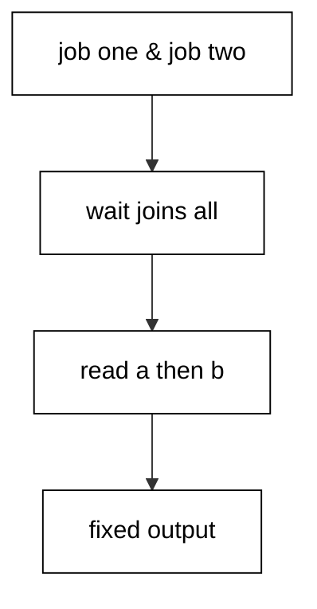
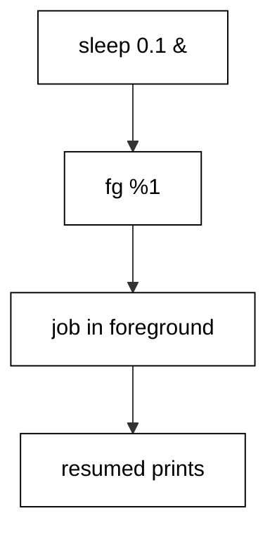
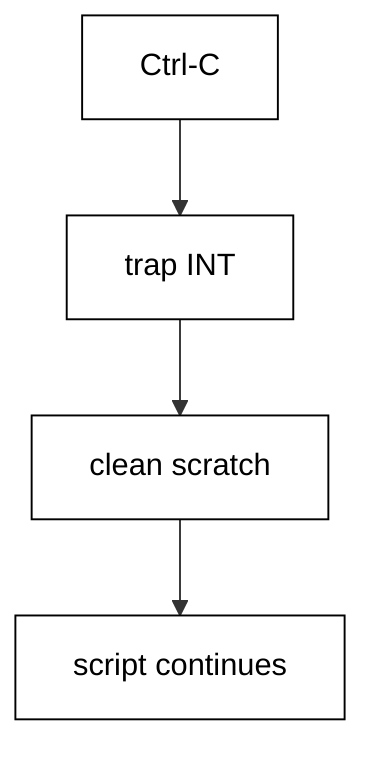
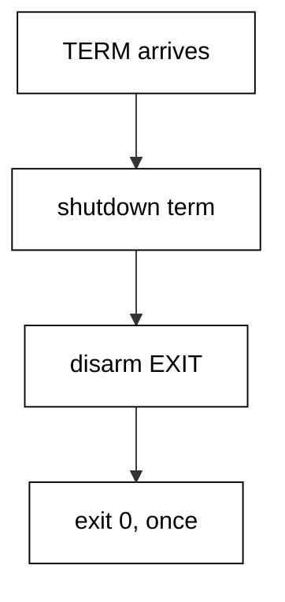
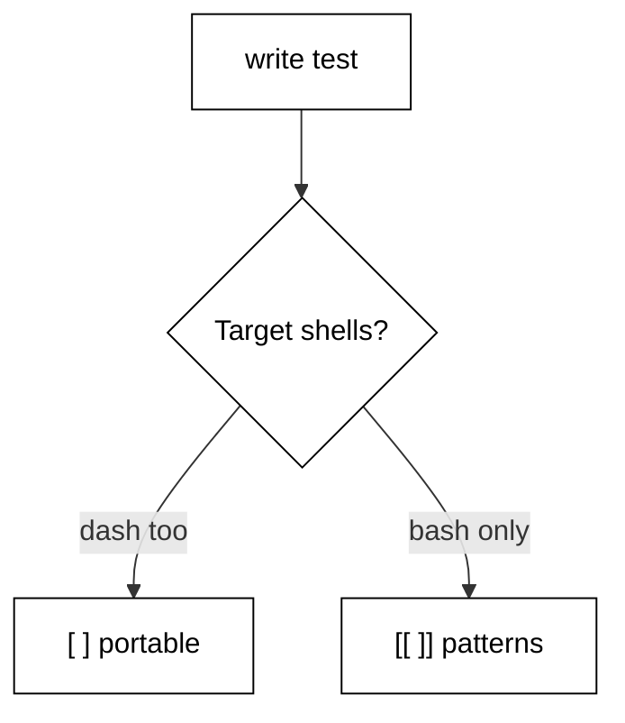
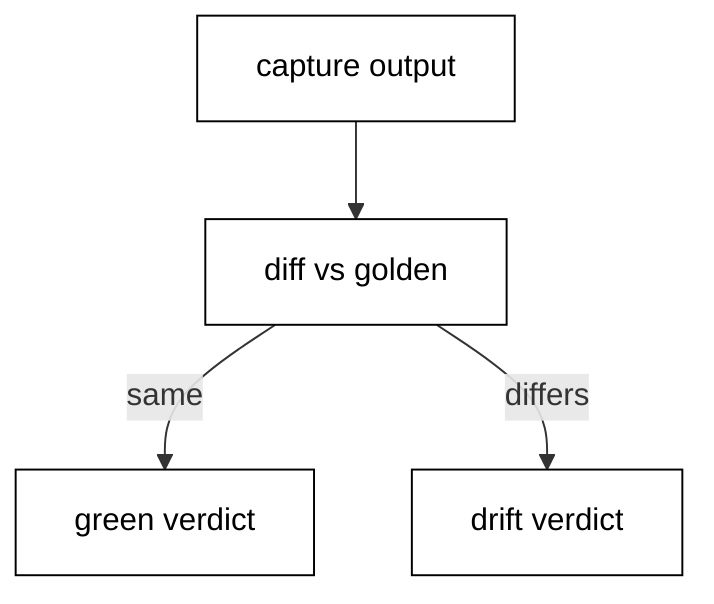
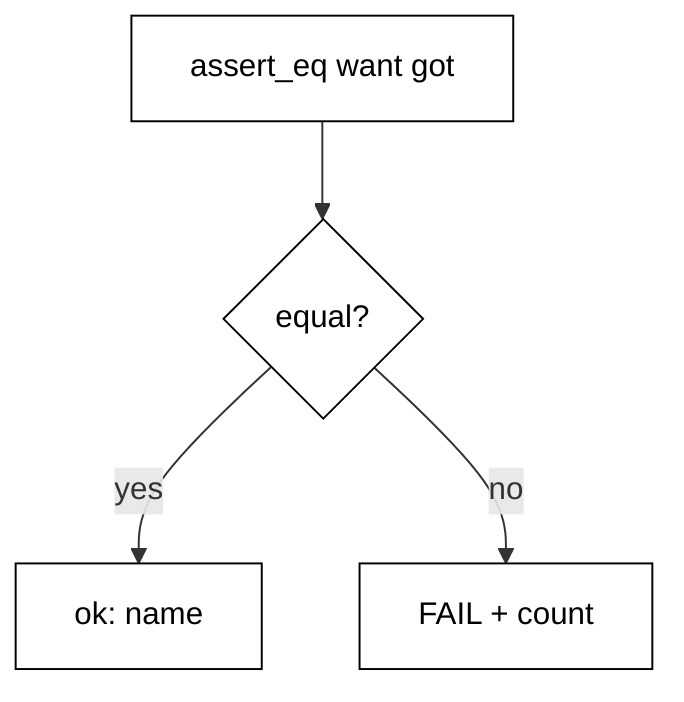
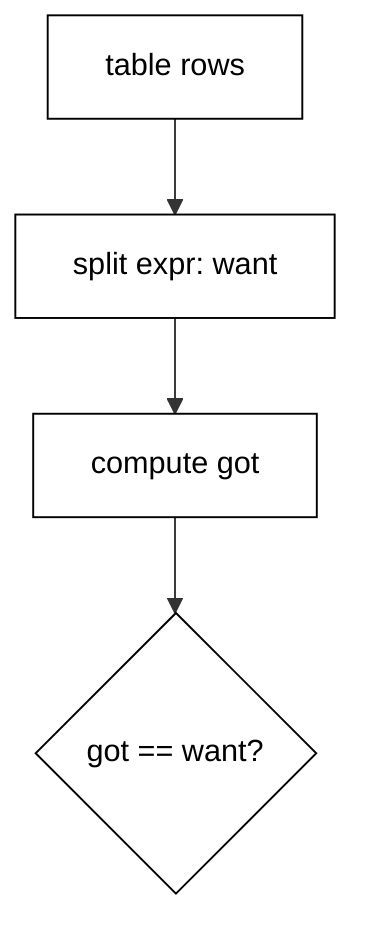
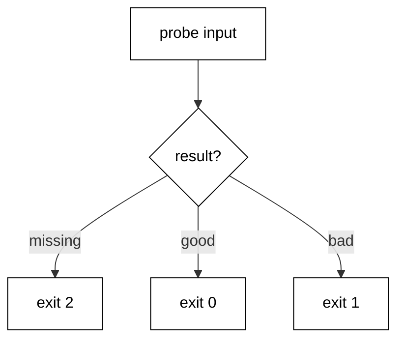
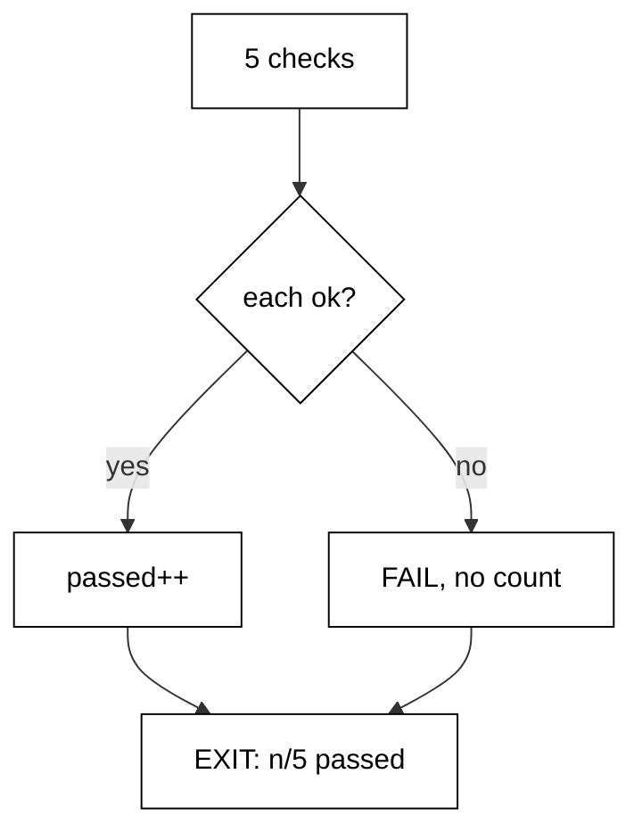

Examples 54-78 harden scripts for production: background jobs joined deterministically, signals handled instead of suffered, portable idioms that behave identically everywhere, mechanical review that catches quoting slips, and fixture-based tests that pin every behaviour. Three clusters carry the level: job control and signals (Examples 54-61), portability and review (Examples 62-70), and testing a script against a fixture (Examples 71-78). Every output is fixed; nothing reads live system state.

### Example 54: Background and wait

Independent steps run concurrently with `&` and rejoin with `wait`. This example runs two writers in the background and reads their files in order. (Concepts: co-06.)



Each background job writes only its own file, so no output interleaves. A bare `wait` blocks until every job finishes, with no PID bookkeeping. Only after the join does the script read the files in name order. The pattern is fan-out, join, then ordered consume.

**`learning/code/ex-54-background-and-wait/example.sh`**:

```bash
# => Example 54: & fans out, wait joins, ordered reads follow.
set -euo pipefail # => strict header first, as in every example
# => WHY files per job: shared stdout interleaves nondeterministically.
out="$(mktemp -d)" # => private dir under /tmp for the job outputs
cleanup() {        # => remove the job outputs on every exit path
	rm -rf "${out}"   # => the job-output dir vanishes with the script
}                  # => closes the job-output cleaner
trap cleanup EXIT  # => removal runs on success, error, or signal exits
(
	sleep 0.1
	printf "alpha\n" >"${out}/a.txt"
) &                                 # => job one: slow writer
(printf "beta\n" >"${out}/b.txt") & # => job two: instant writer
wait                                # => block until EVERY background job has finished
cat "${out}/a.txt" "${out}/b.txt"   # => fixed order: a then b, always
echo "all jobs done"                # => fixed marker after every job finished
```

**Output** (`learning/code/ex-54-background-and-wait/expected/main.stdout.txt`):

```text
alpha
beta
all jobs done
```

**Key takeaway**: Fan out with `&`, rejoin with `wait`, consume outputs in a fixed order.

**Why it matters**: Concurrency without a join is a race: the script reads files that do not exist yet or mixes streams mid-line. `wait` is the join that makes parallel work deterministic to observe. Keep the slow writer slower than any scheduling skew only where order inside one file matters; across files, the ordered read after `wait` is what guarantees output.

### Example 55: wait Collects Each Status

Background failures must be collected, not ignored: `wait` on a finished job returns that job's status. This example reaps one failing job and reports its code. (Concepts: co-06, co-11.)

The demo relaxes strict mode for the collection, starts a job that fails with exit 1, and waits on it by PID. The returned status lands in the report message; no PID ever prints, so the output stays fixed. Real supervisors loop `wait -n` over many jobs; the single-PID form here shows the mechanism.

**`learning/code/ex-55-wait-collects-status/example.sh`**:

```bash
# => Example 55: wait on one PID returns that job's exit status.
set -euo pipefail # => strict header first, as in every example
# => WHY set +e: the collection must observe failure, not die on it.
set +e               # => job failures become collectible, not fatal, below
false &              # => background job that fails with exit 1
failed_pid=$!        # => remember WHICH job to ask about, never printed
wait "${failed_pid}" # => reap one job AND return its status
echo "job exits: $?" # => 1: the background failure, collected
set -e               # => strict again after the collection
echo "collected"     # => fixed marker: the failure was handled
```

**Output** (`learning/code/ex-55-wait-collects-status/expected/main.stdout.txt`):

```text
job exits: 1
collected
```

**Key takeaway**: `wait <pid>` reaps one job and returns its status; collect failures instead of ignoring them.

**Why it matters**: An unchecked background failure is a silent lie: the script exits 0 while its work failed. Collecting every job's status turns the fan-out into an accounted set — all green or explicitly not. Count failures and exit nonzero when the count is positive; a supervisor can only retry what the script reports.

### Example 56: Address Jobs by Spec

Numeric PIDs change every run, but job specs like `%1` stay stable. This example addresses its background job through `%1` and proves the table drains. (Concepts: co-06.)

Monitor mode enables job control in scripts; a quick job finishes before addressing; `wait %1` reaps through the spec with status 0. The jobs table afterwards is provably empty: the `jobs` builtin prints nothing and the marker confirms the drain. Specs, not PIDs, belong in fixed-output scripts.

**`learning/code/ex-56-job-specs-by-name/example.sh`**:

```bash
# => Example 56: %1 addresses the first job without printing any PID.
set -euo pipefail # => strict header first, as in every example
# => WHY specs: numeric PIDs vary every run and would break goldens.
set -m                 # => monitor mode on: job control works in this script
true &                 # => instant job: finished or finishing when addressed below
wait %1                # => reap job one through its spec; status 0 either way
echo "spec resolved"   # => %1 addressed the right job, exit 0 reaped
echo "remaining jobs:" # => fixed label before the provably empty table
jobs                   # => prints nothing: every job was reaped above
echo "table empty"     # => fixed marker: the table held no rows
```

**Output** (`learning/code/ex-56-job-specs-by-name/expected/main.stdout.txt`):

```text
spec resolved
remaining jobs:
table empty
```

**Key takeaway**: Address background jobs with `%n` specs; numeric PIDs never belong in asserted output.

**Why it matters**: Job specs are the stable names of unstable processes: `%1` means the same job on every run while its PID never repeats. Scripts that print PIDs cannot have golden tests; scripts that address by spec can. Reap every job you start — an unreaped table is a leak report waiting to be read at 3am.

### Example 57: Foreground Brings Back

A backgrounded step sometimes needs the terminal back: `fg` resumes it in the foreground. This example backgrounds a short sleeper and brings it forward. (Concepts: co-06.)



Monitor mode enables `fg` in scripts; the sleeper runs while the script continues; `fg %1` waits for it like `wait` but also echoes the command line, which is fixed text here. The closing marker prints only after the foregrounded job finishes, proving the handoff.

**`learning/code/ex-57-foreground-brings-back/example.sh`**:

```bash
# => Example 57: fg %1 resumes the job in the foreground and waits.
set -euo pipefail # => strict header first, as in every example
# => WHY fg over wait: foregrounding also returns terminal control.
set -m         # => monitor mode on: fg exists only with job control
sleep 0.1 &    # => short sleeper: fg has something to bring forward
fg %1          # => bring job one forward; echoes its fixed command line
echo "resumed" # => printed after the foregrounded job finishes
```

**Output** (`learning/code/ex-57-foreground-brings-back/expected/main.stdout.txt`):

```text
sleep 0.1
resumed
```

**Key takeaway**: `fg %1` brings a background job forward and waits for it like `wait` does.

**Why it matters**: Foregrounding is for interactive handoffs and for scripts that must serialize terminal access: only the foreground job reads the tty without a fight. The echoed command line is fixed text, so it stays golden-safe. Prefer `wait` when no terminal is involved; reach for `fg` when control of the terminal is the point.

### Example 58: Trap SIGINT Cleanup

Ctrl-C sends SIGINT, and the default disposition kills without cleaning. This example traps INT to remove scratch and report, then continues. (Concepts: co-07, co-03.)



The handler removes the scratch dir and prints a fixed marker; trapping INT replaces sudden death with an orderly detour. A self-signal stands in for the keyboard deterministically. After the handler returns, the script continues to its closing line — proof that the interrupt was handled, not fatal.

**`learning/code/ex-58-trap-sigint-cleanup/example.sh`**:

```bash
# => Example 58: trap INT to clean up instead of dying mid-write.
set -euo pipefail # => strict header first, as in every example
# => WHY trap INT: the default disposition kills without cleaning.
scratch="$(mktemp -d)"       # => private dir under /tmp, like real tools use
cleanup() {                  # => the interrupt handler: clean up, then report loudly
	rm -rf "${scratch}"         # => remove the scratch dir first
	echo "interrupted: cleaned" # => fixed marker proves the handler ran
}                            # => closes the interrupt handler
trap cleanup INT             # => SIGINT runs cleanup instead of killing silently
touch "${scratch}/work.txt"  # => real work would stage files here
kill -INT $$                 # => self-signal: the deterministic stand-in for Ctrl-C
echo "after interrupt"       # => reached: the handler returned, did not exit
```

**Output** (`learning/code/ex-58-trap-sigint-cleanup/expected/main.stdout.txt`):

```text
interrupted: cleaned
after interrupt
```

**Key takeaway**: Trap SIGINT for cleanup and reporting; the handler runs, then the script continues.

**Why it matters**: Keyboard interrupts arrive mid-write, mid-upload, mid-anything: without a handler they leave whatever the script was touching. The INT handler's job is triage — clean scratch, close cleanly, say so — not heroics. Keep it fast and total: a slow handler invites a second Ctrl-C that kills without mercy.

### Example 59: Trap SIGTERM Drain

Orchestrators stop containers with SIGTERM, and the default kills mid-write. This example drains one item on TERM, then reports it is still alive. (Concepts: co-07.)

The drain handler prints a fixed two-line report standing in for flushing a buffer or finishing a record. A self-signal delivers TERM deterministically; after the handler returns, the script continues. Real drains finish the in-flight unit of work and refuse new ones; the fixed report here marks where that logic lives.

**`learning/code/ex-59-trap-sigterm-drain/example.sh`**:

```bash
# => Example 59: a TERM handler drains the in-flight work, then reports.
set -euo pipefail # => strict header first, as in every example
# => WHY drain on TERM: orchestrators stop with SIGTERM, not SIGKILL.
drain() {                       # => the TERM handler: finish the write, then report
	echo "draining: one item left" # => fixed drain report, no paths
	echo "drained"                 # => fixed marker: the drain completed
}                               # => closes the TERM handler
trap drain TERM                 # => SIGTERM drains instead of dying mid-write
kill -TERM $$                   # => self-signal: the deterministic stand-in for stop
echo "still alive"              # => reached: TERM was handled, not fatal
```

**Output** (`learning/code/ex-59-trap-sigterm-drain/expected/main.stdout.txt`):

```text
draining: one item left
drained
still alive
```

**Key takeaway**: Handle SIGTERM by draining in-flight work; sudden death corrupts the last record.

**Why it matters**: Graceful shutdown is a contract with the orchestrator: TERM means finish up, KILL follows shortly after for the stubborn. Drains must be bounded — finish the record, flush the buffer, stop accepting — because the KILL deadline is real. Log the drain so operators see orderly stops instead of wondering what died.

### Example 60: Ignore SIGHUP

Closing a terminal sends SIGHUP, killing background work by default. This example ignores HUP for one section, then restores the default. (Concepts: co-07.)

Trapping the empty string means ignore; the self-signal then vanishes without a trace and the script continues. `trap - HUP` afterwards restores the default disposition. Ignoring is right for short detachable sections; long-lived daemons should re-read config on HUP instead of ignoring it.

**`learning/code/ex-60-ignore-sighup/example.sh`**:

```bash
# => Example 60: trap with an empty body ignores the signal entirely.
set -euo pipefail # => strict header first, as in every example
# => WHY ignore HUP: detached sections must survive terminal close.
trap "" HUP         # => empty handler means IGNORE for SIGHUP
kill -HUP $$        # => self-signal: ignored, the script never notices
echo "hup ignored"  # => reached: the signal vanished silently
trap - HUP          # => restore the default HUP disposition afterwards
echo "hup restored" # => fixed marker after restoring the default
```

**Output** (`learning/code/ex-60-ignore-sighup/expected/main.stdout.txt`):

```text
hup ignored
hup restored
```

**Key takeaway**: Ignore SIGHUP with an empty trap for detachable sections; restore the default after.

**Why it matters**: HUP semantics depend on context: for a login shell's children it means the terminal went away; for a daemon it traditionally means reload config. Ignoring is the narrow tool for sections that must outlive their terminal. Prefer `nohup` or a process supervisor for whole programs; trap-ignore is for sections.

### Example 61: Shutdown Handler Sequence

TERM and plain exit both need cleanup, but the cleanup must run exactly once. This example routes TERM through a handler that disarms EXIT before exiting. (Concepts: co-07, co-03.)



One shutdown function serves both paths and names which fired. The TERM trap cleans, disarms the EXIT trap so cleanup never doubles, and exits explicitly. The plain-exit path would take the EXIT trap instead; the self-signal demo always takes the TERM path with fixed output.

**`learning/code/ex-61-shutdown-handler-sequence/example.sh`**:

```bash
# => Example 61: one shutdown handler serves TERM and plain exit.
set -euo pipefail # => strict header first, as in every example
# => WHY one handler: every path cleans the same scratch the same way.
scratch="$(mktemp -d)" # => private dir under /tmp for the demo work
shutdown() {           # => the single shutdown path: clean, then name the cause
	rm -rf "${scratch}"   # => clean the scratch dir on every path
	echo "shutdown: $1"   # => the argument names which path fired
}                      # => closes the single shutdown handler
# => TERM path cleans, disarms EXIT so cleanup runs once, then exits.
trap 'shutdown term; trap - EXIT; exit 0' TERM # => self-signal lands here
trap 'shutdown exit' EXIT                      # => plain exit takes this path instead
kill -TERM $$                                  # => self-signal: the deterministic stand-in for stop
echo "unreached"                               # => never prints: the TERM path exits first
```

**Output** (`learning/code/ex-61-shutdown-handler-sequence/expected/main.stdout.txt`):

```text
shutdown: term
```

**Key takeaway**: Route every shutdown path through one handler; disarm the other traps so cleanup runs once.

**Why it matters**: Double cleanup is its own bug: the second run removes files the first run's successor created, or fails loudly on missing paths. One handler plus disarm makes every path converge on exactly one cleanup. Name the path in the message so post-mortems show whether the stop was a TERM, an exit, or an error.

### Example 62: Bashisms to Avoid

Portable scripts run under any POSIX shell; bash-only syntax breaks on dash and minimal containers. This example shows the portable form and the bash-only form side by side. (Concepts: co-14.)



Single brackets with `=` compare portably, while double brackets add pattern matching only bash provides. The demo runs both: the portable test first, then the bash pattern test. Knowing both lets you choose: portable by default, bash-only when the script already requires bash.

**`learning/code/ex-62-bashisms-to-avoid/example.sh`**:

```bash
# => Example 62: single brackets run everywhere, double add patterns.
set -euo pipefail # => strict header first, as in every example
# => WHY both forms: choose portable by default, bash-only on purpose.
name="report.txt"                     # => fixture-like value for the comparisons
if [ "${name}" = "report.txt" ]; then # => POSIX test: works in dash too
	echo "posix match"                   # => portable comparison succeeded
fi                                    # => closes the portable comparison
if [[ "${name}" == *.txt ]]; then     # => bash test: adds pattern matching
	echo "bash match"                    # => pattern comparison succeeded
fi                                    # => closes the bash-only comparison
```

**Output** (`learning/code/ex-62-bashisms-to-avoid/expected/main.stdout.txt`):

```text
posix match
bash match
```

**Key takeaway**: Single brackets compare portably; double brackets add bash-only pattern matching.

**Why it matters**: Portability is a choice, not an accident: scripts that must run on minimal images avoid double brackets, arrays, and other bashisms, while bash-first scripts use them freely. The failure mode is silent — a script that works on your laptop and dies on Alpine. Declare the target shells up front and test on the leanest one.

### Example 63: POSIX Test Brackets

File and value tests with single brackets run on every POSIX shell. This example checks existence, size, strings, and numbers against a fixture. (Concepts: co-14.)

Each test prints a fixed confirmation when it passes; all four pass against the committed fixture. The operators are `-f` for regular files, `-s` for nonempty, `=` for strings, and `-gt` for integers. Quoting every operand keeps empty values from collapsing the test's argument count.

**`learning/code/ex-63-posix-test-brackets/example.sh`**:

```bash
# shellcheck disable=SC2050 # rationale: constant comparisons demonstrate bracket operators, not variables
# => Example 63: single-bracket tests run on every POSIX shell.
set -euo pipefail # => strict header first, as in every example
# => WHY quoted operands: empties must not collapse the argument count.
if [ -f data.txt ]; then # => -f: the fixture is a regular file
	echo "file exists"      # => fixed confirmation for the file test
fi                       # => closes the existence test
if [ -s data.txt ]; then # => -s: the fixture is nonempty
	echo "file nonempty"    # => fixed confirmation for the size test
fi                       # => closes the size test
if [ "a" = "a" ]; then   # => =: string equality, quoted both sides
	echo "strings equal"    # => fixed confirmation for the string test
fi                       # => closes the string test
if [ 2 -gt 1 ]; then     # => -gt: integer comparison, never > inside brackets
	echo "numbers ordered"  # => fixed confirmation for the number test
fi                       # => closes the number test
```

**`learning/code/ex-63-posix-test-brackets/data.txt`**:

```text
x
```

**Output** (`learning/code/ex-63-posix-test-brackets/expected/main.stdout.txt`):

```text
file exists
file nonempty
strings equal
numbers ordered
```

**Key takeaway**: Single-bracket tests with quoted operands run portably for files, strings, and numbers.

**Why it matters**: POSIX tests are the lingua franca of shell conditions: dash, bash, busybox, and ksh all agree on them. The classic traps are unquoted empties (`[ $x = y ]` with empty x) and `>` used for numbers (it redirects). Quote operands, use `-gt` for integers, and the tests behave identically everywhere.

### Example 64: printf Portable Table

Aligned columns with `printf` formats look identical on every system. This example prints a two-column status table with fixed widths. (Concepts: co-14.)

The format `%-8s %s` left-aligns the first field in eight columns and prints the second as-is; every row reuses the same format so columns line up. Data rides in arguments, never in the format string — a value containing `%` would otherwise corrupt the layout or worse.

**`learning/code/ex-64-printf-portable-table/example.sh`**:

```bash
# => Example 64: one format string aligns every row identically.
set -euo pipefail # => strict header first, as in every example
# => WHY printf: echo cannot align columns and varies per system.
printf "%-8s %s\n" "NAME" "STATE"  # => header row: 8-wide left field
printf "%-8s %s\n" "web-1" "ready" # => data row one, same widths
printf "%-8s %s\n" "db-1" "ready"  # => data row two, same widths
```

**Output** (`learning/code/ex-64-printf-portable-table/expected/main.stdout.txt`):

```text
NAME     STATE
web-1    ready
db-1     ready
```

**Key takeaway**: One `printf` format aligns every row; data rides in arguments, never in the format.

**Why it matters**: Format strings are code, arguments are data: mixing them lets a `%` in the data rewrite the layout. Fixed-width formats make logs greppable and reports scannable across machines with different fonts and widths. Left-align names, right-align numbers, and keep the format string a literal the reviewer can audit.

### Example 65: Command -v Check

Scripts depend on external tools that may be missing. This example verifies each dependency with `command -v` and reports a fixed verdict. (Concepts: co-14, co-16.)

The `-v` flag prints the tool's path on success and fails otherwise; redirecting to /dev/null keeps the output fixed because real paths vary per machine. The loop reports present or missing per tool without ever printing a path. A missing dependency exits the real script early; the demo only reports.

**`learning/code/ex-65-command-v-check/example.sh`**:

```bash
# => Example 65: command -v tests PATH; print fixed verdicts, never paths.
set -euo pipefail # => strict header first, as in every example
# => WHY fixed labels: real tool paths vary per machine and break goldens.
for tool in sort awk jq; do               # => every external tool this script needs
	if command -v "${tool}" >/dev/null; then # => -v tests PATH, prints nothing
		echo "${tool}: present"                 # => fixed label: never print the real path
	else                                     # => tool missing from this environment
		echo "${tool}: missing"                 # => fixed label names the gap
	fi                                       # => closes the presence branch
done                                      # => one verdict per required tool
```

**Output** (`learning/code/ex-65-command-v-check/expected/main.stdout.txt`):

```text
sort: present
awk: present
jq: present
```

**Key takeaway**: Check dependencies with `command -v`; report fixed verdicts, never machine paths.

**Why it matters**: Dependency checks turn 'command not found on line 200' into a named precondition failure at line 5. Run them first, fail fast with the full missing list, and never print paths into asserted output. Prefer `command -v` over `which`: the former is a POSIX builtin that cannot itself be missing.

### Example 66: Shebang env Pattern

Hardcoded interpreter paths break across systems; `env` searches PATH instead. This example documents the portable shebang and proves it runs. (Concepts: co-14.)

The `env` lookup finds bash wherever it lives — /bin, /usr/bin, or a version manager shim — while a hardcoded path bets on one layout. The demo prints a fixed marker proving the shebang resolved under the harness, which invokes the script with bash directly.

**`learning/code/ex-66-shebang-env-pattern/example.sh`**:

```bash
#!/usr/bin/env bash
# => Example 66: env searches PATH; fixed paths vary by system, env does not.
# => Portable shebang: env finds bash on every PATH (kept bare: trailing text would become a shebang argument).
set -euo pipefail     # => strict flags work the same under env-launched bash
echo "env found bash" # => fixed marker: the shebang resolved
```

**Output** (`learning/code/ex-66-shebang-env-pattern/expected/main.stdout.txt`):

```text
env found bash
```

**Key takeaway**: Start scripts with `#!/usr/bin/env bash`; hardcoded interpreter paths bet on one layout.

**Why it matters**: The shebang is the script's first portability decision and its most copied line: get it right once in the template and every script inherits it. `env` costs one PATH search per launch and buys freedom from layout assumptions. Never add flags after the interpreter on the shebang line; splitting there varies by system.

### Example 67: ShellCheck Clean Pattern

Linters catch the quoting and syntax slips reviewers miss. This example applies the three most common ShellCheck fixes: quoted expansions, double-bracket-free tests, and `$()` over backticks. (Concepts: co-15.)

Every expansion is quoted, the comparison uses single brackets portably, and command substitution uses the nestable `$()` form. The line count comes through a pipe into `tr` trimming padding, keeping the output fixed. A ShellCheck-clean script is not automatically correct, but a ShellCheck-dirty one is automatically suspect.

**`learning/code/ex-67-shellcheck-clean-pattern/example.sh`**:

```bash
# => Example 67: quoted expansions, portable tests, $() substitution.
set -euo pipefail # => strict header first, as in every example
# => WHY these three: ShellCheck flags them in nearly every new script.
target="report.txt"                          # => quoted on every use below, no exceptions
if [ -n "${target}" ]; then                  # => -n tests nonempty, operands quoted
	echo "target: ${target}"                    # => quoted expansion: no splitting (SC2086)
fi                                           # => closes the guarded use
count=$(printf "a\nb\n" | wc -l | tr -d " ") # => $() nests; tr trims padding
echo "lines: ${count}"                       # => substitution result, quoted on use
```

**Output** (`learning/code/ex-67-shellcheck-clean-pattern/expected/main.stdout.txt`):

```text
target: report.txt
lines: 2
```

**Key takeaway**: Quote expansions, test portably, substitute with `$()`: the ShellCheck-clean trio.

**Why it matters**: Linters encode the community's scar tissue: every default ShellCheck rule exists because someone lost data to that exact pattern. Run the linter before review, not after, so reviewers spend their attention on logic instead of quoting. A clean lint is the entry ticket, not the destination.

### Example 68: Quote Check Review

Reviews need mechanical checks, not just eyeballs. This example greps a sample script for unquoted echo expansions and reports each finding. (Concepts: co-15.)

The pattern `echo \$` matches echo followed directly by a dollar, which is exactly the unquoted form; the quoted line does not match. The sample ships both forms, annotated so density rules still hold for the committed file. The reviewer prints each hit with its line number, then a fixed closing marker.

**`learning/code/ex-68-quote-check-review/example.sh`**:

```bash
# => Example 68: grep finds unquoted echo expansions mechanically.
set -euo pipefail # => strict header first, as in every example
# => WHY mechanical: eyeballs miss bare $ in long scripts, grep never does.
grep -n 'echo \$' sample.sh || true # => list every unquoted echo expansion
echo "review done"                  # => fixed marker after the findings list
```

**`learning/code/ex-68-quote-check-review/sample.sh`**:

```bash
echo $HOME   # => BAD: unquoted expansion splits and globs
echo "$HOME" # => GOOD: quoted expansion stays one word
```

**Output** (`learning/code/ex-68-quote-check-review/expected/main.stdout.txt`):

```text
1:echo $HOME   # => BAD: unquoted expansion splits and globs
review done
```

**Key takeaway**: Review mechanically: grep for unquoted expansions and report each hit with its line.

**Why it matters**: Checklists beat memory for review: a fixed set of greps finds the patterns humans skim past. Commit the bad-good sample pairs so the team shares one definition of wrong. Mechanical checks run in CI, stylistic judgment stays with reviewers; neither replaces the other.

### Example 69: Unsafe Patterns Fixed

Two patterns destroy data: unguarded `rm -rf` and `eval` on dynamic input. This example replaces both with safe equivalents. (Concepts: co-15, co-08.)

The `${dir:?}` expansion aborts when empty, so a typo can never turn the removal into `rm -rf /`. Arithmetic on data uses `$((...))`, which evaluates math without executing commands — never `eval`. The removal targets a path that does not exist, which `rm -rf` accepts silently.

**`learning/code/ex-69-unsafe-patterns-fixed/example.sh`**:

```bash
# => Example 69: guard removals with :? and compute with $(()), never eval.
set -euo pipefail # => strict header first, as in every example
# => WHY these guards: unguarded rm and eval are the two data killers.
dir="build/out"        # => the directory this demo manages
rm -rf "${dir:?}/"     # => :? aborts when empty: never rm -rf / by typo
echo "cleaned: ${dir}" # => fixed confirmation names the cleaned dir
expr="2 + 3"           # => arithmetic as DATA, never evaluated as code
echo "sum: $((expr))"  # => $(()) computes math without executing commands
```

**Output** (`learning/code/ex-69-unsafe-patterns-fixed/expected/main.stdout.txt`):

```text
cleaned: build/out
sum: 5
```

**Key takeaway**: Guard removals with `${var:?}` and compute with `$((...))`; never `eval` dynamic input.

**Why it matters**: Destructive commands deserve syntactic seatbelts: the `:?` guard turns an empty variable from catastrophe into an abort, and arithmetic expansion evaluates numbers without a command interpreter. `eval` on dynamic input is remote code execution with extra steps. When a tool truly needs dynamic code, generate it into a file, review it, then run it.

### Example 70: Locale Safe Sorting

Sorting without a fixed locale orders differently per machine, breaking goldens and joins. This example sorts with `LC_ALL=C` for byte order. (Concepts: co-14.)

The C locale sorts by byte value: uppercase before lowercase, fixed on every system. The fixture mixes cases to make the difference visible; under a language locale the order could interleave. Pipes, joins, and golden comparisons all assume one order — pin it with the environment, not with hope.

**`learning/code/ex-70-locale-safe-sorting/example.sh`**:

```bash
# => Example 70: LC_ALL=C pins byte order identical on every machine.
set -euo pipefail # => strict header first, as in every example
# => WHY pin the locale: language locales interleave cases unpredictably.
LC_ALL=C sort words.txt # => byte-order sort: same bytes everywhere
echo "sorted"           # => fixed marker after the deterministic order
```

**`learning/code/ex-70-locale-safe-sorting/words.txt`**:

```text
banana
Apple
cherry
```

**Output** (`learning/code/ex-70-locale-safe-sorting/expected/main.stdout.txt`):

```text
Apple
banana
cherry
sorted
```

**Key takeaway**: Pin `LC_ALL=C` on every sort, join, and golden comparison for byte-stable order.

**Why it matters**: Locale-dependent ordering is a heisenbug factory: green locally, red in CI, different again in production. The C locale is the only order every system shares, and it sorts case-sensitively by byte — document that for readers expecting dictionary order. Pin the locale at the command, not globally, so messages stay localized while data stays stable.

### Example 71: Golden File Compare

Report generators drift silently unless a committed snapshot pins their output. This example captures a report and diffs it against the golden file. (Concepts: co-16.)



The generator output is captured into scratch, never the repo, and a silent unified diff compares it to the committed golden fixture. Match prints the green verdict; mismatch would print the drift verdict. The trap removes the capture, so green runs leave no droppings behind.

**`learning/code/ex-71-golden-file-compare/example.sh`**:

```bash
# => Example 71: silent diff against goldens; the branch says the verdict.
set -euo pipefail # => strict header first, as in every example
# => WHY silent diff: the verdict belongs in the message, not in noise.
report="$(mktemp)"                                 # => capture file under /tmp, never in the repo
cleanup() {                                        # => remove the capture on every exit path
	rm -f "${report}"                                 # => the capture file vanishes with the script
}                                                  # => closes the capture cleaner
trap cleanup EXIT                                  # => removal runs on success, error, or signal exits
printf "users: 3\nactive: 2\n" >"${report}"        # => the generator output under test
if diff -u golden.txt "${report}" >/dev/null; then # => silent diff: status only
	echo "report matches golden"                      # => byte-identical to the committed snapshot
else                                               # => any byte differs
	echo "report drifted"                             # => the golden file caught a behaviour change
fi                                                 # => closes the golden comparison
```

**`learning/code/ex-71-golden-file-compare/golden.txt`**:

```text
users: 3
active: 2
```

**Output** (`learning/code/ex-71-golden-file-compare/expected/main.stdout.txt`):

```text
report matches golden
```

**Key takeaway**: Capture output to scratch and diff silently against the golden file; print the verdict.

**Why it matters**: Golden tests assert the whole observable behaviour in one committed file, which makes them the highest-value tests per line written. Keep passing runs quiet and print diffs only on mismatch, so suites stay readable at scale. Review golden updates like code changes: a changed snapshot is either a fixed bug or a silently accepted regression.

### Example 72: Assert Helper

A two-line assertion helper turns ad-hoc checks into a countable suite. This example asserts two equalities and reports zero failures. (Concepts: co-16, co-13.)



The helper compares its first two arguments and names the check with the third; failures increment a shared counter for the final verdict. Both demo assertions pass, so the counter stays zero. Real suites grow by adding one-line calls, never by adding branching logic.

**`learning/code/ex-72-assert-helper/example.sh`**:

```bash
# => Example 72: one helper, one counter, one verdict per suite.
set -euo pipefail # => strict header first, as in every example
# => WHY a helper: one-line calls scale, copy-pasted branches do not.
# => The counter below stays zero only when every assertion passes.
failures=0                                                                 # => shared verdict counter for the whole suite
assert_eq() {                                                              # => compare two values, name the check, count misses
	if [ "$1" = "$2" ]; then                                                  # => string equality on the two operands
		echo "ok: $3"                                                            # => $3 names the passing check
	else                                                                      # => values differ
		echo "FAIL: $3 (got [$1])"                                               # => show the actual value for debugging
		failures=$((failures + 1))                                               # => count the failure for the final verdict
	fi                                                                        # => closes the equality branch
}                                                                          # => closes the shared assertion helper
assert_eq "2" "$(printf "a\nb\n" | wc -l | tr -d " ")" "two lines counted" # => real check one
assert_eq "apple" "apple" "literal matches"                                # => real check two
echo "failures: ${failures}"                                               # => 0: every assertion passed
```

**Output** (`learning/code/ex-72-assert-helper/expected/main.stdout.txt`):

```text
ok: two lines counted
ok: literal matches
failures: 0
```

**Key takeaway**: Assert with a helper counting failures; the final counter is the suite verdict.

**Why it matters**: Assertion helpers remove the excuse for untested scripts: two lines of helper plus one line per check. Name every check so failures point at their cause. Count, do not exit early — a suite that stops at the first red hides the second red behind it.

### Example 73: Isolate the Failing Case

Full suites hide which case broke; a selection filter reruns one case alone. This example runs three named cases, filtered by an environment variable. (Concepts: co-16.)

Each case is a function call named for the filter; the loop runs every case when the filter is empty and only the matching one otherwise. The demo runs unfiltered, so all three print in fixed order. Debugging a red suite starts by isolating the red case exactly this way.

**`learning/code/ex-73-isolate-failing-case/example.sh`**:

```bash
# => Example 73: a filter variable selects one case or runs them all.
set -euo pipefail # => strict header first, as in every example
# => WHY a filter: rerunning one red case beats rerunning the suite.
only="${ONLY-}"                                         # => empty means run everything; ONLY=two runs case two
run_case() {                                            # => one function per case, named for the filter
	echo "case: $1"                                        # => $1 names the case that just ran green
}                                                       # => closes the case runner
for case in one two three; do                           # => the full suite: three named cases
	if [ -z "${only}" ] || [ "${only}" = "${case}" ]; then # => all, or the selected one
		run_case "${case}"                                    # => execute the selected case
	fi                                                     # => closes the selection branch
done                                                    # => every selected case ran exactly once
echo "suite done"                                       # => fixed marker after the selected cases
```

**Output** (`learning/code/ex-73-isolate-failing-case/expected/main.stdout.txt`):

```text
case: one
case: two
case: three
suite done
```

**Key takeaway**: Name every case and filter by name; isolate the red case instead of rerunning everything.

**Why it matters**: Isolation is debugging leverage: a case that fails alone but passes in the suite reveals shared-state pollution, while one that fails both ways is honestly broken. Name cases after behaviours, not numbers, so the filter reads like intent. Keep the default as the full suite so nobody accidentally ships a filtered run as green.

### Example 74: Setup Teardown Fixture

Tests need a known world and must not leave one behind. This example builds a fixture stage in setup and destroys it in a trapped teardown. (Concepts: co-16, co-03.)

Setup creates a fresh private stage and writes the fixture rows; the test reads the row count through a trimmed pipe; teardown removes the stage and confirms it. The teardown rides an EXIT trap, so even a failing test cleans up. Setup and teardown are the only functions allowed to touch the stage.

**`learning/code/ex-74-setup-teardown-fixture/example.sh`**:

```bash
# => Example 74: setup builds the world, trapped teardown removes it.
set -euo pipefail # => strict header first, as in every example
# => WHY trapped teardown: failing tests must clean up exactly like passing ones.
setup() {                                              # => build the fixture world before each test
	stage="$(mktemp -d)"                                  # => fresh private stage per run, under /tmp
	printf "row1\nrow2\n" >"${stage}/data.csv"            # => the fixture under test
}                                                      # => closes the setup step
teardown() {                                           # => destroy the fixture world after each test
	rm -rf "${stage}"                                     # => remove the stage the setup built
	echo "torn down"                                      # => fixed marker proves teardown ran
}                                                      # => closes the teardown step
trap teardown EXIT                                     # => teardown runs even when a test fails below
setup                                                  # => build the world first
echo "rows: $(wc -l <"${stage}/data.csv" | tr -d " ")" # => the test reads the fixture
```

**Output** (`learning/code/ex-74-setup-teardown-fixture/expected/main.stdout.txt`):

```text
rows: 2
torn down
```

**Key takeaway**: Setup builds the fixture world, the test reads it, trapped teardown removes it.

**Why it matters**: Untrapped teardowns rot: the first red test leaves a stage that poisons every later run, and the suite starts failing for reasons nobody committed. Trapping teardown makes cleanup unconditional, which makes failures reproducible — the same world, every run. Keep stages private and fresh per run so parallel suites never share a path.

### Example 75: Table Driven Tests

Parametrized cases in a table beat copy-pasted test blocks. This example runs three arithmetic expressions with expected values through one loop. (Concepts: co-16, co-09.)



Each table entry packs expression and expectation around a colon; parameter expansion splits them without forks. The loop computes the expression with arithmetic expansion — data as math, never as code — and compares against the expectation. Adding a case appends one array element, nothing else.

**`learning/code/ex-75-table-driven-tests/example.sh`**:

```bash
# => Example 75: EXPR:EXPECTED rows run through one shared loop.
set -euo pipefail # => strict header first, as in every example
# => WHY a table: adding a case appends an element, never a branch.
# => The colon split below forks nothing: pure parameter expansion.
cases=("1+1:2" "2*3:6" "10-4:6")   # => each case is EXPR:EXPECTED in one word
failures=0                         # => shared verdict counter for the whole table
for entry in "${cases[@]}"; do     # => quoted: one turn per table row
	expr="${entry%%:*}"               # => strip the longest :suffix: the expression half
	want="${entry#*:}"                # => strip the shortest prefix: the expected half
	got="$((expr))"                   # => arithmetic on the expression half, data never code
	if [ "${got}" = "${want}" ]; then # => compare computed against expected
		echo "ok: ${expr}"               # => the table row passed
	else                              # => computed differs
		echo "FAIL: ${expr}"             # => the table row failed
		failures=$((failures + 1))       # => count it toward the verdict
	fi                                # => closes the row verdict
done                               # => every table row ran exactly once
echo "failures: ${failures}"       # => 0: the whole table passed
```

**Output** (`learning/code/ex-75-table-driven-tests/expected/main.stdout.txt`):

```text
ok: 1+1
ok: 2*3
ok: 10-4
failures: 0
```

**Key takeaway**: Pack cases as data rows and run them through one loop; adding a case appends data.

**Why it matters**: Table-driven tests scale where copy-paste dies: fifty cases read as fifty lines of data, not fifty blocks of logic. Keep the runner dumb and the data explicit; clever runners hide which case failed. One verdict counter for the table, printed at the end, tells the whole story.

### Example 76: Stub an External Command

Network calls cannot run in tests, but the code that makes them still needs coverage. This example stubs the HTTP client with a same-named function. (Concepts: co-16.)

A shell function shadows the external command for the script's lifetime: same name, fixed output, zero network. The code under test calls the name exactly as production would; the capture proves what it produced. Function stubs beat PATH-dir stubs for single commands — no fixture executables, no permission juggling.

**`learning/code/ex-76-stub-external-command/example.sh`**:

```bash
# => Example 76: a same-named function shadows the real network tool.
set -euo pipefail # => strict header first, as in every example
# => WHY a function stub: no fixture executables, no network, same call shape.
curl() {                                  # => shadows the real curl for this script only
	echo "stubbed curl: $*"                  # => fixed prefix plus the received arguments
}                                         # => closes the stub: no network ever leaves the harness
fetch() {                                 # => the code under test: calls curl exactly once
	curl -s "https://example.invalid/status" # => the URL is never fetched
}                                         # => closes the code under test
out="$(fetch)"                            # => capture what the code under test produced
echo "${out}"                             # => the stubbed response, byte for byte
echo "no network used"                    # => fixed marker: the stub held
```

**Output** (`learning/code/ex-76-stub-external-command/expected/main.stdout.txt`):

```text
stubbed curl: -s https://example.invalid/status
no network used
```

**Key takeaway**: Shadow network tools with same-named functions; the call shape stays production-true.

**Why it matters**: Stubs prove the code asks correctly, not that the network answers: arguments, flags, and parsing are all assertable without a socket. Keep stubs standing in for exactly one tool each, and fail loudly on unexpected arguments so drift in the call shape surfaces. Reserve a few live contract tests outside the unit suite for the shape of real responses.

### Example 77: Test Exit Codes

Exit codes are the tool's contract, so tests assert them directly. This example probes a validator with three inputs and checks the 2-0-1 contract. (Concepts: co-16, co-11.)



The unit under test returns 2 for missing input with usage on stderr, 0 for the good value, and 1 for anything else. The suite relaxes strict mode for the probes, captures each status on the next line, and closes with a fixed marker. Usage goes to stderr, which the harness is told to ignore for this unit only.

**`learning/code/ex-77-test-exit-codes/example.sh`**:

```bash
# => Example 77: probe the 2-0-1 contract: misuse, success, failure.
set -euo pipefail # => strict header first, as in every example
# => WHY relaxed -e: contract probes must fail without aborting the suite.
check() {                       # => the unit under test: validates one operand, exits by contract
	if [ -z "${1-}" ]; then        # => no operand provided
		echo "usage: check THING" >&2 # => usage belongs on stderr, always
		return 2                      # => misuse: the caller forgot the operand
	fi                             # => closes the misuse guard
	if [ "$1" = "ok" ]; then       # => the one good value
		return 0                      # => success path
	fi                             # => closes the success branch
	return 1                       # => anything else is a runtime failure
}                               # => closes the unit under test
set +e                          # => the probes below must fail without aborting the suite
check
echo "missing exits: $?" # => 2: misuse, per the contract
check ok
echo "good exits: $?" # => 0: success
check bad
echo "bad exits: $?"  # => 1: runtime failure
set -e                # => strict again after the probes
echo "contract holds" # => fixed marker: 2, 0, 1 in order
```

**Output** (`learning/code/ex-77-test-exit-codes/expected/main.stdout.txt`):

```text
missing exits: 2
good exits: 0
bad exits: 1
contract holds
```

**Key takeaway**: Assert the exit contract directly: probe misuse, success, and failure, and check each code.

**Why it matters**: Exit-code tests are the cheapest contract tests a CLI owns: three probes pin the 2-0-1 mapping forever. Usage belongs on stderr, which is why this unit declares the ignore rule — stdout stays golden-clean. Any change to the mapping breaks these tests first, exactly when the caller scripts would have broken instead.

### Example 78: Full Suite Green

The course patterns compose: strict flags, a trap, assertions, and a golden verdict in one script. This example runs five green checks and reports the suite tally from EXIT. (Concepts: co-16, co-01, co-13.)



Five one-line checks exercise flags, pipes, literals, counts, and equality; each green check increments the shared counter. The EXIT trap prints the tally last, so the verdict appears even when a middle check fails — the counter simply stops short of five. Composition without interference is the graduation test.

**`learning/code/ex-78-full-suite-green/example.sh`**:

```bash
# => Example 78: strict flags, trap verdict, asserts, all green.
set -euo pipefail # => strict header first, as in every example
# => WHY one script: the course patterns must compose without interference.
# => The EXIT trap prints the tally even when a middle check fails.
passed=0                                                         # => green-check counter for the final verdict
check() {                                                        # => assert equality and count the green checks
	if [ "$1" = "$2" ]; then                                        # => values agree
		echo "ok: $3"                                                  # => $3 names the passing check
		passed=$((passed + 1))                                         # => count it toward the verdict
	else                                                            # => values differ
		echo "FAIL: $3"                                                # => a red check the suite would report
	fi                                                              # => closes the equality branch
}                                                                # => closes the shared assertion helper
verdict() {                                                      # => the EXIT handler: print the tally last
	echo "suite: ${passed}/5"                                       # => the verdict: five green or short of it
}                                                                # => closes the verdict printer
trap verdict EXIT                                                # => the verdict prints on every exit path
check "strict" "strict" "flags on"                               # => check one: literal equality
check "2" "$(printf "a\nb\n" | wc -l | tr -d " ")" "pipe counts" # => check two: trimmed pipe count
check "a:b" "a:b" "colons kept"                                  # => check three: separators survive
check "3" "3" "counts agree"                                     # => check four: numeric strings match
check "done" "done" "suite ends"                                 # => check five: the closing literal
```

**Output** (`learning/code/ex-78-full-suite-green/expected/main.stdout.txt`):

```text
ok: flags on
ok: pipe counts
ok: colons kept
ok: counts agree
ok: suite ends
suite: 5/5
```

**Key takeaway**: Strict flags, assertions, and an EXIT verdict compose into one green suite.

**Why it matters**: Composition is the graduation test: patterns that work alone must work together without interference. The verdict trap is the keystone — it reports the tally on every path, so even a red suite tells the truth about how far it got. Build suites from these pieces and the patterns hold from five checks to five hundred.
