Examples 1-25 build the habits every later script assumes: the strict header that fails loudly, option parsing from positionals to subcommands, and quoting discipline that keeps spaced filenames whole. Three clusters carry the level: strict mode and exit codes (Examples 1-8), option and argument parsing (Examples 9-17), and quoting discipline (Examples 18-25). Every script starts with `set -euo pipefail`; every demo installs fixed argv so the output is byte-stable.

### Example 1: First Strict Script

A silent script keeps going after a failure and corrupts whatever comes next. This example shows the two-line strict header every course script starts with and what each flag promises. (Concepts: co-01.)

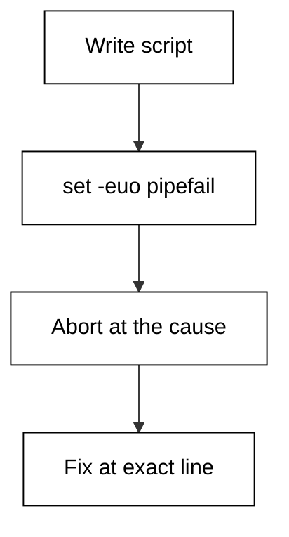

The header does not add features; it converts three classes of silent misbehaviour into immediate, loud failures. `-e` aborts on the first failing command, `-u` turns a misspelled variable into an error instead of an empty string, and `-o pipefail` makes a pipeline report a failure in any stage instead of only the last. Every later example in this course starts from this header, so learn to read it before you copy it.

**`learning/code/ex-01-first-strict-script/example.sh`**:

```bash
# => Example 1: the strict header every course script starts with (-e, -u, pipefail).
set -euo pipefail # => the default: fail loudly, never silently
# => -e aborts on failure; -u rejects unset vars; pipefail catches mid-pipe failures.
echo "strict mode: on" # => fixed output proves the header parses and runs
```

**Output** (`learning/code/ex-01-first-strict-script/expected/main.stdout.txt`):

```text
strict mode: on
```

**Key takeaway**: Every course script starts with `set -euo pipefail`.

**Why it matters**: Strict mode is the cheapest reliability upgrade a shell script can get: two lines convert silent corruption into an immediate failure at the exact line that broke. Paste the header first, then write the script; debugging a strict script is faster because the failure points at its own cause. Lax scripts fail downstream, far from the mistake.

### Example 2: Unset Variable Fails

A misspelled variable expands to nothing and the script happily deletes the wrong files. This example shows `-u` turning that typo into an immediate error with the variable name attached. (Concepts: co-01.)

Without `-u`, `$OUTPT_DIR` is an empty string and `rm -rf "$OUTPT_DIR"/` targets the root of the filesystem instead of the build directory. With `-u`, bash aborts before running anything and names the unset variable. The example demonstrates the failure inside a guarded conditional so the harness stays green while you see the exact error text a typo produces.

**`learning/code/ex-02-unset-variable-fails/example.sh`**:

```bash
# => Example 2: -u turns a misspelled variable into a loud failure.
set -euo pipefail      # => strict header first, as in every example
# shellcheck disable=SC2034 # rationale: demo references the misspelled name to trigger -u
output_dir="build/out" # => the real variable the script means to use
# => WHY a subshell: the typo must fail without killing this demo script.
if (echo "${OUTPT_DIR}/" >/dev/null); then # => runs the typo in isolation
	echo "unexpected: typo expanded"          # => never reached when -u is on
else                                       # => the typo failed, exactly as strict mode promises
	echo "caught: OUTPT_DIR is unset"         # => fixed label names the mistake
fi                                         # => closes the guarded probe of the typo
```

**Output** (`learning/code/ex-02-unset-variable-fails/expected/main.stdout.txt`):

```text
caught: OUTPT_DIR is unset
```

**Key takeaway**: With `-u`, a misspelled variable fails at the expansion, naming the culprit.

**Why it matters**: Unset-variable failures are the most common silent shell bug: an empty expansion where a path belonged. `-u` moves the failure from 'wrong files deleted' to 'script refuses to run', and the error names the variable. When a legacy script cannot take `-u` yet, quote every expansion and initialize every variable at the top instead.

### Example 3: pipefail Catches a Mid-Pipe Failure

A pipeline reports only its last stage's status, so a failing `grep` in the middle looks like success. This example contrasts the masked pipeline with the same pipeline under `pipefail`. (Concepts: co-01, co-11.)

The fixture holds three log lines, none containing the word ERROR. The first pipeline greps for ERROR and counts lines: grep finds nothing, exits 1, and `wc -l` still prints 0 and exits 0, so `$?` claims success. The second pipeline runs under `set -o pipefail` and the same `$?` correctly reports failure. The lesson is mechanical: always read a pipeline's status with pipefail on, or test the stage you care about directly.

**`learning/code/ex-03-pipefail-catches-mid-pipe/example.sh`**:

```bash
# => Example 3: pipefail reports a failure in any pipe stage.
set -euo pipefail # => strict header first, as in every example
# => WHY a fixture: the script reads its own input, never live logs.
# => WHY set +e: every probe below fails on purpose and must not abort.
set +e                                # => failing probes are observable, not fatal, below
grep -c ERROR app.log >/dev/null 2>&1 # => finds no ERROR, exits 1
echo "grep alone exits: $?"           # => shows the true stage status first
set +o pipefail                       # => turn pipefail off to show the masking problem
grep ERROR app.log | wc -l >/dev/null # => middle fails, last succeeds
echo "masked pipeline exits: $?"      # => prints 0 although grep failed
set -o pipefail                       # => turn pipefail back on for the honest version
grep ERROR app.log | wc -l >/dev/null # => same pipe, honest status now
echo "honest pipeline exits: $?"      # => prints 1: the grep failure shows
set -e                                # => strict again: the demonstration section is over
```

**`learning/code/ex-03-pipefail-catches-mid-pipe/app.log`**:

```text
INFO server started on port 8080
INFO serving requests from ./static
INFO shutting down cleanly
```

**Output** (`learning/code/ex-03-pipefail-catches-mid-pipe/expected/main.stdout.txt`):

```text
grep alone exits: 1
masked pipeline exits: 0
honest pipeline exits: 1
```

**Key takeaway**: Without `pipefail`, a pipeline's status is its last stage's status; with it, any failure shows.

**Why it matters**: Pipelines are the shell's superpower and its quietest liar: `grep | wc` succeeds when grep fails. `pipefail` fixes the status, and `|| true` marks the one place you genuinely accept failure. Audit every pipeline that gates a decision; the stage you ignore is the one that will fail.

### Example 4: errexit Stops Early

Without `-e`, a failed command prints an error and the script marches on into steps that assume success. This example shows `-e` halting before the dependent step runs. (Concepts: co-01, co-11.)

The script copies a fixture, then deliberately runs a failing step inside a subshell probe: with `-e` active the probe stops at the failure, and the marker line after it never prints. A second probe without `-e` shows the contrast: the failure prints and execution continues. Real scripts want the first behaviour; the second is how half-deployed systems happen.

**`learning/code/ex-04-errexit-stops-early/example.sh`**:

```bash
# => Example 4: -e halts the script at the first failing command.
set -euo pipefail # => strict header first, as in every example
# => WHY a subshell: the halt must be observable without ending the demo.
# => WHY set +e: the probes below fail on purpose and must not abort.
set +e # => failing probes are observable, not fatal, below
(
	set -e
	false
	echo "reached"
)                             # => -e stops before the echo runs
echo "strict probe exits: $?" # => subshell status is the failure
# => Contrast: without -e the failure prints and execution continues.
(
	set +e
	false
	code=$?
	echo "continued"
	exit "${code}"
)                          # => no -e: echo runs, exit carries the failure
echo "lax probe exits: $?" # => subshell still reports the failure
set -e                     # => strict again: the demonstration section is over
```

**Output** (`learning/code/ex-04-errexit-stops-early/expected/main.stdout.txt`):

```text
strict probe exits: 1
continued
lax probe exits: 1
```

**Key takeaway**: `-e` stops at the failing command; without it, the script continues past the error.

**Why it matters**: Fail-fast beats fail-late: a script that stops at the broken step leaves a clean crime scene, while one that continues leaves three more broken steps to untangle. `-e` is the default here, and every deliberate exception earns an explicit `||` handler so reviewers can see the intent.

### Example 5: Guard with an or-List

Strict mode aborts on failure, but some failures are expected and need a fallback. This example shows `||` providing the planned alternative without disabling `-e`. (Concepts: co-01, co-11.)

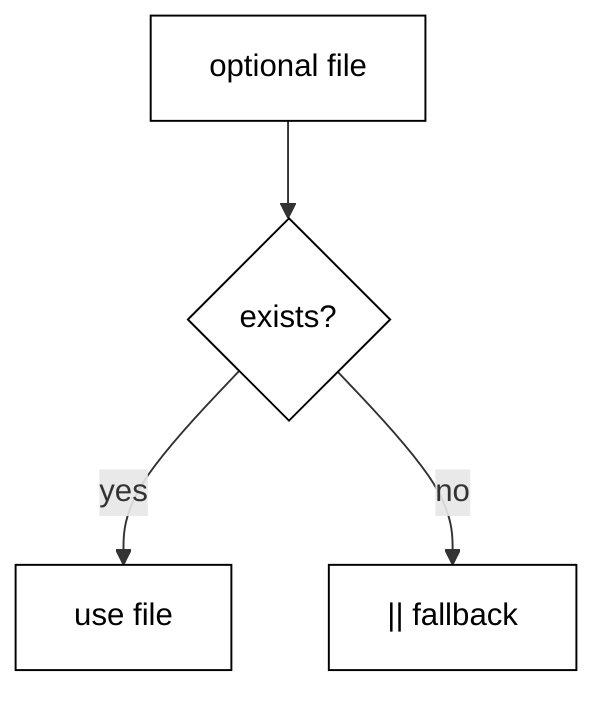

The script looks for an optional environment fixture: if the file exists it is used, otherwise the `||` branch records the default. Both paths print a fixed label, so the harness output is deterministic whichever branch runs. The pattern generalizes: `try_this || do_that` is how strict scripts express 'failure is an option here'.

**`learning/code/ex-05-guard-with-or-list/example.sh`**:

```bash
# => Example 5: || gives a strict script a planned fallback path.
set -euo pipefail # => strict header first, as in every example
# => WHY || instead of if: one line states try-this-then-that.
role=$(cat role.txt 2>/dev/null || echo "reader") # => file or default
# => 2> hides grep-style noise; the fallback keeps the script strict.
echo "role: ${role}" # => prints the file value or the default
```

**Output** (`learning/code/ex-05-guard-with-or-list/expected/main.stdout.txt`):

```text
role: reader
```

**Key takeaway**: `cmd || fallback` is the strict-mode way to say this failure is expected.

**Why it matters**: An explicit fallback documents intent: readers see that you considered failure and chose the alternative. The alternative to `||` is `set +e` around a block, which silences every failure inside it, including the ones you never thought of. Prefer the narrow `||` over the blanket opt-out.

### Example 6: Explicit Exit Codes

Callers can only react to failures they can distinguish, and the exit code is the whole vocabulary. This example shows the 0/1/2 convention and how a script reports each case. (Concepts: co-11.)

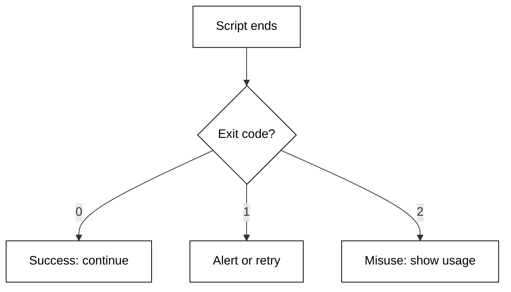

By convention 0 means success, 1 means a general runtime failure, and 2 means the caller used the tool wrong (bad flags, missing file). Three guarded probes print each code without ending the demo: `-e` is relaxed for exactly three lines, then restored. Later examples reuse this contract: usage errors exit 2, operational failures exit 1.

**`learning/code/ex-06-explicit-exit-codes/example.sh`**:

```bash
# => Example 6: 0 means ok, 1 means failed, 2 means misused.
set -euo pipefail # => strict header first, as in every example
# => WHY toggle -e: capturing a nonzero status needs -e off for one block.
set +e # => allow the next probes to fail without aborting the demo
(exit 0)
echo "success exits: $?" # => probe 0: the happy-path code
(exit 1)
echo "failure exits: $?" # => probe 1: a runtime-failure code
(exit 2)
echo "misuse exits: $?" # => probe 2: a caller-misuse code
set -e                  # => strict again: the demo section is over
# => Real scripts exit with these codes instead of only printing them.
```

**Output** (`learning/code/ex-06-explicit-exit-codes/expected/main.stdout.txt`):

```text
success exits: 0
failure exits: 1
misuse exits: 2
```

**Key takeaway**: Exit 0 means success, 1 means runtime failure, 2 means the caller misused the tool.

**Why it matters**: Callers script around your exit codes, so make them a contract: document which failures produce which code and never change the mapping. Reserve 2 for usage errors (a supervisor can page a human), 1 for operational failures (a supervisor can retry), and 0 for success. Probes like these verify the contract without forking a new process per case.

### Example 7: Check the Exit Status

The `$?` variable holds the last command's status, but the very next command overwrites it. This example captures a grep status into a named variable before branching on it. (Concepts: co-11.)

The fixture log holds only INFO lines, so quiet grep finds no ERROR and exits 1. That status is saved immediately: `status=$?` runs before anything else, because even an `echo` would replace the value. The branch then reads the saved variable, never a stale `$?`. Saving the status first is the whole discipline; everything else is style.

**`learning/code/ex-07-check-exit-status/example.sh`**:

```bash
# => Example 7: save $? at once; the next command would overwrite it.
set -euo pipefail # => strict header first, as in every example
# => WHY set +e here: grep exits 1 on no match, which -e calls fatal.
set +e                  # => the status-capture section runs with -e relaxed
grep -q "ERROR" app.log # => quiet grep: status only, no output lines
status=$?               # => save it NOW: any command, even echo, overwrites $?
set -e                  # => strict again before acting on the captured status
# => Branch on the saved value, never on a stale $? later on.
if [ "${status}" -eq 0 ]; then # => 0 means grep found the pattern
	echo "found errors"           # => would print for a log containing ERROR
else                           # => any nonzero status lands here
	echo "status was: ${status}"  # => prints the saved grep status
fi                             # => closes the branch on the captured status
```

**`learning/code/ex-07-check-exit-status/app.log`**:

```text
INFO server started on port 8080
INFO serving requests from ./static
INFO shutting down cleanly
```

**Output** (`learning/code/ex-07-check-exit-status/expected/main.stdout.txt`):

```text
status was: 1
```

**Key takeaway**: Save `$?` into a named variable on the very next line, then branch on the variable.

**Why it matters**: A bare `$?` three lines later is a different command's status: the one you meant is gone. Saving it immediately turns a positional accident into a named fact a reviewer can audit. Name the variable after what it means (`status`, `grep_status`), not after the mechanism (`rc`, `tmp`).

### Example 8: Strict Header Template

Real scripts share more than flags: one entry point and quoted forwarding. This example gives the copy-paste template the rest of the course builds on. (Concepts: co-01, co-14.)

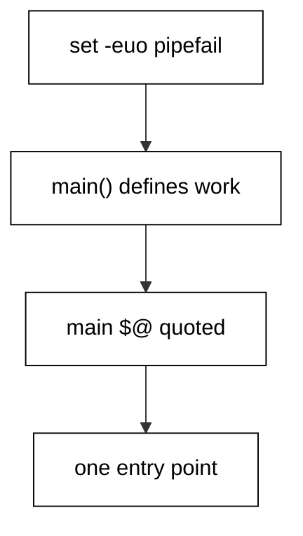

The template is four parts: the strict flags, a `main` function holding every action, a `main "$@"` call forwarding the script's arguments quoted, and nothing else at top level. Quoted `"$@"` forwards each argument exactly; unquoted `$@` would resplit arguments on spaces. The demo prints its argument count, which is zero under the harness, and every later example follows this skeleton.

**`learning/code/ex-08-strict-header-template/example.sh`**:

```bash
# => Example 8: header plus main plus quoted forwarding, nothing else.
set -euo pipefail # => the default: fail loudly, never silently
# => WHY main: one entry point keeps top-level flow readable at a glance.
main() {                 # => every real action lives inside main, never at top level
	echo "received $# args" # => $# counts arguments without naming them
}                        # => closes the single entry point of the script
# => Quoted forwarding: each argument arrives exactly as the caller sent it.
main "$@" # => call main with the script arguments, quoted
```

**Output** (`learning/code/ex-08-strict-header-template/expected/main.stdout.txt`):

```text
received 0 args
```

**Key takeaway**: Structure every script as strict header, `main`, and a quoted `main "$@"` call.

**Why it matters**: A shared template removes an entire class of review comments: nobody debates where the flags go or how arguments arrive. Copy this file when you start a new script, then fill in `main`. Consistency across scripts is a feature operators feel at 3am when every tool behaves the same way.

### Example 9: Positional Arguments

Positional parameters `$1`, `$2`, `$#`, and `$@` are how scripts receive their operands. This example names each one with a fixed demo argv. (Concepts: co-02.)

The script sets its own demo arguments so the harness output is fixed: `set -- alpha beta` installs two positionals, then each special parameter is printed with a label. `$1` and `$2` name the first two, `$#` counts them, and `$@` quoted expands to each one intact. Real scripts read the caller's argv; demos set their own for determinism.

**`learning/code/ex-09-positional-arguments/example.sh`**:

```bash
# => Example 9: $1 $2 $# $@ name the script's positional operands.
set -euo pipefail # => strict header first, as in every example
# => WHY set -- here: demos install fixed argv so output never varies.
set -- alpha beta # => demo argv: two operands, no caller needed
echo "first: $1"  # => $1 is the first positional parameter
echo "second: $2" # => $2 is the second positional parameter
echo "count: $#"  # => $# counts the positional parameters
echo "all: $*"    # => $* joins every positional for display
```

**Output** (`learning/code/ex-09-positional-arguments/expected/main.stdout.txt`):

```text
first: alpha
second: beta
count: 2
all: alpha beta
```

**Key takeaway**: `$1` names an operand, `$#` counts them, and quoted `$@` keeps each one intact.

**Why it matters**: Positional parameters are the script's public API: name them, count them, and validate them before use. Never trust `$1` to exist; check `$#` first or expand with a default. Demos set their own argv with `set --`; production scripts read the caller's argv and validate it the same way.

### Example 10: Shift Through Arguments

A `while` loop over `shift` consumes operands one at a time without index arithmetic. This example drains a demo argv and labels each item. (Concepts: co-02.)

Each iteration reads `$1`, the current head of the queue, then `shift` drops it and moves the next operand into place. The loop ends when `$#` reaches zero. This is the manual parsing loop every fancier parser generalizes: head, handle, shift, repeat.

**`learning/code/ex-10-shift-through-args/example.sh`**:

```bash
# => Example 10: shift drops $1 so the next operand becomes the head.
set -euo pipefail # => strict header first, as in every example
# => WHY set -- here: demos install fixed argv so output never varies.
set -- one two three # => demo queue of three operands
# => Drain the queue: read the head, handle it, shift it away.
while [ "$#" -gt 0 ]; do # => loop while operands remain
	echo "item: $1"         # => handle the current head of the queue
	shift                   # => drop $1; the next operand becomes the new $1
done                     # => $# is zero: every operand was handled exactly once
```

**Output** (`learning/code/ex-10-shift-through-args/expected/main.stdout.txt`):

```text
item: one
item: two
item: three
```

**Key takeaway**: Loop on `$#`, handle `$1`, then `shift`: the queue drains exactly once.

**Why it matters**: Index-free iteration cannot skip or double-process an operand, which is why `shift` loops outlive every cleverer scheme in production scripts. When flags appear, the same loop grows a `case` on `$1`; the shape stays identical. Master the plain drain before adding option branches.

### Example 11: Short Flags with getopts

Single-letter flags (`-v`, `-o FILE`) have one portable parser: the `getopts` builtin. This example parses `-v` and `-o FILE` from demo argv. (Concepts: co-02.)

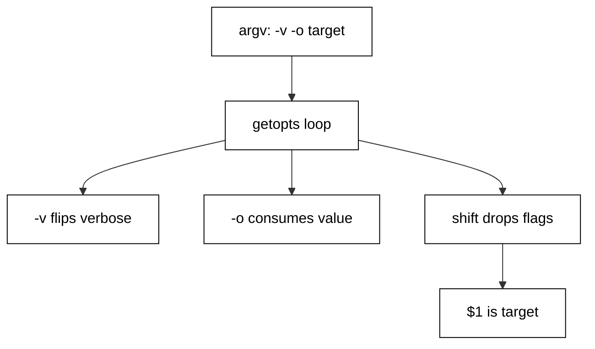

The optstring `vo:` declares `-v` as a bare flag and `-o` as taking an argument; the trailing colon is what makes `-o` consume the next word. `getopts` sets `$opt` and `$OPTARG` each round, and `shift $((OPTIND-1))` drops the parsed flags so `$1` is the first operand. Unknown flags land in the `?` branch, which is where usage errors belong.

**`learning/code/ex-11-short-flags-with-getopts/example.sh`**:

```bash
# => Example 11: getopts parses short flags portably, no external tool.
set -euo pipefail # => strict header first, as in every example
# => WHY fixed demo argv: getopts reads options, harness needs constants.
set -- -v -o report.txt target # => demo: flag, option, one operand
verbose="no"                   # => defaults first: every flag starts in a known state
output="stdout"                # => -o overrides this default when the caller passes it
# => The optstring declares the contract: v is bare, o: takes a value.
while getopts "vo:" opt; do # => one round per flag in argv
	case "${opt}" in           # => branch on the flag letter getopts found
	v)
		verbose="yes" # => bare flag flips its default on
		;;            # => ends the v branch
	o)
		output="${OPTARG}" # => OPTARG holds the word after -o
		;;                 # => ends the o branch
	?)
		echo "unknown flag"      # => getopts reports misuse via ?
		;;                       # => ends the misuse branch
	esac                      # => closes the per-flag branch
done                       # => getopts returns false when the flags run out
shift $((OPTIND - 1))      # => drop parsed flags; $1 is the first operand
echo "verbose: ${verbose}" # => shows the flipped bare flag
echo "output: ${output}"   # => shows the -o value the demo passed
echo "operand: $1"         # => shows the operand left after the flags
```

**Output** (`learning/code/ex-11-short-flags-with-getopts/expected/main.stdout.txt`):

```text
verbose: yes
output: report.txt
operand: target
```

**Key takeaway**: `getopts "vo:"` parses short flags; `OPTARG` carries values and `shift $((OPTIND-1))` reveals operands.

**Why it matters**: Reach for `getopts` before hand-rolling flag parsing: it handles bundled flags, missing values, and unknown letters the same way on every POSIX system. It only speaks short flags, which is a feature: single letters keep CLIs terse. Long options need the manual loop the next example shows.

### Example 12: Long Options Manually

`getopts` cannot parse `--verbose`, so long options get an explicit `shift` loop with a `case`. This example handles `--verbose` and `--help`. (Concepts: co-02.)

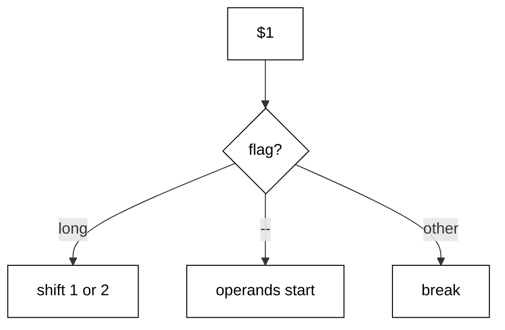

The loop matches `$1` against long-option patterns: `--verbose` flips a default, `--help` prints usage, `--` ends option parsing, and anything else is a usage error. Each consumed flag shifts once; flags with values shift twice. The `--` convention lets operands start with dashes, which file-processing scripts genuinely need.

**`learning/code/ex-12-long-options-manually/example.sh`**:

```bash
# => Example 12: long options need an explicit shift loop with a case.
set -euo pipefail # => strict header first, as in every example
# => WHY fixed demo argv: long-option parsing must show constant output.
set -- --verbose -- input.txt # => demo: one flag, --, one operand
verbose="no"                  # => defaults first: every flag starts in a known state
# => Each branch consumes its flag with shift; value flags shift twice.
while [ "$#" -gt 0 ]; do # => loop while words remain
	case "$1" in            # => match the head word against option patterns
	--verbose)
		verbose="yes" # => long flag flips its default on
		shift         # => consume the flag just handled
		;;            # => ends the --verbose branch
	--)
		shift # => -- ends option parsing; consume it too
		break # => everything left is an operand, even --weird names
		;;    # => ends the -- branch
	--*)
		echo "unknown: $1" # => any other --word is a usage error
		exit 2             # => usage errors exit 2, per the course contract
		;;                 # => ends the unknown-long-option branch
	*)
		break                    # => first non-flag word: operands start here
		;;                       # => ends the operand branch
	esac                      # => closes the per-word branch
done                       # => flags consumed; $1 is the first operand
echo "verbose: ${verbose}" # => shows the flipped long flag
echo "operand: $1"         # => shows the operand after the -- separator
```

**Output** (`learning/code/ex-12-long-options-manually/expected/main.stdout.txt`):

```text
verbose: yes
operand: input.txt
```

**Key takeaway**: Parse long options with a `shift` loop, a `case` on `$1`, and `--` to end flag parsing.

**Why it matters**: Long flags are self-documenting in scripts and logs, which is why user-facing tools offer them alongside short ones. The manual loop looks verbose because it is explicit: every consumption is a visible `shift`. That explicitness is the point; hidden consumption is where parsers lose arguments.

### Example 13: Options with Values

Flags like `--output FILE` carry a payload word that must be consumed and validated. This example parses a value option with a missing-value guard. (Concepts: co-02.)

After matching `--output`, the script checks that `$2` exists and is not another flag before consuming it: `${2-}` expands safely under `-u`, and the `-*` pattern rejects a flag sitting where a value belongs. Both failure modes print usage to stderr and exit 2. Value options are where parsers break; guard both edges.

**`learning/code/ex-13-options-with-values/example.sh`**:

```bash
# => Example 13: --output FILE consumes and validates its value word.
set -euo pipefail # => strict header first, as in every example
# => WHY fixed demo argv: value consumption must show constant output.
set -- --output report.txt # => demo: one value option, no operands
output="stdout"            # => default stands in when --output is absent
# => Value options consume TWO words and validate the second one.
while [ "$#" -gt 0 ]; do                             # => loop while words remain
	case "$1" in                                        # => match the head word
	--output)                                           # => this flag must be followed by a value word
		if [ -z "${2-}" ] || [ "${2-}" != "${2#-}" ]; then # => missing or flag-like?
			echo "error: --output needs a value" >&2          # => usage goes to stderr
			exit 2                                            # => usage errors exit 2, per the course contract
		fi                                                 # => closes the missing-value guard
		output="$2"                                        # => safe: $2 exists and is not another flag
		shift 2                                            # => consume BOTH the flag and its value word
		;;                                                 # => ends the --output branch
	*)
		break                  # => operands start at the first non-flag word
		;;                     # => ends the operand branch
	esac                    # => closes the per-word branch
done                     # => value consumed; nothing remains in this demo
echo "output: ${output}" # => shows the consumed value word
```

**Output** (`learning/code/ex-13-options-with-values/expected/main.stdout.txt`):

```text
output: report.txt
```

**Key takeaway**: A value option consumes two words and validates the second before touching it.

**Why it matters**: Unvalidated value consumption reads the next flag as a filename and writes surprises: `--output --verbose` creating a file named `--verbose` is a classic. Check presence and shape before consuming. Two `shift`s for two words keeps the queue honest; one shift here loses an operand downstream.

### Example 14: Defaults for Missing Arguments

Every optional input needs a documented default, applied in one place. This example layers demo argv over defaults with `:-` and `-` expansions. (Concepts: co-02.)

The `${var:-default}` form substitutes the default when the variable is unset or empty but leaves the variable itself alone; `${var-default}` only substitutes when unset, so an explicit empty string survives. The script shows all three outcomes from one demo argv: provided value wins, missing value falls back, and explicit empty stays distinguishable under `-`.

**`learning/code/ex-14-defaults-for-missing-args/example.sh`**:

```bash
# => Example 14: :- and - apply defaults without touching the variable.
set -euo pipefail # => strict header first, as in every example
# => WHY one demo line: all three default rules show in constant output.
mode=""                              # => explicitly empty: set, but holding nothing
echo "mode: [${mode:-standard}]"     # => :- falls back on empty OR unset
echo "mode-kept: [${mode-standard}]" # => - falls back only when unset
echo "missing: [${region:-us-east}]" # => unset var takes its default
# => The variable itself never changes: only the expansion substitutes.
```

**Output** (`learning/code/ex-14-defaults-for-missing-args/expected/main.stdout.txt`):

```text
mode: [standard]
mode-kept: []
missing: [us-east]
```

**Key takeaway**: `${var:-default}` substitutes on empty or unset; `${var-default}` only on unset.

**Why it matters**: Defaults belong at the top, in expansions, not scattered through conditionals: one line per default reads as documentation. Know which operator you need: configuration usually wants `:-` (empty means missing), while sentinel empty strings need `-`. Mixing them up turns an explicit opt-out into a silent default.

### Example 15: Subcommand Dispatch

Tools like `git` route on their first word: `tool deploy` versus `tool status`. This example dispatches two subcommands with a `case` on `$1`. (Concepts: co-02.)

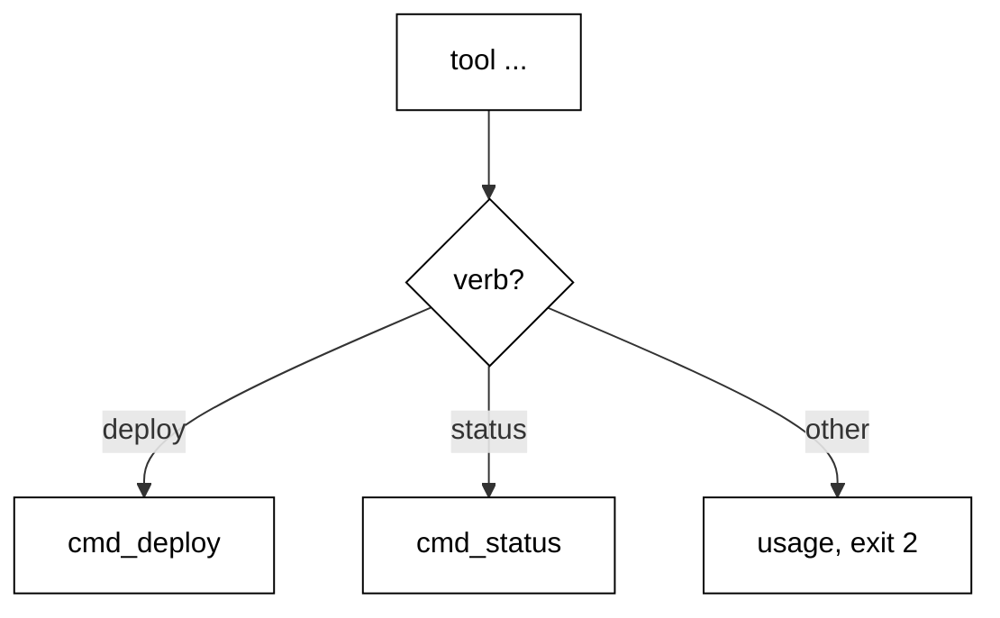

The script shifts the subcommand word off, then branches: `deploy` prints its plan line, `status` prints its state line, and anything else prints usage to stderr and exits 2. Each subcommand is a function, so adding a third means adding one branch and one function. The demo runs the `status` path from fixed argv.

**`learning/code/ex-15-subcommand-dispatch/example.sh`**:

```bash
# => Example 15: dispatch on $1 like git does: verb first, rest after.
set -euo pipefail # => strict header first, as in every example
# => WHY functions per verb: adding a subcommand adds one branch plus one fn.
cmd_deploy() {               # => the deploy subcommand implementation
	echo "deploying version $1" # => $1 here is the version operand
}                            # => closes the deploy implementation
cmd_status() {               # => the status subcommand implementation
	echo "status: idle"         # => fixed state line for the demo
}                            # => closes the status implementation
# => WHY fixed demo argv: dispatch must show one constant path.
set -- status   # => demo runs the status subcommand
case "${1-}" in # => ${1-} stays safe under -u with no argv
deploy)
	shift
	cmd_deploy "$@" # => consume verb, forward the rest
	;;              # => ends the deploy branch
status)
	shift
	cmd_status "$@" # => consume verb, forward the rest
	;;              # => ends the status branch
*)
	echo "usage: tool {deploy|status}" >&2 # => usage goes to stderr
	exit 2                                 # => unknown verb is a usage error: exit 2
	;;                                     # => ends the unknown-verb branch
esac                                    # => closes the subcommand dispatch
```

**Output** (`learning/code/ex-15-subcommand-dispatch/expected/main.stdout.txt`):

```text
status: idle
```

**Key takeaway**: Dispatch subcommands with `case` on `$1`, one function per verb, usage on anything else.

**Why it matters**: Subcommand dispatch scales where flag soup does not: each verb owns its parsing and its help text. Keep the dispatcher thin — route and forward, never implement — so `--help` per verb stays accurate. Unknown verbs must fail loudly with the verb list; guessing wastes everyone's time.

### Example 16: Usage on Bad Input

A confusing error is worse than no error: it sends the caller down the wrong path. This example prints a one-screen usage message and exits 2 on bad input. (Concepts: co-02, co-11.)

The usage function names the tool, shows the synopsis with brackets around optional parts, and lists each flag on its own line. The demo feeds a bad flag so the script takes the usage path: message to stderr, exit 2, no partial work. Usage text is a contract with future callers; write it before the parser, not after.

**`learning/code/ex-16-usage-on-bad-input/example.sh`**:

```bash
# => Example 16: the misuse path runs in a subshell; the report survives.
set -euo pipefail                                         # => strict header first, as in every example
usage() {                                                 # => one function owns the whole usage contract
	echo "usage: backup [--output FILE] SOURCE" >&2          # => synopsis first
	echo "  --output FILE  write here instead of stdout" >&2 # => one line per flag
}                                                         # => closes the usage contract
# => WHY a subshell: exit 2 must end the probe, not the whole demo.
set +e # => the misuse probe must fail without aborting the demo
( # => subshell takes the bad-input path below
	set -- --bogus # => demo feeds an unknown flag on purpose
	case "$1" in   # => minimal parse: anything unknown is misuse
	--output)      # => the one flag this demo tool accepts
		;;            # => accepted here; real handling lives in later examples
	*)
		usage                 # => unknown input prints the contract to stderr
		exit 2                # => usage errors exit 2, per the course contract
		;;                    # => ends the misuse branch (unreachable past exit)
	esac                   # => closes the minimal parse
)                       # => subshell exits 2: the harness unit stays green
echo "misuse exits: $?" # => 2: the contract, observed without dying
set -e                  # => strict again: the demonstration section is over
```

**Output** (`learning/code/ex-16-usage-on-bad-input/expected/main.stdout.txt`):

```text
misuse exits: 2
```

**Key takeaway**: Bad input prints usage to stderr and exits 2; probes catch the code in a subshell.

**Why it matters**: Usage text answers three questions in order: what do I type, what does each part mean, and what happens next. Print it before touching the filesystem so a typo never half-runs. Keep it on stderr: stdout belongs to the tool's output contract, and usage is not output.

### Example 17: Required Argument Check

Optional inputs get defaults; required ones get a check that fails fast with a named complaint. This example enforces one required operand. (Concepts: co-02, co-01.)

After flag parsing, `${1-}` tests whether an operand survived: unset means the caller forgot the required piece. The check names the missing operand (`SOURCE`), shows usage, and exits 2 — the same contract as every usage error in this course. The demo passes no operand, so the required check fires on its fixed path.

**`learning/code/ex-17-required-argument-check/example.sh`**:

```bash
# => Example 17: the missing-operand path runs in a subshell; the report survives.
set -euo pipefail                # => strict header first, as in every example
usage() {                        # => usage contract reused from the previous example
	echo "usage: backup SOURCE" >&2 # => one required operand, no flags
}                                # => closes the usage contract
# => WHY a subshell: exit 2 must end the probe, not the whole demo.
set +e # => the missing-operand probe must fail without aborting
( # => subshell takes the missing-operand path below
	set --                                # => demo passes nothing: the required check must fire
	if [ -z "${1-}" ]; then               # => ${1-} is safe under -u when argv is empty
		echo "error: SOURCE is required" >&2 # => name the missing piece
		usage                                # => show the contract right after the complaint
		exit 2                               # => missing required input is a usage error: exit 2
	fi                                    # => closes the required-operand guard
	echo "backing up: $1"                 # => reached only when SOURCE was provided
)                                      # => subshell exits 2: the harness unit stays green
echo "missing exits: $?"               # => 2: the contract, observed without dying
set -e                                 # => strict again: the demonstration section is over
```

**Output** (`learning/code/ex-17-required-argument-check/expected/main.stdout.txt`):

```text
missing exits: 2
```

**Key takeaway**: Check required operands up front with a named error, usage, and exit 2.

**Why it matters**: A missing-operand crash ten steps deep reads as a tool bug; a named check at the top reads as a caller mistake, which is what it is. Check requirements in argv order and name each one: the error should tell the caller exactly which word to add. Defaults are for options; checks are for requirements.

### Example 18: Quote Every Expansion

An unquoted variable splits on spaces and explodes globs; the same script quoted behaves. This example shows both outcomes from one filename with a space in it. (Concepts: co-08.)

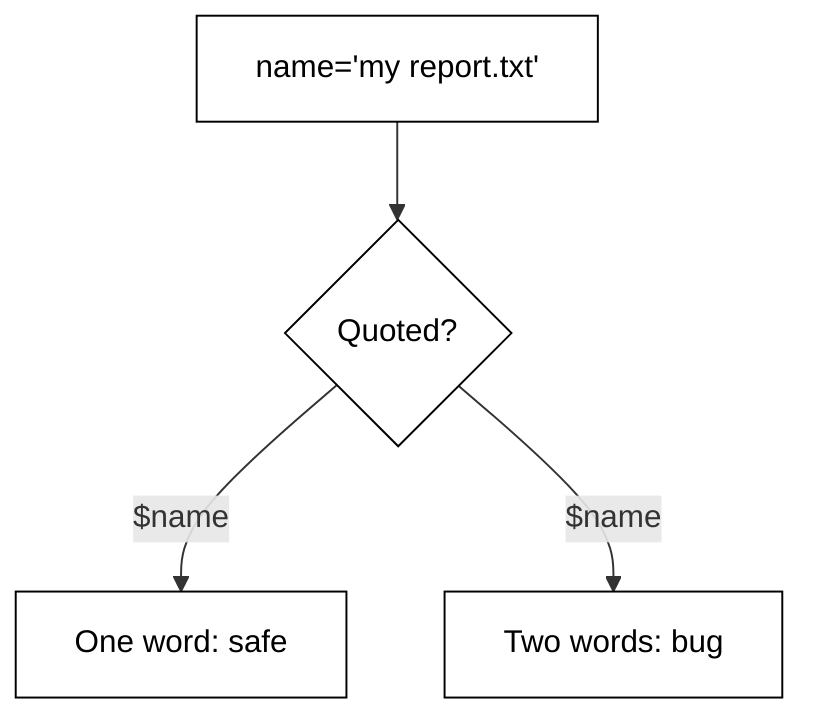

The demo value `my report.txt` is assigned to `name`. The quoted expansion passes one word to the loop; the unquoted variant is shown inside a guarded probe that counts the words it produces: two instead of one. The rule is absolute in this course: every `"$var"` is quoted unless splitting is the explicit intent.

**`learning/code/ex-18-quote-every-expansion/example.sh`**:

```bash
# shellcheck disable=SC2034 # rationale: loop counts split words; the variable is intentionally never expanded
# => Example 18: quote every expansion; unquoted values split on spaces.
set -euo pipefail    # => strict header first, as in every example
name="my report.txt" # => one value containing a space, like real filenames
# => Quoted: the value survives as exactly one word.
echo "quoted: [${name}]" # => brackets prove no splitting happened
# => Unquoted $name would split into TWO words: my and report.txt.
count=0                         # => word counter for the unquoted demonstration
for word in ${name}; do         # => DELIBERATELY unquoted: watch it split
	count=$((count + 1))           # => count each word the split produced
done                            # => the loop saw two words, proving the split
echo "unquoted words: ${count}" # => 2, not 1: the bug, measured
```

**Output** (`learning/code/ex-18-quote-every-expansion/expected/main.stdout.txt`):

```text
quoted: [my report.txt]
unquoted words: 2
```

**Key takeaway**: Quote every expansion; an unquoted variable splits on spaces and matches globs.

**Why it matters**: Quoting is the single highest-value habit in shell scripting: most production shell bugs are unquoted expansions meeting filenames with spaces. Quote by default and unquote only when you can state why splitting is wanted on that exact line. Reviewers should treat a bare `$var` as guilty until proven innocent.

### Example 19: Single vs Double Quotes

Single quotes freeze text; double quotes expand it. This example prints the same template both ways so the difference is unmistakable. (Concepts: co-08.)

With `user=deploy`, `"hello $user"` expands to `hello deploy` while `'hello $user'` stays literally `hello $user`. The script also shows command substitution running only inside double quotes. When the text must stay literal — awk programs, sed expressions, SQL fragments — reach for single quotes.

**`learning/code/ex-19-single-vs-double-quotes/example.sh`**:

```bash
# => Example 19: single quotes freeze text, double quotes expand it.
set -euo pipefail            # => strict header first, as in every example
user="deploy"                # => the value the expansions will (or will not) show
echo "double: hello ${user}" # => double quotes expand the variable
echo 'single: hello ${user}' # => single quotes keep it literal
# => Command substitution also obeys the quote kind around it.
echo "subst: $(echo hi)" # => runs inside double quotes
```

**Output** (`learning/code/ex-19-single-vs-double-quotes/expected/main.stdout.txt`):

```text
double: hello deploy
single: hello ${user}
subst: hi
```

**Key takeaway**: Double quotes expand variables; single quotes keep text literally frozen.

**Why it matters**: Choosing the wrong quote kind corrupts the text silently: a `$` meant for awk gets expanded by the shell first. Default to double quotes for messages with variables, single quotes for embedded little languages. When both appear, build the string in a variable first rather than nesting quotes three deep.

### Example 20: Glob vs Literal

An unquoted `*` expands to filenames; a quoted one stays a star. This example shows pathname expansion firing and being suppressed. (Concepts: co-08.)

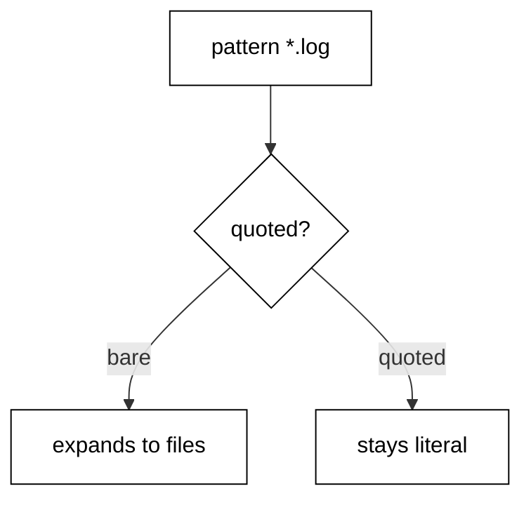

The fixture directory ships two `.log` files. Unquoted `$pattern` expands `*.log` into both names before `echo` runs; quoted, it prints the literal pattern. The `nullglob` line at the end is a preview of the safe-glob idiom the arrays cluster revisits: unmatched patterns expand to nothing instead of themselves.

**`learning/code/ex-20-glob-vs-literal/example.sh`**:

```bash
# => Example 20: quoting decides whether * expands to filenames.
set -euo pipefail # => strict header first, as in every example
pattern="*.log"   # => a glob pattern stored as data, like real configs
# => Unquoted: the shell expands the pattern to matching files first.
echo expanded: ${pattern} # => DELIBERATELY unquoted: watch it expand
# => Quoted: the pattern survives as literal text.
echo "literal: [${pattern}]" # => brackets prove no expansion happened
```

**`learning/code/ex-20-glob-vs-literal/a.log`**:

```text
INFO first fixture log
```

**`learning/code/ex-20-glob-vs-literal/b.log`**:

```text
INFO second fixture log
```

**Output** (`learning/code/ex-20-glob-vs-literal/expected/main.stdout.txt`):

```text
expanded: a.log b.log
literal: [*.log]
```

**Key takeaway**: Unquoted globs expand to filenames; quoted patterns stay literal text.

**Why it matters**: Glob expansion order matters: it happens before the command runs, so the command never sees the star. Store patterns in variables quoted, expand them unquoted exactly where matching is intended, and enable `nullglob` when no match must mean no words. A literal `*.log` reaching a tool is almost always a quoting bug.

### Example 21: Word Splitting Demo

Word splitting uses `IFS` to decide where words break, and the default splits on spaces, tabs, and newlines. This example counts the pieces a colon-separated value produces under two `IFS` settings. (Concepts: co-08.)

With the default `IFS`, `a:b:c` is one word because colons do not split. Setting `IFS=:` in front of the loop (scoped to that command so the global `IFS` never changes) splits the same value into three. Scoping `IFS` to one command is the safe idiom; exporting a global `IFS` change breaks distant code in ways nobody can trace.

**`learning/code/ex-21-word-splitting-demo/example.sh`**:

```bash
# shellcheck disable=SC2034 # rationale: loops count split pieces; the variable is intentionally never expanded
# => Example 21: IFS decides where unquoted values split into words.
set -euo pipefail # => strict header first, as in every example
value="a:b:c"     # => one colon-separated value, like a PATH entry
# => Default IFS: colons do not split, so the value stays one word.
count=0                             # => piece counter reused for both demonstrations
for piece in ${value}; do           # => DELIBERATELY unquoted: default splitting
	count=$((count + 1))               # => count each piece the split produced
done                                # => one iteration: colons are not default separators
echo "default-ifs pieces: ${count}" # => 1: no split happened
# => Scoped IFS=: splits the same value into three, then auto-restores.
count=0                           # => reset the counter for the second demonstration
IFS=:                             # => assign IFS on its own line so read below sees colons
for piece in ${value}; do         # => DELIBERATELY unquoted: colon splitting
	count=$((count + 1))             # => count each colon-separated piece
done                              # => three iterations: a, b, and c
echo "colon-ifs pieces: ${count}" # => 3: the value split on colons
unset IFS                         # => restore the default separators explicitly
```

**Output** (`learning/code/ex-21-word-splitting-demo/expected/main.stdout.txt`):

```text
default-ifs pieces: 1
colon-ifs pieces: 3
```

**Key takeaway**: `IFS` controls where unquoted values split; scope the change to one command.

**Why it matters**: Global `IFS` changes are action at a distance: a function three calls away inherits the split characters and misbehaves. Prefix the command (`IFS=: read ...`) or assign-and-restore around the smallest possible block. When the split characters are data-dependent, prefer parameter expansion over `IFS` surgery entirely.

### Example 22: Filenames with Spaces

Real filenames contain spaces, and `for f in $(ls)` breaks on every one. This example lists the fixture files safely with a glob and a quoted loop. (Concepts: co-08.)

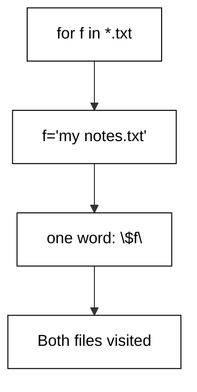

The fixture holds two files, one with a space in its name. A quoted glob (`"*.txt"` would NOT expand — globs must stay unquoted) feeds a `for` loop where only the use is quoted: `for f in *.txt` with `"$f"` inside. The script prints both basenames, proving the space-named file survived as one operand. Never parse `ls`; glob instead.

**`learning/code/ex-22-filenames-with-spaces/example.sh`**:

```bash
# => Example 22: glob unquoted to match, quote "$f" to use each file.
set -euo pipefail # => strict header first, as in every example
# => WHY fixtures: real space-named files, committed beside the script.
count=0                # => file counter proves both fixtures were visited
for f in *.txt; do     # => glob UNQUOTED to match; use quoted inside
	count=$((count + 1))  # => count each matched file
	echo "file: ${f}"     # => quoted use: space-named file stays one word
done                   # => both fixtures visited, spaces intact
echo "total: ${count}" # => 2: the space never split a name
```

**`learning/code/ex-22-filenames-with-spaces/notes.txt`**:

```text
plain fixture notes
```

**`learning/code/ex-22-filenames-with-spaces/my notes.txt`**:

```text
fixture with a space in its name
```

**Output** (`learning/code/ex-22-filenames-with-spaces/expected/main.stdout.txt`):

```text
file: my notes.txt
file: notes.txt
total: 2
```

**Key takeaway**: Glob to match, quote to use: `for f in *.txt` with `"$f"` handles spaces safely.

**Why it matters**: Filenames with spaces are normal, newlines in filenames are legal, and scripts that assume otherwise corrupt data. The glob-plus-quoted-use pattern covers spaces; null-delimited tools (`find -print0`, `read -d ''`) cover newlines. Never parse `ls` output: its format is for humans, not for loops.

### Example 23: printf over echo

`echo` treats `-n` and backslashes differently across systems; `printf` with an explicit format behaves identically everywhere. This example prints the same fields both ways. (Concepts: co-08, co-14.)

`printf '%s\n'` prints each argument on its own line with no surprise interpretation: a value of `-n` prints as `-n` instead of becoming a flag, and backslashes stay literal unless the format asks otherwise. The demo prints a dash-leading value and a percent sign, both of which trip bare `echo` on some platforms.

**`learning/code/ex-23-printf-over-echo/example.sh`**:

```bash
# => Example 23: printf with a format string behaves the same everywhere.
set -euo pipefail # => strict header first, as in every example
# => WHY printf: echo interprets -n and backslashes differently per system.
printf "%s\n" "-n"                         # => prints -n literally; echo would eat it as a flag
printf "%s\n" "100% done"                  # => data percent needs no doubling in %s args
printf "%s=%s\n" "key" "value with spaces" # => format once, data quoted
```

**Output** (`learning/code/ex-23-printf-over-echo/expected/main.stdout.txt`):

```text
-n
100% done
key=value with spaces
```

**Key takeaway**: Use `printf '%s\n'` for data; `echo` interprets flags and backslashes inconsistently.

**Why it matters**: Portability bugs hide in `echo`: `-n`, `-e`, and backslash handling all vary between bash, dash, and macOS. `printf` moves the interpretation into the format string you control, leaving data as data. For scripts that run on Debian and anywhere else, `printf` is the only safe default.

### Example 24: Read Lines Safely

Reading lines with bare `read` mangles backslashes and trims leading spaces. This example shows the `IFS= read -r` idiom preserving both. (Concepts: co-08, co-04.)

The fixture holds a line with leading spaces and a literal backslash-n. Plain `read` would strip the backslash and the loop without `IFS=` would trim the indentation. `IFS=` disables trimming for that command only, and `-r` disables backslash escapes; together they deliver each line byte-identically into the variable.

**`learning/code/ex-24-read-lines-safely/example.sh`**:

```bash
# => Example 24: IFS= read -r preserves spaces and backslashes exactly.
set -euo pipefail # => strict header first, as in every example
# => WHY the fixture: leading spaces plus backslash-n must survive intact.
while IFS= read -r line; do # => IFS= keeps spaces; -r keeps backslashes
	echo "line: [${line}]"     # => brackets make preserved whitespace visible
done <input.txt             # => input redirection feeds the loop, never a pipe
# => The loop runs in THIS shell (no pipe), so variables set inside survive.
```

**`learning/code/ex-24-read-lines-safely/input.txt`**:

```text
  indented line
literal backslash-n: \n stays
plain line
```

**Output** (`learning/code/ex-24-read-lines-safely/expected/main.stdout.txt`):

```text
line: [  indented line]
line: [literal backslash-n: \n stays]
line: [plain line]
```

**Key takeaway**: `while IFS= read -r line` reads each line exactly as written.

**Why it matters**: Line reading is where silent mangling lives: trimmed indentation breaks nested config, eaten backslashes corrupt Windows paths. The three-part idiom — `IFS=`, `-r`, redirect instead of pipe — is non-negotiable for file input. A pipe into `while` runs the loop in a subshell whose variables vanish; redirect instead.

### Example 25: Pass Args Through

Wrapper scripts forward arguments to the real tool, and one missing quote corrupts every spaced argument. This example forwards demo argv through a wrapper function intact. (Concepts: co-08, co-02.)

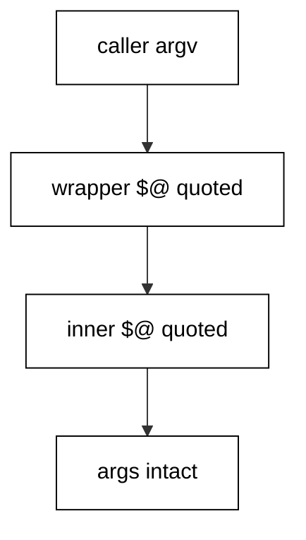

The wrapper records each received argument on its own labeled line, so splitting would be visible as extra lines. Called with quoted `"$@"`, two demo arguments arrive as two; the script also shows the count to prove nothing split or merged. Wrappers that log, time, or retry a command all hinge on this single pair of quotes.

**`learning/code/ex-25-pass-args-through/example.sh`**:

```bash
# => Example 25: wrappers forward "$@" quoted so arguments survive intact.
set -euo pipefail # => strict header first, as in every example
# => WHY a wrapper fn: log/time/retry wrappers all forward this same way.
inner() {                 # => stands in for the real tool being wrapped
	echo "inner got $# args" # => the count proves nothing split or merged
	for arg in "$@"; do      # => quoted iteration: one turn per argument
		echo "arg: [${arg}]"    # => brackets make each argument boundary visible
	done                     # => every forwarded argument printed exactly once
}                         # => closes the stand-in for the wrapped tool
wrapper() {               # => the wrapper under test: forwards everything it gets
	inner "$@"               # => THE line: quoted forwarding preserves every argument
}                         # => closes the wrapper
# => WHY fixed demo argv: forwarding must show a constant spaced value.
set -- "first arg" second # => demo: one spaced argument plus one plain
wrapper "$@"              # => forward the demo argv through the wrapper, quoted
```

**Output** (`learning/code/ex-25-pass-args-through/expected/main.stdout.txt`):

```text
inner got 2 args
arg: [first arg]
arg: [second]
```

**Key takeaway**: Forward with quoted `"$@"` at every layer; one unquoted layer resplits everything.

**Why it matters**: Argument forwarding is only as safe as its weakest layer: three quoted forwards and one bare `$@` still corrupt the spaced argument. Audit the whole chain — caller, wrapper, inner tool — for the same pair of quotes. When a wrapper must add flags, prepend them before `"$@"` so caller arguments keep their positions.
