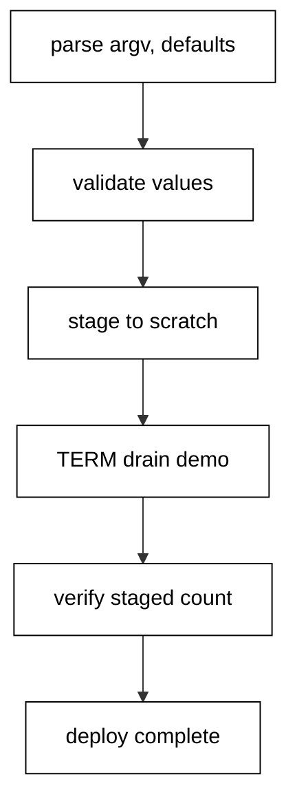

The capstone combines the course into one deploy-helper CLI: it parses `--env`, `--version`, and `--dry-run` with validated defaults, stages every manifest package into trapped scratch, drains SIGTERM mid-deploy, verifies the staged set, and prints a fixed seven-line transcript that the harness asserts byte for byte.

## Why this exists -- the big idea

**The problem before the solution**: course examples prove idioms in isolation, but production scripts fail at the seams — parsing disagrees with validation, cleanup misses the signal path, verification is a comment instead of a check. The capstone wires every layer together so the seams are load-bearing: each stage feeds the next, and the transcript proves the whole chain ran.

**Keep this if you forget everything else**: a deploy tool states its plan, stages privately, verifies, then reports — in that order, every time.

## What you will build

A single `deploy.sh` plus a three-line package manifest. It parses real argv against documented defaults (`staging`, `1.2.3`, real run), rejects empty values with usage on stderr, stages one package per manifest line into a trapped scratch dir, demonstrates the TERM drain with a deterministic self-signal, counts the staged set as self-verification, and closes with a completion marker. The dry-run branch verifies without acting; the demo runs the real path.

## How the pieces compose

Parsing (Examples 9-17) feeds validation (Examples 16-17); the scratch pattern (Example 29) holds staging; the TERM handler (Examples 59-61) drains mid-deploy; the count check (Examples 72-75) verifies the staged set; the golden transcript (Examples 52, 71) asserts the whole run. No new idioms appear here — composition is the test. Read the script top to bottom and name the example each section comes from; if a section has no ancestor, it does not belong.



## Reading the transcript

The seven output lines each prove one stage: the plan line proves parsing and defaults; the three staging lines prove the manifest loop; the drain line proves the TERM handler ran; the verification line proves three packages staged; the closing marker proves the script reached its end. Any missing line names its broken stage exactly. Rerun the unit and diff: identical bytes, because fixed argv, fixed fixtures, and fixed handlers leave no room for variance.

## Extending it

Add a `--concurrency N` flag with the same value-option pattern and fan the staging loop out with per-package files plus `wait` (Example 54); add a `--config FILE` flag that loads key-value pairs into an associative table (Examples 42-43); gate releases on an environment allow-list with a named usage error (Example 17). Each extension is one flag plus one section — the skeleton never changes. Keep the transcript golden: new lines append at the end, never in the middle, so history stays diffable.

## What graduating means

You can start a new tool from the strict header template, parse and validate its inputs, trap its cleanup, handle its signals, test it against fixtures, and ship a transcript that proves all of it. The next script you write for work should follow this skeleton file for file. When it grows a second tool, split subcommands (Example 15) rather than flags; when it grows state, add the golden suite (Examples 71-78) before the state, not after.

**`learning/capstone/code/deploy.sh`**:

```bash
# => Capstone: a deployment-helper CLI with strict flags and a verified transcript.
set -euo pipefail # => strict header first, as in every script
# => WHY this shape: parse, validate, stage, deploy, verify, report.
env="staging"                                                # => default one: staging unless --env says otherwise
version="1.2.3"                                              # => default two: pinned unless --version says otherwise
dry_run="no"                                                 # => default three: real run unless --dry-run is passed
usage() {                                                    # => one function owns the whole usage contract
	echo "usage: deploy [--env NAME] [--version V] [--dry-run]" # => synopsis line
}                                                            # => closes the usage contract
while [ "$#" -gt 0 ]; do                                     # => loop while words remain
	case "$1" in                                                # => match the head word against the three flags
	--env)
		env="$2"
		shift 2 # => value flag consumes its word
		;;      # => ends the env branch
	--version)
		version="$2"
		shift 2 # => value flag consumes its word
		;;      # => ends the version branch
	--dry-run)
		dry_run="yes"
		shift # => bare flag flips its default on
		;;    # => ends the dry-run branch
	--help)
		usage
		exit 0 # => help prints the contract and succeeds
		;;     # => ends the help branch
	*)
		usage >&2
		exit 2                                              # => unknown words are usage errors
		;;                                                  # => ends the misuse branch
	esac                                                 # => closes the per-word branch
done                                                  # => flags parsed; defaults stand where flags were absent
if [ -z "${env}" ] || [ -z "${version}" ]; then       # => empty values are misuse
	usage >&2                                            # => usage belongs on stderr, always
	exit 2                                               # => missing values are usage errors
fi                                                    # => closes the value guard
echo "deploying ${version} to ${env}"                 # => the plan, stated up front
stage="$(mktemp -d)"                                  # => private staging dir under /tmp
cleanup() {                                           # => remove the staging dir on every exit path
	rm -rf "${stage}"                                    # => the staging dir vanishes with the script
}                                                     # => closes the staging cleaner
trap cleanup EXIT                                     # => removal runs on success, error, or signal exits
on_term() {                                           # => the TERM handler: finish the step, then report
	echo "received TERM: finishing current step"         # => fixed drain report
}                                                     # => closes the TERM handler
trap on_term TERM                                     # => SIGTERM drains instead of dying mid-deploy
while IFS= read -r pkg; do                            # => read each manifest line exactly
	echo "staging: ${pkg}"                               # => stage one package per manifest line
	printf "%s\n" "${pkg}" >>"${stage}/staged.txt"       # => record the staged package
done <manifest.txt                                    # => the manifest fixture drives the staging
kill -TERM $$                                         # => self-signal: the deterministic drain demonstration
if [ "${dry_run}" = "yes" ]; then                     # => dry runs verify without acting
	echo "dry run: no changes made"                      # => fixed marker for dry-run mode
else                                                  # => real run: verify the staged set, then report
	staged="$(wc -l <"${stage}/staged.txt" | tr -d " ")" # => count staged packages
	echo "verified: ${staged} packages staged"           # => the self-verification line
fi                                                    # => closes the dry-run branch
echo "deploy complete"                                # => fixed closing marker of the transcript
```

**`learning/capstone/code/manifest.txt`**:

```text
auth-service
billing-worker
web-frontend
```

**Output** (`learning/capstone/code/expected/main/main.stdout.txt`):

```text
deploying 1.2.3 to staging
staging: auth-service
staging: billing-worker
staging: web-frontend
received TERM: finishing current step
verified: 3 packages staged
deploy complete
```

**Key takeaway**: one skeleton — parse, validate, stage, verify, report — carries every deploy tool.

**Why it matters**: deploy tools run when the business is watching; a fixed transcript means the run is reviewable before, during, and after.
