Examples 26-53 turn scripts from command sequences into engineered programs: cleanup guaranteed by traps on every exit path, data held in indexed and associative arrays, and input fed to loops by redirection so variables survive. Three clusters carry the level: traps and cleanup (Examples 26-34), arrays and associative arrays (Examples 35-44), and process substitution with here-documents (Examples 45-53). Scratch lives under /tmp behind EXIT traps; the repo tree is never written.

### Example 26: Trap EXIT Cleanup

A script that dies mid-run leaves its scratch files behind unless cleanup is guaranteed. This example registers an EXIT trap that removes the scratch dir and proves it ran. (Concepts: co-03.)

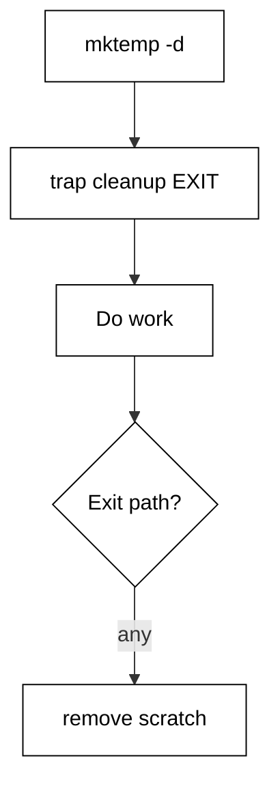

The scratch dir comes from `mktemp -d` under /tmp, the one writable place in the harness. The `cleanup` function removes it and echoes a fixed marker; `trap cleanup EXIT` runs that function on every exit path — success, error, or signal. The marker in the output is the proof: no marker, no cleanup.

**`learning/code/ex-26-trap-exit-cleanup/example.sh`**:

```bash
# => Example 26: an EXIT trap cleans the scratch dir on every exit.
set -euo pipefail # => strict header first, as in every example
# => WHY mktemp: fixed scratch paths collide between harness runs.
scratch="$(mktemp -d)"      # => private scratch dir under /tmp, writable here
cleanup() {                 # => the exit handler: remove scratch, confirm loudly
	rm -rf "${scratch}"        # => remove the private scratch dir
	echo "cleaned"             # => fixed marker proves the trap actually ran
}                           # => closes the exit handler
trap cleanup EXIT           # => run cleanup on success, error, or signal exits
touch "${scratch}/work.txt" # => prove the scratch dir is usable
echo "work done"            # => fixed marker: real work would happen here
# => At exit the trap removes the dir; cleaned prints last.
```

**Output** (`learning/code/ex-26-trap-exit-cleanup/expected/main.stdout.txt`):

```text
work done
cleaned
```

**Key takeaway**: Register `trap cleanup EXIT` once: the scratch dir is removed on every exit path.

**Why it matters**: Cleanup that runs only on the happy path is decoration: failures are exactly when droppings accumulate. EXIT traps fire on every path, so one registration covers success, `exit`, errors, and caught signals. Write the trap first, before creating anything it must clean.

### Example 27: Trap ERR Report

Strict scripts abort at the first failure, but the error message rarely says which command broke. This example adds an ERR trap that names the failing command from `$BASH_COMMAND`. (Concepts: co-03, co-16.)

The `report` function echoes the fixed prefix plus `$BASH_COMMAND`, the exact text of the command that just failed — deterministic because the script is fixed. `trap report ERR` fires after any failing command that `-e` would act on. The demo fails `false` once under relaxed `-e`, the trap names it, and the script continues to its closing marker.

**`learning/code/ex-27-trap-err-report/example.sh`**:

```bash
# => Example 27: an ERR trap names the command that just failed.
set -euo pipefail # => strict header first, as in every example
# => WHY a trap: -e aborts, but rarely says WHICH command broke.
report() {                      # => the ERR handler: name the failing command
	echo "failed: ${BASH_COMMAND}" # => BASH_COMMAND holds the failing text
}                               # => closes the error reporter
trap report ERR                 # => run report after any failing command
set +e                          # => let the demo failure happen without aborting
false                           # => the deliberate failure the trap will report
set -e                          # => strict again after the demonstration
echo "continued"                # => the script survives its reported failure
```

**Output** (`learning/code/ex-27-trap-err-report/expected/main.stdout.txt`):

```text
failed: false
continued
```

**Key takeaway**: An ERR trap reporting `$BASH_COMMAND` names the failing command at the failure site.

**Why it matters**: Naming the failing command at the failure site turns a post-mortem into a pointer: operators grep the message and land on the line. Keep the reporter tiny — one line, no logic — because it runs in the worst moment of the script's life. `$BASH_COMMAND` is deterministic for fixed scripts, so it stays green in golden-output tests.

### Example 28: Cleanup on Any Exit

A cleanup handler must run identically on the success path and the failure path, or one of them rots. This example runs both paths in subshells with the same EXIT trap shape. (Concepts: co-03, co-12, co-04.)

Each subshell registers its own EXIT trap printing a path-specific marker. The first subshell exits 0; the second runs `false` and exits 1, absorbed by `|| true` so the demo continues. Both markers print, proving the trap is path-independent. Idempotent scripts lean on this property: rerunning after any exit state cleans the same way.

**`learning/code/ex-28-cleanup-on-any-exit/example.sh`**:

```bash
# => Example 28: the same EXIT trap shape cleans the ok path and the fail path.
set -euo pipefail # => strict header first, as in every example
# => WHY subshells: each exit path needs its own observable trap run.
clean_ok() {               # => success-path cleaner: names the path it cleaned
	echo "cleaned: ok-path"   # => proves the success path was cleaned
}                          # => closes the success-path cleaner
clean_fail() {             # => failure-path cleaner: names the path it cleaned
	echo "cleaned: fail-path" # => proves the failure path was cleaned
}                          # => closes the failure-path cleaner
( # => subshell one takes the success path below
	trap clean_ok EXIT # => exit trap for the success path
	echo "working"     # => the success path does its work
)                   # => subshell exits 0: the trap prints the ok-path marker
( # => subshell two takes the failure path below
	trap clean_fail EXIT # => exit trap for the failure path
	echo "working"       # => the failure path starts the same way
	false                # => the step that fails; the trap still runs on the way out
) || true             # => absorb the failure so the demo continues past it
```

**Output** (`learning/code/ex-28-cleanup-on-any-exit/expected/main.stdout.txt`):

```text
working
cleaned: ok-path
working
cleaned: fail-path
```

**Key takeaway**: EXIT traps run on success and failure alike; prove both paths with subshell probes.

**Why it matters**: Testing only the happy path leaves the failure path's cleanup to rot until the outage that needs it. Subshell probes make both paths observable in one run with fixed output. When a handler must differ per path, pass the path as an argument rather than writing two handlers.

### Example 29: Temp Dir Pattern

Every script needs scratch space, and hardcoded `/tmp/myapp` collides between parallel runs. This example shows the canonical pattern: `mktemp -d` plus an EXIT trap. (Concepts: co-03.)

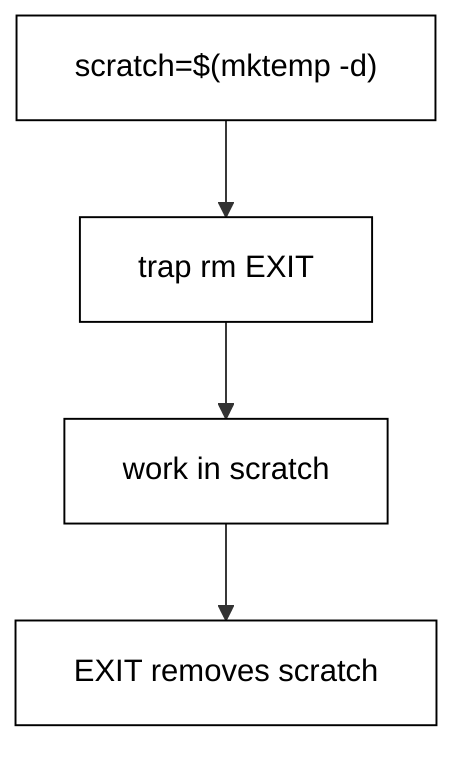

The three lines always appear together: create with `mktemp -d`, trap its removal, then work inside it. The demo stages one input file, sorts it as the real work, and prints a fixed marker. Nothing outside /tmp is touched, so the read-only course tree stays pristine and parallel harness runs never share a path.

**`learning/code/ex-29-temp-dir-pattern/example.sh`**:

```bash
# => Example 29: mktemp -d plus an EXIT trap is the scratch pattern.
set -euo pipefail # => strict header first, as in every example
# => WHY three lines together: create, trap removal, then work inside.
scratch="$(mktemp -d)" # => unique private dir under /tmp, no collisions
cleanup() {            # => remove the staging dir on every exit path
	rm -rf "${scratch}"   # => the scratch dir vanishes with the script
}                      # => closes the scratch cleaner
trap cleanup EXIT      # => removal runs on every exit path
echo "beta
alpha" >"${scratch}/input.txt"       # => stage input in scratch
LC_ALL=C sort "${scratch}/input.txt" # => the real work reads from scratch
echo "scratch used"                  # => fixed marker: nothing outside /tmp was touched
```

**Output** (`learning/code/ex-29-temp-dir-pattern/expected/main.stdout.txt`):

```text
alpha
beta
scratch used
```

**Key takeaway**: `mktemp -d`, trap its removal, work inside: the scratch pattern in three lines.

**Why it matters**: Scratch discipline is what makes scripts rerunnable and parallel-safe: unique dirs never collide, traps never leak, and the repo tree never gains stray files. `LC_ALL=C` on the sort keeps byte order identical on every machine. Copy these three lines verbatim into every new script.

### Example 30: Lockfile Pattern

Two copies of a deploy script running at once corrupt the release. This example serializes with an atomic `mkdir` lock released by an EXIT trap. (Concepts: co-03, co-12.)

`mkdir` is atomic: exactly one process wins, the loser sees failure. The winner traps `rmdir` on EXIT so the lock releases on every path, then does its protected work. The loser path prints a fixed back-off message and exits 1. The harness container starts with a fresh /tmp, so the demo always takes the winner path with fixed output.

**`learning/code/ex-30-lockfile-pattern/example.sh`**:

```bash
# => Example 30: mkdir is atomic, so it makes a perfect mutex.
set -euo pipefail # => strict header first, as in every example
# => WHY mkdir over touch: creation is atomic, exactly one holder wins.
lock_dir="/tmp/advanced-shell-ex30.lock" # => fixed lock path: the point of a lock
release() {                              # => unlock on every exit path
	rmdir "${lock_dir}"                     # => remove the lock dir to release it
}                                        # => closes the lock release
if mkdir "${lock_dir}" 2>/dev/null; then # => atomic acquire: one winner only
	trap release EXIT                       # => release the lock on every exit path
	echo "lock acquired"                    # => this run won the lock
	echo "working under lock"               # => protected work happens here
else                                     # => someone else already holds the lock
	echo "already running"                  # => the second instance backs off loudly
	exit 1                                  # => contention is a runtime failure: exit 1
fi                                       # => closes the atomic-acquire branch
```

**Output** (`learning/code/ex-30-lockfile-pattern/expected/main.stdout.txt`):

```text
lock acquired
working under lock
```

**Key takeaway**: Acquire with atomic `mkdir`, release with an EXIT trap, back off loudly on contention.

**Why it matters**: Locks turn concurrent runs from corruption into a queue: the second instance waits or exits instead of interleaving writes. Always trap the release, or a killed holder wedges every future run until a human deletes the stale lock. Prefer waiting with a timeout over immediate exit for cron jobs that must eventually run.

### Example 31: Partial Output Rollback

A script that crashes halfway leaves half-written outputs that look complete. This example stages everything privately and publishes only on success. (Concepts: co-03.)

The success build writes two parts into scratch, concatenates them into a result, and prints the complete result. The failure build, in a subshell, writes one part and then crashes before publishing; its trap removes the partials and a fixed message reports that nothing escaped. Consumers only ever see whole results or nothing.

**`learning/code/ex-31-partial-output-rollback/example.sh`**:

```bash
# => Example 31: stage privately, publish only whole results.
set -euo pipefail # => strict header first, as in every example
# => WHY stage-then-publish: a crash must never leave half an output.
stage="$(mktemp -d)"                          # => private staging dir under /tmp
cleanup() {                                   # => remove staged partials on every exit path
	rm -rf "${stage}"                            # => the staging dir vanishes with the script
}                                             # => closes the staging cleaner
trap cleanup EXIT                             # => partials vanish on every exit path
echo "step one" >"${stage}/part1.txt"         # => stage part one privately
echo "step two" >"${stage}/part2.txt"         # => stage part two privately
cat "${stage}/part1.txt" "${stage}/part2.txt" # => publish: only whole results print
echo "published complete result only"         # => fixed marker after the publish
( # => subshell takes the crash path below
	part="$(mktemp -d)"                        # => the failed build stages privately too
	cleanup_part() {                           # => remove the failed build partials
		rm -rf "${part}"                          # => the failed staging dir vanishes too
	}                                          # => closes the failed-build cleaner
	trap cleanup_part EXIT                     # => its partials vanish with it
	echo "half" >"${part}/part.txt"            # => half a result, staged privately
	false                                      # => crash before publish: nothing escapes the subshell
) || echo "build failed: nothing published" # => fixed crash report
```

**Output** (`learning/code/ex-31-partial-output-rollback/expected/main.stdout.txt`):

```text
step one
step two
published complete result only
build failed: nothing published
```

**Key takeaway**: Stage outputs privately and publish atomically; a crash must leave nothing half-written.

**Why it matters**: Partial outputs are worse than no outputs: downstream tools consume them as if they were complete. Staging plus atomic publish (rename, or print only at the end) makes every visible state a good state. The EXIT trap is the rollback: whatever the crash, the staging dir disappears with it.

### Example 32: Swap a Trap for One Section

One handler rarely fits the whole script: a debug section wants to keep its scratch while normal sections clean up. This example swaps the EXIT handler for one section, then restores it. (Concepts: co-03.)

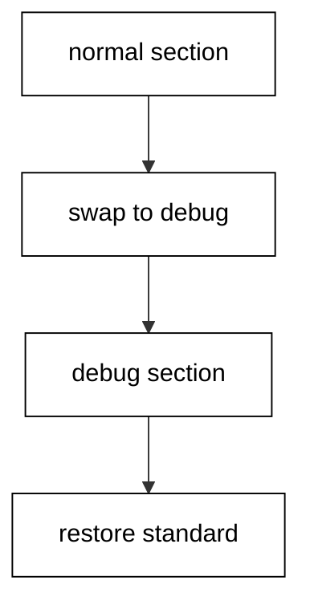

Two handlers exist side by side: standard cleanup removes scratch and says so, debug cleanup keeps scratch and says so. The script traps the standard one, swaps to debug for the middle section, then restores standard before the end. The final marker proves the restored handler ran. `trap - EXIT` would disable entirely; swapping keeps a handler active at all times.

**`learning/code/ex-32-swap-trap-for-one-section/example.sh`**:

```bash
# => Example 32: swap the EXIT handler for one section, then restore it.
set -euo pipefail # => strict header first, as in every example
# => WHY two handlers: debug keeps evidence, standard cleans it.
scratch="$(mktemp -d)"              # => private scratch dir under /tmp
cleanup() {                         # => the standard handler: remove scratch, confirm loudly
	rm -rf "${scratch}"                # => remove the scratch dir
	echo "standard cleanup"            # => names the handler that ran at exit
}                                   # => closes the standard handler
debug_cleanup() {                   # => the debug handler: keep evidence, say so
	echo "debug cleanup: scratch kept" # => names the handler that ran
}                                   # => closes the debug handler
trap cleanup EXIT                   # => standard handler first
echo "normal work"                  # => first section runs under standard cleanup
trap debug_cleanup EXIT             # => swap handlers for the debug section
echo "debug section"                # => middle section runs under debug cleanup
trap cleanup EXIT                   # => restore the standard handler before the end
echo "done"                         # => last section runs under standard cleanup again
```

**Output** (`learning/code/ex-32-swap-trap-for-one-section/expected/main.stdout.txt`):

```text
normal work
debug section
done
standard cleanup
```

**Key takeaway**: Swap EXIT handlers per section with `trap`, restoring the standard one before the end.

**Why it matters**: Handler swapping beats handler flags: no `if DEBUG` inside cleanup, no global mode variable to forget. Each section declares its own cleanup semantics up front, and the restore line is visible right where the section ends. A handler active at all times means no exit path runs naked.

### Example 33: Stack Traps with Functions

One EXIT trap allows one handler, but real scripts clean several resources. This example stacks handler names and runs them all at exit. (Concepts: co-03.)

The `on_exit` function appends handler names to a space-separated stack; `run_handlers` splits that stack and calls each name in order. Two cleaners register, the work runs, and the single EXIT trap fans out to both. The split in `run_handlers` is the one deliberate unquoted expansion in this course: splitting is the intent there.

**`learning/code/ex-33-stack-traps-with-functions/example.sh`**:

```bash
# => Example 33: one EXIT trap fans out to a stack of named handlers.
set -euo pipefail # => strict header first, as in every example
# => WHY a stack: bash runs ONE exit handler, scripts clean MANY resources.
handlers=""                # => space-separated stack of handler names, in run order
on_exit() {                # => push a handler name onto the stack
	handlers="${handlers} $1" # => append the new name after a space
}                          # => closes the stack push
run_handlers() {           # => run every stacked handler in registration order
	# shellcheck disable=SC2086  # => deliberate split: one word per handler
	for h in ${handlers}; do # => DELIBERATELY unquoted: split is the intent
		"${h}"                  # => call the handler by name, quoted as a command
	done                     # => every registered handler ran exactly once
}                         # => closes the fan-out runner
clean_a() {               # => first resource cleaner
	echo "cleaned a"         # => fixed marker proves handler one ran
}                         # => closes handler one
clean_b() {               # => second resource cleaner
	echo "cleaned b"         # => fixed marker proves handler two ran
}                         # => closes handler two
on_exit clean_a           # => register handler one
on_exit clean_b           # => register handler two
trap run_handlers EXIT    # => the single EXIT trap fans out to the stack
echo "work done"          # => the work runs before any handler
```

**Output** (`learning/code/ex-33-stack-traps-with-functions/expected/main.stdout.txt`):

```text
work done
cleaned a
cleaned b
```

**Key takeaway**: Stack handler names in a string and fan out with one EXIT trap; the split there is deliberate.

**Why it matters**: A handler stack keeps setup and cleanup adjacent: acquire a resource, register its cleaner on the next line, and the exit path stays correct no matter how the script grows. Registration order is run order here; reverse it if your resources nest. The deliberate-split line earns its shellcheck exception comment so reviewers know it was chosen, not missed.

### Example 34: Trace a Section

When a script misbehaves, guessing is slower than watching. This example traces one section with `set -x` and a fixed `PS4` prefix. (Concepts: co-03, co-16.)

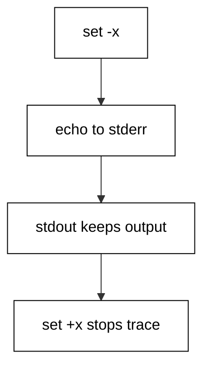

Tracing prints each command before it runs, with `PS4` as the prefix; fixing `PS4` keeps the trace deterministic for golden tests. The trace goes to stderr, so stdout holds only the script's real output. The demo traces two lines, turns tracing off, and closes with a fixed marker. Trace the smallest section that shows the bug, never the whole script.

**`learning/code/ex-34-trace-a-section/example.sh`**:

```bash
# => Example 34: set -x watches one section; PS4 keeps traces stable.
set -euo pipefail # => strict header first, as in every example
# => WHY a fixed PS4: the default prefix embeds depth that shifts output.
export PS4="+ trace: " # => fixed trace prefix, deterministic for goldens
set -x                 # => tracing on: every following command echoes to stderr first
value="traced"         # => this assignment is traced on stderr
echo "value: ${value}" # => this echo is traced, then prints on stdout
set +x                 # => tracing off: output below stays clean
echo "trace done"      # => fixed closing marker on stdout
```

**Output** (`learning/code/ex-34-trace-a-section/expected/main.stdout.txt`):

```text
value: traced
trace done
```

**Key takeaway**: `set -x` with a fixed `PS4` watches a section; traces go to stderr, output stays clean.

**Why it matters**: Tracing beats reading when the bug is in expansion: the trace shows what the shell actually ran, not what you think you wrote. Keep traces out of golden stdout by letting stderr carry them. Never ship `set -x` on in production: it leaks secrets into logs. Trace, fix, remove.

### Example 35: Indexed Array Basics

Related values belong in one array, not in `server1`, `server2`, `server3`. This example builds a three-element array and reads it three ways. (Concepts: co-09.)

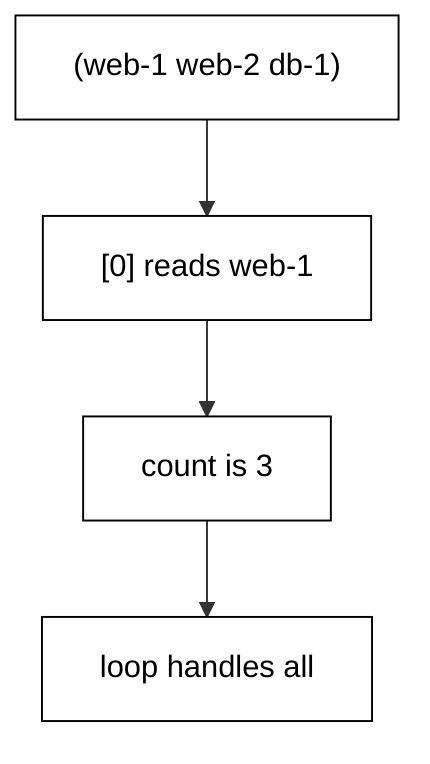

Parentheses assign the whole array at once; `${servers[0]}` reads one element by index; `${#servers[@]}` counts elements; `${servers[*]}` joins everything with the first `IFS` character for display. Indexes start at zero, and quoting the expansions keeps elements with spaces intact.

**`learning/code/ex-35-indexed-array-basics/example.sh`**:

```bash
# => Example 35: parentheses build the array, brackets read it.
set -euo pipefail # => strict header first, as in every example
# => WHY one array: server1/server2/server3 variables never scale.
servers=("web-1" "web-2" "db-1") # => three elements, indexes 0 to 2
echo "first: ${servers[0]}"      # => index 0 is the first element
echo "count: ${#servers[@]}"     # => ${#arr[@]} counts the elements
echo "all: ${servers[*]}"        # => * joins elements for display
```

**Output** (`learning/code/ex-35-indexed-array-basics/expected/main.stdout.txt`):

```text
first: web-1
count: 3
all: web-1 web-2 db-1
```

**Key takeaway**: Parentheses build indexed arrays; `[i]` reads one element and `${#arr[@]}` counts them.

**Why it matters**: Numbered variable names are arrays crying for help: they defeat loops, counts, and passing the set to a function. One array plus a loop replaces every `thing1..thingN` scheme. Quote `${arr[@]}` on use; the unquoted form resplits elements that contain spaces.

### Example 36: Loop over an Array

Arrays pay off in loops: one body handles every element. This example walks the server array with quoted `"${servers[@]}"` so spaced names survive. (Concepts: co-09.)

Each turn binds one element intact; quoting the expansion is what keeps a spaced element as one turn instead of two. The unquoted form would resplit on spaces, which is exactly the bug quoted iteration eliminates. Three elements, three turns, fixed output.

**`learning/code/ex-36-loop-over-array/example.sh`**:

```bash
# => Example 36: quoted @ gives one loop turn per element.
set -euo pipefail # => strict header first, as in every example
# => WHY quoted @: unquoted iteration resplits elements with spaces.
servers=("web-1" "web-2" "db-1") # => three elements to visit
for s in "${servers[@]}"; do     # => quoted: one turn per element, intact
	echo "server: ${s}"             # => handle each element exactly once
done                             # => three turns, one per element
```

**Output** (`learning/code/ex-36-loop-over-array/expected/main.stdout.txt`):

```text
server: web-1
server: web-2
server: db-1
```

**Key takeaway**: Iterate with quoted array expansion for one intact turn per element.

**Why it matters**: Quoted array iteration is the only safe array loop: every alternative resplits, reglobs, or drops empties. Index loops have their place when the position matters, but element loops cover nearly every real case. If the loop needs the index too, iterate indexes and read the element inside.

### Example 37: Array Length and Slice

Whole-array operations avoid manual index math: count with `#`, slice with offsets. This example reports the length and two slices of a four-element array. (Concepts: co-09.)

The count operator measures the whole array at once; the slice takes two elements starting at index 1; an explicit last index reads the final element portably. Slices copy; the original array never changes, so slicing is safe to do freely.

**`learning/code/ex-37-array-length-and-slice/example.sh`**:

```bash
# => Example 37: # counts elements, :offset:length slices them.
set -euo pipefail # => strict header first, as in every example
# => WHY slices: offsets beat manual index loops for heads and tails.
servers=("web-1" "web-2" "db-1" "db-2") # => four elements to measure
echo "count: ${#servers[@]}"            # => 4: the whole array measured at once
echo "middle: ${servers[*]:1:2}"        # => two elements starting at index 1
echo "last: ${servers[3]}"              # => explicit last index, portable everywhere
```

**Output** (`learning/code/ex-37-array-length-and-slice/expected/main.stdout.txt`):

```text
count: 4
middle: web-2 db-1
last: db-2
```

**Key takeaway**: Count whole arrays and slice them; explicit indexes stay portable.

**Why it matters**: Length and slice expressions replace the most error-prone index arithmetic in scripts: no off-by-one, no loop-bound typos. Prefer them over C-style index loops whenever the position itself is not needed. Slices are copies, so transforming a slice never corrupts the source array.

### Example 38: Associative Array Counts

Counting occurrences by key is the associative array's home turf. This example tallies log severities from a fixture and prints the sorted table. (Concepts: co-09.)

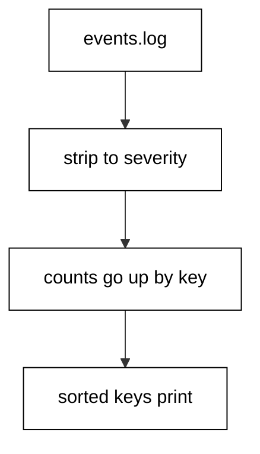

The declare builtin creates the string-keyed map; stripping each line to its severity word gives the key; the increment uses a zero default so strict mode never fires on a first sighting. Sorting the keys fixes the output order, because key iteration order is otherwise unspecified.

**`learning/code/ex-38-associative-array-counts/example.sh`**:

```bash
# => Example 38: associative arrays tally occurrences by key.
set -euo pipefail # => strict header first, as in every example
# => WHY sorted keys: assoc iteration order is unspecified, goldens need order.
declare -A counts=()                                  # => severity word maps to its occurrences
while IFS= read -r line; do                           # => read each fixture line exactly
	level="${line%% *}"                                  # => strip from the first space: the severity
	counts["${level}"]=$((${counts["${level}"]:-0} + 1)) # => increment, default zero guards -u
done <events.log                                      # => redirection feeds the loop, never a pipe
# => Sorted keys make the table deterministic on every machine.
for level in $( # => DELIBERATELY unquoted: split into sorted keys
	printf "%s\n" "${!counts[@]}" | LC_ALL=C sort
); do
	echo "${level}: ${counts[${level}]}" # => one table row per severity
done                                  # => ERROR, INFO, WARN in byte order
```

**`learning/code/ex-38-associative-array-counts/events.log`**:

```text
INFO started
ERROR disk full
INFO retrying
WARN slow
ERROR timeout
INFO done
```

**Output** (`learning/code/ex-38-associative-array-counts/expected/main.stdout.txt`):

```text
ERROR: 2
INFO: 3
WARN: 1
```

**Key takeaway**: Associative arrays tally by key; sort the keys before printing for deterministic output.

**Why it matters**: Associative arrays replace whole pipelines with one readable loop, and they keep the counting logic next to the keys it counts. Always sort keys before printing: iteration order is a hash artifact, and golden tests need byte-stable output. Guard increments with a zero default so strict mode never fires on a first sighting.

### Example 39: Safe Array from a Glob

Collecting matching files into an array beats parsing `ls`, but an unmatched glob expands to itself. This example pairs `nullglob` with an array capture. (Concepts: co-09, co-08.)

With `nullglob` on, a pattern with no matches expands to nothing, so the array is honestly empty and the count reports 0. The demo fixtures guarantee two matches; the loop then visits each with a quoted use. The option is restored after the section so later globs behave normally.

**`learning/code/ex-39-safe-array-from-glob/example.sh`**:

```bash
# => Example 39: nullglob plus an array makes filename collection safe.
set -euo pipefail # => strict header first, as in every example
# => WHY nullglob: no-match must mean no words, not a literal pattern.
shopt -s nullglob           # => unmatched globs expand to nothing from here on
logs=(backup-*.log)         # => collect the matching fixtures into an array
echo "matched: ${#logs[@]}" # => the honest count: 0 when nothing matches
for log in "${logs[@]}"; do # => quoted: spaced names stay whole
	echo "log: ${log}"         # => handle each match exactly once
done                        # => zero turns on no match, never one turn on a literal pattern
shopt -u nullglob           # => restore default glob behaviour after the section
```

**`learning/code/ex-39-safe-array-from-glob/backup-a.log`**:

```text
INFO first backup log
```

**`learning/code/ex-39-safe-array-from-glob/backup-b.log`**:

```text
INFO second backup log
```

**Output** (`learning/code/ex-39-safe-array-from-glob/expected/main.stdout.txt`):

```text
matched: 2
log: backup-a.log
log: backup-b.log
```

**Key takeaway**: Enable nullglob and capture globs into arrays for honest empty results.

**Why it matters**: The literal-pattern surprise has deleted the wrong files in real incidents. The option plus a count check turns no files into an observable zero instead of a phantom operand. Scope the option to the section that needs it; a global change surprises code that tests patterns literally.

### Example 40: mapfile from a File

Reading a file into an array takes one builtin: `mapfile`. This example loads the host fixture into an array and walks it. (Concepts: co-09.)

The mapfile builtin reads standard input into the named array, stripping each line's trailing newline; feeding it by redirection keeps the array in the current shell. The alternative of capturing command substitution into parentheses would split and glob every line, which is exactly the corruption this builtin exists to prevent.

**`learning/code/ex-40-mapfile-from-file/example.sh`**:

```bash
# => Example 40: mapfile -t loads one array element per input line.
set -euo pipefail # => strict header first, as in every example
# => WHY mapfile: substitution capture would split and glob every line.
mapfile -t hosts <hosts.txt # => one element per fixture line, newlines stripped
echo "hosts: ${#hosts[@]}"  # => the count proves every line landed
for h in "${hosts[@]}"; do  # => quoted: each line stays one element
	echo "host: ${h}"          # => handle each host exactly once
done                        # => three turns for three fixture lines
```

**`learning/code/ex-40-mapfile-from-file/hosts.txt`**:

```text
web-1
db-1
cache-1
```

**Output** (`learning/code/ex-40-mapfile-from-file/expected/main.stdout.txt`):

```text
hosts: 3
host: web-1
host: db-1
host: cache-1
```

**Key takeaway**: Load lines intact with mapfile; command substitution would split and glob them.

**Why it matters**: Line-oriented input deserves a line-oriented loader: the builtin preserves spacing and glob characters that substitution mangles. Feed by redirection so the array lands in the current shell, not a subshell. For huge files prefer streaming over loading; arrays are for data that fits comfortably in memory twice.

### Example 41: Join Array Elements

Building a delimited string from an array is one expansion with a scoped `IFS`. This example joins path components with slashes. (Concepts: co-09.)

The star subscript joins with the first character of `IFS`, so setting `IFS=/` for that expansion yields a slash-joined path. Assigning the separator on its own line then restoring it keeps the change visible and bounded; the local variant inside functions is even tighter.

**`learning/code/ex-41-join-array-elements/example.sh`**:

```bash
# => Example 41: star joins with the first IFS char; scope IFS tightly.
set -euo pipefail # => strict header first, as in every example
# => WHY scoped IFS: the join char must not leak into later splits.
parts=("usr" "local" "bin") # => path components as array elements
IFS=/                       # => join character for the next expansion only
joined="${parts[*]}"        # => star joins with the first IFS char
unset IFS                   # => restore the default separators immediately
echo "path: /${joined}"     # => absolute path built from components
```

**Output** (`learning/code/ex-41-join-array-elements/expected/main.stdout.txt`):

```text
path: /usr/local/bin
```

**Key takeaway**: Join with the star subscript under a scoped separator; restore the separator at once.

**Why it matters**: The star versus at-sign distinction exists for exactly this idiom: one keeps elements separate, the other joins them. Scoping the separator to the join is non-negotiable, because a leaked separator corrupts every later split in the script. Inside functions prefer a local separator, which restores itself automatically.

### Example 42: Associative Config Table

Hardcoded environment branches become a lookup table with one associative array. This example reads known keys and defaults unknown ones. (Concepts: co-09, co-02.)

The literal initializer builds the table in place; known keys read directly, and the default operator supplies the documented fallback for missing keys without touching the table. Configuration as data stays greppable and diffable; configuration as branching logic does not.

**`learning/code/ex-42-associative-config-table/example.sh`**:

```bash
# => Example 42: configuration as a lookup table, not a branch chain.
set -euo pipefail # => strict header first, as in every example
# => WHY a table: adding an environment adds a pair, not a branch.
declare -A config=(["env"]="staging" ["retries"]="3") # => table init in place
echo "env: ${config[env]}"                            # => known key reads directly
echo "retries: ${config[retries]}"                    # => second known key reads directly
echo "timeout: ${config[timeout]:-30}"                # => unknown key takes its default
```

**Output** (`learning/code/ex-42-associative-config-table/expected/main.stdout.txt`):

```text
env: staging
retries: 3
timeout: 30
```

**Key takeaway**: Store configuration in an associative array; read known keys directly, default the rest.

**Why it matters**: Lookup tables turn environment-specific behaviour into data a reviewer can scan in one glance. Defaults at the use site keep the table sparse while documenting the fallback where it matters. When the table outgrows the script, move it to a fixture file and load it the same way; the reads do not change.

### Example 43: Dedupe with an Assoc

First-sight filtering with a seen map removes duplicates while preserving order, which sorting cannot do. This example dedupes the name fixture. (Concepts: co-09.)

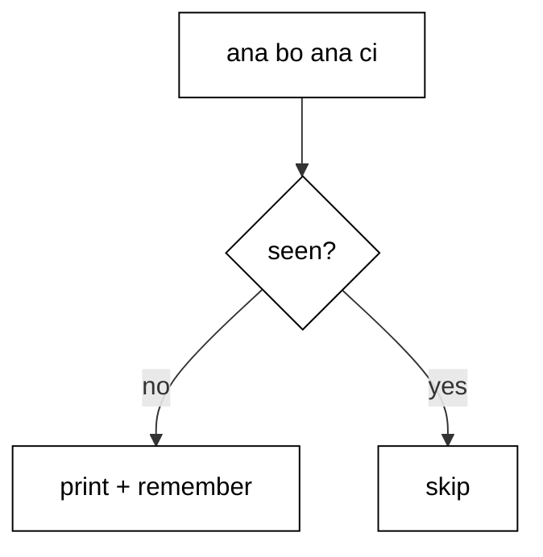

Each name checks the map: empty means first sight, so the script prints it and records it; non-empty means duplicate, skipped silently. The presence test uses the unset-only operator because stored values are always nonempty. Order preserved, duplicates gone, one pass.

**`learning/code/ex-43-dedupe-with-assoc/example.sh`**:

```bash
# => Example 43: a seen-map dedupes in one pass, keeping first-sight order.
set -euo pipefail # => strict header first, as in every example
# => WHY a map: sorting dedupes but destroys the original order.
declare -A seen=()                   # => set of names already printed
while IFS= read -r name; do          # => read each fixture line exactly
	if [ -z "${seen[${name}]-}" ]; then # => empty means first sight
		seen["${name}"]=1                  # => remember it so later dupes are skipped
		echo "unique: ${name}"             # => print only the first occurrence
	fi                                  # => closes the first-sight branch
done <names.txt                      # => redirection keeps the map in this shell
```

**`learning/code/ex-43-dedupe-with-assoc/names.txt`**:

```text
ana
bo
ana
ci
bo
ana
```

**Output** (`learning/code/ex-43-dedupe-with-assoc/expected/main.stdout.txt`):

```text
unique: ana
unique: bo
unique: ci
```

**Key takeaway**: A seen map prints first sightings and skips the rest, preserving order in one pass.

**Why it matters**: Order-preserving dedupe shows up in logs, deploys, and migrations: anywhere repeats are noise but sequence is signal. The idiom is linear with constant memory per key, beating quadratic nested loops on real inputs. Keep the values meaningless; the keys carry the information.

### Example 44: Array of PIDs and wait

Background jobs finish in whatever order they please; collecting their outputs into files and reading them in order restores determinism. This example runs two jobs and prints their results in a fixed sequence. (Concepts: co-09, co-06.)

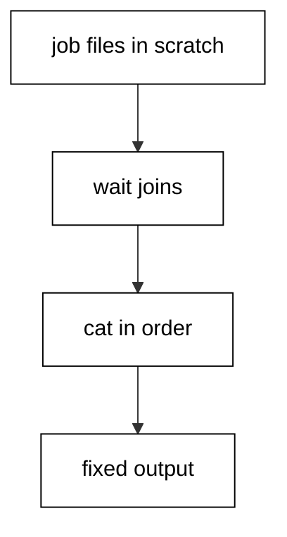

Each background job writes its own file under scratch, so no two jobs share an output stream. A bare `wait` blocks until every job finishes, with no PID bookkeeping needed for the all-jobs case. Only then does the script read the files in name order: identical output on every run, on one core or thirty-two.

**`learning/code/ex-44-array-of-pids-wait/example.sh`**:

```bash
# => Example 44: jobs write files, wait syncs, ordered reads follow.
set -euo pipefail # => strict header first, as in every example
# => WHY files: shared stdout interleaves; separate files order cleanly.
out="$(mktemp -d)"                   # => private dir under /tmp for the job outputs
cleanup() {                          # => remove the job outputs on every exit path
	rm -rf "${out}"                     # => the job-output dir vanishes with the script
}                                    # => closes the job-output cleaner
trap cleanup EXIT                    # => removal runs on success, error, or signal exits
(printf "alpha\n" >"${out}/a.txt") & # => job one writes only its file
(printf "beta\n" >"${out}/b.txt") &  # => job two writes only its file
wait                                 # => block until EVERY background job has finished
cat "${out}/a.txt" "${out}/b.txt"    # => fixed order: a then b, always
echo "all jobs done"                 # => fixed marker after every job finished
```

**Output** (`learning/code/ex-44-array-of-pids-wait/expected/main.stdout.txt`):

```text
alpha
beta
all jobs done
```

**Key takeaway**: Background jobs write separate files; wait for all, then read in a fixed order.

**Why it matters**: Nondeterministic finish order is inherent to concurrency, so deterministic output must come from ordering after the join, never from hoping jobs interleave nicely. Files per job plus one `wait` is the pattern; cat in a fixed order is the proof. Never let two jobs share one stream when the output is asserted.

### Example 45: Here-Doc Config

Multiline literal input belongs in a here-document, not in a chain of echoes. This example feeds a two-line config to cat straight from the script. (Concepts: co-10.)

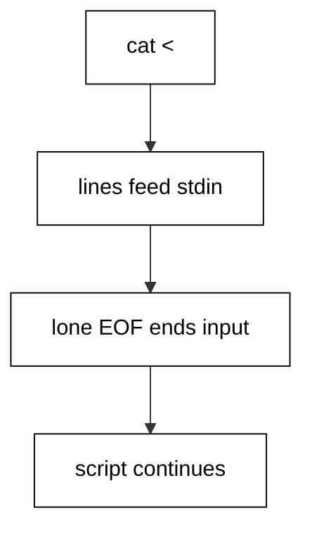

The `<<EOF` marker redirects everything until the lone `EOF` into the command's stdin; variables inside expand normally. The delimiter must sit alone at line start with no trailing spaces, or the shell never finds it. A closing marker ends the input and the script continues.

**`learning/code/ex-45-here-doc-config/example.sh`**:

```bash
# => Example 45: <<EOF feeds literal lines on stdin until EOF.
set -euo pipefail # => strict header first, as in every example
# => WHY a heredoc: multiline input without temp files or echo chains.
# => The delimiter needs no quotes here: expansion inside is wanted.
cat <<EOF # => heredoc starts: stdin reads until the lone EOF
host=db-1
port=5432
EOF
# => The lone EOF above ends the heredoc; nothing may trail it.
echo "config written" # => fixed marker after the heredoc
```

**Output** (`learning/code/ex-45-here-doc-config/expected/main.stdout.txt`):

```text
host=db-1
port=5432
config written
```

**Key takeaway**: Here-documents feed literal multiline input on stdin up to a lone delimiter line.

**Why it matters**: Heredocs keep input next to the command that consumes it: no fixture file to lose, no echo chain to misquote. Quote the delimiter when the text must stay literal, leave it bare when expansion is wanted. The lone-delimiter rule is absolute; trailing whitespace after EOF is the classic silent hang.

### Example 46: Here-String Single Line

Single-line input deserves a lighter tool than a heredoc or a pipe. This example splits one line into two variables with `<<<` and `read`. (Concepts: co-10.)

The here-string appends a newline to its word and feeds the result to the command's stdin; `read` then splits it into the named variables. No subshell runs, so variables set by `read` survive in the current shell — the pipe equivalent would lose them to a fork.

**`learning/code/ex-46-here-string-single-line/example.sh`**:

```bash
# => Example 46: <<< feeds one line on stdin, no fixture or pipe needed.
set -euo pipefail # => strict header first, as in every example
# => WHY a herestring: single-line input with zero fixture files.
read -r user role <<<"deploy admin" # => one line splits into two variables
echo "user: ${user}"                # => first word landed in user
echo "role: ${role}"                # => second word landed in role
```

**Output** (`learning/code/ex-46-here-string-single-line/expected/main.stdout.txt`):

```text
user: deploy
role: admin
```

**Key takeaway**: Here-strings feed one line to a command; `read` splits it into variables that survive.

**Why it matters**: The here-string is the right tool when the input fits on one line: no file, no pipe, no subshell, no cleanup. Because `read` runs in the current shell, every variable it sets stays available afterwards. For multiline input graduate to a heredoc; for generated input, to process substitution.

### Example 47: Quoted Delimiter Stays Literal

Templates for downstream tools must survive the shell untouched: no expansion, no substitution. This example quotes the heredoc delimiter so dollars stay literal. (Concepts: co-10.)

Any quoting on the delimiter word — `<<'EOF'` or `<<"EOF"` — disables every expansion inside the body. The demo template holds a price and a home reference that a later tool will expand; the shell passes both through byte-identically. Unquoted delimiters would have expanded them here and corrupted the template.

**`learning/code/ex-47-quoted-delimiter-literal/example.sh`**:

```bash
# => Example 47: a quoted delimiter disables every expansion inside.
set -euo pipefail # => strict header first, as in every example
# => WHY quoted: templates for other tools must pass through untouched.
# => Unquoted delimiters would expand the dollars below right here.
cat <<'EOF' # => quoted delimiter: NOTHING inside expands
cost: $5
home: $HOME
EOF
# => The lone EOF above ends the heredoc; template lines print intact.
echo "template kept" # => fixed marker after the literal heredoc
```

**Output** (`learning/code/ex-47-quoted-delimiter-literal/expected/main.stdout.txt`):

```text
cost: $5
home: $HOME
template kept
```

**Key takeaway**: Quote the heredoc delimiter to freeze the body; leave it bare to expand.

**Why it matters**: The delimiter quote is a one-character decision with total consequences: quoted means the body is data, bare means the body is a template the shell fills in. Get it backwards and secrets expand into logs or templates arrive pre-corrupted. When in doubt, quote: literal is the safer default.

### Example 48: Diff Two Command Outputs

Diff needs two files, but the inputs are command outputs. This example compares two generated streams with process substitution and no temp files. (Concepts: co-05.)

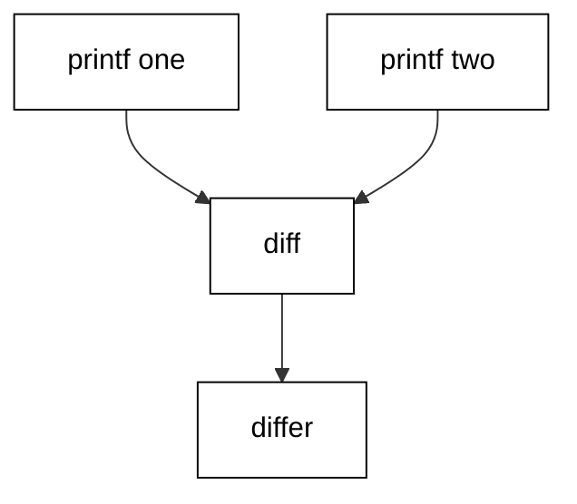

Each `<(...)` becomes a readable path (a pipe or /dev/fd entry) that diff opens like a file; the outputs never touch the disk. The guarded `if` absorbs diff's exit 1 so strict mode stays on while the branch reports the difference. Cleanup is unnecessary: nothing was created.

**`learning/code/ex-48-diff-two-commands/example.sh`**:

```bash
# => Example 48: <(...) turns each command output into a readable path.
set -euo pipefail # => strict header first, as in every example
# => WHY substitution: diff needs FILES, and these inputs are streams.
if diff <(printf "a\nb\n") <(printf "a\nc\n") >/dev/null; then # => compare the two generated streams
	echo "identical"                                              # => printed only when both commands agree
else                                                           # => diff exits 1 on any difference
	echo "differ"                                                 # => the two outputs disagree on line two
fi                                                             # => closes the comparison branch
```

**Output** (`learning/code/ex-48-diff-two-commands/expected/main.stdout.txt`):

```text
differ
```

**Key takeaway**: Process substitution gives streams file paths, so file tools work without temp files.

**Why it matters**: Every tool that insists on files — diff, cmp, join, paste — works on generated data through substitution, with no staging and no cleanup. Guard the comparison in `if`, because a difference is information, not a script failure. The streams run concurrently, so pair this with commands that terminate; a hanging producer hangs the consumer.

### Example 49: Join Command Outputs

Two related streams belong side by side, not in sequence. This example pastes two generated columns together with a colon separator. (Concepts: co-05.)

Paste reads one line from each input per output row, joining with the delimiter; process substitution supplies both inputs as paths. The demo pairs letters with numbers, printing two joined rows. Real uses pair a name stream with a metric stream for reports.

**`learning/code/ex-49-join-command-outputs/example.sh`**:

```bash
# => Example 49: paste joins substitution streams line by line.
set -euo pipefail # => strict header first, as in every example
# => WHY paste plus substitution: two streams become one table, no files.
paste -d: <(printf "a\nb\n") <(printf "1\n2\n") # => join rows with colons
echo "joined two streams"                       # => fixed marker after the joined rows
```

**Output** (`learning/code/ex-49-join-command-outputs/expected/main.stdout.txt`):

```text
a:1
b:2
joined two streams
```

**Key takeaway**: Paste plus process substitution joins generated streams into rows without staging files.

**Why it matters**: Columnar assembly from live commands is a report-building staple: names from one query, numbers from another, joined on row order. The row alignment is positional, so both streams must produce the same row sequence — sort both inputs first when the order is not already fixed.

### Example 50: Loop over Substitution Output

Looping over generated lines with a pipe loses the loop's variables to a subshell. This example feeds process substitution by redirection so the accumulator survives. (Concepts: co-05, co-04.)

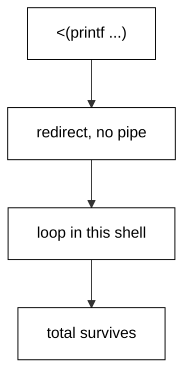

The `< <(...)` form redirects the substitution into the loop without a pipeline, so the loop runs in the current shell and `total` keeps its value after `done`. The demo sums three generated numbers to a fixed total. Whenever a loop must remember, redirect; pipes forget.

**`learning/code/ex-50-while-read-substitution/example.sh`**:

```bash
# => Example 50: < <(...) loops in THIS shell, so variables survive.
set -euo pipefail # => strict header first, as in every example
# => WHY redirection: a pipe would run the loop in a subshell.
total=0                      # => accumulator must survive the loop: no pipe allowed
while IFS= read -r n; do     # => read each generated number exactly
	total=$((total + n))        # => add the line number to the accumulator
done < <(printf "1\n2\n3\n") # => substitution feeds the loop by redirection
echo "total: ${total}"       # => 6: the accumulator survived because no subshell ran
```

**Output** (`learning/code/ex-50-while-read-substitution/expected/main.stdout.txt`):

```text
total: 6
```

**Key takeaway**: Feed generated lines with `< <(...)` so the loop runs in the current shell.

**Why it matters**: The pipe-to-while trap is a rite of passage: the loop works, the total prints inside, and the value is gone one line later. Redirection from substitution keeps the current shell and every variable in it. Teach your fingers the `< <(` shape; the space between the two `<` is load-bearing.

### Example 51: Tee to Two Consumers

One stream feeding two consumers needs a tee, and two consumers sharing stdout interleave. This example tees into two files and reads them in order. (Concepts: co-05.)

The pipeline writes one copy through the pipe and one to the tee file; both are files, so each consumer reads complete bytes in a fixed sequence. Labels separate the two reads in the output. In production the consumers are real stages; here they are ordered reads proving both copies are identical.

**`learning/code/ex-51-tee-to-two-consumers/example.sh`**:

```bash
# => Example 51: tee splits one stream; files keep consumers ordered.
set -euo pipefail # => strict header first, as in every example
# => WHY files: two live consumers on one stdout interleave randomly.
scratch="$(mktemp -d)"                                           # => private dir under /tmp for the two copies
cleanup() {                                                      # => remove both copies on every exit path
	rm -rf "${scratch}"                                             # => the copy dir vanishes with the script
}                                                                # => closes the copy cleaner
trap cleanup EXIT                                                # => removal runs on success, error, or signal exits
printf "one\ntwo\n" | tee "${scratch}/a.txt" >"${scratch}/b.txt" # => one stream becomes two identical files
echo "copy a:"                                                   # => fixed label before the first copy
cat "${scratch}/a.txt"                                           # => first consumer reads in fixed order
echo "copy b:"                                                   # => fixed label before the second copy
cat "${scratch}/b.txt"                                           # => second consumer reads the same bytes
```

**Output** (`learning/code/ex-51-tee-to-two-consumers/expected/main.stdout.txt`):

```text
copy a:
one
two
copy b:
one
two
```

**Key takeaway**: Tee one stream into files when two consumers must each see every byte in order.

**Why it matters**: Live-teed consumers race each other for the terminal, so their shared output is nondeterministic by construction. Files serialize the nondeterminism away: each consumer reads complete, identical bytes whenever it runs. Fan out with tee, join with ordered reads; the files are the synchronization.

### Example 52: Compare a Fixture Snapshot

Snapshots catch behaviour drift: capture the output, compare it to the committed golden file, and report the verdict. This example runs that check with silent cmp. (Concepts: co-05, co-16.)

`cmp -s` compares bytes and reports only a status, so the branch prints the verdict message. The capture lands in scratch, never in the repo, and the trap removes it. When the bytes match, the behaviour held; when they differ, the golden file caught the change before users did.

**`learning/code/ex-52-compare-fixture-snapshot/example.sh`**:

```bash
# => Example 52: cmp -s checks bytes silently; the branch says the verdict.
set -euo pipefail # => strict header first, as in every example
# => WHY cmp -s: the verdict belongs in the branch message, not in diff noise.
actual="$(mktemp)"                     # => capture file under /tmp, never in the repo
cleanup() {                            # => remove the capture on every exit path
	rm -f "${actual}"                     # => the capture file vanishes with the script
}                                      # => closes the capture cleaner
trap cleanup EXIT                      # => removal runs on success, error, or signal exits
printf "v1\nv2\n" >"${actual}"         # => the command output under test, captured
if cmp -s "${actual}" golden.txt; then # => silent compare: status only
	echo "matches golden"                 # => byte-identical to the committed snapshot
else                                   # => any byte differs
	echo "golden mismatch"                # => the snapshot caught a behaviour change
fi                                     # => closes the golden comparison
```

**`learning/code/ex-52-compare-fixture-snapshot/golden.txt`**:

```text
v1
v2
```

**Output** (`learning/code/ex-52-compare-fixture-snapshot/expected/main.stdout.txt`):

```text
matches golden
```

**Key takeaway**: Capture output to scratch and compare with `cmp -s`; print the verdict, not the diff.

**Why it matters**: Golden tests are the cheapest regression net for scripts: one committed file asserts the entire observable behaviour. Silent comparison keeps passing runs quiet and failing runs focused — print the diff only on mismatch, in real suites. Captures live in scratch under a trap, so green runs leave no droppings.

### Example 53: Feed a Loop with a Heredoc

Task lists embedded in the script feed loops cleanly through redirection. This example counts three heredoc-fed tasks with an accumulator that survives. (Concepts: co-10, co-04.)

The `done <<EOF` form redirects the heredoc into the loop, so the loop runs in the current shell and `count` keeps its value. A pipe would fork the loop into a subshell and lose the count. The heredoc body is data here: three task words, one per line.

**`learning/code/ex-53-feed-loop-with-heredoc/example.sh`**:

```bash
# shellcheck disable=SC2034 # rationale: loop counts heredoc lines; each line is intentionally never expanded
# => Example 53: done <<EOF feeds the loop in the current shell.
set -euo pipefail # => strict header first, as in every example
# => WHY redirection: a pipe would run the loop in a subshell.
# => The three body lines below are data, not code: no markers inside.
# => A pipe would fork the loop; redirection keeps every assignment.
count=0                     # => accumulator lives past the loop: no pipe involved
while IFS= read -r task; do # => read each heredoc line exactly
	count=$((count + 1))       # => count the task just read
done <<EOF
build
test
ship
EOF
# => The lone EOF above ends the heredoc; loop and data stay in this shell.
echo "tasks: ${count}" # => 3: the accumulator survived the loop
```

**Output** (`learning/code/ex-53-feed-loop-with-heredoc/expected/main.stdout.txt`):

```text
tasks: 3
```

**Key takeaway**: Redirect a heredoc into the loop so it runs in the current shell and remembers.

**Why it matters**: Embedded task lists keep the script self-contained: the data travels with the logic, reviewable in one glance. Redirection preserves the shell; pipes fork it — the same rule as process substitution, one syntax lighter. For long lists prefer a fixture file; heredocs suit the short, stable enumerations.
