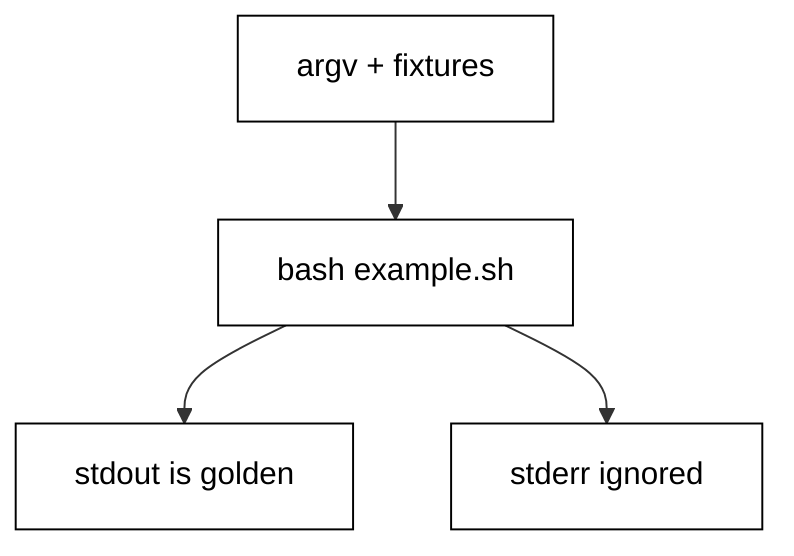

Prerequisites for this course: [just-enough-bash](/en/learn/courses/just-enough-bash/learning/overview) for pipes, redirection, variables, and the strict-mode habit every example here builds on. Comfort reading a shell script and running commands from a terminal is assumed throughout.

## Why this exists -- the big idea

**The problem before the solution**: scripts fail silently far more often than they fail loudly. An unset variable expands to nothing, a failed grep hides inside a pipeline, a half-written output passes as complete, and a background job dies unnoticed. Each failure mode in this course gets a strict-mode answer: flags that abort, traps that clean, tests that pin. **Keep this if you forget everything else**: `set -euo pipefail` is the default, not an afterthought, and everything after it is engineering around that promise.

## Tensions and trade-offs -- when NOT to reach for this

- **Strictness versus legacy**: `-u` and `pipefail` break old scripts that lean on empty expansions and masked statuses. Adopt the header for new scripts immediately; migrate old ones one file at a time, fixing what the flags reveal instead of disabling them.
- **Bash power versus portability**: arrays, process substitution, and `[[ ]]` are bash-only. Use them freely in bash-first tooling, and write POSIX-only for scripts that must run under dash or minimal containers. Declare the target shells before choosing the idiom.
- **When NOT**: one-off interactive command lines do not need traps, goldens, or usage contracts. The engineering in this course earns its place when the script runs twice — on a schedule, on someone else's machine, or at 3am without you.

## Lineage -- where this tool sits

Bash is the glue between every other tool in this series: the primer introduces the shell, the text-processing course sharpens awk, sed, and jq, and this course hardens the scripts that hold pipelines together. Deployment helpers, release scripts, CI glue, and developer tooling all live here. The discipline transfers directly: strict flags, trapped cleanup, and golden tests improve scripts in any language that shells out.

## How this course is organized

[Beginner](/en/learn/courses/advanced-shell-scripting-in-depth/learning/beginner) (Examples 1-25) installs the strict header, parses options from positionals to subcommands, and masters quoting so spaced filenames survive. [Intermediate](/en/learn/courses/advanced-shell-scripting-in-depth/learning/intermediate) (Examples 26-53) traps cleanup for every exit path, counts and dedupes with arrays, and feeds loops by redirection instead of pipes. [Advanced](/en/learn/courses/advanced-shell-scripting-in-depth/learning/advanced) (Examples 54-78) controls jobs and signals, writes portably, reviews mechanically, and tests everything against fixtures. The [capstone](/en/learn/courses/advanced-shell-scripting-in-depth/learning/capstone/overview) ships a deployment-helper CLI with a verified transcript, and [drilling](/en/learn/courses/advanced-shell-scripting-in-depth/drilling/overview) turns the sixteen concepts into recall, katas, and checklists.

## About the runtime

Every example runs as `bash example.sh` in the pinned Debian shell container with no network and a read-only course tree: only /tmp is writable, so scratch and captures live there behind EXIT traps. Demo argv is installed with `set --` for byte-stable output; fixtures ship beside each script; self-signals stand in for keyboards and orchestrators. Standard error carries traces and usage by design and is ignored or golden-pinned per unit; standard output is the asserted transcript.

## Examples by Level

### Beginner (Examples 1-25)

- [Example 1: First Strict Script](/en/learn/courses/advanced-shell-scripting-in-depth/learning/beginner#example-1-first-strict-script)
- [Example 2: Unset Variable Fails](/en/learn/courses/advanced-shell-scripting-in-depth/learning/beginner#example-2-unset-variable-fails)
- [Example 3: pipefail Catches a Mid-Pipe Failure](/en/learn/courses/advanced-shell-scripting-in-depth/learning/beginner#example-3-pipefail-catches-a-mid-pipe-failure)
- [Example 4: errexit Stops Early](/en/learn/courses/advanced-shell-scripting-in-depth/learning/beginner#example-4-errexit-stops-early)
- [Example 5: Guard with an or-List](/en/learn/courses/advanced-shell-scripting-in-depth/learning/beginner#example-5-guard-with-an-or-list)
- [Example 6: Explicit Exit Codes](/en/learn/courses/advanced-shell-scripting-in-depth/learning/beginner#example-6-explicit-exit-codes)
- [Example 7: Check the Exit Status](/en/learn/courses/advanced-shell-scripting-in-depth/learning/beginner#example-7-check-the-exit-status)
- [Example 8: Strict Header Template](/en/learn/courses/advanced-shell-scripting-in-depth/learning/beginner#example-8-strict-header-template)
- [Example 9: Positional Arguments](/en/learn/courses/advanced-shell-scripting-in-depth/learning/beginner#example-9-positional-arguments)
- [Example 10: Shift Through Arguments](/en/learn/courses/advanced-shell-scripting-in-depth/learning/beginner#example-10-shift-through-arguments)
- [Example 11: Short Flags with getopts](/en/learn/courses/advanced-shell-scripting-in-depth/learning/beginner#example-11-short-flags-with-getopts)
- [Example 12: Long Options Manually](/en/learn/courses/advanced-shell-scripting-in-depth/learning/beginner#example-12-long-options-manually)
- [Example 13: Options with Values](/en/learn/courses/advanced-shell-scripting-in-depth/learning/beginner#example-13-options-with-values)
- [Example 14: Defaults for Missing Arguments](/en/learn/courses/advanced-shell-scripting-in-depth/learning/beginner#example-14-defaults-for-missing-arguments)
- [Example 15: Subcommand Dispatch](/en/learn/courses/advanced-shell-scripting-in-depth/learning/beginner#example-15-subcommand-dispatch)
- [Example 16: Usage on Bad Input](/en/learn/courses/advanced-shell-scripting-in-depth/learning/beginner#example-16-usage-on-bad-input)
- [Example 17: Required Argument Check](/en/learn/courses/advanced-shell-scripting-in-depth/learning/beginner#example-17-required-argument-check)
- [Example 18: Quote Every Expansion](/en/learn/courses/advanced-shell-scripting-in-depth/learning/beginner#example-18-quote-every-expansion)
- [Example 19: Single vs Double Quotes](/en/learn/courses/advanced-shell-scripting-in-depth/learning/beginner#example-19-single-vs-double-quotes)
- [Example 20: Glob vs Literal](/en/learn/courses/advanced-shell-scripting-in-depth/learning/beginner#example-20-glob-vs-literal)
- [Example 21: Word Splitting Demo](/en/learn/courses/advanced-shell-scripting-in-depth/learning/beginner#example-21-word-splitting-demo)
- [Example 22: Filenames with Spaces](/en/learn/courses/advanced-shell-scripting-in-depth/learning/beginner#example-22-filenames-with-spaces)
- [Example 23: printf over echo](/en/learn/courses/advanced-shell-scripting-in-depth/learning/beginner#example-23-printf-over-echo)
- [Example 24: Read Lines Safely](/en/learn/courses/advanced-shell-scripting-in-depth/learning/beginner#example-24-read-lines-safely)
- [Example 25: Pass Args Through](/en/learn/courses/advanced-shell-scripting-in-depth/learning/beginner#example-25-pass-args-through)

### Intermediate (Examples 26-53)

- [Example 26: Trap EXIT Cleanup](/en/learn/courses/advanced-shell-scripting-in-depth/learning/intermediate#example-26-trap-exit-cleanup)
- [Example 27: Trap ERR Report](/en/learn/courses/advanced-shell-scripting-in-depth/learning/intermediate#example-27-trap-err-report)
- [Example 28: Cleanup on Any Exit](/en/learn/courses/advanced-shell-scripting-in-depth/learning/intermediate#example-28-cleanup-on-any-exit)
- [Example 29: Temp Dir Pattern](/en/learn/courses/advanced-shell-scripting-in-depth/learning/intermediate#example-29-temp-dir-pattern)
- [Example 30: Lockfile Pattern](/en/learn/courses/advanced-shell-scripting-in-depth/learning/intermediate#example-30-lockfile-pattern)
- [Example 31: Partial Output Rollback](/en/learn/courses/advanced-shell-scripting-in-depth/learning/intermediate#example-31-partial-output-rollback)
- [Example 32: Swap a Trap for One Section](/en/learn/courses/advanced-shell-scripting-in-depth/learning/intermediate#example-32-swap-a-trap-for-one-section)
- [Example 33: Stack Traps with Functions](/en/learn/courses/advanced-shell-scripting-in-depth/learning/intermediate#example-33-stack-traps-with-functions)
- [Example 34: Trace a Section](/en/learn/courses/advanced-shell-scripting-in-depth/learning/intermediate#example-34-trace-a-section)
- [Example 35: Indexed Array Basics](/en/learn/courses/advanced-shell-scripting-in-depth/learning/intermediate#example-35-indexed-array-basics)
- [Example 36: Loop over an Array](/en/learn/courses/advanced-shell-scripting-in-depth/learning/intermediate#example-36-loop-over-an-array)
- [Example 37: Array Length and Slice](/en/learn/courses/advanced-shell-scripting-in-depth/learning/intermediate#example-37-array-length-and-slice)
- [Example 38: Associative Array Counts](/en/learn/courses/advanced-shell-scripting-in-depth/learning/intermediate#example-38-associative-array-counts)
- [Example 39: Safe Array from a Glob](/en/learn/courses/advanced-shell-scripting-in-depth/learning/intermediate#example-39-safe-array-from-a-glob)
- [Example 40: mapfile from a File](/en/learn/courses/advanced-shell-scripting-in-depth/learning/intermediate#example-40-mapfile-from-a-file)
- [Example 41: Join Array Elements](/en/learn/courses/advanced-shell-scripting-in-depth/learning/intermediate#example-41-join-array-elements)
- [Example 42: Associative Config Table](/en/learn/courses/advanced-shell-scripting-in-depth/learning/intermediate#example-42-associative-config-table)
- [Example 43: Dedupe with an Assoc](/en/learn/courses/advanced-shell-scripting-in-depth/learning/intermediate#example-43-dedupe-with-an-assoc)
- [Example 44: Array of PIDs and wait](/en/learn/courses/advanced-shell-scripting-in-depth/learning/intermediate#example-44-array-of-pids-and-wait)
- [Example 45: Here-Doc Config](/en/learn/courses/advanced-shell-scripting-in-depth/learning/intermediate#example-45-here-doc-config)
- [Example 46: Here-String Single Line](/en/learn/courses/advanced-shell-scripting-in-depth/learning/intermediate#example-46-here-string-single-line)
- [Example 47: Quoted Delimiter Stays Literal](/en/learn/courses/advanced-shell-scripting-in-depth/learning/intermediate#example-47-quoted-delimiter-stays-literal)
- [Example 48: Diff Two Command Outputs](/en/learn/courses/advanced-shell-scripting-in-depth/learning/intermediate#example-48-diff-two-command-outputs)
- [Example 49: Join Command Outputs](/en/learn/courses/advanced-shell-scripting-in-depth/learning/intermediate#example-49-join-command-outputs)
- [Example 50: Loop over Substitution Output](/en/learn/courses/advanced-shell-scripting-in-depth/learning/intermediate#example-50-loop-over-substitution-output)
- [Example 51: Tee to Two Consumers](/en/learn/courses/advanced-shell-scripting-in-depth/learning/intermediate#example-51-tee-to-two-consumers)
- [Example 52: Compare a Fixture Snapshot](/en/learn/courses/advanced-shell-scripting-in-depth/learning/intermediate#example-52-compare-a-fixture-snapshot)
- [Example 53: Feed a Loop with a Heredoc](/en/learn/courses/advanced-shell-scripting-in-depth/learning/intermediate#example-53-feed-a-loop-with-a-heredoc)

### Advanced (Examples 54-78)

- [Example 54: Background and wait](/en/learn/courses/advanced-shell-scripting-in-depth/learning/advanced#example-54-background-and-wait)
- [Example 55: wait Collects Each Status](/en/learn/courses/advanced-shell-scripting-in-depth/learning/advanced#example-55-wait-collects-each-status)
- [Example 56: Address Jobs by Spec](/en/learn/courses/advanced-shell-scripting-in-depth/learning/advanced#example-56-address-jobs-by-spec)
- [Example 57: Foreground Brings Back](/en/learn/courses/advanced-shell-scripting-in-depth/learning/advanced#example-57-foreground-brings-back)
- [Example 58: Trap SIGINT Cleanup](/en/learn/courses/advanced-shell-scripting-in-depth/learning/advanced#example-58-trap-sigint-cleanup)
- [Example 59: Trap SIGTERM Drain](/en/learn/courses/advanced-shell-scripting-in-depth/learning/advanced#example-59-trap-sigterm-drain)
- [Example 60: Ignore SIGHUP](/en/learn/courses/advanced-shell-scripting-in-depth/learning/advanced#example-60-ignore-sighup)
- [Example 61: Shutdown Handler Sequence](/en/learn/courses/advanced-shell-scripting-in-depth/learning/advanced#example-61-shutdown-handler-sequence)
- [Example 62: Bashisms to Avoid](/en/learn/courses/advanced-shell-scripting-in-depth/learning/advanced#example-62-bashisms-to-avoid)
- [Example 63: POSIX Test Brackets](/en/learn/courses/advanced-shell-scripting-in-depth/learning/advanced#example-63-posix-test-brackets)
- [Example 64: printf Portable Table](/en/learn/courses/advanced-shell-scripting-in-depth/learning/advanced#example-64-printf-portable-table)
- [Example 65: Command -v Check](/en/learn/courses/advanced-shell-scripting-in-depth/learning/advanced#example-65-command-v-check)
- [Example 66: Shebang env Pattern](/en/learn/courses/advanced-shell-scripting-in-depth/learning/advanced#example-66-shebang-env-pattern)
- [Example 67: ShellCheck Clean Pattern](/en/learn/courses/advanced-shell-scripting-in-depth/learning/advanced#example-67-shellcheck-clean-pattern)
- [Example 68: Quote Check Review](/en/learn/courses/advanced-shell-scripting-in-depth/learning/advanced#example-68-quote-check-review)
- [Example 69: Unsafe Patterns Fixed](/en/learn/courses/advanced-shell-scripting-in-depth/learning/advanced#example-69-unsafe-patterns-fixed)
- [Example 70: Locale Safe Sorting](/en/learn/courses/advanced-shell-scripting-in-depth/learning/advanced#example-70-locale-safe-sorting)
- [Example 71: Golden File Compare](/en/learn/courses/advanced-shell-scripting-in-depth/learning/advanced#example-71-golden-file-compare)
- [Example 72: Assert Helper](/en/learn/courses/advanced-shell-scripting-in-depth/learning/advanced#example-72-assert-helper)
- [Example 73: Isolate the Failing Case](/en/learn/courses/advanced-shell-scripting-in-depth/learning/advanced#example-73-isolate-the-failing-case)
- [Example 74: Setup Teardown Fixture](/en/learn/courses/advanced-shell-scripting-in-depth/learning/advanced#example-74-setup-teardown-fixture)
- [Example 75: Table Driven Tests](/en/learn/courses/advanced-shell-scripting-in-depth/learning/advanced#example-75-table-driven-tests)
- [Example 76: Stub an External Command](/en/learn/courses/advanced-shell-scripting-in-depth/learning/advanced#example-76-stub-an-external-command)
- [Example 77: Test Exit Codes](/en/learn/courses/advanced-shell-scripting-in-depth/learning/advanced#example-77-test-exit-codes)
- [Example 78: Full Suite Green](/en/learn/courses/advanced-shell-scripting-in-depth/learning/advanced#example-78-full-suite-green)
