Examples 57-80 push the task service from a single trusted caller into two real production concerns: authentication (server-side session maps versus server-side token maps, a minting endpoint with `crypto/rand` hex, a middleware check and three helper-guard scenarios, a read/write split, and cookie auth) and list-endpoint scale (`limit`/`offset` with `422`, defaults, an `{items,total,next}` envelope, bounds, one and two filters, parameterized SQL via `modernc.org/sqlite`, a closed sort set, and one combined `WHERE`/`ORDER BY`/`LIMIT`/`OFFSET` query), closed out by an idempotent-PUT proof with `/tasks/count`, `405` plus `Allow` purely from registration, `/health` versus `/ready` with a `TASKS_DB_PATH` probe, one `envelope()` plus `withRecovery` across five failure kinds, a documented `curl` CRUD-plus-auth `script.sh`, an `httptest` suite spanning CRUD, auth, and pagination together, and a genuine two-process statelessness proof with `-port`/`-store` flags, an atomic file store, a `handled_by` stamp, and `/whoami`. Every server runs on port 8000 except Example 57 (port 8003 in its source) and Example 80 (two processes via `-port` flags, demoed on 8003 and 8004); every example directory is self-contained with its own `main.go` and `go.mod` (Examples 71 and 73 add SQLite via `modernc.org/sqlite`, Example 78 adds `script.sh`, Example 79 adds `main_test.go`); run with `go run .` from inside its own directory and exercised with `curl` from a second terminal.

---

### Example 57: Sessions vs Tokens

_ex-57 &middot; exercises co-17_

A session and a bearer token both answer the same question -- who is this caller? -- but they place the credential in different transports: a cookie the browser manages automatically versus a header string the client must attach itself. In this stdlib-only track both records live server-side in maps, because an unsigned opaque token is verifiable only by lookup.

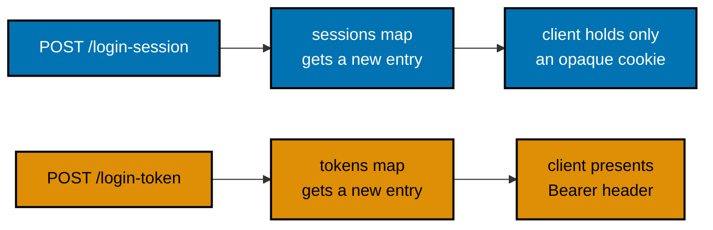

**`learning/code/ex-57-sessions-vs-tokens/main.go`**

```go
// loginMechanismResponse is what a successful login confirms to the caller.
type loginMechanismResponse struct { // => co-09: a typed response, like a pydantic model
	Mechanism string `json:"mechanism"` // => "session" or "token", so curl output is comparable
}

// sessionLoginResponse adds the cookie VALUE the caller may echo for clarity.
type sessionLoginResponse struct { // => mirrors Python's {"mechanism", "session_id"} shape
	Mechanism string `json:"mechanism"`  // => the confirming field, identical across both logins
	SessionID string `json:"session_id"` // => the opaque id sent in the Set-Cookie header below
}

// tokenLoginResponse carries the credential its own handler just minted.
type tokenLoginResponse struct { // => mirrors Python's {"mechanism", "token"} shape
	Mechanism string `json:"mechanism"` // => same key on both login bodies keeps the contrast readable
	Token     string `json:"token"`     // => the client must hold this and attach it on every later call
}

// profileResponse is the shared identity body both profile endpoints return.
type profileResponse struct { // => co-09: one shape so the two mechanisms' outputs diff cleanly
	Mechanism string `json:"mechanism"` // => tells the reader which store resolved the caller
	Username  string `json:"username"`  // => the identity the record points at (co-17)
}

var (
	storeMu  sync.RWMutex          // => both stores are written by POST handlers and read by GET handlers
	sessions = map[string]string{} // => session id -> username; co-05 caveat: PROCESS-side memory,
	// => gone on restart and invisible to a second worker -- Example 80 makes that concrete
	tokens = map[string]string{} // => opaque token -> username; the Go-ified co-17 tradeoff:
	// => an unsigned token cannot self-verify, so its record lives in a store that some
	// => process must read -- deployed for real, that store is the shared database (capstone)
)

// mintToken produces a fresh 128-bit random credential, hex-encoded.
func mintToken() (string, error) {
	raw := make([]byte, 16) // => 16 bytes = 128 bits of entropy, beyond brute-force reach
	if _, err := rand.Read(raw); err != nil {
		// => rand.Read reads from the OS cryptographic source; ever failing is a
		// => genuine internal error, so the caller must refuse to serve on top of it
		return "", err
	}
	return hex.EncodeToString(raw), nil // => 32 lowercase hex chars, safe in a header or cookie
}
```

The file also defines `usernameForSession` and `usernameForToken` (map lookups under `storeMu`, the token path re-confirms with `subtle.ConstantTimeCompare`), `bearerToken` (strips the `Bearer` prefix, one miss for absent and foreign schemes), the four handlers `loginSession` (mints, stores `sessions[sid] = "alice"`, `http.SetCookie` with `HttpOnly` and `SameSiteLaxMode`), `profileSession` (reads the `session_id` cookie, `401` with `no valid session` on miss), `loginToken` (mints, stores `tokens[token] = "alice"`), `profileToken` (header lookup, `401` with `missing or invalid token` on miss), plus the shared `writeJSON`/`writeError` helpers rendering `{"error":{"code":...,"message":...}}` and `main` registering `POST /login-session`, `GET /profile-session`, `POST /login-token`, `GET /profile-token` on `127.0.0.1:8003`.

**Run**: `go run .` from inside `ex-57-sessions-vs-tokens` (listens on `127.0.0.1:8003` per its source), then `curl` in another terminal.

**Output** (curl):

```text
$ curl -s -D - -X POST http://127.0.0.1:8003/login-session -o /tmp/sess.json
HTTP/1.1 200 OK
Set-Cookie: session_id=<32-hex-chars>; Path=/; HttpOnly; SameSite=Lax
{"mechanism":"session","session_id":"<32-hex-chars>"}
$ curl -s --cookie "session_id=<same-hex>" http://127.0.0.1:8003/profile-session
{"mechanism":"session","username":"alice"}
$ curl -s http://127.0.0.1:8003/profile-session
{"error":{"code":"unauthorized","message":"no valid session"}}
$ curl -s -X POST http://127.0.0.1:8003/login-token
{"mechanism":"token","token":"<32-hex-chars>"}
```

(The `<32-hex-chars>` values differ on every run because `mintToken` uses `crypto/rand`; the cookie and token bodies echo whatever was just minted.)

**Key takeaway**: Both mechanisms need server-side storage in this track because an unsigned opaque token cannot self-verify -- the map record, not the string alone, is the identity.

**Why it matters**: This is the tradeoff every later example builds on: Examples 58-63 develop the token side (minting, middleware and helper checks, protecting only writes), Example 64 develops the session side into its own app, and Example 80 later proves an in-process map does not survive across two real worker processes while shared storage does.

---

### Example 58: Issue a Token

_ex-58 &middot; exercises co-17, co-18_

`POST /login` is where the token a client presents on every later call actually comes from: given a username and password it mints a fresh opaque token with `crypto/rand` and remembers it server-side. The credential check stays fixed (`alice` / `wonderland`) so the focus stays on the request/response shape rather than on cryptography.

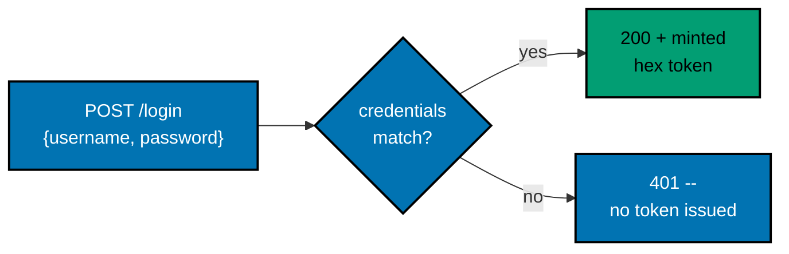

**`learning/code/ex-58-issue-token/main.go`**

```go
// mintToken produces a fresh 128-bit random credential, hex-encoded.
func mintToken() (string, error) { // => (value, error): the Go convention for a fallible mint
	raw := make([]byte, 16)                   // => 16 bytes = 128 bits of entropy, beyond brute-force reach
	if _, err := rand.Read(raw); err != nil { // => the OS source failed: refuse, never fall back to weak
		return "", err // => the caller turns this into a 500 -- no token without entropy
	} // => the failure branch ends
	return hex.EncodeToString(raw), nil // => 32 lowercase hex chars, safe in an Authorization header
} // => mintToken ends

// login verifies credentials, then issues a token -- no session created.
func login(w http.ResponseWriter, r *http.Request) { // => co-17, co-18: issues a token, stores the record
	defer r.Body.Close()                                           // => always release the request body, valid or not
	var creds credentials                                          // => the zero-value target the decoder fills
	if err := json.NewDecoder(r.Body).Decode(&creds); err != nil { // => malformed JSON never reaches the check
		writeJSON(w, http.StatusUnprocessableEntity, // => co-10: validation runs BEFORE handler logic
			detailEnvelope{Detail: "username and password are required"}) // => 422, no token minted
		return // => early return: nothing below runs on an unreadable body
	} // => the decode branch ends
	if strings.TrimSpace(creds.Username) == "" || strings.TrimSpace(creds.Password) == "" { // => a field omitted entirely
		writeJSON(w, http.StatusUnprocessableEntity, // => co-10: missing field, same 422 as malformed JSON
			detailEnvelope{Detail: "username and password are required"}) // => never hints WHICH field was missing
		return // => early return: no partial credential on failure
	} // => the missing-field branch ends
	if creds.Username != username || creds.Password != password { // => reject any mismatch immediately
		// => deliberately ONE message for a wrong username AND a wrong password,
		// => so a caller cannot enumerate valid usernames from the response
		writeJSON(w, http.StatusUnauthorized, // => co-03: 401, not 404 -- the identity was rejected
			errorEnvelope{Error: apiError{Code: "unauthorized", Message: "invalid credentials"}}) // => no token leaked
		return // => early return: a failed login mints nothing
	} // => the bad-credentials branch ends
	token, err := mintToken() // => the fresh credential this login exists to create
	if err != nil {           // => no entropy: refuse loudly instead of issuing a weaker token
		writeJSON(w, http.StatusInternalServerError, // => 500: the server, not the caller, failed
			errorEnvelope{Error: apiError{Code: "internal_error", Message: "could not mint a token"}}) // => sanitized
		return // => early return: no record without a real token
	} // => the mint-failure branch ends
	storeMu.Lock()                                           // => the write lock: this insert races with later token checks
	tokens[token] = username                                 // => co-17: the SERVER remembers who this token belongs to
	storeMu.Unlock()                                         // => release: the next request may now present this token
	writeJSON(w, http.StatusOK, tokenResponse{Token: token}) // => co-09: just the token -- no session, no extra keys
	// => no server-side session beyond the token record: co-17's defining difference
} // => login ends
```

The file also defines the `credentials` and `tokenResponse` structs, the `apiError`/`errorEnvelope`/`detailEnvelope` shapes, the shared `writeJSON` helper, `newHandler` registering only `POST /login`, and `main` listening on `127.0.0.1:8000`.

**Run**: `go run .` from inside `ex-58-issue-token`, then `curl` with JSON bodies in another terminal.

**Output** (curl):

```text
$ curl -s -X POST http://127.0.0.1:8000/login -H 'Content-Type: application/json' -d '{"username":"alice","password":"wonderland"}'
{"token":"<32-hex-chars>"}
$ curl -s -X POST http://127.0.0.1:8000/login -H 'Content-Type: application/json' -d '{"username":"alice","password":"wrong"}' -w '\n%{http_code}\n'
{"error":{"code":"unauthorized","message":"invalid credentials"}}
401
$ curl -s -X POST http://127.0.0.1:8000/login -H 'Content-Type: application/json' -d '{"username":"alice"}' -w '\n%{http_code}\n'
{"detail":"username and password are required"}
422
```

(The success token is fresh `crypto/rand` hex on every call, so its exact value varies; the 401 and 422 bodies are fixed.)

**Key takeaway**: A login endpoint returns only the credential the client needs and rejects a wrong username exactly the same way as a wrong password, so a caller can never enumerate valid usernames from the error alone.

**Why it matters**: Every one of Examples 59-63 assumes a token already exists in the caller's hands; this is where that token comes from. Minting with `crypto/rand` instead of a literal is what makes each token unguessable, while the identical-error-message discipline keeps the endpoint from becoming a username oracle.

---

### Example 59: Token-Check Middleware

_ex-59 &middot; exercises co-18, co-16_

A middleware wraps every request before routing decides which handler runs, which makes it the right place for a cross-cutting concern like "is this caller allowed in?" The entire authorization policy lives in one prefix check plus one store lookup, instead of being copy-pasted into every handler.

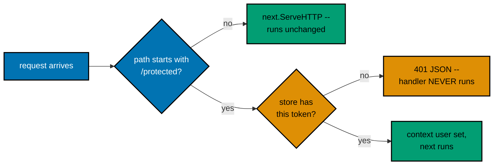

**`learning/code/ex-59-token-check-middleware/main.go`**

```go
// withTokenCheck is the middleware: plain func(http.Handler) http.Handler.
func withTokenCheck(next http.Handler) http.Handler { // => co-16: wraps EVERY request/response
	return http.HandlerFunc(func(w http.ResponseWriter, r *http.Request) { // => the per-request closure
		if !strings.HasPrefix(r.URL.Path, "/protected") { // => co-16: only THIS prefix is guarded
			// => Example 63 explores a read/write split instead of this path-prefix split
			next.ServeHTTP(w, r) // => open path: untouched, straight to routing
			return               // => early return: the token branch below never runs for /public
		} // => the open-path branch ends
		presented, hasBearer := bearerToken(r) // => co-04: the raw header, scheme stripped
		username, ok := "", false              // => the resolved identity and whether anything resolved
		if hasBearer {                         // => only look up when a Bearer value was actually sent
			username, ok = usernameForToken(presented) // => one lookup drives the whole policy
		} // => the lookup branch ends
		if !ok { // => co-18: exact match or nothing -- no partial credit
			// => this branch fires for BOTH a missing header and a garbage one
			writeJSON(w, http.StatusUnauthorized, // => co-03: 401 -- who you claim to be was rejected
				errorEnvelope{Error: apiError{Code: "unauthorized", Message: "missing or invalid token"}}) // => co-11: structured, never bare
			return // => short-circuit: routing never runs, the guarded handler never starts
		} // => the rejected branch ends
		ctx := context.WithValue(r.Context(), userKey, username) // => co-16: attaches identity for the handler
		// => context is the Go twin of request.state: middleware writes, handlers read
		next.ServeHTTP(w, r.WithContext(ctx)) // => guarded path, identity attached -- routing runs now
	}) // => the closure ends
} // => withTokenCheck ends: the ENTIRE policy lives in this one condition
```

The file also defines `demoToken = "s3cr3t-token-abc123"` seeded in a `tokens` map, the `userKey` context key, `bearerToken` and `usernameForToken` helpers, the shared `writeJSON` envelope plumbing, `publicHandler` (always `{"access":"public"}`), `protectedHandler` (reads the context user, no auth logic of its own), `newHandler` registering `GET /public` and `GET /protected/data` wrapped once with `withTokenCheck`, and `main` on `127.0.0.1:8000`.

**Run**: `go run .` from inside `ex-59-token-check-middleware`, then `curl` in another terminal.

**Output** (curl):

```text
$ curl -s http://127.0.0.1:8000/public
{"access":"public"}
$ curl -s http://127.0.0.1:8000/protected/data -H "Authorization: Bearer s3cr3t-token-abc123"
{"access":"protected","user":"alice"}
$ curl -s http://127.0.0.1:8000/protected/data -w '\n%{http_code}\n'
{"error":{"code":"unauthorized","message":"missing or invalid token"}}
401
```

**Key takeaway**: Returning a response directly from inside middleware instead of calling the next handler short-circuits the whole chain: the guarded handler body never starts for a rejected request.

**Why it matters**: Middleware guards by URL path prefix with one rule for a whole section, while Examples 60-63 guard per route with an explicit helper call. The middleware attaches identity via `context.WithValue`, the Go twin of a per-request namespace, so handlers trust what already ran instead of re-deriving it.

---

### Example 60: Missing Token

_ex-60 &middot; exercises co-18, co-11_

The first of three 401 scenarios (Examples 60, 61, 62) sharing the same `requireUser` helper -- only what `curl` sends differs. Here `curl` sends no `Authorization` header at all, which the helper reports as the missing-header branch.

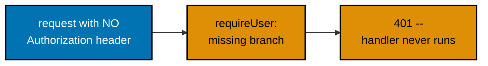

**`learning/code/ex-60-missing-token-401/main.go`**

```go
// requireUser is the reusable guard -- any handler opts in by calling it first.
func requireUser(r *http.Request) (string, bool, string) { // => (identity, ok, whyNot): the Go twin of Depends
	const prefix = "Bearer "                                // => the exact scheme a curl -H flag would send
	header := r.Header.Get("Authorization")                 // => canonicalized, so wire casing is irrelevant
	if header == "" || !strings.HasPrefix(header, prefix) { // => co-18: no Authorization header AT ALL
		// => THIS example's scenario specifically: curl with no -H flag whatsoever
		return "", false, "Authorization header missing" // => the specific reason naming this example
	} // => the missing-header branch ends
	presented := header[len(prefix):] // => HTTPBearer already stripped the prefix in Python; Go does it by hand
	storeMu.RLock()                   // => the read lock for the store lookup
	username, ok := tokens[presented] // => server-side truth: no record means never issued here
	storeMu.RUnlock()                 // => release immediately: the value below is a copy
	if !ok {                          // => header present, but the token itself is wrong
		// => Example 61 is the one that actually exercises THIS branch;
		// => unreachable from THIS example's own curl, kept for completeness
		return "", false, "invalid token" // => the wrong-value reason, distinct from missing
	} // => the wrong-token branch ends
	return username, true, "" // => the resolved identity, for the handler to echo
	// => Example 62 is the one that actually reaches this successful return
} // => requireUser ends
```

The file also defines `demoToken` seeded in `tokens`, the shared `writeJSON`/`writeError` envelope, the `protected` handler calling `requireUser` first and writing `401` with the returned reason on failure, `newHandler` registering only `GET /protected`, and `main` on `127.0.0.1:8000`.

**Run**: `go run .` from inside `ex-60-missing-token-401`, then `curl` in another terminal.

**Output** (curl):

```text
$ curl -s http://127.0.0.1:8000/protected -w '\n%{http_code}\n'
{"error":{"code":"unauthorized","message":"Authorization header missing"}}
401
$ curl -s http://127.0.0.1:8000/protected -H "Authorization: Bearer s3cr3t-token-abc123"
{"user":"alice"}
```

**Key takeaway**: The guard returns a `(user, ok, reason)` triple so the handler can render a distinct missing-header message while keeping one 401 envelope shape.

**Why it matters**: Distinguishing "missing" from "invalid" in the message while keeping the same 401 status gives operators a debuggable signal without changing the client's error-handling path; Example 77 later reuses this same single-envelope discipline across five failure kinds.

---

### Example 61: Invalid Token

_ex-61 &middot; exercises co-18_

A token can be wrong in two ways: entirely absent (Example 60) or present-but-incorrect (this example). A caller sees the same 401 status either way, which is deliberate -- the API never leaks which half of the failure the caller hit beyond a message distinction the operator can read.

**`learning/code/ex-61-invalid-token-401/main.go`**

```go
// requireUser is the reusable guard -- identical SHAPE to Example 60.
func requireUser(r *http.Request) (string, bool, string) { // => (identity, ok, whyNot): the Go twin of Depends
	// => the difference this example exercises lives in what curl SENDS, not in this function's code
	const prefix = "Bearer "                                // => the exact scheme a curl -H flag would send
	header := r.Header.Get("Authorization")                 // => canonicalized, so wire casing is irrelevant
	if header == "" || !strings.HasPrefix(header, prefix) { // => genuinely absent -- Example 60's case
		// => still handled here so this guard stays fully correct standalone
		return "", false, "Authorization header missing" // => the absent reason, kept for completeness
	} // => the missing-header branch ends
	presented := header[len(prefix):] // => the raw string after "Bearer ": HTTPBearer did this in Python
	storeMu.RLock()                   // => the read lock for the store lookup
	username, ok := tokens[presented] // => server-side truth: no record means never issued here
	storeMu.RUnlock()                 // => release immediately: the value below is a copy
	if !ok {                          // => co-18: THIS example's focus -- present but WRONG
		// => a well-formed "Bearer <garbage>" header still fails the lookup;
		// => the prefix strip above means .presented holds just the raw string
		return "", false, "token is invalid" // => distinct message from the missing case above
	} // => the wrong-token branch ends
	return username, true, "" // => the resolved identity -- unreachable from THIS example's own curl,
	// => since the token sent is deliberately wrong, but still needed so every path returns a string
} // => requireUser ends
```

The file also defines the same `demoToken` store, `writeJSON`/`writeError` envelope, `protected` handler, `newHandler` with only `GET /protected`, and `main` on `127.0.0.1:8000`.

**Run**: `go run .` from inside `ex-61-invalid-token-401`, then `curl` in another terminal.

**Output** (curl):

```text
$ curl -s http://127.0.0.1:8000/protected -H "Authorization: Bearer not-a-real-token" -w '\n%{http_code}\n'
{"error":{"code":"unauthorized","message":"token is invalid"}}
401
$ curl -s http://127.0.0.1:8000/protected -H "Authorization: Bearer s3cr3t-token-abc123"
{"user":"alice"}
```

**Key takeaway**: Stripping the literal `Bearer` prefix by hand leaves just the raw token string, so the store lookup is a single equality-backed map hit, not string parsing.

**Why it matters**: 401 means "I do not know who you are"; nothing here returns 403 because nothing distinguishes identity from permission. A real deployment with roles would need a separate 403 path after identity is established, kept out of scope here so the mechanism stays clear.

---

### Example 62: Valid Token

_ex-62 &middot; exercises co-18_

The third scenario in the 401 trio: the same guarded route and the same helper shape as Examples 60 and 61, but this time `curl` sends the genuinely correct token, so the request clears the check and reaches the handler body with a slightly richer success shape.

**`learning/code/ex-62-valid-token-200/main.go`**

```go
// requireUser collapses "missing" AND "wrong" into ONE branch -- this curl
// only ever needs to prove the OPPOSITE: a correct token clears the check.
func requireUser(r *http.Request) (string, bool) { // => (identity, ok): no reason string needed here
	const prefix = "Bearer "                // => the exact scheme a curl -H flag would send
	header := r.Header.Get("Authorization") // => canonicalized, so wire casing is irrelevant
	if !strings.HasPrefix(header, prefix) { // => co-18: absent header or a foreign scheme both fail here
		return "", false // => ONE outcome for every failure mode, never a distinguishing leak
	} // => the missing-or-foreign branch ends
	presented := header[len(prefix):] // => just the credential after "Bearer "
	storeMu.RLock()                   // => the read lock for the store lookup
	username, ok := tokens[presented] // => server-side truth: no record means never issued here
	storeMu.RUnlock()                 // => release immediately: the value below is a copy
	if !ok {                          // => co-18: header present, value wrong -- same outcome as missing
		return "", false // => unreachable from THIS example's own curl -- kept only so the
		// => function stays fully correct if a reader copies it and DOES send a bad token
	} // => the wrong-token branch ends
	return username, true // => co-18: THIS example's focus -- the success path, good token only
	// => no session, no extra lookup -- the token equality above IS the entire proof
} // => requireUser ends
```

The file also defines the same `demoToken` store, `writeJSON`/`writeError` envelope, the `protected` handler returning `{"user":"alice","granted":true}` on success, `newHandler` with only `GET /protected`, and `main` on `127.0.0.1:8000`.

**Run**: `go run .` from inside `ex-62-valid-token-200`, then `curl` in another terminal.

**Output** (curl):

```text
$ curl -s http://127.0.0.1:8000/protected -H "Authorization: Bearer s3cr3t-token-abc123"
{"user":"alice","granted":true}
$ curl -s http://127.0.0.1:8000/protected -w '\n%{http_code}\n'
{"error":{"code":"unauthorized","message":"missing or invalid token"}}
401
```

**Key takeaway**: By the time the handler body runs, the user is guaranteed to be resolved -- every failure path already returned 401 one call earlier, so the handler needs no defensive checks of its own.

**Why it matters**: The three-example progression (absent, wrong, correct) is a complete equivalence-class test of one guard, and Example 79 later organizes its own token-auth tests the same way: missing, wrong, and valid as separate explicit test functions.

---

### Example 63: Protect Writes Only

_ex-63 &middot; exercises co-18, co-02_

A common real-world policy: anyone can read the catalog, but only an authenticated caller can change it. The HTTP method and route registration decide which rule applies -- `GET /items` wears no guard at all, while `POST` and `DELETE` are each wrapped with `withAuth`.

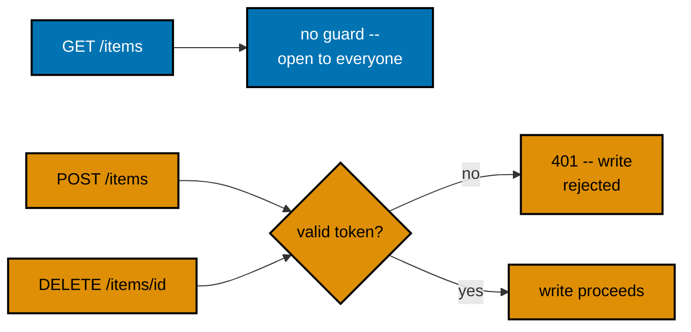

**`learning/code/ex-63-protect-writes-only/main.go`**

```go
// withAuth guards ONE route's side effect: raise-or-don't, then hand off.
func withAuth(next http.Handler) http.Handler { // => plain func(http.Handler) http.Handler, per write route
	return http.HandlerFunc(func(w http.ResponseWriter, r *http.Request) { // => the per-request closure
		if !validToken(r) { // => co-18: either failure mode lands here
			writeError(w, http.StatusUnauthorized, // => co-03: 401 -- the write is blocked
				"unauthorized", "missing or invalid token") // => co-11: same envelope as ex-59..62
			return // => short-circuit: the write handler below never starts
		} // => the rejected branch ends
		next.ServeHTTP(w, r) // => allowed: the actual write runs now
	}) // => the closure ends
} // => withAuth ends: no return value needed -- reaching next IS the approval

// listItems is OPEN: no guard anywhere on this path.
func listItems(w http.ResponseWriter, r *http.Request) { // => co-02: reads are safe/idempotent, open to everyone
	storeMu.RLock()                                 // => the read lock: many GETs may run together
	snapshot := make(map[string]string, len(items)) // => string keys: JSON object keys are always strings
	for id, name := range items {                   // => copy under lock, encode after release
		snapshot[strconv.Itoa(id)] = name // => "1" -> "milk", exactly what curl sees
	} // => the copy loop ends
	storeMu.RUnlock()                     // => release before encoding: snapshot is safe to write
	writeJSON(w, http.StatusOK, snapshot) // => co-02: curl with zero headers succeeds here
} // => listItems ends
```

The file also defines `demoToken` in a `tokens` map, `validToken` (prefix strip plus store lookup), the in-memory `items = {1:"milk",2:"bread"}` map with `nextID = 3`, `createItem` (reads `?name=`, `422` on empty, otherwise assigns an id) and `deleteItem` (parses `{item_id}`, idempotent delete, always `{"deleted":true}`), the shared `writeJSON`/`writeError` envelope, `newHandler` wiring `GET /items` open and `POST /items` plus `DELETE /items/{item_id}` each wrapped with `withAuth`, and `main` on `127.0.0.1:8000`.

**Run**: `go run .` from inside `ex-63-protect-writes-only`, then `curl` in another terminal.

**Output** (curl):

```text
$ curl -s http://127.0.0.1:8000/items
{"1":"milk","2":"bread"}
$ curl -s -X POST "http://127.0.0.1:8000/items?name=eggs" -w '\n%{http_code}\n'
{"error":{"code":"unauthorized","message":"missing or invalid token"}}
401
$ curl -s -X POST "http://127.0.0.1:8000/items?name=eggs" -H "Authorization: Bearer s3cr3t-token-abc123"
{"id":3,"name":"eggs"}
```

**Key takeaway**: Wrapping only the write routes with `withAuth` runs the guard for its side effect only -- the write handler never sees the token value, only the yes-or-no decision to proceed.

**Why it matters**: This mirrors HTTP's own safe-method classification: `GET` is conventionally safe, so leaving it open matches how the web already expects APIs to behave. The in-memory `items` map and `nextID` counter are explicitly process-local, the exact tension Example 80 resolves with a shared file.

---

### Example 64: Session-Cookie Auth

_ex-64 &middot; exercises co-17_

This is Example 57's session mechanism as its own complete app: `POST /login` mints server-side state in a `sessions` map and sets an `HttpOnly` cookie; `GET /me` reads that cookie back and looks up the identity it points to, never re-checking a password.

**`learning/code/ex-64-session-cookie-auth/main.go`**

```go
// login authenticates, then ESTABLISHES a session -- unlike ex-58's token
// endpoint, this one has a SIDE EFFECT: a new entry in the sessions map.
func login(w http.ResponseWriter, r *http.Request) { // => co-17: the session-creating endpoint
	gotUser := r.URL.Query().Get("username")        // => ?username=alice, mirroring Python's query-param login
	gotPass := r.URL.Query().Get("password")        // => ?password=wonderland -- curl's -c flag captures the result
	if gotUser != username || gotPass != password { // => co-17: reject any mismatch immediately
		// => deliberately the SAME message for a wrong username AND a wrong password --
		// => never let a caller distinguish "no such user" from "wrong password"
		writeError(w, http.StatusUnauthorized, // => co-03: 401 -- the credentials were rejected
			"unauthorized", "invalid credentials") // => a failed login must never set a cookie below
		return // => early return: no session entry, no Set-Cookie on failure
	} // => the bad-credentials branch ends
	sid, err := mintSessionID() // => a fresh, unguessable session identifier
	if err != nil {             // => no entropy: refuse loudly instead of issuing a weaker id
		writeError(w, http.StatusInternalServerError, // => 500: the server, not the caller, failed
			"internal_error", "could not create a session") // => sanitized, nothing leaked
		return // => early return: no record without a real id
	} // => the mint-failure branch ends
	storeMu.Lock()                  // => the write lock: this insert races with concurrent /me reads
	sessions[sid] = username        // => co-17: the SERVER remembers this session belongs to username
	storeMu.Unlock()                // => release: the next /me may now present this cookie
	http.SetCookie(w, &http.Cookie{ // => co-04: writes the Set-Cookie header -- curl's -c flag captures it
		Name:     "session_id",         // => the exact key meHandler reads back below
		Value:    sid,                  // => the minted id stands in for Python's uuid4 string
		Path:     "/",                  // => usable on every path, like a real session cookie
		HttpOnly: true,                 // => co-04: JS cannot read it -- mitigates theft via XSS
		SameSite: http.SameSiteLaxMode, // => default-level CSRF mitigation, mirroring Python's httponly cookie
	}) // => the SetCookie call closes
	writeJSON(w, http.StatusOK, map[string]string{"logged_in_as": username}) // => co-17: confirms WHO logged in --
	// => never the session id itself: leaking it in the JSON body too would defeat HttpOnly above
} // => login ends
```

The file also defines `mintSessionID` (`crypto/rand` plus hex, rotated on every login), `meHandler` (reads the `session_id` cookie, `401` with `no active session` for missing or unknown values, including after a restart empties the map), the shared `writeJSON`/`writeError` envelope, `newHandler` registering `POST /login` and `GET /me`, and `main` on `127.0.0.1:8000`.

**Run**: `go run .` from inside `ex-64-session-cookie-auth`, then `curl` with `-c` and `-b` jar handling in another terminal.

**Output** (curl):

```text
$ curl -s -c jar.txt -X POST "http://127.0.0.1:8000/login?username=alice&password=wonderland"
{"logged_in_as":"alice"}
$ cat jar.txt
#HttpOnly_localhost FALSE / FALSE 0 session_id <32-hex-chars>
$ curl -s -b jar.txt http://127.0.0.1:8000/me
{"username":"alice"}
$ curl -s http://127.0.0.1:8000/me -w '\n%{http_code}\n'
{"error":{"code":"unauthorized","message":"no active session"}}
401
```

**Key takeaway**: `HttpOnly: true` keeps client-side JavaScript from ever reading the cookie value, which is what makes a session cookie harder to steal via cross-site scripting than a token kept in readable storage.

**Why it matters**: `curl -c` writes every `Set-Cookie` header into a jar file and `-b` reads it back, exactly what a real browser does automatically -- which is why session-cookie auth just works for browser clients without per-request client code, unlike a bearer token the client must attach explicitly each time.

---

### Example 65: Pagination limit/offset

_ex-65 &middot; exercises co-19_

`GET /tasks?limit=&offset=` slices a 25-row seeded dataset into a bounded page: `limit` caps how many rows come back, `offset` skips ahead past earlier rows. Both are parsed by hand with the same bounds a typed `Query(ge=...)` enforced in Python -- a bad value is a `422` before any slicing runs.


**`learning/code/ex-65-pagination-limit-offset/main.go`**

```go
// parseLimitOffset reads ?limit= (default 10) and ?offset= (default 0),
// enforcing the same bounds FastAPI's Query(ge=...) enforced in Python:
// limit must be >= 1, offset must be >= 0, anything else is a 422.
func parseLimitOffset(r *http.Request) (limit, offset int, errMsg string) {
	limit = 10                                        // => the default when ?limit= is absent entirely -- ex-66 proves this bound
	offset = 0                                        // => the default start: the very first row
	if raw := r.URL.Query().Get("limit"); raw != "" { // => the caller said SOMETHING -- honour it
		n, err := strconv.Atoi(raw) // => "5" -> 5; "abc" -> an error, never a silent zero
		if err != nil || n < 1 {    // => non-numeric AND zero/negative both fail ge=1 alike
			return 0, 0, "limit must be an integer >= 1" // => 422 text, naming the offending field
		}
		limit = n // => valid: this page holds at most n rows
	}
	if raw := r.URL.Query().Get("offset"); raw != "" { // => same opt-in pattern for the skip count
		n, err := strconv.Atoi(raw) // => Atoi again: no floats, no blanks, no coercion
		if err != nil || n < 0 {    // => ge=0: negatives are rejected, zero is the default anyway
			return 0, 0, "offset must be an integer >= 0" // => names the field, like FastAPI's detail
		}
		offset = n // => valid: skip the first n rows before slicing
	}
	return limit, offset, "" // => an empty message IS success -- the caller checks this, not a bool
}
```

The file also defines the `task` struct (`id`, `title`, `status`, `priority`, `created_at`), `seedTasks` building the same deterministic 25 rows (`statuses[i%3]`, `priorities[(i/2)%3]`, `2026-07-<i>T00:00:00`), the read-only `tasks` slice already in id order, the shared `writeJSON`/`writeError` plumbing, `listTasks` clamping `offset`/`end` so a past-the-end window yields `[]` instead of panicking, and `main` registering only `GET /tasks` on `127.0.0.1:8000`.

**Run**: `go run .` from inside `ex-65-pagination-limit-offset`, then `curl` in another terminal.

**Output** (curl):

```text
$ curl -s "http://127.0.0.1:8000/tasks" | python3 -c 'import json,sys; d=json.load(sys.stdin); print(len(d), d[0]["id"], d[-1]["id"])'
10 1 10
$ curl -s "http://127.0.0.1:8000/tasks?limit=5&offset=10" | python3 -c 'import json,sys; print([r["id"] for r in json.load(sys.stdin)])'
[11, 12, 13, 14, 15]
$ curl -s "http://127.0.0.1:8000/tasks?limit=0" -w '\n%{http_code}\n'
{"error":{"code":"validation_error","message":"limit must be an integer >= 1"}}
422
```

**Key takeaway**: Slicing only after clamping both ends keeps page boundaries stable and panic-free -- an `offset` past the end yields `[]`, and the last page is genuinely shorter than `limit`.

**Why it matters**: The 25-row seed is deliberately larger than any single page so a page is provably different from the full list, and the same seed shape (with `done` at ids `{2,5,8,11,14,17,20,23}`) stays checkable across every later filter and sort example.

---

### Example 66: Pagination Default

_ex-66 &middot; exercises co-19_

Builds on Example 65's exact limit/offset mechanism, proving the other side: a caller who sends no `?limit=` at all still gets a bounded page, not the whole 25-row table. `defaultLimit = 10` is a named constant so the bound is documented once and reused everywhere.

**`learning/code/ex-66-pagination-default/main.go`**

```go
// defaultLimit is the NAMED bound applied when the caller sends no ?limit=
// at all -- named (not a bare 10 inline) so the value is documented once,
// reused everywhere below, and trivial to find without reading every route.
const defaultLimit = 10 // => the exact page size an absent limit degrades to
```

The file otherwise mirrors Example 65: the same `task` struct and 25-row `seedTasks`, the same `parseLimitOffset` defaulting `limit` to `defaultLimit` only when the param is absent (`?limit=0` still fails with `422`), `listTasks` slicing the in-memory table, plus a `countTasks` helper serving `GET /tasks/count` with `{"total":25}`, and `main` registering both routes on `127.0.0.1:8000`.

**Run**: `go run .` from inside `ex-66-pagination-default`, then `curl` in another terminal.

**Output** (curl):

```text
$ curl -s http://127.0.0.1:8000/tasks/count
{"total":25}
$ curl -s "http://127.0.0.1:8000/tasks" | python3 -c 'import json,sys; print(len(json.load(sys.stdin)))'
10
$ curl -s "http://127.0.0.1:8000/tasks?limit=3" | python3 -c 'import json,sys; print([r["id"] for r in json.load(sys.stdin)])'
[1, 2, 3]
```

**Key takeaway**: Omitting `?limit=` entirely is different from explicitly sending `?limit=0` -- the first hits the `defaultLimit` default, the second hits the `>= 1` validation error.

**Why it matters**: An unbounded default page turns a small table into an outage once it grows; applying a sane default the moment pagination is introduced is the cheap choice that avoids retrofitting one after a production incident.

---

### Example 67: Pagination Metadata

_ex-67 &middot; exercises co-19, co-09_

Example 65 proved limit/offset slices the list; this proves a client can also discover how many total rows exist and where the next page starts without a separate count request. The `page` struct wraps `items`, `total`, and `next` into one typed envelope instead of a bare array.

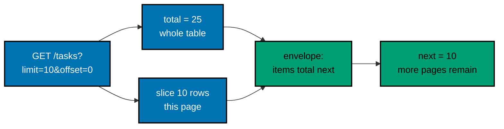

**`learning/code/ex-67-pagination-metadata/main.go`**

```go
// page is the ENVELOPE shape -- not a bare array anymore: every list
// endpoint from THIS example onward wraps its rows with total/next.
type page struct { // => the Go twin of the Python Page dict -- items plus paging metadata
	Items []task `json:"items"` // => this page's rows -- exactly what ex-65 returned on its own
	Total int    `json:"total"` // => the FULL table's row count, independent of this page's size
	Next  *int   `json:"next"`  // => nil encodes as null: "no further page" -- a typed sentinel
}
```

The file also defines the same `task` struct and 25-row seed, the same `parseLimitOffset` bounds, `listTasks` computing `total` apart from the slice, `nextOffset = offset + limit` with `next` set only when `nextOffset < total` (landing on or past `total` leaves it `nil`, encoding as `null`), the shared envelope plumbing, and `main` registering only `GET /tasks` on `127.0.0.1:8000`.

**Run**: `go run .` from inside `ex-67-pagination-metadata`, then `curl` in another terminal.

**Output** (curl):

```text
$ curl -s "http://127.0.0.1:8000/tasks?limit=10&offset=0" | python3 -c 'import json,sys; d=json.load(sys.stdin); print(len(d["items"]), d["total"], d["next"])'
10 25 10
$ curl -s "http://127.0.0.1:8000/tasks?limit=10&offset=20" | python3 -c 'import json,sys; d=json.load(sys.stdin); print(len(d["items"]), d["total"], d["next"])'
5 25 None
```

**Key takeaway**: `next: *int` with `nil` encoding as `null` is a typed sentinel a client checks with a nil test -- far safer than a magic number like `-1`.

**Why it matters**: `total` is computed apart from the page slice, never touched by `limit`/`offset`. Example 73 later reuses this envelope but computes `total` against a filtered count, proving the pattern composes once a filter is active instead of silently reporting the whole table's size.

---

### Example 68: Pagination Bounds

_ex-68 &middot; exercises co-19, co-10_

Example 65's `>= 1` stopped a limit too small; this adds `maxLimit = 50` to stop one too large. Both bounds are checked by hand in `parseLimitOffset` -- there is no `if limit > 50` scattered in the handler body as an afterthought; the check lives at the edge like a declarative constraint.

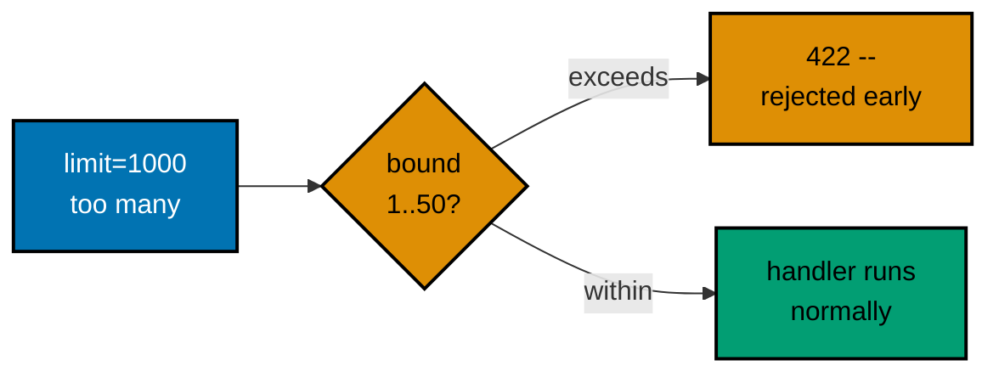

**`learning/code/ex-68-pagination-bounds/main.go`**

```go
// maxLimit is the ceiling this example enforces -- it stops an accidental
// "select everything" call from a caller passing an enormous ?limit= on a
// huge table. The table here holds 25 rows, fewer than the max, so a
// request AT the max still succeeds and proves the boundary is inclusive.
const maxLimit = 50 // => FastAPI's le=50, spelled as a named Go constant instead
```

The file otherwise mirrors Example 65 with one extended check in `parseLimitOffset`: `if err != nil || n < 1 || n > maxLimit` returns `limit must be an integer between 1 and 50` as a `422`; `listTasks` never runs for an out-of-bounds limit, `limit=50` still succeeds (25 rows), and `main` registers only `GET /tasks` on `127.0.0.1:8000`.

**Run**: `go run .` from inside `ex-68-pagination-bounds`, then `curl` in another terminal.

**Output** (curl):

```text
$ curl -s "http://127.0.0.1:8000/tasks?limit=50" | python3 -c 'import json,sys; print(len(json.load(sys.stdin)))'
25
$ curl -s "http://127.0.0.1:8000/tasks?limit=1000" -w '\n%{http_code}\n'
{"error":{"code":"validation_error","message":"limit must be an integer between 1 and 50"}}
422
$ curl -s "http://127.0.0.1:8000/tasks?limit=0" -w '\n%{http_code}\n'
{"error":{"code":"validation_error","message":"limit must be an integer between 1 and 50"}}
422
```

**Key takeaway**: The bound is enforced at the edge before any data access -- an out-of-bounds limit never touches the slice, exactly like a declarative constraint running before the handler body.

**Why it matters**: `maxLimit = 50` stops a caller from requesting an enormous page against a table that will outgrow this 25-row seed; an unbounded upper limit turns a working pagination feature into a resource-exhaustion vector in production.

---

### Example 69: Filter by Field

_ex-69 &middot; exercises co-20_

Builds on Example 65's list endpoint by adding a narrowing dimension: `?status=done` returns only the 8 seeded rows whose `status` equals `done` out of the full 25-row table. An unknown value matches nothing and yields `[]`, never an error.


**`learning/code/ex-69-filter-by-field/main.go`**

```go
// filterTasks is the repository function: it owns 100% of the narrowing
// logic -- the handler below holds none. An empty status means "no filter
// at all"; any other value means "narrow to exactly this".
func filterTasks(status string) []task {
	if status == "" { // => no filter -- the FULL 25-row table, like ex-65's unfiltered query
		return tasks // => shared backing array is fine: callers only ever read it
	}
	matched := []task{}       // => non-nil empty: encodes as [] (not null) when nothing matches
	for _, t := range tasks { // => a linear scan -- the in-memory twin of WHERE status = ?
		if t.Status == status { // => exact match: a crafted value is just a string that matches nothing
			matched = append(matched, t) // => keep only the rows that genuinely qualify
		}
	}
	return matched // => 8 rows for "done", [] for a value no row holds
}

// listTasks serves GET /tasks -- one optional filter query param.
func listTasks(w http.ResponseWriter, r *http.Request) {
	status := r.URL.Query().Get("status")            // => "" when absent: NO validation, any string is accepted
	writeJSON(w, http.StatusOK, filterTasks(status)) // => the handler holds no logic -- it delegates
}
```

The file also defines the `task` struct, the same 25-row `seedTasks` (`done` at ids `{2,5,8,11,14,17,20,23}`), the shared `writeJSON` helper, and `main` registering only `GET /tasks` on `127.0.0.1:8000`.

**Run**: `go run .` from inside `ex-69-filter-by-field`, then `curl` in another terminal.

**Output** (curl):

```text
$ curl -s "http://127.0.0.1:8000/tasks" | python3 -c 'import json,sys; print(len(json.load(sys.stdin)))'
25
$ curl -s "http://127.0.0.1:8000/tasks?status=done" | python3 -c 'import json,sys; print([r["id"] for r in json.load(sys.stdin)])'
[2, 5, 8, 11, 14, 17, 20, 23]
$ curl -s "http://127.0.0.1:8000/tasks?status=archived"
[]
```

**Key takeaway**: An empty filter means "no filter at all" while any other string means "narrow to exactly this" -- the value travels as data through an equality check, never as query grammar.

**Why it matters**: This is the simplest version of the pattern Example 70 extends to two independent filters and Example 73 extends to filter-plus-sort-plus-paginate composing in one query.

---

### Example 70: Filter Multiple

_ex-70 &middot; exercises co-20_

`?status=done&priority=high` combines two independently optional filters with AND semantics. This is exactly why the seed decorrelates `status` from `priority` -- the intersection (4 rows at ids `{5,11,17,23}`) is genuinely smaller than either filter alone (8 each).

**`learning/code/ex-70-filter-multiple/main.go`**

```go
// filterTasks is the repository function: TWO independent filters, each
// optional on its own, AND-combined when both are present. An empty value
// for either means "that dimension does not narrow at all".
func filterTasks(status, priority string) []task {
	matched := []task{}       // => non-nil empty: encodes as [] (not null) when nothing matches
	for _, t := range tasks { // => one pass over the table -- the in-memory twin of WHERE..AND..
		if status != "" && t.Status != status { // => opt-in: omitting ?status= skips this test fully
			continue // => this row fails the first dimension -- drop it, check the next row
		}
		if priority != "" && t.Priority != priority { // => independently opt-in -- stands alone or combines
			continue // => this row fails the second dimension -- drop it the same way
		}
		matched = append(matched, t) // => survived every ACTIVE filter -- genuinely in the intersection
	}
	return matched // => 4 rows for done+high -- strictly smaller than either filter alone
}
```

The file also defines the `task` struct, the same 25-row seed (`done={2,5,8,11,14,17,20,23}`, `high={4,5,10,11,16,17,22,23}`), `listTasks` reading both query params with no validation, the shared `writeJSON` helper, and `main` registering only `GET /tasks` on `127.0.0.1:8000`.

**Run**: `go run .` from inside `ex-70-filter-multiple`, then `curl` in another terminal.

**Output** (curl):

```text
$ curl -s "http://127.0.0.1:8000/tasks?status=done" | python3 -c 'import json,sys; print(len(json.load(sys.stdin)))'
8
$ curl -s "http://127.0.0.1:8000/tasks?status=done&priority=high" | python3 -c 'import json,sys; print([r["id"] for r in json.load(sys.stdin)])'
[5, 11, 17, 23]
```

**Key takeaway**: Each filter is independently opt-in -- an empty value skips that dimension entirely, so one, both, or neither filter can be active on any single request.

**Why it matters**: Decorrelated seed columns are what make the combined filter prove something new; lockstep columns would make the intersection demonstrate nothing beyond either single filter.

---

### Example 71: Filter Parameterized SQL

_ex-71 &middot; exercises co-20, co-14_

Every other pagination/filter example already parameterizes its SQL; this is the one that proves why, by keeping a deliberately vulnerable twin function alongside the safe one actually wired to the route. Sending `done' OR '1'='1` at the real parameterized `/tasks` endpoint returns `[]` -- the whole string is bound as one literal value, not parsed as SQL.

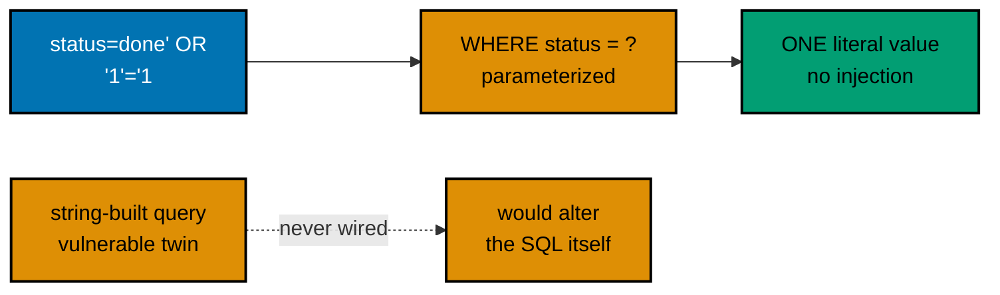

**`learning/code/ex-71-filter-parameterized-sql/main.go`**

```go
// listTasksSafe is the SAFE, parameterized version -- the ONLY function the
// route below calls. The value is bound as a PARAMETER, never concatenated
// into the SQL text: SQLite receives it as DATA, never as grammar.
func listTasksSafe(db *sql.DB, status string) ([]task, error) {
	rows, err := db.Query( // => the ? placeholder keeps the value OUT of the SQL grammar entirely
		"SELECT id, title, status, priority, created_at FROM tasks WHERE status = ? ORDER BY id",
		status, // => an injection payload here is one opaque STRING being compared -- inert by construction
	)
	if err != nil { // => a query failure (not an empty result) -- the caller turns this into a 500
		return nil, err // => propagate: the handler, not the repository, decides the HTTP status
	}
	defer rows.Close()     // => released on every return path -- never leak a cursor on success OR failure
	return scanTasks(rows) // => drained into []task -- [] when no row's status equals the payload
}
```

The file also defines `tasks.db` creation at runtime (removed then re-seeded with the same 25 rows on every start via `database/sql` plus `modernc.org/sqlite`), the `task` struct and `scanTasks` drain helper, the vulnerable `listTasksUnsafeForDemoOnly` (string-built with `fmt.Sprintf`, never called by any route, reachable only from Go code), `getTasks` requiring `?status=` (`422` when absent) and always calling the safe function, and `main` registering only `GET /tasks` on `127.0.0.1:8000`.

**Run**: `go run .` from inside `ex-71-filter-parameterized-sql`, then `curl` in another terminal.

**Output** (curl):

```text
$ curl -s "http://127.0.0.1:8000/tasks?status=done" | python3 -c 'import json,sys; print(len(json.load(sys.stdin)))'
8
$ curl -s --get --data-urlencode "status=done' OR '1'='1" http://127.0.0.1:8000/tasks
[]
$ curl -s "http://127.0.0.1:8000/tasks" -w '\n%{http_code}\n'
{"error":{"code":"validation_error","message":"status is required"}}
422
```

**Key takeaway**: A `?` placeholder keeps the value out of the SQL grammar entirely -- the injection string is compared as one literal, so it matches no row instead of leaking the table.

**Why it matters**: The vulnerable twin exists only as a teaching contrast and is unreachable from HTTP by construction; the route's safety comes from what it never calls, not just from what it does.

---

### Example 72: Sort Param

_ex-72 &middot; exercises co-20_

`?sort=created_at` (ascending) or `?sort=-created_at` (descending via a leading `-`) reorders the same 25 rows -- sorting never changes which rows come back, only their sequence. The set is closed to exactly those two values, so anything else is a `422`; the key is never interpolated into SQL because SQL has no placeholder syntax for column names or directions.

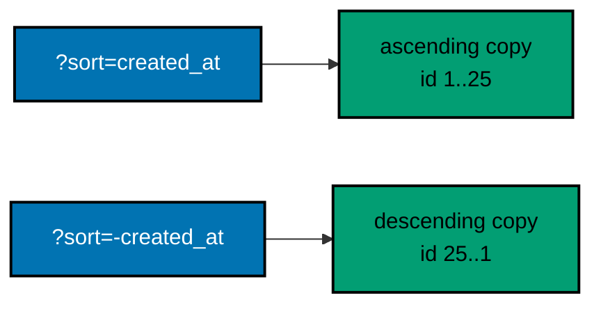

**`learning/code/ex-72-sort-param/main.go`**

```go
// sortTasks is the repository function: it returns the rows ordered per
// sort, which can ONLY be one of the two map keys below -- the handler
// rejects anything else before this ever runs, so no default branch hides
// a third case. The input slice is never mutated: callers share it.
func sortTasks(rows []task, sort string) []task {
	ascending := sort == "created_at"          // => the only other legal value is "-created_at" -- checked by the caller
	out := slices.Clone(rows)                  // => a fresh COPY first: the shared input slice is never mutated
	slices.SortFunc(out, func(a, b task) int { // => sorts the copy in place -- input order untouched
		if ascending { // => oldest-first, matching the seed's natural insertion order
			return cmp.Compare(a.CreatedAt, b.CreatedAt) // => ISO-8601 strings compare chronologically
		}
		return cmp.Compare(b.CreatedAt, a.CreatedAt) // => a leading "-" flips the comparison -- newest first
	})
	return out // => the ordered copy -- same 25 rows, caller-chosen sequence
}
```

The file also defines the `task` struct and the same 25-row seed (`created_at` rising with `id`), `listTasks` defaulting an absent `?sort=` to `created_at` and rejecting anything outside the closed two-value set with `422` (`sort must be "created_at" or "-created_at"`), the shared envelope plumbing, and `main` registering only `GET /tasks` on `127.0.0.1:8000`.

**Run**: `go run .` from inside `ex-72-sort-param`, then `curl` in another terminal.

**Output** (curl):

```text
$ curl -s "http://127.0.0.1:8000/tasks?sort=created_at" | python3 -c 'import json,sys; d=json.load(sys.stdin); print(d[0]["id"], d[-1]["id"])'
1 25
$ curl -s "http://127.0.0.1:8000/tasks?sort=-created_at" | python3 -c 'import json,sys; d=json.load(sys.stdin); print(d[0]["id"], d[-1]["id"])'
25 1
$ curl -s "http://127.0.0.1:8000/tasks?sort=title" -w '\n%{http_code}\n'
{"error":{"code":"validation_error","message":"sort must be \"created_at\" or \"-created_at\""}}
422
```

**Key takeaway**: Sorting clones before ordering -- the shared input slice is never mutated, so concurrent requests cannot race on row order.

**Why it matters**: User input never reaches an `ORDER BY` by interpolation; the closed two-value check (a fixed lookup in Example 73) is what keeps the clause safe, since SQL offers no placeholder for column names or directions.

---

### Example 73: Combined List Query

_ex-73 &middot; exercises co-19, co-20_

Examples 65-72 built pagination, filtering, and sorting separately; this is the proof all three compose in one endpoint without one feature silently breaking another. `total` reflects the filtered count computed with the same `WHERE` clause as the main query, `next` is computed against that filtered total, and the page is sliced only after sorting.

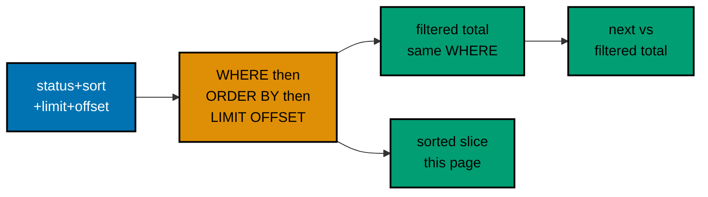

**`learning/code/ex-73-combined-list-query/main.go`**

```go
// orderBySort maps the PUBLIC sort value to a real column plus direction --
// this map is the ONLY thing standing between user input and ORDER BY.
// SQL has no ? syntax for column names or ASC/DESC, so a fixed lookup (not
// interpolation) is what keeps the clause safe, exactly like ex-72.
var orderBySort = map[string]string{ // => the closed sort set -- two keys, nothing else
	"created_at":  "created_at ASC",  // => oldest-first, matching the seed's insertion order
	"-created_at": "created_at DESC", // => a leading "-" is the REST convention for "descending"
}
```

The file also defines `maxLimit = 50`, `tasks.db` creation plus the same 25-row seed via `database/sql` plus `modernc.org/sqlite`, the `task` and `page` (`items`/`total`/`next`) structs, `listPage` building `WHERE status = ?` only when filtered, counting with `SELECT COUNT(*) ... + where` using the same args, then querying `... + where + " ORDER BY " + orderClause + " LIMIT ? OFFSET ?"` with filter args plus limit/offset in positional order, `parseListQuery` validating each param exactly like its standalone example (bounds plus closed sort-set membership), `getTasks` delegating with zero SQL in the handler, and `main` registering only `GET /tasks` on `127.0.0.1:8000`.

**Run**: `go run .` from inside `ex-73-combined-list-query`, then `curl` in another terminal.

**Output** (curl):

```text
$ curl -s "http://127.0.0.1:8000/tasks?status=done&limit=50" | python3 -c 'import json,sys; d=json.load(sys.stdin); print(d["total"], len(d["items"]), d["next"])'
8 8 None
$ curl -s "http://127.0.0.1:8000/tasks?status=done&limit=3&offset=0&sort=-created_at" | python3 -c 'import json,sys; d=json.load(sys.stdin); print([r["id"] for r in d["items"]], d["next"])'
[23, 20, 17] 3
$ curl -s "http://127.0.0.1:8000/tasks?status=done&limit=3&offset=3&sort=-created_at" | python3 -c 'import json,sys; d=json.load(sys.stdin); print([r["id"] for r in d["items"]])'
[14, 11, 8]
```

**Key takeaway**: One statement applies `WHERE`, then `ORDER BY`, then `LIMIT`/`OFFSET` in SQLite's fixed evaluation order, with the filtered `COUNT(*)` sharing the same `WHERE` and args so `total` never drifts from the page.

**Why it matters**: Each param stays independently optional with its standalone validation, so the composed endpoint rejects exactly what the separate ones rejected -- composition adds no new leniency and no new strictness.

---

### Example 74: Idempotent PUT, Verified

_ex-74 &middot; exercises co-02_

RFC 9110 classifies PUT as idempotent, but a classification is only a promise. This example proves it: the same PUT body is sent twice against the same id, both bodies are byte-identical, and `/tasks/count` reads `1` before and after -- no duplicate row, no different final state.

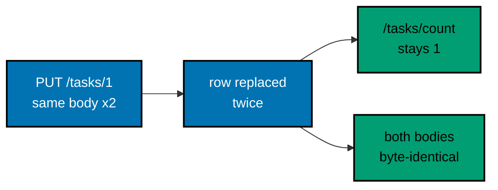

**`learning/code/ex-74-idempotent-put-verified/main.go`**

```go
// replaceTask is the repository function -- calling it TWICE with the SAME
// arguments leaves the SAME final state, because an UPDATE setting columns
// to the values they ALREADY hold changes nothing. The SQL-free twin of
// that: a map store has no memory of prior calls either.
func replaceTask(id int, update taskUpdate) (task, bool) {
	mu.Lock()                // => the write lock: no concurrent GET observes a half-replaced row
	defer mu.Unlock()        // => released on every return path -- found AND not-found alike
	current, ok := tasks[id] // => "does a row exist at this id" -- the only question that branches
	if !ok {                 // => no row matched: this example only REPLACES, never auto-creates at an id
		return task{}, false // => false signals "not found" -- the HANDLER decides the 404, not here
	}
	current.Title = update.Title   // => full replace: BOTH columns overwritten, no merge, no patch
	current.Status = update.Status // => the second PUT writes the SAME values -- a silent no-change
	tasks[id] = current            // => committed back to the map -- first AND second PUT commit alike
	return current, true           // => the CURRENT state -- byte-identical across identical PUTs
}
```

The file also defines the `task` (`id`, `title`, `status`), `taskUpdate` (both fields required, unlike PATCH), and `countResponse` (`{"total":1}`) structs, `decodeUpdate` (JSON decode plus presence checks, `422` on missing fields or bad JSON), `putTask` (integer path validation with `422`, `404` with `no such task` for a well-formed but absent id, otherwise the post-update state), `countTasks` proving no duplicate was inserted, and `main` registering `PUT /tasks/{id}` plus `GET /tasks/count` on `127.0.0.1:8000`.

**Run**: `go run .` from inside `ex-74-idempotent-put-verified`, then `curl` in another terminal.

**Output** (curl):

```text
$ curl -s http://127.0.0.1:8000/tasks/count
{"total":1}
$ curl -s -X PUT -H "Content-Type: application/json" -d '{"title":"write the report","status":"in_progress"}' http://127.0.0.1:8000/tasks/1
{"id":1,"title":"write the report","status":"in_progress"}
$ curl -s -X PUT -H "Content-Type: application/json" -d '{"title":"write the report","status":"in_progress"}' http://127.0.0.1:8000/tasks/1
{"id":1,"title":"write the report","status":"in_progress"}
$ curl -s http://127.0.0.1:8000/tasks/count
{"total":1}
$ curl -s -X PUT -H "Content-Type: application/json" -d '{"title":"x","status":"todo"}' http://127.0.0.1:8000/tasks/999 -w '\n%{http_code}\n'
{"error":{"code":"not_found","message":"no such task"}}
404
```

**Key takeaway**: Replacing both columns with the values they already hold changes nothing -- calling the same PUT twice leaves the same final state and the same body, which is what idempotent means operationally.

**Why it matters**: PUT here only replaces and never auto-creates at an id (a missing id is `404`, a non-integer id is `422`), so retries are safe by construction: a client can resend the same PUT without risking duplicates.

---

### Example 75: Method Not Allowed

_ex-75 &middot; exercises co-02, co-03_

No handler raises a 405 by hand: the status comes purely from route registration. `net/http` method patterns answer `405` automatically when the path matches but the verb does not, and set the `Allow` header listing what that path genuinely supports. `/tasks` speaks only `GET`, `/reports` speaks only `POST`, so each path's `Allow` names its own method.

**`learning/code/ex-75-method-not-allowed-405/main.go`**

```go
// listTasks serves GET /tasks -- the ONLY verb registered for this exact
// path. No PUT/POST/DELETE exists here at all, so every other verb 405s.
func listTasks(w http.ResponseWriter, r *http.Request) {
	writeJSON(w, http.StatusOK, []string{"write the report"}) // => a fixed single-item list -- never mutated
}

// createReport serves POST /reports -- a DIFFERENT path with ONLY POST,
// proving Allow reflects the actual path, not one fixed value app-wide.
func createReport(w http.ResponseWriter, r *http.Request) {
	writeJSON(w, http.StatusOK, map[string]string{"created": "true"}) // => reachable only via POST
}

func main() {
	mux := http.NewServeMux() // => one explicit router -- registration alone drives this example
	// => two separate single-method paths: keep them separate (not two patterns on one
	// => path) so each 405's Allow header names exactly the method its own path supports.
	mux.HandleFunc("GET /tasks", listTasks)               // => ONLY GET: DELETE /tasks 405s with "Allow: GET"
	mux.HandleFunc("POST /reports", createReport)         // => ONLY POST: DELETE /reports 405s with "Allow: POST"
	log.Fatal(http.ListenAndServe("127.0.0.1:8000", mux)) // => block forever on localhost:8000
}
```

**Run**: `go run .` from inside `ex-75-method-not-allowed-405`, then `curl -i` in another terminal.

**Output** (curl):

```text
$ curl -s -i -X DELETE http://127.0.0.1:8000/tasks | head -n 5
HTTP/1.1 405 Method Not Allowed
Allow: GET, HEAD
Content-Type: text/plain; charset=utf-8
$ curl -s -i -X DELETE http://127.0.0.1:8000/reports | head -n 5
HTTP/1.1 405 Method Not Allowed
Allow: POST
Content-Type: text/plain; charset=utf-8
$ curl -s http://127.0.0.1:8000/tasks
["write the report"]
```

(The `GET` path reports `Allow: GET, HEAD` because `ServeMux` auto-admits `HEAD` alongside `GET`; the `POST` path reports only `POST`. Bodies for the 405s are the stdlib's plain-text default, not JSON -- registration, not a handler, produced them.)

**Key takeaway**: Keeping single-method paths separate lets each 405's `Allow` header name exactly what its own path supports -- per-path truth, not one fixed app-wide value.

**Why it matters**: Clients (and proxies) use `Allow` to discover what a path actually speaks without guessing; getting it for free from registration beats hand-maintaining a header that drifts from the routes.

---

### Example 76: Health vs Readiness

_ex-76 &middot; exercises co-08, co-14_

Two different questions that sound similar: `/health` asks "is the process itself alive?" (liveness) while `/ready` asks "can this instance actually do its job right now?" (readiness, proven by probing storage). A failed liveness check usually triggers a restart; a failed readiness check just pulls the instance out of rotation until it recovers.

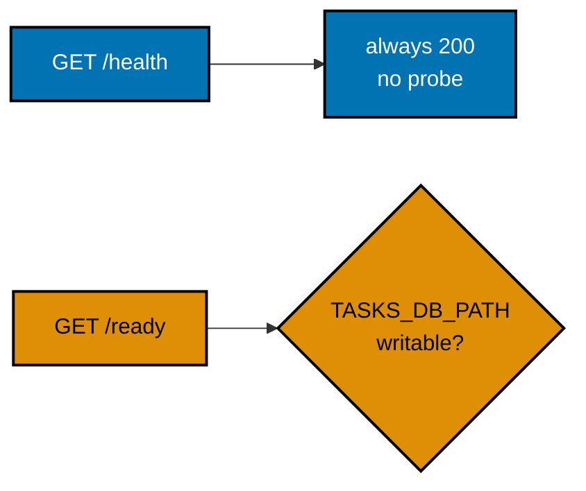

**`learning/code/ex-76-health-vs-readiness/main.go`**

```go
// health serves GET /health -- LIVENESS: "is the process itself running
// and responsive at all?" No dependency on anything external: always 200.
func health(w http.ResponseWriter, r *http.Request) {
	writeJSON(w, http.StatusOK, map[string]string{"status": "ok"}) // => no probe, no store, no failure mode
}

// ready serves GET /ready -- READINESS: "can this instance actually SERVE
// a real request?" With TASKS_DB_PATH unset the store is in-memory and the
// answer is trivially yes; with it set, a REAL filesystem probe runs --
// the cheapest genuine reachability check stdlib-only Go can perform.
func ready(w http.ResponseWriter, r *http.Request) {
	dbPath := os.Getenv("TASKS_DB_PATH") // => empty means in-memory: no external dependency to fail
	if dbPath == "" {                    // => the default demo shape -- nothing to ping, always ready
		writeJSON(w, http.StatusOK, map[string]string{"status": "ready"}) // => 200, no probe needed
		return
	}
	// => a path IS configured: prove it is genuinely writable, exactly like
	// => the Python twin's sqlite3.connect(DB_PATH) attempt -- no mocks, the
	// => OS itself decides whether this succeeds or fails.
	probe, err := os.OpenFile(dbPath, os.O_RDWR|os.O_CREATE, 0o600) // => O_CREATE touches the real path
	if err != nil {                                                 // => e.g. "no such file or directory"
		writeJSON(w, http.StatusServiceUnavailable, map[string]string{ // => 503: cannot serve traffic now
			"status": "not_ready", // => the machine-readable state a load balancer acts on
			"reason": err.Error(), // => the REAL underlying error, for operator debugging -- never end-user text
		})
		return
	}
	probe.Close()                                                     // => the probe only tested reachability -- close it immediately, keep nothing
	writeJSON(w, http.StatusOK, map[string]string{"status": "ready"}) // => 200: the path genuinely answered
}

func main() {
	mux := http.NewServeMux()                             // => one explicit router for the two probe routes
	mux.HandleFunc("GET /health", health)                 // => liveness -- never guarded, never probing
	mux.HandleFunc("GET /ready", ready)                   // => readiness -- genuinely pings the configured path
	log.Fatal(http.ListenAndServe("127.0.0.1:8000", mux)) // => block forever on localhost:8000
}
```

**Run**: `go run .` from inside `ex-76-health-vs-readiness`, then `curl` in another terminal; restart with `TASKS_DB_PATH=/nonexistent-dir/tasks.db go run .` for the down-dependency case.

**Output** (curl):

```text
$ curl -s http://127.0.0.1:8000/health
{"status":"ok"}
$ curl -s http://127.0.0.1:8000/ready
{"status":"ready"}
$ TASKS_DB_PATH=/nonexistent-dir/tasks.db go run . &
$ curl -s http://127.0.0.1:8000/health
{"status":"ok"}
$ curl -s -w '\n%{http_code}\n' http://127.0.0.1:8000/ready
{"status":"not_ready","reason":"open /nonexistent-dir/tasks.db: no such file or directory"}
503
```

**Key takeaway**: Liveness never touches storage while readiness genuinely probes it -- the same `/ready` route returns `200` or `503` depending on what the OS says about the configured path, never a hand-faked answer.

**Why it matters**: Orchestrators act differently on the two signals (restart versus de-rotate), so conflating them causes either needless restarts or traffic sent to an instance that cannot serve it.

---

### Example 77: Error Envelope Consistency

_ex-77 &middot; exercises co-11_

Five different failure kinds -- 400, 401, 404, 422, and 500 -- all render through the same `envelope()` helper and the same two-key `{"error":{"code":...,"message":...}}` shape. A client parses exactly one response shape regardless of which check failed.

**`learning/code/ex-77-error-envelope-consistency/main.go`**

```go
// envelope builds the one shape -- the single reference for "what does an
// error look like in this app," whatever route or check raised it.
func envelope(code, message string) errorEnvelope { // => every error below funnels through HERE
	return errorEnvelope{Error: apiError{Code: code, Message: message}} // => one constructor, five callers
}

// withRecovery is the LAST-resort middleware -- the stdlib twin of
// Python's generic Exception handler. Registration WRAPS the whole mux, so
// a panic in ANY route lands here and becomes a sanitized 500 instead of
// a dropped connection. The real value goes to the OPERATOR log only.
func withRecovery(next http.Handler) http.Handler {
	return http.HandlerFunc(func(w http.ResponseWriter, r *http.Request) {
		defer func() { // => deferred: runs on panic AND on the normal return alike
			if rec := recover(); rec != nil { // => a panicking handler lands here, not in the client conn
				log.Printf("panic: %v", rec)                 // => recorded for the operator -- NEVER echoed to the client
				writeJSON(w, http.StatusInternalServerError, // => the SAME two-key shape as every other error
					envelope("internal_error", "an unexpected error occurred")) // => deliberately generic: no type, no trace
			}
		}()
		next.ServeHTTP(w, r) // => the unmodified pass-through -- recovery only fires on panic
	})
}
```

The file also defines `validToken`, a one-row `tasks` map (id 1 exists for the 200 path), `getTask` (non-integer id is `422`, unknown id is `404` in the shared shape), `listTasks` (`?bad=true` is a business-rule `400`, not a type error), `createTask` (`401` without a token first, then `422` when `title` is omitted, identity before shape), `boom` (panics with a genuine internal failure, sanitized by `withRecovery` into a generic `500`), the shared `writeJSON` plumbing, and `main` registering `GET /tasks/{id}`, `GET /tasks`, `POST /tasks`, and `GET /boom` wrapped with `withRecovery` on `127.0.0.1:8000`.

**Run**: `go run .` from inside `ex-77-error-envelope-consistency`, then `curl` in another terminal.

**Output** (curl):

```text
$ curl -s "http://127.0.0.1:8000/tasks?bad=true" -w '\n%{http_code}\n'
{"error":{"code":"bad_request","message":"the bad=true flag is rejected"}}
400
$ curl -s -X POST -H "Content-Type: application/json" -d '{"title":"x"}' http://127.0.0.1:8000/tasks -w '\n%{http_code}\n'
{"error":{"code":"unauthorized","message":"missing or invalid token"}}
401
$ curl -s http://127.0.0.1:8000/tasks/999 -w '\n%{http_code}\n'
{"error":{"code":"not_found","message":"no such task"}}
404
$ curl -s -X POST -H "Content-Type: application/json" -H "Authorization: Bearer s3cr3t-token-abc123" -d '{}' http://127.0.0.1:8000/tasks -w '\n%{http_code}\n'
{"error":{"code":"validation_error","message":"body.title: title is required"}}
422
$ curl -s http://127.0.0.1:8000/boom -w '\n%{http_code}\n'
{"error":{"code":"internal_error","message":"an unexpected error occurred"}}
500
```

**Key takeaway**: One `envelope()` constructor plus one `withRecovery` wrapper means five failure kinds share one client-visible shape -- the panic value is logged for operators and never leaked on the wire.

**Why it matters**: A client parsing errors should never need to know which route or check failed; stdlib Go has no global exception hook, so the deferred-recover middleware plays that role for the 500 path while the other four write the envelope directly where they detect the problem.

---

### Example 78: curl CRUD + Auth Script

_ex-78 &middot; exercises co-22, co-18_

This app itself introduces nothing new: every route reuses CRUD plus the bearer-token guard plus the shared error envelope. What is new is the companion `script.sh` -- a documented `curl` sequence driving the full lifecycle end to end: create without a token (`401`), create with a token (`201`), open read, guarded PUT, guarded DELETE (`204`), then read-after-delete (`404`, genuinely gone).


**`learning/code/ex-78-curl-crud-auth-script/main.go`** (essential handlers; the file also defines the `task`, `createBody`, `updateBody`, envelope, and mutex-guarded store helpers verbatim as in the source)

```go
// requireToken guards every WRITE -- resolved BEFORE the guarded handler's
// own body runs. Either failure mode (missing, wrong) yields the same 401.
func requireToken(w http.ResponseWriter, r *http.Request) bool { // => true means "allowed": proceed
	if r.Header.Get("Authorization") != "Bearer "+validToken { // => exact match required -- no prefix games
		writeError(w, http.StatusUnauthorized, "unauthorized", "missing or invalid token") // => 401, enveloped
		return false                                                                       // => the handler MUST stop: return without touching the store
	}
	return true // => reaching here IS the "allowed" outcome -- the write proceeds
}
```

The full `main.go` wires `POST /tasks` (guarded, `201` with server-assigned id and server-defaulted `todo` status), `GET /tasks/{id}` (open, `422` on a non-integer id, `404` when absent), `PUT /tasks/{id}` (guarded, both `title` and `status` required, `404` when absent), and `DELETE /tasks/{id}` (guarded, `204` with no body on success, `404` when absent) on `127.0.0.1:8000`, with an in-memory mutex-guarded store starting empty and `nextID` from 1.

**`learning/code/ex-78-curl-crud-auth-script/script.sh`**

```bash
#!/usr/bin/env bash
# Example 78: a documented curl sequence exercising CRUD + auth end to end.
# Run against a live server: go run . (from this directory -- 127.0.0.1:8000).
# Mirrors every step of the test below, so the script and the Go test can
# never drift apart without someone noticing.
set -euo pipefail # => abort on any failing command, unset var, or pipe error -- set -u is mandatory

BASE_URL="http://127.0.0.1:8000" # => the target server this script drives end to end
TOKEN="s3cr3t-token-abc123"      # => matches main.go's validToken -- the SAME literal both sides expect

echo "== Step 1: create WITHOUT a token -- expect 401 ==" # => no Authorization header at all
# => captures ONLY the HTTP status code, discarding the response body via -o /dev/null
code=$(curl -s -o /dev/null -w '%{http_code}' -X POST -H "Content-Type: application/json" \
  -d '{"title":"write the report"}' "$BASE_URL/tasks") # => POST with no Authorization header
echo "status: $code"                                   # => prints the captured status for a human reader
test "$code" = "401"                                   # => aborts the script (set -e) if this assertion fails

echo "== Step 2: create WITH a valid token -- expect 201 ==" # => the SAME create, now WITH a token
# => this time the FULL response body is captured, not just the status
create_response=$(curl -s -X POST -H "Content-Type: application/json" \
  -H "Authorization: Bearer $TOKEN" -d '{"title":"write the report"}' "$BASE_URL/tasks")             # => guarded write, valid token
echo "$create_response"                                                                              # => prints the raw JSON so the created id is visible
task_id=$(echo "$create_response" | python3 -c 'import json,sys; print(json.load(sys.stdin)["id"])') # => extracts "id"
echo "created task id: $task_id"                                                                     # => the id every remaining step operates on

echo "== Step 3: read the created task (no token needed) -- expect 200 ==" # => reads stay OPEN
curl -s -i "$BASE_URL/tasks/$task_id"                                      # => -i prints headers too, not just the body
echo                                                                       # => a blank line between this step and the next

echo "== Step 4: update WITH a valid token -- expect 200, status becomes done ==" # => PUT replaces the full resource
# => PUT is guarded the same way POST was in Step 2
curl -s -X PUT -H "Content-Type: application/json" -H "Authorization: Bearer $TOKEN" \
  -d '{"title":"write the report","status":"done"}' "$BASE_URL/tasks/$task_id" # => full-body replace
echo                                                                           # => separates this step's JSON from the next header

echo "== Step 5: delete WITH a valid token -- expect 204 ==" # => DELETE is guarded too
# => DELETE carries no body -- only the status code is captured
code=$(curl -s -o /dev/null -w '%{http_code}' -X DELETE -H "Authorization: Bearer $TOKEN" \
  "$BASE_URL/tasks/$task_id") # => the same task_id created back in Step 2
echo "status: $code"          # => prints the captured DELETE status code
test "$code" = "204"          # => 204 means success with no response body

echo "== Step 6: read after delete -- expect 404 (genuinely gone) =="     # => proves the row is truly gone
code=$(curl -s -o /dev/null -w '%{http_code}' "$BASE_URL/tasks/$task_id") # => the same unguarded GET as Step 3
echo "status: $code"                                                      # => prints the captured final status code
test "$code" = "404"                                                      # => confirms genuine removal, not a soft-delete

echo "== ALL STEPS PASSED ==" # => only reached if every test assertion above succeeded (set -e)
```

**Run**: `go run .` in one terminal (port `127.0.0.1:8000`), `./script.sh` in another.

**Output** (`./script.sh`):

```text
== Step 1: create WITHOUT a token -- expect 401 ==
status: 401
== Step 2: create WITH a valid token -- expect 201 ==
{"id":1,"title":"write the report","status":"todo"}
created task id: 1
== Step 3: read the created task (no token needed) -- expect 200 ==
HTTP/1.1 200 OK
{"id":1,"title":"write the report","status":"todo"}
== Step 4: update WITH a valid token -- expect 200, status becomes done ==
{"id":1,"title":"write the report","status":"done"}
== Step 5: delete WITH a valid token -- expect 204 ==
status: 204
== Step 6: read after delete -- expect 404 (genuinely gone) ==
status: 404
== ALL STEPS PASSED ==
```

**Key takeaway**: Every step asserts its own expected status with `test "$code" = "..."` under `set -e`, so the script fails loudly the moment any behavior regresses instead of scrolling past a silent mismatch.

**Why it matters**: A documented shell script is the executable version of a manual QA checklist -- it drives the same lifecycle a human would click through, but repeatably and against the live server the team actually ships.

---

### Example 79: Go Integration Test

_ex-79 &middot; exercises co-14, co-18, co-19_

This file combines every major mechanism of the advanced tier into one app: CRUD (create, read, replace, remove, plus a paginated filtered list), a bearer-token guard on every write, and pagination plus filtering on the open list route. The companion `main_test.go` is the fullest `httptest` suite in this track precisely because it verifies all three areas genuinely coexist in process, with no socket.

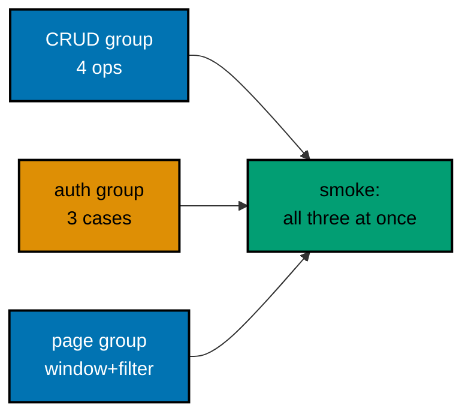

**`learning/code/ex-79-go-integration-test/main.go`** (essential wiring; the file also defines the `task`, `page`, body, and envelope types plus the mutex-guarded `server` methods verbatim as in the source)

```go
// server owns the WHOLE store -- one value per process (main) or per test
// (main_test.go builds a fresh one per case, so tests never share rows).
// Methods keep the lock discipline INSIDE, so handlers stay thin.
type server struct { // => the application layer: repository plus auth, no HTTP vocabulary inside
	mu     sync.Mutex   // => every map access below -- reads AND writes -- holds this lock
	tasks  map[int]task // => the whole "database": empty at construction, like a fresh tasks.db
	nextID int          // => the next server-assigned id -- incremented under the lock, never reused
}

// newServer builds a store with nothing in it -- main calls it once, each
// test calls it once, and neither ever sees the other's rows.
func newServer() *server {
	return &server{tasks: map[int]task{}, nextID: 1} // => empty map, ids from 1 -- the known start state
}
```

The full `main.go` adds `create`/`get`/`update`/`remove`/`listPage` (filtered count plus `limit`/`offset` slice with `maxLimit = 50`, ids ascending, deleted ids skipped as holes), `newHandler` wiring `POST /tasks` (guarded, `201`), `GET /tasks/{id}` (open), `PUT /tasks/{id}` (guarded), `DELETE /tasks/{id}` (guarded, `204`), and `GET /tasks` (open, `limit`/`offset`/`status` with the same bounds as Examples 65-68), and `main` serving it on `127.0.0.1:8000`.

**`learning/code/ex-79-go-integration-test/main_test.go`** (excerpts; the file defines `doRequest`, `decodeBody`, `freshHandler`, plus CRUD, auth, pagination, and smoke groups)

```go
// doRequest performs one in-process round trip: method + path + optional
// JSON body + optional Authorization header, straight through the handler.
// It returns the recorder, so each test asserts status AND body together.
func doRequest(t *testing.T, handler http.Handler, method, path, body, auth string) *httptest.ResponseRecorder { // => body "" means no body; auth "" means no header
	t.Helper()                 // => failures inside report at the CALLER's line, not in this helper
	var reader *strings.Reader // => nil body and an empty body differ: only build a reader when given one
	if body == "" {            // => GETs and DELETES carry no body -- pass a nil reader through
		reader = strings.NewReader("") // => an empty reader: NewRequest with no payload to send
	} else { // => POSTs and PUTs carry a JSON document -- wrap it for the request
		reader = strings.NewReader(body) // => the exact bytes the handler's decoder will read
	}
	req := httptest.NewRequest(method, path, reader) // => in-process request: no socket, no port, no race
	if body != "" {                                  // => only body-carrying calls declare a content type
		req.Header.Set("Content-Type", "application/json") // => what curl's -H "Content-Type: ..." sent
	}
	if auth != "" { // => opt-in credential -- empty means "deliberately no Authorization header"
		req.Header.Set("Authorization", auth) // => the exact header a guarded route checks first
	}
	rec := httptest.NewRecorder() // => captures status, headers, and body for the assertions below
	handler.ServeHTTP(rec, req)   // => the SAME handler main serves -- one line, fully synchronous
	return rec                    // => status via rec.Code, body via rec.Body -- asserted by every test
}

// TestCrudRoundTrip walks one row through its full lifecycle: create (201,
// guarded), read (200, open), update (200, guarded), delete (204,
// guarded), then re-read (404, genuinely removed).
func TestCrudRoundTrip(t *testing.T) { // => the full C-R-U-D cycle on a single row
	handler := freshHandler()                                                                               // => one isolated app for the whole lifecycle -- the row persists across calls
	created := doRequest(t, handler, http.MethodPost, "/tasks", `{"title":"write the report"}`, authHeader) // => valid token
	if created.Code != http.StatusCreated {                                                                 // => 201 confirms a new resource now exists
		t.Fatalf("create: got status %d, want 201", created.Code) // => without 201 there is no id to track
	}
```

The file also defines `TestCrudCreateRequiresToken` (unguarded POST is `401`), `TestCrudUpdateMissingIDIs404` (guarded PUT to an absent id is `404`), `TestTokenMissingIs401` / `TestTokenWrongIs401` / `TestTokenValidSucceeds` / `TestTokenDeleteRequiresToken` (the missing/wrong/valid trio plus DELETE coverage), `TestPaginationWindow` (20 seeded rows, `limit=5` yields 5 items with `next=5`), `TestPaginationStatusFilterNarrows` (a PUT-to-`done` row appears in a `status=done` page), and `TestFullIntegrationSmoke` (3 creates, a wide list, per-id deletes, then a `404` spot-check).

**Run**: `go run .` from inside `ex-79-go-integration-test` for the server (port `127.0.0.1:8000`); `go test -v ./...` from the same directory for the suite (in-process via `httptest`, no socket).

**Output** (`go test -v`):

```text
=== RUN   TestCrudCreateRequiresToken
--- PASS: TestCrudCreateRequiresToken (0.00s)
=== RUN   TestCrudRoundTrip
--- PASS: TestCrudRoundTrip (0.00s)
=== RUN   TestCrudUpdateMissingIDIs404
--- PASS: TestCrudUpdateMissingIDIs404 (0.00s)
=== RUN   TestTokenMissingIs401
--- PASS: TestTokenMissingIs401 (0.00s)
=== RUN   TestTokenWrongIs401
--- PASS: TestTokenWrongIs401 (0.00s)
=== RUN   TestTokenValidSucceeds
--- PASS: TestTokenValidSucceeds (0.00s)
=== RUN   TestTokenDeleteRequiresToken
--- PASS: TestTokenDeleteRequiresToken (0.00s)
=== RUN   TestPaginationWindow
--- PASS: TestPaginationWindow (0.00s)
=== RUN   TestPaginationStatusFilterNarrows
--- PASS: TestPaginationStatusFilterNarrows (0.00s)
=== RUN   TestFullIntegrationSmoke
--- PASS: TestFullIntegrationSmoke (0.00s)
PASS
ok   example/ex-79-go-integration-test 0.4s
```

**Key takeaway**: `newServer` per test plus in-process `httptest` means each test gets an isolated table with zero setup -- the suite passes in any order because no test ever sees another test's rows.

**Why it matters**: Grouping by area (CRUD, token auth, pagination) plus one smoke test touching all three proves the mechanisms coexist rather than each working only in isolation; driving the same `newHandler` value `main` serves keeps the test and the server from drifting apart.

---

### Example 80: Stateless, Two Processes

_ex-80 &middot; exercises co-05, co-24_

The culmination of every "in-process memory is invisible to the next worker" caveat: two separate OS processes serve requests, and a caller cannot tell them apart because neither holds state the other does not also see. The only shared thing is the store file both instances open per request -- no in-process cache, no map, no memory of prior calls.

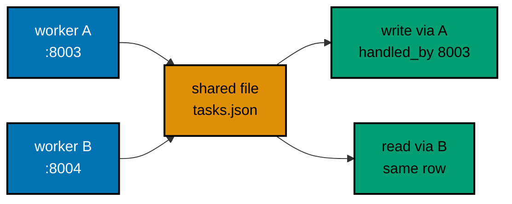

**`learning/code/ex-80-stateless-two-processes/main.go`**

```go
func main() {
	port := flag.String("port", "8000", "port THIS process serves -- give each worker its own")                   // => the side-by-side knob: 8003 vs 8004
	storePath := flag.String("store", "tasks.json", "the ONE file all workers share -- same value every process") // => the shared truth: identical on every command line
	flag.Parse()                                                                                                  // => parses os.Args -- flags must be read before the store or mux below uses them
	s := newStore(*storePath, *port)                                                                              // => path shared, port unique: that pair IS the worker's identity
	mux := http.NewServeMux()                                                                                     // => one explicit router -- a fresh mux PER process, sharing nothing
	mux.HandleFunc("POST /tasks", postTask(s))                                                                    // => writes stamp THIS worker's port, visible to BOTH
	mux.HandleFunc("GET /tasks/{id}", readTask(s))                                                                // => reads hit the CURRENT file -- process-agnostic
	mux.HandleFunc("GET /whoami", whoami(*port))                                                                  // => identity oracle -- proves TWO processes serve
	log.Fatal(http.ListenAndServe("127.0.0.1:"+*port, mux))                                                       // => THIS process binds its OWN port, same file as its twin
}
```

The file also defines the `task` struct with a `handled_by` stamp (the writing worker's port, the demo's whole proof point), `newStore` (two strings in, zero bytes read), `load` (reads the current file at the start of every request; a missing or empty file is an empty table), `save` (atomic temp-file plus rename on the same filesystem so readers see old or new, never half-written), `create` (max-id scan plus `handled_by` stamp plus atomic save), `get` (current-file scan by id), `postTask` (`422` on bad JSON or empty title, otherwise `201` with the stamped row), `readTask` (`422` on a non-integer id, `404` when absent), `whoami` (`{"port":"..."}` differing per process), and the shared `writeJSON`/`writeError` plumbing.

**Run**: two workers sharing one file (three terminals, or background the first two):

```text
go run . -port 8003 -store /tmp/ex80_tasks.json
go run . -port 8004 -store /tmp/ex80_tasks.json
```

**Output** (curl):

```text
$ curl -s http://127.0.0.1:8003/whoami
{"port":"8003"}
$ curl -s http://127.0.0.1:8004/whoami
{"port":"8004"}
$ curl -s -X POST -H "Content-Type: application/json" -d '{"title":"created on A"}' http://127.0.0.1:8003/tasks
{"id":1,"title":"created on A","handled_by":"8003"}
$ curl -s http://127.0.0.1:8004/tasks/1
{"id":1,"title":"created on A","handled_by":"8003"}
```

(A write via A stamped `handled_by` with `8003`; reading the same id via B returns the identical row -- the file, not either process's memory, is the source of truth.)

**Key takeaway**: The `handled_by` column exists purely so the demo can prove which worker wrote each row by reading it from the other -- a real client never needs to know which worker answered, which is exactly the point.

**Why it matters**: This resolves every earlier in-memory caveat (`sessions` in Examples 57 and 64, `items`/`nextID` in Example 63): stateless processes plus shared storage let a deployment add workers for capacity without breaking correctness, with atomic rename as the entire concurrency story at this scale.

---
