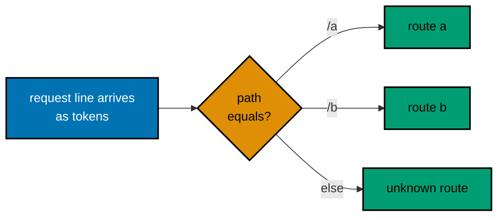
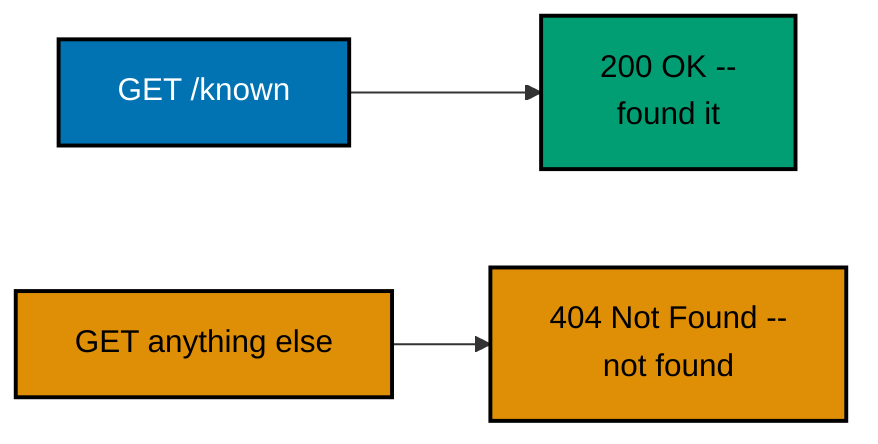
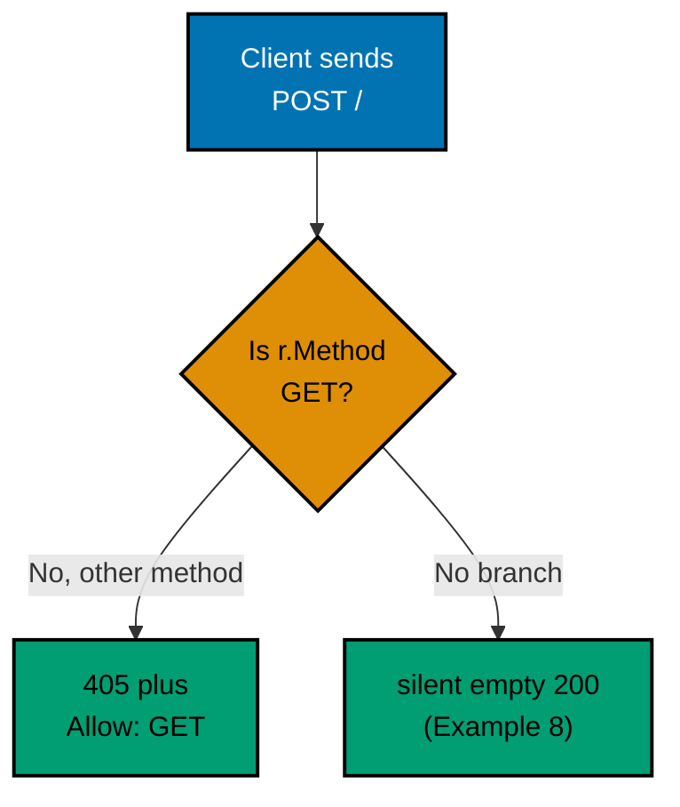
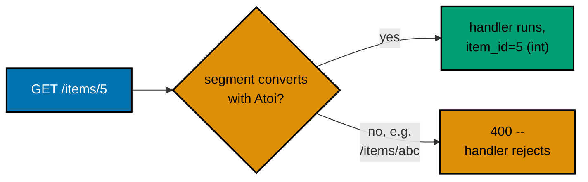
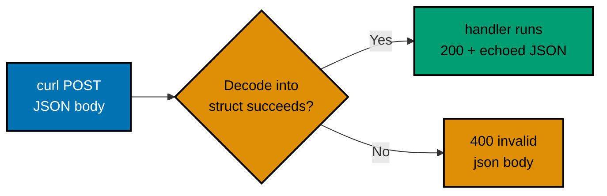
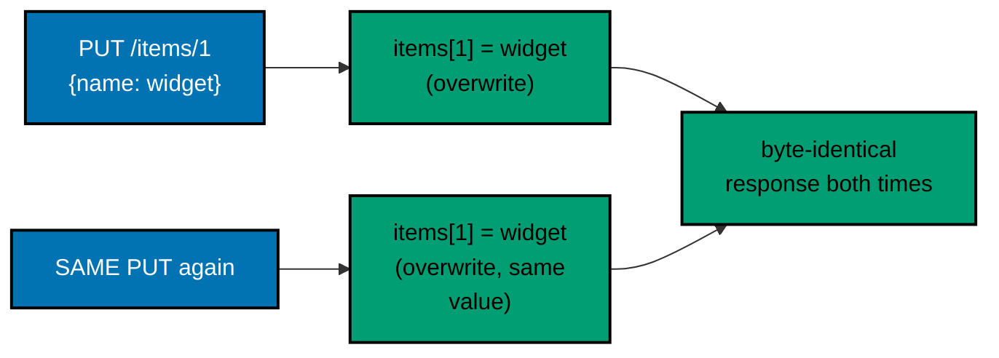
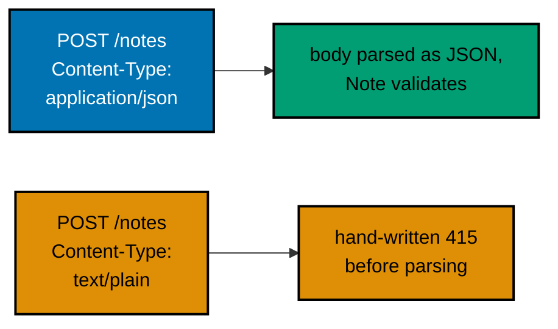

Examples 1-28 build a hand-written raw TCP server first (Examples 1-6), revealing
exactly what `net/http` automates, then move to `net/http` basics: confirming the
stdlib-only module, routing with `ServeMux`, typed path and query parameters, JSON
request/response bodies, status codes, headers, a ServeMux-vs-manual comparison,
PUT/PATCH semantics, statelessness, and a first look at hand-written content-type
enforcement. Every example is a complete, self-contained Go module colocated under
`learning/code/`; run each server with `go run .` from inside its own directory, then
exercise it with `curl` from a second terminal.

---

### Example 1: Raw Server Hello

_ex-01 &middot; exercises co-06, co-01_

The absolute minimum HTTP server: a raw TCP listener that writes a status line, two
headers, a blank line, and a body entirely by hand for every connection. Nothing here
is automated -- this is what `net/http` does invisibly on every single request.


**`learning/code/ex-01-raw-server-hello/main.go`**

```go
// Example 1: Raw Server Hello.
//
// An HTTP response is a fixed sequence of bytes: status line, headers, a
// blank line, then the body. This example writes every byte by hand on a
// raw TCP connection -- no net/http anywhere yet.
package main

import (
	"bufio" // => reads the request side line by line -- it parses nothing itself
	"fmt"   // => the operator-facing startup messages only
	"net"   // => the raw TCP toolkit this example and the next five run on (co-06)
)

// rawResponse is the entire reply, assembled by hand in wire order.
var rawResponse = "HTTP/1.1 200 OK\r\n" + // => status line: protocol, code, reason phrase (co-01)
	"Content-Type: text/plain\r\n" + // => one header: how the client should read the body
	"Content-Length: 5\r\n" + // => a second header: exactly how many body bytes follow
	"\r\n" + // => the blank line RFC 9110 requires to end the header block
	"hello" // => the body itself -- the 5 bytes promised above
// => every byte above is written by this program (co-01); a framework would
// => compose status line, headers, blank line, and body invisibly (co-06)

// handleConn serves one accepted TCP connection, start to finish.
func handleConn(conn net.Conn) { // => net.Conn is a bare, untyped, two-way byte pipe
	defer conn.Close() // => one reply per connection, then this server hangs up

	// => draining (not parsing) the request head first avoids a socket race:
	// => closing while bytes remain unread can reset the connection and
	// => destroy the reply already on its way, so read until the blank line
	reader := bufio.NewReader(conn) // => buffered line reader over that raw pipe
	for {
		line, err := reader.ReadString('\n') // => one full line, newline included
		// => ReadString hands back the line WITH its trailing newline
		if err != nil { // => the stream ended mid-request
			break // => whatever arrived is enough; the reply is written next
		}
		if line == "\r\n" { // => a lone CRLF marks end-of-headers (co-01)
			break // => the request head is fully consumed -- safe to answer
		}
	}
	conn.Write([]byte(rawResponse)) // => the ENTIRE response, one write, bytes only
	// => conn.Write accepts bytes, not string: the wire is a byte stream
}

func main() {
	// => bind localhost:8000 -- this tier has no TLS, no routing, no framework
	listener, err := net.Listen("tcp", "127.0.0.1:8000") // => err is non-nil when the port is taken
	if err != nil {                                      // => Go never panics on bind failure: you handle it
		fmt.Println("listen:", err) // => say exactly why the process is exiting
		return                      // => nothing is listening, so nothing to clean up
	}
	fmt.Println("listening on 127.0.0.1:8000") // => the operator's green light

	for { // => a server loop: one Accept per pass, forever
		conn, err := listener.Accept() // => BLOCKS until curl dials in
		// => conn is that one accepted connection; err covers Accept failures
		if err != nil { // => one failed accept must not kill the server
			fmt.Println("accept:", err) // => log it and move on
			continue                    // => drop this connection, serve the next
		}
		handleConn(conn) // => serve this connection to completion, then loop
	}
}
```

**Run**: `go run .`, then in a second terminal: `curl localhost:8000/`

**Output**:

```text
hello
```

**Key takeaway**: The status line, the headers, the blank line, and the body are four
hand-assembled parts of one string; a `ServeMux` handler is what replaces all of that
manual byte work with a plain function call.

**Why it matters**: Seeing the raw wire protocol once is what makes every later `net/http`
convenience legible instead of magical. When Example 11 encodes a map to JSON and
`net/http` turns it into a full HTTP response, this example is the proof of exactly what
work that call is quietly doing -- writing a status line, headers, and a body, in that
precise order.

---

### Example 2: Raw Status Line

_ex-02 &middot; exercises co-06, co-03_

A technically complete HTTP response needs surprisingly little: a status line, the
blank line that closes the empty header block, and a body. This example sends exactly
that and nothing more, so `curl -i` shows only the bytes this program actually wrote.

**`learning/code/ex-02-raw-status-line/main.go`**

```go
// Example 2: Raw Status Line.
//
// A technically complete HTTP response needs surprisingly little: a status
// line, the blank line that closes the (empty) header block, and a body.
// This example sends exactly that and nothing more, so `curl -i` shows
// only the two lines this program actually wrote.
package main

import (
	"bufio" // => request-side line reading, as in Example 1
	"fmt"   // => operator-facing startup messages
	"net"   // => raw TCP, still nothing above it (co-06)
)

// rawResponse is the entire reply: a status line plus the end-of-headers
// blank line. Not one header is sent, and curl still accepts this reply.
var rawResponse = "HTTP/1.1 200 OK\r\n" + // => the status line, complete on its own
	"\r\n" + // => the blank line closes the EMPTY header block (co-01)
	"status ok" // => a close-delimited body: no Content-Length measures it
// => the connection close below is what tells curl the body has ended
// => note the version: HTTP/1.1 is on the wire because WE typed it

// handleConn replies to one connection with the three-part response above.
func handleConn(conn net.Conn) { // => one call per accepted TCP connection
	defer conn.Close() // => close-delimiting: the close itself ends the body

	// => drain the request head before answering, exactly as Example 1 did:
	// => an unread request can turn this close into a connection reset,
	// => which would race curl's read of a perfectly valid reply
	reader := bufio.NewReader(conn) // => buffered over the raw byte pipe
	for {
		line, err := reader.ReadString('\n') // => one header line at a time
		if err != nil {                      // => the stream cut off mid-head
			break // => enough arrived to justify a reply
		}
		if line == "\r\n" { // => blank line: the request head is fully consumed
			break // => safe to respond and hang up
		}
	}
	conn.Write([]byte(rawResponse)) // => status line + blank line + body, one write
	// => nothing was added around it: no Date, no Server -- raw tier only
	// => sends what this program explicitly wrote (co-06)
}

func main() {
	listener, err := net.Listen("tcp", "127.0.0.1:8000") // => the same bind as Example 1
	if err != nil {                                      // => the port may still be held by a previous example
		fmt.Println("listen:", err) // => report and exit rather than fake success
		return
	}
	fmt.Println("listening on 127.0.0.1:8000") // => start curl in a second terminal

	for {
		conn, err := listener.Accept() // => one connection per iteration
		if err != nil {
			fmt.Println("accept:", err)
			continue
		}
		handleConn(conn) // => a full request/response cycle, then loop again
	}
}
```

**Run**: `go run .`, then: `curl -i localhost:8000/`

**Output**:

```text
HTTP/1.1 200 OK

status ok
```

**Key takeaway**: No `Date`, no `Server`, no `Content-Length` appears here, because raw TCP
adds nothing -- `curl -i` shows only the status line this program typed, which is why the
version reads `HTTP/1.1` instead of a library default.

**Why it matters**: The status line is the very first thing any HTTP client parses, before a
single header or body byte. Confirming its exact wire format with `curl -i` -- not just
trusting that "200 means success" -- is the habit that catches subtle version mismatches
that can otherwise silently break a proxy or load balancer downstream.

---

### Example 3: Raw Set Header

_ex-03 &middot; exercises co-06, co-04_

A response header is just text above the blank line. This example sets exactly one
`Content-Type` header by hand and confirms `curl` receives it -- there is no
queue-then-flush step at this layer: bytes go out in the order they are written, and
that order is the syntax.

**`learning/code/ex-03-raw-set-header/main.go`**

```go
// Example 3: Raw Set Header.
//
// A response header is just text above the blank line. This example sets
// exactly one Content-Type header by hand and confirms curl receives it --
// there is no queue-then-flush step at this layer: bytes go out in the
// order they are written, and that order IS the syntax (co-04).
package main

import (
	"bufio" // => request-side line reading, unchanged from Example 1
	"fmt"   // => operator-facing startup messages
	"net"   // => raw TCP (co-06)
)

// rawResponse writes status line, ONE header, the blank line, and a body --
// in exactly that order, because the wire order is the syntax (co-04).
var rawResponse = "HTTP/1.1 200 OK\r\n" + // => status line first, always
	"Content-Type: text/plain\r\n" + // => the ONE header this example sets
	"\r\n" + // => the blank line ends the header block
	"plain text body" // => a body that matches that Content-Type
// => with no Content-Length, the close below is what ends the body

// handleConn drains the request head, then answers with the fixed response.
func handleConn(conn net.Conn) { // => one connection per call, as before
	defer conn.Close() // => the close that delimits the body arrives last

	// => same drain as Examples 1 and 2: consume the request head up to
	// => its blank line so the reply is not racing unread request bytes
	reader := bufio.NewReader(conn)
	for {
		line, err := reader.ReadString('\n') // => one header line per pass
		if err != nil {                      // => stream ended early
			break // => reply regardless; the head is as drained as it gets
		}
		if line == "\r\n" {
			break // => request fully received: answer, then hang up
		}
	}
	conn.Write([]byte(rawResponse)) // => the header text travels with the very bytes
	// => a client can now treat this body as text/plain -- that header is
	// => metadata the client reads BEFORE it reads the body (co-04)
}

func main() {
	listener, err := net.Listen("tcp", "127.0.0.1:8000") // => same bind as Examples 1 and 2
	if err != nil {
		fmt.Println("listen:", err) // => report the bind failure and exit
		return
	}
	fmt.Println("listening on 127.0.0.1:8000") // => curl in a second terminal

	for {
		conn, err := listener.Accept() // => blocks until the next dial-in
		if err != nil {
			fmt.Println("accept:", err)
			continue
		}
		handleConn(conn) // => serve, then take the next connection
	}
}
```

**Run**: `go run .`, then: `curl -i localhost:8000/`

**Output**:

```text
HTTP/1.1 200 OK
Content-Type: text/plain

plain text body
```

**Key takeaway**: The header is literal text concatenated between the status line and the
blank line -- move it below the blank line and it silently becomes body bytes instead.

**Why it matters**: Headers carry metadata a client relies on before it even reads the
body -- a wrong or missing `Content-Type` here is exactly the class of bug Example 27
later rejects with a hand-written 415. Understanding the order-is-syntax mechanic by hand
is what makes `w.Header().Set()` make sense mechanically instead of by faith.

---

### Example 4: Raw Read Path

_ex-04 &middot; exercises co-06, co-12_

The request line arrives as space-separated tokens: method, path, protocol. Parsing it
by hand and branching on the path with a plain `if`/`else` chain is the manual version
of a `ServeMux` router.



**`learning/code/ex-04-raw-read-path/main.go`**

```go
// Example 4: Raw Read Path.
//
// The request line arrives as space-separated tokens: method, path,
// protocol. Parsing it by hand and branching on the path with a plain
// if/else chain is the manual version of a framework router (co-12).
package main

import (
	"bufio"   // => reading the request head one line at a time
	"fmt"     // => operator-facing startup messages
	"net"     // => raw TCP (co-06)
	"strings" // => whitespace splitting of the request line (co-12)
)

// requestPath extracts ONLY the path token from a request line.
func requestPath(line string) string { // => a helper so the routing branch reads plainly
	fields := strings.Fields(line) // => splits "GET /a HTTP/1.1" on whitespace runs
	// => token 1 is the method, token 2 the path, token 3 the protocol
	if len(fields) < 2 { // => a mangled request line has no path token at all
		return "" // => the caller routes "" straight into the fallback branch
	}
	return fields[1] // => the raw path: "/a", "/b", or "/b?x=1" verbatim
}

// handleConn parses the request line, routes on it, and writes one answer.
func handleConn(conn net.Conn) { // => raw tier: one request, one reply, one close
	defer conn.Close()

	reader := bufio.NewReader(conn)
	first, err := reader.ReadString('\n') // => the FIRST line is the request line (co-12)
	if err != nil {                       // => a dead stream has no request worth answering
		return // => nothing sane to reply to; the deferred close ends it
	}
	path := requestPath(first) // => the parsed path, e.g. "/a" or "/b?x=1"
	var body string            // => selected by the if/else router below
	if path == "/a" {
		body = "route a" // => exact match: ONLY "/a" gets this body
	} else if path == "/b" {
		body = "route b" // => a second, independent exact match
	} else {
		body = "unknown route" // => "/", "/c", "/a/nested" all land here
	}
	for { // => still drain the REST of the request head before replying
		line, err := reader.ReadString('\n')
		if err != nil || line == "\r\n" { // => blank line: headers are done
			break
		}
	}
	reply := "HTTP/1.1 200 OK\r\n" + // => status first, as in every raw example
		"Content-Type: text/plain\r\n" + // => every branch answers plain text
		"Connection: close\r\n" + // => announces the close that follows
		"\r\n" +
		body // => whichever route the if/else chain selected
	conn.Write([]byte(reply)) // => the routed answer, one write
}

func main() {
	listener, err := net.Listen("tcp", "127.0.0.1:8000") // => the same bind as before
	if err != nil {
		fmt.Println("listen:", err)
		return
	}
	fmt.Println("listening on 127.0.0.1:8000")

	for {
		conn, err := listener.Accept()
		if err != nil {
			fmt.Println("accept:", err)
			continue
		}
		handleConn(conn) // => one request parsed and routed per connection
	}
}
```

**Run**: `go run .`, then: `curl localhost:8000/a` and `curl localhost:8000/b`

**Output**:

```text
route a
route b
```

**Key takeaway**: The path is a plain string this handler compares by hand; a `ServeMux`
pattern is exactly this comparison logic, generalized into a reusable table instead of
one-off `if` branches.

**Why it matters**: Every `ServeMux` pattern -- `"GET /items/{item_id}"` (Example 14)
included -- boils down to "match the incoming path against a pattern, then run the
associated function." Writing the crude version by hand first is what makes that later
declarative syntax immediately readable instead of a black box.

---

### Example 5: Raw JSON Response

_ex-05 &middot; exercises co-06, co-09_

`json.Marshal()` turns a typed Go value into JSON bytes, and the `Content-Length` must
be computed by hand because no framework exists yet to compute it. This is the manual
version of what `net/http` plus `encoding/json` does on every route that returns JSON.

**`learning/code/ex-05-raw-json-response/main.go`**

```go
// Example 5: Raw JSON Response.
//
// JSON is text on the wire: a typed Go value is serialized to bytes by an
// explicit encoding/json call, and the Content-Length must be computed by
// hand because no framework exists yet to compute it (co-09).
package main

import (
	"bufio"         // => request-side line reading
	"encoding/json" // => the standard library's JSON encoder (co-09)
	"fmt"           // => operator-facing startup messages
	"net"           // => raw TCP (co-06)
	"strconv"       // => turns the computed byte count into header text
)

// handleConn serializes a Go value, sizes it, and writes the full response.
func handleConn(conn net.Conn) { // => one request, one JSON answer, one close
	defer conn.Close()

	reader := bufio.NewReader(conn)
	for { // => drain the request head before replying, as in Example 1
		line, err := reader.ReadString('\n')
		if err != nil || line == "\r\n" { // => blank line ends the request head
			break
		}
	}
	payload := map[string]any{"msg": "hello", "code": 1} // => an ordinary typed Go value...
	body, err := json.Marshal(payload)                   // => ...serialized to JSON bytes by hand (co-09)
	if err != nil {                                      // => Marshal fails only for unencodable types
		fmt.Println("marshal:", err) // => e.g. a channel or function value in the map
		return                       // => no response at all: the connection just closes
	}
	// => encoding/json sorts map keys: "code" lands before "msg" on the wire
	reply := "HTTP/1.1 200 OK\r\n" +
		"Content-Type: application/json\r\n" + // => tells the client THIS body is JSON (co-09)
		"Content-Length: " + strconv.Itoa(len(body)) + "\r\n" + // => computed, not guessed
		"Connection: close\r\n" +
		"\r\n" +
		string(body) // => the serialized JSON, appended after the blank line
	conn.Write([]byte(reply)) // => the whole JSON response, one write
}

func main() {
	listener, err := net.Listen("tcp", "127.0.0.1:8000") // => same bind as Examples 1-4
	if err != nil {
		fmt.Println("listen:", err)
		return
	}
	fmt.Println("listening on 127.0.0.1:8000")

	for {
		conn, err := listener.Accept()
		if err != nil {
			fmt.Println("accept:", err)
			continue
		}
		handleConn(conn) // => one JSON response per connection
	}
}
```

**Run**: `go run .`, then: `curl localhost:8000/`

**Output**:

```text
{"code":1,"msg":"hello"}
```

**Key takeaway**: JSON is text on the wire, produced by explicitly marshaling a Go value --
`encoding/json` sorts map keys, which is why `code` lands before `msg` here.

**Why it matters**: `json.Marshal()` plus a hand-computed `Content-Length` plus a
`Content-Type` header is the entire mechanism `net/http` handlers repeat with
`json.NewEncoder`. Seeing all three steps spelled out here is what makes Example 11's
encoder call legible as "the same three things, with the sizing done by the library,"
not an unexplained convenience.

---

### Example 6: Raw 404

_ex-06 &middot; exercises co-06, co-03_

A raw handler decides its own status code by hand: `200` for the one known path, `404`
for everything else. This example verifies the exact numeric status with
`curl -o /dev/null -w '%{http_code}'`, per the syllabus's acceptance criterion.



**`learning/code/ex-06-raw-404/main.go`**

```go
// Example 6: Raw 404.
//
// A raw handler decides its own status code by hand: 200 for the one known
// path, 404 for everything else. `curl -o /dev/null -w '%{http_code}'`
// verifies the exact numeric status the syllabus's acceptance criterion
// asks for, instead of eyeballing full responses.
package main

import (
	"bufio"   // => reading the request head
	"fmt"     // => operator-facing startup messages
	"net"     // => raw TCP (co-06)
	"strconv" // => Content-Length is computed, not guessed
	"strings" // => whitespace splitting of the request line (co-12)
)

// requestPath extracts the path token from a request line, as in Example 4.
func requestPath(line string) string { // => copied here so the example stays self-contained
	fields := strings.Fields(line) // => "GET /known HTTP/1.1" -> ["GET", "/known", "HTTP/1.1"]
	if len(fields) < 2 {           // => a mangled request line has no path token
		return ""
	}
	return fields[1] // => the raw path, exactly as the client typed it
}

// handleConn routes on the path and writes 200 or 404 by hand (co-03).
func handleConn(conn net.Conn) { // => one request, one hand-picked status
	defer conn.Close()

	reader := bufio.NewReader(conn)
	first, err := reader.ReadString('\n') // => the request line comes first
	if err != nil {                       // => no request line, no answer to give
		return // => the deferred close ends the connection quietly
	}
	path := requestPath(first) // => "/known", or anything else
	status := "HTTP/1.1 404 Not Found\r\n"
	body := "not found"
	// => RFC 9110: 404 means "the origin server did not find a
	// => current representation for the target resource" (co-03)
	if path == "/known" { // => the ONE path this server recognizes
		status = "HTTP/1.1 200 OK\r\n" // => a real resource -- 200 OK
		body = "found it"              // => confirms the known route ran
	}
	for { // => drain the remaining request head before replying
		line, err := reader.ReadString('\n')
		if err != nil || line == "\r\n" {
			break
		}
	}
	reply := status +
		"Content-Type: text/plain\r\n" + // => both branches answer plain text
		"Content-Length: " + strconv.Itoa(len(body)) + "\r\n" + // => sized per branch
		"Connection: close\r\n" +
		"\r\n" +
		body // => "found it" or "not found", whichever branch won
	conn.Write([]byte(reply)) // => the branch's status line and body, one write
}

func main() {
	listener, err := net.Listen("tcp", "127.0.0.1:8000") // => same bind as Examples 1-5
	if err != nil {
		fmt.Println("listen:", err)
		return
	}
	fmt.Println("listening on 127.0.0.1:8000")

	for {
		conn, err := listener.Accept()
		if err != nil {
			fmt.Println("accept:", err)
			continue
		}
		handleConn(conn) // => one routed, status-picked answer per connection
	}
}
```

**Run**: `go run .`, then: `curl -o /dev/null -w '%{http_code}' localhost:8000/nope` and
`curl -o /dev/null -w '%{http_code}' localhost:8000/known`

**Output**:

```text
404
200
```

**Key takeaway**: `curl -o /dev/null -w '%{http_code}'` discards the body and prints only the
numeric status -- the precise way to verify a status code from a script instead of
eyeballing `curl -i` output.

**Why it matters**: A 404 is a deliberate design decision, not an accident -- this handler
explicitly checks for the one known path and falls back to 404 for everything else. That
same "known path succeeds, everything else 404s" default is exactly what a `ServeMux`
does automatically once real routes outnumber the handful this raw example hand-checks.

---

### Example 7: net/http App

_ex-07 &middot; exercises co-06_

The first `net/http` example: a handler is any function with the signature
`func(http.ResponseWriter, *http.Request)`. That one signature is the calling convention
of every Go HTTP server, and `net/http` supplies the real socket server around it.

**`learning/code/ex-07-net-http-app/main.go`**

```go
// Example 7: net/http App.
//
// The first net/http example: a handler is any function with the signature
// func(http.ResponseWriter, *http.Request). That one signature IS the
// calling convention of every Go HTTP server -- stdlib muxes and third-party
// frameworks alike -- and net/http supplies the real socket server around
// it, the way wsgiref hosted WSGI callables in the Python track.
package main

import (
	"log"      // => Fatal() reports ListenAndServe's startup failure and exits
	"net/http" // => THE standard library HTTP toolkit: server, parsing, dispatch (co-06)
)

// helloHandler has THE handler signature: net/http calls it per request.
func helloHandler(w http.ResponseWriter, r *http.Request) { // => (w, r) is the calling convention
	// => w replaces Example 1's hand-assembled status/headers/body bytes:
	// => writes to w come out in wire order automatically
	// => *http.Request is the PARSED request -- method, URL, headers (co-06);
	// => the line-by-line parsing Examples 1-6 did by hand is free from here on
	w.Header().Set("Content-Type", "text/plain") // => one header, set by name -- no CRLF strings (co-04)
	w.WriteHeader(http.StatusOK)                 // => writes the status line "HTTP/1.1 200 OK"
	// => technically optional BEFORE the first body write: an unwritten
	// => status implies 200 anyway -- kept here to make the step visible
	w.Write([]byte("net/http hello")) // => the body, still just bytes on the wire (co-01)
}

func main() {
	http.HandleFunc("/", helloHandler) // => registers on the package-level DefaultServeMux
	// => "/" is a catch-all prefix: every path lands on helloHandler here
	// => Example 11 refines this with an explicit mux and method patterns

	// => ListenAndServe binds, accepts, parses, and dispatches -- every socket
	// => detail Example 1 hand-wrote -- and returns non-nil only at startup;
	// => log.Fatal reports that failure and ends the process with exit code 1
	log.Fatal(http.ListenAndServe("127.0.0.1:8000", nil)) // => nil = serve the DefaultServeMux
}
```

**Run**: `go run .`, then: `curl localhost:8000/`

**Output**:

```text
net/http hello
```

**Key takeaway**: A `net/http` handler is just a function matching one specific signature --
`(w http.ResponseWriter, r *http.Request)` -- and `ListenAndServe` is the standard
library's own server that can host any such function.

**Why it matters**: Every later example in this tier is a function shaped exactly like
`helloHandler` -- routing and request parsing all sit on top of this same interface.
Recognizing the shared foundation is what makes "any mux or framework ultimately calls a
function shaped like this" a concrete fact instead of unexplained trivia.

---

### Example 8: Handle GET Only

_ex-08 &middot; exercises co-02_

A handler that answers GET and deliberately writes nothing for any other method. Unlike
the Python track -- where a missing handler method replies 501 -- `net/http` does no
method dispatch at all: every method reaches this handler, and an unhandled method gets
a silent, empty 200. That imprecision is exactly what Example 9 fixes by hand.

**`learning/code/ex-08-handle-get-only/main.go`**

```go
// Example 8: Handle GET Only.
//
// A handler that answers GET and deliberately writes NOTHING for any other
// method. Unlike Python's BaseHTTPRequestHandler -- which replies 501 when
// a do_POST method is missing -- net/http does no method dispatch at all:
// every method reaches this handler, and an unhandled method gets a silent,
// empty 200. That imprecision is exactly what Example 9 fixes by hand.
package main

import (
	"log"      // => Fatal() for the ListenAndServe startup error
	"net/http" // => the stdlib server this tier now always runs on
)

// getOnlyHandler answers GET and is deliberately silent about everything else.
func getOnlyHandler(w http.ResponseWriter, r *http.Request) {
	switch r.Method { // => the ONE dispatch this handler implements (co-02)
	case http.MethodGet:
		// => net/http calls this handler for EVERY method; only GET
		// => gets a real reply -- the method check is your code, not
		// => the library's (contrast the Python do_GET magic name)
		w.Write([]byte("get succeeded")) // => the only case this handler answers
	default:
		// => deliberate: NOTHING is written for POST/PUT/DELETE/etc.
		// => net/http fills that silence with an implicit 200 and an
		// => empty body -- technically "success", pedagogically a trap
	}
}

func main() {
	http.HandleFunc("/", getOnlyHandler) // => every method, every path, one handler
	// => there is no do_GET/do_POST dispatch in net/http: r.Method is the
	// => only method information this handler ever sees (co-02)
	log.Fatal(http.ListenAndServe("127.0.0.1:8000", nil)) // => DefaultServeMux, as in Example 7
}
```

**Run**: `go run .`, then: `curl localhost:8000/`

**Output**:

```text
get succeeded
```

**Key takeaway**: `r.Method` is defined and checked by hand, so a GET request succeeds --
but with no branch for POST, this handler is entirely unequipped to answer any method
other than GET, and the silence becomes an empty 200.

**Why it matters**: The stdlib's lack of dispatch (every method reaches the same function)
is the same idea a `ServeMux` method pattern generalizes -- register a handler per
method, per path. Confirming GET succeeds first, then testing what happens to POST in
Example 9, is what makes the difference between "silent" (empty 200) and "explicitly
rejected" (405) concrete.

---

### Example 9: Method 405, Raw

_ex-09 &middot; exercises co-02, co-03_

Unlike Example 8, this handler explicitly rejects every non-GET method with a precise
405, including the RFC 9110-mandated `Allow` header. Verified with `curl -i -X POST`
per the syllabus's acceptance criterion.



**`learning/code/ex-09-method-405-raw/main.go`**

```go
// Example 9: Method 405, Hand-Written.
//
// Unlike Example 8's silent empty 200, this handler explicitly rejects
// every non-GET method with a precise 405 -- including the RFC 9110
// mandated Allow header that tells the client what WOULD have worked.
package main

import (
	"log"      // => Fatal() for the ListenAndServe startup error
	"net/http" // => the stdlib server, as in Examples 7 and 8
)

// getOnlyWith405Handler answers GET and rejects everything else precisely.
func getOnlyWith405Handler(w http.ResponseWriter, r *http.Request) {
	switch r.Method { // => the same hand-written dispatch as Example 8 (co-02)
	case http.MethodGet:
		w.Write([]byte("get succeeded")) // => the one method this route supports
	default:
		// => defined ON PURPOSE, unlike Example 8's empty default branch,
		// => so the client gets a PRECISE rejection, not a silent 200
		w.Header().Set("Allow", "GET") // => lists the methods that ARE ok (co-04)
		// => RFC 9110: a 405 response MUST carry Allow -- the pair is
		// => mandatory together, not the status alone (co-03)
		w.WriteHeader(http.StatusMethodNotAllowed) // => writes "HTTP/1.1 405 Method Not Allowed"
		w.Write([]byte("method not allowed"))      // => a body that explains the rejection
	}
}

func main() {
	http.HandleFunc("/", getOnlyWith405Handler) // => one handler, every method reaching it
	// => the switch above is what a framework's method-scoped route would
	// => generate automatically -- Example 11's "GET " pattern does exactly
	// => this, one registration line at a time (co-07)
	log.Fatal(http.ListenAndServe("127.0.0.1:8000", nil)) // => DefaultServeMux, as in Example 8
}
```

**Run**: `go run .`, then: `curl -i -X POST localhost:8000/`

**Output**:

```text
HTTP/1.1 405 Method Not Allowed
Allow: GET

method not allowed
```

**Key takeaway**: A precise 405 requires two things: the numeric status 405, and an `Allow`
header listing the methods that are supported -- RFC 9110 requires both together, not the
status alone.

**Why it matters**: A silent empty 200 (Example 8's fallback) tells a client only a
confusing "success"; a 405 with `Allow: GET` tells it exactly what is allowed, letting a
well-behaved client retry correctly instead of guessing. This is the exact behavior the
Advanced tier later verifies again once the `ServeMux` is generating it automatically
instead of by hand.

---

### Example 10: go mod init -- Nothing to Install

_ex-10 &middot; exercises co-22_

Confirming the toolchain version and that the module declares zero third-party
dependencies -- the Go analogue of pinning versions in the Python track, and the last
example that does not yet serve an HTTP request.

**`learning/code/ex-10-go-mod-init/main.go`**

```go
// Example 10: go mod init -- Nothing to Install.
//
// Every example from here on is served by `go run .` inside its own module.
// This one is the setup step: confirm the toolchain version and that the
// module declares zero third-party dependencies -- the Go analogue of
// pinning framework versions in the Python track.
package main

import (
	"fmt"     // => prints the three-line version report
	"runtime" // => runtime.Version() reads the toolchain the binary was built with
)

func main() {
	fmt.Println("module example/ex-10-go-mod-init") // => the path this directory's go.mod declares
	// => a module path comes from go.mod, not from this print statement --
	// => inspect the colocated go.mod to see the real declaration (co-22)
	fmt.Println("dependencies: none -- net/http is the standard library") // => the whole "install" step
	// => there is no framework to pin: net/http, encoding/json, and net are
	// => all part of the Go standard library, shipped with the toolchain
	fmt.Println("go toolchain:", runtime.Version()) // => e.g. go1.27.2
	// => runtime.Version() is baked in at compile time: the toolchain version
	// => IS this course's stack version, standing in for the Python pins
}
```

**Run**: `go run .` (no `curl` -- nothing is listening yet; this step only prints the module report)

**Output**:

```text
module example/ex-10-go-mod-init
dependencies: none -- net/http is the standard library
go toolchain: go1.27.2
```

**Key takeaway**: `go.mod` plus `runtime.Version()` are the reliable, network-free way to
confirm exactly which module and toolchain a directory actually builds with -- matching
this output against the colocated `go.mod` is the whole verification.

**Why it matters**: Every later example in this tier assumes the standard library only --
there is no framework version that could silently change behavior. Confirming the empty
dependency list explicitly, in code, before building on top of it is a habit that catches
toolchain drift before it becomes a confusing bug three examples later.

---

### Example 11: net/http Hello

_ex-11 &middot; exercises co-07, co-08_

The same "hello" reply as Example 1, expressed with `net/http`: a `ServeMux` pattern
registers the route, and the handler marshals a typed Go value with `encoding/json`.
Contrast this against the six raw-server examples that preceded it.

**`learning/code/ex-11-net-http-hello/main.go`**

```go
// Example 11: net/http Hello.
//
// The same "hello" reply as Example 1, expressed with net/http's router:
// a ServeMux pattern registers the route, and the handler marshals a typed
// Go value with encoding/json. Contrast this against the six raw examples.
package main

import (
	"encoding/json" // => JSON serialization with no model layer beyond Go structs (co-09)
	"log"           // => Fatal() for the ListenAndServe startup error
	"net/http"      // => the stdlib server and its router (co-06, co-07)
)

// helloHandler answers exactly what Example 1 answered -- minus every
// hand-written byte: no CRLF strings, no manual Content-Length arithmetic.
func helloHandler(w http.ResponseWriter, r *http.Request) {
	// => the raw tier wrote "HTTP/1.1 200 OK\r\n" by hand; here the status
	// => line, Date, and Content-Length headers are all net/http's work
	w.Header().Set("Content-Type", "application/json") // => set BY HAND, unlike FastAPI (co-09)
	// => the stdlib never guesses JSON: without this line net/http would
	// => sniff `{"msg":...}` as text/plain -- a real trap, hence the comment
	json.NewEncoder(w).Encode(map[string]string{"msg": "hello"}) // => serializes AND writes in one call
}

func main() {
	mux := http.NewServeMux()             // => an explicit router object: patterns in, dispatch out (co-07)
	mux.HandleFunc("GET /", helloHandler) // => method+path in ONE pattern, like @app.get("/")
	// => the "GET " prefix routes by method: a POST to "/" now gets an
	// => automatic 405 from the mux -- contrast Example 8's silent 200
	log.Fatal(http.ListenAndServe("127.0.0.1:8000", mux)) // => serve THIS mux, not nil (co-07)
}
```

**Run**: `go run .`, then in a second terminal: `curl localhost:8000/`

**Output**:

```text
{"msg":"hello"}
```

**Key takeaway**: `"GET /"` plus one `Encode` call replaces every manual step Examples 1-6
wrote by hand -- routing, status line, and JSON serialization all happen through the mux
and the encoder, with only the `Content-Type` still set by hand.

**Why it matters**: This is the single moment this tier's arc pays off: six raw examples
built up exactly enough mechanical understanding that `mux.HandleFunc("GET /", ...)` now
reads as "shorthand for Accept plus parse plus status line plus marshal," not as
unexplained magic. Every later `net/http` example in this tier builds on this same
routing-plus-encoding foundation.

---

### Example 12: Run via go run

_ex-12 &middot; exercises co-22_

`go run .` is the command that actually starts serving -- it compiles the main package
in the current directory and runs it, blocking inside `ListenAndServe`, with no separate
server process required.

**`learning/code/ex-12-go-run-server/main.go`**

```go
// Example 12: Run via go run.
//
// `go run .` is the command that actually starts serving: it compiles the
// main package in the current directory and runs its main function, which
// blocks inside ListenAndServe -- the Go analogue of `uvicorn app:app`,
// with the built binary itself playing the role uvicorn played.
package main

import (
	"encoding/json" // => the one JSON route this dev-loop example serves
	"log"           // => Fatal() for the ListenAndServe startup error
	"net/http"      // => the stdlib server (co-22)
)

// rootHandler is the minimal route the dev loop needs something to hit.
func rootHandler(w http.ResponseWriter, r *http.Request) {
	w.Header().Set("Content-Type", "application/json")                  // => hand-set, as every JSON route does (co-09)
	json.NewEncoder(w).Encode(map[string]string{"served_by": "go run"}) // => confirms which process answered
}

func main() {
	mux := http.NewServeMux()            // => the router this example serves (co-07)
	mux.HandleFunc("GET /", rootHandler) // => one route is enough for the loop
	// => ListenAndServe BLOCKS like Python's serve_forever: the process
	// => stays alive, accepting connections, until Ctrl-C stops it (co-22)
	log.Fatal(http.ListenAndServe("127.0.0.1:8000", mux))
}
```

**Run**: `go run .`, then: `curl localhost:8000/`

**Output**:

```text
{"served_by":"go run"}
```

**Key takeaway**: `go run .` means "compile the package in this directory and run its
`main`" -- the server startup lives inside `main`, not in an external runner that imports
the code.

**Why it matters**: Understanding `go run`'s compile-and-run startup (versus Examples 1-6's
raw `Accept` loop) is what makes the rest of this tier's dev loop predictable -- every
example from here forward is served the exact same way, and that consistency is precisely
what makes rapid iteration (edit, save, `curl` again) practical.

---

### Example 13: Health Endpoint

_ex-13 &middot; exercises co-08, co-03_

A `GET /health` route returning a fixed `{"status": "ok"}` body with the default 200
status -- the simplest possible handler, holding zero logic beyond a constant reply.

**`learning/code/ex-13-health-endpoint/main.go`**

```go
// Example 13: Health Endpoint.
//
// A GET /health route returning a fixed {"status": "ok"} body with the
// default 200 status -- the simplest possible handler, holding zero logic
// beyond a constant reply. A liveness check should never depend on
// anything that can itself fail.
package main

import (
	"encoding/json" // => the fixed body is still JSON on the wire (co-09)
	"log"           // => Fatal() for the ListenAndServe startup error
	"net/http"      // => the stdlib server (co-08)
)

// healthHandler is deliberately trivial: a liveness probe, nothing more.
func healthHandler(w http.ResponseWriter, r *http.Request) {
	// => this handler holds ZERO logic beyond returning a constant --
	// => deliberately so: a liveness probe must never depend on anything
	// => that can fail (a database, a downstream service); the Advanced
	// => tier's /ready endpoint is where a dependency check belongs
	w.Header().Set("Content-Type", "application/json")           // => set before any write (co-04)
	json.NewEncoder(w).Encode(map[string]string{"status": "ok"}) // => the constant body
	// => no WriteHeader call: the first Write implies 200, which is
	// => exactly the status a healthy process should report (co-03)
}

func main() {
	mux := http.NewServeMux()
	mux.HandleFunc("GET /health", healthHandler) // => a conventional liveness-check path (co-08)
	// => GET-scoped: a POST /health gets the mux's automatic 405, which is
	// => fine -- probes only ever GET
	log.Fatal(http.ListenAndServe("127.0.0.1:8000", mux))
}
```

**Run**: `go run .`, then: `curl localhost:8000/health`

**Output**:

```text
{"status":"ok"}
```

**Key takeaway**: A liveness check's handler should hold no dependencies of its own --
returning a constant is the correct, deliberate design, not a placeholder waiting to be
filled in.

**Why it matters**: A container orchestrator or load balancer polls a health endpoint
constantly to decide whether to keep routing traffic to this process. A `/health` route
that itself depends on a database would report "unhealthy" the instant the database has
a blip, even if the process serving requests is otherwise fine -- exactly the failure
mode a `/ready` split avoids.

---

### Example 14: Typed Path Param

_ex-14 &middot; exercises co-12_

`"/items/{item_id}"` in the mux pattern matches the path segment as text; the handler
reads it back with `r.PathValue` and converts it with `strconv.Atoi`. The conversion is
hand-written -- the stdlib matches text, it never type-checks for you.



**`learning/code/ex-14-typed-path-param/main.go`**

```go
// Example 14: Typed Path Param.
//
// The ServeMux pattern "/items/{item_id}" matches the path segment; the
// handler reads it back with r.PathValue and converts it to an int with
// strconv. The conversion is hand-written -- the stdlib matches text, it
// does not type-check for you, so the failure branch is your code.
package main

import (
	"encoding/json" // => the echoed value goes out as JSON (co-09)
	"log"           // => Fatal() for the ListenAndServe startup error
	"net/http"      // => the stdlib server and its path patterns (co-12)
	"strconv"       // => the typed conversion the mux does NOT do for you
)

// readItem converts the matched segment to an int, or rejects it.
func readItem(w http.ResponseWriter, r *http.Request) {
	idText := r.PathValue("item_id") // => the {item_id} segment, still a string (co-12)
	// => the name inside PathValue MUST match the {item_id} placeholder in
	// => the registered pattern -- that name match is the whole mechanism
	id, err := strconv.Atoi(idText) // => hand-typed conversion: text -> int
	if err != nil {                 // => "/items/abc" fails HERE, inside your own handler
		// => the stdlib has no automatic 422: a failed conversion gets
		// => whatever status YOUR branch writes -- this course uses 400
		w.WriteHeader(http.StatusBadRequest)                      // => reject before doing any work (co-10)
		w.Write([]byte(`{"error":"item_id must be an integer"}`)) // => a tiny error envelope
		return
	}
	w.Header().Set("Content-Type", "application/json")
	json.NewEncoder(w).Encode(map[string]int{"item_id": id}) // => the TYPED int, echoed back
}

func main() {
	mux := http.NewServeMux()
	mux.HandleFunc("GET /items/{item_id}", readItem) // => {item_id} is the path placeholder (co-12)
	// => the mux matched the segment as TEXT; everything typed happens
	// => inside the handler -- that split is the stdlib's whole story
	log.Fatal(http.ListenAndServe("127.0.0.1:8000", mux))
}
```

**Run**: `go run .`, then: `curl localhost:8000/items/5`

**Output**:

```text
{"item_id":5}
```

**Key takeaway**: The name inside `r.PathValue("item_id")` matching the `{item_id}`
placeholder is the entire routing mechanism -- typing beyond that match is a
hand-written `strconv.Atoi` branch, not a library inference.

**Why it matters**: A typed path parameter means "give me anything that parses as an int"
is enforced before any real work runs -- `/items/abc` never reaches the success branch,
it fails the conversion first. That explicit branch is what lets every line after it trust
its inputs are already well-formed, without a single unchecked conversion.

---

### Example 15: Typed Query Param

_ex-15 &middot; exercises co-12_

A query parameter lives in `r.URL.Query()`, never in the mux pattern. `Get("q")` returns
the empty string when `q` is absent, so "required" is a branch this handler writes by
hand -- the opposite of any automatic inference.

**`learning/code/ex-15-typed-query-param/main.go`**

```go
// Example 15: Typed Query Param.
//
// r.URL.Query().Get("q") reads a query parameter straight from the URL --
// with no conversion and no required-ness check from the stdlib. A missing
// q arrives as the empty string, so "required" is a branch you write.
package main

import (
	"encoding/json" // => the echoed value goes out as JSON (co-09)
	"log"           // => Fatal() for the ListenAndServe startup error
	"net/http"      // => the stdlib server (co-12)
)

// search treats q as REQUIRED: an absent or empty value is a client error.
func search(w http.ResponseWriter, r *http.Request) {
	q := r.URL.Query().Get("q") // => "" both when absent and when sent empty (co-12)
	// => Get returns the zero value -- "" -- for a missing key: the stdlib
	// => never rejects anything, so "required" is this handler's own rule
	if q == "" { // => the required-ness check, hand-written (co-10)
		w.WriteHeader(http.StatusBadRequest) // => refuse before doing any work
		w.Write([]byte(`{"error":"missing required query param q"}`))
		return
	}
	w.Header().Set("Content-Type", "application/json")
	json.NewEncoder(w).Encode(map[string]string{"query": q}) // => echoes the parsed value back
	// => q is already decoded text: "?q=hi%20there" arrives as "hi there"
}

func main() {
	mux := http.NewServeMux()
	mux.HandleFunc("GET /search", search) // => note: no {q} placeholder anywhere in this path
	// => a query param lives in r.URL.Query(), never in the pattern --
	// => the split between path and query params is entirely conventional (co-12)
	log.Fatal(http.ListenAndServe("127.0.0.1:8000", mux))
}
```

**Run**: `go run .`, then: `curl 'localhost:8000/search?q=hi'`

**Output**:

```text
{"query":"hi"}
```

**Key takeaway**: The stdlib never distinguishes "missing" from "empty" for query values --
both arrive as `""`, so required-ness is always an explicit `if q == ""` branch.

**Why it matters**: Because `q` has no default, omitting `?q=` entirely returns a 400, the
same boundary guarantee Example 14's path parameter gets. Recognizing that path and query
parameters share one underlying hand-checked mechanism, just with different lookup calls,
avoids treating them as two unrelated features.

---

### Example 16: Optional Query Param with a Default

_ex-16 &middot; exercises co-12_

Starting from `limit = 10` and only overwriting it when `?limit=` is present makes the
parameter optional -- the presence check is the only thing that changes a parameter from
required to optional.

**`learning/code/ex-16-optional-query-default/main.go`**

```go
// Example 16: Optional Query Param with a Default.
//
// Giving a query parameter a default value (limit = 10) makes it optional:
// the request without ?limit= uses the default, and a provided value is
// parsed with strconv -- where a non-integer is rejected by hand.
package main

import (
	"encoding/json" // => the echoed value goes out as JSON (co-09)
	"log"           // => Fatal() for the ListenAndServe startup error
	"net/http"      // => the stdlib server (co-12)
	"strconv"       // => the typed conversion for the provided value
)

// listItems uses limit=10 when the client sends nothing at all.
func listItems(w http.ResponseWriter, r *http.Request) {
	limit := 10 // => the default: any request without ?limit= keeps this
	// => the presence check is the ONLY thing that makes limit optional --
	// => compare Example 15, where the missing q was refused outright
	if s := r.URL.Query().Get("limit"); s != "" { // => only entered when the client sent a value
		n, err := strconv.Atoi(s) // => typed conversion, hand-written (co-12)
		if err != nil {           // => ?limit=abc lands here -- the typed check
			w.WriteHeader(http.StatusBadRequest) // => reject before any work (co-10)
			w.Write([]byte(`{"error":"limit must be an integer"}`))
			return
		}
		limit = n // => the caller's value wins over the default
	}
	w.Header().Set("Content-Type", "application/json")
	json.NewEncoder(w).Encode(map[string]int{"limit": limit}) // => echoes whichever value was used
}

func main() {
	mux := http.NewServeMux()
	mux.HandleFunc("GET /items", listItems) // => a listing route -- the shape the Advanced
	// => tier's limit/offset pagination builds directly on top of (co-19)
	log.Fatal(http.ListenAndServe("127.0.0.1:8000", mux))
}
```

**Run**: `go run .`, then: `curl localhost:8000/items` and
`curl 'localhost:8000/items?limit=3'`

**Output**:

```text
{"limit":10}
{"limit":3}
```

**Key takeaway**: `limit := 10` reads the same way an ordinary Go default reads -- "keep
this value if the caller supplies nothing" -- applied here to a query parameter by hand.

**Why it matters**: This is the exact shape the Advanced tier's `limit`/`offset`
pagination builds directly on top of: a defaulted query parameter that keeps a list
endpoint safe to call without any parameters at all. Seeing the plain default-value
mechanic here first is what makes that later pagination code look like a straightforward
extension, not a new concept.

---

### Example 17: JSON Request Body

_ex-17 &middot; exercises co-13, co-10_

`json.NewDecoder(r.Body).Decode(&item)` reads the request body and parses it into a
typed struct in one call -- malformed JSON fails there, and the handler answers 400
before doing any real work.



**`learning/code/ex-17-json-request-body/main.go`**

```go
// Example 17: JSON Request Body.
//
// json.NewDecoder(r.Body).Decode(&item) reads the request body and parses
// it into a typed struct in one call -- malformed JSON or mismatched types
// fail there, and the handler answers 400 before doing any real work.
package main

import (
	"encoding/json" // => the decoder AND the encoder: both directions are stdlib (co-13)
	"log"           // => Fatal() for the ListenAndServe startup error
	"net/http"      // => the stdlib server (co-13)
)

// item is the typed shape of the request body (co-13).
type item struct {
	Name  string  `json:"name"`  // => a missing field decodes as "" -- absence is not an error
	Price float64 `json:"price"` // => a JSON string here fails Decode: type mismatch
	// => the struct tags map Go field names to JSON keys; without them the
	// => decoder would match keys case-insensitively to the Go names
}

// createItem parses the body into item, or rejects the request.
func createItem(w http.ResponseWriter, r *http.Request) {
	defer r.Body.Close() // => handlers close the bodies they read (co-13)
	var it item
	if err := json.NewDecoder(r.Body).Decode(&it); err != nil { // => parse + type-check in one call
		// => by the time this LINE runs, parsing already happened: a
		// => malformed body never reaches the logic below (co-10)
		w.WriteHeader(http.StatusBadRequest)             // => the stdlib has no auto-422: this branch is yours
		w.Write([]byte(`{"error":"invalid json body"}`)) // => a tiny structured error (co-11)
		return
	}
	w.Header().Set("Content-Type", "application/json")
	json.NewEncoder(w).Encode(it) // => echo the decoded, typed struct straight back
	// => the round trip: JSON in -> typed Go struct -> JSON out (co-13)
}

func main() {
	mux := http.NewServeMux()
	mux.HandleFunc("POST /items", createItem) // => POST is the method that pairs a body (co-02)
	// => method-scoped: a GET /items gets the mux's automatic 405, so the
	// => body-parsing code only ever runs for requests that carry one
	log.Fatal(http.ListenAndServe("127.0.0.1:8000", mux))
}
```

**Run**: `go run .`, then: `curl -X POST -H 'Content-Type: application/json' -d '{"name": "widget", "price": 9.99}' localhost:8000/items`

**Output**:

```text
{"name":"widget","price":9.99}
```

**Key takeaway**: Declaring a struct and decoding into it is the entire mechanism for JSON
body parsing plus type-checking -- there is no separate "validate the body" step anywhere
else in this code.

**Why it matters**: A body-parsing bug (a typo'd field name, a string where a number
belongs) is the single most common source of confusing 500 errors in hand-rolled
backends, because the failure surfaces deep inside business logic instead of at the
boundary. Checking the decode error before any handler logic runs is what turns that
class of bug into an immediate, structured 400 instead.

---

### Example 18: Response Struct Filters the Output

_ex-18 &middot; exercises co-09, co-10_

Two distinct structs -- one for the input shape, one for the output shape -- keep a
sensitive field reachable on the way in but structurally absent on the way out. The
filtering happens by construction: the output struct simply has no field to leak.


**`learning/code/ex-18-response-struct/main.go`**

```go
// Example 18: A Separate Response Struct Filters the Output.
//
// Two distinct structs -- one for the input shape, one for the output
// shape -- keep a sensitive field reachable on the way in but structurally
// absent on the way out. The filtering happens by construction: the output
// struct simply has no field to leak.
package main

import (
	"encoding/json" // => both directions are stdlib (co-09, co-13)
	"log"           // => Fatal() for the ListenAndServe startup error
	"net/http"      // => the stdlib server
)

// itemIn is the INPUT validation shape: everything the client may send.
type itemIn struct {
	Name       string `json:"name"`        // => safe to echo back to the client
	SecretNote string `json:"secret_note"` // => a field the response must NOT leak
}

// itemOut is the OUTPUT shape: a strict subset of itemIn's fields.
type itemOut struct {
	Name string `json:"name"` // => the ONLY field this struct is allowed to expose
}

// createItem decodes with itemIn and answers with itemOut.
func createItem(w http.ResponseWriter, r *http.Request) {
	defer r.Body.Close()
	var in itemIn
	if err := json.NewDecoder(r.Body).Decode(&in); err != nil { // => input validated first (co-10)
		w.WriteHeader(http.StatusBadRequest)
		w.Write([]byte(`{"error":"invalid json body"}`))
		return
	}
	out := itemOut{Name: in.Name} // => filtering BY CONSTRUCTION (co-09)
	// => even if this handler later grew and returned in itself by
	// => mistake, out above is the only thing ever encoded -- secret_note
	// => has no route to the wire because itemOut has no such field
	w.Header().Set("Content-Type", "application/json")
	json.NewEncoder(w).Encode(out) // => secret_note never reaches the response body
}

func main() {
	mux := http.NewServeMux()
	mux.HandleFunc("POST /items", createItem) // => the same route shape as Example 17 (co-02)
	// => one input struct and one output struct is the Go-stdlib version
	// => of the Python track's response_model pattern (co-09, co-10)
	log.Fatal(http.ListenAndServe("127.0.0.1:8000", mux))
}
```

**Run**: `go run .`, then: `curl -X POST -H 'Content-Type: application/json' -d '{"name": "widget", "secret_note": "internal cost 3.50"}' localhost:8000/items`

**Output**:

```text
{"name":"widget"}
```

**Key takeaway**: `secret_note` was in the request body but never appears in the response --
two distinct structs (an input shape and an output shape) is the pattern that guarantees
this, not handler-body discipline.

**Why it matters**: A field like an internal cost frequently needs to flow into a system
without ever flowing back out to every caller. Enforcing that split structurally, with
two separate structs, is safer than trusting every handler to remember to manually strip
a sensitive field before returning -- one missed field in a hand-rolled version would
leak the data.

---

### Example 19: Status 201 Created

_ex-19 &middot; exercises co-03_

`w.WriteHeader(http.StatusCreated)` overrides `net/http`'s implicit 200 -- RFC 9110's
precise meaning for "a new resource now exists" is exactly what 201 (not 200)
communicates to a well-behaved client.

**`learning/code/ex-19-status-201-created/main.go`**

```go
// Example 19: Status 201 Created.
//
// w.WriteHeader(http.StatusCreated) overrides net/http's implicit 200 --
// RFC 9110's precise meaning for "a new resource now exists" is exactly
// what 201 (not 200) communicates to a well-behaved client.
package main

import (
	"encoding/json" // => the created resource echoes back as JSON (co-09)
	"log"           // => Fatal() for the ListenAndServe startup error
	"net/http"      // => the stdlib server and its status constants (co-03)
)

// task is the resource the client wants created.
type task struct {
	Title string `json:"title"` // => the one field this minimal task model carries
}

// createTask decodes the body and answers with the precise 201 status.
func createTask(w http.ResponseWriter, r *http.Request) {
	defer r.Body.Close()
	var t task
	if err := json.NewDecoder(r.Body).Decode(&t); err != nil { // => input validated first (co-10)
		w.WriteHeader(http.StatusBadRequest)
		w.Write([]byte(`{"error":"invalid json body"}`))
		return
	}
	w.Header().Set("Content-Type", "application/json") // => headers BEFORE the status write (co-04)
	// => http.StatusCreated is just the self-documenting name for the int
	// => 201 -- a bare 201 works too, but the constant reads clearly
	w.WriteHeader(http.StatusCreated) // => 201, not the implicit 200 (co-03)
	// => without this call the first Write would have implied 200 -- a
	// => technically-passing but IMPRECISE code for "a new resource exists"
	json.NewEncoder(w).Encode(t) // => the body AFTER WriteHeader: wire order matters (co-01)
}

func main() {
	mux := http.NewServeMux()
	mux.HandleFunc("POST /tasks", createTask) // => POST creates; 201 is its precise status (co-02, co-03)
	log.Fatal(http.ListenAndServe("127.0.0.1:8000", mux))
}
```

**Run**: `go run .`, then: `curl -i -X POST -H 'Content-Type: application/json' -d '{"title": "write docs"}' localhost:8000/tasks`

**Output**:

```text
HTTP/1.1 201 Created
Content-Type: application/json

{"title":"write docs"}
```

**Key takeaway**: 200 would technically "work," but 201 is the precise status for "a POST
created a new resource" -- one `WriteHeader` call is what makes a route's status match
its actual semantics.

**Why it matters**: A client checking for a 201 is relying on this precision to distinguish
"created something new" from "read or updated an existing resource" without parsing the
body at all. Getting this one detail right is a small, cheap habit that pays off every
time an API consumer branches on status code alone.

---

### Example 20: Status 204 No Content

_ex-20 &middot; exercises co-03_

`w.WriteHeader(http.StatusNoContent)` and nothing else: 204 means "succeeded, and there
is nothing more to say," and RFC 9110 requires that a 204 response carry no body at
all -- so this handler never writes one.

**`learning/code/ex-20-status-204-no-content/main.go`**

```go
// Example 20: Status 204 No Content.
//
// w.WriteHeader(http.StatusNoContent) and NOTHING else: 204 means
// "succeeded, and there is nothing more to say", and RFC 9110 requires
// that a 204 response carry no body at all -- so this handler never
// writes one.
package main

import (
	"log"      // => Fatal() for the ListenAndServe startup error
	"net/http" // => the stdlib server and its status constants (co-03)
)

// deleteItem answers the DELETE with a body-less 204 and nothing else.
func deleteItem(w http.ResponseWriter, r *http.Request) {
	// => item_id would be looked up and deleted by a real handler (co-02);
	// => this example exists to nail ONE thing: the 204 status line
	// => r.PathValue("item_id") is available but deliberately unused here
	w.WriteHeader(http.StatusNoContent) // => ONLY this call -- no body may follow (co-03)
	// => RFC 9110: a 204 response carries NO body, ever; some clients
	// => treat body bytes on a 204 as a protocol violation, so writing
	// => even "{}" after this line would be a real bug, not a style issue
}

func main() {
	mux := http.NewServeMux()
	mux.HandleFunc("DELETE /items/{item_id}", deleteItem) // => DELETE scoped to one path pattern (co-02)
	// => the mux's method-scoped pattern also auto-405s GET /items/5,
	// => which is the correct behavior for a delete-only route
	log.Fatal(http.ListenAndServe("127.0.0.1:8000", mux))
}
```

**Run**: `go run .`, then: `curl -i -X DELETE localhost:8000/items/5`

**Output**:

```text
HTTP/1.1 204 No Content
```

**Key takeaway**: Calling only `WriteHeader` with 204 -- and never calling `Write` -- is
required to keep the body genuinely empty; writing `{}` would still be a JSON body, just
an empty-looking one, not a true 204.

**Why it matters**: RFC 9110 requires a 204 response to have no body at all -- some HTTP
clients treat body bytes on a 204 as a protocol violation. `DELETE` handlers are the
most common place this status appears, because "the resource is gone, there is nothing
left to describe" is exactly what a successful delete means.

---

### Example 21: Read a Request Header

_ex-21 &middot; exercises co-04_

`r.Header.Get("X-Request-Id")` reads one incoming request header by name -- `Get`
canonicalizes the lookup, and a header the client never sent arrives as the empty
string, which this handler turns into an explicit JSON null.

**`learning/code/ex-21-read-request-header/main.go`**

```go
// Example 21: Read a Request Header.
//
// r.Header.Get("X-Request-Id") reads an incoming request header by name --
// Get canonicalizes the lookup, and a header the client never sent arrives
// as the empty string, which this handler turns into an explicit JSON null.
package main

import (
	"encoding/json" // => the echoed header goes out as JSON (co-09)
	"log"           // => Fatal() for the ListenAndServe startup error
	"net/http"      // => the stdlib server (co-04)
)

// whoami echoes one request header back -- nothing more.
func whoami(w http.ResponseWriter, r *http.Request) {
	id := r.Header.Get("X-Request-Id") // => "" when the client sent nothing (co-04)
	// => Get canonicalizes its argument before looking up: "x-request-id"
	// => and "X-REQUEST-ID" both find the same header -- header names are
	// => case-insensitive per RFC 9110, and Go's canonical form is
	// => X-Request-Id (capitalized words, hyphen-separated)
	w.Header().Set("Content-Type", "application/json")
	out := map[string]any{"x_request_id": id} // => starts as whatever string arrived
	if id == "" {                             // => distinguish "absent" from an empty value
		out["x_request_id"] = nil // => JSON null, not an empty string (co-04)
	}
	json.NewEncoder(w).Encode(out) // => encodes null as null, strings as strings
}

func main() {
	mux := http.NewServeMux()
	mux.HandleFunc("GET /whoami", whoami) // => a route whose only job is echoing request metadata (co-04)
	log.Fatal(http.ListenAndServe("127.0.0.1:8000", mux))
}
```

**Run**: `go run .`, then: `curl -H 'X-Request-Id: abc-123' localhost:8000/whoami`

**Output**:

```text
{"x_request_id":"abc-123"}
```

**Key takeaway**: `Header.Get` performs the same case-insensitive lookup for every header
name, so `x-request-id` and `X-Request-Id` find the same value -- one consistent
canonicalization across all header reads.

**Why it matters**: Request IDs are the foundation of distributed tracing -- a
client-supplied `X-Request-Id` lets logs across multiple services be correlated back to
the same originating request. Reading it here by hand is the precursor to the
Intermediate tier's middleware version, which applies this same idea automatically to
every route instead of one at a time.

---

### Example 22: Set a Response Header

_ex-22 &middot; exercises co-04_

`w.Header().Set(name, value)` adds a custom response header -- but only if it happens
before the first `Write`: the header map stays live until the response starts, and a
later `Set` is silently ignored.

**`learning/code/ex-22-set-response-header/main.go`**

```go
// Example 22: Set a Response Header.
//
// w.Header().Set(name, value) adds a custom response header -- but only
// if it happens BEFORE the first Write or WriteHeader call: the header map
// is live until the response starts, and later Sets are silently ignored.
package main

import (
	"encoding/json" // => the body this header rides along with (co-09)
	"log"           // => Fatal() for the ListenAndServe startup error
	"net/http"      // => the stdlib server (co-04)
)

// versionHandler reports a build/version header alongside its JSON body.
func versionHandler(w http.ResponseWriter, r *http.Request) {
	w.Header().Set("X-App-Version", "1.0.0") // => set BEFORE any write, or it never lands (co-04)
	// => w.Header() stays mutable until WriteHeader or the first Write
	// => flushes the headers onto the wire; a Set after that is silently
	// => ignored -- the Go analogue of Python's queue-then-flush, with the
	// => flush point being "the first write" instead of an explicit call
	w.Header().Set("Content-Type", "application/json")         // => the other headers this response needs
	json.NewEncoder(w).Encode(map[string]string{"ok": "true"}) // => the body; the header rides along
	// => the return value here supplies only the BODY -- the headers were
	// => already queued above, exactly as in Example 19's WriteHeader order
}

func main() {
	mux := http.NewServeMux()
	mux.HandleFunc("GET /version", versionHandler) // => a route that reports a build/version header (co-04)
	log.Fatal(http.ListenAndServe("127.0.0.1:8000", mux))
}
```

**Run**: `go run .`, then: `curl -i localhost:8000/version`

**Output**:

```text
HTTP/1.1 200 OK
X-App-Version: 1.0.0
Content-Type: application/json

{"ok":"true"}
```

**Key takeaway**: Mutating `w.Header()` before the first write is how a handler adds a
custom header alongside its normal JSON body -- the encode call still supplies only the
body, never the headers directly.

**Why it matters**: A response header carrying a build number is a common production
pattern for debugging which exact deployment answered a given request. This same
header-before-write mechanism is the direct precursor to the Intermediate tier's timing
middleware, which sets response headers the same way but for every route at once.

---

### Example 23: ServeMux vs Manual -- the Same Route, No Framework Needed

_ex-23 &middot; exercises co-07, co-08_

The identical "hello" reply served two ways side by side: `"/auto"` gets its method
and path matching from the `ServeMux` pattern, while `"/manual"` does the same matching
by hand inside a raw `ServeHTTP` implementation. Go needs no framework -- the standard
library already contains both halves of the comparison.

**`learning/code/ex-23-servemux-vs-manual-comparison/main.go`**

```go
// Example 23: ServeMux vs Manual ServeHTTP -- the Same Route, Two Ways.
//
// Whatever net/http automates was still written once -- inside the mux.
// This example serves two identical routes side by side: "/auto" gets its
// method and path matching from the registered pattern, while "/manual"
// does the same matching by hand inside a raw ServeHTTP implementation.
package main

import (
	"encoding/json" // => only the "auto" route answers with JSON (co-09)
	"log"           // => Fatal() for the ListenAndServe startup error
	"net/http"      // => both the mux AND the raw handler type come from here (co-07)
)

// manualHandler implements http.Handler BY HAND: one ServeHTTP method, no
// pattern syntax, no automatic method enforcement -- every check below is
// exactly the matching logic ServeMux performs upstream for "GET /auto".
type manualHandler struct{} // => zero state: all routing decisions live in ServeHTTP

func (manualHandler) ServeHTTP(w http.ResponseWriter, r *http.Request) {
	// => ServeHTTP is the ONLY method the http.Handler interface requires;
	// => the mux calls it once per request, with the path already matched
	// => the mux matched the PATH above ("/manual"); the method is still ours
	if r.Method != http.MethodGet { // => hand-written method gate (co-02)
		w.Header().Set("Allow", "GET") // => required alongside 405 (co-03, co-04)
		w.WriteHeader(http.StatusMethodNotAllowed)
		w.Write([]byte("method not allowed"))
		return
	}
	w.Header().Set("Content-Type", "text/plain") // => the mux sets NO Content-Type here either
	w.Write([]byte("manual hello"))              // => the hand-built reply body
}

func main() {
	mux := http.NewServeMux() // => the automatic router: patterns in, dispatch out (co-07)

	// => THE AUTOMATIC ROUTE: "GET /auto" encodes BOTH the method and the
	// => path in one registered pattern -- a wrong method never reaches the
	// => handler at all; the mux itself answers POST /auto with 405 + Allow
	mux.HandleFunc("GET /auto", func(w http.ResponseWriter, r *http.Request) {
		w.Header().Set("Content-Type", "application/json") // => hand-set, as always in stdlib (co-09)
		json.NewEncoder(w).Encode(map[string]string{"via": "servemux"})
	})

	// => THE MANUAL ROUTE rides the same server: its pattern has no method,
	// => so every method reaches ServeHTTP, which enforces the method itself
	mux.Handle("/manual", manualHandler{}) // => the mux picks the path; the handler picks the method

	log.Fatal(http.ListenAndServe("127.0.0.1:8000", mux)) // => one mux serves both styles (co-08)
}
```

**Run**: `go run .`, then: `curl localhost:8000/auto` and `curl localhost:8000/manual`

**Output**:

```text
{"via":"servemux"}
manual hello
```

**Key takeaway**: `"GET /auto"` (mux) and the hand-written `r.Method` check plus `Allow`
header (manual) are the same idea, spelled differently -- both map a method plus path to
a handler, and both live inside the standard library.

**Why it matters**: Recognizing that routing is a stdlib concept -- not tied to any
third-party framework's syntax -- is what makes it possible to read any Go web toolkit's
documentation quickly. This example proves the point directly: the manual branch
reimplements, line for line, what the mux pattern one line above already does.

---

### Example 24: PUT Is Idempotent

_ex-24 &middot; exercises co-02_

Two identical `PUT` requests must leave a resource in the exact same final state -- this
example sends the same body twice and confirms the response is identical both times,
verifying RFC 9110's idempotency guarantee.



**`learning/code/ex-24-put-idempotent/main.go`**

```go
// Example 24: PUT Is Idempotent.
//
// PUT means "create or fully replace": two identical PUTs must leave the
// resource in the exact same final state. This example overwrites an
// in-memory map entry twice and confirms the response is byte-identical
// both times -- idempotency verified by direct observation.
package main

import (
	"encoding/json" // => the replacement body and the reply are JSON (co-13)
	"log"           // => Fatal() for the ListenAndServe startup error
	"net/http"      // => the stdlib server (co-02)
	"strconv"       // => the path segment is text until this converts it
)

// items is the in-memory store: intentional process state, cleared on
// every restart. The Intermediate tier replaces it with SQLite proper.
var items = map[int]string{} // => item_id -> name; created or overwritten by PUT

// item is the full intended state of an item, sent by the client.
type item struct {
	Name string `json:"name"` // => PUT REPLACES the whole resource: this is the WHOLE state
}

// replaceItem always overwrites -- the definition of idempotent (co-02).
func replaceItem(w http.ResponseWriter, r *http.Request) {
	defer r.Body.Close()
	id, err := strconv.Atoi(r.PathValue("item_id")) // => the typed path param, as in Example 14 (co-12)
	if err != nil {
		w.WriteHeader(http.StatusBadRequest)
		w.Write([]byte(`{"error":"item_id must be an integer"}`))
		return
	}
	var it item
	if err := json.NewDecoder(r.Body).Decode(&it); err != nil { // => the replacement body (co-13)
		w.WriteHeader(http.StatusBadRequest)
		w.Write([]byte(`{"error":"invalid json body"}`))
		return
	}
	items[id] = it.Name // => always OVERWRITES, never appends or accumulates
	// => a SECOND identical call writes the SAME value again: idempotent
	// => (co-02) -- map assignment is create-or-replace, which is exactly
	// => RFC 9110's semantics for PUT
	w.Header().Set("Content-Type", "application/json")
	json.NewEncoder(w).Encode(map[string]string{"item_id": r.PathValue("item_id"), "name": items[id]})
	// => reads back the JUST-written value, confirming the overwrite landed
}

func main() {
	mux := http.NewServeMux()
	mux.HandleFunc("PUT /items/{item_id}", replaceItem) // => PUT means "create or fully replace" (co-02)
	log.Fatal(http.ListenAndServe("127.0.0.1:8000", mux))
}
```

**Run**: `go run .`, then run this `curl` command TWICE in a row:
`curl -X PUT -H 'Content-Type: application/json' -d '{"name": "widget"}' localhost:8000/items/1`

**Output**:

```text
{"item_id":"1","name":"widget"}
{"item_id":"1","name":"widget"}
```

**Key takeaway**: Both PUT calls produced the byte-identical response, because
`items[id] = it.Name` overwrites rather than accumulates -- the definition of
idempotent, verified by direct observation, not just assertion.

**Why it matters**: Idempotency is what makes it safe for a client (or a proxy) to retry
a PUT after a dropped connection without checking first whether the original request
actually landed -- retrying a non-idempotent POST under the same uncertainty risks
creating a duplicate resource, which is exactly why RFC 9110 draws this line between the
two methods so precisely.

---

### Example 25: PATCH Updates Only What It Is Sent

_ex-25 &middot; exercises co-02_

`PATCH` partially updates a resource -- only the fields present in the request body
change; every other field, like `title` here, is left completely untouched. The Go
mechanism for "present vs absent" is a pointer field: nil means the client never sent
it.

**`learning/code/ex-25-patch-partial/main.go`**

```go
// Example 25: PATCH Updates Only What It Is Sent.
//
// PATCH partially updates a resource: only the fields present in the
// request body change. The Go mechanism for "present vs absent" is a
// POINTER field -- nil means the client never sent it, so "title" below
// survives untouched while "done" flips.
package main

import (
	"encoding/json" // => decode the patch, encode the stored task (co-13)
	"log"           // => Fatal() for the ListenAndServe startup error
	"net/http"      // => the stdlib server (co-02)
	"strconv"       // => the path segment is text until this converts it
)

// task is one stored task -- the PATCH target.
type task struct {
	Title string `json:"title"` // => deliberately NOT patchable in this example
	Done  bool   `json:"done"`  // => the field the PATCH will actually change
}

// taskPatch uses a POINTER field so "absent" and "false" stay distinct:
// decoding leaves the pointer nil unless the client sent the field --
// the Go analogue of Python's `done: bool | None = None` sentinel.
type taskPatch struct {
	Done *bool `json:"done"` // => nil = the field was never sent (co-13)
}

// tasks seeds one record for the partial update to land against.
var tasks = map[int]*task{ // => values are POINTERS so mutations write back to the store
	1: {Title: "draft", Done: false},
}

// updateTask applies only the fields the client actually sent.
func updateTask(w http.ResponseWriter, r *http.Request) {
	defer r.Body.Close()
	id, err := strconv.Atoi(r.PathValue("task_id"))
	if err != nil {
		w.WriteHeader(http.StatusBadRequest)
		w.Write([]byte(`{"error":"task_id must be an integer"}`))
		return
	}
	stored, ok := tasks[id] // => the comma-ok idiom: missing id != zero value (co-02)
	if !ok {
		w.WriteHeader(http.StatusNotFound) // => no task with that id: 404, not 400
		w.Write([]byte(`{"error":"no task with that id"}`))
		return
	}
	var patch taskPatch
	if err := json.NewDecoder(r.Body).Decode(&patch); err != nil { // => the partial body (co-13)
		w.WriteHeader(http.StatusBadRequest)
		w.Write([]byte(`{"error":"invalid json body"}`))
		return
	}
	if patch.Done != nil { // => "is not None" in Python; a nil-pointer check in Go
		stored.Done = *patch.Done // => ONLY this field ever changes (co-02)
	}
	w.Header().Set("Content-Type", "application/json")
	json.NewEncoder(w).Encode(stored) // => "title" survives unchanged from before the PATCH
}

func main() {
	mux := http.NewServeMux()
	mux.HandleFunc("PATCH /tasks/{task_id}", updateTask) // => PATCH means "partially update" (co-02)
	// => contrast Example 24's PUT: there the body was the WHOLE new
	// => state; here the patch struct makes every field optional
	log.Fatal(http.ListenAndServe("127.0.0.1:8000", mux))
}
```

**Run**: `go run .`, then: `curl -X PATCH -H 'Content-Type: application/json' -d '{"done": true}' localhost:8000/tasks/1`

**Output**:

```text
{"title":"draft","done":true}
```

**Key takeaway**: `"title"` still reads `"draft"` after the PATCH -- only `"done"` (the
field actually sent) changed, confirming PATCH's "partial update" contract by direct
observation.

**Why it matters**: A PATCH's effect can depend on the resource's prior state, unlike PUT
(Example 24), where the same body always lands the same way. Contrasting PUT and PATCH
side by side is what makes their distinct semantics concrete instead of two
interchangeable-sounding "update" verbs.

---

### Example 26: Statelessness, Demonstrated

_ex-26 &middot; exercises co-05_

Three sequential requests, each with a different (or missing) `X-Caller` header, prove
that nothing is remembered between them -- every response depends entirely on that one
request's own header, never on any request that came before it.

**`learning/code/ex-26-statelessness-demo/main.go`**

```go
// Example 26: Statelessness, Demonstrated.
//
// Three sequential requests, each with a different (or missing) X-Caller
// header, prove that nothing is remembered between them: every response
// depends entirely on that one request's own header, never on any request
// that came before it.
package main

import (
	"encoding/json" // => the per-request answer goes out as JSON (co-09)
	"log"           // => Fatal() for the ListenAndServe startup error
	"net/http"      // => the stdlib server (co-05)
)

// whoamiHandler derives its answer from THIS request and nothing else.
func whoamiHandler(w http.ResponseWriter, r *http.Request) {
	// => no package-level "last caller" variable is read or written here --
	// => the handler has ZERO memory of any request that came before this
	// => one (co-05); contrast Example 24's items map, which is
	// => intentional, in-process state. THIS handler deliberately holds none
	caller := r.Header.Get("X-Caller") // => read from THIS request's headers only (co-04)
	if caller == "" {                  // => reduce "no header sent" to a readable default
		caller = "anonymous" // => the only default in this whole handler
	}
	w.Header().Set("Content-Type", "application/json")
	json.NewEncoder(w).Encode(map[string]string{"you_are": caller}) // => derived entirely from THIS request
}

func main() {
	mux := http.NewServeMux()
	mux.HandleFunc("GET /whoami", whoamiHandler) // => a route whose response depends only on THIS request (co-05)
	log.Fatal(http.ListenAndServe("127.0.0.1:8000", mux))
}
```

**Run**: `go run .`, then run these three `curl` commands in order:
`curl -H 'X-Caller: alice' localhost:8000/whoami`, then `curl localhost:8000/whoami` (no header), then
`curl -H 'X-Caller: bob' localhost:8000/whoami`

**Output**:

```text
{"you_are":"alice"}
{"you_are":"anonymous"}
{"you_are":"bob"}
```

**Key takeaway**: The second request, with no header at all, shows `"anonymous"` -- it does
not remember `"alice"` from the request immediately before it, proving no server-side
memory carries between calls.

**Why it matters**: Because HTTP is stateless, this exact same process could be killed and
restarted between any two of these three requests, or ten identical copies of it could
run behind a load balancer, and every response would be unchanged. The Advanced tier
later runs two real processes in parallel to verify this same property under actual
concurrency.

---

### Example 27: Hand-Written Content-Type Rejection

_ex-27 &middot; exercises co-21, co-11_

The stdlib automates nothing here: `net/http` never checks `Content-Type`, so this
handler refuses a JSON-shaped body sent with a wrong media type before any parsing runs
-- a hand-written 415, where the Python track's framework did the equivalent natively
by default.



**`learning/code/ex-27-require-json-content-type/main.go`**

```go
// Example 27: A Hand-Written Content-Type Rejection.
//
// The stdlib automates NOTHING here: net/http never checks Content-Type,
// so this handler refuses a JSON-shaped body sent with a wrong media type
// BEFORE any parsing runs -- a hand-written 415, where the Python track's
// FastAPI did the equivalent natively by framework default.
package main

import (
	"encoding/json" // => the decode only runs once the media type is right (co-13)
	"log"           // => Fatal() for the ListenAndServe startup error
	"net/http"      // => the stdlib server (co-21)
	"strings"       // => prefix match tolerates "; charset=utf-8" parameters
)

// note is the body type -- but parsing only runs once Content-Type is right.
type note struct {
	Text string `json:"text"` // => the one required field this minimal note model carries
}

// createNote checks the media type FIRST, then parses the body.
func createNote(w http.ResponseWriter, r *http.Request) {
	defer r.Body.Close()
	// => the hand-written check the stdlib does NOT do for you (co-21):
	// => net/http never parses, validates, or rejects based on Content-Type,
	// => so the check lives in this handler, before Decode ever runs
	if ct := r.Header.Get("Content-Type"); !strings.HasPrefix(ct, "application/json") {
		// => HasPrefix, not equality: "application/json; charset=utf-8"
		// => is still a JSON promise and must not be rejected
		w.WriteHeader(http.StatusUnsupportedMediaType)                       // => 415: refuse BEFORE any parsing (co-03)
		w.Write([]byte(`{"error":"Content-Type must be application/json"}`)) // => structured envelope (co-11)
		return
	}
	var n note
	if err := json.NewDecoder(r.Body).Decode(&n); err != nil { // => the body itself is validated second
		w.WriteHeader(http.StatusBadRequest) // => a malformed body is a different failure than 415
		w.Write([]byte(`{"error":"invalid json body"}`))
		return
	}
	w.Header().Set("Content-Type", "application/json")
	json.NewEncoder(w).Encode(n) // => only reached when the media type AND body both check out
}

func main() {
	mux := http.NewServeMux()
	mux.HandleFunc("POST /notes", createNote) // => a route whose Content-Type gate is hand-written (co-21)
	log.Fatal(http.ListenAndServe("127.0.0.1:8000", mux))
}
```

**Run**: `go run .`, then `curl` a correct request versus a wrong one: `curl -i -X POST -H 'Content-Type: application/json' -d '{"text": "hi"}' localhost:8000/notes` versus `curl -i -X POST -H 'Content-Type: text/plain' -d '{"text": "hi"}' localhost:8000/notes`

**Output**:

```text
HTTP/1.1 200 OK
Content-Type: application/json

{"text":"hi"}

HTTP/1.1 415 Unsupported Media Type

{"error":"Content-Type must be application/json"}
```

**Key takeaway**: The 415 here is hand-written code -- a `HasPrefix` check plus
`WriteHeader(http.StatusUnsupportedMediaType)` -- because the stdlib never rejects a
body on media type by itself.

**Why it matters**: `net/http` does not enforce `Content-Type` at all; without this
branch a JSON-shaped body sent as `text/plain` would decode as if nothing were wrong.
Writing the gate explicitly is what turns a silent mislabel into an immediate,
structured 415 at the boundary.

---

### Example 28: curl POST JSON, End to End

_ex-28 &middot; exercises co-22, co-13_

The complete local dev loop in miniature: serve with `go run .`, POST a JSON body with
`curl`, and read the exact same shape back out -- the smallest possible example that
exercises every step of this tier's dev loop at once.

**`learning/code/ex-28-curl-post-json/main.go`**

```go
// Example 28: curl POST JSON, End to End.
//
// The complete local dev loop in miniature: serve with `go run .`, POST a
// JSON body with curl, and read the exact same shape back out -- the
// smallest possible example that exercises every step of the dev loop
// (co-22) at once.
package main

import (
	"encoding/json" // => decode the POST body, encode it straight back (co-13)
	"log"           // => Fatal() for the ListenAndServe startup error
	"net/http"      // => the stdlib server (co-22)
)

// echo is a body echoed straight back -- it proves the round trip.
type echo struct {
	Message string `json:"message"` // => arbitrary text the caller sends
	Count   int    `json:"count"`   // => a second, differently-typed field in the same body
	// => string AND int in one struct: Decode type-checks BOTH (co-10)
}

// echoHandler is the smallest possible "does the whole pipeline work" check.
func echoHandler(w http.ResponseWriter, r *http.Request) {
	defer r.Body.Close()
	var in echo
	if err := json.NewDecoder(r.Body).Decode(&in); err != nil { // => curl sends JSON; this parses it (co-13)
		w.WriteHeader(http.StatusBadRequest)
		w.Write([]byte(`{"error":"invalid json body"}`))
		return
	}
	w.Header().Set("Content-Type", "application/json")
	json.NewEncoder(w).Encode(in) // => whatever curl sent, serialized straight back out
	// => byte-for-byte the same shape, just round-tripped through the
	// => typed struct: the full request -> handler -> response pipeline
}

func main() {
	mux := http.NewServeMux()
	mux.HandleFunc("POST /echo", echoHandler) // => the final beginner-tier route; curl exercises it below
	log.Fatal(http.ListenAndServe("127.0.0.1:8000", mux))
}
```

**Run**: `go run .`, then: `curl -X POST -H 'Content-Type: application/json' -d '{"message": "hi there", "count": 3}' localhost:8000/echo`

**Output**:

```text
{"message":"hi there","count":3}
```

**Key takeaway**: The response is byte-for-byte the request, having passed through decoding
and back out through encoding -- confirming the full request -> handler -> response
pipeline works, with no step silently dropping or corrupting a field.

**Why it matters**: This round-trip pattern -- serve, POST, read the response back -- is
the same loop every one of this track's remaining examples repeats, whether the body ends
up persisted to SQLite (Intermediate tier) or protected by a bearer token (Advanced
tier). Confirming this minimal version works end to end, with nothing more than `curl`
and a running server, is the baseline every later, more complex example builds on.

---

## References

- R. Fielding et al., RFC 9110: HTTP Semantics -- status lines, header field order, and
  the meanings of 200, 201, 204, 404, 405 plus the `Allow` header rule.
  https://www.rfc-editor.org/rfc/rfc9110.html
- Go standard library documentation -- `net` for raw TCP listeners, `net/http` for
  handlers, `ServeMux` patterns, and status constants, `encoding/json` for marshaling,
  `strconv` for path and query conversion. https://pkg.go.dev/net/http

---

← Previous: [Learning Overview](./overview.md) · Next: [Intermediate Examples](./intermediate.md) →
