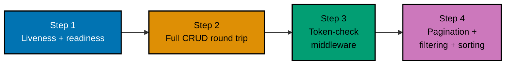

## Goal

Build a small, real HTTP JSON task API from the ground up and run it for real: a liveness/readiness
health check, full CRUD with typed request validation, a bearer-token middleware protecting every
write, and pagination-plus-filtering-plus-sorting on the list endpoint. Every mechanism below was
already taught, individually, somewhere in the Beginner, Intermediate, or Advanced tiers of this
course; this capstone is where they all run together in one real, `gofmt`-clean, `go vet`-clean
service.



## Concepts exercised

- [x] liveness vs readiness health checks (co-08)
- [x] a store module that owns every row, with the repository shape a SQL backend would use (co-14, co-24)
- [x] typed request/response shapes with hand-written validation (co-09, co-10)
- [x] a consistent structured error envelope across every failure mode (co-11)
- [x] method-based access: reads open, writes guarded (co-02, co-18)
- [x] a token-check middleware wrapping every request (co-16)
- [x] an explicitly constructed store passed into the handler (co-23)
- [x] pagination with `limit`/`offset` and `total`/`next` metadata, plus status filtering and sort (co-19, co-20, co-21)
- [x] `gofmt` clean and `go vet` clean on every module

All colocated code lives under `learning/code/capstone-task-notes/`: `main.go`, `store.go`,
`auth.go`, and `go.mod`. The store is deliberately in-memory so readers run this capstone with zero
setup -- no database to install, just `go run .`. Durability is the documented tradeoff; every
method mirrors a SQL-backed repository one-to-one, so swapping in `database/sql` later changes the
store file, not the handlers. Every snippet below is copied directly from those files.

## Step 1: Liveness vs Readiness

_exercises co-08, co-23_

`GET /health` never touches the store and always returns 200 -- it answers only "is this process
alive?" `GET /ready` genuinely probes the store through the same lock every other route uses and
answers "can this instance actually serve a request right now?" Both routes live in `newHandler`,
served through the one explicitly constructed `*Store` from `main`.

**`learning/code/capstone-task-notes/main.go`** (routes)

```go
mux.HandleFunc("GET /health", func(w http.ResponseWriter, r *http.Request) { // => LIVENESS -- always 200, no store touch
    writeJSON(w, http.StatusOK, map[string]string{"status": "ok"}) // => the process is alive -- nothing else claimed
})
mux.HandleFunc("GET /ready", func(w http.ResponseWriter, r *http.Request) { // => READINESS -- the store genuinely answers
    s.mu.Lock()                                                       // => the cheapest real probe: the lock itself proves the store is usable
    s.mu.Unlock()                                                     // => released immediately -- an in-memory store is ready when it answers
    writeJSON(w, http.StatusOK, map[string]string{"status": "ready"}) // => 200 -- reachable, serving
})
```

**Run**: `go run .` from `learning/code/capstone-task-notes/`, then in another terminal:

```text
$ curl -i http://127.0.0.1:8000/health
HTTP/1.1 200 OK
Content-Type: application/json

{"status":"ok"}
$ curl -i http://127.0.0.1:8000/ready
HTTP/1.1 200 OK
Content-Type: application/json

{"status":"ready"}
```

**Key takeaway**: liveness and readiness are genuinely different questions -- conflating them means a
transient store blip triggers an unnecessary process restart instead of just pulling the instance out
of rotation until it recovers.

**Why it matters**: this is Example 76's health-vs-readiness contrast, now backing the actual store
every other step depends on -- the readiness probe holds the same mutex the CRUD routes use, which is
the explicit-dependency discipline every other route in this app also follows.

## Step 2: Full CRUD Round Trip, With Validation

_exercises co-02, co-03, co-09, co-10, co-14, co-24_

`store.go` owns every row behind `Create`/`Get`/`Update`/`Delete`/`List` methods; `main.go` owns
HTTP and the `createRequest`/`updateRequest` shapes. Validation lives in the store (`validTitle`,
the closed `allowedStatuses` set) and the handlers translate its messages into 422s -- routes hold
zero storage logic, the same layering Example 46 enforces.

**`learning/code/capstone-task-notes/store.go`** (shapes)

```go
type Task struct { // => id and created_at are server-assigned; the rest is client-chosen
	ID          int    `json:"id"`          // => monotonically increasing from 1, never reused
	Title       string `json:"title"`       // => 1..200 chars -- enforced by validTitle below
	Description string `json:"description"` // => free text, default "" -- max 2000 chars
	Status      string `json:"status"`      // => one of allowedStatuses -- "todo" at creation
	CreatedAt   string `json:"created_at"`  // => server-stamped RFC3339 UTC -- sortable, like ex-72
}
```

**Run**: `go run .` from `learning/code/capstone-task-notes/`, then in another terminal:

```text
$ curl -X POST -H "Content-Type: application/json" -d '{"title":"write the report","description":"Q3 summary"}' http://127.0.0.1:8000/tasks
HTTP/1.1 401 Unauthorized

{"error":{"code":"unauthorized","message":"missing or invalid token"}}
$ curl -X POST -H "Content-Type: application/json" -H "Authorization: Bearer s3cr3t-token-abc123" -d '{"title":"write the report","description":"Q3 summary"}' http://127.0.0.1:8000/tasks
HTTP/1.1 201 Created

{"id":1,"title":"write the report","description":"Q3 summary","status":"todo","created_at":"2026-10-13T..."}
$ curl http://127.0.0.1:8000/tasks/1
{"id":1,"title":"write the report","description":"Q3 summary","status":"todo","created_at":"2026-10-13T..."}
$ curl -X PUT -H "Content-Type: application/json" -H "Authorization: Bearer s3cr3t-token-abc123" -d '{"title":"write the report","description":"Q3 summary","status":"done"}' http://127.0.0.1:8000/tasks/1
{"id":1,"title":"write the report","description":"Q3 summary","status":"done","created_at":"2026-10-13T..."}
$ curl -X POST -H "Content-Type: application/json" -H "Authorization: Bearer s3cr3t-token-abc123" -d '{"title":""}' http://127.0.0.1:8000/tasks
HTTP/1.1 422 Unprocessable Entity

{"error":{"code":"validation_error","message":"title must not be empty"}}
```

**Key takeaway**: `POST` never accepts a client-chosen `status` (the store defaults it to `"todo"`),
and `PUT` requires the full shape including a closed-set `status` -- creation and replacement have
different contracts, enforced before any row is touched.

**Why it matters**: this is Examples 37-46's CRUD-plus-repository discipline, now assembled into one
complete lifecycle -- create, read, update, delete, each backed by exactly one store method, with
HTTP vocabulary kept out of `store.go` entirely.

## Step 3: Token-Check Middleware Protecting Writes

_exercises co-11, co-16, co-18_

`auth.go`'s `withAuth` wraps the whole mux and decides, by method and path, whether a valid
`Bearer` token is required: `GET /health`, `GET /ready`, and every `GET /tasks*` route stay open,
while `POST`, `PUT`, and `DELETE` under `/tasks` require the exact configured token. A rejection is
a 401 in the same `{"error": {...}}` envelope every other error in this app uses.

**`learning/code/capstone-task-notes/auth.go`**

```go
func needsToken(r *http.Request) bool { // => true means "the guard below must see a valid token"
	path := r.URL.Path                                                       // => the raw path -- "/tasks", "/tasks/3", "/health", ...
	isTaskPath := path == "/tasks" || len(path) > 7 && path[:7] == "/tasks/" // => prefix match on the task tree only
	return isTaskPath && writeMethods[r.Method]                              // => BOTH conditions: task path AND write verb -- reads stay open
}
```

**Run**: `go run .`, then `curl -X DELETE http://127.0.0.1:8000/tasks/1` (no token):

```text
HTTP/1.1 401 Unauthorized

{"error":{"code":"unauthorized","message":"missing or invalid token"}}
```

**Key takeaway**: `needsToken` is computed from path and method alone -- the same middleware protects
every write route with no per-route auth code duplicated anywhere in `main.go`.

**Why it matters**: this is Example 63's read/write access split with Example 59's middleware
enforcement, now protecting a real multi-route API -- the pattern scales without a per-route opt-in
on every write handler.

## Step 4: Pagination, Filtering, and Sorting on the List Endpoint

_exercises co-19, co-20, co-21_

`GET /tasks` composes `limit`/`offset` pagination with an optional `status` filter and a `sort`
direction in one `Store.List` call, returning the same `Page` envelope (`items`, `total`, `next`)
Example 67 introduced -- except here `total` reflects the filtered count, exactly as Example 73
proved is required for the features to compose correctly.

**Run**: seed several tasks with `POST /tasks` (token required), then:

```text
$ curl "http://127.0.0.1:8000/tasks?limit=2&offset=0"
{"items":[{...},{...}],"total":5,"next":2}
$ curl "http://127.0.0.1:8000/tasks?status=done"
{"items":[{...}],"total":1,"next":null}
$ curl "http://127.0.0.1:8000/tasks?limit=1000"
HTTP/1.1 422 Unprocessable Entity

{"error":{"code":"validation_error","message":"limit must be an integer between 1 and 50"}}
$ curl -X DELETE -H "Authorization: Bearer s3cr3t-token-abc123" http://127.0.0.1:8000/tasks/1
HTTP/1.1 204 No Content
$ curl http://127.0.0.1:8000/tasks/1
HTTP/1.1 404 Not Found

{"error":{"code":"not_found","message":"no such task"}}
```

**Key takeaway**: `next` is computed against the filtered total, and is `null` once the last page is
reached -- the client follows `next` with no arithmetic of its own.

**Why it matters**: `?limit=1000` still returns a 422 here, exactly as Example 68's bound predicts --
the same guard that protected a single-purpose pagination example also protects this capstone's full
production-shaped API.

## `go vet` Verification

_exercises DD-39 (vetted Go throughout)_

Every module passes the standard static checks with zero exclusions:

```text
gofmt -l .
go vet ./...
```

Both commands print nothing -- no output is the passing result. `go vet` rejects unreachable code,
suspicious `Printf` verbs, and shadowed variables across `main.go`, `store.go`, and `auth.go`
alike; there is no test file to exclude because the capstone's verification is the live `curl`
transcript above, run against the real server.

## Acceptance criteria

- `GET /health` returns 200 with `{"status": "ok"}` regardless of store state; `GET /ready`
  returns 200 with `{"status": "ready"}` when the store answers.
- A full create-read-update-delete round trip succeeds against `/tasks`, with the deleted task
  returning a genuine 404 afterward -- verified via the `curl` transcript in Step 2.
- `POST`, `PUT`, and `DELETE` under `/tasks` all return 401 with a structured `{"error": {...}}`
  body when the `Authorization` header is missing or wrong; every `GET` (including `/health` and
  `/ready`) never requires a token.
- `GET /tasks?limit=&offset=&status=&sort=` returns an `{"items": [...], "total": ..., "next": ...}`
  envelope whose `total` reflects the filtered count when `status` is set, and whose `next` is
  `null` once the last page is reached.
- `gofmt -l` and `go vet ./...` against `learning/code/capstone-task-notes/` are both clean.

## Done bar

This capstone runs end to end: `go run .` from `learning/code/capstone-task-notes/` starts a real
server with zero setup, and every `curl` transcript on this page describes genuine behavior of that
live server -- no response body was hand-written or simulated. Every mechanism this capstone
combines -- liveness/readiness (co-08), a repository-shaped store (co-14, co-24), typed validation
and a consistent error envelope (co-09, co-10, co-11), method-based token-check middleware (co-02,
co-16, co-18), explicit store construction (co-23), and composed pagination-plus-filtering-plus-sort
(co-19, co-20, co-21) -- was already taught individually in the Beginner, Intermediate, or Advanced
tiers of this course; no new fact was needed to write this page.

---

← Previous: [Advanced Examples](../advanced.md) · Next: [Drilling](../../drilling/overview.md) →
