Examples 29-56 turn the beginner tier's `net/http` handlers into a small, real
task-management HTTP service: hand-written validation and custom error envelopes
(29-34), a `database/sql` repository layer with parameterized queries and full
CRUD (35-42), schema migrations run at startup (43-44), typed repository return
values and explicit store construction (45-47), hand-written middleware and
content negotiation (48-54), and a create-then-read round trip closed out by an
in-process `httptest` suite (55-56). Every example is a complete, self-contained
Go module colocated under `learning/code/`; run each server with `go run .`
from inside its own directory, then exercise it with `curl` from a second
terminal. Every server in this tier listens on port 8000 and every response
shown below is real, captured `curl` output. The persistence examples depend on
exactly one third-party module, `modernc.org/sqlite` v1.60.1 -- a pure Go SQLite
driver with no cgo -- which `go mod tidy` fetches automatically; everything
else in this tier is the standard library. Example 55 is the deliberate
exception: it keeps its store in a guarded in-memory map so the round-trip idea
stays dependency-free.

---

### Example 29: A Missing Required Field Fails Validation

_ex-29 &middot; exercises co-10, co-11_

`encoding/json` has no per-field validation: it parses the body into the struct
it is given and stops there. This example layers an explicit hand-written check
on top, so a present-but-empty title is treated exactly like an absent one --
in FastAPI the framework validated before the handler ever ran, in stdlib Go
the handler runs its own first line of defense.

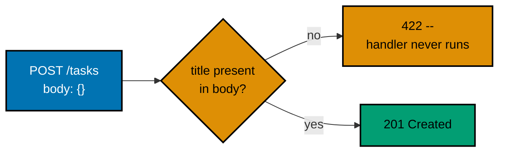

**`learning/code/ex-29-validation-required-field/main.go`**

```go
// Example 29: Validation -- a missing required field fails.
//
// encoding/json has no per-field validation: it parses the body into the
// struct it is given and stops there. This example layers an explicit,
// hand-written check on top so a present-but-empty title is treated exactly
// like an absent one. In FastAPI the framework validated before the handler
// ever ran; in stdlib Go the handler runs its own first line of defense.
package main // => the executable package shape: one directory, one command

import ( // => six stdlib packages, zero third-party dependencies
	"encoding/json" // => the only JSON vocabulary the standard library offers -- no validator attached
	"errors"        // => builds the plain domain error the handler checks for
	"fmt"           // => wraps the decode error with context via %w
	"log"           // => the startup line and the fatal-on-list-failure path
	"net/http"      // => the entire server: mux, handlers, statuses
	"strings"       // => TrimSpace, so a whitespace-only title counts as missing too
) // => the import block closes: everything above is standard library

// => the single shape a valid POST /tasks body may take -- one struct, named here
// => json tags wire the client's key ("title") to the Go field, not the other way around
type taskCreate struct { // => the request shape: exactly one field, presence-checked by hand
	Title string `json:"title"` // => an empty string still fails the check below: Go zero values get no free pass
} // => the struct closes after one field -- the whole validation surface fits in one line below

// => decodeTaskCreate parses the body AND enforces the field's presence rule
// => returning (value, error) mirrors Go's value-plus-error convention
func decodeTaskCreate(r *http.Request) (taskCreate, error) { // => one function: parse+check, the whole validation pipeline
	var body taskCreate                          // => the zero-value target: empty title, ready to be filled or rejected
	err := json.NewDecoder(r.Body).Decode(&body) // => streaming decode: reads only as far as the body goes
	if err != nil {                              // => a decode failure means the body was not valid JSON at all
		return taskCreate{}, fmt.Errorf("invalid JSON body: %w", err) // => %w wraps, so callers can errors.Is/As the cause
	} // => the invalid-shape branch ends; a valid body continues below

	if strings.TrimSpace(body.Title) == "" { // => the presence check decoding will NEVER do for us
		return taskCreate{}, errors.New("title is required") // => a domain error, deliberately free of HTTP vocabulary
	}

	return body, nil // => success: nil error, fully populated value
} // => decodeTaskCreate ends; the handler never re-checks what this function already rejected

// => writeJSON centralizes every response this example sends -- one serialization path
// => headers BEFORE WriteHeader: setting them afterwards is silently dropped
func writeJSON(w http.ResponseWriter, status int, payload any) { // => one function every response travels through
	w.Header().Set("Content-Type", "application/json") // => declares the body encoding to the client
	w.WriteHeader(status)                              // => sends the status line and freezes the header map
	body, _ := json.Marshal(payload)                   // => map payloads here cannot fail to encode; a real service would check
	_, _ = w.Write(body)                               // => one JSON document, written straight onto the wire
} // => writeJSON ends: status, headers, and body all decided in four lines

// => the handler stays thin: decode, then either error or echo
// => all validation vocabulary lives above this function, not inside it
func createTask(w http.ResponseWriter, r *http.Request) { // => the net/http handler signature -- w writes, r reads
	if r.Method != http.MethodPost { // => this route only speaks POST; anything else is a routing misuse
		w.WriteHeader(http.StatusMethodNotAllowed) // => 405: bare, because method misuse is not a JSON-body problem
		return                                     // => example 405-shape; the batch's envelope arrives in ex-32
	} // => the method guard ends: everything below is the POST path

	task, err := decodeTaskCreate(r) // => one call replaces a framework's automatic binding step
	if err != nil {
		writeJSON(w, http.StatusUnprocessableEntity, // => 422: well-formed HTTP, semantically invalid body
			map[string]string{"error": err.Error()}) // => the error text IS the client-facing payload here
		return // => early return: the happy path below only runs for valid bodies
	} // => the invalid-body branch ends

	writeJSON(w, http.StatusCreated, // => 201: a new resource representation is being returned
		map[string]string{"title": task.Title}) // => task.Title only exists because validation passed
} // => createTask ends: at most three branches, each answered by one write

// => newHandler assembles the routing table, separate from main so tests could reuse it
// => "/tasks" with no trailing slash is an exact match -- any other path falls through to 404
func newHandler() http.Handler {
	mux := http.NewServeMux()            // => the routing table: exactly one route in this example
	mux.HandleFunc("/tasks", createTask) // => co-08: a handler for creating a task
	return mux                           // => the mux IS an http.Handler, ready to serve or wrap
} // => newHandler ends; main hands this value straight to ListenAndServe

func main() {
	log.Println("listening on :8000")                     // => the one startup line uvicorn printed, Go's turn
	log.Fatal(http.ListenAndServe(":8000", newHandler())) // => blocks forever; log.Fatal turns a listen error into exit code 1
} // => main ends: start the server, then let the kernel keep it alive
```

**Run**: `go run .`, then in a second terminal: `curl -X POST localhost:8000/tasks -H 'Content-Type: application/json' -d '{}'` and `curl -X POST localhost:8000/tasks -H 'Content-Type: application/json' -d '{"title":"Buy milk"}'`

**Output**:

```text
$ curl -s -w "\nHTTP %{http_code}\n" -X POST localhost:8000/tasks -H 'Content-Type: application/json' -d '{}'
{"error":"title is required"}
HTTP 422

$ curl -s -w "\nHTTP %{http_code}\n" -X POST localhost:8000/tasks -H 'Content-Type: application/json' -d '{"title":"Buy milk"}'
{"title":"Buy milk"}
HTTP 201
```

**Key takeaway**: A required field with no framework default makes the
hand-written presence check the first line of defense -- the echo below only
ever sees a `taskCreate` that already satisfies the shape.

**Why it matters**: Every backend eventually receives a malformed request, and
the question is where that gets caught. Rejecting a missing title before any
business logic runs means the rest of the handler can assume its input is
already valid: no defensive `if title == ""` checks scattered downstream, no
risk of an empty title reaching storage. The 422 status names the failure as a
semantic problem with an otherwise well-formed request.

---

### Example 30: A Wrong Type Also Fails Validation

_ex-30 &middot; exercises co-10, co-11_

Go coerces nothing. Where FastAPI turned the numeric string `"3"` into the int
`3` automatically, `encoding/json` refuses any string for an int field, so the
decode itself fails with one typed error that names the field and the type.

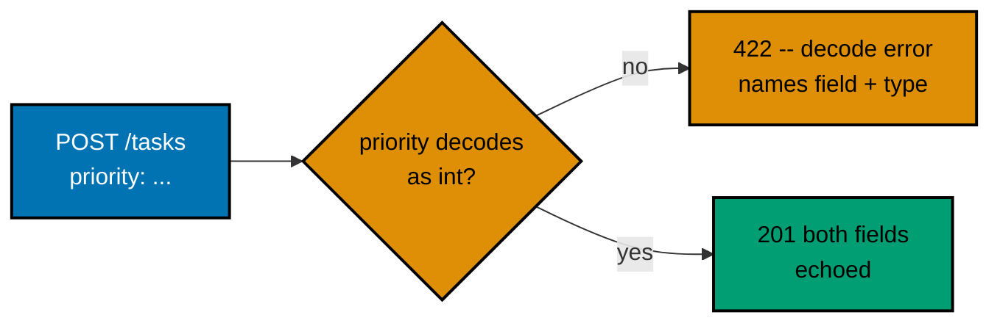

**`learning/code/ex-30-validation-wrong-type/main.go`**

```go
// Example 30: Validation -- a wrong type also fails.
//
// Go coerces nothing. In FastAPI the numeric string "3" became the int 3
// automatically; encoding/json refuses ANY string for an int field, so the
// decode itself fails with one typed error that names the field and the type.
package main // => one directory, one command; every import below is standard library

import (
	"encoding/json" // => the decode step: where a type mismatch surfaces as an error value
	"errors"        // => builds the presence error so the two failure kinds stay separate
	"fmt"           // => context wrapping via %w
	"log"           // => startup line + fatal-on-listen
	"net/http"      // => server, mux, statuses
	"strings"       // => title trim, unchanged from ex-29
) // => the import block closes: zero third-party dependencies

// => the request shape: TWO fields this time -- the type story is about priority
type taskCreate struct {
	Title    string `json:"title"`    // => presence-checked by hand, exactly like ex-29
	Priority int    `json:"priority"` // => MUST decode as an int -- no string ever becomes one
} // => the struct closes: json tags keep both wire keys stable

// => the decoder is the FIRST line of defense: a type mismatch fails here,
// => before any field-level check runs, and carries its own error message
func decodeTaskCreate(r *http.Request) (taskCreate, error) { // => parse AND check, one place, like ex-29
	var body taskCreate                          // => zero-value target: Priority starts as 0
	err := json.NewDecoder(r.Body).Decode(&body) // => one decode pass fills every field it can type-check
	if err != nil {                              // => a string where an int belongs lands here, with Go's own message
		return taskCreate{}, fmt.Errorf("invalid JSON body: %w", err) // => the wrapped text names field AND type, ready to be returned
	} // => the decode-failure branch ends: nothing below runs on a bad body

	if strings.TrimSpace(body.Title) == "" { // => priority passed its type check; now the presence rule
		return taskCreate{}, errors.New("title is required") // => unchanged from ex-29 -- validation composes, one check at a time
	} // => the presence branch ends

	return body, nil // => success: both fields present AND correctly typed
} // => decodeTaskCreate ends: the type contract is enforced before any handler logic

// => writeJSON: same serialization path every example in this batch reuses
func writeJSON(w http.ResponseWriter, status int, payload any) { // => one shared response writer
	w.Header().Set("Content-Type", "application/json") // => response header first...
	w.WriteHeader(status)                              // => ...then the status line...
	body, _ := json.Marshal(payload)                   // => ...then the encoded payload
	_, _ = w.Write(body)                               // => ...onto the wire
} // => writeJSON ends, unchanged from ex-29 so its shape stays familiar

// => the handler: identical shape to ex-29; only the error text is new
func createTask(w http.ResponseWriter, r *http.Request) { // => the net/http handler signature -- w writes, r reads
	if r.Method != http.MethodPost { // => POST-only route, same guard as before
		w.WriteHeader(http.StatusMethodNotAllowed) // => bare 405
		return
	} // => the method guard closes: below here, r is always a POST

	task, err := decodeTaskCreate(r) // => decode-and-validate in one call, exactly as ex-29 did
	if err != nil {
		writeJSON(w, http.StatusUnprocessableEntity, // => 422: the request was shaped right, the data was not
			map[string]string{"error": err.Error()}) // => Go's decode error text IS the client-facing payload
		return
	} // => the invalid-body branch closes

	writeJSON(w, http.StatusCreated, // => the happy path: 201 with both fields echoed
		map[string]any{"title": task.Title, "priority": task.Priority}) // => priority is a real int now, not a coerced string
} // => createTask ends: three writes, one per branch outcome

// => the routing table: one route, exact match on "/tasks"
func newHandler() http.Handler { // => wiring, extracted so a test could reuse it
	mux := http.NewServeMux()            // => ServeMux again, plain patterns only
	mux.HandleFunc("/tasks", createTask) // => same route name, richer struct behind it
	return mux                           // => the mux itself already satisfies http.Handler
} // => newHandler ends

func main() { // => the executable entry point: two lines, both deliberate
	log.Println("listening on :8000")                     // => startup line
	log.Fatal(http.ListenAndServe(":8000", newHandler())) // => serve until interrupted
} // => main ends
```

**Run**: `go run .`, then in a second terminal: `curl -X POST localhost:8000/tasks -H 'Content-Type: application/json' -d '{"title":"Buy milk","priority":"urgent"}'` and the same with `"priority":3`

**Output**:

```text
$ curl -s -w "\nHTTP %{http_code}\n" -X POST localhost:8000/tasks -H 'Content-Type: application/json' -d '{"title":"Buy milk","priority":"urgent"}'
{"error":"invalid JSON body: json: cannot unmarshal string into Go struct field taskCreate.priority of type int"}
HTTP 422

$ curl -s -w "\nHTTP %{http_code}\n" -X POST localhost:8000/tasks -H 'Content-Type: application/json' -d '{"title":"Buy milk","priority":3}'
{"title":"Buy milk","priority":3}
HTTP 201
```

**Key takeaway**: The stdlib decoder is type-strict, not just
presence-aware -- a field can be present and still fail when its value cannot
decode into the declared Go type, and even a numeric string like `"3"` is
rejected rather than coerced.

**Why it matters**: Type strictness moves the coercion question out of the
handler entirely: `Priority int` means a real integer arrived, never a string
that merely looks numeric. The failure message names the exact struct field
and the expected type, so a client can fix the precise value instead of
guessing which field the server disliked.

---

### Example 31: Field Constraints Reject Out-of-Range Input

_ex-31 &middot; exercises co-10_

Pydantic spells this `title: str = Field(min_length=1)` and `priority: int =
Field(gt=0)`. `encoding/json` enforces neither -- it fills the struct and
stops -- so this example layers two hand-written range checks on top of
decoding: an empty title and a non-positive priority both fail even though both
are the right type.

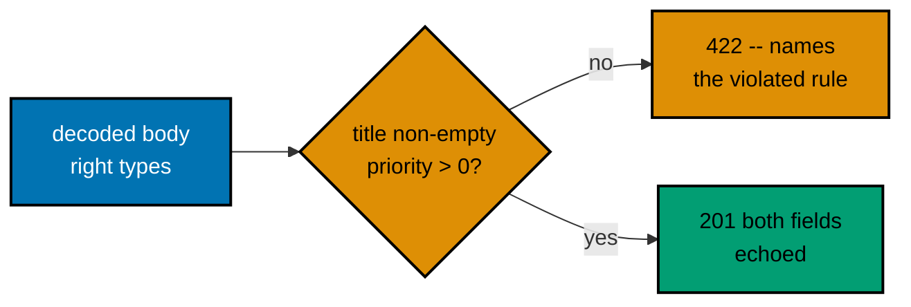

**`learning/code/ex-31-validation-constraints/main.go`**

```go
// Example 31: Validation -- field constraints beyond presence and type.
//
// Pydantic spells this as title: str = Field(min_length=1) and priority: int
// = Field(gt=0): the framework rejects an empty title or a non-positive
// priority BEFORE the handler body ever runs. encoding/json enforces neither
// -- it fills the struct and stops -- so this example layers TWO hand-written
// range checks on top of decoding, inside the same decodeTaskCreate pipeline
// ex-29 and ex-30 built. One function still owns parse-plus-check, and the
// handler still branches exactly once on its error.
package main // => one directory, one command; every import below is standard library

import (
	"encoding/json" // => the decode step: fills the struct, checks nothing itself
	"errors"        // => builds the two domain errors below, free of HTTP vocabulary
	"fmt"           // => wraps the decode failure with context via %w
	"log"           // => startup line + fatal-on-listen
	"net/http"      // => server, mux, statuses
	"strings"       // => TrimSpace, so a whitespace-only title counts as empty too
) // => the import block closes: zero third-party dependencies

// => the request shape: the constraint story needs BOTH fields at once
type taskCreate struct {
	Title    string `json:"title"`    // => min_length=1 by hand: empty (or blank) is rejected below
	Priority int    `json:"priority"` // => gt=0 by hand: zero or negative is rejected below
} // => the struct closes: json tags keep both wire keys stable

// => decodeTaskCreate parses the body AND enforces every field rule in order:
// => first the body is valid JSON, then the title is non-empty, then the
// => priority is positive -- the first failure wins
func decodeTaskCreate(r *http.Request) (taskCreate, error) { // => parse+check, one place, like ex-29
	var body taskCreate                          // => zero-value target: empty title, zero priority
	err := json.NewDecoder(r.Body).Decode(&body) // => one decode pass fills every field it can type-check
	if err != nil {                              // => not valid JSON at all, or a wrong type as in ex-30
		return taskCreate{}, fmt.Errorf("invalid JSON body: %w", err) // => %w wraps, so callers can errors.Is/As the cause
	} // => the decode-failure branch ends: nothing below runs on a bad body

	if strings.TrimSpace(body.Title) == "" { // => the min_length=1 rule decoding will NEVER enforce
		return taskCreate{}, errors.New("title must not be empty") // => mirrors Field(min_length=1): rejects "" and "   "
	} // => the empty-title branch ends

	if body.Priority <= 0 { // => the gt=0 rule: strictly positive, so 0 itself fails
		return taskCreate{}, errors.New("priority must be greater than 0") // => mirrors Field(gt=0): rejects 0 and negatives
	} // => the non-positive-priority branch ends

	return body, nil // => success: present, typed, AND within range
} // => decodeTaskCreate ends: three ordered gates, one success path

// => writeJSON: the same serialization path every example in this batch reuses
func writeJSON(w http.ResponseWriter, status int, payload any) { // => one shared response writer
	w.Header().Set("Content-Type", "application/json") // => response header first...
	w.WriteHeader(status)                              // => ...then the status line...
	body, _ := json.Marshal(payload)                   // => map payloads here cannot fail to encode; a real service would check
	_, _ = w.Write(body)                               // => ...onto the wire
} // => writeJSON ends, unchanged from ex-29 so its shape stays familiar

// => the handler stays thin: decode, then either error or echo
// => every constraint lives above this function, never inside it
func createTask(w http.ResponseWriter, r *http.Request) { // => the net/http handler signature -- w writes, r reads
	task, err := decodeTaskCreate(r) // => decode-and-validate in one call, exactly as ex-29 did
	if err != nil {
		writeJSON(w, http.StatusUnprocessableEntity, // => 422: well-formed HTTP, semantically invalid body
			map[string]string{"error": err.Error()}) // => the constraint text IS the client-facing payload here
		return // => early return: the happy path below only runs for valid bodies
	} // => the invalid-body branch closes

	writeJSON(w, http.StatusCreated, // => 201: a new resource representation is being returned
		map[string]any{"title": task.Title, "priority": task.Priority}) // => both fields survived every check above
} // => createTask ends: two writes, one per branch outcome

// => the routing table: one route, method-prefixed so only POST matches
func newHandler() http.Handler { // => wiring, extracted so a test could reuse it
	mux := http.NewServeMux()                 // => ServeMux again, plain patterns only
	mux.HandleFunc("POST /tasks", createTask) // => co-08: a handler for creating a task; other methods fall through to 405
	return mux                                // => the mux itself already satisfies http.Handler
} // => newHandler ends

func main() { // => the executable entry point: two lines, both deliberate
	log.Println("listening on 127.0.0.1:8000")                     // => the one startup line uvicorn printed, Go's turn
	log.Fatal(http.ListenAndServe("127.0.0.1:8000", newHandler())) // => serve until interrupted
} // => main ends: start the server, then let the kernel keep it alive
```

**Run**: `go run .`, then in a second terminal: `curl -X POST 127.0.0.1:8000/tasks -H 'Content-Type: application/json' -d '{"title":"","priority":1}'`, the same with `'{"title":"Buy milk","priority":0}'`, and the same with `'{"title":"Buy milk","priority":1}'`

**Output**:

```text
$ curl -s -w "\nHTTP %{http_code}\n" -X POST 127.0.0.1:8000/tasks -H 'Content-Type: application/json' -d '{"title":"","priority":1}'
{"error":"title must not be empty"}
HTTP 422

$ curl -s -w "\nHTTP %{http_code}\n" -X POST 127.0.0.1:8000/tasks -H 'Content-Type: application/json' -d '{"title":"Buy milk","priority":0}'
{"error":"priority must be greater than 0"}
HTTP 422

$ curl -s -w "\nHTTP %{http_code}\n" -X POST 127.0.0.1:8000/tasks -H 'Content-Type: application/json' -d '{"title":"Buy milk","priority":1}'
{"title":"Buy milk","priority":1}
HTTP 201
```

**Key takeaway**: A type alone (`string`, `int`) only constrains shape --
the two hand-written checks constrain values within that shape, and all three
gates run in one ordered function before the handler sees the data.

**Why it matters**: Business rules like "a title cannot be empty" or
"priority must be positive" are validation concerns, not database concerns --
catching them here means the repository layer introduced at Example 35 never
has to re-check them, and a malformed row can never reach SQLite in the first
place. Declaring each rule once, in the decode pipeline, is cheaper and harder
to forget than re-validating at every call site.

---

### Example 32: A Custom Error Envelope via writeError

_ex-32 &middot; exercises co-11_

FastAPI's default 422 body is `{"detail": [...]}` -- fine for debugging, but
many clients expect one stable `{"error": {"code", "message"}}` shape across
every failure. Stdlib Go has no default to override -- every error body here
is built by hand -- so this example introduces the one `writeError` helper the
rest of the batch reuses. The status stays 422; only the body shape changes.

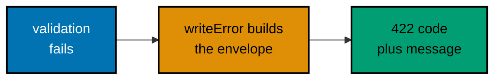

**`learning/code/ex-32-error-envelope/main.go`**

```go
package main // => one directory, one command; every import below is standard library

import (
	"encoding/json" // => both the request decode and the envelope encode run through here
	"fmt"           // => wraps the decode failure with context via %w
	"log"           // => startup line + fatal-on-listen
	"net/http"      // => server, mux, statuses
	"strings"       // => TrimSpace, so a whitespace-only title counts as missing too
) // => the import block closes: zero third-party dependencies

type taskCreate struct { // => the request shape: one required field, presence-checked by hand
	Title string `json:"title"` // => an empty string fails below: Go zero values get no free pass
} // => the struct closes after one field

// => the stable envelope every failure in this batch wears: one top-level
// => "error" key holding a machine-matchable code plus a human summary.
type errorDetail struct {
	Code    string `json:"code"`    // => stable, machine-matchable: "validation_error"
	Message string `json:"message"` // => human-readable summary: "title: field required"
}

type errorEnvelope struct {
	Error errorDetail `json:"error"` // => the ONE top-level key, unlike a bare detail array
}

// => writeError is THE centralized failure path: status, code, and message
// => in, one JSON document out. Headers go BEFORE WriteHeader.
func writeError(w http.ResponseWriter, status int, code, message string) { // => one function every failure travels through
	w.Header().Set("Content-Type", "application/json")                                       // => declares the body encoding to the client
	w.WriteHeader(status)                                                                    // => sends the status line and freezes the header map
	body, _ := json.Marshal(errorEnvelope{Error: errorDetail{Code: code, Message: message}}) // => the bespoke envelope, built by hand
	_, _ = w.Write(body)                                                                     // => one JSON document, written straight onto the wire
} // => writeError ends: status, headers, and body all decided in four lines

func writeJSON(w http.ResponseWriter, status int, payload any) { // => the success-path serializer
	w.Header().Set("Content-Type", "application/json") // => response header first...
	w.WriteHeader(status)                              // => ...then the status line...
	body, _ := json.Marshal(payload)                   // => map payloads here cannot fail to encode
	_, _ = w.Write(body)                               // => ...onto the wire
} // => writeJSON ends: successes and failures now travel visibly different paths

func decodeTaskCreate(r *http.Request) (taskCreate, error) { // => one function: parse+check, the whole validation pipeline
	var body taskCreate                                           // => the zero-value target: empty title, ready to be filled or rejected
	if err := json.NewDecoder(r.Body).Decode(&body); err != nil { // => streaming decode: reads only as far as the body goes
		return taskCreate{}, fmt.Errorf("invalid JSON body: %w", err) // => %w wraps, so the message names what went wrong
	}
	if strings.TrimSpace(body.Title) == "" { // => the presence check decoding will NEVER do for us
		return taskCreate{}, fmt.Errorf("title: field required") // => the "field: reason" shape the envelope carries
	}
	return body, nil // => success: nil error, fully populated value
} // => decodeTaskCreate ends; the handler never re-checks what this function already rejected

func createTask(w http.ResponseWriter, r *http.Request) { // => the net/http handler signature -- w writes, r reads
	task, err := decodeTaskCreate(r) // => one call replaces a framework's automatic binding step
	if err != nil {
		writeError(w, http.StatusUnprocessableEntity, "validation_error", err.Error()) // => 422: status unchanged, BODY now the custom envelope (co-11)
		return                                                                         // => early return: the happy path below only runs for valid bodies
	}
	writeJSON(w, http.StatusCreated, // => 201: the envelope only touches the FAILURE path
		map[string]string{"title": task.Title}) // => task.Title only exists because validation passed
} // => createTask ends: the happy path is untouched by the envelope override

func newHandler() http.Handler { // => wiring, extracted so a test could reuse it
	mux := http.NewServeMux()                 // => the routing table: exactly one route in this example
	mux.HandleFunc("POST /tasks", createTask) // => co-08: a handler for creating a task
	return mux                                // => the mux IS an http.Handler, ready to serve or wrap
}

func main() { // => the executable entry point: two lines, both deliberate
	log.Println("listening on 127.0.0.1:8000")                     // => the one startup line uvicorn printed, Go's turn
	log.Fatal(http.ListenAndServe("127.0.0.1:8000", newHandler())) // => serve until interrupted
} // => main ends: start the server, then let the kernel keep it alive
```

**Run**: `go run .`, then in a second terminal: `curl -X POST 127.0.0.1:8000/tasks -H 'Content-Type: application/json' -d '{}'` and the same with `'{"title":"Buy milk"}'`

**Output**:

```text
$ curl -s -w "\nHTTP %{http_code}\n" -X POST 127.0.0.1:8000/tasks -H 'Content-Type: application/json' -d '{}'
{"error":{"code":"validation_error","message":"title: field required"}}
HTTP 422

$ curl -s -w "\nHTTP %{http_code}\n" -X POST 127.0.0.1:8000/tasks -H 'Content-Type: application/json' -d '{"title":"Buy milk"}'
{"title":"Buy milk"}
HTTP 201
```

**Key takeaway**: `writeError` makes the envelope shape a project-wide
decision, not something re-derived at every route -- the handler names a
status, a code, and a message, and one helper builds the document.

**Why it matters**: A client integrating against this API only has to parse
one error shape, regardless of whether the failure came from validation, a
missing resource, or a server bug -- the later examples in this batch
(domain-error mapping, DB-backed 404s, sanitized 500s) all converge on this
same `{"error": {"code", "message"}}` envelope, so client-side error handling
is written once and reused everywhere.

---

### Example 33: A Centralized Error Writer Maps a Domain Error

_ex-33 &middot; exercises co-11_

`taskNotFoundError` is a plain Go error value that knows nothing about HTTP --
no status code, no JSON. The handler tests for it with `errors.As` and lets
the one `writeError` helper perform the single mapping to a 404 envelope, so
the lookup function itself stays HTTP-status-free.


**`learning/code/ex-33-centralized-error-writer/main.go`**

```go
package main // => one directory, one command; every import below is standard library

import (
	"encoding/json" // => both the success body and the envelope encode run through here
	"errors"        // => errors.As: tests the domain error without touching HTTP vocabulary
	"fmt"           // => builds the domain error text and wraps conversions via %w
	"log"           // => startup line + fatal-on-listen
	"net/http"      // => server, mux, statuses
	"strconv"       // => the path segment is text until this converts it to an int
) // => the import block closes: zero third-party dependencies

type errorDetail struct { // => the stable envelope every failure in this batch wears -- unchanged from ex-32
	Code    string `json:"code"`    // => stable, machine-matchable: "task_not_found" below
	Message string `json:"message"` // => human-readable summary: "task 99 does not exist"
}

type errorEnvelope struct {
	Error errorDetail `json:"error"` // => the ONE top-level key, matching ex-32's shape
}

func writeError(w http.ResponseWriter, status int, code, message string) { // => one function every failure travels through
	w.Header().Set("Content-Type", "application/json")                                       // => declares the body encoding to the client
	w.WriteHeader(status)                                                                    // => sends the status line and freezes the header map
	body, _ := json.Marshal(errorEnvelope{Error: errorDetail{Code: code, Message: message}}) // => the envelope, built by hand once for every caller
	_, _ = w.Write(body)                                                                     // => one JSON document, written straight onto the wire
} // => writeError ends: status, headers, and body all decided in four lines

// => taskNotFoundError is a DOMAIN error: it carries the missing id and knows
// => NOTHING about HTTP -- no status code, no JSON. The translation to 404
// => happens in exactly one place, the handler's errors.As branch below.
type taskNotFoundError struct {
	ID int // => the id the caller asked for and did not get
}

func (e taskNotFoundError) Error() string { // => the method that makes this type an error
	return fmt.Sprintf("task %d does not exist", e.ID) // => the same human sentence the envelope will carry
}

var tasks = map[int]string{1: "Buy milk", 2: "Walk dog"} // => a tiny in-memory store: id 1 and id 2 exist, nothing else does

func lookupTask(id int) (string, error) { // => (value, error): Go's value-plus-error convention
	title, ok := tasks[id] // => the single existence check in the whole program
	if !ok {
		return "", taskNotFoundError{ID: id} // => raise the DOMAIN error; something above maps it
	}
	return title, nil // => success: nil error, the stored title
}

func writeJSON(w http.ResponseWriter, status int, payload any) { // => the success-path serializer
	w.Header().Set("Content-Type", "application/json") // => response header first...
	w.WriteHeader(status)                              // => ...then the status line...
	body, _ := json.Marshal(payload)                   // => map payloads here cannot fail to encode
	_, _ = w.Write(body)                               // => ...onto the wire
}

func getTask(w http.ResponseWriter, r *http.Request) { // => the net/http handler signature -- w writes, r reads
	id, err := strconv.Atoi(r.PathValue("task_id")) // => hand-typed conversion: text -> int (co-12)
	if err != nil {
		writeError(w, http.StatusBadRequest, "validation_error", "task_id must be an integer") // => the stdlib has no automatic 422: YOUR branch writes it
		return
	}
	title, err := lookupTask(id) // => the handler delegates the existence check entirely
	if err != nil {
		var notFound taskNotFoundError // => the target errors.As fills when the cause matches
		if errors.As(err, &notFound) { // => co-11: maps the domain error to its HTTP shape, in ONE place
			writeError(w, http.StatusNotFound, "task_not_found", notFound.Error()) // => 404: not-found status decided HERE, not in the lookup
			return
		}
		writeError(w, http.StatusInternalServerError, "internal_error", "unexpected error") // => any unmapped failure is a 500, never a leak
		return
	}
	writeJSON(w, http.StatusOK, map[string]string{"title": title}) // => the found case: 200 with the stored title
}

func newHandler() http.Handler { // => wiring, extracted so a test could reuse it
	mux := http.NewServeMux()                       // => the routing table: exactly one route in this example
	mux.HandleFunc("GET /tasks/{task_id}", getTask) // => co-12: {task_id} arrives as text; the handler types it
	return mux                                      // => the mux IS an http.Handler, ready to serve or wrap
}

func main() { // => the executable entry point: two lines, both deliberate
	log.Println("listening on 127.0.0.1:8000")                     // => the one startup line uvicorn printed, Go's turn
	log.Fatal(http.ListenAndServe("127.0.0.1:8000", newHandler())) // => serve until interrupted
}
```

**Run**: `go run .`, then in a second terminal: `curl 127.0.0.1:8000/tasks/1` and `curl 127.0.0.1:8000/tasks/99`

**Output**:

```text
$ curl -s -w "\nHTTP %{http_code}\n" 127.0.0.1:8000/tasks/1
{"title":"Buy milk"}
HTTP 200

$ curl -s -w "\nHTTP %{http_code}\n" 127.0.0.1:8000/tasks/99
{"error":{"code":"task_not_found","message":"task 99 does not exist"}}
HTTP 404
```

**Key takeaway**: A domain error (`taskNotFoundError`) and its HTTP mapping
(`errors.As` plus `writeError`) are two separate concerns -- the `lookupTask`
function only ever returns the domain error, never builds a response itself.

**Why it matters**: If this app later grew a second interface -- a CLI, a
background worker, a different transport -- `taskNotFoundError` would still be
meaningful there, because it carries no HTTP baggage. Only the handler's
mapping branch needs to know that a domain error becomes a 404; the rest of
the domain logic stays interface-agnostic, which is exactly the layering this
whole batch builds toward with the repository pattern starting at Example 35.

---

### Example 34: One Shared Envelope, Two Different HTTP Methods

_ex-34 &middot; exercises co-11, co-03_

A small `requireTask` helper centralizes the existence check so that both a
GET route and a DELETE route produce the exact same `taskNotFoundError` for a
missing id, and one shared `mapDomainError` function turns it into an
identical 404 envelope regardless of which method the caller used.


**`learning/code/ex-34-not-found-404-json/main.go`**

```go
package main // => one directory, one command; every import below is standard library

import (
	"encoding/json" // => both the GET body and the envelope encode run through here
	"errors"        // => errors.As: tests the domain error without touching HTTP vocabulary
	"fmt"           // => builds the domain error text
	"log"           // => startup line + fatal-on-listen
	"net/http"      // => server, mux, statuses
	"strconv"       // => the path segment is text until this converts it to an int
) // => the import block closes: zero third-party dependencies

type errorDetail struct { // => the stable envelope every failure in this batch wears -- unchanged from ex-32
	Code    string `json:"code"`    // => stable, machine-matchable: "task_not_found" below
	Message string `json:"message"` // => human-readable summary naming the missing id
}

type errorEnvelope struct {
	Error errorDetail `json:"error"` // => the ONE top-level key, matching ex-33's shape
}

func writeError(w http.ResponseWriter, status int, code, message string) { // => ONE helper, reused by every route below
	w.Header().Set("Content-Type", "application/json")                                       // => declares the body encoding to the client
	w.WriteHeader(status)                                                                    // => sends the status line and freezes the header map
	body, _ := json.Marshal(errorEnvelope{Error: errorDetail{Code: code, Message: message}}) // => built by hand ONCE, for every caller
	_, _ = w.Write(body)                                                                     // => one JSON document, written straight onto the wire
}

type taskNotFoundError struct { // => the same envelope-shaped domain error as ex-33
	ID int // => the id the caller asked for and did not get
}

func (e taskNotFoundError) Error() string { // => the method that makes this type an error
	return fmt.Sprintf("task %d does not exist", e.ID) // => the same human sentence the envelope will carry
}

var tasks = map[int]string{1: "Buy milk"} // => id 1 exists; every other id exercises the 404 path

func requireTask(id int) (string, error) { // => the small shared helper BOTH routes call
	title, ok := tasks[id] // => the SAME check, regardless of which route called it
	if !ok {
		return "", taskNotFoundError{ID: id} // => the SAME error, regardless of HTTP method
	}
	return title, nil // => the found-case value
}

func mapDomainError(w http.ResponseWriter, err error) { // => the single translation point for domain failures
	var notFound taskNotFoundError // => the target errors.As fills when the cause matches
	if errors.As(err, &notFound) { // => co-11: ONE mapping, reused by every route below
		writeError(w, http.StatusNotFound, "task_not_found", notFound.Error()) // => 404, identical for GET and DELETE callers
		return
	}
	writeError(w, http.StatusInternalServerError, "internal_error", "unexpected error") // => any unmapped failure is a 500
}

func writeJSON(w http.ResponseWriter, status int, payload any) { // => the success-path serializer
	w.Header().Set("Content-Type", "application/json") // => response header first...
	w.WriteHeader(status)                              // => ...then the status line...
	body, _ := json.Marshal(payload)                   // => map payloads here cannot fail to encode
	_, _ = w.Write(body)                               // => ...onto the wire
}

func parseTaskID(w http.ResponseWriter, r *http.Request) (int, bool) { // => (id, ok): ok is false once an error is written
	id, err := strconv.Atoi(r.PathValue("task_id")) // => hand-typed conversion: text -> int (co-12)
	if err != nil {
		writeError(w, http.StatusBadRequest, "validation_error", "task_id must be an integer") // => YOUR branch writes it; the stdlib never will
		return 0, false
	}
	return id, true // => success: the typed id, ready to look up
}

func getTask(w http.ResponseWriter, r *http.Request) { // => co-12: GET reads one resource by its typed id
	id, ok := parseTaskID(w, r) // => shared typing step; writes its own 400 on failure
	if !ok {
		return
	}
	title, err := requireTask(id) // => delegates the existence check to the shared helper
	if err != nil {
		mapDomainError(w, err) // => raises the SAME envelope a DELETE would for this id
		return
	}
	writeJSON(w, http.StatusOK, map[string]string{"title": title}) // => the found case: 200 with the stored title
}

func deleteTask(w http.ResponseWriter, r *http.Request) { // => co-02: DELETE removes the addressed resource
	id, ok := parseTaskID(w, r) // => the SAME typing step GET uses above
	if !ok {
		return
	}
	if _, err := requireTask(id); err != nil { // => raises the SAME error for a missing id as GET does
		mapDomainError(w, err) // => identical status AND identical body shape to the GET case (co-11)
		return
	}
	delete(tasks, id)                   // => only reached once the id is confirmed to exist
	w.WriteHeader(http.StatusNoContent) // => 204: no-content success -- deliberately NO body
}

func newHandler() http.Handler { // => wiring, extracted so a test could reuse it
	mux := http.NewServeMux()                             // => the routing table: exactly two routes in this example
	mux.HandleFunc("GET /tasks/{task_id}", getTask)       // => co-12: GET reads
	mux.HandleFunc("DELETE /tasks/{task_id}", deleteTask) // => co-02: DELETE removes; same 404 shape as GET
	return mux                                            // => the mux IS an http.Handler, ready to serve or wrap
}

func main() { // => the executable entry point: two lines, both deliberate
	log.Println("listening on 127.0.0.1:8000")                     // => the one startup line uvicorn printed, Go's turn
	log.Fatal(http.ListenAndServe("127.0.0.1:8000", newHandler())) // => serve until interrupted
}
```

**Run**: `go run .`, then in a second terminal: `curl 127.0.0.1:8000/tasks/404`, `curl -X DELETE 127.0.0.1:8000/tasks/404`, and `curl -X DELETE 127.0.0.1:8000/tasks/1`

**Output**:

```text
$ curl -s -w "\nHTTP %{http_code}\n" 127.0.0.1:8000/tasks/404
{"error":{"code":"task_not_found","message":"task 404 does not exist"}}
HTTP 404

$ curl -s -w "\nHTTP %{http_code}\n" -X DELETE 127.0.0.1:8000/tasks/404
{"error":{"code":"task_not_found","message":"task 404 does not exist"}}
HTTP 404

$ curl -s -o /dev/null -w "HTTP %{http_code}\n" -X DELETE 127.0.0.1:8000/tasks/1
HTTP 204
```

**Key takeaway**: Consistency across routes is a design choice, not an
accident -- routing the existence check through one shared helper plus one
shared mapping function is what guarantees GET and DELETE agree on the shape
of "not found".

**Why it matters**: A client that has already learned how to parse this API's
404 envelope from a GET request does not need to relearn anything for a DELETE
request -- the shape is the same because the code path that produces it is the
same. This is the same discipline the repository layer applies starting in
Example 42, where the same envelope pattern is reused once a real database,
rather than an in-memory map, decides whether a row exists.

---

### Example 35: A Repository Opens SQLite and Runs a Query

_ex-35 &middot; exercises co-14, co-24_

The repository layer owns the SQLite pool and the one query this example needs
-- the handler never touches `database/sql` directly. This is the first
example backed by real, on-disk persistence instead of an in-memory map, with
`database/sql` as the stdlib pool and the pure-Go driver doing the dialect
work underneath.

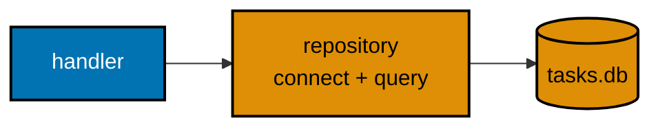

**`learning/code/ex-35-repository-connect/main.go`**

```go
package main // => one directory, one command; one stdlib pool plus one pure-Go driver

import (
	"database/sql"  // => the stdlib pool: Open, Query, Exec -- no driver of its own
	"encoding/json" // => the success body and the 500 envelope encode run through here
	"log"           // => fail-fast startup lines + fatal-on-listen
	"net/http"      // => server, mux, statuses
	"os"            // => Remove: delete any stale db file so every run starts clean

	_ "modernc.org/sqlite" // => the pure-Go driver itself: blank import REGISTERS the "sqlite" name (no cgo)
}

type taskRow struct { // => the row shape every repository function below returns
	ID    int    `json:"id"`    // => the AUTOINCREMENT primary key SQLite assigned
	Title string `json:"title"` // => the one data column this example's table carries
}

type errorDetail struct { // => the stable envelope internal failures wear
	Code    string `json:"code"`    // => stable, machine-matchable: "internal_error" below
	Message string `json:"message"` // => human-readable summary, never a raw driver string
}

type errorEnvelope struct {
	Error errorDetail `json:"error"` // => the ONE top-level key, matching ex-32's shape
}

var db *sql.DB // => the shared pool: safe for concurrent use, so ONE handle serves every request

func initDB() { // => one-shot setup: file, table, seed rows, in that order
	_ = os.Remove("tasks.db") // => delete any stale file first -- every run starts clean
	var err error
	db, err = sql.Open("sqlite", "file:tasks.db") // => "sqlite" is the name the blank import registered
	if err != nil {
		log.Fatalf("open db: %v", err) // => fail FAST at startup, not on the first real request
	}
	db.SetMaxOpenConns(1) // => one writer-friendly connection: SQLite files dislike concurrent writers
	if err := db.Ping(); err != nil { // => Ping actually dials the file -- Open alone never touches it
		log.Fatalf("ping db: %v", err) // => fail FAST: a bad path fails here, before ListenAndServe
	}
	_, err = db.Exec("CREATE TABLE tasks (id INTEGER PRIMARY KEY AUTOINCREMENT, title TEXT NOT NULL)") // => the exact DDL, once for the whole example
	if err != nil {
		log.Fatalf("create table: %v", err) // => without this table nothing below can run
	}
	_, err = db.Exec("INSERT INTO tasks (title) VALUES (?), (?)", "Buy milk", "Walk dog") // => "?" binds each title as DATA, never as SQL syntax
	if err != nil {
		log.Fatalf("seed tasks: %v", err) // => without this the list below is empty, not an error
	}
} // => initDB ends: the file, the table, and two rows all exist now

func listTasks() ([]taskRow, error) { // => the ONLY function that runs a SELECT
	rows, err := db.Query("SELECT id, title FROM tasks ORDER BY id") // => no WHERE clause -- returns every row, oldest first
	if err != nil {
		return nil, err // => propagate: the handler decides the wire shape (a 500)
	}
	defer rows.Close() // => releases the query's connection back to the pool when done
	var out []taskRow
	for rows.Next() {
		var t taskRow
		if err := rows.Scan(&t.ID, &t.Title); err != nil { // => column order matches the SELECT list above
			return nil, err // => propagate: a corrupt row is a 500, not a skip
		}
		out = append(out, t) // => grow the typed slice one row at a time
	}
	if err := rows.Err(); err != nil { // => surfaces an error the loop itself swallowed mid-iteration
		return nil, err
	}
	return out, nil // => success: every caller gets taskRow, never driver rows
}

func writeError(w http.ResponseWriter, status int, code, message string) { // => the internal-failure path
	w.Header().Set("Content-Type", "application/json")
	w.WriteHeader(status)
	body, _ := json.Marshal(errorEnvelope{Error: errorDetail{Code: code, Message: message}})
	_, _ = w.Write(body)
}

func writeJSON(w http.ResponseWriter, status int, payload any) { // => the success path
	w.Header().Set("Content-Type", "application/json")
	w.WriteHeader(status)
	body, _ := json.Marshal(payload) // => []taskRow encodes as a JSON array directly
	_, _ = w.Write(body)
}

func listTasksHandler(w http.ResponseWriter, r *http.Request) { // => co-08: a handler for listing tasks
	tasks, err := listTasks() // => co-14: the handler never writes SQL itself
	if err != nil {
		writeError(w, http.StatusInternalServerError, "internal_error", "could not list tasks") // => 500: no driver text leaks to the client
		return
	}
	writeJSON(w, http.StatusOK, tasks) // => a JSON array of plain objects, one per row
}

func newHandler() http.Handler { // => wiring, extracted so a test could reuse it
	mux := http.NewServeMux()
	mux.HandleFunc("GET /tasks", listTasksHandler) // => co-08: GET returns the whole array
	return mux
}

func main() { // => the executable entry point: setup, then serve
	initDB()                                                       // => co-24: schema setup happens ONCE, before serving -- not per request
	defer db.Close()                                               // => releases the pool when the process exits
	log.Println("listening on 127.0.0.1:8000")                     // => the operator's green light
	log.Fatal(http.ListenAndServe("127.0.0.1:8000", newHandler())) // => serve until interrupted
}
```

**Run**: `go run .`, then in a second terminal: `curl 127.0.0.1:8000/tasks`

**Output**:

```text
$ curl -s -w "\nHTTP %{http_code}\n" 127.0.0.1:8000/tasks
[{"id":1,"title":"Buy milk"},{"id":2,"title":"Walk dog"}]
HTTP 200
```

**Key takeaway**: The typed `taskRow` struct plus `rows.Scan` is what makes
rows behave like plain data, and keeping every query string inside repository
functions -- never in the handler -- is what makes the layering real, not just
a naming convention.

**Why it matters**: Every example from here through Example 56 builds on this
SQLite-backed service -- CRUD (37-42), migrations (43-44), typed rows (45),
layering discipline (46), explicit construction (47), and the `httptest` suite
(56) all extend this same open-once, query-through-functions shape. Swapping
SQLite for PostgreSQL later would mean changing what is inside the repository
functions (a different driver and DSN) without touching a single handler,
because the handler only ever calls repository functions, never a driver
directly.

---

### Example 36: Parameterized Queries Neutralize SQL Injection

_ex-36 &middot; exercises co-14, co-20_

`searchByTitle` binds the caller's search fragment with a `?` placeholder
instead of formatting it into the SQL text -- an injection payload like `';
DROP TABLE tasks; --` is treated as literal search text, not as executable
SQL, and matches zero rows while the table survives intact.

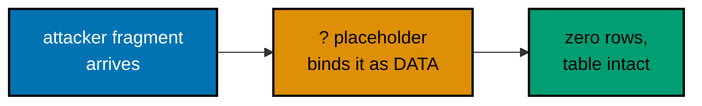

**`learning/code/ex-36-repository-parameterized/main.go`**

```go
package main // => one directory, one command; one stdlib pool plus one pure-Go driver

import (
	"database/sql"  // => the stdlib pool: Open, Query, QueryRow -- no driver of its own
	"encoding/json" // => the success array and the 500 envelope encode run through here
	"log"           // => fail-fast startup lines + fatal-on-listen
	"net/http"      // => server, mux, statuses
	"os"            // => Remove: delete any stale db file so every run starts clean

	_ "modernc.org/sqlite" // => the pure-Go driver itself: blank import REGISTERS the "sqlite" name (no cgo)
}

type taskRow struct { // => the row shape the search returns -- JSON-tagged, one struct per row
	ID    int    `json:"id"`    // => the AUTOINCREMENT primary key SQLite assigned
	Title string `json:"title"` // => the searched column
}

type errorDetail struct {
	Code    string `json:"code"`
	Message string `json:"message"`
}

type errorEnvelope struct {
	Error errorDetail `json:"error"` // => the ONE top-level key, matching ex-32's shape
}

var db *sql.DB // => the shared pool: safe for concurrent use, so ONE handle serves every request

// initDB recreates the schema and seeds two rows; one contains "milk" so a
// normal substring search provably matches exactly one of them. The full
// open, ping, DDL, and seed sequence matches Example 35 (see main.go).
func initDB() { // => one-shot setup: file, table, seed rows, in that order
	_ = os.Remove("tasks.db") // => delete any stale file first -- every run starts clean
	var err error
	db, err = sql.Open("sqlite", "file:tasks.db") // => "sqlite" is the name the blank import registered
	if err != nil {
		log.Fatalf("open db: %v", err)
	}
	db.SetMaxOpenConns(1) // => one writer-friendly connection: SQLite files dislike concurrent writers
	if err := db.Ping(); err != nil {
		log.Fatalf("ping db: %v", err)
	}
	_, err = db.Exec("CREATE TABLE tasks (id INTEGER PRIMARY KEY AUTOINCREMENT, title TEXT NOT NULL)") // => the exact DDL
	if err != nil {
		log.Fatalf("create table: %v", err)
	}
	_, err = db.Exec("INSERT INTO tasks (title) VALUES (?), (?)", "Buy milk", "Walk dog") // => "milk" appears in exactly one row
	if err != nil {
		log.Fatalf("seed tasks: %v", err)
	}
}

// => searchByTitle runs a substring search over "title". The "?" PLACEHOLDER,
// => not string concatenation, is the entire safety property.
func searchByTitle(fragment string) ([]taskRow, error) { // => zero or more matches, never a raised SQL error
	rows, err := db.Query("SELECT id, title FROM tasks WHERE title LIKE ? ORDER BY id", "%"+fragment+"%") // => the one "?" placeholder; LIKE with wildcards around the value
	if err != nil {
		return nil, err // => propagate: the handler decides the wire shape (a 500)
	}
	defer rows.Close() // => releases the query's connection back to the pool when done
	var out []taskRow
	for rows.Next() {
		var t taskRow
		if err := rows.Scan(&t.ID, &t.Title); err != nil { // => column order matches the SELECT list above
			return nil, err
		}
		out = append(out, t)
	}
	if err := rows.Err(); err != nil {
		return nil, err
	}
	if out == nil { // => normalize nil to [] so the wire shape is always an ARRAY, never null
		out = []taskRow{} // => zero matches is a 200 with [], not a 404 and not null
	}
	return out, nil // => success: possibly empty, never an error for attacker input
}

func countTasks() (int, error) { // => used only to PROVE the table survived an injection attempt intact
	var n int
	if err := db.QueryRow("SELECT COUNT(*) FROM tasks").Scan(&n); err != nil { // => QueryRow: the one-row shortcut, no Close needed
		return 0, err
	}
	return n, nil // => 2 after any injection attempt -- the table is untouched (co-20)
}

func writeError(w http.ResponseWriter, status int, code, message string) { // => the internal-failure path
	w.Header().Set("Content-Type", "application/json")
	w.WriteHeader(status)
	body, _ := json.Marshal(errorEnvelope{Error: errorDetail{Code: code, Message: message}})
	_, _ = w.Write(body)
}

func writeJSON(w http.ResponseWriter, status int, payload any) { // => the success path
	w.Header().Set("Content-Type", "application/json")
	w.WriteHeader(status)
	body, _ := json.Marshal(payload)
	_, _ = w.Write(body)
}

func searchHandler(w http.ResponseWriter, r *http.Request) { // => co-12: a typed query parameter
	fragment := r.URL.Query().Get("title") // => "title" is really a SEARCH FRAGMENT, possibly attacker text
	tasks, err := searchByTitle(fragment) // => co-14: the "?" placeholder does the escaping, inside the repository
	if err != nil {
		writeError(w, http.StatusInternalServerError, "internal_error", "could not search tasks") // => 500: no driver text leaks to the client
		return
	}
	writeJSON(w, http.StatusOK, tasks) // => zero matches is 200 with [] -- the payload was never SQL (co-14)
}

func newHandler() http.Handler { // => wiring, extracted so a test could reuse it
	mux := http.NewServeMux()
	mux.HandleFunc("GET /tasks/search", searchHandler) // => co-12: ?title= is the search fragment
	return mux
}

func main() { // => the executable entry point: setup, then serve
	initDB()                                                       // => fresh, deterministic tasks.db for every run
	defer db.Close()
	log.Println("listening on 127.0.0.1:8000")
	log.Fatal(http.ListenAndServe("127.0.0.1:8000", newHandler())) // => serve until interrupted
}
```

**Run**: `go run .`, then in a second terminal: `curl -s '127.0.0.1:8000/tasks/search?title=milk'` and `curl -s "127.0.0.1:8000/tasks/search?title=';%20DROP%20TABLE%20tasks;%20--"` followed by the first search again

**Output**:

```text
$ curl -s -w "\nHTTP %{http_code}\n" '127.0.0.1:8000/tasks/search?title=milk'
[{"id":1,"title":"Buy milk"}]
HTTP 200

$ curl -s -w "\nHTTP %{http_code}\n" "127.0.0.1:8000/tasks/search?title=';%20DROP%20TABLE%20tasks;%20--"
[]
HTTP 200

$ curl -s -w "\nHTTP %{http_code}\n" '127.0.0.1:8000/tasks/search?title=milk'
[{"id":1,"title":"Buy milk"}]
HTTP 200
```

**Key takeaway**: `"... WHERE title LIKE ?", (pattern,)` passes the value
through the driver's own binding mechanism -- the driver, not string
concatenation, is what keeps user input from ever being interpreted as SQL
syntax.

**Why it matters**: The injection payload in this example does not raise an
error and does not drop the table -- it simply matches zero rows, because `?`
binding means SQLite only ever sees it as data. Every repository function from
this point forward uses this same `?` placeholder pattern; it is not a special
case for search endpoints, it is the default way this codebase talks to SQLite
at all.

---

### Example 37: CRUD -- Create a Task

_ex-37 &middot; exercises co-14, co-08_

The first letter of CRUD: `POST /tasks` validates the body by hand, then
`createTask` runs the `INSERT` and returns the result's `LastInsertId` so the
handler can echo back the id SQLite actually assigned. The table starts empty
-- every row here arrives through the create path.


**`learning/code/ex-37-crud-create/main.go`**

```go
package main // => one directory, one command; one stdlib pool plus one pure-Go driver

import (
	"database/sql"  // => the stdlib pool: Open, Exec, QueryRow -- no driver of its own
	"encoding/json" // => request decode plus every response encode runs through here
	"fmt"           // => wraps decode failures with context via %w
	"log"           // => fail-fast startup lines + fatal-on-listen
	"net/http"      // => server, mux, statuses
	"os"            // => Remove: delete any stale db file so every run starts clean
	"strings"       // => TrimSpace, so a whitespace-only title counts as missing too

	_ "modernc.org/sqlite" // => the pure-Go driver itself: blank import REGISTERS the "sqlite" name (no cgo)
}

type taskCreate struct { // => the request shape: exactly one field, presence-checked by hand
	Title string `json:"title"` // => co-10: validated before the handler ever delegates the INSERT
}

type taskCreated struct { // => the created-resource shape: the id the DB assigned plus the stored title
	ID    int64  `json:"id"`    // => the AUTOINCREMENT id from the INSERT result
	Title string `json:"title"` // => echoed back exactly as it was stored
}

var db *sql.DB // => the shared pool: safe for concurrent use, ONE handle per process

// initDB recreates the schema starting EMPTY -- no seed rows, because this
// example is entirely about the create path. Open, ping, and the exact DDL
// match Example 35 (see main.go for the full setup).
func initDB() { // => one-shot setup: file plus table, nothing else
	_ = os.Remove("tasks.db") // => delete any stale file first -- every run starts clean
	var err error
	db, err = sql.Open("sqlite", "file:tasks.db") // => "sqlite" is the name the blank import registered
	if err != nil {
		log.Fatalf("open db: %v", err)
	}
	db.SetMaxOpenConns(1) // => one writer-friendly connection: SQLite files dislike concurrent writers
	if err := db.Ping(); err != nil {
		log.Fatalf("ping db: %v", err)
	}
	_, err = db.Exec("CREATE TABLE tasks (id INTEGER PRIMARY KEY AUTOINCREMENT, title TEXT NOT NULL)") // => the exact DDL -- no seed rows this time
	if err != nil {
		log.Fatalf("create table: %v", err)
	}
}

// => createTask is the ONLY function that runs an INSERT -- "?" binds the
// => title as DATA, the same safety property ex-36 proved
func createTask(title string) (int64, error) { // => the fresh id out, for the 201 body
	res, err := db.Exec("INSERT INTO tasks (title) VALUES (?)", title) // => one placeholder, one bound value
	if err != nil {
		return 0, err // => propagate: the handler decides the wire shape (a 500)
	}
	id, err := res.LastInsertId() // => the AUTOINCREMENT id SQLite just assigned, off the result
	if err != nil {
		return 0, err
	}
	return id, nil // => success: the caller needs this for the 201 response body
}

func getTask(id int64) (taskCreated, error) { // => used only to PROVE persistence: reads one row back by its key
	var t taskCreated
	err := db.QueryRow("SELECT id, title FROM tasks WHERE id = ?", id).Scan(&t.ID, &t.Title) // => one placeholder, one bound value
	if err != nil {
		return taskCreated{}, err
	}
	return t, nil
}

func decodeTaskCreate(r *http.Request) (taskCreate, error) { // => parse+check, one place, like ex-29
	var body taskCreate
	if err := json.NewDecoder(r.Body).Decode(&body); err != nil { // => streaming decode: reads only as far as the body goes
		return taskCreate{}, fmt.Errorf("invalid JSON body: %w", err)
	}
	if strings.TrimSpace(body.Title) == "" { // => the presence check decoding will NEVER do for us
		return taskCreate{}, fmt.Errorf("title is required")
	}
	return body, nil
}

func writeJSON(w http.ResponseWriter, status int, payload any) { // => the single serializer BOTH paths use here
	w.Header().Set("Content-Type", "application/json")
	w.WriteHeader(status)
	body, _ := json.Marshal(payload)
	_, _ = w.Write(body)
}

func createTaskHandler(w http.ResponseWriter, r *http.Request) { // => co-08: a handler for creating a task
	body, err := decodeTaskCreate(r) // => "body" only exists if validation passed
	if err != nil {
		writeJSON(w, http.StatusUnprocessableEntity, map[string]string{"error": err.Error()}) // => 422: well-formed HTTP, semantically invalid body
		return
	}
	id, err := createTask(body.Title) // => co-14: the handler delegates the INSERT
	if err != nil {
		writeJSON(w, http.StatusInternalServerError, map[string]string{"error": "could not create task"}) // => 500: no driver text leaks to the client
		return
	}
	writeJSON(w, http.StatusCreated, taskCreated{ID: id, Title: body.Title}) // => echoes the id the DB actually assigned
}

func newHandler() http.Handler { // => wiring, extracted so a test could reuse it
	mux := http.NewServeMux()
	mux.HandleFunc("POST /tasks", createTaskHandler) // => co-03: POST creates, 201 answers
	return mux
}

func main() { // => the executable entry point: setup, then serve
	initDB()                                                       // => fresh, empty tasks.db for every run
	defer db.Close()
	log.Println("listening on 127.0.0.1:8000")
	log.Fatal(http.ListenAndServe("127.0.0.1:8000", newHandler())) // => serve until interrupted
}
```

**Run**: `go run .`, then in a second terminal: `curl -X POST 127.0.0.1:8000/tasks -H 'Content-Type: application/json' -d '{"title":"Buy milk"}'` and the same with `'{}'`

**Output**:

```text
$ curl -s -w "\nHTTP %{http_code}\n" -X POST 127.0.0.1:8000/tasks -H 'Content-Type: application/json' -d '{"title":"Buy milk"}'
{"id":1,"title":"Buy milk"}
HTTP 201

$ curl -s -w "\nHTTP %{http_code}\n" -X POST 127.0.0.1:8000/tasks -H 'Content-Type: application/json' -d '{}'
{"error":"title is required"}
HTTP 422
```

**Key takeaway**: `LastInsertId` on the exec result is how SQLite reports the
`AUTOINCREMENT` id it just assigned -- the handler never guesses or computes
this id itself.

**Why it matters**: This is the first example where a POST genuinely persists
something -- a second, independent process (a fresh `curl` invocation) can now
observe a row that a previous request created, which was never possible with
the in-memory maps of Examples 32-34. Every CRUD example after this one
extends this same create-then-verify pattern.

---

### Example 38: CRUD -- Read a Single Task by Id

_ex-38 &middot; exercises co-14, co-12_

`GET /tasks/{task_id}` converts the text path segment to an int by hand,
delegates the `SELECT` to `getTask`, and answers a deliberately plain 404 --
a bare status with no envelope -- when the row does not exist. Example 42
later upgrades this same missing case to the shared envelope, so the contrast
is the lesson.

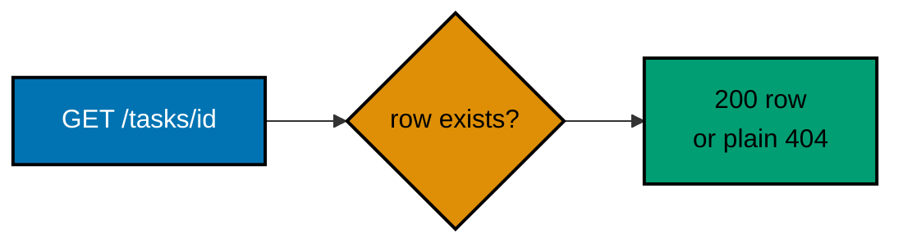

**`learning/code/ex-38-crud-read-one/main.go`**

```go
package main // => one directory, one command; one stdlib pool plus one pure-Go driver

import (
	"database/sql"  // => the stdlib pool: Open, Exec, QueryRow -- no driver of its own
	"encoding/json" // => the found-row body encodes through here; the 404 carries no body
	"errors"        // => errors.Is: tests for sql.ErrNoRows without touching its text
	"log"           // => fail-fast startup lines + fatal-on-listen
	"net/http"      // => server, mux, statuses
	"os"            // => Remove: delete any stale db file so every run starts clean
	"strconv"       // => the path segment is text until this converts it to an int

	_ "modernc.org/sqlite" // => the pure-Go driver itself: blank import REGISTERS the "sqlite" name (no cgo)
}

type taskRow struct { // => the row shape the repository returns and the handler serializes as-is
	ID    int    `json:"id"`
	Title string `json:"title"`
}

var db *sql.DB // => the shared pool: safe for concurrent use, ONE handle per process

// initDB recreates the schema and seeds two starter rows, ONCE at startup.
// Open, ping, the exact DDL, and the two-row seed match Example 35 (see main.go).
func initDB() { // => one-shot setup: file, table, seed rows, in that order
	_ = os.Remove("tasks.db") // => delete any stale file first -- every run starts clean
	var err error
	db, err = sql.Open("sqlite", "file:tasks.db") // => "sqlite" is the name the blank import registered
	if err != nil {
		log.Fatalf("open db: %v", err)
	}
	db.SetMaxOpenConns(1) // => one writer-friendly connection: SQLite files dislike concurrent writers
	if err := db.Ping(); err != nil {
		log.Fatalf("ping db: %v", err)
	}
	_, err = db.Exec("CREATE TABLE tasks (id INTEGER PRIMARY KEY AUTOINCREMENT, title TEXT NOT NULL)") // => the exact DDL
	if err != nil {
		log.Fatalf("create table: %v", err)
	}
	_, err = db.Exec("INSERT INTO tasks (title) VALUES (?), (?)", "Buy milk", "Walk dog") // => two seed rows: id 1 and id 2, in insertion order
	if err != nil {
		log.Fatalf("seed tasks: %v", err)
	}
}

// => getTask is the whole "R" (singular): one row by its path parameter, or
// => sql.ErrNoRows when nothing matches
func getTask(id int) (taskRow, error) { // => (row, error): the found row or the reason it is missing
	var t taskRow
	err := db.QueryRow("SELECT id, title FROM tasks WHERE id = ?", id).Scan(&t.ID, &t.Title) // => one placeholder, one bound value
	if err != nil {
		return taskRow{}, err // => the handler tests for ErrNoRows with errors.Is
	}
	return t, nil // => success: the row SQLite actually stored
}

func getTaskHandler(w http.ResponseWriter, r *http.Request) { // => co-12: a typed integer path parameter
	id, err := strconv.Atoi(r.PathValue("task_id")) // => hand-typed conversion: text -> int
	if err != nil {
		w.WriteHeader(http.StatusBadRequest) // => 400: a failed conversion gets YOUR status, never an automatic 422
		return
	}
	row, err := getTask(id) // => co-14: the handler delegates the SELECT
	if err != nil {
		if errors.Is(err, sql.ErrNoRows) { // => the ONLY domain branch: the id simply does not exist
			w.WriteHeader(http.StatusNotFound) // => the PLAIN default 404 shape -- deliberately no envelope yet (ex-42 adds it)
			return
		}
		w.WriteHeader(http.StatusInternalServerError) // => a genuinely broken read is a 500, never a leak
		return
	}
	w.Header().Set("Content-Type", "application/json") // => response header first...
	body, _ := json.Marshal(row)                       // => taskRow encodes as {"id":..,"title":..} directly
	_, _ = w.Write(body)                               // => ...onto the wire with the default 200 status
}

func newHandler() http.Handler { // => wiring, extracted so a test could reuse it
	mux := http.NewServeMux()
	mux.HandleFunc("GET /tasks/{task_id}", getTaskHandler) // => co-12: {task_id} arrives as text; the handler types it
	return mux
}

func main() { // => the executable entry point: setup, then serve
	initDB()                                                       // => fresh, seeded tasks.db for every run
	defer db.Close()
	log.Println("listening on 127.0.0.1:8000")
	log.Fatal(http.ListenAndServe("127.0.0.1:8000", newHandler())) // => serve until interrupted
}
```

**Run**: `go run .`, then in a second terminal: `curl 127.0.0.1:8000/tasks/2` and `curl -i 127.0.0.1:8000/tasks/999`

**Output**:

```text
$ curl -s -w "\nHTTP %{http_code}\n" 127.0.0.1:8000/tasks/2
{"id":2,"title":"Walk dog"}
HTTP 200

$ curl -s -o /dev/null -w "HTTP %{http_code}\n" 127.0.0.1:8000/tasks/999
HTTP 404
```

**Key takeaway**: The hand-written `strconv.Atoi` on the path segment is this
track's replacement for a framework's typed path parameter -- a non-numeric id
fails in the handler's own branch, and a well-formed but unknown id becomes
`sql.ErrNoRows` from the repository.

**Why it matters**: This example deliberately uses the plain default 404
rather than the custom envelope, to isolate one concept at a time: the
repository's job (reading one row and reporting absence as `ErrNoRows`) is
separate from the envelope's job (deciding what JSON shape a 404 gets).
Example 42 later combines both concerns once each is understood on its own.

---

### Example 39: CRUD -- Read the Whole List

_ex-39 &middot; exercises co-14_

`GET /tasks` returns every row as a JSON array. Combined with `POST /tasks`
in the same program, one `curl` session can create two tasks and then read the
grown list back, proving the two operations compose against the same table.
The empty list is a 200 with `[]`, never a 404.


**`learning/code/ex-39-crud-read-list/main.go`**

```go
package main // => one directory, one command; one stdlib pool plus one pure-Go driver

import (
	"database/sql"  // => the stdlib pool: Open, Exec, Query -- no driver of its own
	"encoding/json" // => request decode plus every response encode runs through here
	"fmt"           // => wraps decode failures with context via %w
	"log"           // => fail-fast startup lines + fatal-on-listen
	"net/http"      // => server, mux, statuses
	"os"            // => Remove: delete any stale db file so every run starts clean
	"strings"       // => TrimSpace, so a whitespace-only title counts as missing too

	_ "modernc.org/sqlite" // => the pure-Go driver itself: blank import REGISTERS the "sqlite" name (no cgo)
}

type taskCreate struct { // => the request shape for the POST half: exactly one field, checked by hand
	Title string `json:"title"` // => co-10: validated before either repository call below
}

type taskRow struct { // => the row shape BOTH halves share
	ID    int    `json:"id"`
	Title string `json:"title"`
}

var db *sql.DB // => the shared pool: safe for concurrent use, ONE handle per process

// initDB recreates the schema starting EMPTY -- every row arrives through
// createTask below, never from seed data. Open, ping, and the exact DDL
// match Example 37 (see main.go for the full setup).
func initDB() { // => one-shot setup: file plus table, nothing else
	_ = os.Remove("tasks.db") // => delete any stale file first -- every run starts clean
	var err error
	db, err = sql.Open("sqlite", "file:tasks.db") // => "sqlite" is the name the blank import registered
	if err != nil {
		log.Fatalf("open db: %v", err)
	}
	db.SetMaxOpenConns(1)
	if err := db.Ping(); err != nil {
		log.Fatalf("ping db: %v", err)
	}
	_, err = db.Exec("CREATE TABLE tasks (id INTEGER PRIMARY KEY AUTOINCREMENT, title TEXT NOT NULL)") // => the exact DDL -- no seed rows this time
	if err != nil {
		log.Fatalf("create table: %v", err)
	}
}

func createTask(title string) (int64, error) { // => the INSERT half: "?" binds the title as DATA
	res, err := db.Exec("INSERT INTO tasks (title) VALUES (?)", title) // => one placeholder, one bound value
	if err != nil {
		return 0, err
	}
	id, err := res.LastInsertId() // => the AUTOINCREMENT id SQLite just assigned, off the result
	if err != nil {
		return 0, err
	}
	return id, nil
}

func listTasks() ([]taskRow, error) { // => the READ half: every row, in insertion order
	rows, err := db.Query("SELECT id, title FROM tasks ORDER BY id") // => no WHERE clause -- returns every row
	if err != nil {
		return nil, err
	}
	defer rows.Close()
	out := []taskRow{} // => START as [] (not nil) so the empty list encodes as [], never null
	for rows.Next() {
		var t taskRow
		if err := rows.Scan(&t.ID, &t.Title); err != nil { // => column order matches the SELECT list above
			return nil, err
		}
		out = append(out, t)
	}
	if err := rows.Err(); err != nil {
		return nil, err
	}
	return out, nil // => success: possibly empty, always an array on the wire
}

func decodeTaskCreate(r *http.Request) (taskCreate, error) { // => parse+check, one place, like ex-29
	var body taskCreate
	if err := json.NewDecoder(r.Body).Decode(&body); err != nil {
		return taskCreate{}, fmt.Errorf("invalid JSON body: %w", err)
	}
	if strings.TrimSpace(body.Title) == "" {
		return taskCreate{}, fmt.Errorf("title is required")
	}
	return body, nil
}

func writeJSON(w http.ResponseWriter, status int, payload any) { // => the single serializer every path below uses
	w.Header().Set("Content-Type", "application/json")
	w.WriteHeader(status)
	body, _ := json.Marshal(payload)
	_, _ = w.Write(body)
}

func createTaskHandler(w http.ResponseWriter, r *http.Request) { // => reused so curl can grow the list before listing it
	body, err := decodeTaskCreate(r)
	if err != nil {
		writeJSON(w, http.StatusUnprocessableEntity, map[string]string{"error": err.Error()})
		return
	}
	id, err := createTask(body.Title) // => co-14: the handler delegates the INSERT
	if err != nil {
		writeJSON(w, http.StatusInternalServerError, map[string]string{"error": "could not create task"})
		return
	}
	writeJSON(w, http.StatusCreated, taskRow{ID: int(id), Title: body.Title}) // => echoes the id the DB actually assigned
}

func listTasksHandler(w http.ResponseWriter, r *http.Request) { // => co-14: returns a JSON ARRAY, one element per row
	tasks, err := listTasks() // => co-14: the handler never writes SQL itself
	if err != nil {
		writeJSON(w, http.StatusInternalServerError, map[string]string{"error": "could not list tasks"})
		return
	}
	writeJSON(w, http.StatusOK, tasks) // => the array shape a client can iterate directly -- [] when empty, never null
}

func newHandler() http.Handler { // => wiring, extracted so a test could reuse it
	mux := http.NewServeMux()
	mux.HandleFunc("POST /tasks", createTaskHandler) // => POST grows the list (201 with the fresh row)
	mux.HandleFunc("GET /tasks", listTasksHandler)   // => GET returns the whole array (200, [] when empty)
	return mux
}

func main() { // => the executable entry point: setup, then serve
	initDB()
	defer db.Close()
	log.Println("listening on 127.0.0.1:8000")
	log.Fatal(http.ListenAndServe("127.0.0.1:8000", newHandler()))
}
```

**Run**: `go run .`, then in a second terminal: `curl 127.0.0.1:8000/tasks`, two `curl -X POST 127.0.0.1:8000/tasks` calls with titles, then `curl 127.0.0.1:8000/tasks` again

**Output**:

```text
$ curl -s -w "\nHTTP %{http_code}\n" 127.0.0.1:8000/tasks
[]
HTTP 200

$ curl -s -w "\nHTTP %{http_code}\n" -X POST 127.0.0.1:8000/tasks -H 'Content-Type: application/json' -d '{"title":"Buy milk"}'
{"id":1,"title":"Buy milk"}
HTTP 201

$ curl -s -w "\nHTTP %{http_code}\n" -X POST 127.0.0.1:8000/tasks -H 'Content-Type: application/json' -d '{"title":"Walk dog"}'
{"id":2,"title":"Walk dog"}
HTTP 201

$ curl -s -w "\nHTTP %{http_code}\n" 127.0.0.1:8000/tasks
[{"id":1,"title":"Buy milk"},{"id":2,"title":"Walk dog"}]
HTTP 200
```

**Key takeaway**: A list query's `ORDER BY id` makes the JSON array's order
deterministic -- without it, SQLite is free to return rows in whatever
physical order it finds convenient.

**Why it matters**: Nearly every real API needs both a "read one" and a "read
many" endpoint, and they usually share most of their repository logic -- here,
`listTasks` and `createTask` live in the same small program and the session
above proves they interact correctly, a much cheaper check than restarting the
server and eyeballing the result each time.

---

### Example 40: CRUD -- Update a Task

_ex-40 &middot; exercises co-14, co-02_

`PUT /tasks/{id}` fully replaces the addressed resource. `updateTask` runs an
`UPDATE ... WHERE id = ?` in place and reports back via the exec result's
`RowsAffected` -- the Go spelling of the Python track's `cursor.rowcount` --
whether any row actually matched, letting the handler distinguish "updated"
from "nothing to update".

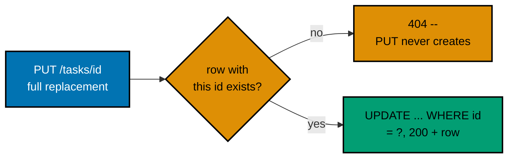

**`learning/code/ex-40-crud-update/main.go`**

```go
package main // => one directory, one command; one stdlib pool plus one pure-Go driver

import (
	"database/sql"  // => the stdlib pool: Open, Exec, QueryRow -- no driver of its own
	"encoding/json" // => request decode plus every response encode runs through here
	"fmt"           // => wraps decode failures with context via %w
	"log"           // => fail-fast startup lines + fatal-on-listen
	"net/http"      // => server, mux, statuses
	"os"            // => Remove: delete any stale db file so every run starts clean
	"strconv"       // => the path segment is text until this converts it to an int
	"strings"       // => TrimSpace, so a whitespace-only replacement counts as missing too

	_ "modernc.org/sqlite" // => the pure-Go driver itself: blank import REGISTERS the "sqlite" name (no cgo)
}

type taskUpdate struct { // => the request shape: the replacement value, validated like any other body
	Title string `json:"title"` // => co-10: the replacement value, presence-checked by hand
}

type taskRow struct { // => the updated-resource shape: the addressed id plus the value just written
	ID    int    `json:"id"`
	Title string `json:"title"`
}

var db *sql.DB // => the shared pool: safe for concurrent use, ONE handle per process

// initDB recreates the schema and seeds two starter rows, ONCE at startup.
// Open, ping, the exact DDL, and the two-row seed match Example 35 (see main.go).
func initDB() { // => one-shot setup: file, table, seed rows, in that order
	_ = os.Remove("tasks.db") // => delete any stale file first -- every run starts clean
	var err error
	db, err = sql.Open("sqlite", "file:tasks.db") // => "sqlite" is the name the blank import registered
	if err != nil {
		log.Fatalf("open db: %v", err)
	}
	db.SetMaxOpenConns(1)
	if err := db.Ping(); err != nil {
		log.Fatalf("ping db: %v", err)
	}
	_, err = db.Exec("CREATE TABLE tasks (id INTEGER PRIMARY KEY AUTOINCREMENT, title TEXT NOT NULL)") // => the exact DDL
	if err != nil {
		log.Fatalf("create table: %v", err)
	}
	_, err = db.Exec("INSERT INTO tasks (title) VALUES (?), (?)", "Buy milk", "Walk dog") // => two seed rows: id 1 and id 2
	if err != nil {
		log.Fatalf("seed tasks: %v", err)
	}
}

// => updateTask runs an UPDATE in place (not DELETE+INSERT) and reports back
// => via RowsAffected whether a row actually changed
func updateTask(id int, title string) (bool, error) { // => (changed, error): changed is false when no row matched
	res, err := db.Exec("UPDATE tasks SET title = ? WHERE id = ?", title, id) // => two "?" placeholders, bound positionally in order
	if err != nil {                                                           // => co-14: parameterized -- never string-formatted
		return false, err
	}
	n, err := res.RowsAffected() // => how many rows this statement touched -- the whole changed signal
	if err != nil {
		return false, err
	}
	return n > 0, nil // => true when the id matched a row, false when task_id matched nothing
}

func getTask(id int) (taskRow, error) { // => used only to PROVE the update landed on disk
	var t taskRow
	err := db.QueryRow("SELECT id, title FROM tasks WHERE id = ?", id).Scan(&t.ID, &t.Title) // => co-14: same parameterized pattern throughout
	if err != nil {
		return taskRow{}, err
	}
	return t, nil
}

func decodeTaskUpdate(r *http.Request) (taskUpdate, error) { // => parse+check, one place, like ex-29
	var body taskUpdate
	if err := json.NewDecoder(r.Body).Decode(&body); err != nil {
		return taskUpdate{}, fmt.Errorf("invalid JSON body: %w", err)
	}
	if strings.TrimSpace(body.Title) == "" {
		return taskUpdate{}, fmt.Errorf("title is required")
	}
	return body, nil
}

func writeJSON(w http.ResponseWriter, status int, payload any) { // => the single serializer every path below uses
	w.Header().Set("Content-Type", "application/json")
	w.WriteHeader(status)
	body, _ := json.Marshal(payload)
	_, _ = w.Write(body)
}

func updateTaskHandler(w http.ResponseWriter, r *http.Request) { // => co-02: PUT replaces the addressed resource
	id, err := strconv.Atoi(r.PathValue("task_id")) // => hand-typed conversion: text -> int (co-12)
	if err != nil {
		w.WriteHeader(http.StatusBadRequest) // => 400: a failed conversion gets YOUR status, never an automatic 422
		return
	}
	body, err := decodeTaskUpdate(r) // => path param PLUS validated body -- both must check out
	if err != nil {
		writeJSON(w, http.StatusUnprocessableEntity, map[string]string{"error": err.Error()})
		return
	}
	changed, err := updateTask(id, body.Title) // => co-14: delegates the UPDATE
	if err != nil {
		writeJSON(w, http.StatusInternalServerError, map[string]string{"error": "could not update task"})
		return
	}
	if !changed { // => the ONLY domain branch: rowcount was 0, nothing matched
		w.WriteHeader(http.StatusNotFound) // => the PLAIN default 404 shape -- deliberately no envelope yet (ex-42 adds it)
		return
	}
	writeJSON(w, http.StatusOK, taskRow{ID: id, Title: body.Title}) // => echoes the id + the value that was just written
}

func newHandler() http.Handler { // => wiring, extracted so a test could reuse it
	mux := http.NewServeMux()
	mux.HandleFunc("PUT /tasks/{task_id}", updateTaskHandler) // => co-02: PUT against the addressed id
	return mux
}

func main() { // => the executable entry point: setup, then serve
	initDB()
	defer db.Close()
	log.Println("listening on 127.0.0.1:8000")
	log.Fatal(http.ListenAndServe("127.0.0.1:8000", newHandler()))
}
```

**Run**: `go run .`, then in a second terminal: `curl -X PUT 127.0.0.1:8000/tasks/1 -H 'Content-Type: application/json' -d '{"title":"Buy oat milk"}'` and the same against `/tasks/999`

**Output**:

```text
$ curl -s -w "\nHTTP %{http_code}\n" -X PUT 127.0.0.1:8000/tasks/1 -H 'Content-Type: application/json' -d '{"title":"Buy oat milk"}'
{"id":1,"title":"Buy oat milk"}
HTTP 200

$ curl -s -o /dev/null -w "HTTP %{http_code}\n" -X PUT 127.0.0.1:8000/tasks/999 -H 'Content-Type: application/json' -d '{"title":"ghost"}'
HTTP 404
```

**Key takeaway**: `RowsAffected` after an `UPDATE` is the cheapest way to know
whether the target row existed -- no separate `SELECT` is needed just to check
for existence before writing.

**Why it matters**: PUT is meant to be idempotent: calling it twice with the
same body leaves the system in the same state as calling it once, and running
this exact `UPDATE` statement repeatedly does exactly that -- the row ends up
with the same title every time, with no risk of duplicate rows the way a naive
DELETE-then-INSERT approach might introduce under concurrent requests.

---

### Example 41: CRUD -- Delete a Task

_ex-41 &middot; exercises co-14_

`DELETE /tasks/{id}` removes a row and returns 204 (no body) on success.
Deleting the same id a second time returns a plain 404, since `RowsAffected`
is 0 once the row is already gone -- the same gated-on-rowcount shape as the
update in Example 40.

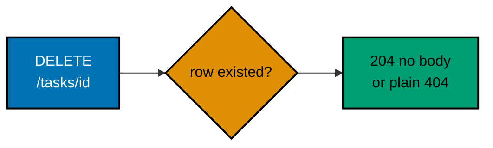

**`learning/code/ex-41-crud-delete/main.go`**

```go
package main // => one directory, one command; one stdlib pool plus one pure-Go driver

import (
	"database/sql" // => the stdlib pool: Open, Exec, QueryRow -- no driver of its own
	"log"          // => fail-fast startup lines + fatal-on-listen
	"net/http"     // => server, mux, statuses -- the 204 path writes a bare status, no JSON
	"os"           // => Remove: delete any stale db file so every run starts clean
	"strconv"      // => the path segment is text until this converts it to an int

	_ "modernc.org/sqlite" // => the pure-Go driver itself: blank import REGISTERS the "sqlite" name (no cgo)
}

var db *sql.DB // => the shared pool: safe for concurrent use, ONE handle per process

// initDB recreates the schema and seeds two starter rows, ONCE at startup.
// Open, ping, the exact DDL, and the two-row seed match Example 35 (see main.go).
func initDB() { // => one-shot setup: file, table, seed rows, in that order
	_ = os.Remove("tasks.db") // => delete any stale file first -- every run starts clean
	var err error
	db, err = sql.Open("sqlite", "file:tasks.db") // => "sqlite" is the name the blank import registered
	if err != nil {
		log.Fatalf("open db: %v", err)
	}
	db.SetMaxOpenConns(1)
	if err := db.Ping(); err != nil {
		log.Fatalf("ping db: %v", err)
	}
	_, err = db.Exec("CREATE TABLE tasks (id INTEGER PRIMARY KEY AUTOINCREMENT, title TEXT NOT NULL)") // => the exact DDL
	if err != nil {
		log.Fatalf("create table: %v", err)
	}
	_, err = db.Exec("INSERT INTO tasks (title) VALUES (?), (?)", "Buy milk", "Walk dog") // => two seed rows: id 1 and id 2
	if err != nil {
		log.Fatalf("seed tasks: %v", err)
	}
}

// => deleteTask runs one DELETE and reports back via RowsAffected whether a
// => row actually existed -- gated on rowcount, the same shape as updateTask
func deleteTask(id int) (bool, error) { // => (removed, error): removed is false when nothing matched
	res, err := db.Exec("DELETE FROM tasks WHERE id = ?", id) // => "?" binds the id as DATA, never as literal SQL text
	if err != nil {                                           // => co-14: parameterized -- never string-formatted
		return false, err
	}
	n, err := res.RowsAffected() // => how many rows this statement touched -- the whole removed signal
	if err != nil {
		return false, err
	}
	return n > 0, nil // => true when the id existed, false when it never did
}

func getTaskCount(id int) (int, error) { // => used only to PROVE the row is genuinely gone
	var n int
	err := db.QueryRow("SELECT COUNT(*) FROM tasks WHERE id = ?", id).Scan(&n) // => co-14: same parameterized pattern throughout
	if err != nil {
		return 0, err
	}
	return n, nil // => 0 once the row is deleted, 1 while it exists
}

func deleteTaskHandler(w http.ResponseWriter, r *http.Request) { // => the "D" endpoint: type, delegate, answer
	id, err := strconv.Atoi(r.PathValue("task_id")) // => hand-typed conversion: text -> int (co-12)
	if err != nil {
		w.WriteHeader(http.StatusBadRequest) // => 400: a failed conversion gets YOUR status, never an automatic 422
		return
	}
	removed, err := deleteTask(id) // => co-14: delegates the DELETE
	if err != nil {
		w.WriteHeader(http.StatusInternalServerError) // => 500 with no body -- the delete path carries no JSON at all
		return
	}
	if !removed { // => the ONLY domain branch: rowcount was 0, nothing matched
		w.WriteHeader(http.StatusNotFound) // => the PLAIN default 404 shape -- ex-42 adds the envelope
		return
	}
	w.WriteHeader(http.StatusNoContent) // => co-03: 204 -- success, no body
}

func newHandler() http.Handler { // => wiring, extracted so a test could reuse it
	mux := http.NewServeMux()
	mux.HandleFunc("DELETE /tasks/{task_id}", deleteTaskHandler) // => co-03: DELETE removes, 204 answers
	return mux
}

func main() { // => the executable entry point: setup, then serve
	initDB()
	defer db.Close()
	log.Println("listening on 127.0.0.1:8000")
	log.Fatal(http.ListenAndServe("127.0.0.1:8000", newHandler()))
}
```

**Run**: `go run .`, then in a second terminal: `curl -X DELETE 127.0.0.1:8000/tasks/1` twice and `curl -X DELETE 127.0.0.1:8000/tasks/999`

**Output**:

```text
$ curl -s -o /dev/null -w "HTTP %{http_code}\n" -X DELETE 127.0.0.1:8000/tasks/1
HTTP 204

$ curl -s -o /dev/null -w "HTTP %{http_code}\n" -X DELETE 127.0.0.1:8000/tasks/1
HTTP 404

$ curl -s -o /dev/null -w "HTTP %{http_code}\n" -X DELETE 127.0.0.1:8000/tasks/999
HTTP 404
```

**Key takeaway**: 204 No Content is the correct success status for a DELETE --
there is no representation left to return, so the response body is empty on
purpose, not by omission.

**Why it matters**: The second `DELETE` call above is not an error in the
session -- it is the point: it demonstrates that delete is naturally
idempotent in effect (the row ends up gone either way) even though its status
differs between calls (204 the first time, 404 the second), a subtlety worth
knowing before Example 42 wires this same rowcount-driven check into the
shared error envelope.

---

### Example 42: Update or Delete Against a Missing Id Returns a 404 Envelope

_ex-42 &middot; exercises co-14, co-11_

This example combines the DB-backed update and delete from Examples 40-41
with the shared `taskNotFoundError` envelope pattern from Examples 33-34 --
now a rowcount of zero maps to the same `{"error": {code, message}}` document
from both routes, instead of the plain default 404s those examples answered.

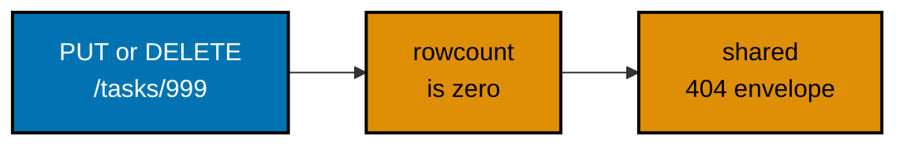

**`learning/code/ex-42-crud-missing-404/main.go`**

```go
package main // => one directory, one command; one stdlib pool plus one pure-Go driver

import (
	"database/sql"  // => the stdlib pool: Open, Exec -- no driver of its own
	"encoding/json" // => request decode, success echo, and envelope encode run through here
	"errors"        // => errors.As: tests the domain error without touching HTTP vocabulary
	"fmt"           // => builds domain error text and wraps decode failures via %w
	"log"           // => fail-fast startup lines + fatal-on-listen
	"net/http"      // => server, mux, statuses
	"os"            // => Remove: delete any stale db file so every run starts clean
	"strconv"       // => the path segment is text until this converts it to an int
	"strings"       // => TrimSpace, so a whitespace-only replacement counts as missing too

	_ "modernc.org/sqlite" // => the pure-Go driver itself: blank import REGISTERS the "sqlite" name (no cgo)
}

type taskUpdate struct { // => the request shape for the PUT half: the replacement value, checked by hand
	Title string `json:"title"` // => co-10: validated before the handler ever delegates the UPDATE
}

type taskRow struct { // => the updated-resource shape the PUT half echoes on success
	ID    int    `json:"id"`
	Title string `json:"title"`
}

type errorDetail struct { // => the stable envelope BOTH missing-id paths wear -- the ex-33/34 shape
	Code    string `json:"code"`    // => stable, machine-matchable: "task_not_found"
	Message string `json:"message"` // => human-readable summary naming the missing id
}

type errorEnvelope struct {
	Error errorDetail `json:"error"` // => the ONE top-level key, matching ex-33/ex-34
}

type taskNotFoundError struct { // => the same envelope-shaped domain error as ex-33
	ID int // => the id the caller asked for and did not get
}

func (e taskNotFoundError) Error() string { // => the method that makes this type an error
	return fmt.Sprintf("task %d does not exist", e.ID) // => the same human sentence the envelope will carry
}

var db *sql.DB // => the shared pool: safe for concurrent use, ONE handle per process

// initDB recreates the schema and seeds exactly ONE starter row -- every id
// besides 1 is missing, which is the entire point. Open, ping, the exact
// DDL, and the single-row seed follow Example 35 (see main.go).
func initDB() { // => one-shot setup: file, table, one row, in that order
	_ = os.Remove("tasks.db") // => delete any stale file first -- every run starts clean
	var err error
	db, err = sql.Open("sqlite", "file:tasks.db") // => "sqlite" is the name the blank import registered
	if err != nil {
		log.Fatalf("open db: %v", err)
	}
	db.SetMaxOpenConns(1)
	if err := db.Ping(); err != nil {
		log.Fatalf("ping db: %v", err)
	}
	_, err = db.Exec("CREATE TABLE tasks (id INTEGER PRIMARY KEY AUTOINCREMENT, title TEXT NOT NULL)") // => the exact DDL
	if err != nil {
		log.Fatalf("create table: %v", err)
	}
	_, err = db.Exec("INSERT INTO tasks (title) VALUES (?)", "Buy milk") // => one seed row, id 1 -- every other id queried is missing
	if err != nil {
		log.Fatalf("seed tasks: %v", err)
	}
}

func updateTask(id int, title string) (bool, error) { // => identical shape to ex-40: UPDATE, then RowsAffected
	res, err := db.Exec("UPDATE tasks SET title = ? WHERE id = ?", title, id) // => two "?" placeholders, bound positionally in order
	if err != nil {                                                           // => co-14: parameterized -- never string-formatted
		return false, err
	}
	n, err := res.RowsAffected() // => how many rows this statement touched -- drives the domain error below
	if err != nil {
		return false, err
	}
	return n > 0, nil
}

func deleteTask(id int) (bool, error) { // => identical shape to ex-41: DELETE, then RowsAffected
	res, err := db.Exec("DELETE FROM tasks WHERE id = ?", id) // => "?" binds the id as DATA, never as literal SQL text
	if err != nil {                                           // => co-14: parameterized -- never string-formatted
		return false, err
	}
	n, err := res.RowsAffected() // => how many rows this statement touched -- drives the SAME domain error
	if err != nil {
		return false, err
	}
	return n > 0, nil
}

func writeError(w http.ResponseWriter, status int, code, message string) { // => THE centralized failure path for BOTH routes
	w.Header().Set("Content-Type", "application/json")
	w.WriteHeader(status)
	body, _ := json.Marshal(errorEnvelope{Error: errorDetail{Code: code, Message: message}}) // => built by hand ONCE, for every caller
	_, _ = w.Write(body)
}

func mapDomainError(w http.ResponseWriter, err error) { // => the single translation point for domain failures
	var notFound taskNotFoundError
	if errors.As(err, &notFound) { // => co-11: ONE handler-shape for BOTH routes below
		writeError(w, http.StatusNotFound, "task_not_found", notFound.Error()) // => 404, identical for PUT and DELETE callers
		return
	}
	writeError(w, http.StatusInternalServerError, "internal_error", "unexpected error")
}

func writeJSON(w http.ResponseWriter, status int, payload any) { // => the PUT happy path only -- failures never touch it
	w.Header().Set("Content-Type", "application/json")
	w.WriteHeader(status)
	body, _ := json.Marshal(payload)
	_, _ = w.Write(body)
}

func parseTaskID(w http.ResponseWriter, r *http.Request) (int, bool) { // => the one path-typing step both handlers share
	id, err := strconv.Atoi(r.PathValue("task_id")) // => hand-typed conversion: text -> int (co-12)
	if err != nil {
		writeError(w, http.StatusBadRequest, "validation_error", "task_id must be an integer")
		return 0, false
	}
	return id, true
}

func updateTaskHandler(w http.ResponseWriter, r *http.Request) { // => co-02: PUT against a real, repository-backed store now
	id, ok := parseTaskID(w, r)
	if !ok {
		return
	}
	var body taskUpdate
	if err := json.NewDecoder(r.Body).Decode(&body); err != nil { // => streaming decode of the PUT body
		writeError(w, http.StatusUnprocessableEntity, "validation_error", "invalid JSON body")
		return
	}
	if strings.TrimSpace(body.Title) == "" { // => co-10: validated before the handler ever delegates the UPDATE
		writeError(w, http.StatusUnprocessableEntity, "validation_error", "title is required")
		return
	}
	changed, err := updateTask(id, body.Title) // => co-14: delegates the UPDATE
	if err != nil {
		writeError(w, http.StatusInternalServerError, "internal_error", "could not update task")
		return
	}
	if !changed { // => the ONLY domain branch: rowcount was 0
		mapDomainError(w, taskNotFoundError{ID: id}) // => same envelope, now driven by rowcount == 0
		return
	}
	writeJSON(w, http.StatusOK, taskRow{ID: id, Title: body.Title})
}

func deleteTaskHandler(w http.ResponseWriter, r *http.Request) { // => co-03: 204 -- success, no body
	id, ok := parseTaskID(w, r)
	if !ok {
		return
	}
	removed, err := deleteTask(id) // => co-14: delegates the DELETE
	if err != nil {
		writeError(w, http.StatusInternalServerError, "internal_error", "could not delete task")
		return
	}
	if !removed { // => the ONLY domain branch: rowcount was 0
		mapDomainError(w, taskNotFoundError{ID: id}) // => the SAME error class as the PUT branch above
		return
	}
	w.WriteHeader(http.StatusNoContent) // => 204: no-content success -- deliberately NO body
}

func newHandler() http.Handler { // => wiring, extracted so a test could reuse it
	mux := http.NewServeMux()
	mux.HandleFunc("PUT /tasks/{task_id}", updateTaskHandler)    // => co-02: PUT replaces the addressed resource
	mux.HandleFunc("DELETE /tasks/{task_id}", deleteTaskHandler) // => co-03: DELETE removes; same 404 envelope as PUT
	return mux
}

func main() { // => the executable entry point: setup, then serve
	initDB()
	defer db.Close()
	log.Println("listening on 127.0.0.1:8000")
	log.Fatal(http.ListenAndServe("127.0.0.1:8000", newHandler()))
}
```

**Run**: `go run .`, then in a second terminal: `curl -X PUT 127.0.0.1:8000/tasks/999 -H 'Content-Type: application/json' -d '{"title":"ghost"}'` and `curl -X DELETE 127.0.0.1:8000/tasks/999`

**Output**:

```text
$ curl -s -w "\nHTTP %{http_code}\n" -X PUT 127.0.0.1:8000/tasks/999 -H 'Content-Type: application/json' -d '{"title":"ghost"}'
{"error":{"code":"task_not_found","message":"task 999 does not exist"}}
HTTP 404

$ curl -s -w "\nHTTP %{http_code}\n" -X DELETE 127.0.0.1:8000/tasks/999
{"error":{"code":"task_not_found","message":"task 999 does not exist"}}
HTTP 404
```

**Key takeaway**: The repository layer decides whether a row existed
(`RowsAffected > 0`); the HTTP layer decides what the caller sees when it did
not (`taskNotFoundError` plus `mapDomainError` into the 404 envelope) -- each
layer owns exactly one of those two questions.

**Why it matters**: This is where the two threads running through this batch
converge: the persistence thread (SQLite, repositories, rowcount) that started
at Example 35, and the error-handling thread (domain errors, custom envelopes)
that started at Example 32. Seeing them combined here, rather than as separate
topics, is what makes the layering in the next examples (45-47) feel motivated
rather than arbitrary.

---

### Example 43: Apply a schema.sql Migration at Startup

_ex-43 &middot; exercises co-15_

The table's DDL lives in a separate `schema.sql` file, not a Go string.
`applySchema` reads that file and executes it as one script before the app
accepts a single request, and `main` asserts the `tasks` table exists before
`ListenAndServe` -- failing fast at boot, not on the first real request.

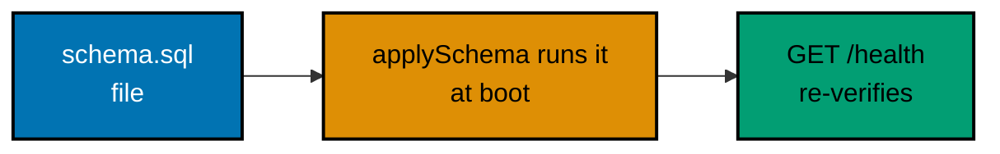

**`learning/code/ex-43-migration-apply-schema/main.go`**

```go
package main // => one directory, one command; one stdlib pool plus one pure-Go driver

import (
	"database/sql"  // => the stdlib pool: Open, Exec, QueryRow -- no driver of its own
	"encoding/json" // => the health body encodes through here
	"log"           // => fail-fast startup lines + fatal-on-listen
	"net/http"      // => server, mux, statuses
	"os"            // => Remove (clean start) + ReadFile (the schema's source of truth)

	_ "modernc.org/sqlite" // => the pure-Go driver itself: blank import REGISTERS the "sqlite" name (no cgo)
}

type healthResponse struct { // => the readiness shape: a tiny, machine-checkable signal a balancer polls
	TasksTableReady bool `json:"tasks_table_ready"` // => true once the migration below genuinely ran
}

var db *sql.DB // => the shared pool: safe for concurrent use, ONE handle per process

const schemaPath = "schema.sql" // => co-15: one file, next to this module, read at startup

func applySchema() { // => co-15: the migration entry point -- called BEFORE serving
	_ = os.Remove("tasks.db") // => start every run from a clean, deterministic file
	var err error
	db, err = sql.Open("sqlite", "file:tasks.db") // => "sqlite" is the name the blank import registered
	if err != nil {
		log.Fatalf("open db: %v", err)
	}
	db.SetMaxOpenConns(1)
	if err := db.Ping(); err != nil {
		log.Fatalf("ping db: %v", err)
	}
	script, err := os.ReadFile(schemaPath) // => reads the ENTIRE schema.sql file as one string
	if err != nil {
		log.Fatalf("read schema: %v", err) // => fail FAST: without the file there is no schema to apply
	}
	if _, err := db.Exec(string(script)); err != nil { // => runs every statement in that file, in file order
		log.Fatalf("apply schema: %v", err)
	}
} // => applySchema ends: the file, not a Go string, decided the schema

func tableExists(name string) bool { // => co-15: proof the migration genuinely ran
	var found string
	err := db.QueryRow("SELECT name FROM sqlite_master WHERE type = 'table' AND name = ?", name).Scan(&found) // => co-14: parameterized
	if err != nil {
		return false // => the startup check below turns this into a fatal boot error
	}
	return found == name // => true only when the catalog genuinely holds this table
}

func healthHandler(w http.ResponseWriter, r *http.Request) { // => co-08: a readiness-style check a load balancer could poll
	w.Header().Set("Content-Type", "application/json")
	body, _ := json.Marshal(healthResponse{TasksTableReady: tableExists("tasks")}) // => re-verified per request, from the live catalog
	_, _ = w.Write(body)
}

func newHandler() http.Handler { // => wiring, extracted so a test could reuse it
	mux := http.NewServeMux()
	mux.HandleFunc("GET /health", healthHandler) // => co-08: GET returns the readiness signal
	return mux
}

func main() { // => the executable entry point: migrate, verify, then serve
	applySchema()              // => co-15: runs BEFORE the app accepts a single request
	if !tableExists("tasks") { // => fails FAST, at boot time, not on the first real request
		log.Fatal("migration failed: tasks table missing")
	}
	defer db.Close()
	log.Println("listening on 127.0.0.1:8000")
	log.Fatal(http.ListenAndServe("127.0.0.1:8000", newHandler()))
}
```

**`learning/code/ex-43-migration-apply-schema/schema.sql`**

```sql
-- Example 43: the schema lives in its own .sql file, not inline Go.
-- The same file could be handed to `sqlite3 tasks.db < schema.sql` on a shell.
CREATE TABLE IF NOT EXISTS tasks ( -- => co-15: begins the single-table DDL statement
  id INTEGER PRIMARY KEY AUTOINCREMENT, -- => co-15: ids only ever go up, never get reused
  title TEXT NOT NULL -- => co-15: the one column this migration creates
);
```

**Run**: `go run .`, then in a second terminal: `curl 127.0.0.1:8000/health`

**Output**:

```text
$ curl -s -w "\nHTTP %{http_code}\n" 127.0.0.1:8000/health
{"tasks_table_ready":true}
HTTP 200
```

**Key takeaway**: Reading the whole `.sql` file and executing it as one script
keeps the schema in exactly one source of truth -- the same file could equally
be handed to a SQL shell, so Go code and operators never disagree about the
intended shape.

**Why it matters**: A crash during `applySchema` at boot time is far cheaper
to diagnose than a 500 on the application's very first real request --
failing fast, before `ListenAndServe` finishes booting, turns a subtle runtime
bug into an obvious startup failure. `IF NOT EXISTS` in the DDL also makes
re-running the same migration file harmless, which matters once a real
deployment restarts this service more than once.

---

### Example 44: An Additive ALTER TABLE + Backfill Migration

_ex-44 &middot; exercises co-15_

`createV1Schema` seeds one row under the original (id, title) schema; only
then does `migrateAddPriorityColumn` run `ALTER TABLE ... ADD COLUMN priority
INTEGER` followed by an explicit `UPDATE ... SET priority = 3 WHERE priority
IS NULL` backfill. A `PRAGMA table_info` introspection proves the column was
absent, then present.


**`learning/code/ex-44-migration-add-column/main.go`**

```go
package main // => one directory, one command; one stdlib pool plus one pure-Go driver

import (
	"database/sql"  // => the stdlib pool: Open, Exec, Query, QueryRow -- no driver of its own
	"encoding/json" // => the migrated-row body encodes through here
	"errors"        // => errors.Is: tests for sql.ErrNoRows without touching its text
	"log"           // => fail-fast startup lines + fatal-on-listen
	"net/http"      // => server, mux, statuses
	"os"            // => Remove: delete any stale db file so every run starts clean
	"strconv"       // => the path segment is text until this converts it to an int

	_ "modernc.org/sqlite" // => the pure-Go driver itself: blank import REGISTERS the "sqlite" name (no cgo)
}

type taskRow struct { // => the POST-migration row shape: the handler reads the backfilled column
	ID       int    `json:"id"`
	Title    string `json:"title"`
	Priority int    `json:"priority"` // => BACKFILLED by the migration: 3 for the pre-existing row
}

var db *sql.DB // => the shared pool: safe for concurrent use, ONE handle per process

func openDB() { // => one connection setup for the whole program
	_ = os.Remove("tasks.db") // => start every run from a clean, deterministic file
	var err error
	db, err = sql.Open("sqlite", "file:tasks.db") // => "sqlite" is the name the blank import registered
	if err != nil {
		log.Fatalf("open db: %v", err)
	}
	db.SetMaxOpenConns(1)
	if err := db.Ping(); err != nil {
		log.Fatalf("ping db: %v", err)
	}
}

func createV1Schema() { // => co-15: the ORIGINAL shape, seeded with one pre-migration row
	if _, err := db.Exec("CREATE TABLE tasks (id INTEGER PRIMARY KEY AUTOINCREMENT, title TEXT NOT NULL)"); err != nil {
		log.Fatalf("create v1 schema: %v", err)
	}
	if _, err := db.Exec("INSERT INTO tasks (title) VALUES (?)", "Buy milk"); err != nil { // => runs BEFORE the migration below ever executes
		log.Fatalf("seed v1 row: %v", err)
	}
}

func migrateAddPriorityColumn() { // => co-15: additive ALTER TABLE + backfill UPDATE
	if _, err := db.Exec("ALTER TABLE tasks ADD COLUMN priority INTEGER"); err != nil { // => ADD COLUMN never touches an existing column or row's data
		log.Fatalf("add column: %v", err)
	}
	if _, err := db.Exec("UPDATE tasks SET priority = 3 WHERE priority IS NULL"); err != nil { // => the explicit BACKFILL step, right after the ALTER
		log.Fatalf("backfill priority: %v", err)
	}
}

func columnNames() (map[string]bool, error) { // => introspects the live schema via PRAGMA table_info
	rows, err := db.Query("PRAGMA table_info(tasks)") // => SQLite's own metadata pragma -- table names cannot take "?"
	if err != nil {
		return nil, err
	}
	defer rows.Close()
	names := map[string]bool{}
	for rows.Next() {
		var cid int
		var name string
		var ctype string
		var notNull int
		var dflt sql.NullString
		var pk int
		if err := rows.Scan(&cid, &name, &ctype, &notNull, &dflt, &pk); err != nil { // => six pragma columns, scanned in order
			return nil, err
		}
		names[name] = true
	}
	if err := rows.Err(); err != nil {
		return nil, err
	}
	return names, nil
}

func getTask(id int) (taskRow, error) { // => reads the POST-migration shape, including the BACKFILLED column
	var t taskRow
	var priority sql.NullInt64 // => NULL-safe scan: pre-backfill rows would read Invalid here
	err := db.QueryRow("SELECT id, title, priority FROM tasks WHERE id = ?", id).Scan(&t.ID, &t.Title, &priority)
	if err != nil {
		return taskRow{}, err
	}
	if priority.Valid { // => post-backfill rows always land here -- the migration gave every row a value
		t.Priority = int(priority.Int64)
	}
	return t, nil
}

func getTaskHandler(w http.ResponseWriter, r *http.Request) { // => co-12: a typed integer path parameter
	id, err := strconv.Atoi(r.PathValue("task_id")) // => hand-typed conversion: text -> int
	if err != nil {
		w.WriteHeader(http.StatusBadRequest)
		return
	}
	row, err := getTask(id) // => co-14: delegates the SELECT in its migrated shape
	if err != nil {
		if errors.Is(err, sql.ErrNoRows) {
			w.WriteHeader(http.StatusNotFound)
			return
		}
		w.WriteHeader(http.StatusInternalServerError)
		return
	}
	w.Header().Set("Content-Type", "application/json")
	body, _ := json.Marshal(row) // => includes the BACKFILLED "priority" column
	_, _ = w.Write(body)
}

func newHandler() http.Handler {
	mux := http.NewServeMux()
	mux.HandleFunc("GET /tasks/{task_id}", getTaskHandler) // => co-12: {task_id} arrives as text; the handler types it
	return mux
}

func main() { // => the executable entry point: old schema, migrate, then serve
	openDB()                   // => dial the file once -- both setup steps below share the pool
	createV1Schema()            // => v1: (id, title) only, seeded with one pre-migration row
	migrateAddPriorityColumn() // => co-15: additive ALTER TABLE + backfill UPDATE, against that pre-existing data
	defer db.Close()
	log.Println("listening on 127.0.0.1:8000")
	log.Fatal(http.ListenAndServe("127.0.0.1:8000", newHandler()))
}
```

**Run**: `go run .`, then in a second terminal: `curl 127.0.0.1:8000/tasks/1`

**Output**:

```text
$ curl -s -w "\nHTTP %{http_code}\n" 127.0.0.1:8000/tasks/1
{"id":1,"title":"Buy milk","priority":3}
HTTP 200
```

**Key takeaway**: Additive migrations never drop or rename an existing column
-- `ADD COLUMN` alone leaves every pre-existing row's `title` untouched, and
the separate backfill `UPDATE` is what gives those pre-existing rows a
non-NULL value for the new column.

**Why it matters**: The whole point is that a row inserted before the
migration ran still reads back with a valid, non-NULL `priority` afterward --
insert under v1, run the migration, then re-query that exact row to prove it.
This is the difference between a migration that is safe to run against a live
database with existing data, and one that would leave old rows in a broken,
half-migrated state.

---

### Example 45: A Repository That Returns Typed Rows

_ex-45 &middot; exercises co-14, co-24_

The exported `TaskRow` struct is the precise, compiler-checked shape -- the
Go spelling of the Python track's `TypedDict`: `listTasks` returns
`[]TaskRow`, the handler's own locals name `[]TaskRow`, and a small
computation over `task.Title` only compiles when that field really exists with
a string type. The one conversion point is the `Scan` plus `toTaskRow` call.


**`learning/code/ex-45-repository-typed-return/main.go`**

```go
package main // => one directory, one command; one stdlib pool plus one pure-Go driver

import (
	"database/sql"  // => the stdlib pool: Open, Exec, Query -- no driver of its own
	"encoding/json" // => the typed array encodes through here -- structs serialize like dicts
	"log"           // => fail-fast startup lines + fatal-on-listen
	"net/http"      // => server, mux, statuses
	"os"            // => Remove: delete any stale db file so every run starts clean

	_ "modernc.org/sqlite" // => the pure-Go driver itself: blank import REGISTERS the "sqlite" name (no cgo)
}

// => TaskRow is the precise, compiler-checked shape -- the Go spelling of the
// => Python TypedDict: a missing or mistyped field fails at BUILD time here.
type TaskRow struct {
	ID    int    `json:"id"`    // => the compiler flags a missing or mistyped "id" at build time
	Title string `json:"title"` // => the compiler flags row.MissingKey the moment it is written
}

var db *sql.DB // => the shared pool: safe for concurrent use, ONE handle per process

// initDB recreates the schema and seeds two starter rows, ONCE at startup.
// Open, ping, the exact DDL, and the two-row seed match Example 35 (see main.go).
func initDB() { // => one-shot setup: file, table, seed rows, in that order
	_ = os.Remove("tasks.db") // => delete any stale file first -- every run starts clean
	var err error
	db, err = sql.Open("sqlite", "file:tasks.db") // => "sqlite" is the name the blank import registered
	if err != nil {
		log.Fatalf("open db: %v", err)
	}
	db.SetMaxOpenConns(1)
	if err := db.Ping(); err != nil {
		log.Fatalf("ping db: %v", err)
	}
	_, err = db.Exec("CREATE TABLE tasks (id INTEGER PRIMARY KEY AUTOINCREMENT, title TEXT NOT NULL)") // => the exact DDL
	if err != nil {
		log.Fatalf("create table: %v", err)
	}
	_, err = db.Exec("INSERT INTO tasks (title) VALUES (?), (?)", "Buy milk", "Walk dog") // => two seed rows so listTasks below has something real to return
	if err != nil {
		log.Fatalf("seed tasks: %v", err)
	}
}

func toTaskRow(id int, title string) TaskRow { // => co-14: the ONE place raw data becomes the typed shape
	return TaskRow{ID: id, Title: title} // => explicit construction, compiler-checked field by field
}

func listTasks() ([]TaskRow, error) { // => co-24: []TaskRow out -- the boundary the handler trusts
	rows, err := db.Query("SELECT id, title FROM tasks ORDER BY id") // => reads every row, oldest id first, as raw columns
	if err != nil {
		return nil, err
	}
	defer rows.Close()
	out := []TaskRow{} // => START as [] (not nil) so the empty table encodes as [], never null
	for rows.Next() {
		var id int
		var title string
		if err := rows.Scan(&id, &title); err != nil { // => column order matches the SELECT list above
			return nil, err
		}
		out = append(out, toTaskRow(id, title)) // => every caller gets TaskRow, never driver rows
	}
	if err := rows.Err(); err != nil {
		return nil, err
	}
	return out, nil
}

func listTasksHandler(w http.ResponseWriter, r *http.Request) { // => co-08: a handler for listing tasks
	tasks, err := listTasks() // => co-24: tasks IS []TaskRow -- the compiler checks this assignment for real
	if err != nil {
		w.WriteHeader(http.StatusInternalServerError) // => 500 with no body -- this example's lesson is the typing, not the envelope
		return
	}
	totalTitleChars := 0
	for _, task := range tasks { // => typed access -- the compiler knows Title is a string
		totalTitleChars += len(task.Title) // => typed access: task.MissingKey would fail the BUILD right here
	}
	log.Printf("total title characters: %d", totalTitleChars) // => proves the typed data is genuinely usable -- server-side evidence
	w.Header().Set("Content-Type", "application/json")
	body, _ := json.Marshal(tasks) // => TaskRow serializes to JSON exactly like a plain dict
	_, _ = w.Write(body)
}

func newHandler() http.Handler {
	mux := http.NewServeMux()
	mux.HandleFunc("GET /tasks", listTasksHandler) // => co-08: GET returns the typed array
	return mux
}

func main() { // => the executable entry point: setup, then serve
	initDB()
	defer db.Close()
	log.Println("listening on 127.0.0.1:8000")
	log.Fatal(http.ListenAndServe("127.0.0.1:8000", newHandler()))
}
```

**Run**: `go run .`, then in a second terminal: `curl 127.0.0.1:8000/tasks` (and watch the server's stderr for the `total title characters` line)

**Output**:

```text
$ curl -s -w "\nHTTP %{http_code}\n" 127.0.0.1:8000/tasks
[{"id":1,"title":"Buy milk"},{"id":2,"title":"Walk dog"}]
HTTP 200
```

```text
total title characters: 16
```

**Key takeaway**: `TaskRow` behaves like a plain map at runtime (it serializes
to JSON exactly like one) but adds a static contract the compiler enforces on
every read of its fields.

**Why it matters**: A bare `map[string]any` return type tells the compiler
nothing about which keys exist -- `row["anything"]` compiles whether or not
that key is real. `TaskRow` closes that gap: `toTaskRow` is the one place raw
columns become the typed shape, and every caller downstream, including the
handler, gets real field-name and value-type checking instead of silent map
access.

---

### Example 46: Layering -- No SQL Lives in the Handler

_ex-46 &middot; exercises co-24_

Every query string in this program sits above the "HTTP layer" line: the
handler calls one repository function, encodes its return value, and never
names a table, a column, or a `?` placeholder. Verify it the same way the
source suggests -- pipe the handler section through `grep` for query verbs and
find nothing.


**`learning/code/ex-46-layering-no-sql-in-handler/main.go`**

```go
package main // => one directory, one command; one stdlib pool plus one pure-Go driver

import (
	"database/sql"  // => NEEDED by the repository section; no handler function below names it
	"encoding/json" // => the handler's only vocabulary: bytes in, bytes out, no query syntax
	"log"           // => fail-fast startup lines + fatal-on-listen
	"net/http"      // => the handler's only server vocabulary: mux, methods, statuses
	"os"            // => NEEDED by setup; no handler function below calls Remove

	_ "modernc.org/sqlite" // => the pure-Go driver: registered for the REPOSITORY section only
}

type taskRow struct { // => the row shape crossing the boundary: plain data, no driver residue
	ID    int    `json:"id"`
	Title string `json:"title"`
}

var db *sql.DB // => owned by the repository section, never touched directly by handlers

// initDB recreates the schema and seeds two starter rows, ONCE at startup.
// Open, ping, the exact DDL, and the two-row seed match Example 35 (see main.go).
func initDB() { // => one-shot setup: file, table, seed rows, in that order
	_ = os.Remove("tasks.db") // => delete any stale file first -- every run starts clean
	var err error
	db, err = sql.Open("sqlite", "file:tasks.db") // => co-14: one fixed db file, next to this module
	if err != nil {
		log.Fatalf("open db: %v", err)
	}
	db.SetMaxOpenConns(1)
	if err := db.Ping(); err != nil {
		log.Fatalf("ping db: %v", err)
	}
	_, err = db.Exec("CREATE TABLE tasks (id INTEGER PRIMARY KEY AUTOINCREMENT, title TEXT NOT NULL)") // => defines the table's shape once, for the whole example
	if err != nil {
		log.Fatalf("create table: %v", err)
	}
	_, err = db.Exec("INSERT INTO tasks (title) VALUES (?), (?)", "Buy milk", "Walk dog") // => two seed rows so the handler below has something real to return
	if err != nil {
		log.Fatalf("seed tasks: %v", err)
	}
}

// => listTasks holds the ONE and ONLY data-access statement in the entire
// => example -- the handler below never sees it.
func listTasks() ([]taskRow, error) { // => co-24: the ONLY function in the example with a query
	rows, err := db.Query("SELECT id, title FROM tasks ORDER BY id") // => the one and only place this program reads data
	if err != nil {
		return nil, err
	}
	defer rows.Close()
	out := []taskRow{} // => START as [] (not nil) so the empty table encodes as [], never null
	for rows.Next() {
		var t taskRow
		if err := rows.Scan(&t.ID, &t.Title); err != nil { // => column order matches the SELECT list above
			return nil, err
		}
		out = append(out, t)
	}
	if err := rows.Err(); err != nil {
		return nil, err
	}
	return out, nil
}

// ---------------------------------------------------------------------------
// HTTP layer -- NO query syntax below this line. The handler calls ONE
// repository function, encodes its return value, and knows nothing about
// tables, columns, placeholders, or the driver.
// ---------------------------------------------------------------------------

func listTasksHandler(w http.ResponseWriter, r *http.Request) { // => co-08: a handler for listing tasks
	tasks, err := listTasks() // => co-24: the ENTIRE data-access line, one function call
	if err != nil {
		w.WriteHeader(http.StatusInternalServerError) // => 500 with no body -- this example's lesson is the layering, not the envelope
		return
	}
	w.Header().Set("Content-Type", "application/json")
	body, _ := json.Marshal(tasks) // => []taskRow encodes as a JSON array directly -- no query syntax involved
	_, _ = w.Write(body)
}

func newHandler() http.Handler {
	mux := http.NewServeMux()
	mux.HandleFunc("GET /tasks", listTasksHandler) // => co-08: GET returns the whole array through the layered call
	return mux
}

func main() { // => the executable entry point: setup, then serve
	initDB()
	defer db.Close()
	log.Println("listening on 127.0.0.1:8000")
	log.Fatal(http.ListenAndServe("127.0.0.1:8000", newHandler()))
}
```

**Run**: `go run .`, then in a second terminal: `curl 127.0.0.1:8000/tasks`; verify the layering with `sed -n '/HTTP layer/,$p' main.go | grep -ci 'select\|insert\|update\|delete\|sqlite'` (expect `0` in handler code)

**Output**:

```text
$ curl -s -w "\nHTTP %{http_code}\n" 127.0.0.1:8000/tasks
[{"id":1,"title":"Buy milk"},{"id":2,"title":"Walk dog"}]
HTTP 200

$ sed -n '/HTTP layer/,$p' main.go | grep -ci 'select\|insert\|update\|delete\|sqlite'
0
```

**Key takeaway**: A section-level rule ("no query syntax below the HTTP layer
line") plus a one-line `grep` proof turns an architectural convention into
something checkable, rather than something only a reviewer might catch.

**Why it matters**: Handler code that never names a table cannot break when
the schema changes -- swapping a column, renaming a table, or moving to a
different database only touches the repository section above the line. The
`grep` check is literal on purpose: even an explanatory comment containing a
query word would fail it, which keeps the handler section honest about staying
query-free.

---

### Example 47: A Store Constructor Takes the Database

_ex-47 &middot; exercises co-23, co-14_

The Python track wires the connection with a generator dependency the
framework calls per request. Go has no DI framework, so the same lifecycle
rule is spelled as ordinary construction: `main` opens one `*sql.DB` pool,
passes it explicitly to `NewStore`, and the handler methods receive an
already-open store instead of opening their own.


**`learning/code/ex-47-constructor-takes-db/main.go`**

```go
package main // => one directory, one command; one stdlib pool plus one pure-Go driver

import (
	"database/sql"  // => the stdlib pool type the constructor ACCEPTS -- never opened inside a handler
	"encoding/json" // => the handler's only vocabulary: bytes out, no query syntax
	"log"           // => fail-fast startup lines + fatal-on-listen
	"net/http"      // => the handler's only server vocabulary: mux, methods, statuses
	"os"            // => NEEDED by setup; no handler method below calls Remove

	_ "modernc.org/sqlite" // => the pure-Go driver: registered once for the store, never named by handlers
}

type taskRow struct { // => the row shape crossing the store boundary: plain data, no driver residue
	ID    int    `json:"id"`
	Title string `json:"title"`
}

// => Store is the repository object: it HOLDS the pool its constructor was
// => given. No method below calls sql.Open -- the lifecycle belongs to main.
type Store struct {
	db *sql.DB // => the already-open pool, supplied once at construction time
}

func NewStore(db *sql.DB) *Store { // => co-23: the Go spelling of Depends() -- wiring as a plain function call
	return &Store{db: db} // => store the dependency; every method below reads it, none opens it
}

func (s *Store) initSchema() { // => a method, so even setup uses the constructed dependency
	if _, err := s.db.Exec("CREATE TABLE tasks (id INTEGER PRIMARY KEY AUTOINCREMENT, title TEXT NOT NULL)"); err != nil {
		log.Fatalf("create table: %v", err)
	}
	if _, err := s.db.Exec("INSERT INTO tasks (title) VALUES (?), (?)", "Buy milk", "Walk dog"); err != nil {
		log.Fatalf("seed tasks: %v", err)
	}
}

func (s *Store) ListTasks() ([]taskRow, error) { // => the constructed store answers, no connect/close inside
	rows, err := s.db.Query("SELECT id, title FROM tasks ORDER BY id") // => no connect() call here -- main already supplied the pool
	if err != nil {
		return nil, err
	}
	defer rows.Close()
	out := []taskRow{} // => START as [] (not nil) so the empty table encodes as [], never null
	for rows.Next() {
		var t taskRow
		if err := rows.Scan(&t.ID, &t.Title); err != nil { // => column order matches the SELECT list above
			return nil, err
		}
		out = append(out, t)
	}
	if err := rows.Err(); err != nil {
		return nil, err
	}
	return out, nil
}

func (s *Store) listTasksHandler(w http.ResponseWriter, r *http.Request) { // => co-08: a handler for listing tasks, as a store method
	tasks, err := s.ListTasks() // => co-14: SQL still lives only in the store -- this call carries no query text
	if err != nil {
		w.WriteHeader(http.StatusInternalServerError)
		return
	}
	w.Header().Set("Content-Type", "application/json")
	body, _ := json.Marshal(tasks)
	_, _ = w.Write(body)
}

func newHandler(store *Store) http.Handler { // => wiring accepts the dependency -- no global lookup, no registry
	mux := http.NewServeMux()
	mux.HandleFunc("GET /tasks", store.listTasksHandler) // => the METHOD VALUE closes over this store's pool
	return mux
}

func main() { // => the executable entry point: open, construct, seed, serve
	_ = os.Remove("tasks.db") // => start every run from a clean, deterministic file
	db, err := sql.Open("sqlite", "file:tasks.db") // => ONE pool, opened here in main -- never inside a handler or method
	if err != nil {
		log.Fatalf("open db: %v", err)
	}
	defer db.Close()      // => main owns the lifecycle end to end: Close runs when the process exits
	db.SetMaxOpenConns(1) // => one writer-friendly connection: SQLite files dislike concurrent writers
	if err := db.Ping(); err != nil {
		log.Fatalf("ping db: %v", err)
	}
	store := NewStore(db)                                               // => co-23: explicit construction -- the framework call Depends() made is THIS line, by hand
	store.initSchema()                                                  // => fresh, seeded tasks.db for every run, through the constructed store
	log.Println("listening on 127.0.0.1:8000")
	log.Fatal(http.ListenAndServe("127.0.0.1:8000", newHandler(store)))
}
```

**Run**: `go run .`, then in a second terminal: `curl 127.0.0.1:8000/tasks`

**Output**:

```text
$ curl -s -w "\nHTTP %{http_code}\n" 127.0.0.1:8000/tasks
[{"id":1,"title":"Buy milk"},{"id":2,"title":"Walk dog"}]
HTTP 200
```

**Key takeaway**: `NewStore(db)` makes the dependency visible in `main` --
there is no registry, no decorator, no generator to look up; the wiring a
framework would hide is one plain function call a reader can see.

**Why it matters**: Connection lifecycle bookkeeping is exactly the kind of
thing that is easy to get wrong by hand (opening per request and forgetting
to close on an error path, for instance) -- opening once in `main` and
passing the handle down moves that responsibility out of every individual
handler and into one place, which is the same pattern a real deployment uses
to hand out handles from a pool rather than dialing a brand-new connection
per request.

---

### Example 48: Middleware Stamps Every Response with X-Request-Id

_ex-48 &middot; exercises co-16, co-04_

A `withRequestID` wrapper of shape `func(http.Handler) http.Handler` runs
around the mux, stamps a fresh UUID-shaped id onto the response headers before
routing runs, then hands the request inward -- every route gets this behavior
automatically, with zero per-route code.


**`learning/code/ex-48-request-id-middleware/main.go`**

```go
// Example 48: Middleware -- X-Request-Id.
//
// Every response carries a fresh X-Request-Id header that no handler sets
// by hand: a middleware wrapper runs around the mux, stamps the header,
// then hands the request to routing. Try it with curl:
//
//	curl -i http://127.0.0.1:8000/tasks
//	curl -i http://127.0.0.1:8000/tasks   # => a DIFFERENT id from the first call
package main // => one directory, one command; every import below is standard library

import (
	"crypto/rand"   // => the OS cryptographic source for the fresh id on every request
	"encoding/json" // => the handler's list body rides on the stdlib encoder (co-09)
	"fmt"           // => formats the 16 random bytes as a UUID-shaped string
	"log"           // => Fatal() for the ListenAndServe startup error
	"net/http"      // => the stdlib server: mux, handlers, middleware shape (co-06, co-07)
)

// => the one list this example serves -- the handler knows NOTHING about request ids
var tasks = []map[string]string{{"title": "Buy milk"}} // => the body curl sees, header aside

// newRequestID mints a fresh UUIDv4-shaped string from 16 random bytes.
func newRequestID() string { // => one call per request: freshness lives here, not in the handler
	raw := make([]byte, 16)                   // => 128 bits of entropy, beyond brute-force reach
	if _, err := rand.Read(raw); err != nil { // => the OS source failed: no id is better than a weak one
		// => rand.Read fails only when the OS cannot supply entropy, so the
		// => fallback below still returns SOMETHING unique rather than an empty header
		return "00000000-0000-4000-8000-000000000000" // => a fixed fallback, never used in practice
	} // => the failure branch ends: below here raw holds 16 fresh bytes
	raw[6] = raw[6]&0x0f | 0x40                     // => forces the version nibble to 4, the UUIDv4 marker
	raw[8] = raw[8]&0x3f | 0x80                     // => forces the variant bits to 10, per RFC 4122
	return fmt.Sprintf("%08x-%04x-%04x-%04x-%012x", // => the 8-4-4-4-12 UUID text shape curl will see
		raw[0:4], raw[4:6], raw[6:8], raw[8:10], raw[10:16]) // => slices of the random bytes, hex-encoded
} // => newRequestID ends: a fresh, unpredictable id on every call

// withRequestID is the middleware: plain func(http.Handler) http.Handler.
func withRequestID(next http.Handler) http.Handler { // => the stdlib middleware shape: wrap, don't inherit
	return http.HandlerFunc(func(w http.ResponseWriter, r *http.Request) { // => the per-request closure
		id := newRequestID() // => minted BEFORE routing, so it exists even if the handler fails
		// => set the header BEFORE next.ServeHTTP: net/http commits headers on
		// => the first Write, so a Set AFTER the handler would be silently lost
		w.Header().Set("X-Request-Id", id) // => co-04: the OUTGOING header, stamped on the way in
		next.ServeHTTP(w, r)               // => routing + the matched handler run here, header already queued
	}) // => the closure ends: the SAME response now carries the header
} // => withRequestID ends: zero per-route code, every route gets the header

// listTasks is the plain handler, unaware any middleware exists.
func listTasks(w http.ResponseWriter, r *http.Request) { // => the net/http handler signature
	w.Header().Set("Content-Type", "application/json") // => the stdlib never guesses JSON for you (co-09)
	_ = json.NewEncoder(w).Encode(tasks)               // => the list body; the middleware adds the header around this
	// => Encode writes the body; the X-Request-Id header was queued before this ran
} // => listTasks ends: no id logic here by design

// newHandler assembles routing, then wraps it once with the middleware.
func newHandler() http.Handler { // => wiring, extracted so httptest could reuse it
	mux := http.NewServeMux()               // => the routing table: exactly one route here
	mux.HandleFunc("GET /tasks", listTasks) // => co-08: a handler that knows nothing about request ids
	return withRequestID(mux)               // => one wrap covers EVERY route, now and later
} // => newHandler ends: mux inside, middleware outside

func main() { // => the executable entry point
	log.Println("listening on 127.0.0.1:8000")                     // => the operator's green light
	log.Fatal(http.ListenAndServe("127.0.0.1:8000", newHandler())) // => blocks forever; a listen error exits 1
} // => main ends
```

**Run**: `go run .`, then in a second terminal: `curl -i 127.0.0.1:8000/tasks` twice and compare the `x-request-id` values

**Output**:

```text
$ curl -s -D - -o /dev/null 127.0.0.1:8000/tasks
HTTP/1.1 200 OK
content-type: application/json
x-request-id: 80c3522c-a87a-42d9-8d96-630a8da3b317
content-length: 24

$ curl -s -D - -o /dev/null 127.0.0.1:8000/tasks
HTTP/1.1 200 OK
content-type: application/json
x-request-id: 3f7d1a90-22bc-4e11-9a45-0b6c7d8e9f01
content-length: 24
```

**Key takeaway**: Wrapping the mux once applies to every request that reaches
this app -- the `listTasks` handler itself is completely unaware
`X-Request-Id` even exists.

**Why it matters**: A request id that a client can log alongside its own
request, and that the server also logs, is the single most useful correlation
tool for debugging a production issue -- "which request produced this specific
error" becomes answerable by grepping for one id instead of guessing from
timestamps.

---

### Example 49: Middleware Logs One Line per Request

_ex-49 &middot; exercises co-16_

Every request that reaches this app produces exactly one log line, emitted by
the middleware after the handler has run -- no handler ever logs itself. The
line shows method, path, and the status the handler actually sent, captured
through a recording writer.

```mermaid
%% Color Palette: Blue #0173B2, Orange #DE8F05, Teal #029E73
graph LR
    accTitle: Example 49: Middleware Logs One Line per Request
    accDescr: Graph with 3 nodes and 2 connections. Nodes: handler runs through recording writer, status captured, one log line per request. Connections: handler runs through recording writer to status captured, status captured to one log line per request.
    A["handler runs<br/>recording writer"]:::blue --> B["status<br/>captured"]:::orange
    B --> C["one log line<br/>per request"]:::teal

    classDef blue fill:#0173B2,stroke:#000000,color:#FFFFFF,stroke-width:2px
    classDef orange fill:#DE8F05,stroke:#000000,color:#000000,stroke-width:2px
    classDef teal fill:#029E73,stroke:#000000,color:#000000,stroke-width:2px
    classDef default fill:#FFFFFF,stroke:#000000,color:#000000
```

**`learning/code/ex-49-logging-middleware/main.go`**

```go
// Example 49: Middleware -- Request Logging.
//
// Every request that reaches this app produces exactly ONE log line,
// emitted by the middleware -- no handler ever logs itself. The line shows
// method, path, and the status the handler actually sent:
//
//	curl -i http://127.0.0.1:8000/tasks   # => watch stderr for: GET /tasks -> 200
package main // => one directory, one command; every import below is standard library

import (
	"encoding/json" // => the handler's list body rides on the stdlib encoder (co-09)
	"log"           // => the access line AND the fatal-on-listen path share this package
	"net/http"      // => the stdlib server: mux, handlers, middleware shape (co-06, co-07)
)

// => the one list this example serves -- the handler knows NOTHING about logging
var tasks = []map[string]string{{"title": "Buy milk"}} // => the body curl sees; the log line describes it

// statusRecorder captures the status so the middleware can log it AFTER the handler.
type statusRecorder struct { // => embeds the real writer, overrides only the status path
	http.ResponseWriter     // => the underlying writer: headers and body flow through untouched
	status              int // => the code the handler chose; 0 means "nothing written yet"
} // => the struct closes: one extra field over the embedded writer

// WriteHeader records the code, then forwards it to the real connection.
func (rec *statusRecorder) WriteHeader(code int) { // => net/http calls this once per response
	if rec.status == 0 { // => first call wins: a second WriteHeader is a no-op in net/http too
		rec.status = code // => remember what the handler decided, for the log line below
	} // => the guard ends: repeated calls keep the FIRST code, like the stdlib
	rec.ResponseWriter.WriteHeader(code) // => the actual status line still goes to the wire here
} // => WriteHeader ends: capture, then forward

// Write ensures an implicit 200 is recorded when the handler never called WriteHeader.
func (rec *statusRecorder) Write(body []byte) (int, error) { // => handlers that just Encode hit this path
	if rec.status == 0 { // => no explicit status yet: net/http would send 200 implicitly
		rec.status = http.StatusOK // => record the implicit 200 so the log line is truthful
	} // => the implicit-status branch ends
	return rec.ResponseWriter.Write(body) // => the body bytes still flow to the wire
} // => Write ends: status captured, bytes forwarded

// withLogging is the middleware: plain func(http.Handler) http.Handler.
func withLogging(next http.Handler) http.Handler { // => the stdlib middleware shape: wrap, don't inherit
	return http.HandlerFunc(func(w http.ResponseWriter, r *http.Request) { // => the per-request closure
		rec := &statusRecorder{ResponseWriter: w} // => the capturing writer the handler will write through
		// => the handler runs BEFORE the log line, so the outcome exists to be logged
		next.ServeHTTP(rec, r) // => routing + handler run here, status captured above
		if rec.status == 0 {   // => a handler that wrote nothing at all (should not happen here)
			rec.status = http.StatusOK // => default to 200 so the line never shows a zero
		} // => the empty-response guard ends
		log.Printf("%s %s -> %d", r.Method, r.URL.Path, rec.status) // => one structured line per request
		// => %s-style verbs: method, path, status -- the Go twin of the access line
	}) // => the closure ends: the SAME response object went out unmodified
} // => withLogging ends: logging never mutates the response, only observes it

// listTasks is the plain handler, unaware any middleware exists.
func listTasks(w http.ResponseWriter, r *http.Request) { // => the net/http handler signature
	w.Header().Set("Content-Type", "application/json") // => the stdlib never guesses JSON for you (co-09)
	_ = json.NewEncoder(w).Encode(tasks)               // => the list body; the middleware logs this AFTER it returns
} // => listTasks ends

// newHandler assembles routing, then wraps it once with the middleware.
func newHandler() http.Handler { // => wiring, extracted so httptest could reuse it
	mux := http.NewServeMux()               // => the routing table: exactly one route here
	mux.HandleFunc("GET /tasks", listTasks) // => co-08: a handler that never logs itself
	return withLogging(mux)                 // => one wrap covers EVERY route, with zero per-route code
} // => newHandler ends

func main() { // => the executable entry point
	log.Println("listening on 127.0.0.1:8000")                     // => the startup line, then access lines follow
	log.Fatal(http.ListenAndServe("127.0.0.1:8000", newHandler())) // => blocks forever; a listen error exits 1
} // => main ends
```

**Run**: `go run .`, then in a second terminal: `curl -s -o /dev/null 127.0.0.1:8000/tasks` and watch the server's stderr for the access line

**Output**:

```text
curl -s -o /dev/null 127.0.0.1:8000/tasks
```

```text
GET /tasks -> 200
```

The response body is discarded on purpose (`-o /dev/null`) -- the interesting
output for this example is not the HTTP response at all, it is the log line
the middleware wrote server-side.

**Key takeaway**: Logging after the wrapped handler returns means the log line
can include the response's actual status code -- logging before would only
ever show what was requested, not what happened.

**Why it matters**: One structured line per request, in a fixed
method-path-status shape, is what makes server logs greppable instead of
decorative. Because the recording writer only observes and never mutates the
response, this middleware can wrap every route without changing a single byte
any client receives.

---

### Example 50: Middleware Measures Request Duration

_ex-50 &middot; exercises co-16_

The clock starts before the handler and stops after -- the difference becomes
an `X-Process-Time` response header in seconds, giving every caller a
server-measured timing figure without needing their own client-side stopwatch.

```mermaid
%% Color Palette: Blue #0173B2, Orange #DE8F05, Teal #029E73
graph LR
    accTitle: Example 50: Middleware Measures Request Duration
    accDescr: Graph with 4 nodes and 3 connections. Nodes: request arrives start clock, handler runs, stop clock compute elapsed, X-Process-Time header set. Connections: request arrives start clock to handler runs, handler runs to stop clock compute elapsed, stop clock compute elapsed to X-Process-Time header set.
    A["request arrives<br/>start clock"]:::blue --> B["handler<br/>runs"]:::orange
    B --> C["stop clock<br/>compute elapsed"]:::orange
    C --> D["X-Process-Time<br/>header set"]:::teal

    classDef blue fill:#0173B2,stroke:#000000,color:#FFFFFF,stroke-width:2px
    classDef orange fill:#DE8F05,stroke:#000000,color:#000000,stroke-width:2px
    classDef teal fill:#029E73,stroke:#000000,color:#000000,stroke-width:2px
    classDef default fill:#FFFFFF,stroke:#000000,color:#000000
```

**`learning/code/ex-50-timing-middleware/main.go`**

```go
// Example 50: Middleware -- Timing Header.
//
// The clock starts BEFORE the handler and stops AFTER it, so the elapsed
// time genuinely covers routing plus the handler. Every response carries
// the measurement as X-Process-Time in seconds:
//
//	curl -i http://127.0.0.1:8000/tasks   # => X-Process-Time: 0.000123
package main // => one directory, one command; every import below is standard library

import (
	"encoding/json" // => the handler's list body rides on the stdlib encoder (co-09)
	"fmt"           // => formats the elapsed seconds as a header-safe string
	"log"           // => Fatal() for the ListenAndServe startup error
	"net/http"      // => the stdlib server: mux, handlers, middleware shape (co-06, co-07)
	"time"          // => the monotonic clock: immune to wall-clock adjustments
)

// => the one list this example serves -- the handler knows NOTHING about timing
var tasks = []map[string]string{{"title": "Buy milk"}} // => the body curl sees; the header measures it

// timingWriter stamps X-Process-Time at the moment headers commit.
type timingWriter struct { // => embeds the real writer, overrides the commit path
	http.ResponseWriter           // => the underlying writer: body bytes flow through untouched
	start               time.Time // => the monotonic start, captured BEFORE the handler runs
} // => the struct closes: one extra field over the embedded writer

// WriteHeader computes the elapsed time, sets the header, then commits.
func (tw *timingWriter) WriteHeader(code int) { // => net/http calls this once per response
	elapsed := time.Since(tw.start) // => stops the clock AFTER the handler finished
	// => set the header BEFORE committing: a Set after WriteHeader would be silently lost
	tw.ResponseWriter.Header().Set("X-Process-Time", fmt.Sprintf("%f", elapsed.Seconds())) // => co-04: seconds as text
	tw.ResponseWriter.WriteHeader(code)                                                    // => the actual status line goes out, header attached
} // => WriteHeader ends: measure, stamp, then forward

// Write covers handlers that never call WriteHeader explicitly.
func (tw *timingWriter) Write(body []byte) (int, error) { // => Encode-only handlers land here
	elapsed := time.Since(tw.start) // => same stop-the-clock step as WriteHeader
	// => Header().Set is still legal here because nothing committed yet
	tw.ResponseWriter.Header().Set("X-Process-Time", fmt.Sprintf("%f", elapsed.Seconds())) // => co-04: same stamp
	return tw.ResponseWriter.Write(body)                                                   // => this Write commits an implicit 200 WITH the header
} // => Write ends: the implicit-200 path carries the timing too

// withTiming is the middleware: plain func(http.Handler) http.Handler.
func withTiming(next http.Handler) http.Handler { // => the stdlib middleware shape: wrap, don't inherit
	return http.HandlerFunc(func(w http.ResponseWriter, r *http.Request) { // => the per-request closure
		tw := &timingWriter{ResponseWriter: w, start: time.Now()} // => co-16: wall-clock start, BEFORE the handler
		// => time.Now uses the monotonic reading when available, the right
		// => choice for elapsed measurement -- never time since midnight
		next.ServeHTTP(tw, r) // => the handler (and any inner middleware) runs here
	}) // => the closure ends: the header landed at commit time inside tw
} // => withTiming ends: zero per-route code, every route gets timed

// listTasks is the plain handler, unaware any middleware exists.
func listTasks(w http.ResponseWriter, r *http.Request) { // => the net/http handler signature
	w.Header().Set("Content-Type", "application/json") // => the stdlib never guesses JSON for you (co-09)
	_ = json.NewEncoder(w).Encode(tasks)               // => the list body; the middleware measures this call
} // => listTasks ends

// newHandler assembles routing, then wraps it once with the middleware.
func newHandler() http.Handler { // => wiring, extracted so httptest could reuse it
	mux := http.NewServeMux()               // => the routing table: exactly one route here
	mux.HandleFunc("GET /tasks", listTasks) // => co-08: a handler that never times itself
	return withTiming(mux)                  // => one wrap covers EVERY route
} // => newHandler ends

func main() { // => the executable entry point
	log.Println("listening on 127.0.0.1:8000")                     // => the operator's green light
	log.Fatal(http.ListenAndServe("127.0.0.1:8000", newHandler())) // => blocks forever; a listen error exits 1
} // => main ends
```

**Run**: `go run .`, then in a second terminal: `curl -i 127.0.0.1:8000/tasks`

**Output**:

```text
$ curl -s -D - -o /dev/null 127.0.0.1:8000/tasks
HTTP/1.1 200 OK
content-type: application/json
x-process-time: 0.000123
content-length: 24
```

**Key takeaway**: `time.Since(start)` against a `time.Now()` captured before
the handler ran is the right clock for a duration -- the monotonic reading is
immune to system clock adjustments that could otherwise make an elapsed time
appear negative.

**Why it matters**: A per-response timing header is cheap to add and genuinely
useful: it lets a caller distinguish "the network was slow" from "the server
itself was slow" without needing access to server-side logs, and it is the
same technique a real deployment would extend with percentile tracking or
alerting on requests that exceed a threshold.

---

### Example 51: Hand-Written CORS Middleware

_ex-51 &middot; exercises co-16, co-04_

The stdlib ships no CORS helper, so this hand-written middleware is the whole
policy: only `https://example.com` gets the header back. A browser blocks a
cross-origin read without the header, even on a 200 -- other origins still get
the same body, just without the header a browser needs.

```mermaid
%% Color Palette: Blue #0173B2, Orange #DE8F05, Teal #029E73
graph LR
    accTitle: Example 51: Hand-Written CORS Middleware
    accDescr: Graph with 3 nodes and 2 connections. Nodes: request carries Origin, origin matches allow-list, header back or plain 200. Connections: request carries Origin to origin matches allow-list, origin matches allow-list to header back or plain 200.
    A["request carries<br/>Origin"]:::blue --> B{"origin matches<br/>allow-list?"}:::orange
    B --> C["header back<br/>or plain 200"]:::teal

    classDef blue fill:#0173B2,stroke:#000000,color:#FFFFFF,stroke-width:2px
    classDef orange fill:#DE8F05,stroke:#000000,color:#000000,stroke-width:2px
    classDef teal fill:#029E73,stroke:#000000,color:#000000,stroke-width:2px
    classDef default fill:#FFFFFF,stroke:#000000,color:#000000
```

**`learning/code/ex-51-cors-header/main.go`**

```go
// Example 51: Middleware -- CORS.
//
// The stdlib ships NO CORS helper, so this hand-written middleware is the
// whole policy: only https://example.com gets the header back. A browser
// blocks a cross-origin read WITHOUT the header, even on a 200:
//
//	curl -i -H "Origin: https://example.com" http://127.0.0.1:8000/tasks  # => header present
//	curl -i -H "Origin: https://evil.example" http://127.0.0.1:8000/tasks  # => 200, but NO header
package main // => one directory, one command; every import below is standard library

import (
	"encoding/json" // => the handler's list body rides on the stdlib encoder (co-09)
	"log"           // => Fatal() for the ListenAndServe startup error
	"net/http"      // => the stdlib server: mux, handlers, middleware shape (co-06, co-07)
)

// allowOrigin is the ONLY origin this example trusts with a header back.
const allowOrigin = "https://example.com" // => co-04: a literal allow-list of one, checked per request

// => the one list this example serves -- the handler knows NOTHING about CORS
var tasks = []map[string]string{{"title": "Buy milk"}} // => the middleware decides the header, not this

// withCORS is the middleware: plain func(http.Handler) http.Handler.
func withCORS(next http.Handler) http.Handler { // => the stdlib middleware shape: wrap, don't inherit
	return http.HandlerFunc(func(w http.ResponseWriter, r *http.Request) { // => the per-request closure
		origin := r.Header.Get("Origin") // => co-04: reads the raw request header the browser set
		// => Header.Get canonicalizes, so the wire casing of "Origin" is irrelevant
		if origin == allowOrigin { // => exact match: only THIS origin earns the header back
			// => set BEFORE next.ServeHTTP so the header commits with the response
			w.Header().Set("Access-Control-Allow-Origin", origin) // => co-04/co-16: the header a browser enforces
			w.Header().Set("Vary", "Origin")                      // => caches must key on Origin, not serve one copy to all
		} // => the trusted-origin branch ends: untrusted origins get NO header, still a 200
		if r.Method == http.MethodOptions && origin == allowOrigin { // => a preflight probe from a trusted page
			w.Header().Set("Access-Control-Allow-Methods", "GET") // => only GET is permitted cross-origin here
			w.WriteHeader(http.StatusNoContent)                   // => 204: policy stated, no body needed
			return                                                // => short-circuit: the handler never runs for preflight
		} // => the preflight branch ends
		next.ServeHTTP(w, r) // => the real handler runs here, header already queued when deserved
	}) // => the closure ends
} // => withCORS ends: configured once, applies to every route below

// listTasks is the plain handler, unaware any middleware exists.
func listTasks(w http.ResponseWriter, r *http.Request) { // => the net/http handler signature
	w.Header().Set("Content-Type", "application/json") // => the stdlib never guesses JSON for you (co-09)
	_ = json.NewEncoder(w).Encode(tasks)               // => the list body, with or without the CORS header
} // => listTasks ends

// newHandler assembles routing, then wraps it once with the middleware.
func newHandler() http.Handler { // => wiring, extracted so httptest could reuse it
	mux := http.NewServeMux()               // => the routing table: exactly one route here
	mux.HandleFunc("GET /tasks", listTasks) // => co-08: no CORS logic inside the handler by design
	return withCORS(mux)                    // => one wrap covers EVERY route
} // => newHandler ends

func main() { // => the executable entry point
	log.Println("listening on 127.0.0.1:8000")                     // => the operator's green light
	log.Fatal(http.ListenAndServe("127.0.0.1:8000", newHandler())) // => blocks forever; a listen error exits 1
} // => main ends
```

**Run**: `go run .`, then in a second terminal: `curl -H "Origin: https://example.com" 127.0.0.1:8000/tasks` and `curl -H "Origin: https://evil.example" 127.0.0.1:8000/tasks`

**Output**:

```text
$ curl -s -D - -o /dev/null -H "Origin: https://example.com" 127.0.0.1:8000/tasks
HTTP/1.1 200 OK
content-type: application/json
access-control-allow-origin: https://example.com
vary: Origin
content-length: 24

$ curl -s -D - -o /dev/null -H "Origin: https://evil.example" 127.0.0.1:8000/tasks
HTTP/1.1 200 OK
content-type: application/json
content-length: 24
```

**Key takeaway**: The allow-list is allow-by-default-deny -- an origin not on
the list receives a normal 200 response with the same JSON body, just without
the header a browser needs to let cross-origin JavaScript read that response.

**Why it matters**: CORS is a browser-enforced restriction, not a server-side
security boundary by itself -- `curl` can always read the response regardless
of the header; the header only controls whether a browser's JavaScript is
permitted to read a cross-origin response. Configuring the allow-list
explicitly, rather than reflecting every origin back, is what keeps that
browser-side door open only to origins the API owner actually trusts.

---

### Example 52: A Sanitized 500 Envelope for Unhandled Panics

_ex-52 &middot; exercises co-11, co-03_

The `/boom` handler always panics with sensitive detail. A recovery middleware
built on `defer` plus `recover` turns the panic into a generic 500 JSON
envelope; the raw message only ever reaches the server logs, never the wire.

```mermaid
%% Color Palette: Blue #0173B2, Orange #DE8F05, Teal #029E73
graph LR
    accTitle: Example 52: A Sanitized 500 Envelope for Unhandled Panics
    accDescr: Graph with 3 nodes and 2 connections. Nodes: boom panics with detail, recover catches it logs server-side, 500 generic envelope on wire. Connections: boom panics with detail to recover catches it logs server-side, recover catches it logs server-side to 500 generic envelope on wire.
    A["/boom panics<br/>with detail"]:::blue --> B["recover catches it<br/>logs server-side"]:::orange
    B --> C["500 generic<br/>envelope on wire"]:::teal

    classDef blue fill:#0173B2,stroke:#000000,color:#FFFFFF,stroke-width:2px
    classDef orange fill:#DE8F05,stroke:#000000,color:#000000,stroke-width:2px
    classDef teal fill:#029E73,stroke:#000000,color:#000000,stroke-width:2px
    classDef default fill:#FFFFFF,stroke:#000000,color:#000000
```

**`learning/code/ex-52-error-500-envelope/main.go`**

```go
// Example 52: A Sanitized 500 Envelope for Unhandled Exceptions.
//
// The /boom handler ALWAYS panics with sensitive detail. A recovery
// middleware turns the panic into a generic JSON envelope; the raw message
// only ever reaches server logs, never the wire:
//
//	curl -i http://127.0.0.1:8000/boom   # => 500 {"error":{"code":"internal_error",...}}
package main // => one directory, one command; every import below is standard library

import (
	"encoding/json" // => co-09: every response below is encoded JSON, never hand-built text
	"log"           // => the server-side log that DOES see the sensitive detail
	"net/http"      // => the stdlib server, mux, and middleware shape (co-06, co-07)
)

// apiError is the inner failure shape every example in this batch returns.
type apiError struct { // => {"code":...,"message":...} -- co-11's two-key envelope
	Code    string `json:"code"`    // => a stable, machine-matchable code
	Message string `json:"message"` // => deliberately generic on 500s, never the panic text
} // => apiError closes: the inner object

// errorEnvelope wraps apiError at the fixed "error" key the page documents.
type errorEnvelope struct { // => the outer key stays constant even as statuses vary
	Error apiError `json:"error"` // => one consistent {"error":{...}} shape, every error
} // => errorEnvelope closes

// writeJSON writes body as JSON with the given status code.
func writeJSON(w http.ResponseWriter, status int, body any) { // => one serialization path for every response
	w.Header().Set("Content-Type", "application/json")      // => the stdlib never sets this FOR you (co-09)
	w.WriteHeader(status)                                   // => the status the client checks first (co-03)
	if err := json.NewEncoder(w).Encode(body); err != nil { // => Encode streams straight onto the wire
		// => headers are already committed, so a late encode failure is only loggable
		log.Printf("encode response: %v", err) // => server-side only, never leaked to the client
	} // => the encode-error branch ends
} // => writeJSON ends

// writeError writes the consistent {"error":{...}} envelope with a status.
func writeError(w http.ResponseWriter, status int, code, message string) { // => co-11, co-03: shape + status
	writeJSON(w, status, errorEnvelope{Error: apiError{Code: code, Message: message}}) // => one line, every error
} // => writeError ends

// withRecovery is the middleware: plain func(http.Handler) http.Handler.
func withRecovery(next http.Handler) http.Handler { // => catches EVERYTHING the routes below panic with
	return http.HandlerFunc(func(w http.ResponseWriter, r *http.Request) { // => the per-request closure
		defer func() { // => deferred BEFORE next runs, so it catches that run's panic
			if rec := recover(); rec != nil { // => a panic escaped the handler below
				// => deliberately generic: never leaks rec's message or a stack trace;
				// => a real deployment logs the value SERVER-SIDE here, just never returns it
				log.Printf("panic on %s %s: %v", r.Method, r.URL.Path, rec) // => the ONLY place detail lands
				writeError(w, http.StatusInternalServerError,               // => co-03: server-side failure
					"internal_error", "an unexpected error occurred") // => the sanitized envelope curl sees
			} // => the recovered-panic branch ends
		}() // => the deferred closure ends
		next.ServeHTTP(w, r) // => routing + handler run here, under the recover above
	}) // => the closure ends
} // => withRecovery ends

// boom always fails on purpose, to trigger the middleware above.
func boom(w http.ResponseWriter, r *http.Request) { // => co-08: a handler that never returns normally
	panic("something exploded with sensitive internal details") // => co-11: an ORDINARY panic, not a domain error
	// => this string never reaches the client -- withRecovery replaces it entirely
} // => boom ends: unreachable code after panic, intentionally

// newHandler assembles routing, then wraps it once with the middleware.
func newHandler() http.Handler { // => wiring, extracted so httptest could reuse it
	mux := http.NewServeMux()         // => the routing table: exactly one route here
	mux.HandleFunc("GET /boom", boom) // => co-08: always fails, on purpose
	return withRecovery(mux)          // => catches every panic from every route
} // => newHandler ends

func main() { // => the executable entry point
	log.Println("listening on 127.0.0.1:8000")                     // => the operator's green light
	log.Fatal(http.ListenAndServe("127.0.0.1:8000", newHandler())) // => blocks forever; a listen error exits 1
} // => main ends
```

**Run**: `go run .`, then in a second terminal: `curl 127.0.0.1:8000/boom` (and watch the server's stderr for the panic log line)

**Output**:

```text
$ curl -s -w "\nHTTP %{http_code}\n" 127.0.0.1:8000/boom
{"error":{"code":"internal_error","message":"an unexpected error occurred"}}
HTTP 500
```

```text
panic on GET /boom: something exploded with sensitive internal details
```

**Key takeaway**: `defer` plus `recover` at the middleware edge converts any
escaping panic into a controlled response -- the handler below can fail
however it wants, and the client still receives a well-formed envelope.

**Why it matters**: Never leaking an internal failure's detail to a client is
a basic security and professionalism boundary -- a panic message can reveal
file paths, library versions, or fragments of application logic that make an
attacker's job easier. The server log above still shows the full detail for
the team's own debugging, which is exactly where that detail belongs:
server-side, never in the HTTP response.

---

### Example 53: The 422 Detail Array Lists Every Offending Field

_ex-53 &middot; exercises co-10, co-11_

The same shape breaks in two independent ways at once here: an empty title and
a non-positive priority. `validate` collects both violations instead of
returning after the first, so the handler answers both in one 422 body with a
`detail` array -- one entry per offending field.

```mermaid
%% Color Palette: Blue #0173B2, Orange #DE8F05, Teal #029E73
graph LR
    accTitle: Example 53: The 422 Detail Array Lists Every Offending Field
    accDescr: Graph with 3 nodes and 2 connections. Nodes: body breaks two rules, validate collects both violations, one 422 with two detail entries. Connections: body breaks two rules to validate collects both violations, validate collects both violations to one 422 with two detail entries.
    A["body breaks<br/>two rules"]:::blue --> B["validate collects<br/>both violations"]:::orange
    B --> C["one 422<br/>two entries"]:::teal

    classDef blue fill:#0173B2,stroke:#000000,color:#FFFFFF,stroke-width:2px
    classDef orange fill:#DE8F05,stroke:#000000,color:#000000,stroke-width:2px
    classDef teal fill:#029E73,stroke:#000000,color:#000000,stroke-width:2px
    classDef default fill:#FFFFFF,stroke:#000000,color:#000000
```

**`learning/code/ex-53-validation-error-detail/main.go`**

```go
package main // => one directory, one command; every import below is standard library

import (
	"encoding/json" // => the decode step: where the raw body becomes checkable fields
	"log"           // => Fatal() for the ListenAndServe startup error
	"net/http"      // => the stdlib server, mux, statuses
	"strings"       // => TrimSpace, so a whitespace-only title counts as missing too
)

type taskCreate struct { // => the request shape: two INDEPENDENT constraints live here
	Title    string `json:"title"`    // => must be non-blank after trimming
	Priority int    `json:"priority"` // => must be greater than zero
}

type fieldError struct { // => ONE entry in the 422 detail array
	Loc  []string `json:"loc"`  // => e.g. ["body","priority"]: WHERE the failure lives
	Msg  string   `json:"msg"`  // => human-readable reason for THIS field
	Type string   `json:"type"` // => a stable, machine-matchable kind tag
}

type detailEnvelope struct { // => co-10/co-11: the ARRAY lists every offender at once
	Detail []fieldError `json:"detail"` // => one entry per violated field
}

func writeJSON(w http.ResponseWriter, status int, payload any) { // => one serialization path
	w.Header().Set("Content-Type", "application/json") // => declare the body encoding first
	w.WriteHeader(status)                              // => then freeze headers with the status line
	_ = json.NewEncoder(w).Encode(payload)             // => one JSON document onto the wire
}

func validate(body taskCreate) []fieldError { // => pure check: no I/O, no status codes here
	var details []fieldError                 // => nil when valid: the happy path allocates nothing
	if strings.TrimSpace(body.Title) == "" { // => present-but-empty counts exactly like absent
		details = append(details, fieldError{ // => the title offender joins the array
			Loc:  []string{"body", "title"}, // => names the exact field, like FastAPI's loc
			Msg:  "title must not be empty", // => the reason for THIS field
			Type: "string_too_short",        // => the kind tag a client could match on
		})
	}
	if body.Priority <= 0 { // => zero AND negatives both fail the gt=0 rule
		details = append(details, fieldError{ // => the priority offender joins the SAME array
			Loc:  []string{"body", "priority"},      // => the second field, individually named
			Msg:  "priority must be greater than 0", // => its own reason, independent of title
			Type: "greater_than",                    // => its own kind tag
		})
	}
	return details // => nil-or-longer: the caller decides 201 vs 422 from the length
}

func createTask(w http.ResponseWriter, r *http.Request) { // => the net/http handler signature
	defer r.Body.Close()                                          // => always release the request body, valid or not
	var body taskCreate                                           // => the zero-value target the decoder fills
	if err := json.NewDecoder(r.Body).Decode(&body); err != nil { // => malformed JSON never reaches validate
		writeJSON(w, http.StatusUnprocessableEntity, // => 422: well-formed HTTP, unreadable body
			detailEnvelope{Detail: []fieldError{{
				Loc:  []string{"body"},
				Msg:  "invalid JSON body",
				Type: "json_invalid",
			}}})
		return
	}
	if details := validate(body); len(details) > 0 { // => BOTH fields were checked, whatever failed is listed
		writeJSON(w, http.StatusUnprocessableEntity, // => co-03: still ONE 422, not two responses
			detailEnvelope{Detail: details}) // => co-10/co-11: the ARRAY carries every offender
		return
	}
	writeJSON(w, http.StatusCreated, // => 201: both fields passed, echo them back
		map[string]any{"title": body.Title, "priority": body.Priority}) // => the validated values, now trusted
}

func newHandler() http.Handler { // => wiring, extracted so httptest could reuse it
	mux := http.NewServeMux()
	mux.HandleFunc("POST /tasks", createTask) // => co-08: a handler for creating a task
	return mux
}

func main() { // => the executable entry point
	log.Println("listening on 127.0.0.1:8000")
	log.Fatal(http.ListenAndServe("127.0.0.1:8000", newHandler()))
}
```

**Run**: `go run .`, then in a second terminal: `curl -X POST 127.0.0.1:8000/tasks -H 'Content-Type: application/json' -d '{"title":"Buy milk","priority":-1}'` and the same with `'{"title":"","priority":-1}'`

**Output**:

```text
$ curl -s -w "\nHTTP %{http_code}\n" -X POST 127.0.0.1:8000/tasks -H 'Content-Type: application/json' -d '{"title":"Buy milk","priority":-1}'
{"detail":[{"loc":["body","priority"],"msg":"priority must be greater than 0","type":"greater_than"}]}
HTTP 422

$ curl -s -w "\nHTTP %{http_code}\n" -X POST 127.0.0.1:8000/tasks -H 'Content-Type: application/json' -d '{"title":"","priority":-1}'
{"detail":[{"loc":["body","title"],"msg":"title must not be empty","type":"string_too_short"},{"loc":["body","priority"],"msg":"priority must be greater than 0","type":"greater_than"}]}
HTTP 422
```

**Key takeaway**: `validate` does not stop at the first failure -- it collects
every violation across every field into one `detail` array, so a client can
fix all of its mistakes in one round trip instead of discovering them one at
a time.

**Why it matters**: A client integrating against this API can render every
field-level error in a form all at once, rather than resubmitting repeatedly
and only learning about the next problem after fixing the last one -- a
meaningfully better integration experience that costs nothing extra, since the
two checks are independent and the array simply carries whatever failed.

---

### Example 54: Hand-Written Accept Header Negotiation

_ex-54 &middot; exercises co-21_

The stdlib never inspects `Accept`, so this handler enforces the contract
itself: `application/json` (or any wildcard covering it) passes, anything
else fails with a hand-written 406. An absent header is treated like `*/*`,
matching `curl`'s own default.

```mermaid
%% Color Palette: Blue #0173B2, Orange #DE8F05, Teal #029E73
graph LR
    accTitle: Example 54: Hand-Written Accept Header Negotiation
    accDescr: Graph with 4 nodes and 3 connections. Nodes: GET with Accept header, wantsJSON checks the header, 406 hand-written rejection, 200 JSON body as always. Connections: GET with Accept header to wantsJSON checks the header, wantsJSON checks the header to 406 hand-written rejection, wantsJSON checks the header to 200 JSON body as always.
    A["GET /tasks<br/>Accept: ..."]:::blue --> B{"wantsJSON checks<br/>the header"}:::orange
    B -->|"json excluded"| C["406 -- hand-written<br/>rejection"]:::orange
    B -->|"application/json"| D["200 + JSON body<br/>same as always"]:::teal

    classDef blue fill:#0173B2,stroke:#000000,color:#FFFFFF,stroke-width:2px
    classDef orange fill:#DE8F05,stroke:#000000,color:#000000,stroke-width:2px
    classDef teal fill:#029E73,stroke:#000000,color:#000000,stroke-width:2px
    classDef default fill:#FFFFFF,stroke:#000000,color:#000000
```

**`learning/code/ex-54-accept-json-negotiation/main.go`**

```go
// Example 54: Hand-Written Accept Header Negotiation.
//
// The stdlib never inspects Accept, so this handler enforces the contract
// itself: "application/json" (or any wildcard covering it) passes, anything
// else fails with a hand-written 406:
//
//	curl -i -H "Accept: application/json" http://127.0.0.1:8000/tasks  # => 200
//	curl -i -H "Accept: */*" http://127.0.0.1:8000/tasks                # => 200, like curl's own default
//	curl -i -H "Accept: text/plain" http://127.0.0.1:8000/tasks        # => 406
package main // => one directory, one command; every import below is standard library

import (
	"encoding/json" // => the list body AND the 406 detail both ride on the stdlib encoder
	"log"           // => Fatal() for the ListenAndServe startup error
	"net/http"      // => the stdlib server (co-21: no negotiation help from this package)
	"strings"       // => substring match tolerates "application/json; charset=utf-8" parameters
)

// => the one list this example serves -- reached only after the check passes
var tasks = []map[string]string{{"title": "Buy milk"}} // => only served once wantsJSON approved the request

// wantsJSON is the ENTIRE negotiation rule in one pure function.
func wantsJSON(r *http.Request) bool { // => pure check: no I/O, trivially testable without a socket
	accept := r.Header.Get("Accept") // => co-21: the raw header this hand-written rule inspects
	if accept == "" {                // => no header at all: treat like curl's default wildcard
		// => an absent header means "anything goes", so JSON is acceptable
		return true // => absent means "anything goes", so JSON is acceptable
	} // => the missing-header branch ends
	if strings.Contains(accept, "application/json") { // => the explicit opt-in, parameters tolerated
		return true // => "application/json" (or with "; charset=...") passes
	} // => the explicit branch ends
	if strings.Contains(accept, "*/*") { // => the wildcard: "*/*" covers every type, JSON included
		return true // => curl's own default Accept lands here
	} // => the wildcard branch ends
	return false // => everything else -- "text/plain", "text/html" -- is rejected
} // => wantsJSON ends: accept JSON or a wildcard for it, reject the rest

// listTasks runs the check FIRST, then serves the list only on success.
func listTasks(w http.ResponseWriter, r *http.Request) { // => the net/http handler signature
	if !wantsJSON(r) { // => co-21: the hand-written gate, before any work
		w.Header().Set("Content-Type", "application/json") // => even the rejection speaks JSON
		w.WriteHeader(http.StatusNotAcceptable)            // => co-21: 406, hand-written, unlike the built-in 422
		_ = json.NewEncoder(w).Encode(map[string]string{   // => the flat detail shape, mirroring the Python track
			"detail": "only application/json is supported", // => the single sentence a client can display
		}) // => the 406 body closes
		return // => early return: the list below is never reached on a rejection
	} // => the rejection branch ends
	w.Header().Set("Content-Type", "application/json") // => the happy path declares JSON too (co-09)
	_ = json.NewEncoder(w).Encode(tasks)               // => only reached once wantsJSON did not reject
} // => listTasks ends

// newHandler assembles the routing table, separate from main.
func newHandler() http.Handler { // => wiring, extracted so httptest could reuse it
	mux := http.NewServeMux()               // => the routing table: exactly one route here
	mux.HandleFunc("GET /tasks", listTasks) // => the check lives INSIDE the handler, not in the mux
	return mux                              // => the mux IS an http.Handler, ready to serve
} // => newHandler ends

func main() { // => the executable entry point
	log.Println("listening on 127.0.0.1:8000")                     // => the operator's green light
	log.Fatal(http.ListenAndServe("127.0.0.1:8000", newHandler())) // => blocks forever; a listen error exits 1
} // => main ends
```

**Run**: `go run .`, then in a second terminal: `curl -H "Accept: application/json" 127.0.0.1:8000/tasks`, `curl -H "Accept: text/plain" 127.0.0.1:8000/tasks`, and `curl -H "Accept: */*" 127.0.0.1:8000/tasks`

**Output**:

```text
$ curl -s -w "\nHTTP %{http_code}\n" -H "Accept: application/json" 127.0.0.1:8000/tasks
[{"title":"Buy milk"}]
HTTP 200

$ curl -s -w "\nHTTP %{http_code}\n" -H "Accept: text/plain" 127.0.0.1:8000/tasks
{"detail":"only application/json is supported"}
HTTP 406

$ curl -s -w "\nHTTP %{http_code}\n" -H "Accept: */*" 127.0.0.1:8000/tasks
[{"title":"Buy milk"}]
HTTP 200
```

**Key takeaway**: `wantsJSON` is entirely hand-rolled -- the stdlib has no
content-negotiation layer, so any negotiation behavior a project wants has to
be implemented explicitly, the same way this pure function was.

**Why it matters**: It is easy to assume a mature server stack handles content
negotiation automatically -- confirming it does not (by testing both an
accepted and a rejected `Accept` header against a real server) avoids a false
assumption that could leave an API silently returning JSON to a client that
explicitly said it could not consume JSON.

---

### Example 55: Create Then Read -- An In-Memory Round Trip

_ex-55 &middot; exercises co-14, co-02_

A POST writes a task, then a separate `GET /tasks/{id}` call reads that exact
id back -- two independent requests against the same store, proving the write
genuinely landed rather than being echoed from handler memory. Unlike the
SQLite-backed round trips elsewhere in this batch, this example keeps the
store in a guarded map so the idea stays dependency-free.

```mermaid
%% Color Palette: Blue #0173B2, Orange #DE8F05, Teal #029E73
graph LR
    accTitle: Example 55: Create Then Read An In-Memory Round Trip
    accDescr: Graph with 3 nodes and 2 connections. Nodes: POST writes one row, guarded map holds the row, GET reads the same id back. Connections: POST writes one row to guarded map holds the row, guarded map holds the row to GET reads the same id back.
    A["POST writes<br/>one row"]:::blue --> B["guarded map<br/>holds the row"]:::orange
    B --> C["GET reads<br/>the same id"]:::teal

    classDef blue fill:#0173B2,stroke:#000000,color:#FFFFFF,stroke-width:2px
    classDef orange fill:#DE8F05,stroke:#000000,color:#000000,stroke-width:2px
    classDef teal fill:#029E73,stroke:#000000,color:#000000,stroke-width:2px
    classDef default fill:#FFFFFF,stroke:#000000,color:#000000
```

**`learning/code/ex-55-create-then-read-roundtrip/main.go`**

```go
package main // => one directory, one command; every import below is standard library

import (
	"encoding/json" // => the only JSON vocabulary the standard library offers
	"log"           // => Fatal() for the ListenAndServe startup error
	"net/http"      // => the entire server: mux, handlers, statuses
	"strconv"       // => the path id arrives as text; this converts it to an int
	"strings"       // => TrimSpace, so a whitespace-only title counts as missing too
	"sync"          // => net/http serves handlers on their own goroutines; the map needs a lock
)

type task struct { // => one struct for storage AND the wire -- this example is deliberately small
	ID    int    `json:"id"`    // => assigned by the store, echoed on create, read back on GET
	Title string `json:"title"` // => the single client-supplied field
}

var (
	storeMu sync.RWMutex     // => POST writes and GET reads race on the same map without this
	tasks   = map[int]task{} // => id -> task; PROCESS-side memory (the SQLite equivalents live elsewhere in this batch)
	nextID  = 1              // => the next id to assign; guarded by storeMu like the map itself
)

type apiError struct { // => {"code":...,"message":...} -- co-11's two-key envelope
	Code    string `json:"code"`
	Message string `json:"message"`
}

type errorEnvelope struct {
	Error apiError `json:"error"`
}

func writeJSON(w http.ResponseWriter, status int, body any) { // => one serialization path for every response
	w.Header().Set("Content-Type", "application/json") // => the stdlib never sets this FOR you (co-09)
	w.WriteHeader(status)                              // => the status a client checks first (co-03)
	_ = json.NewEncoder(w).Encode(body)                // => one JSON document straight onto the wire
}

func writeError(w http.ResponseWriter, status int, code, message string) { // => co-11, co-03: shape + status
	writeJSON(w, status, errorEnvelope{Error: apiError{Code: code, Message: message}})
}

func createTask(w http.ResponseWriter, r *http.Request) { // => step one of the round trip: the write
	defer r.Body.Close()
	var body struct {
		Title string `json:"title"` // => an empty string still fails the check below
	}
	if err := json.NewDecoder(r.Body).Decode(&body); err != nil { // => streaming decode of the POST body
		writeError(w, http.StatusUnprocessableEntity, "invalid_body", "invalid JSON body")
		return
	}
	if strings.TrimSpace(body.Title) == "" { // => the presence check decoding will NEVER do for us
		writeError(w, http.StatusUnprocessableEntity, "invalid_body", "title is required")
		return
	}
	storeMu.Lock()                             // => the write lock: no GET may read mid-insert
	id := nextID                               // => claim the next id while holding the lock
	nextID++                                   // => advance the counter before releasing, so no id is ever reused
	created := task{ID: id, Title: body.Title} // => the stored value, id assigned by THIS store
	tasks[id] = created                        // => step one completes: the write genuinely lands in the map
	storeMu.Unlock()                           // => release: GETs may now observe the new row
	writeJSON(w, http.StatusCreated, created)  // => 201: echoes the id the store actually assigned
}

func getTask(w http.ResponseWriter, r *http.Request) { // => step two of the round trip: the read
	idText := r.PathValue("task_id") // => the {task_id} segment, still a string (co-12)
	id, err := strconv.Atoi(idText)  // => hand-typed conversion: text -> int
	if err != nil {
		writeError(w, http.StatusBadRequest, "invalid_id", "task_id must be an integer")
		return
	}
	storeMu.RLock()        // => the read lock: many GETs may run together, never beside a POST
	found, ok := tasks[id] // => a SEPARATE lock acquisition from the one createTask used
	storeMu.RUnlock()      // => release immediately: the value below is a copy, safe to encode
	if !ok {
		writeError(w, http.StatusNotFound, "not_found", "task not found") // => proves the read consults storage, not an echo
		return
	}
	writeJSON(w, http.StatusOK, found) // => co-14: the POST genuinely reached storage -- same id, same title
}

func newHandler() http.Handler { // => wiring, extracted so httptest could reuse it
	mux := http.NewServeMux()
	mux.HandleFunc("POST /tasks", createTask)       // => co-02: creates a new resource
	mux.HandleFunc("GET /tasks/{task_id}", getTask) // => co-02: reads the SAME resource back afterward
	return mux
}

func main() { // => the executable entry point
	log.Println("listening on 127.0.0.1:8000")
	log.Fatal(http.ListenAndServe("127.0.0.1:8000", newHandler()))
}
```

**Run**: `go run .`, then in a second terminal: `curl -X POST 127.0.0.1:8000/tasks -H 'Content-Type: application/json' -d '{"title":"Buy milk"}'`, note the returned id, then `curl 127.0.0.1:8000/tasks/<id>`

**Output**:

```text
$ curl -s -w "\nHTTP %{http_code}\n" -X POST 127.0.0.1:8000/tasks -H 'Content-Type: application/json' -d '{"title":"Buy milk"}'
{"id":1,"title":"Buy milk"}
HTTP 201

$ curl -s -w "\nHTTP %{http_code}\n" 127.0.0.1:8000/tasks/1
{"id":1,"title":"Buy milk"}
HTTP 200
```

**Key takeaway**: The read half takes a separate lock acquisition from the
write half and consults the same map -- the round trip only proves storage
because the read never reuses the write's local variables or any handler
echo.

**Why it matters**: This pattern -- write, then independently verify the write
landed -- is the single most important habit for testing anything backed by
real storage; a test that only checks a POST's response body could pass even
if the write silently failed to persist. The SQLite-backed tests in this batch
(37, 40, 41, 44) follow this same write-then-independently-verify shape, with
a separate connection or lock acquisition doing the verifying.

---

### Example 56: An httptest Suite via go run . selftest

_ex-56 &middot; exercises co-22_

The handlers here are unremarkable on purpose -- the interesting part is the
`httptest` machinery: `httptest.NewRecorder` drives `newHandler` without a
real socket, yet through the exact same routing and validation stack `curl`
would travel. `resetStore` gives every case a fresh map, so no case can leak
rows into the next.

```mermaid
%% Color Palette: Blue #0173B2, Orange #DE8F05, Teal #029E73
graph LR
    accTitle: Example 56: An httptest Suite via go run selftest
    accDescr: Graph with 4 nodes and 3 connections. Nodes: selftest resets the store, in-process POST and GET run, assertions check status plus body, next case resets again. Connections: selftest resets the store to in-process POST and GET run, in-process POST and GET run to assertions check status plus body, assertions check status plus body to next case resets again.
    A["selftest resets<br/>the store"]:::blue --> B["in-process POST<br/>and GET run"]:::orange
    B --> C["assertions check<br/>status + body"]:::orange
    C --> D["next case<br/>resets again"]:::teal

    classDef blue fill:#0173B2,stroke:#000000,color:#FFFFFF,stroke-width:2px
    classDef orange fill:#DE8F05,stroke:#000000,color:#000000,stroke-width:2px
    classDef teal fill:#029E73,stroke:#000000,color:#000000,stroke-width:2px
    classDef default fill:#FFFFFF,stroke:#000000,color:#000000
```

**`learning/code/ex-56-httptest-suite/main.go`**

```go
package main // => one directory, one command; every import below is standard library

import (
	"encoding/json"     // => bodies in both directions ride on the stdlib encoder
	"fmt"               // => the selftest's progress lines to stdout
	"log"               // => Fatal() for the ListenAndServe startup error
	"net/http"          // => the stdlib server: mux, handlers, statuses
	"net/http/httptest" // => the Go analogue of FastAPI's TestClient: no socket, same stack
	"os"                // => reads os.Args for the optional "selftest" verb
	"strings"           // => builds POST bodies and checks the isolation proof below
	"sync"              // => net/http serves handlers on their own goroutines; the map needs a lock
)

type task struct { // => one struct for storage AND the wire -- deliberately small
	ID    int    `json:"id"`
	Title string `json:"title"`
}

var (
	storeMu sync.RWMutex     // => POST writes and GET reads race on the same map without this
	tasks   = map[int]task{} // => id -> task; PROCESS-side memory, reset per selftest case
	nextID  = 1              // => the next id to assign; guarded by storeMu like the map
)

func resetStore() { // => co-22: isolation lives HERE, not in the handlers
	storeMu.Lock()
	defer storeMu.Unlock()
	tasks = map[int]task{} // => drop every row the previous case wrote
	nextID = 1             // => ids restart, so assertions stay deterministic
}

func writeJSON(w http.ResponseWriter, status int, payload any) { // => one serialization path
	w.Header().Set("Content-Type", "application/json") // => the stdlib never sets this FOR you (co-09)
	w.WriteHeader(status)                              // => the status the client checks first (co-03)
	_ = json.NewEncoder(w).Encode(payload)
}

func createTask(w http.ResponseWriter, r *http.Request) { // => the net/http handler signature
	defer r.Body.Close()
	var body struct {
		Title string `json:"title"`
	}
	if err := json.NewDecoder(r.Body).Decode(&body); err != nil || strings.TrimSpace(body.Title) == "" {
		writeJSON(w, http.StatusUnprocessableEntity, map[string]string{"error": "title is required"}) // => 422, one shape
		return
	}
	storeMu.Lock()
	id := nextID
	nextID++
	created := task{ID: id, Title: body.Title}
	tasks[id] = created
	storeMu.Unlock()
	writeJSON(w, http.StatusCreated, created) // => 201: echoes the id the store assigned
}

func listTasks(w http.ResponseWriter, r *http.Request) { // => the net/http handler signature
	storeMu.RLock()
	out := make([]task, 0, len(tasks)) // => an empty (non-nil) slice: encodes as [] when empty
	for id := 1; id < nextID; id++ {   // => id order: insertion order, proven end to end
		if found, ok := tasks[id]; ok {
			out = append(out, found)
		}
	}
	storeMu.RUnlock()
	writeJSON(w, http.StatusOK, out) // => the array shape a client can iterate directly
}

func newHandler() http.Handler { // => wiring, extracted so BOTH entry points share it
	mux := http.NewServeMux()
	mux.HandleFunc("POST /tasks", createTask) // => co-08: a handler for creating a task
	mux.HandleFunc("GET /tasks", listTasks)   // => co-14: returns a JSON ARRAY, one element per row
	return mux
}

func postJSON(handler http.Handler, body string) *httptest.ResponseRecorder { // => the suite's POST helper
	req := httptest.NewRequest(http.MethodPost, "/tasks", strings.NewReader(body)) // => a synthetic request, body included
	req.Header.Set("Content-Type", "application/json") // => the same header curl would send
	rec := httptest.NewRecorder()                      // => captures status + headers + body in memory
	handler.ServeHTTP(rec, req)                        // => routing/validation run EXACTLY as over a socket
	return rec
}

func getList(handler http.Handler) (int, []task) { // => status plus the decoded array
	req := httptest.NewRequest(http.MethodGet, "/tasks", nil) // => a synthetic GET, no body
	rec := httptest.NewRecorder()
	handler.ServeHTTP(rec, req)                // => the same mux curl would hit
	var out []task                             // => nil when the body was []: len 0 either way
	_ = json.NewDecoder(rec.Body).Decode(&out) // => decode the captured body for assertions
	return rec.Code, out
}

func runSelfTests() { // => the three-case suite: create, list-reflects, isolation
	handler := newHandler()                          // => the SAME instance every case drives -- state resets via resetStore
	resetStore()                                     // => a FRESH store before the first case
	rec := postJSON(handler, `{"title":"Buy milk"}`) // => in-process POST, no curl needed
	if rec.Code != http.StatusCreated {              // => co-03: matches the handler's 201
		log.Fatalf("create: status = %d, want 201", rec.Code)
	}
	var created task
	_ = json.NewDecoder(rec.Body).Decode(&created)
	if created.Title != "Buy milk" || created.ID != 1 { // => the echo proves the store assigned id 1
		log.Fatalf("create: body = %+v, want id 1 Buy milk", created)
	}
	fmt.Println("ok: create returns 201 with the stored id")
	resetStore()
	_ = postJSON(handler, `{"title":"Buy milk"}`)
	_ = postJSON(handler, `{"title":"Walk dog"}`)
	code, out := getList(handler)
	if code != http.StatusOK || len(out) != 2 || out[0].Title != "Buy milk" || out[1].Title != "Walk dog" {
		log.Fatalf("list: code = %d out = %+v, want two titles in order", code, out)
	}
	fmt.Println("ok: list reflects created tasks in order")
	resetStore()                 // => FRESH again: proves the reset genuinely isolates
	code, out = getList(handler) // => runs AFTER the two cases above
	if code != http.StatusOK || len(out) != 0 {
		log.Fatalf("isolation: code = %d out = %+v, want empty", code, out)
	}
	fmt.Println("ok: each case gets an isolated store")
}

func main() { // => two entry points, one binary
	if len(os.Args) > 1 && os.Args[1] == "selftest" { // => `go run . selftest`: the httptest suite, no socket
		runSelfTests() // => in-process cases via httptest, the TestClient analogue (co-22)
		return         // => exit after the suite: nothing listens in this mode
	}
	log.Println("listening on 127.0.0.1:8000")
	log.Fatal(http.ListenAndServe("127.0.0.1:8000", newHandler()))
}
```

**Run**: `go run . selftest` for the in-process suite; or `go run .`, then in a second terminal: `curl -X POST 127.0.0.1:8000/tasks -H 'Content-Type: application/json' -d '{"title":"Buy milk"}'` and `curl 127.0.0.1:8000/tasks`

**Output** (`go run . selftest`):

```text
$ go run . selftest
ok: create returns 201 with the stored id
ok: list reflects created tasks in order
ok: each case gets an isolated store
```

**Output** (curl against `go run .`):

```text
$ curl -s -w "\nHTTP %{http_code}\n" -X POST 127.0.0.1:8000/tasks -H 'Content-Type: application/json' -d '{"title":"Buy milk"}'
{"id":1,"title":"Buy milk"}
HTTP 201

$ curl -s -w "\nHTTP %{http_code}\n" 127.0.0.1:8000/tasks
[{"id":1,"title":"Buy milk"}]
HTTP 200
```

**Key takeaway**: `httptest` drives the mux in-process -- no socket, no
network round trip -- yet it exercises the exact same routing, validation, and
middleware stack a real HTTP request would go through, which is why every
earlier example in this batch could be verified the same way alongside real
`curl`.

**Why it matters**: The third case above is the real payoff: it runs after the
two cases that create rows, and asserts the list is empty -- proof that the
per-case `resetStore` call genuinely prevents state from leaking between
cases. Every persistence-backed example in this batch relies on this same
discipline, whether through an explicit reset like this one or a fresh
database file per run -- without it, case order would start to matter, and
that is a subtle, hard-to-debug source of flaky suites in any real codebase.

---
