Examples 54-78 handle the sessions that fight back and the setups that scale: stuck loops and their recoveries, configuration depth from memory files to managed ceilings, and fair comparisons against a second agent on one shared task. Three clusters carry the level: failure modes and recovery (Examples 54-61), extensions and configuration depth (Examples 62-70), and comparing agents on a shared task (Examples 71-78). The peer shim in the final cluster stands in for any sibling terminal agent in this plan; repeat the same brief in that course and compare numbers.

### Example 54: The Loop That Repeats Itself

A stuck session repeats the same failing action with cosmetic variations. This example detects the loop by comparing recent actions and names the repetition for what it is. (Concepts: co-08.)

The shell invocation this example stands in for:

<!-- harness: illustration -->

```bash
claude -p "if you repeat an action twice, stop and tell me"
```

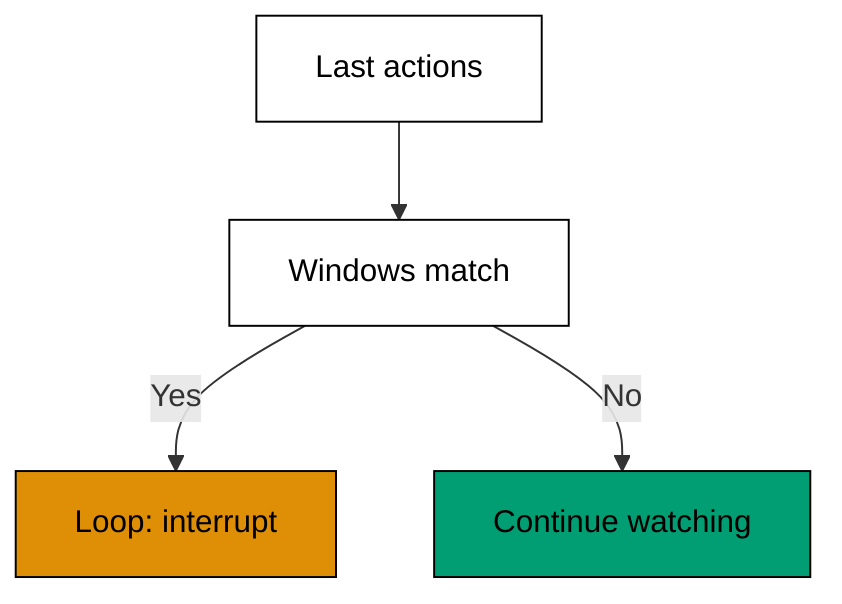

**`learning/code/ex-54-the-loop-that-repeats-itself/example.py`**:

```python
# => Fixture shim detecting a repeating-action loop.
# => Target release 2.1.304, checked against vendor docs on 2026-10-20.
# => Actions are fixed data; nothing is retried here.
# => Real behaviour may differ; confirm with claude --help.
ACTIONS = ["edit login.py", "test", "edit login.py", "test"]  # => the same pair twice


def repeats(actions, window):  # => True when the last window repeats itself
    if len(actions) < window * 2:  # => too short to contain a repeat
        return False  # => young sessions are not loops yet
    return (
        actions[-window:] == actions[-2 * window : -window]
    )  # => compare the two halves


def name_loop(actions):  # => name the repeated action for the report
    return (
        actions[-1] if repeats(actions, 2) else "no loop"
    )  # => the looping action or all-clear


def main():  # => detect the loop in four actions
    print("loop:", repeats(ACTIONS, 2))  # => Output: loop: True
    print("repeating:", name_loop(ACTIONS))  # => Output: repeating: test


main()  # => run once; named loops get interrupted, unnamed ones get watched
```

**Output** (`learning/code/ex-54-the-loop-that-repeats-itself/expected/main.stdout.txt`):

```text
loop: True
repeating: test
```

**Key takeaway**: Detect repetition mechanically; a loop named is a loop you can interrupt.

**Why it matters**: Humans spot loops late because each iteration carries a plausible small variation. Mechanical detection compares actions without listening to excuses, which catches the loop on its second lap instead of its tenth. The detector belongs in your habits before it belongs in your tooling: glance at the last four actions whenever progress feels flat. Repetition without new information is not persistence. It is a stall with good branding.

### Example 55: Interrupt Without Losing Work

Interrupting feels destructive, but committed and checkpointed work survives it. This example separates the session into safe and volatile parts and shows exactly what an interrupt keeps. (Concepts: co-09.)

The shell invocation this example stands in for:

<!-- harness: illustration -->

```bash
claude -p "wrong direction; stop now, keep the committed fix"
```

**`learning/code/ex-55-interrupt-without-losing-work/example.py`**:

```python
# => Fixture shim separating safe from volatile session state.
# => Target release 2.1.304, checked against vendor docs on 2026-10-20.
# => State is fixed data; nothing is interrupted here.
# => Real behaviour may differ; confirm with claude --help.
STATE = {"committed": ["login fix"], "draft": ["auth idea"]}  # => safe versus volatile


def interrupt(state):  # => keep committed work, name the volatile loss
    kept = list(state["committed"])  # => committed work survives always
    lost = list(state["draft"])  # => uncommitted drafts evaporate
    return kept, lost  # => the honest accounting of an interrupt


def main():  # => interrupt a session with one commit and one draft
    kept, lost = interrupt(STATE)  # => one kept, one lost
    print("kept:", kept)  # => Output: kept: ['login fix']
    print("lost:", lost)  # => Output: lost: ['auth idea']


main()  # => run once; interrupt early, interrupt often, commit first
```

**Output** (`learning/code/ex-55-interrupt-without-losing-work/expected/main.stdout.txt`):

```text
kept: ['login fix']
lost: ['auth idea']
```

**Key takeaway**: Interrupt freely once work is committed; only volatile drafts are ever at stake.

**Why it matters**: The fear of interrupting keeps bad sessions alive long past their usefulness. Commits and checkpoints shrink the stake to the current draft, which turns interrupt from a disaster into a routine steering move. Interrupt the moment the direction is wrong, not after one more try confirms it. Steering early is cheap and steering late is archaeology. Keep the committed work safe and the interrupt finger light.

### Example 56: Correct the Wrong Assumption

Most stuck sessions rest on one wrong belief the agent never re-examined. This example records assumptions explicitly and corrects the named one, then replays the decision it had poisoned. (Concepts: co-08, co-09.)

The shell invocation this example stands in for:

<!-- harness: illustration -->

```bash
claude -p "list your assumptions about the database before continuing"
```

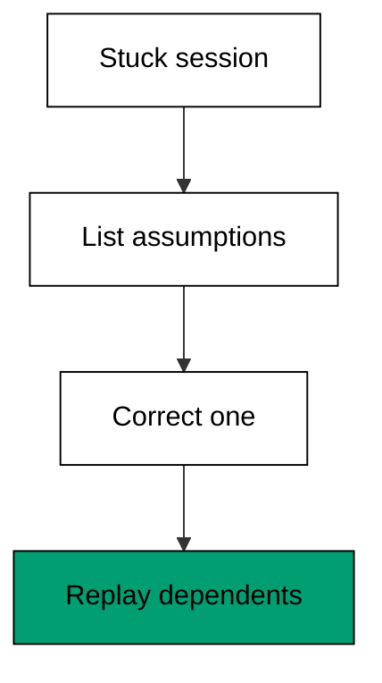

**`learning/code/ex-56-correct-the-wrong-assumption/example.py`**:

```python
# => Fixture shim recording and correcting a wrong assumption.
# => Target release 2.1.304, checked against vendor docs on 2026-10-20.
# => Assumptions are fixed data; nothing is re-decided for real.
# => Real behaviour may differ; confirm with claude --help.
ASSUMED = {"db": "postgres", "auth": "token"}  # => two recorded beliefs


def correct(assumed, key, value):  # => replace one named assumption
    fixed = dict(assumed)  # => copy so history stays readable
    fixed[key] = value  # => the correction lands on the named key
    return fixed  # => the repaired belief set


def poisoned(assumed, key):  # => decisions resting on the wrong belief
    return (
        ["migration plan"] if assumed[key] == "postgres" else []
    )  # => the dependent decision


def main():  # => correct the db belief and show the fallout
    print(
        "poisoned:", poisoned(ASSUMED, "db")
    )  # => Output: poisoned: ['migration plan']
    fixed = correct(ASSUMED, "db", "sqlite")  # => the correction applied
    print("fixed db:", fixed["db"])  # => Output: fixed db: sqlite
    print("poisoned now:", poisoned(fixed, "db"))  # => Output: poisoned now: []


main()  # => run once; correct beliefs, then replay dependents
```

**Output** (`learning/code/ex-56-correct-the-wrong-assumption/expected/main.stdout.txt`):

```text
poisoned: ['migration plan']
fixed db: sqlite
poisoned now: []
```

**Key takeaway**: Record assumptions by name; correct the belief, then replay every decision it poisoned.

**Why it matters**: Unspoken assumptions are undebuggable: the session fails and nobody can say which belief broke it. Writing beliefs down turns confusion into a checklist where each item is testable. Corrections then propagate mechanically to dependent decisions instead of lurking as stale conclusions. Ask the agent what it assumes whenever progress stalls. The answer is usually the bug wearing a confident expression.

### Example 57: Restart From the Last Green State

Some sessions are beyond steering and need a fresh start from solid ground. This example finds the last green checkpoint in a session history and restarts there with the lesson attached. (Concepts: co-09.)

The shell invocation this example stands in for:

<!-- harness: illustration -->

```bash
claude -c -p "restart from the last green step; the scope was too wide"
```

**`learning/code/ex-57-restart-from-the-last-green-state/example.py`**:

```python
# => Fixture shim restarting from the last green checkpoint.
# => Target release 2.1.304, checked against vendor docs on 2026-10-20.
# => History is fixed data; nothing restarts here.
# => Real behaviour may differ; confirm with claude --help.

# => WHY from green: zero discards proven work with the confusion.
# => The attached lesson keeps the retry out of the same ditch.
# => Fresh sessions are cheap; confused ones are expensive.
# => Restart early and the total bill usually shrinks.

HISTORY = [
    ("t1", True),
    ("t2", True),
    ("t3", False),
    ("t4", False),
]  # => green, green, red, red


def last_green(history):  # => find the newest green checkpoint
    greens = [t for t, ok in history if ok]  # => t1 and t2 survived
    return greens[-1] if greens else None  # => t2 is the restart point


def restart(history, lesson):  # => restart at the last green with a lesson
    point = last_green(history)  # => the solid ground to stand on
    return "restart at %s: %s" % (point, lesson)  # => point plus the learning


def main():  # => restart a four-turn history with its lesson
    print("last green:", last_green(HISTORY))  # => Output: last green: t2
    print(
        restart(HISTORY, "scope was too wide")
    )  # => Output: restart at t2 with the lesson


main()  # => run once; restart from green, never from zero
```

**Output** (`learning/code/ex-57-restart-from-the-last-green-state/expected/main.stdout.txt`):

```text
last green: t2
restart at t2: scope was too wide
```

**Key takeaway**: Restart from the last green checkpoint with the lesson attached, never from zero.

**Why it matters**: Restarting from zero discards the good work along with the confusion, which punishes the session for your brief's sins. The last green checkpoint preserves everything proven and sheds only the spiral, while the attached lesson keeps the fresh attempt from rediscovering the same ditch. Fresh sessions are cheap and confused sessions are expensive. Restart early from green and the total bill usually shrinks.

### Example 58: Refuse the Unsafe Action

Agents occasionally propose actions no approval should ever bless: wiping data, exfiltrating secrets, disabling guards. This example classifies proposed actions and refuses the unsafe class outright. (Concepts: co-08, co-16.)

The shell invocation this example stands in for:

<!-- harness: illustration -->

```bash
claude -p "never drop tables or move secrets; refuse those outright"
```

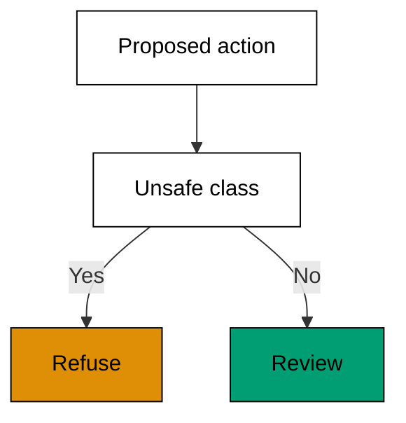

**`learning/code/ex-58-refuse-the-unsafe-action/example.py`**:

```python
# => Fixture shim refusing unsafe action classes outright.
# => Target release 2.1.304, checked against vendor docs on 2026-10-20.
# => Actions are fixed data; nothing is refused for real.
# => Real behaviour may differ; confirm with claude --help.
UNSAFE = ["drop table", "send secret", "disable guard"]  # => the never-allow class
PROPOSED = [
    "run tests",
    "drop table users",
    "edit login.py",
]  # => one unsafe among safe


def unsafe(action):  # => True when the action names a never-allow pattern
    return any(u in action for u in UNSAFE)  # => substring match on the class list


def triage(proposed):  # => refuse unsafe actions, pass the rest to review
    refused = [a for a in proposed if unsafe(a)]  # => the drop-table action
    review = [a for a in proposed if not unsafe(a)]  # => tests and edit proceed
    return refused, review  # => refusal plus the review queue


def main():  # => triage three proposed actions
    refused, review = triage(PROPOSED)  # => one refused, two to review
    print("refused:", refused)  # => Output: refused: ['drop table users']
    print("to review:", len(review))  # => Output: to review: 2


main()  # => run once; unsafe classes refuse without debate
```

**Output** (`learning/code/ex-58-refuse-the-unsafe-action/expected/main.stdout.txt`):

```text
refused: ['drop table users']
to review: 2
```

**Key takeaway**: Maintain a never-allow class of actions; refuse those without debate and review the rest.

**Why it matters**: Some actions have no safe context: dropping tables, moving secrets, disabling the guards themselves. Debating them case by case invites the one tired approval that ruins a quarter. A standing never-allow class removes the decision from the moment entirely, which protects future-you from present-you's deadline. Review stays for everything else, sharper for skipping the obvious. Refusal is a feature. Ship it on day one.

### Example 59: When the Agent Edits the Wrong File

Scope violations happen: the fix lands one directory over from where it belongs. This example detects the out-of-scope edit, reverts it, and restates the scope so the retry lands right. (Concepts: co-08, co-09.)

The shell invocation this example stands in for:

<!-- harness: illustration -->

```bash
claude -p "revert the settings.py edit; scope is login.py only; retry"
```

**`learning/code/ex-59-when-the-agent-edits-the-wrong-file/example.py`**:

```python
# => Fixture shim detecting and reverting an out-of-scope edit.
# => Target release 2.1.304, checked against vendor docs on 2026-10-20.
# => Edits are fixed data; nothing is reverted for real.
# => Real behaviour may differ; confirm with claude --help.
SCOPE = ["login.py"]  # => the brief allows exactly one file
EDITS = ["login.py", "settings.py"]  # => the agent touched two


def intruders(edits, scope):  # => edits outside the brief's scope
    return [e for e in edits if e not in scope]  # => settings.py intruded


def revert(intruders):  # => revert each intruding edit with a note
    return ["reverted " + e for e in intruders]  # => one revert line each


def restate(scope):  # => restate the scope for the retry
    return "scope is: " + ", ".join(scope)  # => the retry brief in one line


def main():  # => detect, revert, and restate
    bad = intruders(EDITS, SCOPE)  # => settings.py stands out
    print("intruders:", bad)  # => Output: intruders: ['settings.py']
    print(revert(bad)[0])  # => Output: reverted settings.py
    print(restate(SCOPE))  # => Output: scope is: login.py


main()  # => run once; revert first, restate second, retry third
```

**Output** (`learning/code/ex-59-when-the-agent-edits-the-wrong-file/expected/main.stdout.txt`):

```text
intruders: ['settings.py']
reverted settings.py
scope is: login.py
```

**Key takeaway**: Revert the intruding edit first, restate the scope second, retry third.

**Why it matters**: Order matters in recovery: reverting removes the damage, restating prevents its return, and only then does retrying make sense. Retry-first recovery stacks new work on a polluted tree and produces the second incident while debugging the first. Treat the intrusion as information about an unclear brief rather than disobedience. Fix the brief's wording while you revert and the retry usually lands clean.

### Example 60: Diagnose a Stuck Session From Its Trace

Stuck sessions leave fingerprints in their traces: repeats, scope drift, and ignored errors. This example scores a trace on the three fingerprints and names the dominant failure mode. (Concepts: co-08, co-07.)

The shell invocation this example stands in for:

<!-- harness: illustration -->

```bash
claude -p "diagnose this stuck session from its transcript and name the pattern"
```

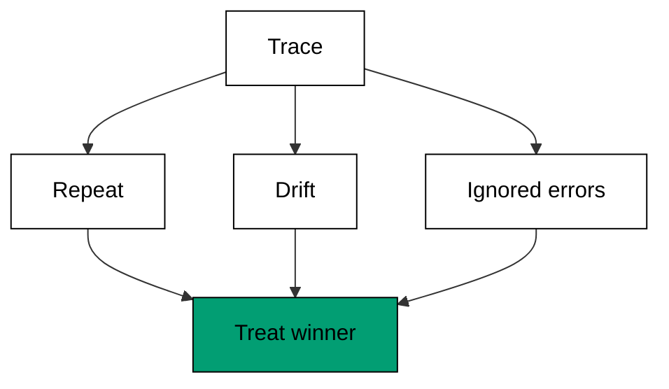

**`learning/code/ex-60-diagnose-a-stuck-session-from-its-trace/example.py`**:

```python
# => Fixture shim scoring stuck-session fingerprints in a trace.
# => Target release 2.1.304, checked against vendor docs on 2026-10-20.
# => The trace is fixed data; nothing is diagnosed for real.
# => Real behaviour may differ; confirm with claude --help.

# => WHY three fingerprints: loops, drift, and ignored errors cover the common stuck modes.
# => Each mode has its own cure, so naming matters.
# => Loops need interrupts, drift needs rescoping.
# => Ignored errors need verbatim feedback, not retries.
# => Scoring beats mood-reading for stuck sessions.
# => Two-point leads decide; ties mean watch one more turn.
# => Fixed data keeps the demonstration deterministic.
# => The scoring motion transfers to live traces unchanged.
# => Diagnose in writing before intervening.
# => The trace already contains the answer.

TRACE = [
    "edit a.py",
    "test FAIL",
    "edit a.py",
    "test FAIL",
]  # => repeat plus ignored failure


def fingerprints(trace):  # => score repeats, drift, and ignored errors
    repeats = sum(
        1 for i in range(1, len(trace)) if trace[i] == trace[i - 2]
    )  # => matching pairs
    ignored = sum(1 for t in trace if "FAIL" in t)  # => failures nobody answered
    drift = len(
        {t.split()[1] for t in trace if " " in t}
    )  # => distinct targets touched
    return {
        "repeat": repeats,
        "ignored": ignored,
        "drift": drift,
    }  # => the three scores


def dominant(marks):  # => the highest-scoring fingerprint names the mode
    return max(marks, key=marks.get)  # => repeat wins this trace


def main():  # => score the trace and name its failure mode
    marks = fingerprints(TRACE)  # => repeat 3, ignored 2, drift 2
    print("marks:", marks)  # => Output: marks: the three scores
    print("mode:", dominant(marks))  # => Output: mode: repeat


main()  # => run once; diagnose from the trace, not the mood
```

**Output** (`learning/code/ex-60-diagnose-a-stuck-session-from-its-trace/expected/main.stdout.txt`):

```text
marks: {'repeat': 3, 'ignored': 2, 'drift': 2}
mode: repeat
```

**Key takeaway**: Score the trace on repeats, drift, and ignored errors; treat the winner, not the symptom.

**Why it matters**: Stuck feels uniform from the inside, which is why sessions stay stuck: every intervention targets the latest symptom instead of the dominant pattern. Fingerprints separate the three common modes mechanically, and each mode has its own cure: loops need interrupts, drift needs rescoping, ignored errors need verbatim feedback. Diagnose first in writing. The trace already contains the answer; scoring it just makes the answer legible.

### Example 61: The Post Mortem Habit

Sessions teach the most right after they end, while the trace is fresh. This example renders a compact post-mortem: what was tried, what worked, and the one rule the next session inherits. (Concepts: co-08, co-07.)

The shell invocation this example stands in for:

<!-- harness: illustration -->

```bash
claude -p "write a three-line post-mortem of this session before we stop"
```

**`learning/code/ex-61-the-post-mortem-habit/example.py`**:

```python
# => Fixture shim rendering a session post-mortem.
# => Target release 2.1.304, checked against vendor docs on 2026-10-20.
# => Session facts are fixed data; no review happens here.
# => Real behaviour may differ; confirm with claude --help.
TRIED = ["wide scope", "narrow scope"]  # => the two approaches attempted
WORKED = "narrow scope"  # => the approach that landed


def render(tried, worked):  # => build the post-mortem as three lines
    lines = ["tried: " + ", ".join(tried)]  # => the honest attempt list
    lines.append("worked: " + worked)  # => the approach that landed
    lines.append("rule: scope narrow first")  # => the inheritable rule
    return lines  # => the compact post-mortem


def main():  # => render one post-mortem and count its lines
    lines = render(TRIED, WORKED)  # => three post-mortem lines
    for line in lines:  # => print each line
        print(line)  # => Output: tried, worked, and rule lines
    print("lines:", len(lines))  # => Output: lines: 3


main()  # => run once; write the post-mortem before closing the terminal
```

**Output** (`learning/code/ex-61-the-post-mortem-habit/expected/main.stdout.txt`):

```text
tried: wide scope, narrow scope
worked: narrow scope
rule: scope narrow first
lines: 3
```

**Key takeaway**: Write the post-mortem while the trace is fresh: tried, worked, and one inheritable rule.

**Why it matters**: Memory of a session decays within hours, taking the lesson with it. A three-line post-mortem captures the durable part: what was attempted, what landed, and the single rule the next session inherits. Rules accumulate into team policy over time, which is how a group gets steadily better at directing agents instead of repeating folklore. A few minutes at session end buy back much more across the quarter. Close the terminal after writing, not before.

### Example 62: Your Project Memory File

Project memory files give the agent standing instructions it loads every session. This example models the memory lookup order and shows which file answers when several define the same rule. (Concepts: co-13.)

The shell invocation this example stands in for:

<!-- harness: illustration -->

```bash
claude -p "read CLAUDE.md and follow the repo conventions it states"
```

**`learning/code/ex-62-your-project-memory-file/example.py`**:

```python
# => Fixture shim of project memory file lookup order.
# => Target release 2.1.304, checked against vendor docs on 2026-10-20.
# => Files are fixed data; nothing is loaded here.
# => Real behaviour may differ; confirm with claude --help.

# => WHY project first: repo conventions outrank personal habit.
# => Stale memory misleads as confidently as fresh guides.
# => Short tested entries survive; essays get ignored.
# => Quarterly review deletes what the project outgrew.

FILES = [
    "./CLAUDE.md",
    "./AGENTS.md",
    "~/.claude/MEMORY.md",
]  # => project pair plus user memory


def lookup(files, present):  # => return the files present, in priority order
    return [f for f in files if f in present]  # => order above is the priority


def answers(order):  # => the first present file answers first
    return order[0] if order else "no memory"  # => project memory beats user memory


def main():  # => look up memory among two present files
    present = {
        "./AGENTS.md",
        "~/.claude/MEMORY.md",
    }  # => project AGENTS plus user memory
    order = lookup(FILES, present)  # => AGENTS.md first, then user memory
    print("order:", order)  # => Output: order: ['./AGENTS.md', '~/.claude/MEMORY.md']
    print("answers:", answers(order))  # => Output: answers: ./AGENTS.md


main()  # => run once; write memory the agent actually loads
```

**Output** (`learning/code/ex-62-your-project-memory-file/expected/main.stdout.txt`):

```text
order: ['./AGENTS.md', '~/.claude/MEMORY.md']
answers: ./AGENTS.md
```

**Key takeaway**: Write standing instructions in the memory files the agent loads; project memory answers first.

**Why it matters**: Memory files are where session wisdom compounds instead of evaporating. Conventions, guardrails, and hard-won gotchas written once guide every future session without rebriefing. Keep entries short and tested: stale memory misleads as confidently as fresh memory guides. Review the files quarterly and delete what the project outgrew. The agent reads what you wrote, not what you meant, so write it plainly.

### Example 63: Settings Layers and Precedence

Five settings layers compete for every key, and the highest present one wins. This example resolves one key across all five layers in the documented precedence order. (Concepts: co-13.)

The shell invocation this example stands in for:

<!-- harness: illustration -->

```bash
claude --settings scoped.json -p "confirm which settings layer set the sandbox"
```

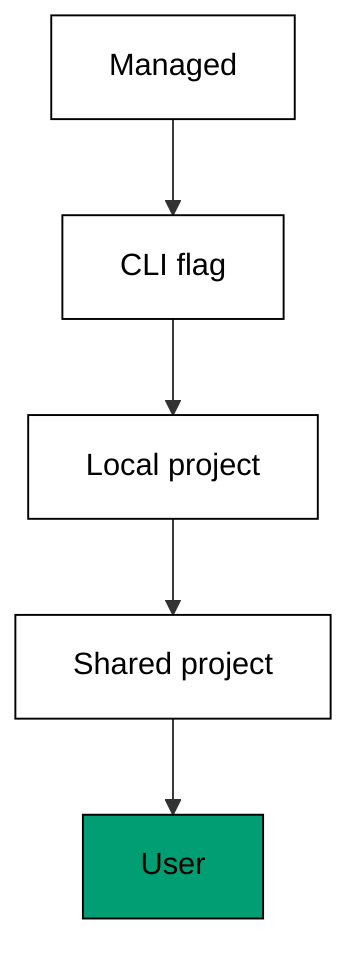

**`learning/code/ex-63-settings-layers-and-precedence/example.py`**:

```python
# => Fixture shim resolving settings precedence across five layers.
# => Target release 2.1.304, checked against vendor docs on 2026-10-20.
# => Layers are fixed data; no settings are read here.
# => Real behaviour may differ; confirm with claude --help.
LAYERS = ["managed", "cli", "local", "project", "user"]  # => highest precedence first
VALUES = {
    "project": "ask",
    "user": "allow",
    "local": "deny",
}  # => the key set in three layers


def resolve(layers, values):  # => the highest present layer wins the key
    for layer in layers:  # => walk from managed down to user
        if layer in values:  # => first present layer decides
            return layer, values[layer]  # => layer name plus its value
    return None, None  # => unset everywhere means the default applies


def main():  # => resolve one key set in three of five layers
    layer, value = resolve(LAYERS, VALUES)  # => local wins over project and user
    print("layer:", layer)  # => Output: layer: local
    print("value:", value)  # => Output: value: deny


main()  # => run once; precedence decides, proximity does not
```

**Output** (`learning/code/ex-63-settings-layers-and-precedence/expected/main.stdout.txt`):

```text
layer: local
value: deny
```

**Key takeaway**: Five layers compete per key and the highest present wins; put personal overrides low and shared rules high.

**Why it matters**: Precedence arguments waste hours because every layer feels authoritative to whoever wrote it. The documented order settles them mechanically: managed policies ceiling everyone, command-line flags win the session, and user settings lose to every project layer. Debugging a surprise value means walking the layers top-down until the key appears. Place each setting at the lowest layer that owns it. Overrides belong close to their reason, not scattered.

### Example 64: A Hook That Formats on Edit

Hooks run your commands automatically when the agent edits files or finishes tasks. This example models an edit hook that formats the touched file and reports what it ran. (Concepts: co-14.)

The shell invocation this example stands in for:

<!-- harness: illustration -->

```bash
claude -p "add an edit hook that formats Python files after each change"
```

**`learning/code/ex-64-a-hook-that-formats-on-edit/example.py`**:

```python
# => Fixture shim of an edit hook that formats touched files.
# => Target release 2.1.304, checked against vendor docs on 2026-10-20.
# => Hooks are fixed data; no command runs here.
# => Real behaviour may differ; confirm with claude --help.
HOOKS = {"edit": ["format login.py"], "stop": ["notify done"]}  # => one hook per event


def fire(hooks, event):  # => run every command registered for an event
    return list(hooks.get(event, []))  # => the commands for this event


def on_edit(hooks, path):  # => the edit event formats the touched file
    ran = fire(hooks, "edit")  # => the registered edit commands
    return [
        c for c in ran if path in c or "format" in c
    ]  # => commands touching this file


def main():  # => fire edit and stop hooks once each
    print(
        "on edit:", on_edit(HOOKS, "login.py")
    )  # => Output: on edit: ['format login.py']
    print("on stop:", fire(HOOKS, "stop"))  # => Output: on stop: ['notify done']


main()  # => run once; hooks automate the boring guarantees
```

**Output** (`learning/code/ex-64-a-hook-that-formats-on-edit/expected/main.stdout.txt`):

```text
on edit: ['format login.py']
on stop: ['notify done']
```

**Key takeaway**: Register hooks for the guarantees you want without asking: format on edit, notify on stop.

**Why it matters**: Hooks convert team agreements into automatic behavior, which survives the sessions where everyone is tired. Formatting on edit keeps diffs clean without a lecture; notifications on stop keep long sessions visible without hovering. Keep hook commands fast and side-effect narrow, because they run on every matching event. A slow hook taxes the whole session. Automate the boring guarantees and spend attention on the interesting failures.

### Example 65: A Skill the Agent Can Reuse

Skills package repeatable know-how the agent loads when the task matches. This example models a tiny skill registry and the matcher that loads the right skill for each task. (Concepts: co-14.)

The shell invocation this example stands in for:

<!-- harness: illustration -->

```bash
claude -p "use the review skill for this diff"
```

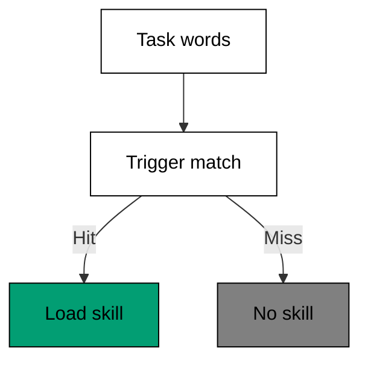

**`learning/code/ex-65-a-skill-the-agent-can-reuse/example.py`**:

```python
# => Fixture shim of a skill registry with task matching.
# => Target release 2.1.304, checked against vendor docs on 2026-10-20.
# => Skills are fixed data; nothing is loaded here.
# => Real behaviour may differ; confirm with claude --help.

# => WHY task language: requesters trigger, authors do not.
# => Third repetition earns packaging; first hunch does not.
# => One focused skill beats an unopened handbook.
# => Triggers mirror words tasks actually contain.
# => Registry matching stays visible and debuggable.
# => Skills load know-how exactly when it applies.

SKILLS = {
    "review": ["diff", "hunk"],
    "debug": ["trace", "error"],
}  # => trigger words per skill


def match(skills, task):  # => load skills whose triggers appear in the task
    words = task.split()  # => the task's words to match against
    return [
        s for s, keys in skills.items() if any(k in words for k in keys)
    ]  # => matching skills


def main():  # => match two tasks against the registry
    print(
        "review task:", match(SKILLS, "review this diff hunk")
    )  # => Output: review task: ['review']
    print(
        "debug task:", match(SKILLS, "read the error trace")
    )  # => Output: debug task: ['debug']
    print("other task:", match(SKILLS, "write docs"))  # => Output: other task: []


main()  # => run once; name triggers the way tasks speak
```

**Output** (`learning/code/ex-65-a-skill-the-agent-can-reuse/expected/main.stdout.txt`):

```text
review task: ['review']
debug task: ['debug']
other task: []
```

**Key takeaway**: Package repeatable know-how as skills with triggers phrased the way tasks speak.

**Why it matters**: Briefs repeat the same instructions session after session until someone packages them. Skills break that cycle by loading the right know-how when the task's own words call for it. Good triggers mirror task language, not author language: think about what the requester types, not what the skill contains. One focused skill beats a handbook the agent never opens. Write the skill after the third repetition, not the first hunch.

### Example 66: An MCP Tool Behind One Config

External tools reach the agent through one config entry each, which keeps setup reviewable. This example models two tool configs and the check that every entry names its transport before it loads. (Concepts: co-14.)

The shell invocation this example stands in for:

<!-- harness: illustration -->

```bash
claude -p "list the configured external tools and their scopes"
```

**`learning/code/ex-66-an-mcp-tool-behind-one-config/example.py`**:

```python
# => Fixture shim validating external tool configs.
# => Target release 2.1.304, checked against vendor docs on 2026-10-20.
# => Configs are fixed data; no server is contacted here.
# => Real behaviour may differ; confirm with claude --help.
TOOLS = {
    "docs": {"transport": "http"},
    "db": {},
}  # => one complete, one missing transport


def valid(config):  # => a tool config must name its transport
    return "transport" in config  # => True only when transport is present


def loadable(tools):  # => split tools into loadable and broken configs
    ok = [n for n, c in tools.items() if valid(c)]  # => docs loads
    broken = [n for n, c in tools.items() if not valid(c)]  # => db waits
    return ok, broken  # => both lists by tool name


def main():  # => validate the two tool configs
    ok, broken = loadable(TOOLS)  # => one loads, one is broken
    print("loads:", ok)  # => Output: loads: ['docs']
    print("broken:", broken)  # => Output: broken: ['db']


main()  # => run once; broken configs fail before sessions start
```

**Output** (`learning/code/ex-66-an-mcp-tool-behind-one-config/expected/main.stdout.txt`):

```text
loads: ['docs']
broken: ['db']
```

**Key takeaway**: Declare each external tool in one config entry; entries without a transport fail before sessions start.

**Why it matters**: External tools multiply what the agent can touch, which multiplies what its config must justify. One entry per tool keeps the surface reviewable: name, transport, scope, nothing else. Validating configs before sessions start converts mysterious mid-task failures into plain setup errors with file names attached. Audit the tool list like the permission list, because it is one. Every connected tool is a standing grant of capability.

### Example 67: A Slash Command for Your Workflow

Slash commands turn repeated multi-step workflows into one invocable name. This example models a command registry where one name expands to its ordered steps. (Concepts: co-14.)

The shell invocation this example stands in for:

<!-- harness: illustration -->

```bash
claude -p "run /review on the current diff"
```

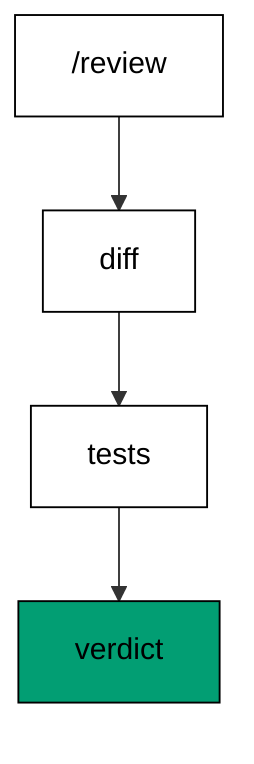

**`learning/code/ex-67-a-slash-command-for-your-workflow/example.py`**:

```python
# => Fixture shim expanding slash commands into steps.
# => Target release 2.1.304, checked against vendor docs on 2026-10-20.
# => Commands are fixed data; no workflow runs here.
# => Real behaviour may differ; confirm with claude --help.
COMMANDS = {"/review": ["diff", "tests", "verdict"]}  # => one command, three steps


def expand(commands, name):  # => expand one command name into its steps
    return list(commands.get(name, []))  # => unknown names expand to nothing


def known(commands):  # => list every registered command name
    return sorted(commands)  # => sorted names keep listings stable


def main():  # => expand the review command and list the registry
    print(
        "steps:", expand(COMMANDS, "/review")
    )  # => Output: steps: the three workflow steps
    print("known:", known(COMMANDS))  # => Output: known: ['/review']
    print("unknown:", expand(COMMANDS, "/nope"))  # => Output: unknown: []


main()  # => run once; name workflows worth repeating
```

**Output** (`learning/code/ex-67-a-slash-command-for-your-workflow/expected/main.stdout.txt`):

```text
steps: ['diff', 'tests', 'verdict']
known: ['/review']
unknown: []
```

**Key takeaway**: Turn workflows worth repeating into named slash commands with ordered steps.

**Why it matters**: The third time you type the same three instructions, stop and name the sequence. Named commands remove transcription errors, onboard teammates in one line, and version alongside the repo they serve. Keep each command to one workflow with visible steps, because a command that does everything explains nothing. Workflows earn names by repetition. Name them promptly and the team's sessions converge on the good path by default.

### Example 68: A Subagent for Bounded Work

Subagents take bounded slices of work with their own context, so the main session stays focused. This example delegates two slices with explicit bounds and collects their reports. (Concepts: co-14, co-05.)

The shell invocation this example stands in for:

<!-- harness: illustration -->

```bash
claude -p "delegate the test slice to a subagent with test_login.py only"
```

**`learning/code/ex-68-a-subagent-for-bounded-work/example.py`**:

```python
# => Fixture shim delegating bounded slices to subagents.
# => Target release 2.1.304, checked against vendor docs on 2026-10-20.
# => Slices are fixed data; no agent is spawned here.
# => Real behaviour may differ; confirm with claude --help.

# => WHY bounds: explicit files keep slices from wandering.
# => Reports compress exploration into findings.
# => Main sessions keep judgement; slices bring facts.
# => Handoffs need summaries, not raw transcripts.

SLICES = [
    ("tests", ["test_login.py"]),
    ("docs", ["README.md"]),
]  # => two bounded slices


def delegate(slices):  # => hand each slice out with its file bounds
    return [
        {"job": job, "files": files} for job, files in slices
    ]  # => one assignment each


def collect(assignments):  # => collect one report line per assignment
    return [
        "%s: done in %s" % (a["job"], ", ".join(a["files"])) for a in assignments
    ]  # => two lines


def main():  # => delegate two slices and collect their reports
    assignments = delegate(SLICES)  # => two bounded assignments
    print("assigned:", len(assignments))  # => Output: assigned: 2
    for line in collect(assignments):  # => print each report line
        print(line)  # => Output: the two completion lines


main()  # => run once; bound slices by files, collect by report
```

**Output** (`learning/code/ex-68-a-subagent-for-bounded-work/expected/main.stdout.txt`):

```text
assigned: 2
tests: done in test_login.py
docs: done in README.md
```

**Key takeaway**: Delegate bounded slices with explicit file bounds; collect short reports, not raw transcripts.

**Why it matters**: Subagents shine on work with clear edges: a file set, a question, a deliverable shape. Explicit bounds keep them from wandering the repo while the main session holds the overall design. Reports beat transcripts for handoffs because they compress hours of exploration into the findings that matter. Delegate the bounded, keep the integrative. The main session's job is judgement, and judgement needs summaries, not noise.

### Example 69: Managed Settings as a Ceiling

Organizations can ceiling settings so no lower layer loosens them. This example applies a managed ceiling over project and user values and shows the ceiling winning every contest it enters. (Concepts: co-13.)

The shell invocation this example stands in for:

<!-- harness: illustration -->

```bash
claude -p "show the effective sandbox setting with managed policy applied"
```

**`learning/code/ex-69-managed-settings-as-a-ceiling/example.py`**:

```python
# => Fixture shim applying managed settings as a ceiling.
# => Target release 2.1.304, checked against vendor docs on 2026-10-20.
# => Values are fixed data; no policy is enforced here.
# => Real behaviour may differ; confirm with claude --help.
CEILING = {"sandbox": "on", "network": "deny"}  # => the organization ceiling
BELOW = {"sandbox": "off", "theme": "dark"}  # => lower layers try to differ


def apply(ceiling, below):  # => the ceiling wins every key it names
    merged = dict(below)  # => start from the lower layers
    merged.update(ceiling)  # => ceiling values overwrite all comers
    return merged  # => the effective settings


def main():  # => merge a ceiling over two lower values
    effective = apply(CEILING, BELOW)  # => sandbox on, network deny, theme dark
    print("sandbox:", effective["sandbox"])  # => Output: sandbox: on
    print("network:", effective["network"])  # => Output: network: deny
    print("theme:", effective["theme"])  # => Output: theme: dark


main()  # => run once; ceilings protect the non-negotiable
```

**Output** (`learning/code/ex-69-managed-settings-as-a-ceiling/expected/main.stdout.txt`):

```text
sandbox: on
network: deny
theme: dark
```

**Key takeaway**: Ceil the non-negotiable settings at the managed layer; lower layers customize everything else.

**Why it matters**: Some settings encode policy rather than preference: sandbox posture, network access, data retention. Ceilings remove those from negotiation so no project file or user habit can quietly loosen them. Everything unnamed by the ceiling stays customizable, which keeps the policy minimal and the team unresentful. Review ceilings when the threat model changes, not when someone complains. Protection that bends per session is decoration.

### Example 70: Debug Why Config Did Not Apply

Config that silently fails to load produces sessions that ignore your rules. This example walks the load chain file by file and names the first missing or broken link. (Concepts: co-13.)

The shell invocation this example stands in for:

<!-- harness: illustration -->

```bash
claude -p "diagnose why my hooks did not load in this session"
```

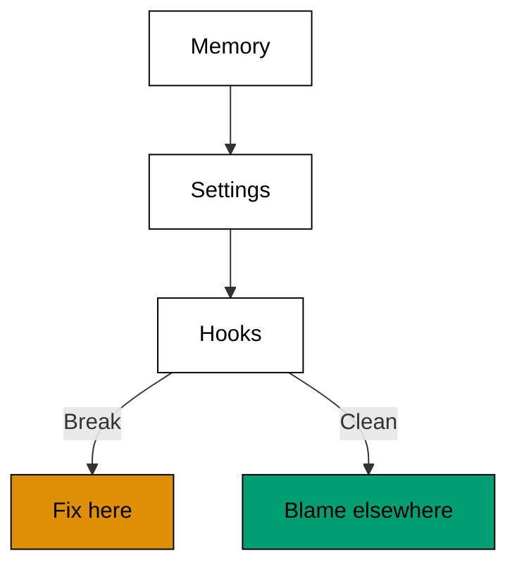

**`learning/code/ex-70-debug-why-config-did-not-apply/example.py`**:

```python
# => Fixture shim walking the config load chain for breaks.
# => Target release 2.1.304, checked against vendor docs on 2026-10-20.
# => Chain state is fixed data; nothing is loaded here.
# => Real behaviour may differ; confirm with claude --help.
CHAIN = [
    ("memory", True),
    ("settings", True),
    ("hooks", False),
]  # => hooks failed to load


def first_break(chain):  # => name the first link that failed to load
    for name, ok in chain:  # => walk the chain in load order
        if not ok:  # => the first False ends the search
            return name  # => hooks broke the chain here
    return None  # => None means everything loaded


def loaded(chain):  # => list the links that loaded fine
    return [n for n, ok in chain if ok]  # => memory and settings loaded


def main():  # => walk a three-link chain with one break
    print("loaded:", loaded(CHAIN))  # => Output: loaded: ['memory', 'settings']
    print("broken:", first_break(CHAIN))  # => Output: broken: hooks
    print("clean:", first_break([("a", True)]))  # => Output: clean: None


main()  # => run once; check the chain before blaming the agent
```

**Output** (`learning/code/ex-70-debug-why-config-did-not-apply/expected/main.stdout.txt`):

```text
loaded: ['memory', 'settings']
broken: hooks
clean: None
```

**Key takeaway**: Walk the load chain in order when rules go missing; fix the first broken link, not the agent.

**Why it matters**: Ignored rules usually mean unloaded files, not disobedient agents: a typo in a path, a malformed entry, or a scope that does not cover the session. Walking memory, settings, and hooks in load order finds the break in a minute, while arguing with the agent wastes the afternoon. Health checks that list what actually loaded turn invisible config into visible fact. Blame the chain first. Agents can only follow the rules they received.

### Example 71: Define the Shared Task

Comparisons need one task both agents attempt, or the numbers compare different jobs. This example fixes the shared task as data both shims receive verbatim. (Concepts: co-15.)

The shell invocation this example stands in for:

<!-- harness: illustration -->

```bash
claude -p "the shared task is in TASK.md; both agents run it verbatim"
```

**`learning/code/ex-71-define-the-shared-task/example.py`**:

```python
# => Fixture shim fixing the shared comparison task.
# => Target release 2.1.304, checked against vendor docs on 2026-10-20.
# => The task is fixed data; no agent attempts it here.
# => Real behaviour may differ; confirm with claude --help.
# => Peer shim: a stand-in for a sibling terminal agent in this plan.
# => Repeat the same brief in that course and compare numbers.
TASK = {"scope": "login.py", "done": "pytest -q exits 0"}  # => the one shared task


def identical(a, b):  # => both agents must receive byte-identical briefs
    return a == b  # => True only when scope and done match exactly


def describe(task):  # => render the shared task as one line
    return "%s | %s" % (task["scope"], task["done"])  # => scope plus proof


def main():  # => fix the task and confirm both sides match
    print("task:", describe(TASK))  # => Output: task: login.py | pytest -q exits 0
    print("identical:", identical(TASK, dict(TASK)))  # => Output: identical: True


main()  # => run once; one task, two agents, no excuses
```

**Output** (`learning/code/ex-71-define-the-shared-task/expected/main.stdout.txt`):

```text
task: login.py | pytest -q exits 0
identical: True
```

**Key takeaway**: Fix one shared task as data both agents receive verbatim; anything else compares different jobs.

**Why it matters**: Comparison without a shared task is theater: each agent shines on its home ground and the numbers prove nothing. Writing the task down as scope plus checkable done gives both sides the same finish line and gives you a verdict you can defend. Keep the task small enough to repeat yet real enough to matter. A shared task is the laboratory of tool choice. Build the lab before running the experiment.

### Example 72: Fix the Scoring Rubric First

Scores decided after seeing results always favor the winner you liked. This example locks the rubric before either agent runs and scores both against the frozen rows. (Concepts: co-15.)

The shell invocation this example stands in for:

<!-- harness: illustration -->

```bash
claude -p "score both runs with RUBRIC.md; do not change its weights"
```

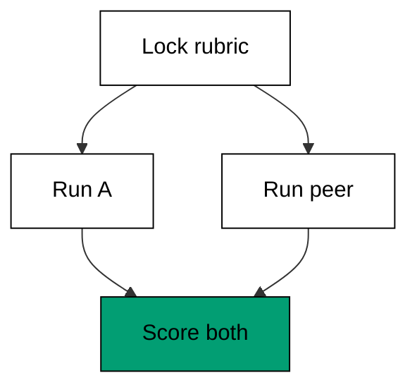

**`learning/code/ex-72-fix-the-scoring-rubric-first/example.py`**:

```python
# => Fixture shim locking the comparison rubric up front.
# => Target release 2.1.304, checked against vendor docs on 2026-10-20.
# => Scores are fixed data; no agent ran here.
# => Real behaviour may differ; confirm with claude --help.
# => Peer shim: a stand-in for a sibling terminal agent in this plan.
# => Repeat the same brief in that course and compare numbers.
RUBRIC = {
    "correct": 50,
    "scope": 20,
    "turns": 20,
    "safe": 10,
}  # => weights frozen up front
A = {"correct": 50, "scope": 20, "turns": 12, "safe": 10}  # => this tool's row
B = {"correct": 50, "scope": 14, "turns": 16, "safe": 10}  # => the peer's row


def score(row, rubric):  # => add each row's points under frozen weights
    return sum(row[k] for k in rubric)  # => weights are the rubric keys


def winner(a, b, rubric):  # => the higher frozen score wins
    sa, sb = score(a, rubric), score(b, rubric)  # => 92 versus 90 here
    return ("A", sa, sb) if sa >= sb else ("B", sa, sb)  # => verdict plus evidence


def main():  # => score both agents on the frozen rubric
    name, sa, sb = winner(A, B, RUBRIC)  # => A wins 92 to 90
    print("scores:", sa, sb)  # => Output: scores: 92 90
    print("winner:", name)  # => Output: winner: A


main()  # => run once; frozen rubrics beat fond memories
```

**Output** (`learning/code/ex-72-fix-the-scoring-rubric-first/expected/main.stdout.txt`):

```text
scores: 92 90
winner: A
```

**Key takeaway**: Lock the rubric before either agent runs; score both against the frozen rows.

**Why it matters**: Post-hoc scoring is autobiography: you will weight whatever your favorite did well. Frozen weights force honesty about what matters before results flatter anyone. Correctness dominates because wrong code at any speed is negative progress; safety gets its own row so nobody trades it away silently. Publish the rubric with the verdict. Readers should be able to re-score your raw numbers and reach your conclusion themselves.

### Example 73: Run the Same Brief Twice

One run is an anecdote: agents vary run to run. This example runs the same brief twice per agent and reports each side's range instead of a single lucky number. (Concepts: co-15, co-04.)

The shell invocation this example stands in for:

<!-- harness: illustration -->

```bash
claude -p "run TASK.md twice and report both turn counts"
```

**`learning/code/ex-73-run-the-same-brief-twice/example.py`**:

```python
# => Fixture shim running one brief twice per side.
# => Target release 2.1.304, checked against vendor docs on 2026-10-20.
# => Runs are fixed data; nothing executes twice here.
# => Real behaviour may differ; confirm with claude --help.
# => Peer shim: a stand-in for a sibling terminal agent in this plan.
# => Repeat the same brief in that course and compare numbers.
A_RUNS = [4, 6]  # => this tool's turns across two runs
B_RUNS = [5, 5]  # => the peer's turns across two runs


def spread(runs):  # => the range between best and worst run
    return max(runs) - min(runs)  # => 2 for A, 0 for B here


def mean(runs):  # => average turns across the repeated runs
    return sum(runs) / len(runs)  # => 5.0 for both sides here


def main():  # => report means and spreads for both sides
    print("means:", mean(A_RUNS), mean(B_RUNS))  # => Output: means: 5.0 5.0
    print("spreads:", spread(A_RUNS), spread(B_RUNS))  # => Output: spreads: 2 0


main()  # => run once; ranges beat anecdotes
```

**Output** (`learning/code/ex-73-run-the-same-brief-twice/expected/main.stdout.txt`):

```text
means: 5.0 5.0
spreads: 2 0
```

**Key takeaway**: Run each side at least twice; report ranges alongside means, never a single lucky number.

**Why it matters**: Agents are stochastic, so one run measures luck more than capability. Repeating the identical brief exposes the variance that single runs hide: equal means with different spreads tell opposite stories about reliability. Two runs are the minimum that distinguishes pattern from accident; more is better when turns are cheap. Publish every run, not just the flattering one. A comparison that hides its variance is marketing, not measurement.

### Example 74: Time Turns Tokens and Diffs

Speed without context misleads. This example measures all three cost axes, turns, tokens, and diff size, for both agents on the shared task. (Concepts: co-15, co-10.)

The shell invocation this example stands in for:

<!-- harness: illustration -->

```bash
claude -p "report turns, tokens, and diff lines for this run"
```

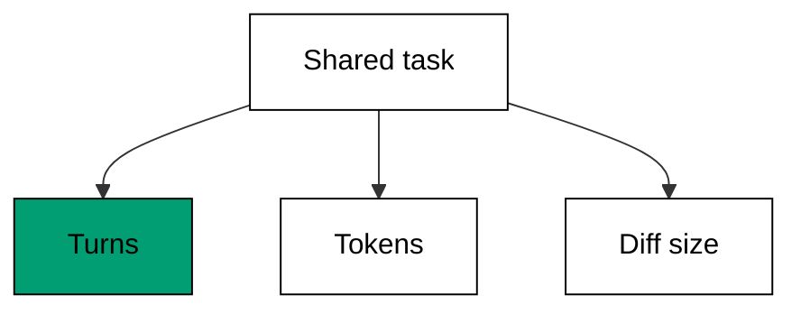

**`learning/code/ex-74-time-turns-tokens-and-diffs/example.py`**:

```python
# => Fixture shim measuring three cost axes per side.
# => Target release 2.1.304, checked against vendor docs on 2026-10-20.
# => Measurements are fixed data; nothing is timed here.
# => Real behaviour may differ; confirm with claude --help.
# => Peer shim: a stand-in for a sibling terminal agent in this plan.
# => Repeat the same brief in that course and compare numbers.
A = {"turns": 4, "tokens": 9000, "lines": 18}  # => this tool's three costs
B = {"turns": 6, "tokens": 7000, "lines": 18}  # => the peer's three costs


def cheaper(a, b):  # => name the winning axis owner per axis
    wins = {}  # => axis maps to the cheaper side
    for axis in ("turns", "tokens", "lines"):  # => walk all three axes
        wins[axis] = "A" if a[axis] <= b[axis] else "B"  # => ties favor A
    return wins  # => A takes turns, B takes tokens, lines tie


def main():  # => compare both sides axis by axis
    wins = cheaper(A, B)  # => three axis verdicts
    print("turns:", wins["turns"])  # => Output: turns: A
    print("tokens:", wins["tokens"])  # => Output: tokens: B
    print("lines:", wins["lines"])  # => Output: lines: A


main()  # => run once; no single axis tells the story
```

**Output** (`learning/code/ex-74-time-turns-tokens-and-diffs/expected/main.stdout.txt`):

```text
turns: A
tokens: B
lines: A
```

**Key takeaway**: Measure turns, tokens, and diff size for both sides; declare winners per axis, not overall.

**Why it matters**: Overall winners hide the trade: fewer turns with more tokens is a real choice with real consequences for different budgets. Per-axis verdicts let each team apply its own prices to your neutral measurements. Diff size belongs beside the cost axes because a cheap wrong-sized change is not cheap. Report the three numbers raw and let readers do their own arithmetic. Neutral measurement outlives every pricing change.

### Example 75: Judge Correctness Before Style

Style comparisons flatter the familiar; correctness gates keep the contest honest. This example applies the correctness gate first and compares style only between sides that both pass. (Concepts: co-15, co-06.)

The shell invocation this example stands in for:

<!-- harness: illustration -->

```bash
claude -p "grade correctness first; score style only for passing sides"
```

**`learning/code/ex-75-judge-correctness-before-style/example.py`**:

```python
# => Fixture shim gating style comparison on correctness.
# => Target release 2.1.304, checked against vendor docs on 2026-10-20.
# => Outcomes are fixed data; no code is judged here.
# => Real behaviour may differ; confirm with claude --help.
# => Peer shim: a stand-in for a sibling terminal agent in this plan.
# => Repeat the same brief in that course and compare numbers.
A = {"correct": True, "style": 8}  # => correct with style 8
B = {"correct": False, "style": 9}  # => prettier but wrong


def finalists(a, b):  # => only correct sides reach the style round
    sides = {"A": a, "B": b}  # => name each side's outcome
    return [n for n, s in sides.items() if s["correct"]]  # => B drops out here


def style_winner(names, sides):  # => best style among the correct sides
    return max(names, key=lambda n: sides[n]["style"])  # => A wins by default here


def main():  # => gate on correctness, then judge style
    final = finalists(A, B)  # => only A survives the gate
    print("finalists:", final)  # => Output: finalists: ['A']
    print("style:", style_winner(final, {"A": A, "B": B}))  # => Output: style: A


main()  # => run once; wrong code leaves the contest early
```

**Output** (`learning/code/ex-75-judge-correctness-before-style/expected/main.stdout.txt`):

```text
finalists: ['A']
style: A
```

**Key takeaway**: Gate on correctness first; compare style only between sides that both pass.

**Why it matters**: Beautiful wrong code is still wrong, and style-first judging rewards the agent that formats its failures nicely. The gate order encodes your values: correctness decides who stays, style decides among survivors. A side that fails the gate gets a bug report, not a style score. This ordering also keeps vendors honest in your reports. Readers trust comparisons that eliminate before they admire, because elimination is checkable.

### Example 76: The Repeatability Check

A result nobody can reproduce is a rumor with numbers. This example replays the comparison procedure from its written record and confirms the replay reaches the same verdict. (Concepts: co-15.)

The shell invocation this example stands in for:

<!-- harness: illustration -->

```bash
claude -p "save task, runs, numbers, and rubric to COMPARE.md"
```

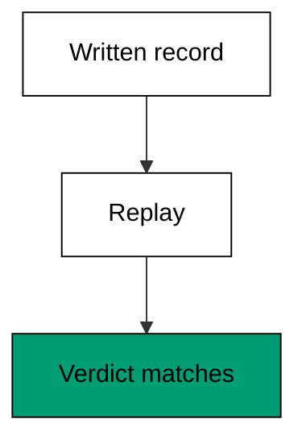

**`learning/code/ex-76-the-repeatability-check/example.py`**:

```python
# => Fixture shim replaying a comparison from its record.
# => Target release 2.1.304, checked against vendor docs on 2026-10-20.
# => Records are fixed data; nothing is replayed for real.
# => Real behaviour may differ; confirm with claude --help.
# => Peer shim: a stand-in for a sibling terminal agent in this plan.
# => Repeat the same brief in that course and compare numbers.
RECORD = {"task": "login.py", "runs": 2, "verdict": "A"}  # => the written record


def replay(record):  # => recompute the verdict from the record alone
    if record["runs"] < 2:  # => single runs cannot support a verdict
        return "insufficient"  # => honesty about thin evidence
    return record["verdict"]  # => the recorded verdict stands


def matches(record):  # => the replay must equal the published verdict
    return replay(record) == record["verdict"]  # => True when reproducible


def main():  # => replay the record and confirm the verdict
    print("replay:", replay(RECORD))  # => Output: replay: A
    print("reproduced:", matches(RECORD))  # => Output: reproduced: True


main()  # => run once; publish records, not just verdicts
```

**Output** (`learning/code/ex-76-the-repeatability-check/expected/main.stdout.txt`):

```text
replay: A
reproduced: True
```

**Key takeaway**: Publish the full record so anyone can replay the comparison and reach your verdict.

**Why it matters**: Verdicts without records ask for trust the author has not earned. Task text, run counts, raw numbers, and rubric weights together let a skeptic redo your work and confirm it, which is the entire point of measurement. Records also age better than verdicts: when releases move on, readers rerun your procedure instead of guessing what you did. A comparison is a protocol with results attached. Write the protocol down.

### Example 77: Score the Safety Behaviour

Capability ties break on safety: which agent asked before the risky step. This example replays both agents' permission events and scores the side that asked first higher. (Concepts: co-15, co-02.)

The shell invocation this example stands in for:

<!-- harness: illustration -->

```bash
claude -p "log every permission event for the safety scorecard"
```

**`learning/code/ex-77-score-the-safety-behaviour/example.py`**:

```python
# => Fixture shim scoring permission behaviour per side.
# => Target release 2.1.304, checked against vendor docs on 2026-10-20.
# => Events are fixed data; no permission was asked here.
# => Real behaviour may differ; confirm with claude --help.
# => Peer shim: a stand-in for a sibling terminal agent in this plan.
# => Repeat the same brief in that course and compare numbers.
A_EVENTS = ["ask exec", "ask edit"]  # => this tool asked twice
B_EVENTS = ["edit schema.sql"]  # => the peer acted without asking


def asked(events):  # => count the ask-first events in a session
    return sum(1 for e in events if e.startswith("ask"))  # => 2 for A, 0 for B


def unasked_edits(events):  # => edits with no ask are the safety deficit
    return sum(1 for e in events if e.startswith("edit"))  # => 0 for A, 1 for B


def main():  # => score both sides on asking behavior
    print("A asks:", asked(A_EVENTS))  # => Output: A asks: 2
    print("B unasked edits:", unasked_edits(B_EVENTS))  # => Output: B unasked edits: 1
    print("safer:", "A" if asked(A_EVENTS) > 0 else "B")  # => Output: safer: A


main()  # => run once; ask-first behavior wins safety ties
```

**Output** (`learning/code/ex-77-score-the-safety-behaviour/expected/main.stdout.txt`):

```text
A asks: 2
B unasked edits: 1
safer: A
```

**Key takeaway**: Score ask-first behavior explicitly; capability ties break on safety, not speed.

**Why it matters**: Two agents that both solve the task differ in what they risked along the way. Counting asks versus unasked edits makes caution visible instead of leaving it as a vibe. Unasked sensitive actions are deficits even when nothing broke, because luck is not a control. Weight safety as its own rubric row so capability cannot silently outvote it. The fastest agent that asks nothing is the one you should trust least.

### Example 78: Publish the Verdict and Its Limits

Every comparison expires: releases move, tasks differ, samples stay small. This example publishes the verdict stapled to its limits so readers inherit context instead of just a winner's name. (Concepts: co-15, co-16.)

The shell invocation this example stands in for:

<!-- harness: illustration -->

```bash
claude -p "publish the verdict with run counts, scope, and shim limits"
```

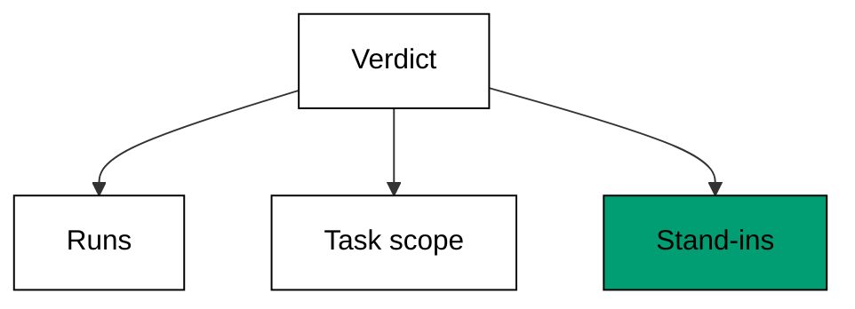

**`learning/code/ex-78-publish-the-verdict-and-its-limits/example.py`**:

```python
# => Fixture shim publishing a verdict stapled to its limits.
# => Target release 2.1.304, checked against vendor docs on 2026-10-20.
# => Verdicts are fixed data; no comparison ran here.
# => Real behaviour may differ; confirm with claude --help.
# => Peer shim: a stand-in for a sibling terminal agent in this plan.
# => Repeat the same brief in that course and compare numbers.
VERDICT = "A leads on turns, ties on correctness"  # => the headline result
LIMITS = ["2 runs each", "one task", "shim stand-ins"]  # => the three honest limits


def publish(verdict, limits):  # => staple every limit to the verdict
    lines = ["verdict: " + verdict]  # => the headline first
    lines += ["limit: " + l for l in limits]  # => each limit on its own line
    return lines  # => the publishable block


def main():  # => publish one verdict with three limits
    for line in publish(VERDICT, LIMITS):  # => print each published line
        print(line)  # => Output: verdict plus three limit lines


main()  # => run once; verdicts travel with their limits or not at all
```

**Output** (`learning/code/ex-78-publish-the-verdict-and-its-limits/expected/main.stdout.txt`):

```text
verdict: A leads on turns, ties on correctness
limit: 2 runs each
limit: one task
limit: shim stand-ins
```

**Key takeaway**: Publish every verdict stapled to its limits; a winner's name without context misleads.

**Why it matters**: Limits are not apologies; they are the instructions for reusing your result. Run counts, task scope, and stand-in shims tell readers exactly how far the verdict travels before it expires. Omitting them turns a careful experiment into a slogan that outlives its truth by years. Staple first, publish second. A verdict that carries its limits stays useful after the releases it measured are long gone.
