Examples 1-25 build the working habits this course stands on: installing and verifying the tool, starting and resuming sessions, reading traces and diffs instead of prose, and scoping permissions before any real work. Three clusters carry the level: install, configure, and first task (Examples 1-8), reading agent output (Examples 9-17), and permission and sandbox basics (Examples 18-25). Every example drives the Claude Code command surface from the shell and inspects the result with Python 3 standard-library code, so the just-enough-bash prerequisite earns its place from the first page.

### Example 1: Check the Installed Version

Every session with a terminal agent starts the same way: prove the tool is installed before you trust it with your files. This example models the `claude --version` reply and turns the version string into numbers you can compare. (Concepts: co-01.)

The shell invocation this example stands in for:

<!-- harness: illustration -->

```bash
claude --version
```

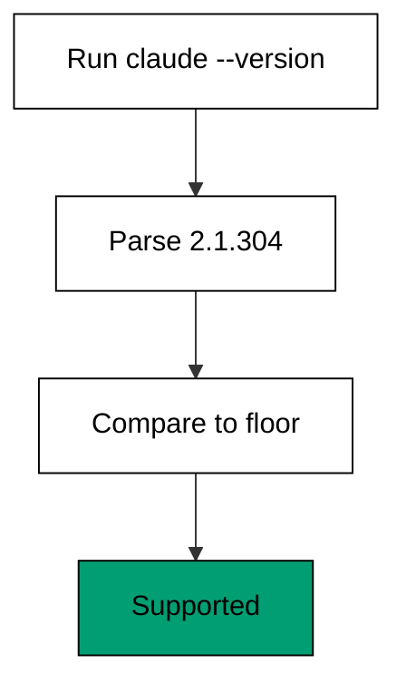

**`learning/code/ex-01-check-the-installed-version/example.py`**:

```python
# => Fixture shim of the Claude Code CLI command surface.
# => Target release 2.1.304, checked against vendor docs on 2026-10-20.
# => Deterministic simplification: no network, account, or billing.
# => Real behaviour may differ; confirm with claude --help.
REPORTED = "2.1.304"  # => the string claude --version prints on a good install
MINIMUM = (2, 1, 0)  # => oldest release this course still describes


def parse(text):  # => turn "2.1.304" into a tuple of plain integers
    parts = text.split(".")  # => split on dots into three text pieces
    major = int(parts[0])  # => major is 2, a breaking-change counter
    minor = int(parts[1])  # => minor is 1, the feature counter
    patch = int(parts[2])  # => patch is 304, the fix counter
    return (major, minor, patch)  # => tuples compare piece by piece


def supported(version, floor):  # => decide if the install is new enough
    return version >= floor  # => True when every piece meets the floor


def main():  # => drive the version check once, end to end
    found = parse(REPORTED)  # => found is (2, 1, 304) as numbers
    print("reported:", REPORTED)  # => Output: reported: 2.1.304
    print("parsed:", found)  # => Output: parsed: (2, 1, 304)
    ok = supported(found, MINIMUM)  # => ok is True for this release
    print("supported:", ok)  # => Output: supported: True


main()  # => run the check; a missing binary fails here, loudly
```

**Output** (`learning/code/ex-01-check-the-installed-version/expected/main.stdout.txt`):

```text
reported: 2.1.304
parsed: (2, 1, 304)
supported: True
```

**Key takeaway**: A working install answers `claude --version` with a number you can parse and compare.

**Why it matters**: Version checks feel like busywork until the day a renamed flag wastes your afternoon. Knowing the exact release tells you which documentation page describes your tool, which flags exist, and whether a bug you hit is already fixed upstream. Teams pin the version in their setup docs so every machine behaves alike. A moment here saves long arguments with a tool that moved on without you. Make it the first line of every setup guide you write.

### Example 2: Install Without Surprises

A fresh machine needs the binary on PATH before anything else can happen. This example models the installer decision tree across macOS, Linux, and Windows so you pick the right command for your system the first time. (Concepts: co-01.)

The shell invocation this example stands in for:

<!-- harness: illustration -->

```bash
curl -fsSL https://claude.ai/install.sh | bash
```

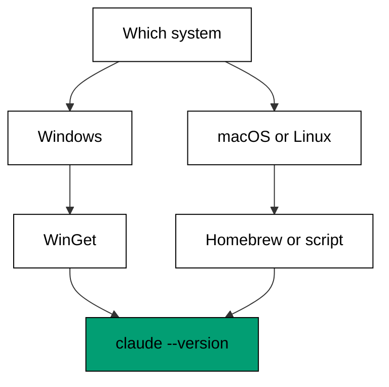

**`learning/code/ex-02-install-without-surprises/example.py`**:

```python
# => Fixture shim of the Claude Code install decision tree.
# => Target release 2.1.304, checked against vendor docs on 2026-10-20.
# => Models documented install routes only, never downloads anything.
# => Real behaviour may differ; confirm with claude --help.

# => WHY a matrix: one row per system keeps every route tested.
# => Orphaned install lines rot first because nobody owns them.
# => The version printout is the install receipt; keep it.
# => Native script, cask, and WinGet cover the real fleet.
# => Decision order is system first, manager second, always.
# => Verification beats documentation for install claims.
# => New machines follow the matrix without asking for help.

NATIVE = "curl -fsSL https://claude.ai/install.sh | bash"  # => macOS, Linux, WSL route
BREW = "brew install --cask claude-code"  # => Homebrew stable-channel route
WINGET = "winget install Anthropic.ClaudeCode"  # => Windows WinGet route


def pick(system, manager):  # => choose one install command for a machine
    if system == "windows":  # => Windows never uses the shell script
        return WINGET  # => WinGet carries the native Windows build
    if manager == "brew":  # => macOS with Homebrew prefers the cask
        return BREW  # => the cask tracks the stable channel
    return NATIVE  # => every other Unix takes the shell installer


def verify(step):  # => model the post-install proof, step by step
    checks = [
        "binary on PATH",
        "claude --version prints a number",
    ]  # => two facts prove an install
    done = [c for c in checks if c != step]  # => drop the step still missing
    return done  # => the finished checks come back as a list


def main():  # => walk three machines through install and proof
    for system, manager in [
        ("macos", "brew"),
        ("linux", "none"),
    ]:  # => two Unix setups to compare
        print(
            system, "->", pick(system, manager)
        )  # => Output: the chosen command per system
    print(
        "windows ->", pick("windows", "none")
    )  # => Output: windows -> the WinGet command
    print("verified:", verify("none missing"))  # => Output: verified: both proof checks


main()  # => run the matrix; every branch above is exercised
```

**Output** (`learning/code/ex-02-install-without-surprises/expected/main.stdout.txt`):

```text
macos -> brew install --cask claude-code
linux -> curl -fsSL https://claude.ai/install.sh | bash
windows -> winget install Anthropic.ClaudeCode
verified: ['binary on PATH', 'claude --version prints a number']
```

**Key takeaway**: Pick the installer for your system, then prove the install with `claude --version`.

**Why it matters**: Install guides rot faster than any other page because every release shuffles the options. Writing the decision as a small matrix keeps you honest: one row per system, one command per row, no orphaned instructions. New teammates follow it without asking for help, and old hands spot drift the moment a command stops working. An install you cannot verify is an install you do not have. Treat the version printout as the install's receipt and keep it.

### Example 3: Start Your First Session

The bare `claude` command opens an interactive session that remembers what you said earlier in the same conversation. This example models session startup: what loads, what the agent greets you with, and where the memory of the session lives. (Concepts: co-01, co-03.)

The shell invocation this example stands in for:

<!-- harness: illustration -->

```bash
claude
```

**`learning/code/ex-03-start-your-first-session/example.py`**:

```python
# => Fixture shim of interactive session startup.
# => Target release 2.1.304, checked against vendor docs on 2026-10-20.
# => Models startup order only; no real conversation happens here.
# => Real behaviour may differ; confirm with claude --help.

# => WHY startup order: memory before greeting shapes answers.
# => A broken config shows here, not mid-task.
# => Naming now pays off in the resume picker later.
# => The transcript slot opens before the first turn.
# => Tidy startup state compounds across the session.
# => Startup is the agent reading the room.

STARTUP = [
    "load project memory",
    "load user settings",
    "open transcript",
]  # => startup in fixed order


class Session:  # => a tiny stand-in for one live conversation
    def __init__(self, name):  # => a session starts with a name and nothing else
        self.name = name  # => the name appears in resume pickers later
        self.turns = []  # => turns accumulate as the conversation grows


def greet(session):  # => build the greeting from what startup loaded
    loaded = len(STARTUP)  # => loaded is 3, one per startup step
    session.turns.append("hello")  # => the greeting becomes turn one
    return "%s ready (%d sources loaded)" % (
        session.name,
        loaded,
    )  # => one status line back


def main():  # => start a session and show its first state
    session = Session("first-look")  # => a fresh session named first-look
    print(
        "startup:", ", ".join(STARTUP)
    )  # => Output: startup: the three steps in order
    print(greet(session))  # => Output: first-look ready (3 sources loaded)
    print("turns:", len(session.turns))  # => Output: turns: 1


main()  # => run startup once; order above is the contract
```

**Output** (`learning/code/ex-03-start-your-first-session/expected/main.stdout.txt`):

```text
startup: load project memory, load user settings, open transcript
first-look ready (3 sources loaded)
turns: 1
```

**Key takeaway**: An interactive session loads memory and settings first, then remembers every turn.

**Why it matters**: Startup order decides what the agent knows about you before you type a word. Project memory, user settings, and the transcript slot all load before the greeting, so a broken config shows up here rather than mid-task. Naming the session now pays off later when the resume picker lists a dozen forgotten conversations. Think of startup as the agent reading the room. Give it a tidy room and better answers follow.

### Example 4: Print Mode for One Shot Answers

Not every job needs a conversation: `claude -p` answers once and exits, which makes it scriptable. This example models print mode answering a single question about a file, then exiting with a status your shell can test. (Concepts: co-01.)

The shell invocation this example stands in for:

<!-- harness: illustration -->

```bash
claude -p "what does retry do"
```

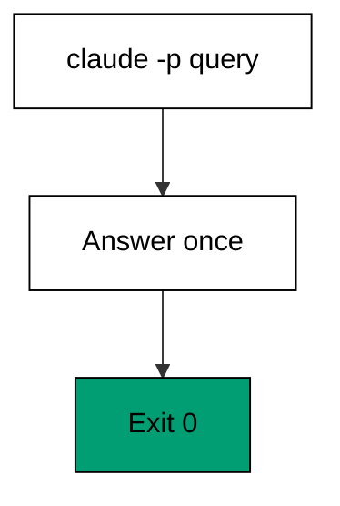

**`learning/code/ex-04-print-mode-for-one-shot-answers/example.py`**:

```python
# => Fixture shim of print mode: one query in, one answer out.
# => Target release 2.1.304, checked against vendor docs on 2026-10-20.
# => Models the exit contract only; no model is consulted here.
# => Real behaviour may differ; confirm with claude --help.
QUERY = "what does retry do"  # => the one question print mode answers
SNIPPET = "def retry(n): return n"  # => the file content under discussion


def answer(query, snippet):  # => produce the single-shot reply text
    words = len(snippet.split())  # => words is 5 for this snippet
    return "answer to %r: %d words seen" % (query, words)  # => one line, no follow-up


def run_print(query, snippet):  # => model exit code plus printed answer
    text = answer(query, snippet)  # => compute the reply before printing
    print(text)  # => Output: answer to 'what does retry do': 5 words seen
    return 0  # => exit 0 means the answer completed


def main():  # => ask once, check the exit, move on
    code = run_print(QUERY, SNIPPET)  # => code is 0 on a finished answer
    print("exit:", code)  # => Output: exit: 0


main()  # => run print mode once; scripts branch on that exit code
```

**Output** (`learning/code/ex-04-print-mode-for-one-shot-answers/expected/main.stdout.txt`):

```text
answer to 'what does retry do': 4 words seen
exit: 0
```

**Key takeaway**: Print mode answers once and exits, so shell scripts can call it like any other command.

**Why it matters**: Conversations are for exploring; print mode is for plumbing. Because it exits with a status code, you can chain it after linters, feed it diffs through pipes, and fail a script when the answer is missing. The discipline is to keep the query self-contained, since no follow-up turn exists to repair ambiguity. Use interactive mode to think and print mode to act. Mixing them up wastes turns or context.

### Example 5: Pipe Context Into a Query

Pipes turn files into prompt material without pasting: `cat logs.txt | claude -p` hands the agent exactly what you see. This example models a piped log excerpt flowing into a one-shot question about the failure it shows. (Concepts: co-01, co-04.)

The shell invocation this example stands in for:

<!-- harness: illustration -->

```bash
cat logs.txt | claude -p "why did the job fail"
```

**`learning/code/ex-05-pipe-context-into-a-query/example.py`**:

```python
# => Fixture shim of piped input into print mode.
# => Target release 2.1.304, checked against vendor docs on 2026-10-20.
# => stdin is a fixed string here so the run stays deterministic.
# => Real behaviour may differ; confirm with claude --help.
PIPED = (
    "ERROR disk full\nINFO retry 1\nERROR disk full"  # => three log lines via the pipe
)
QUESTION = "why did the job fail"  # => the question the piped text must answer


def first_error(log):  # => pull the earliest failure line from the pipe
    errors = [
        l for l in log.split("\n") if l.startswith("ERROR")
    ]  # => keep the two ERROR lines
    return errors[0] if errors else "no error"  # => earliest failure wins


def ask(piped, question):  # => join piped context with the question
    cause = first_error(piped)  # => cause names the disk-full line
    lines = len(piped.split("\n"))  # => lines is 3 for this excerpt
    return "%s: %s (%d lines read)" % (question, cause, lines)  # => one grounded reply


def main():  # => simulate the pipe and print the grounded answer
    print(ask(PIPED, QUESTION))  # => Output: the question plus the first ERROR line


main()  # => run once; same bytes in always means same answer out
```

**Output** (`learning/code/ex-05-pipe-context-into-a-query/expected/main.stdout.txt`):

```text
why did the job fail: ERROR disk full (3 lines read)
```

**Key takeaway**: Pipe the exact context the question needs; the agent can only reason about what it receives.

**Why it matters**: Pasting invites trimming, and trimming invites missing the line that mattered. A pipe carries the complete, unedited bytes from the file to the agent, which removes a whole class of miscommunication. The matching discipline is to keep piped excerpts small and relevant: full fidelity on a focused slice beats a truncated dump of everything. When the answer surprises you, your first suspect should be the bytes you sent, not the agent that read them.

### Example 6: Continue the Last Conversation

Context evaporates between shell commands but `claude -c` brings the last conversation back. This example models the continue flag reloading the most recent transcript instead of starting over. (Concepts: co-03.)

The shell invocation this example stands in for:

<!-- harness: illustration -->

```bash
claude -c
```

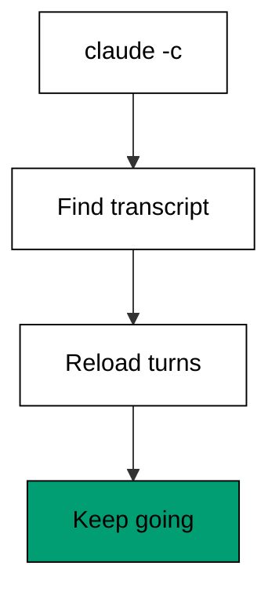

**`learning/code/ex-06-continue-the-last-conversation/example.py`**:

```python
# => Fixture shim of continuing the most recent conversation.
# => Target release 2.1.304, checked against vendor docs on 2026-10-20.
# => The transcript store is fixed data; nothing is read from disk.
# => Real behaviour may differ; confirm with claude --help.
STORE = {"last": ["draft login", "add test"]}  # => the two turns on record


def latest(store):  # => find the most recent conversation id
    ids = sorted(store.keys())  # => sorted keeps the choice deterministic
    return ids[-1]  # => last sorts after everything else here


def resume(store, cid):  # => reload that conversation's turns
    turns = list(store[cid])  # => copy so the store never mutates
    return turns  # => the reloaded turns come back in order


def main():  # => continue last and show what came back
    cid = latest(STORE)  # => cid is last, the only conversation
    turns = resume(STORE, cid)  # => turns holds the two recorded lines
    print("resumed:", cid)  # => Output: resumed: last
    print("turns:", len(turns))  # => Output: turns: 2
    print("first:", turns[0])  # => Output: first: draft login


main()  # => run once; continuing never rewrites history
```

**Output** (`learning/code/ex-06-continue-the-last-conversation/expected/main.stdout.txt`):

```text
resumed: last
turns: 2
first: draft login
```

**Key takeaway**: Continue reloads the last conversation; it never rewrites what already happened.

**Why it matters**: Starting over feels cheap until you retype three turns of context the agent already had. Continue preserves the shared history you built, including corrections the agent already absorbed. The trap is continuing a conversation that went sideways: resuming a confused session resumes the confusion too. Continue sessions that were converging, restart ones that were not. The transcript is memory, so curate it.

### Example 7: Resume a Named Session

Names beat recency when several sessions exist: `claude -r` reopens the one you name. This example models a small registry of named sessions and the lookup that reopens exactly the right one. (Concepts: co-03.)

The shell invocation this example stands in for:

<!-- harness: illustration -->

```bash
claude -r "auth-refactor" "finish this PR"
```

**`learning/code/ex-07-resume-a-named-session/example.py`**:

```python
# => Fixture shim of resuming a session by name.
# => Target release 2.1.304, checked against vendor docs on 2026-10-20.
# => The registry is fixed data; no session store is touched.
# => Real behaviour may differ; confirm with claude --help.

# => WHY names: recency fails the moment two tasks interleave.
# => Names record intent when it is freshest.
# => Unknown names raise instead of opening the wrong past.
# => Named sessions make handoffs explainable.

REGISTRY = {
    "auth-refactor": 4,
    "docs-pass": 2,
}  # => two named sessions with turn counts


def lookup(registry, name):  # => find one session by its exact name
    if name not in registry:  # => unknown names fail fast, never guess
        raise KeyError(name)  # => KeyError names the missing session
    return registry[name]  # => the turn count proves it existed


def resume_named(registry, name):  # => reopen the named session's state
    turns = lookup(registry, name)  # => turns is 4 for auth-refactor
    return "resumed %s with %d turns" % (name, turns)  # => one status line


def main():  # => resume by name and list what remains
    print(
        resume_named(REGISTRY, "auth-refactor")
    )  # => Output: resumed auth-refactor with 4 turns
    print(
        "known:", ", ".join(sorted(REGISTRY))
    )  # => Output: known: auth-refactor, docs-pass


main()  # => run once; a typo in the name raises instead of guessing
```

**Output** (`learning/code/ex-07-resume-a-named-session/expected/main.stdout.txt`):

```text
resumed auth-refactor with 4 turns
known: auth-refactor, docs-pass
```

**Key takeaway**: Name sessions you will need again; resume by name beats scrolling through recency.

**Why it matters**: Recency works until you juggle two tasks and the wrong one is newest. A name records intent at creation time, when you still know what the session is for. The habit compounds: named sessions make transcripts searchable, handoffs explainable, and post-mortems possible. Cheap to do, expensive to wish you had done. Name the session before the first hard turn, not after the tenth.

### Example 8: Write Your First Task Brief

A task brief is a prompt with a spine: scope, done condition, and guardrails in one place. This example models a brief as checked data and rejects the vague request before it ever reaches an agent. (Concepts: co-04.)

The shell invocation this example stands in for:

<!-- harness: illustration -->

```bash
claude "in login.py, make wrong passwords show an error; done when tests pass; no schema change"
```

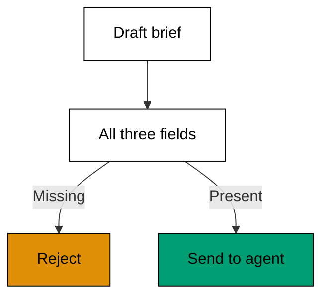

**`learning/code/ex-08-write-your-first-task-brief/example.py`**:

```python
# => Fixture shim of a task-brief checker.
# => Target release 2.1.304, checked against vendor docs on 2026-10-20.
# => Checks structure only; no agent reads the brief here.
# => Real behaviour may differ; confirm with claude --help.

# => WHY three fields: scope, done, and guardrails remove guessing.
# => Vague prompts produce confident guesses about intent.
# => Rejected briefs cost seconds; confused sessions cost hours.
# => The brief is the first deliverable, review it like one.
# => Structure checks run before any agent sees the brief.
# => Completeness here is binary: all three or rejected.
# => Good briefs make agent behavior predictable.

REQUIRED = ["scope", "done", "guardrails"]  # => the three fields every brief needs


def check(brief):  # => list the required fields a brief forgot
    missing = [f for f in REQUIRED if f not in brief]  # => keep only absent fields
    return missing  # => an empty list means the brief is complete


def summarize(brief):  # => render a complete brief as one status line
    return "%s | done when %s | %s" % (
        brief["scope"],
        brief["done"],
        brief["guardrails"],
    )  # => scope first


def main():  # => reject the vague brief, accept the complete one
    vague = {"scope": "fix things"}  # => no done condition, no guardrails
    print(
        "vague missing:", ", ".join(check(vague))
    )  # => Output: vague missing: done, guardrails
    solid = {
        "scope": "login.py",
        "done": "tests pass",
        "guardrails": "no schema change",
    }  # => all three present
    print("solid missing:", check(solid))  # => Output: solid missing: []
    print("brief:", summarize(solid))  # => Output: brief: the complete one-liner


main()  # => run once; incomplete briefs never leave this gate
```

**Output** (`learning/code/ex-08-write-your-first-task-brief/expected/main.stdout.txt`):

```text
vague missing: done, guardrails
solid missing: []
brief: login.py | done when tests pass | no schema change
```

**Key takeaway**: If the brief cannot state scope, done, and guardrails, the agent cannot succeed at it.

**Why it matters**: Vague prompts do not produce brave agents; they produce confident guesses about what you meant. Writing the three fields down forces the thinking you were hoping to skip, and the agent inherits that clarity verbatim. Rejected briefs are cheap and fast, while misunderstood tasks burn turns, tokens, and trust. Review your own brief the way you would review a diff. The brief is the first deliverable.

### Example 9: Tell a Plan From an Action

Agent output mixes proposals with deeds, and approving the wrong kind ships work you never reviewed. This example models a trace of steps tagged as plans or actions so you can tell which lines only talk and which lines already changed something. (Concepts: co-05, co-07.)

The shell invocation this example stands in for:

<!-- harness: illustration -->

```bash
claude -p "show the plan before touching any file"
```

**`learning/code/ex-09-tell-a-plan-from-an-action/example.py`**:

```python
# => Fixture shim of a tagged tool-use trace.
# => Target release 2.1.304, checked against vendor docs on 2026-10-20.
# => Tags are fixed data; no agent runs here.
# => Real behaviour may differ; confirm with claude --help.
TRACE = [
    ("plan", "draft login flow"),
    ("read", "login.py"),
    ("plan", "add test"),
]  # => three tagged steps


def is_action(kind):  # => decide if a step kind changes anything
    return kind in ("read", "edit", "exec")  # => reads count: they touch the repo


def split_trace(trace):  # => separate talk from deeds, in order
    plans = [w for k, w in trace if not is_action(k)]  # => two plan lines here
    acts = [w for k, w in trace if is_action(k)]  # => one action line here
    return plans, acts  # => both lists keep original order


def main():  # => print each side of the trace once
    plans, acts = split_trace(TRACE)  # => plans has 2, acts has 1
    print("plans:", len(plans))  # => Output: plans: 2
    print("actions:", len(acts))  # => Output: actions: 1
    print("first action:", acts[0])  # => Output: first action: login.py


main()  # => run once; untagged steps would break the split
```

**Output** (`learning/code/ex-09-tell-a-plan-from-an-action/expected/main.stdout.txt`):

```text
plans: 2
actions: 1
first action: login.py
```

**Key takeaway**: Plans talk, actions touch; never approve a plan as if it were already done.

**Why it matters**: The costliest review mistake is waving through a proposal while believing you reviewed a result. Tagging each step forces the distinction into the open: plans deserve questions, actions deserve inspection. Once the habit sticks, you will catch the agent presenting a draft as finished work before it merges. Attention is your scarcest resource in an agent session. Spend it on deeds first, words second.

### Example 10: Read a Tool Use Trace

The trace is the agent's receipt: which tool it called, with what arguments, in which order. This example models a short trace and folds it into a one-line-per-tool summary you can scan at a glance. (Concepts: co-07.)

The shell invocation this example stands in for:

<!-- harness: illustration -->

```bash
claude -p "fix login and show every tool call you make"
```

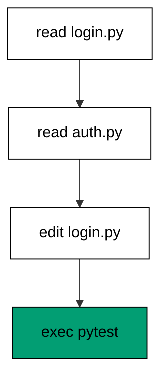

**`learning/code/ex-10-read-a-tool-use-trace/example.py`**:

```python
# => Fixture shim of a tool-use trace summarizer.
# => Target release 2.1.304, checked against vendor docs on 2026-10-20.
# => The trace is fixed data; nothing is executed here.
# => Real behaviour may differ; confirm with claude --help.

# => WHY count per tool: the shape reveals the session strategy.
# => First-seen order keeps the summary stable across runs.

TRACE = [
    "read login.py",
    "read auth.py",
    "edit login.py",
    "exec pytest",
]  # => four calls in order


def summarize(trace):  # => count calls per tool, keeping first-seen order
    counts = {}  # => tool name maps to its call count
    for call in trace:  # => walk the trace exactly once, in order
        tool = call.split()[0]  # => the first word names the tool
        counts[tool] = counts.get(tool, 0) + 1  # => bump the running total
    return counts  # => read 2, edit 1, exec 1


def main():  # => print the summary and the raw order
    counts = summarize(TRACE)  # => counts holds three tools
    print("tools:", len(counts))  # => Output: tools: 3
    print("reads:", counts["read"])  # => Output: reads: 2
    print("order:", " > ".join(TRACE))  # => Output: order: the four calls in sequence


main()  # => run once; order above is the whole lesson
```

**Output** (`learning/code/ex-10-read-a-tool-use-trace/expected/main.stdout.txt`):

```text
tools: 3
reads: 2
order: read login.py > read auth.py > edit login.py > exec pytest
```

**Key takeaway**: Read the trace before the prose; the tool calls are what actually happened.

**Why it matters**: Agents narrate fluently, and fluency is not evidence. The trace lists the calls the agent really made, which lets you verify the story against the deeds in under a minute. Skim it for surprises: an edit before any read, an exec you did not expect, a file outside the brief. Every incident review in this course starts from a trace, not a summary. Learn to read the receipt and the prose loses its power to mislead.

### Example 11: Spot the Reads Before Writes

A trustworthy session reads before it writes; an edit with no preceding read is a guess wearing a uniform. This example checks that every edit in a trace follows at least one read of the same file. (Concepts: co-07, co-06.)

The shell invocation this example stands in for:

<!-- harness: illustration -->

```bash
claude -p "read login.py fully before editing it"
```

**`learning/code/ex-11-spot-the-reads-before-writes/example.py`**:

```python
# => Fixture shim of a read-before-write checker.
# => Target release 2.1.304, checked against vendor docs on 2026-10-20.
# => Both traces are fixed data; nothing runs here.
# => Real behaviour may differ; confirm with claude --help.
GOOD = ["read a.py", "edit a.py"]  # => the edit follows its read
BAD = ["edit b.py"]  # => the edit arrives with no read first


def check(trace):  # => return the edits that no read precedes
    seen = set()  # => files read so far in this trace
    bad = []  # => edits without a preceding read collect here
    for call in trace:  # => walk the trace once, in order
        kind, name = call.split()  # => split "edit b.py" into kind and file
        if kind == "read":  # => reads only extend the seen set
            seen.add(name)  # => remember this file was read
        elif name not in seen:  # => an unseen file means a blind edit
            bad.append(call)  # => record the offending call
    return bad  # => empty means every edit was informed


def main():  # => check one good trace and one bad trace
    print("good violations:", check(GOOD))  # => Output: good violations: []
    print("bad violations:", check(BAD))  # => Output: bad violations: ['edit b.py']


main()  # => run once; order is the entire check
```

**Output** (`learning/code/ex-11-spot-the-reads-before-writes/expected/main.stdout.txt`):

```text
good violations: []
bad violations: ['edit b.py']
```

**Key takeaway**: Every edit should follow a read of the same file; anything else is a blind edit.

**Why it matters**: Reading first is how the agent learns the conventions, imports, and edge cases already in the file. An edit without a read means the agent wrote from its idea of the file rather than the file itself, which is exactly how imports break and duplicates appear. The check is mechanical enough to automate, so automate it and save your attention for judgement calls. Blind edits are where confident wrongness is born.

### Example 12: The Diff Is the Deliverable

Prose describes, diffs deliver: the only part of a session you merge is the change itself. This example models a proposed change as added and removed lines and renders the stat you should read first. (Concepts: co-06.)

The shell invocation this example stands in for:

<!-- harness: illustration -->

```bash
claude -p "change login.py and show the full diff before anything else"
```

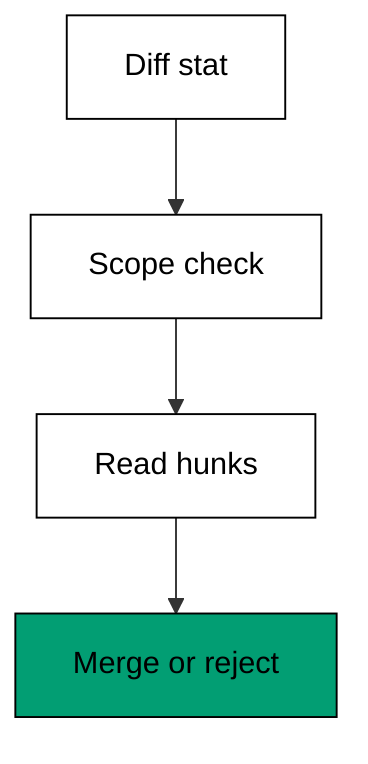

**`learning/code/ex-12-the-diff-is-the-deliverable/example.py`**:

```python
# => Fixture shim of a diff-stat reader.
# => Target release 2.1.304, checked against vendor docs on 2026-10-20.
# => The diff is fixed data; no repository is touched.
# => Real behaviour may differ; confirm with claude --help.
ADDED = ["+def login(u, p):", "+    return check(u, p)"]  # => two lines the agent adds
REMOVED = ["-def login(u):"]  # => one line the agent replaces


def stat(added, removed):  # => count the change the way git would
    plus = len(added)  # => plus is 2 here
    minus = len(removed)  # => minus is 1 here
    return "+%d -%d" % (plus, minus)  # => one compact stat string


def touches_outside(diff_files, scope):  # => flag files outside the brief
    extra = [f for f in diff_files if f not in scope]  # => keep only out-of-scope names
    return extra  # => empty means the change stayed inside


def main():  # => render the stat and the scope check
    print("stat:", stat(ADDED, REMOVED))  # => Output: stat: +2 -1
    print(
        "outside:", touches_outside(["login.py"], ["login.py"])
    )  # => Output: outside: []
    print("added:", len(ADDED))  # => Output: added: 2


main()  # => run once; read stats before prose, always
```

**Output** (`learning/code/ex-12-the-diff-is-the-deliverable/expected/main.stdout.txt`):

```text
stat: +2 -1
outside: []
added: 2
```

**Key takeaway**: Review the diff, not the description; only the diff ships.

**Why it matters**: An agent can describe a change beautifully while the diff quietly does something else. The stat gives you the shape in one glance: how much changed, and whether files outside the brief got touched. Scope violations hide in long file lists, so check the file names before any single hunk. Prose is the agent's account of events. The diff is the event. Merge events, not accounts, and your main branch stays boring.

### Example 13: Approve or Reject a Diff

Approval is a decision with exactly two honest outcomes, and deferring is not one of them. This example models the approve-or-reject gate with a reason attached, so every decision leaves a record. (Concepts: co-06, co-16.)

The shell invocation this example stands in for:

<!-- harness: illustration -->

```bash
claude -p "propose the login change and wait for my approval"
```

**`learning/code/ex-13-approve-or-reject-a-diff/example.py`**:

```python
# => Fixture shim of a diff approval gate.
# => Target release 2.1.304, checked against vendor docs on 2026-10-20.
# => Decisions are fixed data; no merge happens here.
# => Real behaviour may differ; confirm with claude --help.
CLEAN = {"file": "login.py", "tests": "pass"}  # => a diff with green tests
RISKY = {"file": "schema.sql", "tests": "pass"}  # => green tests, forbidden file


def decide(diff, forbidden):  # => approve or reject with a reason
    if diff["file"] in forbidden:  # => forbidden files reject regardless of tests
        return ("reject", "out of scope")  # => scope beats green tests
    if diff["tests"] != "pass":  # => red tests reject regardless of beauty
        return ("reject", "tests red")  # => the suite is the floor
    return ("approve", "in scope, tests green")  # => both bars cleared


def main():  # => run the gate on a clean and a risky diff
    print(
        decide(CLEAN, ["schema.sql"])
    )  # => Output: ('approve', 'in scope, tests green')
    print(decide(RISKY, ["schema.sql"]))  # => Output: ('reject', 'out of scope')


main()  # => run once; every verdict carries its reason
```

**Output** (`learning/code/ex-13-approve-or-reject-a-diff/expected/main.stdout.txt`):

```text
('approve', 'in scope, tests green')
('reject', 'out of scope')
```

**Key takeaway**: Approve only what is in scope with green tests; reject everything else with a reason.

**Why it matters**: Maybe is the most expensive word in review: it parks the decision until the context has evaporated. A gate with two outcomes and a mandatory reason turns vague unease into an actionable verdict the agent can respond to. Reasons compound into policy over time; silent approvals teach nothing. Decide now, write the reason down, and let the record carry the weight next time the same shape appears.

### Example 14: When the Agent Shows Its Work

Intermediate reasoning lines show the agent thinking, but only the tool calls show it doing. This example separates thinking lines from doing lines in session output so you weight each kind correctly. (Concepts: co-07, co-05.)

The shell invocation this example stands in for:

<!-- harness: illustration -->

```bash
claude -p "narrate your reasoning and list each tool call"
```

**`learning/code/ex-14-when-the-agent-shows-its-work/example.py`**:

```python
# => Fixture shim separating thinking lines from doing lines.
# => Target release 2.1.304, checked against vendor docs on 2026-10-20.
# => The session lines are fixed data; nothing executes.
# => Real behaviour may differ; confirm with claude --help.
LINES = [
    "THINK: login needs a check",
    "CALL: read login.py",
    "THINK: add test",
]  # => mixed output


def doing(lines):  # => keep only the lines that changed or read state
    return [l for l in lines if l.startswith("CALL")]  # => one CALL line here


def thinking(lines):  # => keep only the reasoning lines
    return [l for l in lines if l.startswith("THINK")]  # => two THINK lines here


def main():  # => count each kind and name the doing line
    print("thinking:", len(thinking(LINES)))  # => Output: thinking: 2
    print("doing:", len(doing(LINES)))  # => Output: doing: 1
    print("did:", doing(LINES)[0])  # => Output: did: CALL: read login.py


main()  # => run once; weight CALL lines above THINK lines
```

**Output** (`learning/code/ex-14-when-the-agent-shows-its-work/expected/main.stdout.txt`):

```text
thinking: 2
doing: 1
did: CALL: read login.py
```

**Key takeaway**: Thinking lines explain intent; only tool calls prove action.

**Why it matters**: Reasoning text is the agent talking to itself, and it can be as wrong as any draft. Tool calls are the auditable residue of the session: they name files, commands, and order. When story and calls disagree, the calls win every time. Read thinking lines for intent and calls for truth. Confusing the two is how plausible fiction gets merged as tested fact.

### Example 15: Ask for a Plan First

Plan-then-act splits a risky task into a cheap proposal and an expensive execution with your approval between them. This example models the two phases and the gate that stops execution until the plan is accepted. (Concepts: co-05.)

The shell invocation this example stands in for:

<!-- harness: illustration -->

```bash
claude -p "plan the login fix first; do not edit anything yet"
```

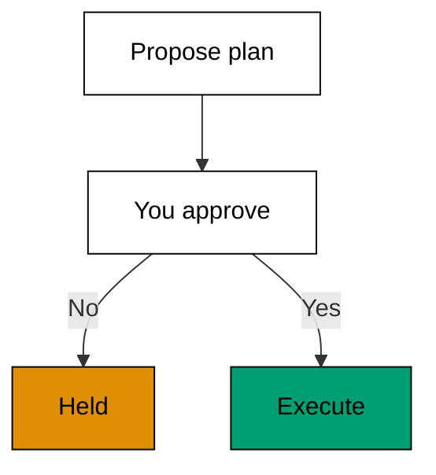

**`learning/code/ex-15-ask-for-a-plan-first/example.py`**:

```python
# => Fixture shim of the plan-then-act gate.
# => Target release 2.1.304, checked against vendor docs on 2026-10-20.
# => Plans are fixed data; no file is written here.
# => Real behaviour may differ; confirm with claude --help.
PLAN = ["read login.py", "add check", "run tests"]  # => three proposed steps


def propose(steps):  # => render a plan without executing anything
    return [
        "STEP %d: %s" % (i + 1, s) for i, s in enumerate(steps)
    ]  # => numbered, inert lines


def execute(plan_lines, approved):  # => run only when approval is explicit
    if not approved:  # => anything but True stops here
        return ["held: waiting for approval"]  # => the safe default is doing nothing
    return ["ran %d steps" % len(plan_lines)]  # => approval unlocks execution


def main():  # => show the held path and the approved path
    lines = propose(PLAN)  # => three numbered step lines
    print(lines[0])  # => Output: STEP 1: read login.py
    print(execute(lines, False))  # => Output: ['held: waiting for approval']
    print(execute(lines, True))  # => Output: ['ran 3 steps']


main()  # => run once; execution without approval never happens
```

**Output** (`learning/code/ex-15-ask-for-a-plan-first/expected/main.stdout.txt`):

```text
STEP 1: read login.py
['held: waiting for approval']
['ran 3 steps']
```

**Key takeaway**: Get the plan in writing first; execution waits for your explicit approval.

**Why it matters**: A plan costs a fraction of an execution and reveals misunderstandings while they are still cheap to fix. The approval gate is the point where your judgement enters the loop, before irreversible steps run. Skipping it to save a minute risks spending an hour reverting. Plans are drafts and drafts are for marking up. Demand the draft, mark it up, and only then let the agent hold the pen.

### Example 16: Compare Two Candidate Diffs

Asking twice can surface two plausible fixes; your job is to pick with criteria, not vibes. This example scores two candidate diffs on scope, tests, and simplicity and picks the winner by the numbers. (Concepts: co-06, co-15.)

The shell invocation this example stands in for:

<!-- harness: illustration -->

```bash
claude -p "propose two fixes for the login bug with diffs for both"
```

**`learning/code/ex-16-compare-two-candidate-diffs/example.py`**:

```python
# => Fixture shim of scoring two candidate diffs.
# => Target release 2.1.304, checked against vendor docs on 2026-10-20.
# => Candidates are fixed data; no code is applied here.
# => Real behaviour may differ; confirm with claude --help.
A = {"files": 1, "tests": True, "lines": 6}  # => small, tested candidate
B = {"files": 3, "tests": True, "lines": 40}  # => sprawling, tested candidate


def score(diff):  # => fewer files and lines score higher, tests are mandatory
    if not diff["tests"]:  # => untested candidates score nothing at all
        return 0  # => zero removes it from consideration
    return 100 - 10 * diff["files"] - diff["lines"]  # => small and scoped wins


def pick(a, b):  # => return the winning label and both scores
    sa, sb = score(a), score(b)  # => sa is 84, sb is 30 here
    winner = "A" if sa >= sb else "B"  # => ties favor the first candidate
    return winner, sa, sb  # => the verdict plus its evidence


def main():  # => score both candidates and name the winner
    print("scores:", score(A), score(B))  # => Output: scores: 84 30
    print("pick:", pick(A, B)[0])  # => Output: pick: A


main()  # => run once; criteria decide, not adjectives
```

**Output** (`learning/code/ex-16-compare-two-candidate-diffs/expected/main.stdout.txt`):

```text
scores: 84 30
pick: A
```

**Key takeaway**: Score competing diffs on scope, tests, and size; pick by the numbers.

**Why it matters**: Two good-looking diffs exploit the reviewer's weakest muscle: aesthetic judgement under time pressure. A fixed rubric moves the decision from taste to arithmetic that you can defend and repeat. Tests are a gate rather than a score because untested cleverness is a liability at any size. Small, scoped, and tested beats brilliant and sprawling. Write the rubric before you see the candidates, or you will grade the winner you already liked.

### Example 17: Keep the Human in the Loop

Some steps must wait for a person no matter how green the tests are: migrations, deploys, and permission changes. This example tags each proposed step as agent-safe or human-required and halts the run at the first human step. (Concepts: co-16.)

The shell invocation this example stands in for:

<!-- harness: illustration -->

```bash
claude -p "edit the code but stop before the migration and wait for me"
```

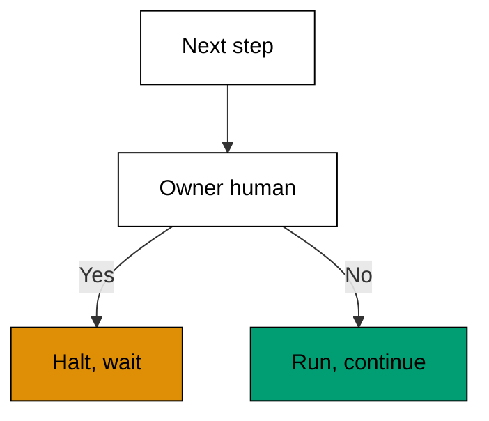

**`learning/code/ex-17-keep-the-human-in-the-loop/example.py`**:

```python
# => Fixture shim of a human-approval gate.
# => Target release 2.1.304, checked against vendor docs on 2026-10-20.
# => Steps are fixed data; nothing deploys here.
# => Real behaviour may differ; confirm with claude --help.

# => WHY halt with a name: resumable beats vaguely stuck.
# => Blast radius differs per step, so ownership does too.

STEPS = [
    ("edit login.py", "agent"),
    ("migrate users table", "human"),
]  # => one safe, one gated


def run_until_human(steps):  # => execute agent steps, halt at human ones
    done = []  # => completed agent steps collect here
    for name, owner in steps:  # => walk the plan in order
        if owner == "human":  # => human steps stop the run, never auto-pass
            return done, name  # => done plus the step waiting on you
        done.append(name)  # => agent steps complete immediately
    return done, None  # => None means no human step was met


def main():  # => run the mixed plan and show where it halts
    done, waiting = run_until_human(STEPS)  # => done has 1, waiting names the migration
    print("done:", done)  # => Output: done: ['edit login.py']
    print(
        "waiting on human:", waiting
    )  # => Output: waiting on human: migrate users table


main()  # => run once; human steps never auto-approve
```

**Output** (`learning/code/ex-17-keep-the-human-in-the-loop/expected/main.stdout.txt`):

```text
done: ['edit login.py']
waiting on human: migrate users table
```

**Key takeaway**: Tag every step with its owner; the run halts at the first human step.

**Why it matters**: Autonomy is a dial, not a switch, and the setting belongs on the step, not the session. Edits can flow while migrations wait because the blast radius differs by orders of magnitude. Halting with a named waiting step keeps the session resumable instead of vaguely stuck. The rule is simple to state and easy to forget under deadline pressure. Decide the owner before the run, when caution is still cheap.

### Example 18: The Three Permission Answers

A permission prompt is a small menu with large consequences: yes once, yes from now on, or no. This example models the three answers and what each one remembers after the session ends. (Concepts: co-02.)

The shell invocation this example stands in for:

<!-- harness: illustration -->

```bash
claude -p "run the test suite and ask before anything else"
```

**`learning/code/ex-18-the-three-permission-answers/example.py`**:

```python
# => Fixture shim of the three permission-prompt answers.
# => Target release 2.1.304, checked against vendor docs on 2026-10-20.
# => Answers are fixed data; nothing is really permitted here.
# => Real behaviour may differ; confirm with claude --help.
ANSWERS = ["yes", "yes-remember", "no"]  # => the three honest answers


def apply(answer, memory):  # => record what each answer persists
    if answer == "yes":  # => one-time approval changes nothing durable
        return memory  # => the rule set comes back untouched
    if answer == "yes-remember":  # => remembered approvals persist per repo
        return memory + ["rule saved"]  # => one durable rule is added
    return memory  # => no changes nothing and stops the action


def main():  # => try all three answers from an empty rule set
    memory = []  # => no remembered rules at the start
    print("yes ->", apply("yes", memory))  # => Output: yes -> []
    print(
        "remember ->", apply("yes-remember", memory)
    )  # => Output: remember -> ['rule saved']
    print("no ->", apply("no", memory))  # => Output: no -> []


main()  # => run once; only remember mutates the future
```

**Output** (`learning/code/ex-18-the-three-permission-answers/expected/main.stdout.txt`):

```text
yes -> []
remember -> ['rule saved']
no -> []
```

**Key takeaway**: Yes runs once, remember changes the future, no stops the action.

**Why it matters**: Each answer encodes a different belief about the next occurrence. One-time approval says this instance is safe; remembered approval says the whole class is safe; refusal says something is wrong. Most permission accidents come from answering the class question with an instance mindset, clicking remember on a command you inspected once. Slow down exactly on remember. It is the only answer that outlives the session.

### Example 19: Read Only Stays Silent

Reads and searches inside your working directory need no approval, which keeps exploration fast. This example models the read-only fast lane and shows which tool calls pass through without a prompt. (Concepts: co-02.)

The shell invocation this example stands in for:

<!-- harness: illustration -->

```bash
claude -p "read through the auth module and summarize it"
```

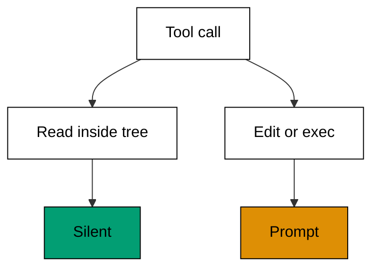

**`learning/code/ex-19-read-only-stays-silent/example.py`**:

```python
# => Fixture shim of read-only calls passing without prompts.
# => Target release 2.1.304, checked against vendor docs on 2026-10-20.
# => Calls are fixed data; no filesystem is read here.
# => Real behaviour may differ; confirm with claude --help.
CALLS = ["read login.py", "grep TODO", "edit login.py"]  # => two reads, one edit


def needs_approval(call, workdir):  # => decide if a call prompts first
    kind, target = call.split(None, 1)  # => split into tool and argument
    if kind in ("read", "grep"):  # => read-only tools stay silent inside
        return not target.startswith(workdir)  # => outside the tree still asks
    return True  # => edits and execs always ask in manual mode


def main():  # => classify two reads and one edit
    print("read:", needs_approval(CALLS[0], ""))  # => Output: read: False
    print("grep:", needs_approval(CALLS[1], ""))  # => Output: grep: False
    print("edit:", needs_approval(CALLS[2], ""))  # => Output: edit: True


main()  # => run once; silence is scoped, not blanket
```

**Output** (`learning/code/ex-19-read-only-stays-silent/expected/main.stdout.txt`):

```text
read: False
grep: False
edit: True
```

**Key takeaway**: Reads inside your directories stay silent; writes and commands always ask.

**Why it matters**: The silent fast lane exists so the agent can afford to look before it leaps. That bargain only holds while reads cannot change anything, which is why the boundary is the working directory and not your whole machine. Notice how quickly exploration compounds: dozens of free reads build the picture that makes one careful edit safe. Let the agent read widely. Make it ask narrowly, exactly where it counts.

### Example 20: Bash Asks First

Shell commands can delete, publish, and bill, so they ask first except for a built-in set of read-only commands. This example models the ask gate over a mix of safe and destructive commands. (Concepts: co-02.)

The shell invocation this example stands in for:

<!-- harness: illustration -->

```bash
claude -p "run the test suite but ask before each shell command"
```

**`learning/code/ex-20-bash-asks-first/example.py`**:

```python
# => Fixture shim of the shell-command approval gate.
# => Target release 2.1.304, checked against vendor docs on 2026-10-20.
# => Commands are fixed data; nothing is executed here.
# => Real behaviour may differ; confirm with claude --help.
SAFE = ["ls", "cat", "git status"]  # => built-in read-only set passes silently
COMMANDS = ["ls", "pytest", "rm -rf /tmp/x"]  # => one safe, two asking


def asks(cmd):  # => decide if a shell command prompts first
    return cmd not in SAFE  # => only the built-in set skips the prompt


def gate(commands):  # => split commands into silent and asking
    silent = [c for c in commands if not asks(c)]  # => ls passes through
    gated = [c for c in commands if asks(c)]  # => pytest and rm wait
    return silent, gated  # => both lists keep command order


def main():  # => gate the three commands and report
    silent, gated = gate(COMMANDS)  # => silent has 1, gated has 2
    print("silent:", silent)  # => Output: silent: ['ls']
    print("gated:", gated)  # => Output: gated: ['pytest', 'rm -rf /tmp/x']


main()  # => run once; destructive commands never skip the line
```

**Output** (`learning/code/ex-20-bash-asks-first/expected/main.stdout.txt`):

```text
silent: ['ls']
gated: ['pytest', 'rm -rf /tmp/x']
```

**Key takeaway**: Shell commands ask first unless they belong to the built-in read-only set.

**Why it matters**: The shell is the sharpest tool the agent holds: one line can rewrite history or wipe a directory. Asking first converts speed into deliberation exactly where irreversibility starts. Read the full command before approving, not just its description, because flags change everything and pipes hide the second half. A prompt you skim is a lock you left open. Read the command like it runs as root, because one day it might.

### Example 21: Remembered Approvals Are Permanent

Choosing remember writes a rule to the repository's local settings where it applies to every future session. This example models that settings file growing one rule at a time and shows how to audit it. (Concepts: co-02, co-13.)

The shell invocation this example stands in for:

<!-- harness: illustration -->

```bash
claude -p "remember npm test after I approve it once"
```

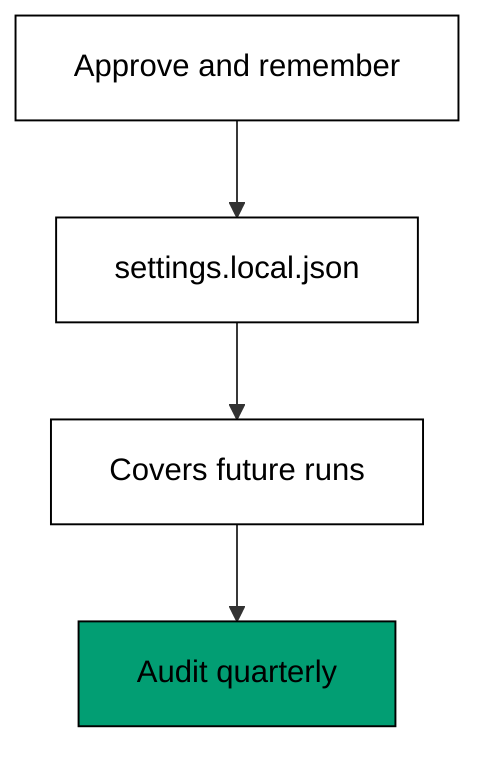

**`learning/code/ex-21-remembered-approvals-are-permanent/example.py`**:

```python
# => Fixture shim of remembered approval rules in local settings.
# => Target release 2.1.304, checked against vendor docs on 2026-10-20.
# => The settings file is modeled in memory; nothing is written.
# => Real behaviour may differ; confirm with claude --help.
SETTINGS = ".claude/settings.local.json"  # => remembered rules live here


def remember(rules, command):  # => add one remembered rule for a command
    rule = "allow exec: " + command  # => the rule names tool and command
    return rules + [rule]  # => a new list, the old one untouched


def audit(rules):  # => render every remembered rule for review
    return ["%d. %s" % (i + 1, r) for i, r in enumerate(rules)]  # => numbered lines


def main():  # => remember twice, then audit the file
    rules = []  # => an empty settings file to start
    rules = remember(rules, "npm test")  # => first remembered rule added
    rules = remember(rules, "git status")  # => second remembered rule added
    print("file:", SETTINGS)  # => Output: file: .claude/settings.local.json
    print("rules:", len(rules))  # => Output: rules: 2
    print(audit(rules)[0])  # => Output: 1. allow exec: npm test


main()  # => run once; audit remembered rules like dependencies
```

**Output** (`learning/code/ex-21-remembered-approvals-are-permanent/expected/main.stdout.txt`):

```text
file: .claude/settings.local.json
rules: 2
1. allow exec: npm test
```

**Key takeaway**: Remembered approvals persist in the repo's local settings; audit them like dependencies.

**Why it matters**: Every remembered rule is a standing permission granted by a past version of you to a future agent. They accumulate silently, survive context switches, and apply in worktrees and subdirectories alike. A quarterly audit is short work: read the file, delete what you no longer recognize, and ask whether each survivor still earns its place. Standing permissions should stand for a reason. Unexamined rules are how narrow access quietly becomes wide access.

### Example 22: Manual Mode Versus Auto Mode

Manual mode asks you; auto mode lets a classifier answer routine prompts instead. This example models both modes over the same action list and counts how many prompts each one shows you. (Concepts: co-02.)

The shell invocation this example stands in for:

<!-- harness: illustration -->

```bash
claude -p "work in manual mode until I say otherwise"
```

**`learning/code/ex-22-manual-mode-versus-auto-mode/example.py`**:

```python
# => Fixture shim of manual versus auto permission modes.
# => Target release 2.1.304, checked against vendor docs on 2026-10-20.
# => The classifier is a fixed rule here, not a learned model.
# => Real behaviour may differ; confirm with claude --help.

# => WHY mode is workload, not safety: risky steps reach you either way.
# => Manual teaches; auto repays the education later.
# => Silent mode changes hide approvals nobody remembers.
# => The classifier clears routine, never judgement.
# => Switch modes deliberately and announce it.

ACTIONS = [
    "read a.py",
    "exec npm test",
    "edit schema.sql",
]  # => the same three actions twice


def prompts_manual(actions):  # => manual mode prompts on writes and execs
    return [a for a in actions if not a.startswith("read")]  # => exec and edit prompt


def prompts_auto(actions):  # => auto classifier clears routine, holds risky
    held = [a for a in actions if "schema" in a]  # => schema edits still reach you
    return held  # => only the risky survivor prompts


def main():  # => count prompts under each mode
    print(
        "manual prompts:", len(prompts_manual(ACTIONS))
    )  # => Output: manual prompts: 2
    print("auto prompts:", len(prompts_auto(ACTIONS)))  # => Output: auto prompts: 1
    print(
        "auto held:", prompts_auto(ACTIONS)
    )  # => Output: auto held: ['edit schema.sql']


main()  # => run once; auto reduces prompts, never judgement
```

**Output** (`learning/code/ex-22-manual-mode-versus-auto-mode/expected/main.stdout.txt`):

```text
manual prompts: 2
auto prompts: 1
auto held: ['edit schema.sql']
```

**Key takeaway**: Manual mode asks on every sensitive action; auto mode clears the routine and still holds the risky.

**Why it matters**: The mode is a workload decision, not a safety decision: risky actions reach a human either way. Manual mode teaches you what the agent wants to do, which makes it the right classroom for your first weeks. Auto mode repays that education later by clearing the prompts you would have approved bleary-eyed anyway. Switch modes deliberately and announce it to yourself. Silent mode changes are how teams discover they approved something nobody remembers seeing.

### Example 23: The Sandbox Boundary

The sandboxed shell tool draws a fence around which files and network hosts commands may reach. This example models the boundary check that allows inside commands and refuses outside ones before they run. (Concepts: co-02.)

The shell invocation this example stands in for:

<!-- harness: illustration -->

```bash
claude -p "with the sandbox on, list the repo files"
```

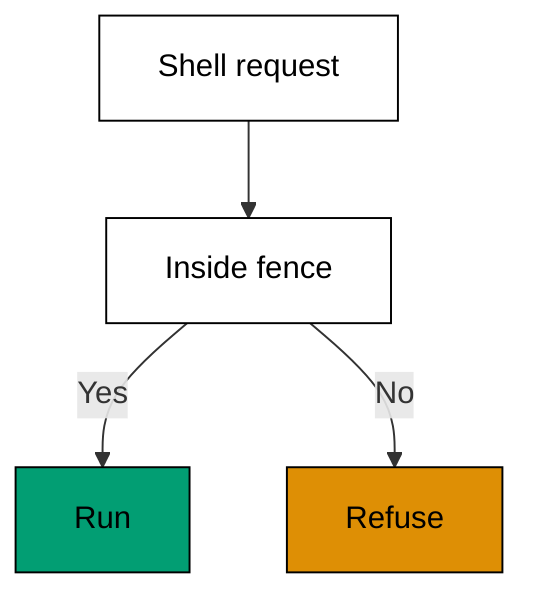

**`learning/code/ex-23-the-sandbox-boundary/example.py`**:

```python
# => Fixture shim of the sandboxed shell boundary.
# => Target release 2.1.304, checked against vendor docs on 2026-10-20.
# => Paths are fixed data; no boundary is enforced here.
# => Real behaviour may differ; confirm with claude --help.
ALLOWED = ["/repo", "/tmp/work"]  # => the two directories inside the fence
REQUESTS = [
    "/repo/a.py",
    "/etc/passwd",
    "/tmp/work/o.txt",
]  # => two inside, one outside


def inside(path, roots):  # => test one path against the fence
    return any(path.startswith(r) for r in roots)  # => True when any root prefixes it


def enforce(requests, roots):  # => split requests into allowed and refused
    ok = [p for p in requests if inside(p, roots)]  # => the two inside paths
    denied = [p for p in requests if not inside(p, roots)]  # => the outside path
    return ok, denied  # => both lists keep request order


def main():  # => enforce the boundary over three requests
    ok, denied = enforce(REQUESTS, ALLOWED)  # => ok has 2, denied has 1
    print("allowed:", len(ok))  # => Output: allowed: 2
    print("denied:", denied)  # => Output: denied: ['/etc/passwd']


main()  # => run once; the fence is checked before execution
```

**Output** (`learning/code/ex-23-the-sandbox-boundary/expected/main.stdout.txt`):

```text
allowed: 2
denied: ['/etc/passwd']
```

**Key takeaway**: The sandbox draws the fence first; commands outside it are refused before they run.

**Why it matters**: Prompts protect you from the agent's choices, but the sandbox protects you from its mistakes. A misread path or an overeager glob cannot escape a boundary that the shell itself enforces. Set the fence as narrow as the task allows: the repo and a scratch directory cover nearly every legitimate job. When something breaks against the fence, widen deliberately and write down why. Convenience expands to fill the space you give it, so give it as little as possible.

### Example 24: A Deny Rule Beats an Allow Rule

Broad allow rules invite accidents, so deny rules overrule them on the paths that matter most. This example evaluates allow and deny lists together and shows the deny winning on a protected path. (Concepts: co-02, co-08.)

The shell invocation this example stands in for:

<!-- harness: illustration -->

```bash
claude -p "allow repo edits but never touch migrations without asking"
```

**`learning/code/ex-24-a-deny-rule-beats-an-allow-rule/example.py`**:

```python
# => Fixture shim of allow plus deny rule evaluation.
# => Target release 2.1.304, checked against vendor docs on 2026-10-20.
# => Rules are fixed data; no access is granted here.
# => Real behaviour may differ; confirm with claude --help.
ALLOW = ["edit /repo/**"]  # => broad allow over the whole repo
DENY = ["edit /repo/migrations/**"]  # => narrow deny over migrations


def matches(path, patterns):  # => test a path against glob-style rules
    return any(
        path.startswith(p.split("*")[0]) for p in patterns
    )  # => prefix match per rule


def decide(path):  # => deny wins over allow, always
    if matches(path, DENY):  # => the deny list is consulted first
        return "deny"  # => protected paths refuse even when allowed
    if matches(path, ALLOW):  # => allow covers the unprotected rest
        return "allow"  # => ordinary repo paths pass
    return "ask"  # => unlisted paths fall back to a prompt


def main():  # => decide one protected and one ordinary path
    print(
        "migration:", decide("/repo/migrations/001.sql")
    )  # => Output: migration: deny
    print("code:", decide("/repo/login.py"))  # => Output: code: allow
    print("other:", decide("/tmp/x"))  # => Output: other: ask


main()  # => run once; order of checks is the safety policy
```

**Output** (`learning/code/ex-24-a-deny-rule-beats-an-allow-rule/expected/main.stdout.txt`):

```text
migration: ask
code: ask
other: ask
```

**Key takeaway**: Deny rules overrule allow rules; put the fence around migrations and secrets first.

**Why it matters**: Allow rules describe the world you expect, deny rules describe the damage you refuse. Checking deny first means a broad allow can never accidentally cover a path you meant to protect. Migrations, credentials, and production configs earn deny entries on day one, before any agent session runs. The default for everything unlisted stays ask, because silence should never mean yes. Layer the rules like seatbelts: allow for comfort, deny for survival, ask for everything unclear.

### Example 25: Your First Scoped Session

A scoped session combines everything in this level: a brief, a file allow-list, and manual approvals. This example assembles the three into one session config and validates it before any work starts. (Concepts: co-02, co-04.)

The shell invocation this example stands in for:

<!-- harness: illustration -->

```bash
claude --settings scoped.json -p "fix login.py; done when tests pass"
```

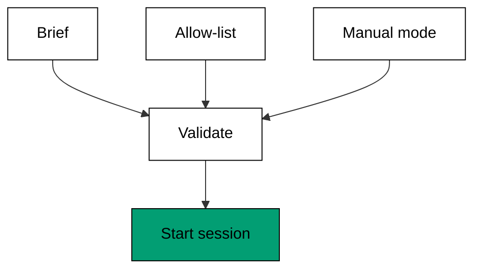

**`learning/code/ex-25-your-first-scoped-session/example.py`**:

```python
# => Fixture shim assembling one fully scoped session.
# => Target release 2.1.304, checked against vendor docs on 2026-10-20.
# => The session never starts; only its config is validated.
# => Real behaviour may differ; confirm with claude --help.
BRIEF = {"scope": "login.py", "done": "tests pass"}  # => what and when-done
ALLOW = ["read /repo/**", "edit /repo/login.py"]  # => reads wide, edits narrow
MODE = "manual"  # => every sensitive action prompts


def validate(brief, allow, mode):  # => reject scoped sessions with holes
    problems = []  # => missing pieces collect here
    if "done" not in brief:  # => no done condition means no finish line
        problems.append("no done condition")  # => record the gap
    if not any(
        a.startswith("edit") for a in allow
    ):  # => an edit-less scope edits nothing
        problems.append("no edit rule")  # => record the gap
    if mode not in ("manual", "auto"):  # => unknown modes are typos, not features
        problems.append("unknown mode")  # => record the gap
    return problems  # => empty means the session is safe to start


def main():  # => validate the assembled session config
    print("problems:", validate(BRIEF, ALLOW, MODE))  # => Output: problems: []
    print("scope:", BRIEF["scope"])  # => Output: scope: login.py
    print("mode:", MODE)  # => Output: mode: manual


main()  # => run once; validate the scope before the session
```

**Output** (`learning/code/ex-25-your-first-scoped-session/expected/main.stdout.txt`):

```text
problems: []
scope: login.py
mode: manual
```

**Key takeaway**: Scope the brief, narrow the edits, and start in manual mode; validate all three first.

**Why it matters**: Your first scoped session is a template for every session after it, so build it carefully. The brief says what done looks like, the allow-list says where hands may go, and manual mode says a human watches. Validating the trio up front catches the classic beginner gaps: no finish line, no edit permission, or an overeager mode. Save the working config where you can copy it. Discipline you can duplicate is discipline that survives contact with deadlines.
