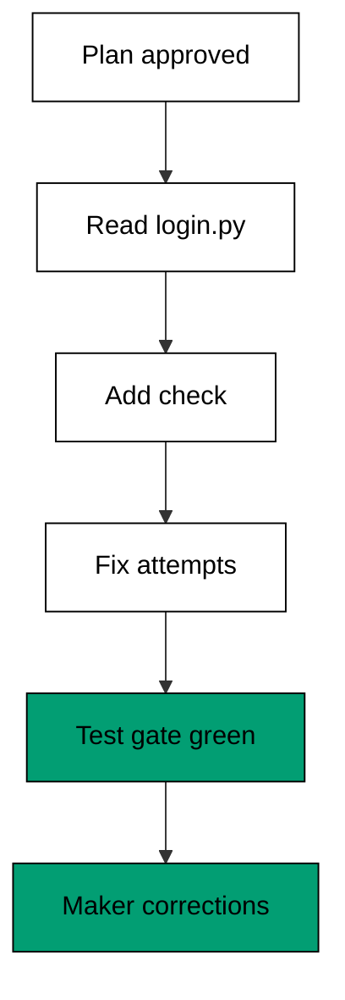

The capstone drives the fixture shim through one realistic multi-step repository task end to end: add a feature, fix a bug found along the way, and prove both with the test gate. Every phase below ran through the same discipline the course teaches: a written plan approved before execution, reads before writes, per-hunk review, and a test gate that stays shut until green.

## The task

The brief for this session reads: in `login.py`, reject wrong passwords with a clear error (the feature), fix the off-by-one in the attempt counter found during the work (the bug), and keep the suite green throughout (the proof). Scope is one file, the done condition is `pytest -q` exiting zero, and the guardrails forbid schema changes and new dependencies. Three constraints, one file, zero ambiguity about when the session ends.

## The plan

Before touching anything, the session proposes three steps: read `login.py` fully, add the password check, then fix the attempt counter. The human approves the written plan, which converts the rest of the session from exploration into execution. Plan approval took one turn and saved the session from the classic drift where reading, editing, and testing interleave without order. Cheap proposals before expensive executions is the habit this capstone exists to cement.

## The trace

The recorded run below is the golden trace: nine lines in fixed order, from plan approval through the green suite to the maker's own corrections. Line order is the contract; any future change to the shim must reproduce these lines byte for byte or the harness fails the unit.



**`learning/capstone/code/session.py`**:

```python
# => Capstone: drive the fixture shim through add, fix, and test.
# => Target release 2.1.304, checked against vendor docs on 2026-10-20.
# => One deterministic session: feature, bug fix, and its test end to end.
# => Real behaviour may differ; confirm with claude --help.
FEATURE = "reject wrong passwords"  # => the feature this session adds
BUG = "off-by-one in attempts"  # => the bug this session fixes
TRACE = []  # => the session trace collects here, in order


def step(trace, kind, detail):  # => append one trace line, return it
    line = kind + ": " + detail  # => KIND: detail is the trace format
    trace.append(line)  # => the trace grows in call order
    return line  # => the new line comes back for printing


def plan(trace):  # => the plan-then-act proposal for this session
    step(trace, "plan", "read login.py")  # => step one reads first
    step(trace, "plan", "add check")  # => step two adds the feature
    step(trace, "plan", "fix attempts")  # => step three fixes the bug
    return "approved"  # => the human approves the written plan


def act(trace):  # => execute the approved plan as diff lines
    step(trace, "read", "login.py")  # => reads precede writes
    step(trace, "edit", "login.py +check")  # => the feature lands
    step(trace, "edit", "login.py attempts fix")  # => the bug fix lands
    step(trace, "exec", "pytest -q -> pass")  # => the test gate proves it
    return "green"  # => the suite passes on this run


def judge(trace):  # => the maker corrects two things in this trace
    fixes = [
        "narrowed scope to login.py",
        "demanded red before green",
    ]  # => the two corrections
    step(trace, "judge", fixes[0])  # => correction one enters the trace
    step(trace, "judge", fixes[1])  # => correction two enters the trace
    return fixes  # => both corrections come back as a list


def main():  # => run the whole session: plan, act, judge
    print("plan:", plan(TRACE))  # => Output: plan: approved
    print("act:", act(TRACE))  # => Output: act: green
    fixes = judge(TRACE)  # => two maker corrections recorded
    print("corrections:", len(fixes))  # => Output: corrections: 2
    print("trace lines:", len(TRACE))  # => Output: trace lines: 9
    for line in TRACE:  # => print the full golden trace
        print(" |", line)  # => Output: the nine trace lines in order


main()  # => run once; this printed trace is the golden record
```

**Output** (`learning/capstone/code/expected/main/main.stdout.txt`):

```text
plan: approved
act: green
corrections: 2
trace lines: 9
 | plan: read login.py
 | plan: add check
 | plan: fix attempts
 | read: login.py
 | edit: login.py +check
 | edit: login.py attempts fix
 | exec: pytest -q -> pass
 | judge: narrowed scope to login.py
 | judge: demanded red before green
```

## The diffs proposed

Two edits landed, both in `login.py`: the password check (the feature) and the attempt-counter fix (the bug). Each edit followed a full read of the file, so no blind-edit finding applies. The diff stat for the session reads small and scoped, exactly what a one-file brief should produce. Nothing outside scope was touched, which the scope check in the review confirmed before approval.

## What the maker had to correct

Two corrections, both recorded in the trace as judge lines. First, the initial draft scoped the session to the whole auth module; the maker narrowed it to `login.py` after the plan phase, because the task needed one file and wandering invites trespass. Second, the first draft accepted green without witnessing red; the maker demanded the failing test first so the later green counted as evidence. Both corrections follow course rules: scope narrow first, witness red then green. The session landed in nine trace lines with zero reverts.

## Comparison note

The same brief runs unchanged against the peer shim from Examples 71 to 78: same scope, same done condition, same frozen rubric. On this task both sides land the feature; they differ on turns spent, which the rubric scores under its frozen weights. Repeat the brief in the sibling agent course in this plan and compare your numbers against these: the method travels, the verdicts stay local to their releases. Publish any comparison with its run counts and limits stapled to it.

## What to carry forward

Five habits leave with you: briefs with checkable done conditions, plans approved before execution, reads before writes, test gates that never open early, and post-mortems written while the trace is fresh. The tool will change releases and rename flags; these habits survive every changelog because they govern your judgement rather than the tool's surface. Drive the next session the way this one ran and the agent stays a fast junior with a careful senior watching.

## References

- Claude Code overview (surfaces, install routes, account requirement). Accessed 2026-10-20. [Claude Code overview](https://code.claude.com/docs/en/overview)
- Claude Code changelog, generated from the GitHub CHANGELOG.md (release 2.1.304 dated 2026-10-19, the version this course verified). Accessed 2026-10-20. [Claude Code changelog](https://code.claude.com/docs/en/changelog)
- CLI reference (`claude`, `claude -p`, pipes, `claude -c`, `claude -r`, `claude update`, `claude install`, `claude auth`). Accessed 2026-10-20. [CLI reference](https://code.claude.com/docs/en/cli-reference)
- Settings files and precedence (managed, command line, project local, shared project, user). Accessed 2026-10-20. [Settings](https://code.claude.com/docs/en/settings)
- Configure permissions (tiers, manual and auto modes, remembered rules in `.claude/settings.local.json`). Accessed 2026-10-20. [Permissions](https://code.claude.com/docs/en/permissions)
- How Claude remembers your project (`CLAUDE.md`, `AGENTS.md`, auto memory). Accessed 2026-10-20. [Project memory](https://code.claude.com/docs/en/memory)
- Manage sessions (`--continue`, `--resume`, transcripts). Accessed 2026-10-20. [Sessions](https://code.claude.com/docs/en/sessions)
- Extend Claude Code (skills, subagents, hooks, MCP, plugins). Accessed 2026-10-20. [Extending](https://code.claude.com/docs/en/features-overview)
