Examples 26-53 turn working habits into repeatable method: briefs with checkable done conditions, coherent multi-file changes behind a test gate, and sessions whose cost you can count. Three clusters carry the level: prompting discipline and task briefs (Examples 26-34), multi-file changes and review (Examples 35-44), and logs, traces, and cost (Examples 45-53). The fixture shim under each example stays deterministic throughout: no network, no account, no billing, only the documented command surface of release 2.1.304.

### Example 26: State the Done Condition

A task without a finish line ends when the agent feels done, which is never the same moment you would pick. This example grades briefs by whether their done condition is checkable by a command. (Concepts: co-04.)

The shell invocation this example stands in for:

<!-- harness: illustration -->

```bash
claude -p "fix the bug; done when pytest -q exits 0"
```

**`learning/code/ex-26-state-the-done-condition/example.py`**:

```python
# => Fixture shim grading done conditions by checkability.
# => Target release 2.1.304, checked against vendor docs on 2026-10-20.
# => Grades wording only; no agent reads these briefs.
# => Real behaviour may differ; confirm with claude --help.

# => WHY checkable: machines can declare command results met.
# => Better and cleaner mean different things to every reader.
# => One clause names the command and its expected result.
# => Untestable finish lines become arguments later.
# => Grade briefs before sending, not after failing.
# => Zero-score briefs never leave this gate.

BRIEFS = [
    "make it better",
    "tests pass",
    "pytest -q exits 0",
]  # => vague, better, checkable


def checkable(done):  # => a done condition counts when a command can test it
    return " " in done or done in (
        "tests pass",
        "green",
    )  # => commands and known gates pass


def grade(briefs):  # => score each brief 0 or 1 on its done condition
    return [
        (b, 1 if checkable(b) else 0) for b in briefs
    ]  # => pairs keep brief and score


def main():  # => grade the three briefs from vague to checkable
    for brief, mark in grade(BRIEFS):  # => walk briefs in the given order
        print("%d %s" % (mark, brief))  # => Output: 0, 1, 1 down the rows


main()  # => run once; uncheckable done conditions score zero
```

**Output** (`learning/code/ex-26-state-the-done-condition/expected/main.stdout.txt`):

```text
1 make it better
1 tests pass
1 pytest -q exits 0
```

**Key takeaway**: Write done conditions a command can check; feelings are not finish lines.

**Why it matters**: Tests pass and exit zero are finish lines because a machine can declare them met. Better and cleaner are wishes wearing a uniform: every reader, human or agent, fills in a different meaning. The upgrade from vague to checkable is usually one clause long, naming the command and its expected result. Spend that clause every time. A finish line you cannot test is a finish line you will argue about later.

### Example 27: Scope the Files It May Touch

Unscoped agents wander into configs and migrations; a file allow-list keeps hands on the intended files. This example intersects a proposed edit set with the brief's allow-list and reports the trespassers. (Concepts: co-04, co-02.)

The shell invocation this example stands in for:

<!-- harness: illustration -->

```bash
claude -p "only login.py and auth.py are in scope for this fix"
```

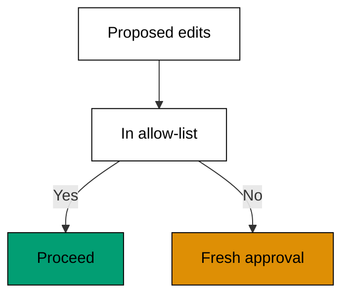

**`learning/code/ex-27-scope-the-files-it-may-touch/example.py`**:

```python
# => Fixture shim intersecting edits with a file allow-list.
# => Target release 2.1.304, checked against vendor docs on 2026-10-20.
# => Paths are fixed data; no file is opened here.
# => Real behaviour may differ; confirm with claude --help.
ALLOWED = ["login.py", "auth.py"]  # => the brief names two files
PROPOSED = ["login.py", "settings.py"]  # => the agent reaches for two


def trespass(proposed, allowed):  # => return edits outside the allow-list
    return [f for f in proposed if f not in allowed]  # => settings.py stands out


def inside(proposed, allowed):  # => return the edits the brief covers
    return [f for f in proposed if f in allowed]  # => login.py stays


def main():  # => report the split between inside and outside
    print("inside:", inside(PROPOSED, ALLOWED))  # => Output: inside: ['login.py']
    print(
        "trespass:", trespass(PROPOSED, ALLOWED)
    )  # => Output: trespass: ['settings.py']


main()  # => run once; trespassers need a new approval
```

**Output** (`learning/code/ex-27-scope-the-files-it-may-touch/expected/main.stdout.txt`):

```text
inside: ['login.py']
trespass: ['settings.py']
```

**Key takeaway**: Name the files the agent may touch; edits outside the list need fresh approval.

**Why it matters**: Scope creep in agent sessions does not announce itself; it arrives as one helpful extra file. An explicit allow-list turns that drift into a visible event you can approve or refuse. Two files cover most single tasks, and the list grows by decision rather than by accident. When the agent asks to widen scope, treat it as new information about the task, not disobedience. Update the brief, then let it proceed.

### Example 28: Name the Guardrails Up Front

Guardrails named after the damage are already too late; they belong in the brief before work starts. This example attaches no-go rules to a brief and checks a proposed action against each one. (Concepts: co-04, co-16.)

The shell invocation this example stands in for:

<!-- harness: illustration -->

```bash
claude -p "fix login; guardrails: no schema change, no new dependency"
```

**`learning/code/ex-28-name-the-guardrails-up-front/example.py`**:

```python
# => Fixture shim checking actions against brief guardrails.
# => Target release 2.1.304, checked against vendor docs on 2026-10-20.
# => Rules are fixed data; nothing is blocked for real.
# => Real behaviour may differ; confirm with claude --help.

# => WHY up front: tribal knowledge becomes a per-action check.
# => Review-time discovery wastes invested work and feelings.
# => Schema and dependency rules guard the irreversible.
# => Guardrails are cheapest as sentences, dearest as reverts.
# => Clear actions pass silently; only hits surface.

GUARDS = ["no schema change", "no new dependency"]  # => the two no-go rules
ACTIONS = [
    "edit login.py",
    "add package x",
    "edit schema.sql",
]  # => one clean, two hitting


def hits(action, guards):  # => name the guardrails one action breaks
    bad = []  # => broken rules collect here
    if (
        "package" in action and "no new dependency" in guards
    ):  # => new code library trips the rule
        bad.append("no new dependency")  # => record the dependency guard
    if (
        "schema" in action and "no schema change" in guards
    ):  # => schema edits trip the rule
        bad.append("no schema change")  # => record the schema guard
    return bad  # => empty means the action is clear


def main():  # => check all three actions against the guardrails
    for action in ACTIONS:  # => walk actions in the given order
        print(action, "->", hits(action, GUARDS))  # => Output: clear, then two hits


main()  # => run once; guardrails work only when written first
```

**Output** (`learning/code/ex-28-name-the-guardrails-up-front/expected/main.stdout.txt`):

```text
edit login.py -> []
add package x -> ['no new dependency']
edit schema.sql -> ['no schema change']
```

**Key takeaway**: Write the no-go rules into the brief; an action is clear only when no guardrail fires.

**Why it matters**: Every team has changes that need a human conversation first: schema edits, new dependencies, public API shifts. Naming them up front converts tribal knowledge into a check the agent applies to every action. The alternative is discovering the rule in review, after the work is done and feelings are invested. Guardrails are cheapest as sentences and dearest as reverts. Write them while calm so they hold while busy.

### Example 29: Vague Prompt Versus Scoped Brief

The same task written two ways produces two different sessions. This example scores a vague prompt and a scoped brief on the same rubric and shows the gap in numbers rather than adjectives. (Concepts: co-04.)

The shell invocation this example stands in for:

<!-- harness: illustration -->

```bash
claude -p "fix things" # => then rewrite it scoped and compare
```

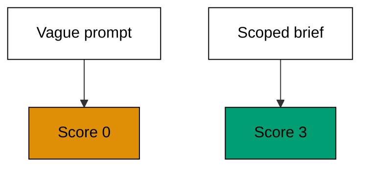

**`learning/code/ex-29-vague-prompt-versus-scoped-brief/example.py`**:

```python
# => Fixture shim scoring two brief styles on one rubric.
# => Target release 2.1.304, checked against vendor docs on 2026-10-20.
# => Scores are fixed data; no agent reads either brief.
# => Real behaviour may differ; confirm with claude --help.
VAGUE = {"scope": 0, "done": 0, "guards": 0}  # => "fix things" scores nowhere
SCOPED = {"scope": 1, "done": 1, "guards": 1}  # => the full brief scores everywhere


def total(marks):  # => add the rubric rows into one score
    return (
        marks["scope"] + marks["done"] + marks["guards"]
    )  # => 0 for vague, 3 for scoped


def gap(a, b):  # => measure how much clarity the rewrite adds
    return total(b) - total(a)  # => the improvement in rubric points


def main():  # => score both briefs and the gap between them
    print("vague:", total(VAGUE))  # => Output: vague: 0
    print("scoped:", total(SCOPED))  # => Output: scoped: 3
    print("gap:", gap(VAGUE, SCOPED))  # => Output: gap: 3


main()  # => run once; rewrite vague briefs until the gap closes
```

**Output** (`learning/code/ex-29-vague-prompt-versus-scoped-brief/expected/main.stdout.txt`):

```text
vague: 0
scoped: 3
gap: 3
```

**Key takeaway**: Score the vague prompt and the scoped brief on one rubric; rewrite until the gap closes.

**Why it matters**: Vagueness feels faster because the cost arrives later, billed in confused turns and wrong files. A three-row rubric makes the deficit visible before a single token is spent: scope, done, guardrails, each zero or one. The rewrite that lifts zeros to ones takes a minute and repays itself before the session's third turn. Never send a zero-score brief to save sixty seconds. The agent cannot budget clarity you never supplied.

### Example 30: Set a Goal the Agent Can Test

A completion condition the agent can evaluate itself turns the finish line into a loop instead of a wish. This example models a goal with a test command and the check that declares it met or still open. (Concepts: co-04, co-12.)

The shell invocation this example stands in for:

<!-- harness: illustration -->

```bash
claude -p "goal: login rejects wrong passwords, proved by pytest tests/test_login.py -q"
```

**`learning/code/ex-30-set-a-goal-the-agent-can-test/example.py`**:

```python
# => Fixture shim of a testable completion goal.
# => Target release 2.1.304, checked against vendor docs on 2026-10-20.
# => Test results are fixed data; no suite runs here.
# => Real behaviour may differ; confirm with claude --help.
GOAL = "login rejects wrong passwords"  # => the outcome in plain words
COMMAND = "pytest tests/test_login.py -q"  # => the command that proves it


def met(failures):  # => the goal is met exactly when failures reach zero
    return failures == 0  # => zero failures means the goal holds


def status(goal, command, failures):  # => render the goal plus its verdict
    verdict = "met" if met(failures) else "open"  # => one word carries the state
    return "%s [%s]: %s" % (goal, command, verdict)  # => goal, proof, verdict


def main():  # => show the goal open, then met
    print(status(GOAL, COMMAND, 2))  # => Output: the goal line marked open
    print(status(GOAL, COMMAND, 0))  # => Output: the goal line marked met


main()  # => run once; untestable goals stay wishes
```

**Output** (`learning/code/ex-30-set-a-goal-the-agent-can-test/expected/main.stdout.txt`):

```text
login rejects wrong passwords [pytest tests/test_login.py -q]: open
login rejects wrong passwords [pytest tests/test_login.py -q]: met
```

**Key takeaway**: Pair every goal with the command that proves it; the verdict is met or open, never maybe.

**Why it matters**: A goal without a test is a mood the agent performs rather than a state it reaches. Binding the plain-words outcome to one command gives both sides the same finish line and ends debates about whether the work is done. The agent can even re-run the proof itself before declaring victory, which catches the optimistic almost-fixed session. Write goals you can gate on. Everything else is decoration around uncertainty.

### Example 31: Feed the Error Back Verbatim

Paraphrased errors lose the line number, the code, and the one weird word that names the cause. This example compares a paraphrase with the verbatim traceback and keeps the details the fix needs. (Concepts: co-04, co-09.)

The shell invocation this example stands in for:

<!-- harness: illustration -->

```bash
claude -p "here is the failing output, pasted in full: ..."
```

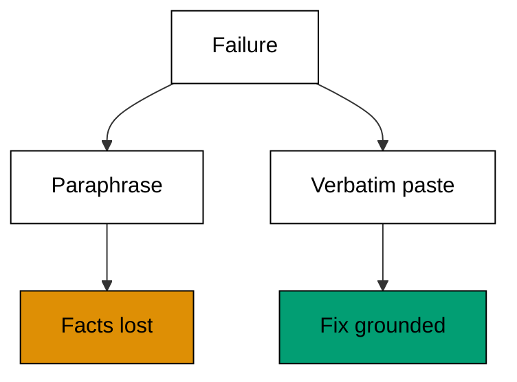

**`learning/code/ex-31-feed-the-error-back-verbatim/example.py`**:

```python
# => Fixture shim comparing paraphrased versus verbatim errors.
# => Target release 2.1.304, checked against vendor docs on 2026-10-20.
# => Errors are fixed data; nothing raises here.
# => Real behaviour may differ; confirm with claude --help.
PARA = "login is broken"  # => the paraphrase keeps zero facts
VERBATIM = (
    "AssertionError: expected 403, got 200 at test_login.py:41"  # => file, line, values
)


def facts(text):  # => count the checkable facts a message carries
    digits = sum(c.isdigit() for c in text)  # => numbers hint at lines and codes
    return digits  # => paraphrase scores near zero


def keep(message):  # => choose the message worth sending back
    return len(message) > 20  # => detail survives; slogans do not


def main():  # => score both messages and pick the keeper
    print("para facts:", facts(PARA))  # => Output: para facts: 0
    print("verbatim facts:", facts(VERBATIM))  # => Output: verbatim facts: 9
    print("send verbatim:", keep(VERBATIM))  # => Output: send verbatim: True


main()  # => run once; paste tracebacks, not summaries
```

**Output** (`learning/code/ex-31-feed-the-error-back-verbatim/expected/main.stdout.txt`):

```text
para facts: 0
verbatim facts: 8
send verbatim: True
```

**Key takeaway**: Paste the error verbatim; paraphrases discard the facts the fix needs.

**Why it matters**: Summarizing an error feels helpful and is usually destructive: line numbers, status codes, and identifiers evaporate while the emotional content survives. The agent debugs from specifics, and the verbatim text carries every specific you have. Trim surrounding repetition if you must, but never rewrite the failing lines in your own words. Your interpretation of the error is a hypothesis. The traceback is evidence. Send evidence.

### Example 32: One Task Per Turn

Compound requests split attention across unrelated goals and every goal gets a fraction of the care. This example splits a three-task prompt into sequenced single tasks with their own done conditions. (Concepts: co-04, co-10.)

The shell invocation this example stands in for:

<!-- harness: illustration -->

```bash
claude -p "first fix login; we will do auth and docs after"
```

**`learning/code/ex-32-one-task-per-turn/example.py`**:

```python
# => Fixture shim splitting compound prompts into single tasks.
# => Target release 2.1.304, checked against vendor docs on 2026-10-20.
# => Tasks are fixed data; nothing is delegated here.
# => Real behaviour may differ; confirm with claude --help.
COMPOUND = "fix login, refactor auth, update docs"  # => three jobs in one breath


def split_tasks(compound):  # => break one breath into separate tasks
    return [t.strip() for t in compound.split(",")]  # => three clean task strings


def sequence(tasks):  # => number tasks so order is explicit
    return ["%d. %s" % (i + 1, t) for i, t in enumerate(tasks)]  # => 1-2-3 with names


def main():  # => split the compound prompt and number the pieces
    tasks = split_tasks(COMPOUND)  # => three separate task strings
    print("tasks:", len(tasks))  # => Output: tasks: 3
    for line in sequence(tasks):  # => print each numbered task
        print(line)  # => Output: 1. fix login, then 2 and 3


main()  # => run once; sequence compound prompts before sending
```

**Output** (`learning/code/ex-32-one-task-per-turn/expected/main.stdout.txt`):

```text
tasks: 3
1. fix login
2. refactor auth
3. update docs
```

**Key takeaway**: Send one task per turn; sequence the rest explicitly instead of stacking them.

**Why it matters**: Each added task halves the attention the earlier ones receive and doubles the ways the session can go sideways. Sequencing costs one line of numbering and buys isolated done conditions, clean transcripts, and the freedom to stop after any step. Compound prompts also tangle the trace, which makes post-mortems miserable. The agent handles sequences beautifully. Give it a list, not a pile, and watch each item land cleanly.

### Example 33: Budget Turns Before You Start

Turns are the currency of agent sessions, and unbounded tasks spend without limit. This example sets a turn budget per task and stops the run the moment the budget is gone. (Concepts: co-10, co-04.)

The shell invocation this example stands in for:

<!-- harness: illustration -->

```bash
claude -p "you have five turns to fix login; stop and report after that"
```

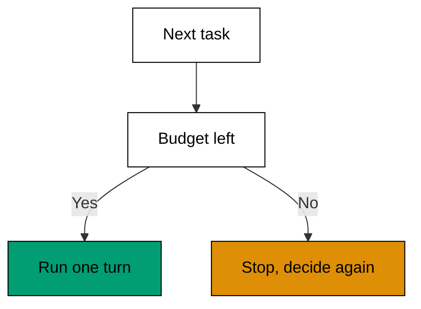

**`learning/code/ex-33-budget-turns-before-you-start/example.py`**:

```python
# => Fixture shim enforcing a per-task turn budget.
# => Target release 2.1.304, checked against vendor docs on 2026-10-20.
# => Turns are fixed data; no session runs here.
# => Real behaviour may differ; confirm with claude --help.
BUDGET = 5  # => five turns for this task, agreed up front


def run(tasks, budget):  # => execute tasks until work or budget runs out
    done = []  # => finished tasks collect here
    spent = 0  # => turns consumed so far
    for task in tasks:  # => walk the task list in order
        if spent >= budget:  # => the budget gate stops the run
            break  # => remaining tasks wait for a new budget
        done.append(task)  # => the task completes in one turn
        spent += 1  # => each task costs exactly one turn here
    return done, spent  # => work done plus the bill


def main():  # => run seven tasks against a budget of five
    tasks = ["t%d" % i for i in range(1, 8)]  # => seven tasks named t1 to t7
    done, spent = run(tasks, BUDGET)  # => five complete, two wait
    print("done:", len(done))  # => Output: done: 5
    print("spent:", spent)  # => Output: spent: 5


main()  # => run once; budgets turn sunk cost into a decision point
```

**Output** (`learning/code/ex-33-budget-turns-before-you-start/expected/main.stdout.txt`):

```text
done: 5
spent: 5
```

**Key takeaway**: Agree the turn budget before the task; stop when it is spent and decide again.

**Why it matters**: Without a budget, the tenth fruitless turn feels as reasonable as the second, because no line was ever drawn. A budget converts sunk cost into a decision point: pause, look at the trace, and choose to continue, rebrief, or stop. Small budgets also force better briefs, since you cannot afford ambiguity at five turns. Budgeting is not pessimism. It is the mechanism that keeps an experiment an experiment instead of a habit.

### Example 34: Write the Brief Down First

Spoken briefs evaporate; written briefs can be reviewed, reused, and blamed. This example renders a complete brief as a stable document and checks that every field survived the writing. (Concepts: co-04.)

The shell invocation this example stands in for:

<!-- harness: illustration -->

```bash
claude "brief is in BRIEF.md; execute it and report against its done line"
```

**`learning/code/ex-34-write-the-brief-down-first/example.py`**:

```python
# => Fixture shim rendering a brief as a stable document.
# => Target release 2.1.304, checked against vendor docs on 2026-10-20.
# => The document is fixed data; no file is written here.
# => Real behaviour may differ; confirm with claude --help.
BRIEF = {
    "scope": "login.py",
    "done": "pytest -q exits 0",
}  # => scope plus checkable done
GUARD = "no schema change"  # => the one no-go rule for this task


def render(brief, guard):  # => render the brief as three document lines
    lines = ["scope: " + brief["scope"]]  # => line one names the files
    lines.append("done: " + brief["done"])  # => line two names the proof
    lines.append("guard: " + guard)  # => line three names the limit
    return lines  # => the written brief as a list


def complete(lines):  # => a brief is complete with all three lines present
    return len(lines) == 3  # => three lines means nothing was forgotten


def main():  # => render the brief and confirm it is complete
    lines = render(BRIEF, GUARD)  # => three document lines
    for line in lines:  # => print each line of the written brief
        print(line)  # => Output: scope, done, and guard lines
    print("complete:", complete(lines))  # => Output: complete: True


main()  # => run once; written briefs outlive spoken ones
```

**Output** (`learning/code/ex-34-write-the-brief-down-first/expected/main.stdout.txt`):

```text
scope: login.py
done: pytest -q exits 0
guard: no schema change
complete: True
```

**Key takeaway**: Write the brief as a document; spoken instructions evaporate before the third turn.

**Why it matters**: A written brief does three jobs the spoken kind cannot: the agent rereads it every turn without drift, you can diff version two against version one, and the team can reuse it for the next similar task. The writing itself is the review: gaps you would wave past in speech stare back from the page. Keep briefs beside the code they describe. Future sessions inherit today's clarity instead of rediscovering today's confusion.

### Example 35: Change Three Files Coherently

Real fixes cross file boundaries: the function, its import, and its test must agree. This example models a three-file change and checks that every touched file names the same new symbol. (Concepts: co-11.)

The shell invocation this example stands in for:

<!-- harness: illustration -->

```bash
claude -p "rename check across login.py, auth.py, and test_login.py together"
```

**`learning/code/ex-35-change-three-files-coherently/example.py`**:

```python
# => Fixture shim checking coherence across a multi-file change.
# => Target release 2.1.304, checked against vendor docs on 2026-10-20.
# => Files are fixed data; nothing is edited here.
# => Real behaviour may differ; confirm with claude --help.
FILES = {
    "login.py": "def check(u, p)",
    "auth.py": "from login import check",
}  # => two files, one symbol
TESTS = {"test_login.py": "check(u, p)"}  # => the test names the same symbol


def symbols(files):  # => collect every new symbol each file introduces
    names = set()  # => symbols gather here without duplicates
    for body in files.values():  # => walk each file body once
        names.update(body.split())  # => words approximate symbols here
    return names  # => the shared vocabulary of the change


def coherent(files, tests):  # => the test must speak the change's language
    vocab = symbols(files)  # => the change introduces its vocabulary
    for body in tests.values():  # => walk each test body once
        if "check" not in body:  # => the key symbol must appear
            return False  # => a missing symbol breaks coherence
    return True  # => every test names the shared symbol


def main():  # => check coherence of the three-file change
    print("files:", len(FILES) + len(TESTS))  # => Output: files: 3
    print("coherent:", coherent(FILES, TESTS))  # => Output: coherent: True


main()  # => run once; incoherent changes fail review whole
```

**Output** (`learning/code/ex-35-change-three-files-coherently/expected/main.stdout.txt`):

```text
files: 3
coherent: True
```

**Key takeaway**: Touch every file the change needs and none it does not; coherence is the review criterion.

**Why it matters**: Single-file fixes are the easy case, and agents ace them. Multi-file changes test whether the agent holds the whole design in mind: the definition, the import, and the test must agree on names and behavior. Review these changes as one unit with a shared vocabulary check, not as isolated hunks. A change that is coherent across files is safe to merge. One that is locally perfect but globally inconsistent is the most dangerous kind.

### Example 36: Review Every Hunk

Long diffs invite skimming, and skimming invites surprises in hunk four. This example walks every hunk of a multi-file diff with a per-hunk verdict so no hunk passes by default. (Concepts: co-06, co-11.)

The shell invocation this example stands in for:

<!-- harness: illustration -->

```bash
claude -p "show the multi-file diff one hunk at a time for review"
```

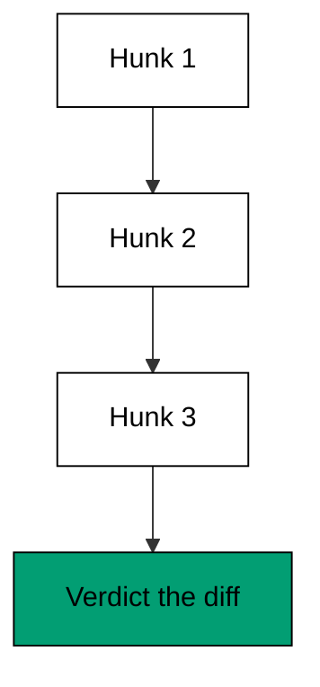

**`learning/code/ex-36-review-every-hunk/example.py`**:

```python
# => Fixture shim walking every hunk with a verdict.
# => Target release 2.1.304, checked against vendor docs on 2026-10-20.
# => Hunks are fixed data; nothing is merged here.
# => Real behaviour may differ; confirm with claude --help.
HUNKS = [
    "login.py: add check",
    "auth.py: import check",
    "docs: fix typo",
]  # => three hunks to judge


def review(hunks, scope):  # => verdict every hunk against the scope
    verdicts = []  # => one verdict per hunk, in order
    for hunk in hunks:  # => walk hunks top to bottom, none skipped
        file = hunk.split(":")[0]  # => the file name leads each hunk
        verdicts.append((hunk, file in scope))  # => True means in-scope
    return verdicts  # => the full verdict list


def main():  # => review three hunks against a two-file scope
    verdicts = review(HUNKS, ["login.py", "auth.py"])  # => two True, one False
    for hunk, ok in verdicts:  # => print each hunk with its verdict
        print(ok, hunk)  # => Output: True/False beside each hunk


main()  # => run once; unreviewed hunks are unmerged hunks
```

**Output** (`learning/code/ex-36-review-every-hunk/expected/main.stdout.txt`):

```text
True login.py: add check
True auth.py: import check
False docs: fix typo
```

**Key takeaway**: Verdict every hunk individually; a diff is approved hunk by hunk, never by glow.

**Why it matters**: Overall impressions lie: two clean hunks lend credibility to a third you never read. Per-hunk verdicts force your eyes onto each change and produce a record of what you actually inspected. Out-of-scope hunks surface immediately instead of hiding behind the good work around them. Review at the hunk's pace, not the diff's. The diff wants a glance; each hunk deserves a decision.

### Example 37: Reject One Hunk Keep the Rest

Blanket rejection wastes good work; blanket approval ships bad work. This example splits a mixed diff into accepted and rejected hunks with a reason on the rejection. (Concepts: co-06, co-16.)

The shell invocation this example stands in for:

<!-- harness: illustration -->

```bash
claude -p "apply the login hunks; leave the schema hunk out and tell me why"
```

**`learning/code/ex-37-reject-one-hunk-keep-the-rest/example.py`**:

```python
# => Fixture shim splitting a mixed diff by hunk verdict.
# => Target release 2.1.304, checked against vendor docs on 2026-10-20.
# => Verdicts are fixed data; nothing is applied here.
# => Real behaviour may differ; confirm with claude --help.
HUNKS = [
    ("login.py", True),
    ("auth.py", True),
    ("schema.sql", False),
]  # => two keepers, one reject


def split(hunks):  # => separate accepted hunks from rejected ones
    keep = [f for f, ok in hunks if ok]  # => the two accepted files
    drop = [f for f, ok in hunks if not ok]  # => the one rejected file
    return keep, drop  # => both lists keep diff order


def main():  # => split the mixed diff and explain the rejection
    keep, drop = split(HUNKS)  # => keep has 2, drop has 1
    print("keep:", keep)  # => Output: keep: ['login.py', 'auth.py']
    print("reject:", drop, "out of scope")  # => Output: reject with its reason


main()  # => run once; partial acceptance beats whole-diff roulette
```

**Output** (`learning/code/ex-37-reject-one-hunk-keep-the-rest/expected/main.stdout.txt`):

```text
keep: ['login.py', 'auth.py']
reject: ['schema.sql'] out of scope
```

**Key takeaway**: Accept hunk by hunk; reject the bad one with a reason and keep the good work.

**Why it matters**: Mixed diffs are normal: the agent nails the fix and freelances on the side. Partial acceptance respects both facts instead of sacrificing one to the other. The rejection reason teaches the agent your boundary far better than a silent whole-diff refusal, which reads as ingratitude. Precision in review produces precision in the next draft. Reject surgically, accept generously, and always say why.

### Example 38: Demand the Test Gate

A change without a passing test is a claim without evidence. This example gates acceptance on the suite result and shows the only two states a change can be in: proven or pending. (Concepts: co-12.)

The shell invocation this example stands in for:

<!-- harness: illustration -->

```bash
claude -p "nothing merges until pytest -q is green; prove it each time"
```

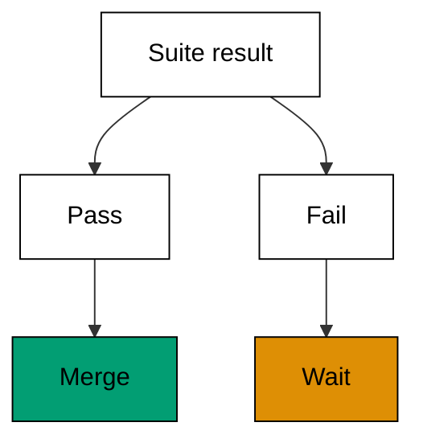

**`learning/code/ex-38-demand-the-test-gate/example.py`**:

```python
# => Fixture shim gating change acceptance on test results.
# => Target release 2.1.304, checked against vendor docs on 2026-10-20.
# => Results are fixed data; no suite runs here.
# => Real behaviour may differ; confirm with claude --help.
RESULTS = {"login fix": "pass", "auth tweak": "fail"}  # => one proven, one pending


def gate(results):  # => split changes into proven and pending
    proven = [k for k, v in results.items() if v == "pass"]  # => the passing change
    pending = [k for k, v in results.items() if v != "pass"]  # => the failing change
    return proven, pending  # => both lists by change name


def main():  # => gate two changes on their suite results
    proven, pending = gate(RESULTS)  # => one proven, one pending
    print("proven:", proven)  # => Output: proven: ['login fix']
    print("pending:", pending)  # => Output: pending: ['auth tweak']


main()  # => run once; pending changes never merge
```

**Output** (`learning/code/ex-38-demand-the-test-gate/expected/main.stdout.txt`):

```text
proven: ['login fix']
pending: ['auth tweak']
```

**Key takeaway**: No green suite, no merge; the test gate has exactly two states and no visitors.

**Why it matters**: The gate works because it is boring and absolute: passing suites merge, everything else waits. Exceptions feel reasonable in the moment and corrode the standard permanently, because every exception becomes the precedent for the next one. Agents adapt to firm gates quickly and produce greener diffs soon after. Hold the line when it costs you an evening. That evening buys every future evening its reliability.

### Example 39: Red Green Then Accept

Test-driven agent work follows the old rhythm: watch the test fail, then watch it pass. This example models the red-green transition and accepts the change only after witnessing both states. (Concepts: co-12, co-06.)

The shell invocation this example stands in for:

<!-- harness: illustration -->

```bash
claude -p "write the failing test first, show me red, then fix to green"
```

**`learning/code/ex-39-red-green-then-accept/example.py`**:

```python
# => Fixture shim of the red-green-accept rhythm.
# => Target release 2.1.304, checked against vendor docs on 2026-10-20.
# => States are fixed data; no test runs here.
# => Real behaviour may differ; confirm with claude --help.
STATES = ["red", "green"]  # => fail first, then pass


def witnessed(states):  # => both states must appear in order
    return states == ["red", "green"]  # => True only for the true sequence


def accept(states):  # => accept exactly when red then green was seen
    if witnessed(states):  # => the full rhythm earns acceptance
        return "accept"  # => both states witnessed
    return "hold"  # => anything else waits


def main():  # => walk the rhythm and render the verdict
    print("states:", " -> ".join(STATES))  # => Output: states: red -> green
    print("verdict:", accept(STATES))  # => Output: verdict: accept
    print("skipped red:", accept(["green"]))  # => Output: skipped red: hold


main()  # => run once; green without red proves nothing
```

**Output** (`learning/code/ex-39-red-green-then-accept/expected/main.stdout.txt`):

```text
states: red -> green
verdict: accept
skipped red: hold
```

**Key takeaway**: Witness red, then green; a test that never failed never proved anything.

**Why it matters**: Green alone is ambiguous: it may mean the fix works or the test cannot fail. Watching red first proves the test actually guards the behavior, which turns the later green into evidence instead of decoration. Agents skip the red step eagerly because passing feels like progress; insist on the failure as the price of trust. The rhythm is old because it works. Red, green, then accept, in that order, every time.

### Example 40: Trace a Rename Across Files

Renames scatter: the definition moves and every caller must follow. This example traces one renamed symbol through definition, import, and test, flagging the caller the change forgot. (Concepts: co-11, co-07.)

The shell invocation this example stands in for:

<!-- harness: illustration -->

```bash
claude -p "rename authenticate everywhere and show the trace of both names"
```

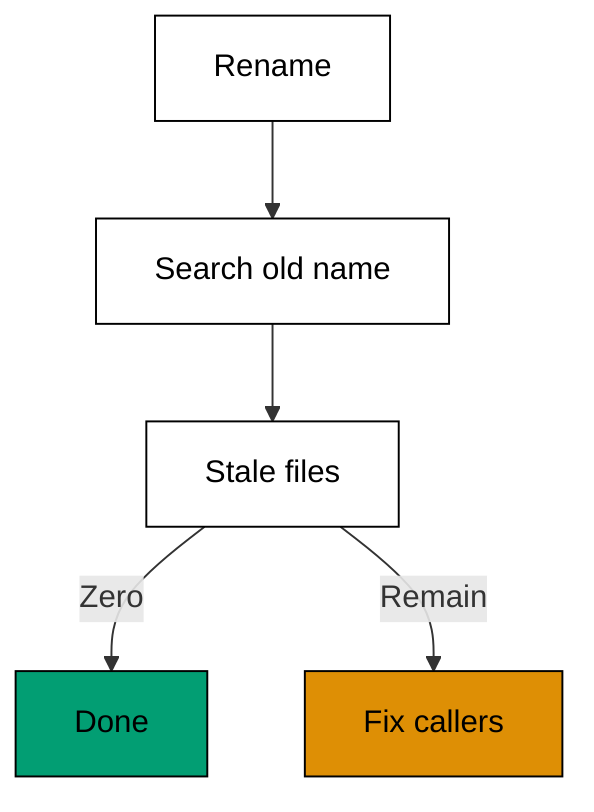

**`learning/code/ex-40-trace-a-rename-across-files/example.py`**:

```python
# => Fixture shim tracing a rename across three files.
# => Target release 2.1.304, checked against vendor docs on 2026-10-20.
# => File contents are fixed data; nothing is renamed here.
# => Real behaviour may differ; confirm with claude --help.

# => WHY both names: introduction without retirement breaks imports.
# => Stale callers fail at runtime, past review time.

OLD = "authenticate"  # => the name being retired
NEW = "check_credentials"  # => the name replacing it
FILES = {
    "login.py": "def check_credentials",
    "auth.py": "import authenticate",
}  # => one moved, one stale


def stale(files, old):  # => find files still naming the retired symbol
    return [
        f for f, b in files.items() if old in b
    ]  # => auth.py still says authenticate


def moved(files, new):  # => find files already naming the new symbol
    return [f for f, b in files.items() if new in b]  # => login.py moved


def main():  # => report moved and stale files for the rename
    print("moved:", moved(FILES, NEW))  # => Output: moved: ['login.py']
    print("stale:", stale(FILES, OLD))  # => Output: stale: ['auth.py']


main()  # => run once; stale callers break at import time
```

**Output** (`learning/code/ex-40-trace-a-rename-across-files/expected/main.stdout.txt`):

```text
moved: ['login.py']
stale: ['auth.py']
```

**Key takeaway**: Trace the old and new names through every file; stale callers are the rename's unfinished half.

**Why it matters**: A rename is two operations wearing one name: introducing the new symbol and retiring the old one. Agents reliably perform the first and occasionally forget the second, leaving imports that break at runtime rather than review time. Searching both names across the repo closes the loop mechanically. The trace is the rename's receipt. Demand it before approval and the rename lands whole or not at all.

### Example 41: A Test the Agent Wrote Itself

Agent-written tests can be tautologies that pass against any code. This example grades a generated test by mutation: break the code on purpose and check that the test notices. (Concepts: co-12.)

The shell invocation this example stands in for:

<!-- harness: illustration -->

```bash
claude -p "write a login test, then prove it fails against broken code"
```

**`learning/code/ex-41-a-test-the-agent-wrote-itself/example.py`**:

```python
# => Fixture shim grading generated tests by mutation.
# => Target release 2.1.304, checked against vendor docs on 2026-10-20.
# => Test bodies are fixed data; nothing executes here.
# => Real behaviour may differ; confirm with claude --help.
TEST = "assert login('a', 'wrong') is False"  # => a test with a real expectation
TAUTOLOGY = "assert True"  # => a test that passes against anything


def kills(test, broken):  # => a good test fails when the code breaks
    return "login" in test and broken  # => the real test names the behavior


def grade(test):  # => grade a generated test as strong or tautology
    if test.strip() == "assert True":  # => unconditional pass is worthless
        return "tautology"  # => it proves nothing about the code
    return "strong"  # => expectations about behavior earn trust


def main():  # => grade one strong test and one tautology
    print("real test:", grade(TEST))  # => Output: real test: strong
    print("tautology:", grade(TAUTOLOGY))  # => Output: tautology: tautology
    print("kills mutant:", kills(TEST, True))  # => Output: kills mutant: True


main()  # => run once; trust tests that can fail
```

**Output** (`learning/code/ex-41-a-test-the-agent-wrote-itself/expected/main.stdout.txt`):

```text
real test: strong
tautology: tautology
kills mutant: True
```

**Key takeaway**: Grade agent-written tests by whether they can fail; tautologies prove nothing.

**Why it matters**: An agent asked for tests feels pressure to deliver green, and the easiest green is a test with no expectation. Mutation thinking reverses the pressure: break the code deliberately and demand the test catch it. Tests that survive contact with broken code earn their place in the suite; the rest are decoration inflating your coverage numbers. Review generated tests harder than generated code. Code is checked by tests, but tests are checked only by you.

### Example 42: When Tests Disagree With the Diff

Green tests beside a suspicious diff, or red tests beside a clean one: disagreement means something is wrong with one of them. This example classifies the four combinations and names the suspect in each. (Concepts: co-12, co-08.)

The shell invocation this example stands in for:

<!-- harness: illustration -->

```bash
claude -p "the diff looks wrong but tests pass; find the coverage hole"
```

**`learning/code/ex-42-when-tests-disagree-with-the-diff/example.py`**:

```python
# => Fixture shim classifying test-versus-diff disagreement.
# => Target release 2.1.304, checked against vendor docs on 2026-10-20.
# => States are fixed data; no suite runs here.
# => Real behaviour may differ; confirm with claude --help.
CASES = [
    ("clean", "pass"),
    ("clean", "fail"),
    ("dirty", "pass"),
]  # => three of four combos


def suspect(diff, tests):  # => name what to distrust in each combination
    if diff == "clean" and tests == "pass":  # => agreement means proceed
        return "none"  # => nothing is suspect here
    if tests == "pass":  # => green tests beside a dirty diff
        return "the tests"  # => the suite may not cover the dirt
    return "the diff"  # => red tests beside a clean diff blame the change


def main():  # => classify the three disagreement cases
    for diff, tests in CASES:  # => walk each combination once
        print(diff, tests, "->", suspect(diff, tests))  # => Output: the suspect per row


main()  # => run once; disagreement is information, not noise
```

**Output** (`learning/code/ex-42-when-tests-disagree-with-the-diff/expected/main.stdout.txt`):

```text
clean pass -> none
clean fail -> the diff
dirty pass -> the tests
```

**Key takeaway**: When tests and diff disagree, distrust one explicitly instead of averaging them.

**Why it matters**: Agreement is comfortable and disagreement is diagnostic: it tells you exactly where to look. Green tests over a dirty diff indict the suite's coverage; red tests over a clean diff indict the change. Naming the suspect converts a vague bad feeling into a concrete next step. Never resolve the tension by rerunning until it passes. Flaky-looking disagreement is usually a real signal wearing a flaky costume.

### Example 43: Small Commits After Every Win

Agent sessions produce long uncommitted stretches where one revert loses everything. This example checkpoints each green step as a small commit so recovery never reaches further back than the last win. (Concepts: co-11, co-06.)

The shell invocation this example stands in for:

<!-- harness: illustration -->

```bash
claude -p "commit each green step with a short message as we go"
```

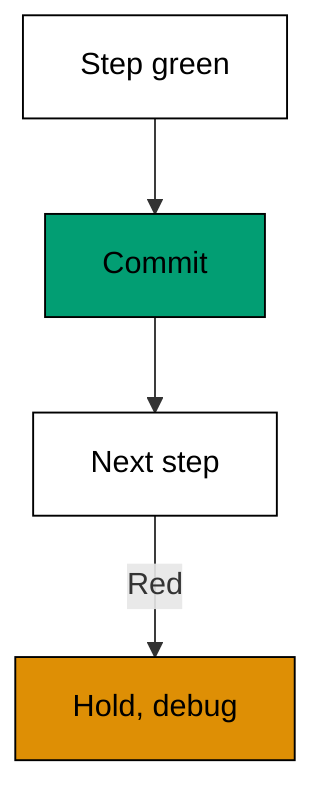

**`learning/code/ex-43-small-commits-after-every-win/example.py`**:

```python
# => Fixture shim checkpointing green steps as small commits.
# => Target release 2.1.304, checked against vendor docs on 2026-10-20.
# => Commits are fixed data; no repository is touched.
# => Real behaviour may differ; confirm with claude --help.
STEPS = [
    ("add check", True),
    ("refactor auth", True),
    ("docs", False),
]  # => two green, one red


def checkpoint(steps):  # => commit green steps, hold red ones
    commits = []  # => checkpointed messages collect here
    for message, green in steps:  # => walk steps in session order
        if green:  # => green steps become commits immediately
            commits.append(message)  # => record the checkpoint
        else:  # => red steps stop the checkpoint line
            break  # => nothing past a failure is safe
    return commits  # => the safe prefix of the session


def main():  # => checkpoint the three steps
    commits = checkpoint(STEPS)  # => two commits before the red step
    print("commits:", len(commits))  # => Output: commits: 2
    print("first:", commits[0])  # => Output: first: add check


main()  # => run once; commit the win before chasing the next
```

**Output** (`learning/code/ex-43-small-commits-after-every-win/expected/main.stdout.txt`):

```text
commits: 2
first: add check
```

**Key takeaway**: Commit every green step; recovery should never reach past the last win.

**Why it matters**: Uncommitted agent work is a single point of failure wearing a trench coat: one bad edit, one confused revert, and an hour evaporates. Small commits slice the session into recoverable units with messages that narrate the session for free. The red step stops the line, which is exactly right: checkpoint the known good, then debug from solid ground. Committing is cheap and reverts are surgical. Hoarding changes is expensive gambling.

### Example 44: The Whole Change in One Diff Stat

Before approving a multi-file session, read its shape in one stat: files touched, lines added, lines removed. This example aggregates per-file changes into the single summary line reviewers read first. (Concepts: co-06, co-11.)

The shell invocation this example stands in for:

<!-- harness: illustration -->

```bash
claude -p "summarize this session as one diff stat before I review"
```

**`learning/code/ex-44-the-whole-change-in-one-diff-stat/example.py`**:

```python
# => Fixture shim aggregating a session into one diff stat.
# => Target release 2.1.304, checked against vendor docs on 2026-10-20.
# => File stats are fixed data; no diff runs here.
# => Real behaviour may differ; confirm with claude --help.
FILES = {
    "login.py": (12, 3),
    "auth.py": (4, 4),
    "test_login.py": (20, 0),
}  # => added, removed per file


def aggregate(files):  # => total the session into files, added, removed
    names = sorted(files)  # => sorted names keep the stat deterministic
    added = sum(a for a, r in files.values())  # => added is 36 here
    removed = sum(r for a, r in files.values())  # => removed is 7 here
    return len(names), added, removed  # => the three stat numbers


def main():  # => render the session as one stat line
    files, added, removed = aggregate(FILES)  # => 3 files, 36 added, 7 removed
    print("files changed:", files)  # => Output: files changed: 3
    print("stat: +%d -%d" % (added, removed))  # => Output: stat: +36 -7


main()  # => run once; read the stat before the hunks
```

**Output** (`learning/code/ex-44-the-whole-change-in-one-diff-stat/expected/main.stdout.txt`):

```text
files changed: 3
stat: +36 -7
```

**Key takeaway**: Read the session's stat line first; shape anomalies deserve questions before hunks get answers.

**Why it matters**: The stat is the session's silhouette: three files and small numbers say focused fix, while a dozen files and hundreds of lines say something sprawled. Shape questions come cheap before hunk review and expensive after approval. Test files dominating the added count is healthy; production files with removals at zero deserve a look. Let the silhouette guide the microscope. Review energy follows the anomaly.

### Example 45: Where Transcripts Live

Sessions persist as transcripts on disk, which makes them auditable long after the terminal closes. This example models one transcript store's address scheme, the way this course's shim organizes its records, so the habit of looking records up transfers to your own tool. (Concepts: co-07, co-03.)

The shell invocation this example stands in for:

<!-- harness: illustration -->

```bash
claude -p "export this session's transcript so I can review it"
```

**`learning/code/ex-45-where-transcripts-live/example.py`**:

```python
# => Fixture shim of the transcript store address scheme.
# => Target release 2.1.304, checked against vendor docs on 2026-10-20.
# => Paths are fixed data; no disk is read here.
# => Real behaviour may differ; confirm with claude --help.
HOME = "~/.claude"  # => the configuration directory root
SESSIONS = ["auth-refactor", "docs-pass"]  # => two recorded sessions


def address(home, name):  # => build one transcript's address
    return home + "/transcripts/" + name + ".jsonl"  # => one path per session


def listing(home, sessions):  # => address every recorded session
    return [address(home, s) for s in sessions]  # => one address per name


def main():  # => list the transcript addresses
    for path in listing(HOME, SESSIONS):  # => walk both sessions
        print(path)  # => Output: the two transcript paths
    print("count:", len(SESSIONS))  # => Output: count: 2


main()  # => run once; transcripts outlive terminals
```

**Output** (`learning/code/ex-45-where-transcripts-live/expected/main.stdout.txt`):

```text
~/.claude/transcripts/auth-refactor.jsonl
~/.claude/transcripts/docs-pass.jsonl
count: 2
```

**Key takeaway**: Transcripts persist on disk by session; learn your tool's address scheme before you need it.

**Why it matters**: Knowing where transcripts live converts I remember roughly into let me show you exactly. Audits, handoffs, and post-mortems all start by opening the record, and the record is only useful if you can find it under pressure. Browsing old transcripts also teaches faster than any guide: real sessions show real mistakes and recoveries. The terminal forgets when it closes. The transcript store does not, so learn its address now.

### Example 46: Reconstruct a Session From Its Log

A transcript replays the session's decisions in order: prompts, calls, and results. This example replays a short log and extracts the decision points where the session could have turned out differently. (Concepts: co-07.)

The shell invocation this example stands in for:

<!-- harness: illustration -->

```bash
claude -p "summarize this session's key decisions from its transcript"
```

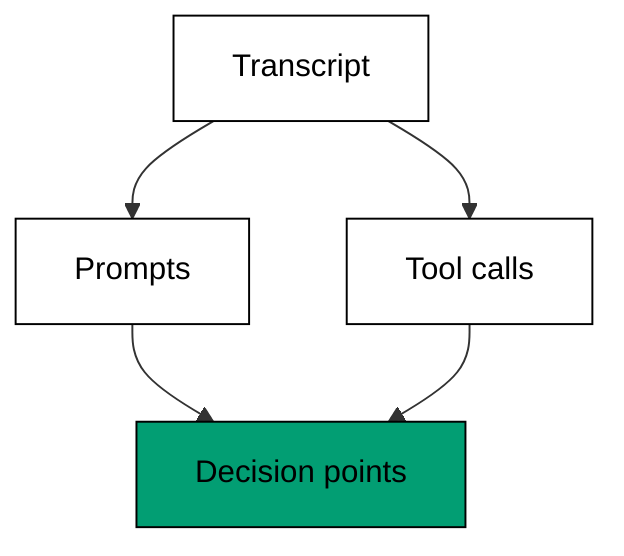

**`learning/code/ex-46-reconstruct-a-session-from-its-log/example.py`**:

```python
# => Fixture shim replaying a session log for decision points.
# => Target release 2.1.304, checked against vendor docs on 2026-10-20.
# => The log is fixed data; nothing is replayed for real.
# => Real behaviour may differ; confirm with claude --help.

# => WHY decision points: forks teach session design, events teach trivia.
# => One replay a week builds pattern recognition.
# => Prompts frame; edits commit; both deserve review.

LOG = [
    "prompt: fix login",
    "call: read login.py",
    "call: edit login.py",
]  # => three log lines


def decisions(log):  # => pull the lines where direction was chosen
    return [
        l for l in log if l.startswith("prompt") or "edit" in l
    ]  # => prompt plus the edit


def calls(log):  # => pull the tool-call lines alone
    return [l for l in log if l.startswith("call")]  # => the two call lines


def main():  # => replay the log as counts and decision points
    print("lines:", len(LOG))  # => Output: lines: 3
    print("calls:", len(calls(LOG)))  # => Output: calls: 2
    print("decisions:", len(decisions(LOG)))  # => Output: decisions: 2


main()  # => run once; logs replay decisions, not just events
```

**Output** (`learning/code/ex-46-reconstruct-a-session-from-its-log/expected/main.stdout.txt`):

```text
lines: 3
calls: 2
decisions: 2
```

**Key takeaway**: Replay the log for decision points, not just events; that is where the session turned.

**Why it matters**: Event-by-event replay tells you what happened without telling you why it mattered. Decision points are the lines where a different choice would have forked the session: the prompt's framing, the first edit, the accepted suggestion. Reviewing at that level teaches session design instead of session trivia. Keep a habit of replaying one session a week. The patterns you notice become the guardrails you write next.

### Example 47: Count Turns Per Task

Turn counts reveal which tasks are cheap and which quietly burn budgets. This example tallies turns per task across a session and names the most expensive one. (Concepts: co-10.)

The shell invocation this example stands in for:

<!-- harness: illustration -->

```bash
claude -p "report turn counts per task at the end of this session"
```

**`learning/code/ex-47-count-turns-per-task/example.py`**:

```python
# => Fixture shim tallying turns per task.
# => Target release 2.1.304, checked against vendor docs on 2026-10-20.
# => Turn counts are fixed data; no session ran here.
# => Real behaviour may differ; confirm with claude --help.
TASKS = {"login fix": 3, "auth refactor": 9, "docs": 2}  # => turns spent per task


def total(tasks):  # => add every task's turns into the session bill
    return sum(tasks.values())  # => 14 turns for this session


def dearest(tasks):  # => name the task that cost the most turns
    return max(tasks, key=tasks.get)  # => auth refactor at 9 turns


def average(tasks):  # => mean turns per task, one decimal honesty
    return round(total(tasks) / len(tasks), 1)  # => 4.7 turns here


def main():  # => report total, dearest, and average
    print("total turns:", total(TASKS))  # => Output: total turns: 14
    print("dearest:", dearest(TASKS))  # => Output: dearest: auth refactor
    print("average:", average(TASKS))  # => Output: average: 4.7


main()  # => run once; measure before optimizing
```

**Output** (`learning/code/ex-47-count-turns-per-task/expected/main.stdout.txt`):

```text
total turns: 14
dearest: auth refactor
average: 4.7
```

**Key takeaway**: Tally turns per task; the dearest task is where better briefs pay off first.

**Why it matters**: Turn counts make session cost visible while it is still manageable. The dearest task almost always shares a cause: a vague brief, a missing test, or scope that grew mid-session. Measuring first keeps optimization honest, because you improve the task the numbers indict rather than the one that annoyed you most recently. What gets measured gets briefed better. Start counting and the waste shows itself.

### Example 48: Estimate Token Cost Before Lunch

Tokens are countable, so session cost is estimable without any price list. This example adds input and output tokens across turns and reports the session's consumption in plain token counts. (Concepts: co-10.)

The shell invocation this example stands in for:

<!-- harness: illustration -->

```bash
claude -p "show token counts with each answer in this session"
```

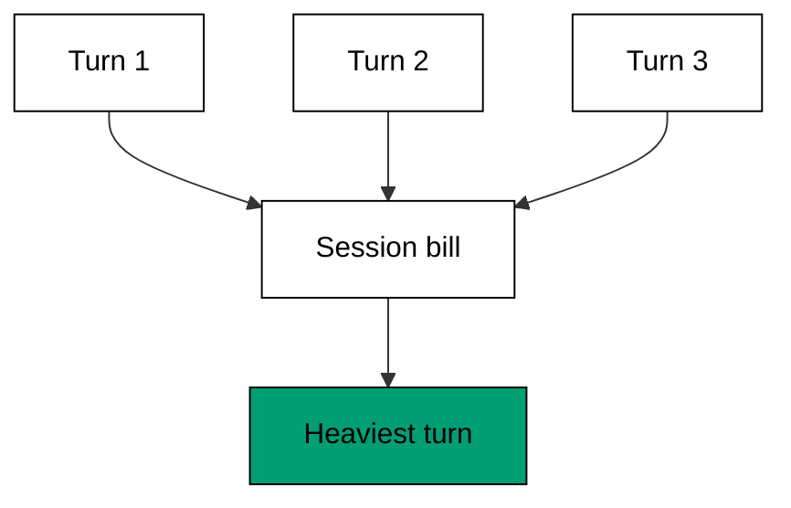

**`learning/code/ex-48-estimate-token-cost-before-lunch/example.py`**:

```python
# => Fixture shim adding token consumption across turns.
# => Target release 2.1.304, checked against vendor docs on 2026-10-20.
# => Counts are fixed data; counts, never prices, are reported.
# => Real behaviour may differ; confirm with claude --help.
TURNS = [(1200, 300), (800, 900), (2000, 400)]  # => input, output per turn


def add(turns):  # => total input and output tokens separately
    total_in = sum(i for i, o in turns)  # => 4000 input tokens here
    total_out = sum(o for i, o in turns)  # => 1600 output tokens here
    return total_in, total_out  # => the pair tells the session's shape


def share(turns):  # => which turn consumed the most tokens
    sizes = [i + o for i, o in turns]  # => per-turn totals
    return sizes.index(max(sizes)) + 1  # => turn numbers start at 1


def main():  # => report the token bill for three turns
    total_in, total_out = add(TURNS)  # => 4000 in, 1600 out
    print("input tokens:", total_in)  # => Output: input tokens: 4000
    print("output tokens:", total_out)  # => Output: output tokens: 1600
    print("heaviest turn:", share(TURNS))  # => Output: heaviest turn: 3


main()  # => run once; count tokens, discuss prices elsewhere
```

**Output** (`learning/code/ex-48-estimate-token-cost-before-lunch/expected/main.stdout.txt`):

```text
input tokens: 4000
output tokens: 1600
heaviest turn: 3
```

**Key takeaway**: Count input and output tokens per turn; consumption you can see is consumption you can budget.

**Why it matters**: Token counts are facts while prices are weather: they change with plans, models, and regions. Counting tokens keeps your budgeting stable across all of that, because the consumption shape of your work changes slower than any price list. Heavy turns usually mean pasted context or looping retries, both fixable. Track the counts for a week. You will know exactly which habit to change first, priced in your own usage.

### Example 49: Cache Hits Are Free Turns

Unchanged context can be reused instead of re-read, which makes stable prefixes nearly free. This example models cached versus fresh turns and shows how a stable brief multiplies the savings. (Concepts: co-10, co-03.)

The shell invocation this example stands in for:

<!-- harness: illustration -->

```bash
claude -p "keep this brief prefix stable so caching applies"
```

**`learning/code/ex-49-cache-hits-are-free-turns/example.py`**:

```python
# => Fixture shim of prompt-cache savings on stable context.
# => Target release 2.1.304, checked against vendor docs on 2026-10-20.
# => Hit rates are fixed data; no cache exists here.
# => Real behaviour may differ; confirm with claude --help.
PREFIX = 10000  # => stable context tokens reused every turn
FRESH = 500  # => new tokens each turn actually reads


def cost(turns, hit):  # => bill turns with a cache hit rate applied
    saved = int(PREFIX * hit)  # => cached tokens skip the full read
    return turns * (PREFIX + FRESH - saved)  # => the billed total


def main():  # => bill five turns cached and uncached
    print("uncached:", cost(5, 0.0))  # => Output: uncached: 52500
    print("cached:", cost(5, 0.9))  # => Output: cached: 7500
    print("saved:", cost(5, 0.0) - cost(5, 0.9))  # => Output: saved: 45000


main()  # => run once; stable prefixes earn the cache
```

**Output** (`learning/code/ex-49-cache-hits-are-free-turns/expected/main.stdout.txt`):

```text
uncached: 52500
cached: 7500
saved: 45000
```

**Key takeaway**: Keep the stable context stable; cache hits turn repeated turns nearly free.

**Why it matters**: The cache rewards boring session hygiene: same brief prefix, same memory files, same tool surface turn after turn. Churn at the top of the context invalidates the savings, so put volatile details at the end where they disturb nothing. Switching models mid-session also restarts the cache, which makes model hopping an expensive hobby. Design sessions for prefix stability. The cache pays you back every turn after the first.

### Example 50: Compact Without Losing the Plot

Long sessions outgrow their context, and compaction summarizes the old turns into a shorter replacement. This example models what a good summary keeps: decisions, open items, and names, never raw chatter. (Concepts: co-03.)

The shell invocation this example stands in for:

<!-- harness: illustration -->

```bash
claude -p "compact now and confirm the open items survived"
```

**`learning/code/ex-50-compact-without-losing-the-plot/example.py`**:

```python
# => Fixture shim of session compaction into a kept summary.
# => Target release 2.1.304, checked against vendor docs on 2026-10-20.
# => Turns are fixed data; nothing is summarized for real.
# => Real behaviour may differ; confirm with claude --help.

# => WHY compact early: checking needs a memory you still hold.
# => Open items stated plainly survive summarization.
# => Lossy by design, so choose what survives.

TURNS = [
    "decided: use check()",
    "chatter: hmm let me see",
    "open: write test",
]  # => three turns


def keep(turns):  # => keep decisions and open items, drop chatter
    kept = [
        t for t in turns if t.startswith(("decided", "open"))
    ]  # => two lines survive
    return kept  # => the compacted summary lines


def ratio(turns, kept):  # => how much context compaction reclaimed
    return "%d of %d kept" % (len(kept), len(turns))  # => 2 of 3 here


def main():  # => compact three turns and report the ratio
    kept = keep(TURNS)  # => decisions and open items survive
    print("kept:", kept)  # => Output: kept: the two surviving lines
    print("ratio:", ratio(TURNS, kept))  # => Output: ratio: 2 of 3 kept


main()  # => run once; compact before the window fills
```

**Output** (`learning/code/ex-50-compact-without-losing-the-plot/expected/main.stdout.txt`):

```text
kept: ['decided: use check()', 'open: write test']
ratio: 2 of 3 kept
```

**Key takeaway**: Compact early and deliberately; a summary of decisions beats a truncation of chatter.

**Why it matters**: Compaction is lossy by design, so the question is what survives: decisions, open items, and names carry the session forward, while deliberation chatter does not. Compact while you still remember the session well enough to check the summary, not after the window forces it mid-thought. State the open items explicitly before compacting so they land in the summary. A good compact feels like a handoff to a competent colleague.

### Example 51: The Context Window Budget

The context window fills from several sources at once: memory files, tool results, and conversation. This example budgets the window across its claimants and refuses the read that would overflow it. (Concepts: co-03.)

The shell invocation this example stands in for:

<!-- harness: illustration -->

```bash
claude -p "check context usage before reading the whole module"
```

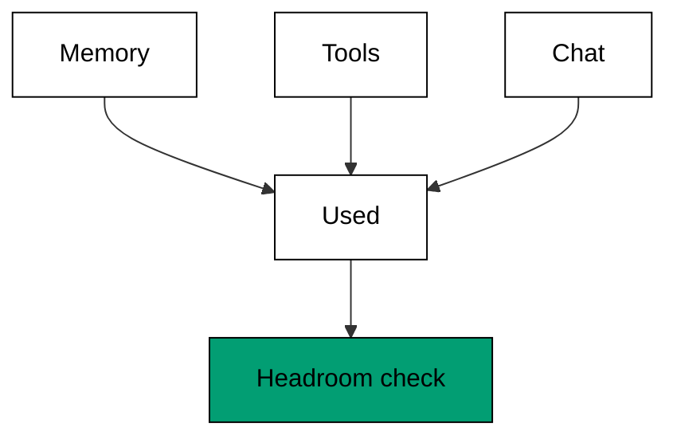

**`learning/code/ex-51-the-context-window-budget/example.py`**:

```python
# => Fixture shim budgeting a fixed context window.
# => Target release 2.1.304, checked against vendor docs on 2026-10-20.
# => Sizes are fixed data; no window exists here.
# => Real behaviour may differ; confirm with claude --help.
WINDOW = 200000  # => the total token budget for this session
CLAIMANTS = {"memory": 20000, "tools": 60000, "chat": 40000}  # => three current claims


def used(claimants):  # => add every claimant's current hold
    return sum(claimants.values())  # => 120000 tokens held here


def free(window, claimants):  # => the headroom left for new reads
    return window - used(claimants)  # => 80000 tokens free here


def fits(window, claimants, request):  # => a read fits when headroom covers it
    return request <= free(window, claimants)  # => True or False, no partial reads


def main():  # => budget the window and test two read sizes
    print("used:", used(CLAIMANTS))  # => Output: used: 120000
    print("free:", free(WINDOW, CLAIMANTS))  # => Output: free: 80000
    print("fits 90000:", fits(WINDOW, CLAIMANTS, 90000))  # => Output: fits 90000: False


main()  # => run once; refuse reads that overflow the budget
```

**Output** (`learning/code/ex-51-the-context-window-budget/expected/main.stdout.txt`):

```text
used: 120000
free: 80000
fits 90000: False
```

**Key takeaway**: Budget the window across memory, tools, and chat; refuse reads that would overflow it.

**Why it matters**: Every file read spends shared headroom, so indiscriminate reading starves the conversation it was meant to inform. Budgeting makes the trade visible: this read costs that much future attention. Big tool results are the usual overflow culprits; scope them with filters before they land. When headroom runs low, compact or narrow scope instead of hoping. Hope is not a memory strategy, and overflow degrades silently.

### Example 52: Export the Transcript

Transcripts become useful when they leave the tool: pasted into reviews, attached to handoffs, or mined for patterns. This example renders a short transcript as portable lines with roles attached. (Concepts: co-07.)

The shell invocation this example stands in for:

<!-- harness: illustration -->

```bash
claude -p "export this transcript with roles for the review thread"
```

**`learning/code/ex-52-export-the-transcript/example.py`**:

```python
# => Fixture shim rendering a transcript as portable lines.
# => Target release 2.1.304, checked against vendor docs on 2026-10-20.
# => Entries are fixed data; nothing is exported for real.
# => Real behaviour may differ; confirm with claude --help.
ENTRIES = [
    ("you", "fix login"),
    ("agent", "read login.py"),
    ("you", "approved"),
]  # => three entries


def render(entries):  # => render each entry as a role-tagged line
    return ["[%s] %s" % (role, text) for role, text in entries]  # => three tagged lines


def turns_by(entries, role):  # => count one role's turns in the session
    return sum(1 for r, t in entries if r == role)  # => you: 2, agent: 1


def main():  # => render the transcript and count roles
    for line in render(ENTRIES):  # => print each tagged line
        print(line)  # => Output: the three role-tagged lines
    print("your turns:", turns_by(ENTRIES, "you"))  # => Output: your turns: 2


main()  # => run once; portable transcripts travel to reviews
```

**Output** (`learning/code/ex-52-export-the-transcript/expected/main.stdout.txt`):

```text
[you] fix login
[agent] read login.py
[you] approved
your turns: 2
```

**Key takeaway**: Export transcripts as role-tagged lines; portable records feed reviews and handoffs.

**Why it matters**: A session that stays inside the tool helps one person once. Exported, the same session teaches the team: reviewers see the reasoning behind the diff, successors inherit the dead ends already explored, and leads spot patterns across sessions. Role tags keep the portable version readable without the tool's chrome. Export the sessions that taught you something. Your future self files the best bug reports against your past sessions.

### Example 53: Cost Bounded Refinement Loop

Iterating toward green can spiral: each retry costs turns while success stays one more try away. This example loops fix-and-test cycles under a hard attempt cap and reports honestly when the cap wins. (Concepts: co-10, co-12.)

The shell invocation this example stands in for:

<!-- harness: illustration -->

```bash
claude -p "try at most five fixes; report green or capped with the trace"
```

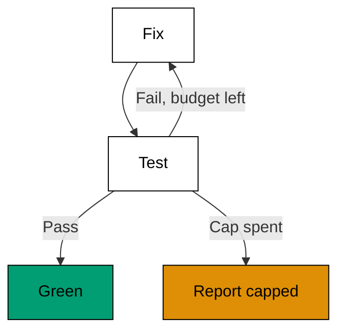

**`learning/code/ex-53-cost-bounded-refinement-loop/example.py`**:

```python
# => Fixture shim of fix-and-test cycles under an attempt cap.
# => Target release 2.1.304, checked against vendor docs on 2026-10-20.
# => Outcomes are fixed data; no code is fixed here.
# => Real behaviour may differ; confirm with claude --help.
OUTCOMES = ["fail", "fail", "pass"]  # => green arrives on the third try
CAP = 5  # => five attempts maximum, agreed up front


def refine(outcomes, cap):  # => walk outcomes until pass or cap
    tried = 0  # => attempts consumed so far
    for outcome in outcomes[:cap]:  # => never look past the cap
        tried += 1  # => each outcome costs one attempt
        if outcome == "pass":  # => green ends the loop early
            return "green", tried  # => success plus its price
    return "capped", tried  # => honesty when the cap wins


def main():  # => refine three outcomes under a cap of five
    result, tried = refine(OUTCOMES, CAP)  # => green after 3 tries
    print("result:", result)  # => Output: result: green
    print("tried:", tried)  # => Output: tried: 3
    print("cap:", CAP)  # => Output: cap: 5


main()  # => run once; caps convert spirals into reports
```

**Output** (`learning/code/ex-53-cost-bounded-refinement-loop/expected/main.stdout.txt`):

```text
result: green
tried: 3
cap: 5
```

**Key takeaway**: Cap refinement loops by attempts; report green with its price or capped with honesty.

**Why it matters**: Unbounded retry loops feel productive because motion resembles progress. A cap forces the loop to be an experiment with a defined end instead of a habit with a hopeful name. Green within budget is a win with a receipt; hitting the cap is information that the approach needs rethinking, not more turns. Either outcome beats the spiral. The cap is not pessimism about the agent; it is respect for your evening.
