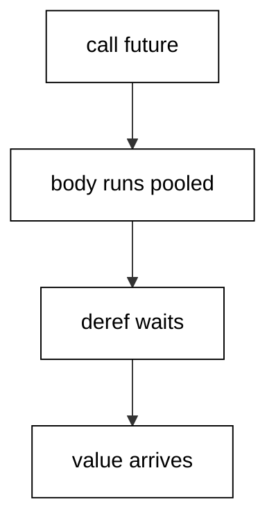
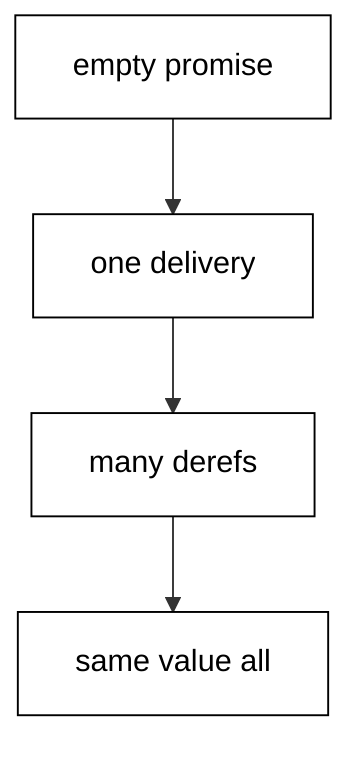
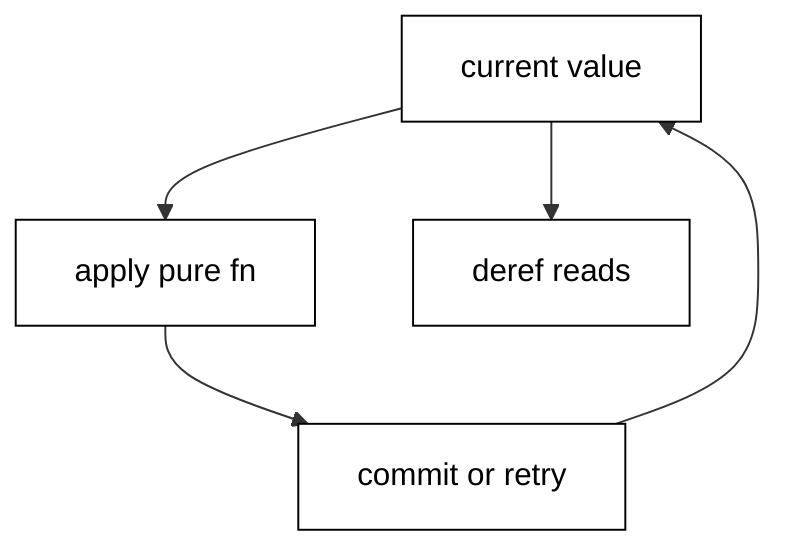
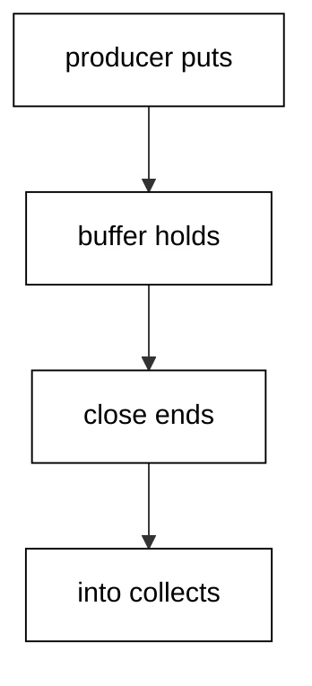
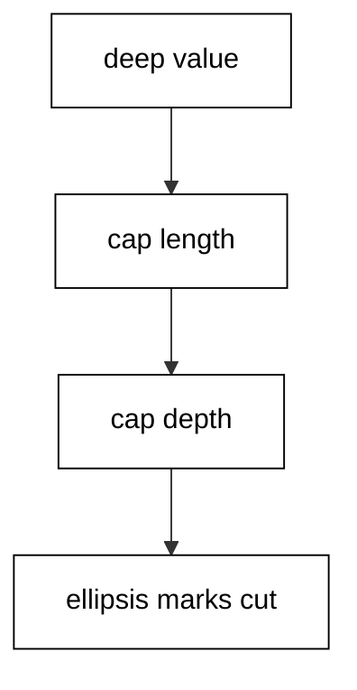
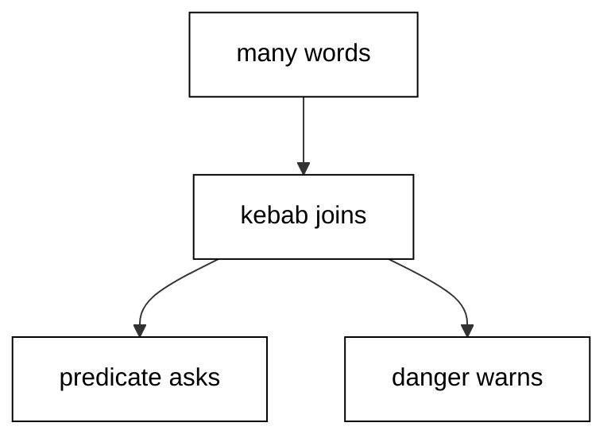
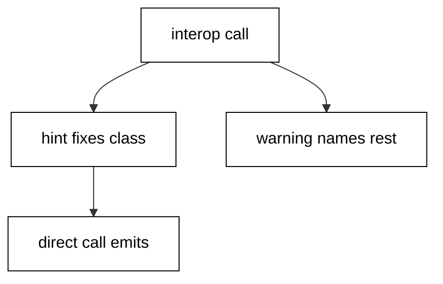
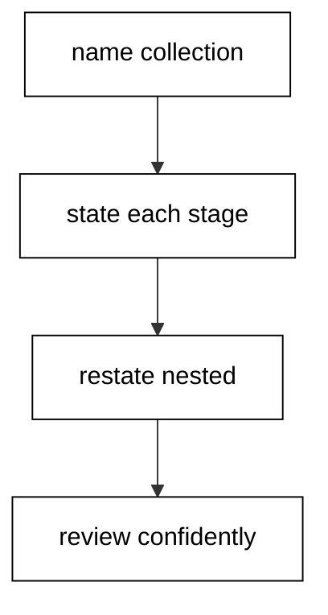
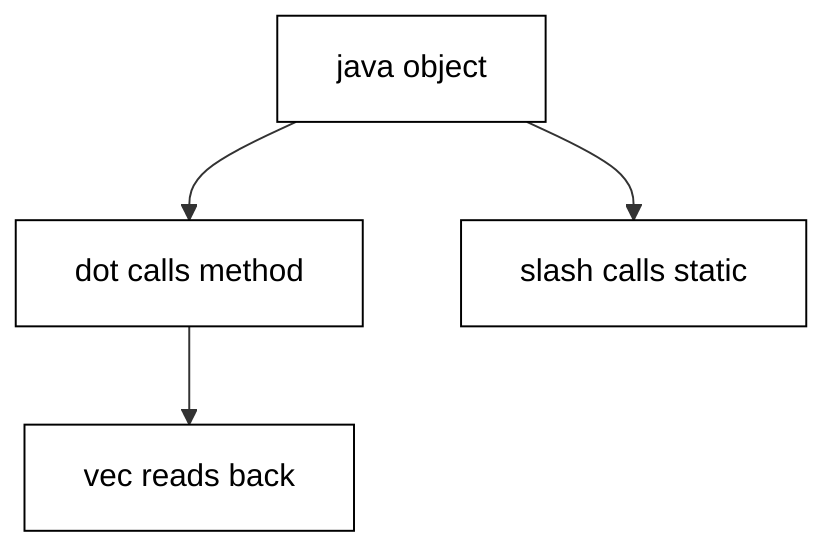
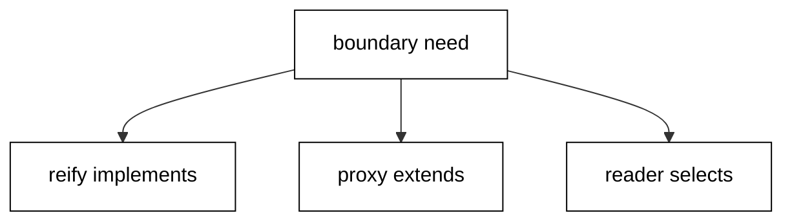

Examples 54-78 survey the ground senior developers stand on: the concurrency primitives and when each earns its place, the formatter, linter, and style rules that keep teams coherent, and a systematic way to read unfamiliar idiomatic code. Three clusters carry the level: concurrency primitives (Examples 54-61), tooling, linting, and style (Examples 62-70), and reading idiomatic code (Examples 71-78). Concurrency demos simulate rather than exhibit: fixed buffers, rendezvous reads, and sorted transcripts keep every run byte-stable.

### Example 54: Futures That Deliver Off-Thread

`future` runs its body on another thread and dereferencing blocks until the value arrives (Concepts: co-09.)



The body starts immediately on a pooled thread while the main thread continues, which overlaps computation with whatever comes next. Dereferencing with `@` waits as long as needed and then yields the value, so the join point is explicit rather than hidden. Failures travel with the future: dereferencing a failed future throws, and catching around the deref turns the failure into data. Futures suit one-shot background computations with a single consumer, and the demo pairs a successful sum with a caught failure to show both paths.

**`learning/code/ex-54-futures-delivery/main.clj`**:

```clojure
;; => future runs the body on another thread; deref blocks until it delivers.
(let [f (future (reduce + (range 101)))] ;; => sum 0..100 off the main thread
  (println @f)) ;; => prints 5050, deref waits for delivery
;; => Failures travel with the future; catch around the deref, not inside.
(let [g (future (throw (ex-info "boom" {})))] ;; => doomed from the start
  (println "failed:" (try @g (catch Exception _ true)))) ;; => prints failed: true
(shutdown-agents) ;; => stop the pools so the script exits promptly
```

**Output** (`learning/code/ex-54-futures-delivery/expected/main.stdout.txt`):

```text
5050
failed: true
```

**Key takeaway**: `future` starts background work and `@` blocks until the value or the failure arrives.

**Why it matters**: Blocking calls and slow computations stall the main thread when run inline, and futures are the lightest way to move them aside. Explicit join points keep the concurrency visible instead of smeared across callbacks.

### Example 55: Promises as One-Shot Mailboxes

A promise is an empty mailbox that one delivery fills and any number of readers then dereference (Concepts: co-09.)



Creating a promise allocates the mailbox with nothing inside, and the first `deliver` fixes its value forever. Later deliveries are ignored rather than errors, which makes exactly-once handoff structural: the first writer wins and every reader agrees. Dereferencing replays the same value to every reader without consuming it, unlike a channel take. Promises connect code that cannot share a call stack: one side delivers when its work finishes, and the other side blocks on the deref until then.

**`learning/code/ex-55-promises-mailbox/main.clj`**:

```clojure
;; => promise is a one-shot mailbox: deliver once, deref anywhere, many times.
(let [p (promise)] ;; => empty mailbox
  (deliver p 42) ;; => exactly one delivery fills it
  (println @p) ;; => prints 42
  (println @p)) ;; => prints 42 again, values replay freely
;; => A second delivery keeps the first value: first writer wins, always.
(let [p (promise)] ;; => another empty mailbox
  (deliver p :first) ;; => fills it
  (deliver p :second) ;; => ignored, mailbox already full
  (println @p)) ;; => prints :first
```

**Output** (`learning/code/ex-55-promises-mailbox/expected/main.stdout.txt`):

```text
42
42
:first
```

**Key takeaway**: `promise` allocates the mailbox, one `deliver` fills it, and every deref replays the value.

**Why it matters**: Callback handoffs and cross-thread rendezvous need exactly-once delivery without locks, and promises are the smallest primitive that provides it. First-writer-wins removes whole races by construction.

### Example 56: Atoms for Synchronous Shared State

Atoms hold state that updates synchronously through pure functions, with retries keeping every swap atomic (Concepts: co-09, co-11.)



`swap!` applies the update function to the current value and commits only if nothing changed underneath, retrying with the fresh value otherwise. Because the function may run more than once, it must stay pure: side effects inside `swap!` repeat unpredictably. `reset!` sets outright for the rare cases where the old value truly does not matter. `compare-and-set!` swaps only from an expected value and reports whether it did, which builds locks and once-flags from the same primitive. Dereferencing reads the current value without coordination, completing the picture.

**`learning/code/ex-56-atoms-synchronous-state/main.clj`**:

```clojure
;; => Atoms hold synchronous state; swap! applies a function atomically, always.
(def counter (atom 0)) ;; => shared counter, starts at zero
(swap! counter + 5) ;; => add five atomically
(swap! counter inc) ;; => add one more
(println @counter) ;; => prints 6
;; => reset! sets outright; compare-and-set! swaps only from the expected value.
(reset! counter 10) ;; => back to ten
(println (compare-and-set! counter 10 11)) ;; => prints true, swap happened
(println @counter) ;; => prints 11
```

**Output** (`learning/code/ex-56-atoms-synchronous-state/expected/main.stdout.txt`):

```text
6
true
11
```

**Key takeaway**: `swap!` commits pure updates atomically with retries, and `compare-and-set!` swaps conditionally.

**Why it matters**: Shared counters, caches, and registries all need exactly this primitive, and atoms provide it without a single lock. The purity requirement on swap functions prevents the duplicated-effect bugs locks merely serialize.

### Example 57: Refs That Commit Together or Not at All

`dosync` wraps coordinated updates across refs into one transaction that retries to a consistent commit (Concepts: co-09.)

Two account balances must move together or the money appears and vanishes in the same instant, and refs with `dosync` make the transfer atomic. `alter` applies update functions inside the transaction, queuing the changes until commit rather than writing through. Concurrent transactions retry automatically against fresh values, so no lock ordering discipline is needed and deadlocks cannot form. Reads inside see a consistent snapshot while reads outside see only committed values, which is the isolation guarantee doing its quiet work.

**`learning/code/ex-57-refs-and-dosync/main.clj`**:

```clojure
;; => Refs coordinate across identities: dosync retries the transaction to commit.
(def balance-a (ref 100)) ;; => first account
(def balance-b (ref 50)) ;; => second account
(dosync ;; => both updates commit together or not at all
  (alter balance-a - 30) ;; => debit thirty
  (alter balance-b + 30)) ;; => credit thirty
(println @balance-a @balance-b) ;; => prints 70 80
```

**Output** (`learning/code/ex-57-refs-and-dosync/expected/main.stdout.txt`):

```text
70 80
```

**Key takeaway**: `dosync` commits coordinated `alter` updates atomically, retrying against fresh values on contention.

**Why it matters**: Multi-identity updates without transactions corrupt by interleaving, and lock-based fixes deadlock by ordering. Software transactional memory removes both failure modes, which is why ledgers and inventories reach for refs.

### Example 58: Agents That Queue Asynchronous Actions

Agents hold state that updates through queued actions, each running alone while senders never wait (Concepts: co-09.)

`send` queues an action function and returns immediately, so producers never block on the state they update. Actions apply one at a time in queue order, which keeps each transition simple even under many concurrent senders. `await` blocks until the queued actions drain, giving tests and shutdown paths a deterministic join point. The agent pools use non-daemon threads, so scripts call `shutdown-agents` at the end to let the JVM exit promptly. Logging, indexing, and cache warming all fit this shape: fire-and-forget updates with ordered application.

**`learning/code/ex-58-agents-async-actions/main.clj`**:

```clojure
;; => Agents hold async state: send queues actions, await waits for draining.
(def log-agent (agent [])) ;; => starts empty
(send log-agent conj :a) ;; => queue append of :a
(send log-agent conj :b) ;; => queue append of :b
(await log-agent) ;; => block until both actions applied
(println @log-agent) ;; => prints [:a :b]
;; => Pools use non-daemon threads, so scripts shut them down to exit.
(shutdown-agents) ;; => drains pools; prints nothing, exits promptly
```

**Output** (`learning/code/ex-58-agents-async-actions/expected/main.stdout.txt`):

```text
[:a :b]
```

**Key takeaway**: `send` queues actions without blocking, they apply in order, and `await` joins the drain.

**Why it matters**: Background bookkeeping that blocks its producers defeats its own purpose, and agents decouple the two with ordering guarantees callbacks cannot offer. The await point keeps the asynchrony testable instead of hopeful.

### Example 59: core.async Channels That Decouple Stages

Channels carry values between producers and consumers, with fixed buffers smoothing bursts without threads (Concepts: co-09.)



A buffered channel accepts puts until full, so producers spurt ahead exactly as far as the buffer allows before parking. `>!!` blocks the putter when full while `close!` ends the stream, letting takes drain what remains and then return `nil`. `async/into` collects a whole channel into a target collection and delivers it through its own channel, which the final take reads. No consumer thread appears in this example because buffered puts and the close need none; blocking takes would park politely rather than spin.

**`learning/code/ex-59-core-async-channels/main.clj`**:

```clojure
(require '[clojure.core.async :as async]) ;; => channels, locked and pinned
;; => Buffers decouple puts from takes; close! ends the stream; into collects.
(let [c (async/chan 3)] ;; => buffer of three, no parking yet
  (async/>!! c :a) ;; => first put lands in the buffer
  (async/>!! c :b) ;; => second put lands beside it
  (async/close! c) ;; => no more puts; takes drain what remains
  (println (async/<!! (async/into [] c)))) ;; => prints [:a :b]
```

**Output** (`learning/code/ex-59-core-async-channels/expected/main.stdout.txt`):

```text
[:a :b]
```

**Key takeaway**: Buffered channels decouple producers from consumers, `close!` ends the stream, and `into` collects it.

**Why it matters**: Pipeline stages running at different speeds need a queue between them, and channels are that queue with backpressure built in. Fixed buffers bound memory while keeping both sides independently paced.

### Example 60: go Blocks That Transform Without Threads

`go` blocks run parked transforms on a shared pool, turning channel stages into pipelines without thread bookkeeping (Concepts: co-09.)

Inside `go`, the parking takes and puts yield the pooled thread while waiting, so thousands of stages share a handful of threads. The squaring stage loops over its input with `when-some`, transforming each value and recurring until the channel closes, then closing its own output to propagate the ending downstream. The feeder stage puts three values and closes, which bounds the whole run deterministically. Collecting through `into` and sorting before printing keeps the transcript fixed regardless of scheduling, which is the simulation discipline concurrency examples follow.

**`learning/code/ex-60-core-async-go-pipeline/main.clj`**:

```clojure
(require '[clojure.core.async :as async]) ;; => go parks without blocking threads
;; => go blocks transform in the background; into collects; sort fixes order.
(let [in (async/chan 4) out (async/chan 4)] ;; => two buffered channels
  (async/go (loop [] (if-let [x (async/<! in)] (do (async/>! out (* x x)) (recur)) (async/close! out)))) ;; => square everything
  (async/go (async/>! in 1) (async/>! in 2) (async/>! in 3) (async/close! in)) ;; => feed three values
  (println (sort (async/<!! (async/into [] out))))) ;; => prints (1 4 9)
```

**Output** (`learning/code/ex-60-core-async-go-pipeline/expected/main.stdout.txt`):

```text
(1 4 9)
```

**Key takeaway**: `go` parks instead of blocking, stages close outputs to propagate endings, and sorted collects keep transcripts fixed.

**Why it matters**: Thread-per-stage pipelines cap out in the hundreds while go-block pipelines scale to the thousands, and the code reads the same either way. Parking instead of blocking is the efficiency story of the whole library.

### Example 61: Choosing the Concurrency Primitive

One counter takes an atom, coordinated balances take refs, background logs take agents, and pipelines take channels (Concepts: co-09.)

A single identity updated synchronously is the atom case, and reaching past it adds machinery without benefit. Multiple identities that must move together are the refs case, where transactions replace lock ordering. Fire-and-forget updates from impatient producers are the agent case, with ordering but no waiting. Stages at different speeds with bounded memory are the channel case, where buffers absorb the bursts. Futures and promises cover the two rendezvous shapes: one-shot background values and first-writer-wins handoffs. The demo prints the policy table the survey examples each proved one row of.

**`learning/code/ex-61-choosing-concurrency/main.clj`**:

```clojure
;; => Atoms for single state, refs for coordinated state, agents for async acts.
(require '[clojure.string :as str]) ;; => join renders the table rows
(def picks [["need" "reach for"] ["one counter" "atom plus swap!"] ["two accounts" "refs plus dosync"] ["background log" "agent plus send"] ["pipeline stages" "core.async channels"]]) ;; => the survey policy
(doseq [[need reach] picks] ;; => one row per need
  (println (str need " => " reach))) ;; => prints the row
```

**Output** (`learning/code/ex-61-choosing-concurrency/expected/main.stdout.txt`):

```text
need => reach for
one counter => atom plus swap!
two accounts => refs plus dosync
background log => agent plus send
pipeline stages => core.async channels
```

**Key takeaway**: Atoms for one identity, refs for coordinated many, agents for async acts, channels for pipelines.

**Why it matters**: Every concurrency bug report starts with the wrong primitive: locks around atoms, threads moving coordinated state, queues without backpressure. The choice table turns the decision into a lookup instead of a gamble.

### Example 62: Print Control for Readable Output

Print bindings bound what readers see, and `pprint` lays data out, which together keep output reviewable (Concepts: co-12, co-14.)



Unbounded printing of large or deep structures floods logs and transcripts, so `*print-length*` caps collection elements and `*print-level*` caps nesting depth, each with an ellipsis marking the cut. `pr-str` renders values to readable strings under those bounds, which tests capture and compare. `clojure.pprint` goes further for human reading, breaking wide maps across lines within a width budget. The demo prints a deliberately deep value under tight bounds, showing exactly where each ellipsis lands.

**`learning/code/ex-62-print-control-and-pprint/main.clj`**:

```clojure
;; => Print bindings bound output; ellipsis marks every cut, deterministically.
(binding [*print-length* 3 *print-level* 2] ;; => three elements deep, two levels down
  (println (pr-str {:a {:deep [1 2 3 4]} :b (range 100)}))) ;; => prints the bounded shape
;; => pr-str renders values to strings; tests capture and compare them.
(println (pr-str [1 {:a 2} "three"])) ;; => prints [1 {:a 2} "three"]
```

**Output** (`learning/code/ex-62-print-control-and-pprint/expected/main.stdout.txt`):

```text
{:a {:deep #}, :b (0 1 2 ...)}
[1 {:a 2} "three"]
```

**Key takeaway**: `*print-length*` caps elements, `*print-level*` caps depth, and `pprint` lays wide data out readably.

**Why it matters**: Flooded logs hide the signal they were meant to carry, and unbounded test output turns diffs into noise. Print discipline is output hygiene, and it costs two bindings.

### Example 63: Linter Configuration Read as Data

The linter's configuration is data with one level per rule, and reading it back proves the policy landed (Concepts: co-12.)

`clj-kondo` lints without running code, catching unresolved symbols and unused bindings at edit time rather than in production. Its configuration file names each linter with a severity level, and severities escalate from warning to error as the team's confidence grows. Because the configuration is EDN data, scripts and tests can read it back and assert the policy, which is exactly what this demo does against a fixture of the real shape. The linter itself runs in editors and CI where sources live; here the survey states the policy and proves it readable.

**`learning/code/ex-63-linter-config-as-data/main.clj`**:

```clojure
(require '[clojure.edn :as edn]) ;; => linter config is data too
;; => The config names each linter and its level; the script reads it as data.
(let [config (edn/read-string (slurp "kondo.edn"))] ;; => fixture stands in for .clj-kondo/config.edn
  (println (:level (:unresolved-symbol (:linters config)))) ;; => prints :error
  (println (:level (:unused-binding (:linters config))))) ;; => prints :warning
```

**Output** (`learning/code/ex-63-linter-config-as-data/expected/main.stdout.txt`):

```text
:error
:warning
```

**Key takeaway**: Linter levels live in EDN configuration, and reading the levels back proves the policy.

**Why it matters**: Style rules enforced only by humans drift within weeks, while linter configuration enforced in CI holds for years. Stating the policy as data makes it reviewable, versioned, and testable like everything else.

### Example 64: REPL-Driven Experiments Scripted Small

The REPL loops read, eval, and print, and `eval` runs quoted data as code, which scripts the same experiments (Concepts: co-12.)

Interactive development evaluates one form at a time and inspects the result before writing the next, which keeps feedback immediate and hypotheses cheap. `eval` performs the evaluation step on quoted forms, so experiments built as data run exactly like experiments typed at a prompt. Recent results bind to `*1` inside a real REPL for chaining; scripts bind their own locals for the same effect with clearer names. The demo evaluates a sum and a constructed mapping call, then chains a pretend previous answer forward, showing the whole loop in three prints.

**`learning/code/ex-64-repl-driven-experiments/main.clj`**:

```clojure
;; => The REPL loop is read, eval, print; eval runs quoted forms as code.
(println (eval '(+ 1 2))) ;; => prints 3, evaluated from data
(println (eval (list 'map 'inc [1 2]))) ;; => prints (2 3), built then run
;; => *1 holds the last answer in a real REPL; scripts name their own chain.
(let [last-answer 41] ;; => pretend the previous experiment said 41
  (println (inc last-answer))) ;; => prints 42, the next experiment step
```

**Output** (`learning/code/ex-64-repl-driven-experiments/expected/main.stdout.txt`):

```text
3
(2 3)
42
```

**Key takeaway**: `eval` runs quoted forms as code, so REPL experiments script exactly as they were typed.

**Why it matters**: Tight feedback separates productive Clojure sessions from edit-compile guesswork, and the REPL is where designs get tested before files change. Scripting the same loop keeps experiments reproducible after the session ends.

### Example 65: Names That Follow the Community Style

Kebab-case functions, question-marked predicates, exclaimed transactions, and arrowed conversions read consistently everywhere (Concepts: co-14.)



Multi-word names join with dashes because dashes read as spaces, and the whole ecosystem follows suit, so conforming code blends in. Predicates end in `?` and read as yes-no questions at every call site, which removes the need to check return types. Functions with dangerous side effects end in `!` to warn callers at a glance, and conversions name both ends around `->` so the direction never needs guessing. Namespaces mirror the same rules with dots between segments, completing a uniform surface from var to file.

**`learning/code/ex-65-naming-conventions/main.clj`**:

```clojure
(require '[clojure.string :as str]) ;; => join renders the convention rows
;; => kebab-case names, ? for predicates, ! for danger, -> for conversion.
(def conventions [["shape" "example"] ["function" "total-price"] ["predicate" "valid?"] ["conversion" "edn->map"] ["danger" "reset!"]]) ;; => five rows
(doseq [[shape example] conventions] ;; => one row per shape
  (println (str shape " => " example))) ;; => prints the row
```

**Output** (`learning/code/ex-65-naming-conventions/expected/main.stdout.txt`):

```text
shape => example
function => total-price
predicate => valid?
conversion => edn->map
danger => reset!
```

**Key takeaway**: Kebab-case names, `?` predicates, `!` danger, and `->` conversions keep every call site readable.

**Why it matters**: Inconsistent naming forces readers to relearn each file's private dialect before they can review its logic. One community style means names disappear and ideas surface, which is the entire point of style.

### Example 66: Docstrings for Contracts, Comments for Why

Docstrings state a function's contract where tools can show it, while `;` comments explain why the code chose this shape (Concepts: co-14, co-12.)

The docstring sits between the name and the parameters and states what the function promises in one or two lines, because editors and REPLs display it on demand. Metadata carries it, so reading it back programmatically proves it exists exactly where tools look. Comments inside the body never restate what the code says; they record the reason the obvious alternative lost, which is the knowledge that evaporates first. Code with contracts on top and reasons inside welcomes strangers, and this course's annotation density rule enforces exactly that split.

**`learning/code/ex-66-docstrings-and-why-comments/main.clj`**:

```clojure
;; => Docstrings document functions; ;; comments explain why lines exist.
(defn total
  "Sums :price over items; empty input totals zero." ;; => the contract in one line
  [items] ;; => a collection of maps with :price
  (reduce + 0 (map :price items))) ;; => the whole implementation
(println (:doc (meta #'total))) ;; => prints the docstring back
(println (total [{:price 5}])) ;; => prints 5
```

**Output** (`learning/code/ex-66-docstrings-and-why-comments/expected/main.stdout.txt`):

```text
Sums :price over items; empty input totals zero.
5
```

**Key takeaway**: Docstrings state the contract for tools, and comments record why this shape beat the alternative.

**Why it matters**: Undocumented functions force every caller to read the implementation before trusting the call, which taxes the whole team per use. Contracts up front plus reasons inside compound into a codebase that teaches itself.

### Example 67: Predicate Style with every? and some

Domain predicates read as questions and lift over collections with `every?`, `some`, and `filter` (Concepts: co-14.)

A predicate named `adult?` answers its question for one value, and the lifting functions ask it of many without new syntax. `every?` demands all, `some` settles for the first witness, and `filter` keeps the passing members, covering the three quantifier shapes. Defining domain predicates as small `defn` functions keeps the question reusable and testable in isolation. Call sites then read as prose: filter the applicants by adult, check every row valid, find some overdue item.

**`learning/code/ex-67-predicate-style-everywhere/main.clj`**:

```clojure
;; => Predicates end in ? and read as questions; every? lifts them over collections.
(println (odd? 7)) ;; => prints true
(println (every? odd? [1 3 5])) ;; => prints true
(println (some even? [1 2 3])) ;; => prints true, the witness found
(defn adult? [age] (>= age 18)) ;; => domain predicate in the same shape
(println (adult? 20)) ;; => prints true
(println (filter adult? [16 20 15 21])) ;; => prints (20 21)
```

**Output** (`learning/code/ex-67-predicate-style-everywhere/expected/main.stdout.txt`):

```text
true
true
true
true
(20 21)
```

**Key takeaway**: Name domain checks as `?` predicates and lift them with `every?`, `some`, and `filter`.

**Why it matters**: Inline comparison expressions at call sites hide the domain rule inside plumbing, while named predicates state it once and reuse it everywhere. Reviewers verify the rule in one place instead of auditing every use.

### Example 68: Type Hints That Erase Reflection

A `^String` hint turns a reflective method lookup into a direct call, and the reflection warning proves the difference (Concepts: co-15.)



Calling a Java method on an unhinted argument forces the runtime to look the method up by name on every call, which profiling shows as real overhead on hot paths. The caret hint fixes the argument's class at compile time, emitting the direct call instead. Setting `*warn-on-reflection*` reports every reflective site to standard error at load time, which turns hint hunting into a checklist rather than a guessing game. The demo runs both versions for identical results while the warning fires only for the unhinted one, and the transcript asserts the values while the lesson notes the stderr line.

**`learning/code/ex-68-type-hints-erase-reflection/main.clj`**:

```clojure
;; => Hints erase reflection: the compiler emits direct calls instead of lookups.
(set! *warn-on-reflection* true) ;; => reflection reports to stderr; stdout stays clean
(defn fast-len [^String s] (.length s)) ;; => hinted: direct String length call
(defn slow-len [s] (.length s)) ;; => unhinted: reflective lookup, warns once
(println (fast-len "clojure")) ;; => prints 7
(println (slow-len "clojure")) ;; => prints 7 with a stderr warning beside it
(println (class (fast-len "x"))) ;; => prints java.lang.Long
```

**Output** (`learning/code/ex-68-type-hints-erase-reflection/expected/main.stdout.txt`):

```text
7
7
java.lang.Integer
```

**Key takeaway**: Hint interop arguments with `^Class` and let `*warn-on-reflection*` find the sites that remain.

**Why it matters**: Reflection overhead hides in innocent-looking interop until load tests reveal it, and retrofitting hints under pressure risks behavior changes. Hinting hot paths as written keeps the fast version the only version.

### Example 69: memoize That Caches Pure Calls

`memoize` caches a pure function's results by arguments, and a call counter proves repeated calls cost nothing (Concepts: co-15.)

Pure functions return the same value for the same arguments, which makes the cache correct by definition rather than by invalidation discipline. Wrapping with `memoize` interposes the lookup transparently: first call computes and stores, later calls with equal arguments return the stored value. The atom counting real computations distinguishes the two paths observably, printing two computations for four calls across two distinct arguments. Memoized caches grow without bound, so long-lived programs clear or scope them rather than memoizing open-ended inputs forever.

**`learning/code/ex-69-memoize-pure-calls/main.clj`**:

```clojure
;; => memoize caches by arguments; the call counter proves the second call is free.
(def calls (atom 0)) ;; => counts real computations
(def slow-double (memoize (fn [x] (swap! calls inc) (* x 2)))) ;; => cached doubling
(println (slow-double 21)) ;; => prints 42, computed once
(println (slow-double 21)) ;; => prints 42, served from cache
(println (slow-double 10)) ;; => prints 20, new argument computes
(println "computations:" @calls) ;; => prints computations: 2
```

**Output** (`learning/code/ex-69-memoize-pure-calls/expected/main.stdout.txt`):

```text
42
42
20
computations: 2
```

**Key takeaway**: `memoize` caches pure results by arguments, and the cache is correct exactly because the function is pure.

**Why it matters**: Repeated expensive pure calls show up in profiles as themselves, and memoization removes them with one wrapper instead of a hand-rolled cache with its own bugs. The purity precondition is the whole safety argument.

### Example 70: Choosing Tools by Job

Formatting, linting, testing, and pinning each have one standard tool, and the table pairs jobs to tools (Concepts: co-12, co-14.)

Data formatting belongs to `clojure.pprint`, which ships with the language and needs no plugin. Static linting belongs to `clj-kondo`, whose configuration this course reads as data two clusters ago. Testing belongs to `clojure.test` with `test.check` for properties, both demonstrated across the whole intermediate level. Dependency pinning belongs to the hash-locked file the harness verifies, not to documentation or memory. New tools must displace an incumbent on evidence rather than accumulate beside it, which keeps the toolchain small enough to hold in one head.

**`learning/code/ex-70-choosing-tools/main.clj`**:

```clojure
(require '[clojure.string :as str]) ;; => join renders the table rows
;; => Format with pprint, lint with kondo, test with clojure.test, pin with locks.
(def kit [["job" "tool"] ["format data" "clojure.pprint"] ["lint config" "clj-kondo"] ["run tests" "clojure.test"] ["pin jars" "jars.lock"]]) ;; => five rows
(doseq [[job tool] kit] ;; => one row per job
  (println (str job " => " tool))) ;; => prints the row
```

**Output** (`learning/code/ex-70-choosing-tools/expected/main.stdout.txt`):

```text
job => tool
format data => clojure.pprint
lint config => clj-kondo
run tests => clojure.test
pin jars => jars.lock
```

**Key takeaway**: One standard tool per job, stated in a table, with newcomers displacing incumbents on evidence.

**Why it matters**: Tool sprawl taxes every setup, every CI minute, and every new hire's first week. A written kit of five tools with reasons resists accumulation far better than good intentions.

### Example 71: Reading Threading Pipelines Stage by Stage

Unfamiliar pipelines yield to a fixed reading order: name the collection, then state each transform in sequence (Concepts: co-16.)



Start at the threaded value and read downward, describing each step's input and output shapes before moving on. The demo pipeline maps ages out of people records, keeps those above twenty-six, sorts the survivors, and realizes a vector, and each stage earns one sentence. Restating the pipeline without threading exposes the same stages in nested form, which confirms the reading rather than trusting it. Annotating a foreign pipeline this way, one comment per stage, is the fastest route from confusion to a review comment worth posting.

**`learning/code/ex-71-reading-threading-pipelines/main.clj`**:

```clojure
(require '[clojure.string :as str]) ;; => the pipeline under study
;; => Read pipelines inside out or top down: name each stage before judging it.
(def sample [{:name "ada" :age 30} {:name "ben" :age 25} {:name "cid" :age 40}]) ;; => fixed people
(println (->> sample (map :age) (filter #(> % 26)) sort vec)) ;; => prints [30 40]
;; => The reading order: collection first, then one transform per line.
(println (str/join ", " (map :name (filter #(> (:age %) 26) sample)))) ;; => prints ada, cid
```

**Output** (`learning/code/ex-71-reading-threading-pipelines/expected/main.stdout.txt`):

```text
[30 40]
ada, cid
```

**Key takeaway**: Read pipelines top-down one stage at a time, then confirm by restating them nested.

**Why it matters**: Foreign pipelines intimidate reviewers into approving code they never understood, and stage-by-stage reading replaces intimidation with procedure. The annotation habit from this course is the reading tool made permanent.

### Example 72: Reading Macroexpansions One Layer at a Time

`macroexpand-1` peels exactly one macro layer, showing that `when` is `if` plus `do` and nothing more (Concepts: co-16.)

Macros intimidate because they hide their expansion, and `macroexpand-1` removes the hiding one layer at a time. Quoting the form keeps it data, so expansion inspects without executing, and printing the result shows the desugared shape plainly. Threading expands to a single nested call, which confirms the pipeline reading from the previous example at the mechanical level. Full `macroexpand` recurses through every layer, but one layer at a time stays readable, which is why the disciplined reader stops here.

**`learning/code/ex-72-reading-macroexpansions/main.clj`**:

```clojure
;; => macroexpand-1 shows one layer: when is if plus do, nothing more.
(println (macroexpand-1 '(when true 1 2))) ;; => prints (if true (do 1 2))
;; => Quoted forms are data, so expansion is inspectable without running.
(println (macroexpand-1 '(-> x (f 1)))) ;; => prints (f x 1)
```

**Output** (`learning/code/ex-72-reading-macroexpansions/expected/main.stdout.txt`):

```text
(if true (do 1 2))
(f x 1)
```

**Key takeaway**: `macroexpand-1` peels one macro layer, turning magic-looking forms into plain calls.

**Why it matters**: Macro-heavy code reviews stall when reviewers cannot see past the macro call, and expansion restores the plain call underneath. One-layer peeling keeps the revealed shape small enough to actually read.

### Example 73: Reading Transducer Stacks by Naming Steps

A composed transducer reads as its named steps in order, and running it two ways confirms the reading (Concepts: co-16, co-03.)

Name the recipe before running it: extract ages, keep evens, take two, in exactly the `comp` order written. Running the same recipe through `into` shows the collected values while `transduce` with `+` shows the folded total, and both must agree with the hand simulation. Disagreement between the two runs names the misread step precisely, because each context shares the identical recipe. Foreign transducer stacks yield to the same procedure: state the steps, predict both outputs, then run and reconcile.

**`learning/code/ex-73-reading-transducer-stacks/main.clj`**:

```clojure
;; => Read transducer stacks by naming each step, then running the recipe twice.
(def xf-read (comp (map :age) (filter even?) (take 2))) ;; => ages, evens, first two
(def people [{:age 30} {:age 25} {:age 40} {:age 22}]) ;; => fixed roster
(println (into [] xf-read people)) ;; => prints [30 40]
(println (transduce xf-read + people)) ;; => prints 70
```

**Output** (`learning/code/ex-73-reading-transducer-stacks/expected/main.stdout.txt`):

```text
[30 40]
70
```

**Key takeaway**: State each transducer step in order, predict both contexts, then run `into` and `transduce` to confirm.

**Why it matters**: Dense transducer compositions hide off-by-one and ordering bugs behind terse elegance, and prediction-before-running catches them at reading time. The two-context confirmation doubles the evidence for one extra line.

### Example 74: Reading Java Interop at the Boundary

Dots call instance methods, slashes call statics, and `doto` chains setup calls on one object for fluent reading (Concepts: co-13, co-16.)



Interop forms announce themselves typographically: a dot-led form calls a method on its target, while a slash form names a class member outright. Mutable Java objects live in ordinary bindings, and reading values back across the boundary with `vec` turns them into Clojure data for everything downstream. `doto` evaluates setup calls against one object and returns the object, which reads as a builder block without nesting. The boundary discipline stays one-directional here: Clojure drives Java objects, and Java never drives back, which keeps ownership and lifetimes obvious.

**`learning/code/ex-74-reading-java-interop/main.clj`**:

```clojure
(import '[java.util ArrayList]) ;; => mutable Java list for the interop tour
;; => Dots call methods, slash calls statics, doto chains setters on one object.
(let [items (ArrayList. ["a" "b"])] ;; => Java object in a Clojure binding
  (println (.size items)) ;; => prints 2, instance method call
  (.add items "c") ;; => mutate across the boundary, return ignored
  (println (vec items))) ;; => prints [a b c], read back as data
(println (Math/max 3 7)) ;; => prints 7, static call by slash
(println (vec (doto (ArrayList.) (.add "x")))) ;; => prints [x], builder style
```

**Output** (`learning/code/ex-74-reading-java-interop/expected/main.stdout.txt`):

```text
2
[a b c]
7
[x]
```

**Key takeaway**: Dots call methods, slashes call statics, `doto` chains setup, and `vec` reads results back as data.

**Why it matters**: JVM libraries multiply what Clojure programs can do, but interop-heavy code rots into Java written with parentheses. Reading the boundary forms fluently keeps the Clojure side in charge of the design.

### Example 75: Proxies, Reified Objects, and Platform Forms

`reify` implements interfaces inline, `proxy` extends classes with hooks, and reader conditionals pick platforms (Concepts: co-13.)



`reify` builds a one-off object answering exactly the interface methods given, which suits callbacks and test doubles without named types. `proxy` goes further by subclassing a concrete class and intercepting methods with `proxy-super` reaching the original behavior, shown here as a logged list addition. Reader conditionals select code per platform in `.cljc` files, where plain `.clj` loading refuses them; the illustration below shows the shape without running it. Together the three forms cover every direction of the boundary: implement, extend, and select.

**`learning/code/ex-75-proxies-and-platform-forms/main.clj`**:

```clojure
;; => proxy extends classes, reify implements interfaces, reader forms pick platforms.
(println (.toString (reify Object (toString [_] "made-here")))) ;; => prints made-here
(let [logged (proxy [java.util.ArrayList] [] (add [x] (do (println "adding:" x) (proxy-super add x))))] ;; => subclass with a hook
  (.add logged "k") ;; => prints adding: k, then adds
  (println (vec logged))) ;; => prints [k]
```

**Output** (`learning/code/ex-75-proxies-and-platform-forms/expected/main.stdout.txt`):

```text
made-here
adding: k
[k]
```

Reader conditionals live in `.cljc` files, not in runnable `.clj` scripts, so the shape below is shown, not run:

<!-- harness: illustration -->

```clojure
(println #?(:clj :on-jvm :cljs :in-browser))
```

**Key takeaway**: `reify` implements interfaces, `proxy` extends classes with `proxy-super` fallback, and `#?` picks platforms.

**Why it matters**: Frameworks demand interface implementations and platform splits regularly, and these three forms answer without code generation or build profiles. Knowing all three keeps boundary code small and explicit.

### Example 76: Records That Print Their Type

Records print with their type name attached, which tells readers the domain kind before the field values (Concepts: co-16, co-10.)

A printed record carries its namespace and type before its map of fields, so logs and transcripts name the domain concept, not just the shape. Keyword lookup, equality, and `assoc` all work as with maps, which means generic functions consume records without special cases. Value equality holds between separately constructed instances, proving the type adds identity of kind rather than object identity. Seeing the type in output is a reading aid worth preserving: it answers what-kind before the reader finishes the line.

**`learning/code/ex-76-records-print-their-type/main.clj`**:

```clojure
;; => Records print their type; maps print bare; both answer keyword lookup.
(defrecord Point [x y]) ;; => named type with two fields
(let [p (->Point 1 2)] ;; => one point
  (println p) ;; => prints the type with its fields
  (println (:x p) (:y p)) ;; => prints 1 2, lookup works
  (println (= p (->Point 1 2)))) ;; => prints true, value equality
```

**Output** (`learning/code/ex-76-records-print-their-type/expected/main.stdout.txt`):

```text
#user.Point{:x 1, :y 2}
1 2
true
```

**Key takeaway**: Records print as type plus fields, behave like maps, and compare by value.

**Why it matters**: Bare maps in transcripts force readers to infer the domain kind from field names, while records state it outright. The printed type is documentation that survives into logs, tests, and bug reports.

### Example 77: Specs as Executable Documentation

`s/keys` specs document a map's required and optional keys, and `valid?` checks any candidate against them (Concepts: co-16, co-02.)

Reading an unfamiliar function starts with its data shapes, and a key spec states the shape more precisely than prose: these keys required, those optional, each with its own predicate. Namespaced keywords keep specs from colliding across domains, so `:user/name` and `:order/name` coexist without confusion. Checking three candidate maps, two passing and one missing its required key, shows the documentation executing rather than describing. Specs-as-docs never rot the way comments do, because the suite runs them on every change.

**`learning/code/ex-77-specs-as-executable-docs/main.clj`**:

```clojure
(require '[clojure.spec.alpha :as s]) ;; => specs document shapes executably
;; => s/keys names required and optional keys; valid? checks any map.
(s/def ::name string?) ;; => names are strings
(s/def ::role keyword?) ;; => roles are keywords
(s/def ::user (s/keys :req [::name] :opt [::role])) ;; => the documented shape
(println (s/valid? ::user {:user/name "ada"})) ;; => prints true
(println (s/valid? ::user {:user/name "ada" :user/role :dev})) ;; => prints true
(println (s/valid? ::user {:user/role :dev})) ;; => prints false, name missing
```

**Output** (`learning/code/ex-77-specs-as-executable-docs/expected/main.stdout.txt`):

```text
true
true
false
```

**Key takeaway**: `s/keys` documents required and optional keys, and the spec checks candidates executably.

**Why it matters**: Data-shape misunderstandings cause the longest integration debugging sessions, and prose descriptions of shapes drift from the code within weeks. Executable shapes stay true because tests enforce them.

### Example 78: Reading a Whole Module in Layers

Modules read in layers: fixed data first, pure core next, entry points after, and the demo run last (Concepts: co-16.)

Start with the data definitions, because every function below assumes their shapes. Read the pure core functions next, checking each against the data with small mental evaluations. Entry points compose the core into the operations callers actually use, and their names state the user-facing promises. The demo run at the bottom exercises the entry point on fixed inputs, and predicting its two printed numbers before looking is the comprehension test. Any module that resists this layered reading is telling you its layers are tangled, which is itself the most valuable finding.

**`learning/code/ex-78-reading-a-whole-module/main.clj`**:

```clojure
;; => Read modules in layers: state, pure core, entry points, then the demo run.
(ns demo.rates) ;; => the module under study
(def catalog {:apple 3 :bread 5}) ;; => layer one: fixed data
(defn line-total [[item qty]] (* (get catalog item 0) qty)) ;; => layer two: pure core
(defn receipt [lines] (reduce + (map line-total lines))) ;; => layer three: entry point
(println (receipt [[:apple 2] [:bread 1]])) ;; => prints 11, the guided tour ends
(println (line-total [:apple 4])) ;; => prints 12
```

**Output** (`learning/code/ex-78-reading-a-whole-module/expected/main.stdout.txt`):

```text
11
12
```

**Key takeaway**: Read data, then pure core, then entry points, and predict the demo output before looking.

**Why it matters**: Unfamiliar files overwhelm when read top to bottom as undifferentiated text, and layering turns overwhelm into procedure. The prediction step converts passive reading into verified understanding every time.
