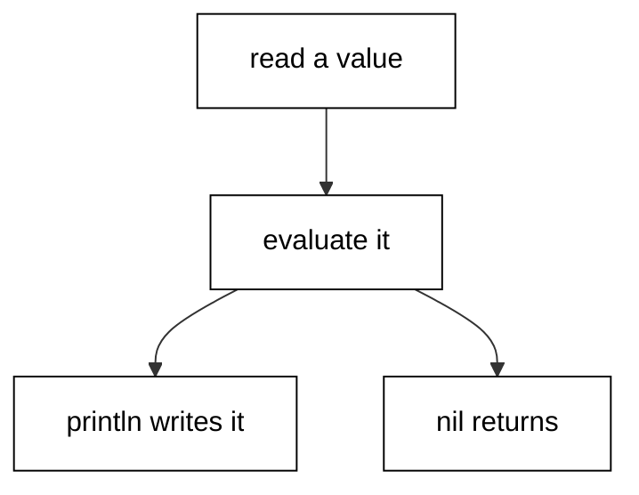
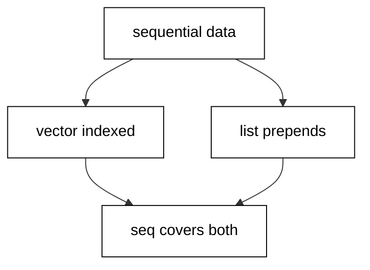
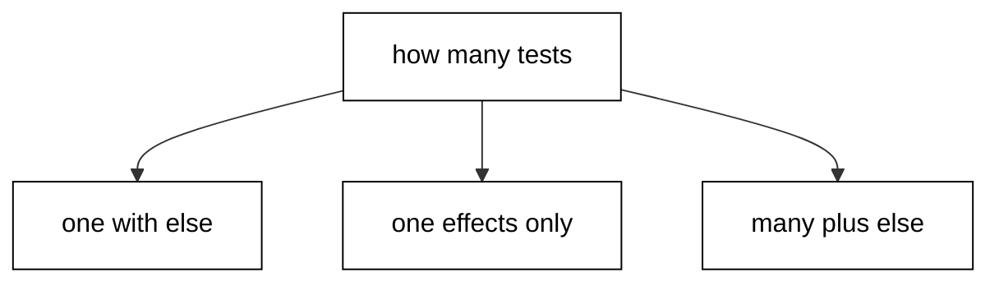
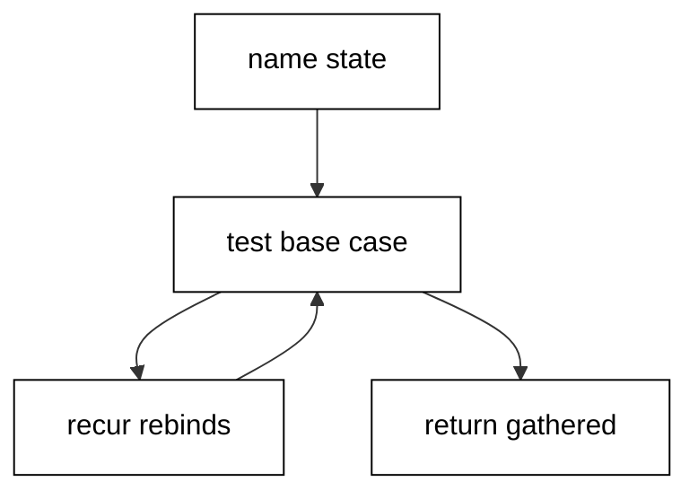
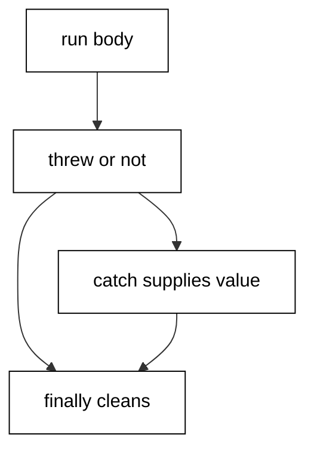
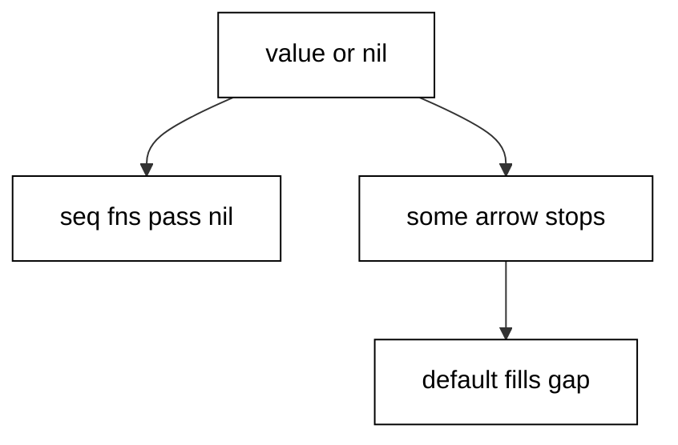
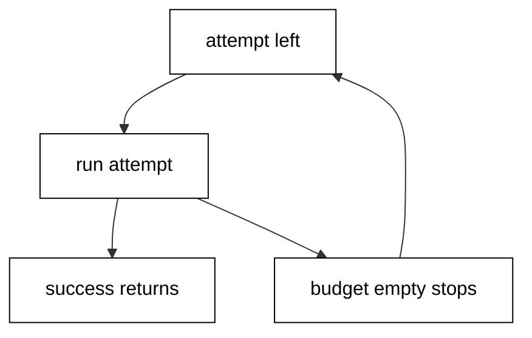
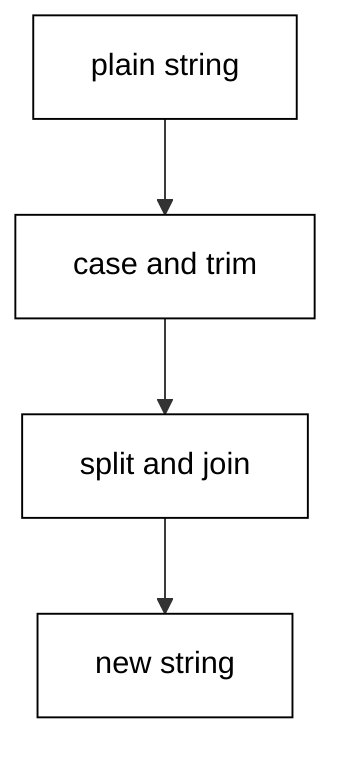
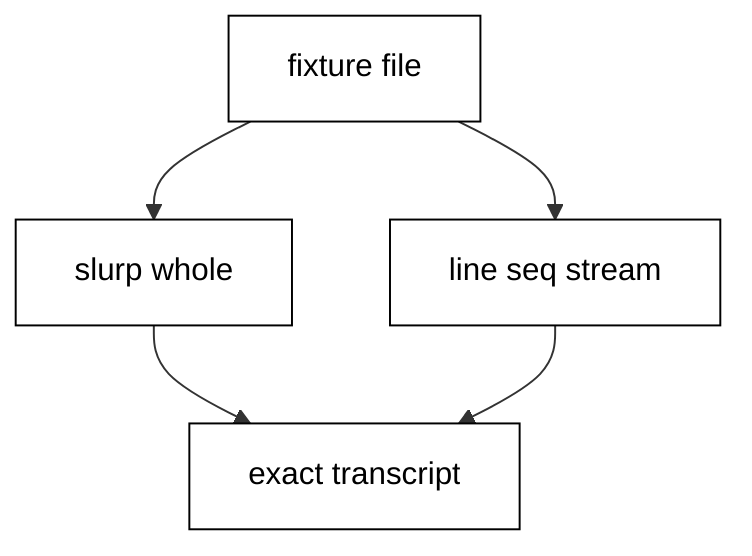
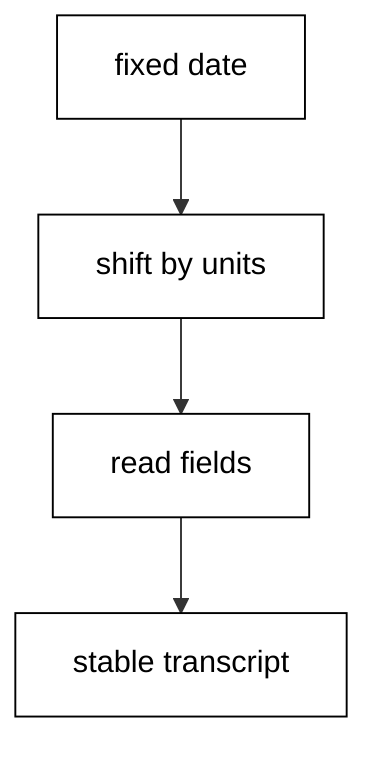

Examples 1-25 build the fluency every later page assumes: idiomatic control flow and the core collections, the error-handling style that keeps failures informative, and the standard-library text, file, and time tools a working developer reaches for daily. Three clusters carry the level: control flow and collections (Examples 1-8), error-handling idiom (Examples 9-17), and text, files, and time (Examples 18-25). Every script runs as `clojure main.clj` on the pinned Clojure 1.12.6 toolchain with no network; outputs are recorded golden files.

### Example 1: Basic Values and println

Clojure programs are expressions that evaluate to values, and the simplest expression is a value standing on its own (Concepts: co-11, co-14.)



A string evaluates to itself, a number evaluates to itself, and a keyword evaluates to itself. Nothing needs a statement terminator or a return keyword because there are no statements at all. `println` is the one effect in this example: it writes its arguments to standard output separated by spaces and returns `nil`, which the lesson ignores. Ratios stay exact instead of degrading to floats, and small maps print in the order their entries were written, so what you see is what the data holds.

**`learning/code/ex-01-basic-values-and-println/main.clj`**:

```clojure
;; => Example 1: values evaluate to themselves; println returns nil.
(println "Hello, Clojure") ;; => prints the string, returns nil
;; => Numbers keep exact types: the ratio 22/7 stays a ratio, never a float.
(println (+ 1 2 3)) ;; => prints 6
(println (/ 22 7)) ;; => prints 22/7, exact rational arithmetic
;; => Keywords evaluate to themselves and print with their leading colon.
(println :name) ;; => prints :name
(println {:a 1 :b 2}) ;; => small maps print in insertion order
```

**Output** (`learning/code/ex-01-basic-values-and-println/expected/main.stdout.txt`):

```text
Hello, Clojure
6
22/7
:name
{:a 1, :b 2}
```

**Key takeaway**: Every Clojure expression evaluates to a value, and `println` writes values while returning `nil`.

**Why it matters**: Reading output starts with knowing what prints: exact rationals, self-evaluating keywords, and insertion-ordered small maps. Developers coming from statement languages waste their first week hunting for missing returns; this example shows there is nothing to hunt.

### Example 2: Lists and Vectors

Clojure keeps two sequential collections apart on purpose: vectors for indexed access and lists for front-growing sequences (Concepts: co-03, co-11.)



A vector holds its elements in slots you can count and index, and `conj` appends at the end, which is the shape most programs want most of the time. A list grows at the front instead, which suits code-as-data and recursive consumption. Both answer `first`, `rest`, and `count`, because the sequence abstraction sits above the concrete type: one vocabulary works over vectors, lists, strings, and streams alike. Nothing here mutates; `conj` returns a new collection and the original binding keeps pointing at the old one.

**`learning/code/ex-02-lists-and-vectors/main.clj`**:

```clojure
(require '[clojure.string :as str]) ;; => string helpers used for the final join
;; => Vectors are indexed; conj appends at the end, effectively O(1).
(def scores [3 1 2]) ;; => a vector of three numbers
(println (conj scores 4)) ;; => prints [3 1 2 4], original untouched
(println (nth scores 0)) ;; => prints 3, indexed access
;; => Lists grow at the front; conj prepends instead of appending.
(println (conj '(2 3) 1)) ;; => prints (1 2 3)
;; => first, rest, and count work over both: the seq abstraction at work.
(println (first scores)) ;; => prints 3
(println (count scores)) ;; => prints 3
(println (str/join "-" scores)) ;; => prints 3-1-2
```

**Output** (`learning/code/ex-02-lists-and-vectors/expected/main.stdout.txt`):

```text
[3 1 2 4]
3
(1 2 3)
3
3
3-1-2
```

**Key takeaway**: Vectors index and append while lists prepend, and the seq functions work over both.

**Why it matters**: Picking the wrong sequential type is the most common beginner performance smell in Clojure: indexing into a list or prepending onto a vector in a loop. Knowing which grows where, plus the shared seq vocabulary, prevents both.

### Example 3: Maps and Sets

Maps pair keys to values and sets hold unique values, and both are immutable values rather than containers to fill (Concepts: co-03, co-11.)

Keywords are the idiomatic map key because they evaluate to themselves, compare by identity, and double as lookup functions, so `(:name user)` reads as naturally as field access. `get` takes a not-found default that removes the nil check most languages force on every lookup. `assoc` returns a new map with the entry added, leaving the original binding exactly as it was, which is why sharing maps across threads needs no locks. Sets absorb duplicates silently, and `contains?`, `conj`, and `disj` give the whole membership vocabulary in three functions.

**`learning/code/ex-03-maps-and-sets/main.clj`**:

```clojure
;; => Maps pair keys to values; keywords are the idiomatic key type.
(def user {:name "ada" :role :admin}) ;; => a two-entry map
(println (:name user)) ;; => keyword lookup prints ada
(println (get user :missing "n/a")) ;; => default prints n/a, no nil surprise
;; => assoc returns a new map; the original binding never changes.
(println (assoc user :active true)) ;; => prints three entries
(println user) ;; => still the original two entries
;; => Sets hold unique values; sort before printing for a stable transcript.
(println (sort (conj #{1 2} 2 3))) ;; => prints (1 2 3), duplicate absorbed
(println (contains? #{1 2 3} 2)) ;; => prints true
```

**Output** (`learning/code/ex-03-maps-and-sets/expected/main.stdout.txt`):

```text
ada
n/a
{:name ada, :role :admin, :active true}
{:name ada, :role :admin}
(1 2 3)
true
```

**Key takeaway**: Keywords look maps up, `assoc` returns new maps, and sets keep membership unique without effort.

**Why it matters**: Configuration, domain entities, and lookup tables in Clojure are all maps, so fluency here pays off in every file. The immutable update habit removes an entire class of aliasing bugs that mutable maps invite.

### Example 4: Conditionals with if, when, and cond

Branching in Clojure is expression-shaped: `if` returns a value, `when` guards side effects, and `cond` reads as a decision table (Concepts: co-01.)



There is no truthy-falsy sprawl to memorize: only `nil` and `false` count as false, and everything else, including zero and empty collections, counts as true. `if` takes exactly one test and two branches, which keeps nesting shallow and pushes multi-way decisions toward `cond`. `when` has no else branch on purpose; it says the false case means doing nothing, and its body holds as many effect expressions as the branch needs. `cond` pairs each test with its value and ends with `:else`, so adding a new case means adding one line, never re-indenting a ladder.

**`learning/code/ex-04-conditionals-if-when-cond/main.clj`**:

```clojure
;; => if is an expression: both branches return values, no statements.
(defn label [n] ;; => classify a number by sign
  (if (pos? n) ;; => test first, then the two value branches
    "positive" ;; => returned when n is above zero
    "non-positive")) ;; => returned for zero and negatives alike
(println (label 5)) ;; => prints positive
(println (label -2)) ;; => prints non-positive
;; => when wraps a one-sided test with an implicit do for side effects.
(println (when (odd? 7) "odd!")) ;; => prints odd!
;; => cond reads as a table of test and value pairs, plus :else.
(println (cond (neg? -1) "neg" (zero? -1) "zero" :else "pos")) ;; => prints neg
```

**Output** (`learning/code/ex-04-conditionals-if-when-cond/expected/main.stdout.txt`):

```text
positive
non-positive
odd!
neg
```

**Key takeaway**: `if` returns one of two values, `when` guards effects with no else, and `cond` tables many tests.

**Why it matters**: Translating another language's statement conditionals into Clojure produces nested `if` ladders that fight the grain. The three-form split is the first idiom check reviewers apply, and it shapes every function written after.

### Example 5: Loop and Recur Without Growing the Stack

`loop` with `recur` is Clojure's explicit tail recursion: iteration speed with recursion shape and no stack growth (Concepts: co-01, co-03.)



The bindings vector names the loop variables and their starting values, and `recur` rebinds them in tail position, which the compiler turns into a jump rather than a call. Because only tail position is allowed, a misplaced `recur` is a compile error instead of a production stack overflow, and that strictness is a feature. The accumulator pattern carries the half-built result alongside the remaining work, so the base case simply returns what was gathered. `doseq` covers the companion case: repeating side effects over a collection when no value needs building at all.

**`learning/code/ex-05-loop-and-recur/main.clj`**:

```clojure
;; => loop opens explicit recursion targets; recur jumps without growing the stack.
(defn countdown [n] ;; => collect n down to 1 into a vector
  (loop [i n acc []] ;; => i counts down, acc gathers
    (if (zero? i) ;; => done when i reaches zero
      acc ;; => return the gathered vector
      (recur (dec i) (conj acc i))))) ;; => tail jump, stack stays flat
(println (countdown 4)) ;; => prints [4 3 2 1]
;; => doseq repeats side effects over a collection with no value built.
(doseq [x [1 2 3]] ;; => x takes each element in turn
  (println "got" x)) ;; => prints one line per element
```

**Output** (`learning/code/ex-05-loop-and-recur/expected/main.stdout.txt`):

```text
[4 3 2 1]
got 1
got 2
got 3
```

**Key takeaway**: `loop` names the changing state and `recur` rebinds it in tail position, so iteration never grows the stack.

**Why it matters**: Clojure has no `for` statement and no mutable loop counters, so every hand-rolled iteration passes through this form. Writing it correctly once unlocks reductions, retries, and state machines built from the same skeleton.

### Example 6: doseq, for, dotimes, and while

Four iteration forms split along two axes: effects versus values, and collections versus counters (Concepts: co-01, co-03.)

`doseq` walks a collection to perform effects and returns `nil`, which announces that the values were never the point. `for` is the mirror image: a list comprehension that builds values lazily, so it composes inside larger expressions and realizes only when consumed. `dotimes` counts from zero to `n` for index-shaped work, and `while` loops on a test with an atom or volatile carrying the changing state. Reaching for the wrong one is visible immediately: a `for` whose result is discarded should have been `doseq`, and a `doseq` building a vector by hand should have been `for` or `mapv`.

**`learning/code/ex-06-doseq-for-dotimes/main.clj`**:

```clojure
;; => doseq runs side effects and returns nil; for builds values lazily.
(doseq [x [:a :b]] ;; => one effect per element
  (println "seen" x)) ;; => prints two lines
(println (vec (for [x [1 2 3]] (* x 10)))) ;; => prints [10 20 30]
;; => dotimes repeats n times with an index; while loops on a test.
(dotimes [i 3] ;; => i runs 0, 1, 2
  (println "tick" i)) ;; => prints three indexed lines
(let [n (atom 3)] ;; => a counter the while test can drain
  (while (pos? @n) ;; => loop while the counter stays positive
    (println "left" @n) ;; => prints the current count
    (swap! n dec))) ;; => drain one per pass
```

**Output** (`learning/code/ex-06-doseq-for-dotimes/expected/main.stdout.txt`):

```text
seen :a
seen :b
[10 20 30]
tick 0
tick 1
tick 2
left 3
left 2
left 1
```

**Key takeaway**: `doseq` performs effects, `for` builds lazy values, `dotimes` counts, and `while` tests.

**Why it matters**: Iteration is where translated code smells strongest: indexed `dotimes` walks over vectors that `doseq` would read better, and manual accumulation loops hide a `for` waiting to come out. The four-way split is the review checklist for every loop.

### Example 7: Threading Macros That Read Top to Bottom

Threading macros turn inside-out nested calls into pipelines that read in execution order (Concepts: co-01, co-14.)

Deeply nested calls force readers to start at the innermost form and work outward, which is backwards from how the data flows. Thread-first inserts each result as the first argument of the next form, which suits map and record updates where the thing being changed leads. Thread-last inserts each result as the last argument, which suits sequence pipelines where the collection trails. `as->` names the threaded value for the awkward middle cases where neither end fits, and reaching for it is a signal the pipeline may want splitting rather than cleverness.

**`learning/code/ex-07-threading-macros/main.clj`**:

```clojure
(require '[clojure.string :as str]) ;; => join and upper-case for the pipeline
;; => Thread-first threads each result as the first argument of the next form.
(println (-> {:a 1} (assoc :b 2) (:b))) ;; => prints 2
;; => Thread-last suits sequence pipelines: data flows into the last slot.
(println (->> [1 2 3 4] (map inc) (filter even?) sort vec)) ;; => prints [2 4]
;; => as-> names the thread when neither first nor last position fits.
(println (as-> [1 2 3] xs (str/join "," xs) (str "<" xs ">"))) ;; => prints <1,2,3>
```

**Output** (`learning/code/ex-07-threading-macros/expected/main.stdout.txt`):

```text
2
[2 4]
<1,2,3>
```

**Key takeaway**: `->` threads first for updates, `->>` threads last for sequences, and `as->` names the value when neither end fits.

**Why it matters**: Clojure pipelines are the idiom other languages borrow and rename, and unreadable nesting is the first thing threading fixes in real codebases. Reviewers read pipelines fluently, so writing them is table stakes for shared code.

### Example 8: Destructuring That Names the Shape

Destructuring binds a function's arguments and a `let` body directly to the shape of the incoming data (Concepts: co-01, co-03.)

Positional vector patterns pull elements by index, `&` gathers the remainder, and `:as` keeps the whole for the cases that need both the parts and the original. Map patterns bind by key with `:or` defaults filling the gaps, which removes the manual `get` chains that clutter defensive code. The `:keys` shorthand binds keyword entries to same-named locals in one line, and it is the standard way domain maps enter a function. Over-destructuring is the failure mode: binding six levels deep in the parameter list hides the expected shape instead of documenting it, so two levels is the working limit.

**`learning/code/ex-08-destructuring/main.clj`**:

```clojure
;; => Vector patterns bind by position; & gathers the rest, :as keeps the whole.
(let [[first-x second-x & others :as all] [1 2 3 4]] ;; => one pattern, four bindings
  (println first-x second-x others all)) ;; => prints 1 2 (3 4) [1 2 3 4]
;; => Map patterns bind by key, with :or defaults and :keys shorthand.
(let [{name :name role :role level :level :or {level 1}} {:name "ada" :role :dev}] ;; => defaults fill gaps
  (println name role level)) ;; => prints ada :dev 1
(let [{:keys [a b]} {:a 10 :b 20}] ;; => :keys binds matching keywords as locals
  (println (+ a b))) ;; => prints 30
```

**Output** (`learning/code/ex-08-destructuring/expected/main.stdout.txt`):

```text
1 2 (3 4) [1 2 3 4]
ada :dev 1
30
```

**Key takeaway**: Vector patterns bind by position, map patterns bind by key with `:or` defaults, and `:keys` shortens the common case.

**Why it matters**: Clojure functions receive maps far more often than argument lists, so parameter destructuring is the everyday reading skill. Done well it documents the contract; done deeply it obscures it, and this example shows the line.

### Example 9: try, catch, and finally That Return Values

Exceptions in Clojure are ordinary JVM throwables, and `try` is an expression whose value is the branch that ran (Concepts: co-02.)



A `try` returns the value of its body when nothing throws, the value of the matching `catch` when something does, and the `finally` runs for cleanup in both cases without changing the value. Catch clauses select by exception class from most specific to most general, mirroring Java because they are Java semantics. `(catch ArithmeticException _ ...)` binds nothing when the throwable itself carries no needed information, and the underscore marks the deliberate discard. Code after the `try` runs normally, which is how a recovered program proves it recovered.

**`learning/code/ex-09-try-catch-finally/main.clj`**:

```clojure
;; => try returns a value; catch selects by class; finally always runs.
(println (try (/ 1 0) (catch ArithmeticException _ "nope"))) ;; => prints nope
;; => The caught binding carries the throwable; ex-message reads its text.
(try (throw (ex-info "bad input" {:got -1})) ;; => raise with data attached
  (catch clojure.lang.ExceptionInfo e ;; => catch the exact class
    (println "caught:" (ex-message e)))) ;; => prints caught: bad input
(println "after") ;; => proves execution continued past the catch
```

**Output** (`learning/code/ex-09-try-catch-finally/expected/main.stdout.txt`):

```text
nope
caught: bad input
after
```

**Key takeaway**: `try` returns the body's value or the matching `catch` value, and `finally` cleans without changing it.

**Why it matters**: Every error-handling idiom later in this course layers on this mechanism, so its value semantics must be exact first. Developers who treat `try` as a statement write recovery code that discards the recovered value.

### Example 10: ex-info Failures That Carry Their Context

`ex-info` pairs a human message with a machine-readable data map, so failures explain themselves to both audiences (Concepts: co-02.)

A bare exception carries a string and a stack trace, which forces every handler to parse prose to learn what happened. `ex-info` adds the third ingredient: a map of the values that were in play, keyed by name, traveling with the throwable to wherever it is caught. Callers read it back with `ex-data` and branch on facts instead of matching message substrings, which survives message rewording. Sorting the known keys before attaching them keeps the data deterministic, because the same failure must print the same map on every run.

**`learning/code/ex-10-ex-info-and-ex-data/main.clj`**:

```clojure
;; => ex-info pairs a message with a data map; ex-data reads the map back.
(defn load-user [id users] ;; => look up one user or fail informatively
  (or (get users id) ;; => happy path returns the user map
      (throw (ex-info "unknown user" {:id id :known (sort (keys users))})))) ;; => failure carries context
(println (load-user :ada {:ada {:role :admin}})) ;; => prints the user map
(println (ex-data (try (load-user :bob {:ada 1}) (catch clojure.lang.ExceptionInfo e e)))) ;; => prints the data map
```

**Output** (`learning/code/ex-10-ex-info-and-ex-data/expected/main.stdout.txt`):

```text
{:role :admin}
{:id :bob, :known (:ada)}
```

**Key takeaway**: `ex-info` throws a message plus a data map, and `ex-data` reads the map back for branching.

**Why it matters**: Production debugging lives or dies on the context attached at the throw site; a message without data sends the next developer reading code instead of reading the error. This is the single most-used error idiom in Clojure services.

### Example 11: Pre and Post Conditions at the Front Door

`:pre` and `:post` maps guard a function where it is defined, so every caller inherits the checks without writing them (Concepts: co-02, co-14.)

Preconditions test the arguments before the body runs, and a violation throws `AssertionError` naming the failed predicate, which points at the caller rather than the implementation. Postconditions test the result with `%` standing for the return value, catching the function itself when it breaks its own promise. `assert` is the same idea anywhere else in the body: a stated invariant that fails loudly instead of letting a lie travel downstream. These checks stay on in production in Clojure, unlike some languages' debug-only asserts, so they must test cheap facts, not expensive recomputations.

**`learning/code/ex-11-pre-and-post-conditions/main.clj`**:

```clojure
;; => :pre and :post guard a function at its own front door.
(defn discount [price pct] ;; => pct must be a fraction between 0 and 1
  {:pre [(number? price) (<= 0 pct 1)] ;; => inputs checked before the body
   :post [(number? %)]} ;; => the result checked after the body
  (* price (- 1 pct))) ;; => the only line callers came for
(println (discount 100 0.2)) ;; => prints 80.0
;; => assert states an invariant anywhere; it throws AssertionError on lies.
(let [total (discount 50 0.1)] ;; => reuse the guarded function
  (assert (pos? total) "total stays positive") ;; => documents the invariant
  (println total)) ;; => prints 45.0
```

**Output** (`learning/code/ex-11-pre-and-post-conditions/expected/main.stdout.txt`):

```text
80.0
45.0
```

**Key takeaway**: `:pre` checks arguments, `:post` checks the result, and `assert` states invariants anywhere.

**Why it matters**: Contract violations caught at the boundary produce one-line diagnostics; the same violations caught three calls deep produce debugging sessions. Guard placement is the cheapest reliability upgrade a function can get.

### Example 12: Nil Punning That Refuses to Throw

Clojure collections and sequence functions accept `nil` gracefully, which turns missing data from an exception into a value (Concepts: co-02, co-03.)



Mapping over `nil` yields an empty list instead of a null-pointer crash, and `first` of `nil` is `nil`, so short pipelines over possibly-absent data simply produce empty results. `some->` threads a value through lookups only while each step stays non-nil, stopping at the first gap without ever calling a function on `nil`. `get` with an explicit default removes the last ambiguity by naming what missing means in this context. `fnil` wraps a function so chosen arguments default when they arrive nil, which keeps arithmetic over sparse data total without a single conditional.

**`learning/code/ex-12-nil-punning-safe-navigation/main.clj`**:

```clojure
;; => nil flows through seq functions instead of throwing NullPointerException.
(println (map inc nil)) ;; => prints (), not an error
(println (first nil)) ;; => prints nil
;; => some-> threads only while each step stays non-nil, stopping at nil.
(println (some-> {:user {:name "ada"}} :user :name)) ;; => prints ada
(println (some-> {:user nil} :user :name)) ;; => prints nil, no lookup on nil
;; => get with a default and fnil turn missing values into workable ones.
(println (get {:a 1} :b :fallback)) ;; => prints :fallback, named and explicit
(println ((fnil + 0 0) nil nil)) ;; => prints 0, nils become zeros
```

**Output** (`learning/code/ex-12-nil-punning-safe-navigation/expected/main.stdout.txt`):

```text
()
nil
ada
nil
:fallback
0
```

**Key takeaway**: Seq functions pass `nil` through, `some->` stops at the first `nil`, and `get` with a default names the fallback.

**Why it matters**: Null-pointer exceptions are the most common crash in JVM languages, and Clojure's answer is structural rather than disciplined: the standard functions simply do something sensible with `nil`. Code written this way has visibly fewer guards.

### Example 13: Error Values for Expected Failures

Failures the caller was always going to handle belong in the return value, not in the exception channel (Concepts: co-02.)

Parsing user input fails routinely, not exceptionally, so returning `{:error reason}` keeps the failure in the same channel as the success and forces the caller to look at it. The `{:ok value}` wrapper marks the happy path explicitly, which makes destructuring both outcomes a one-line `let`. Throwing stays reserved for broken contracts: violated invariants, missing configuration, unreachable services. The decision rule fits in a sentence: if the caller should branch, return data; if the programmer must intervene, throw.

**`learning/code/ex-13-error-values-over-exceptions/main.clj`**:

```clojure
;; => Return data for expected failures, throw only for broken contracts.
(defn parse-age [s] ;; => ages arrive as strings from the outside world
  (try {:ok (Integer/parseInt s)} ;; => success wraps the value in :ok
    (catch NumberFormatException _ {:error (str "not a number: " s)}))) ;; => failure wraps the reason
(println (parse-age "36")) ;; => prints {:ok 36}
(println (parse-age "old")) ;; => prints {:error not a number: old}
;; => Callers branch on the key, never on a caught exception.
(let [{age :ok problem :error} (parse-age "old")] ;; => destructure both outcomes
  (println (or age problem))) ;; => prints the error text
```

**Output** (`learning/code/ex-13-error-values-over-exceptions/expected/main.stdout.txt`):

```text
{:ok 36}
{:error not a number: old}
not a number: old
```

**Key takeaway**: Return `{:ok ...}` or `{:error ...}` for expected failures and reserve throwing for broken contracts.

**Why it matters**: Exception-shaped control flow for routine failures hides the failure rate and punishes callers with try blocks around ordinary logic. Data-shaped errors compose with the rest of Clojure: they thread, destructure, and test like any other map.

### Example 14: Spec Validation That Answers True or False

`clojure.spec` names predicates and combines them, and `s/valid?` checks any value without ever throwing (Concepts: co-02.)

A spec defined with `s/def` is a named, reusable predicate, which beats anonymous inline tests because failures can name the rule that broke. Combinators like `s/and` build range checks and shape checks from small predicates, each readable on its own. `s/valid?` returns a boolean, so validation slots into conditionals and preconditions without exception handling. When a value fails, `explain-data` returns the problems as data, and printing the count keeps the transcript stable while still proving the failure was detected.

**`learning/code/ex-14-spec-validation-basics/main.clj`**:

```clojure
(require '[clojure.spec.alpha :as s]) ;; => the standard validation vocabulary
;; => s/def names a predicate; s/valid? answers true or false, never throws.
(s/def ::port (s/and int? #(<= 1 % 65535))) ;; => ports are ints in range
(println (s/valid? ::port 8080)) ;; => prints true
(println (s/valid? ::port 99999)) ;; => prints false
(println (s/valid? ::port "http")) ;; => prints false, wrong type
;; => explain-data counts problems as data; print the count, not prose.
(println "problems:" (count (:clojure.spec.alpha/problems (s/explain-data ::port 0)))) ;; => prints problems: 1
```

**Output** (`learning/code/ex-14-spec-validation-basics/expected/main.stdout.txt`):

```text
true
false
false
problems: 1
```

**Key takeaway**: `s/def` names a predicate, `s/valid?` checks without throwing, and `explain-data` reports problems as data.

**Why it matters**: Validation at the boundary is where bad data enters, and specs turn ad-hoc scattered checks into named rules the whole team shares. This example is the foundation for function specs and generative testing later.

### Example 15: Retry Loops That Carry Their Own Budget

Retries belong in one loop with a fixed attempt budget, because unbounded retry turns a hiccup into an outage (Concepts: co-02, co-01.)



The loop binds the attempts remaining alongside the work, and each failure spends one attempt before recurring, so exhaustion is structural rather than hoped for. Catching inside the attempt converts the throwable to `nil`, which the loop treats as try-again rather than crash, while a truthy result returns immediately. The budget counts down to one and then stops, returning `nil` to announce that every attempt failed, and the caller branches on that like any other error value. An atom counting calls in the demo proves the budget binds: three attempts, three calls, then a value.

**`learning/code/ex-15-retry-with-a-budget/main.clj`**:

```clojure
;; => Retry belongs in one loop with a budget, not in copy-pasted calls.
(defn with-retry [tries f] ;; => run f until it returns truthy or tries run out
  (loop [left tries] ;; => left counts the attempts still allowed
    (let [got (try (f) (catch RuntimeException _ nil))] ;; => failure becomes nil
      (if (or got (<= left 1)) ;; => stop on success or an empty budget
        got ;; => the value, or nil when every attempt failed
        (recur (dec left)))))) ;; => spend one attempt and try again
(let [calls (atom 0)] ;; => counts how often the flaky function ran
  (println (with-retry 3 (fn [] (swap! calls inc) (when (= @calls 3) "ok")))) ;; => prints ok
  (println "attempts:" @calls)) ;; => prints attempts: 3
```

**Output** (`learning/code/ex-15-retry-with-a-budget/expected/main.stdout.txt`):

```text
ok
attempts: 3
```

**Key takeaway**: Loop with the attempts remaining, convert failure to `nil` inside, and return `nil` when the budget empties.

**Why it matters**: Retry logic scattered across call sites drifts: one site retries forever, another gives up instantly. One budgeted helper with a test is the whole policy, and every flaky dependency in the codebase shares it.

### Example 16: with-open Cleanup That Cannot Be Skipped

`with-open` binds closable resources and closes them when the body exits, on success and on failure alike (Concepts: co-02, co-04.)

Every stream opened in the bindings vector is closed in reverse order when the body finishes, and an exception inside the body still triggers the closes before propagating, so leaks need deliberate effort. `line-seq` over a reader streams lines lazily, which pairs with `with-open` only when the sequence is fully consumed inside the body; returning it would read from a closed stream. The demo writes its scratch file first with `spit`, reads it back under `with-open`, and prints the closing marker to prove control reached the end normally.

**`learning/code/ex-16-with-open-cleanup/main.clj`**:

```clojure
(require '[clojure.java.io :as io]) ;; => reader helpers over files
;; => with-open closes every stream it binds, on success and on failure alike.
(spit "/tmp/clojure-ex16.txt" "line one\nline two\n") ;; => fixed scratch file, fixed bytes
(with-open [r (io/reader "/tmp/clojure-ex16.txt")] ;; => the reader closes itself
  (println (vec (line-seq r)))) ;; => prints both lines as a vector
(println "closed") ;; => reached because cleanup never throws past us
```

**Output** (`learning/code/ex-16-with-open-cleanup/expected/main.stdout.txt`):

```text
[line one line two]
closed
```

**Key takeaway**: `with-open` closes every bound stream on exit, and lazy reads must be consumed inside its body.

**Why it matters**: Leaked file handles surface as flaky too-many-open-files failures under load, far from the open call that caused them. Binding the lifetime to the lexical scope removes the failure class instead of managing it.

### Example 17: Choosing the Error-Handling Shape

Three failure kinds take three shapes: error maps for expected failures, `ex-info` for broken domain rules, and asserts for programmer errors (Concepts: co-02.)

Caller input fails routinely, so parsing returns `{:error ...}` and the caller branches without ceremony. Domain rules break rarely but informatively, so they throw `ex-info` with the offending identifiers attached for whoever triages. Programmer errors, the supposedly impossible branches, assert, because continuing past a lie corrupts everything downstream. The demo runs the first two shapes and prints their payloads; the assert branch documents the third shape without firing, since a fired assert would fail the run it is supposed to teach in.

**`learning/code/ex-17-choosing-error-handling/main.clj`**:

```clojure
;; => Choose by failure kind: data for expected, ex-info for broken rules, assert for lies.
(println (:ok {:ok 1})) ;; => expected failure shape: branch on keys
(println (ex-message (ex-info "rule broken" {:rule :unique}))) ;; => broken rule: message plus data
;; => The decision table: parse problems return error maps, rule breaks throw.
(defn handle [mode] ;; => one branch per failure kind
  (cond (= mode :parse) {:error "bad row 7"} ;; => caller input: data, not drama
        (= mode :rule) (throw (ex-info "duplicate id" {:id 7})) ;; => domain rule: throw with context
        :else (do (assert false "unknown mode") nil))) ;; => programmer error: assert loudly
(println (handle :parse)) ;; => prints the error map
(println (ex-data (try (handle :rule) (catch clojure.lang.ExceptionInfo e e)))) ;; => prints the rule data
```

**Output** (`learning/code/ex-17-choosing-error-handling/expected/main.stdout.txt`):

```text
1
rule broken
{:error bad row 7}
{:id 7}
```

**Key takeaway**: Parse problems return error maps, rule breaks throw `ex-info`, and impossible branches assert.

**Why it matters**: One shape for all failures either litters ordinary logic with try blocks or lets contract breaks masquerade as data. The three-way choice is the design review question for every failure path in the codebase.

### Example 18: String Operations from clojure.string

`clojure.string` holds the everyday text vocabulary, and every function takes the string first and returns a new one (Concepts: co-04.)



Case changes, joins, splits, trims, and replacements cover the bulk of text wrangling without leaving the standard library, which is exactly the point: no dependency for what ships in the box. Functions return new strings rather than mutating, so pipelines of text transforms read as value flow. Splits take regex patterns and return vectors, which keeps the result indexed and countable. The predicate `includes?` answers membership questions directly instead of via index arithmetic, and the whole namespace rewards a first read of its docstrings before any hand-rolled helper.

**`learning/code/ex-18-string-operations/main.clj`**:

```clojure
(require '[clojure.string :as str]) ;; => the standard text vocabulary
;; => Pure functions transform text; the originals never change.
(println (str/upper-case "clojure")) ;; => prints CLOJURE
(println (str/join ", " ["a" "b" "c"])) ;; => prints a, b, c
(println (str/split "a,b,c" #",")) ;; => prints [a b c]
(println (str/trim "  padded  ")) ;; => prints padded
(println (str/includes? "hello world" "world")) ;; => prints true
(println (str/replace "aaa" "a" "b")) ;; => prints bbb
```

**Output** (`learning/code/ex-18-string-operations/expected/main.stdout.txt`):

```text
CLOJURE
a, b, c
[a b c]
padded
true
bbb
```

**Key takeaway**: `clojure.string` transforms text with pure functions, so reach for it before any dependency or helper.

**Why it matters**: Hand-rolled string utilities are the most duplicated code in young Clojure projects, and each copy drifts. One namespace read replaces a dozen helpers and their tests.

### Example 19: Regular Expressions That Stay Small

Regex literals pair with four functions that split matching into find, full-match, all-matches, and group capture (Concepts: co-04.)

`re-find` returns the first match anywhere in the string, which answers does-it-contain questions without ceremony. `re-matches` anchors the whole string, so partial lookalikes return `nil` instead of false confidence, and the demo shows both sides of that line. `re-seq` walks every non-overlapping match into a lazy sequence for extraction loops. Parenthesized groups return with the full match in position zero, and `rest` drops it to leave exactly the captured groups.

**`learning/code/ex-19-regular-expressions/main.clj`**:

```clojure
;; => Regex literals compile once; re-find, re-matches, and re-seq use them.
(println (re-find #"\d+" "order 42 shipped")) ;; => prints 42
(println (re-matches #"[a-z]+" "hello")) ;; => prints hello, full match
(println (re-matches #"[a-z]+" "hi-there")) ;; => prints nil, dash breaks it
(println (re-seq #"\w+@\w+\.\w+" "a@x.io and b@y.dev")) ;; => prints both addresses
(println (rest (re-matches #"(\d+)-(\d+)" "2026-10"))) ;; => prints groups 2026 and 10
```

**Output** (`learning/code/ex-19-regular-expressions/expected/main.stdout.txt`):

```text
42
hello
nil
(a@x.io b@y.dev)
(2026 10)
```

**Key takeaway**: `re-find` finds, `re-matches` anchors fully, `re-seq` extracts all, and groups ride along in the match vector.

**Why it matters**: Text extraction sits in importers, log readers, and routers, and regex overreach there produces silent misparses. The four-function split keeps each match doing exactly one job.

### Example 20: format and printf for Shaped Output

`format` builds shaped strings and `printf` writes them, both on the `java.util.Formatter` pattern language (Concepts: co-04.)

Width, alignment, zero-padding, and precision live in the format string, not in string concatenation logic, which keeps columnar output declarative. `%-8s` left-aligns in eight columns while `%03d` zero-pads to three digits, the two workhorses of fixed-width reports. Precision like `%.2f` rounds for display without touching the underlying value. `with-out-str` rebinds standard output to capture prints as data, which is how tests assert on printed output without touching files.

**`learning/code/ex-20-format-and-printf/main.clj`**:

```clojure
;; => format builds strings; printf writes them; both use Formatter patterns.
(println (format "user %-8s has %03d points" "ada" 7)) ;; => prints padded fields
(println (format "ratio %.2f" (/ 22.0 7))) ;; => prints ratio 3.14
;; => *out* can be rebound to capture prints as data in tests.
(println (with-out-str (printf "x=%d" 41))) ;; => prints the captured string x=41
```

**Output** (`learning/code/ex-20-format-and-printf/expected/main.stdout.txt`):

```text
user ada      has 007 points
ratio 3.14
x=41
```

**Key takeaway**: `format` shapes with width and precision patterns, and `with-out-str` captures prints as testable data.

**Why it matters**: Reports, CLI tables, and log lines all need shaped text, and concatenation logic for alignment rots fast. One pattern language covers building, writing, and capturing alike.

### Example 21: Reading and Writing Files Beside the Code

`slurp` reads a whole file, `line-seq` streams it, and `spit` writes it, and fixtures ship beside the script that reads them (Concepts: co-04.)



Demos read committed fixture files through relative paths, never the live filesystem, so the bytes are identical on every machine and every run. `slurp` suits small files read whole, while `line-seq` over a reader streams large ones without holding them in memory, closed by `with-open`. Printing `pr-str` of the content shows the exact bytes including newlines, which removes ambiguity about trailing whitespace. Writes go to fixed scratch paths under `/tmp` with fixed content, keeping the course tree read-only and the transcript byte-stable.

**`learning/code/ex-21-reading-and-writing-files/main.clj`**:

```clojure
(require '[clojure.java.io :as io]) ;; => reader opens the fixture as a stream
;; => slurp reads a whole file; line-seq streams it; spit writes it back.
(println (pr-str (slurp "lines.txt"))) ;; => the exact fixture bytes, quoted
(with-open [r (io/reader "lines.txt")] ;; => stream the file line by line
  (println (count (line-seq r)))) ;; => prints 3
(spit "/tmp/clojure-ex21.txt" (str "total: " 3)) ;; => write a fixed summary aside
(println (slurp "/tmp/clojure-ex21.txt")) ;; => prints total: 3
```

**Output** (`learning/code/ex-21-reading-and-writing-files/expected/main.stdout.txt`):

```text
"alpha\nbravo\ncharlie\n"
3
total: 3
```

**Key takeaway**: `slurp` reads whole, `line-seq` streams, `spit` writes, and fixtures keep every byte fixed.

**Why it matters**: File-handling code that reads live paths cannot be tested deterministically, and this example establishes the fixture habit every later file example follows. Golden transcripts start with fixed inputs.

### Example 22: EDN Data That Round-Trips Exactly

EDN is Clojure data as text: extensible, readable, and safe to read because the reader never evaluates (Concepts: co-04.)

`edn/read-string` parses data notation into values with no evaluation, which makes it safe for configuration and message payloads where `read-string` would execute code. `pr-str` writes values back to notation, and well-formed data round-trips exactly, which the demo asserts with an equality check. Configuration ships as EDN fixtures in this course: the demo reads a config file, pulls named keys, and prints a subset. Keywords, vectors, and nested maps all survive the trip, so the format covers real configuration shapes without a schema language.

**`learning/code/ex-22-edn-data-round-trips/main.clj`**:

```clojure
(require '[clojure.edn :as edn]) ;; => the data notation reader, no eval inside
;; => edn/read-string parses data; pr-str writes it back; round trips hold.
(println (edn/read-string "{:a 1}")) ;; => prints {:a 1}
(let [config (edn/read-string (slurp "config.edn"))] ;; => config ships as data
  (println (:port config)) ;; => prints 8080
  (println (pr-str (select-keys config [:host :port])))) ;; => prints the subset
(println (= {:a 1} (edn/read-string (pr-str {:a 1})))) ;; => prints true, round trip
```

**Output** (`learning/code/ex-22-edn-data-round-trips/expected/main.stdout.txt`):

```text
{:a 1}
8080
{:host "example", :port 8080}
true
```

**Key takeaway**: `edn/read-string` parses safely without evaluation, and `pr-str` writes values back exactly.

**Why it matters**: Configuration and fixtures need a format that is both human-editable and machine-exact, and EDN is Clojure's answer. Reading it safely, without the code-execution risk of the full reader, is the point of the separate namespace.

### Example 23: Local Dates and Times Without a Clock

`java.time` types construct fixed dates and times, shift them arithmetically, and read their fields, all without reading any clock (Concepts: co-05.)



`LocalDate/of` pins a calendar date and `LocalTime/of` pins a wall time, so examples and tests never depend on when they run. Arithmetic like `plusDays` returns new values instead of mutating, matching Clojure's value semantics across the interop boundary. Field readers like `getDayOfWeek` answer calendar questions directly, and their enum values print as stable names. Keeping every instant in these examples fixed is what makes the transcripts byte-stable: no call here asks the machine what time it is.

**`learning/code/ex-23-local-dates-and-times/main.clj`**:

```clojure
(import '[java.time LocalDate LocalTime]) ;; => the JDK date and time types
;; => of constructs fixed dates; plus and minus shift them; getters read fields.
(let [day (LocalDate/of 2026 10 21)] ;; => a fixed Wednesday
  (println (str day)) ;; => prints 2026-10-21
  (println (str (.getDayOfWeek day))) ;; => prints WEDNESDAY
  (println (str (.plusDays day 10)))) ;; => prints 2026-10-31
(let [noon (LocalTime/of 12 0)] ;; => fixed noon, no clock read
  (println (str noon)) ;; => prints 12:00
  (println (str (.plusHours noon 9)))) ;; => prints 21:00, same day
```

**Output** (`learning/code/ex-23-local-dates-and-times/expected/main.stdout.txt`):

```text
2026-10-21
WEDNESDAY
2026-10-31
12:00
21:00
```

**Key takeaway**: Construct fixed `LocalDate` and `LocalTime` values, shift them with `plus` methods, and read fields directly.

**Why it matters**: Date code that reads the clock in examples cannot be verified by reading, and the fixed-construction habit transfers directly to tests. The interop line noise is worth learning once because `java.time` underlies all JVM date work.

### Example 24: Instants, Durations, and Periods in Their Places

Machine time and human time are different types: `Instant` with `Duration` for the former, `LocalDate` with `Period` for the latter (Concepts: co-05.)

`Instant/parse` reads fixed UTC timestamps, and `toString` prints them back in the same shape, so transcripts never wobble. `Duration/between` measures exact elapsed time in hours and minutes, printing in ISO-8601 shape like `PT1H30M`. `Period/between` measures calendar distance in years, months, and days, which is the right answer for expiry dates and schedules where daylight-saving shifts would corrupt a duration. Mixing the two is the classic date bug: durations across a spring-forward Sunday are an hour short of a calendar day.

**`learning/code/ex-24-instants-durations-periods/main.clj`**:

```clojure
(import '[java.time Instant Duration Period LocalDate]) ;; => machine and human time
;; => Instants are UTC timestamps; parse fixed strings, never read the clock.
(let [t (Instant/parse "2026-10-21T00:00:00Z")] ;; => a fixed midnight
  (println (str t)) ;; => prints 2026-10-21T00:00:00Z
  (println (str (Duration/between t (Instant/parse "2026-10-21T01:30:00Z"))))) ;; => prints PT1H30M
(let [start (LocalDate/of 2026 10 21)] ;; => human dates use Period, not Duration
  (println (str (Period/between start (.plusMonths start 3))))) ;; => prints P3M
```

**Output** (`learning/code/ex-24-instants-durations-periods/expected/main.stdout.txt`):

```text
2026-10-21T00:00:00Z
PT1H30M
P3M
```

**Key takeaway**: `Instant` plus `Duration` measures machine time, and `LocalDate` plus `Period` measures calendar time.

**Why it matters**: Expiry, scheduling, and timeout logic picks the wrong type constantly, and the failures arrive as off-by-one-hour mysteries. Naming the two tracks explicitly prevents the most expensive date confusion.

### Example 25: Formatting Dates for People, Parsing for Machines

`DateTimeFormatter` turns dates into display strings and back, with an explicit locale so the transcript never depends on the machine (Concepts: co-05.)

A pattern like `dd MMM yyyy` states the display shape once, and both formatting and parsing share it, so the two directions cannot drift apart. The locale gets pinned to `ROOT` explicitly because month abbreviations come from locale data, and an unpinned formatter prints whatever the machine happens to speak. Round-tripping proves the pair: format a fixed date, parse the string back, and land on the same value. Field readers like `getYear` skip formatting entirely for the common case of pulling one number out of a date.

**`learning/code/ex-25-formatting-and-parsing-dates/main.clj`**:

```clojure
(import '[java.time LocalDate] '[java.time.format DateTimeFormatter]) ;; => patterns live here
;; => Format for people, parse back for machines; pin the locale for stability.
(let [fmt (.withLocale (DateTimeFormatter/ofPattern "dd MMM yyyy") java.util.Locale/ROOT)] ;; => fixed pattern, fixed tongue
  (println (.format (LocalDate/of 2026 10 21) fmt)) ;; => prints 21 Oct 2026
  (println (str (LocalDate/parse "21 Oct 2026" fmt)))) ;; => prints 2026-10-21 back
(println (.getYear (LocalDate/of 2026 10 21))) ;; => prints 2026
```

**Output** (`learning/code/ex-25-formatting-and-parsing-dates/expected/main.stdout.txt`):

```text
21 Oct 2026
2026-10-21
2026
```

**Key takeaway**: Share one pattern between formatting and parsing, pin the locale to `ROOT`, and prove the round trip.

**Why it matters**: Date display bugs are locale bugs wearing a trench coat: green on the author's machine, broken on the server. Pinning the locale in the example teaches the production habit where it cannot be skipped.
