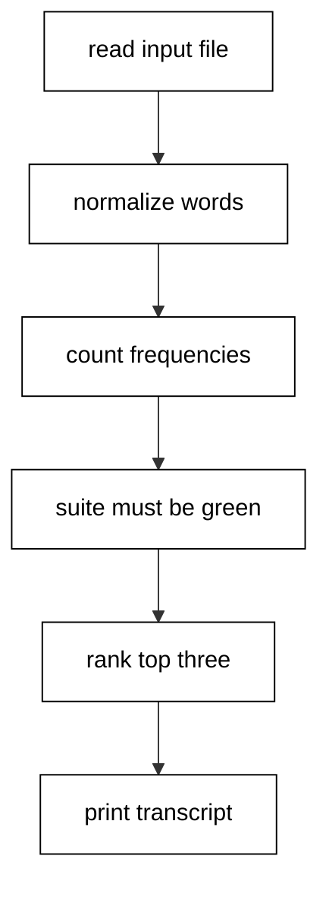

The capstone combines the course into one word-frequency CLI: it reads a fixed input file, normalizes and counts words with the standard library, verifies itself with an embedded `clojure.test` suite that must stay green before any report prints, handles a missing input with `ex-info` context instead of silence, and prints a fixed six-line transcript that the harness asserts byte for byte.

## Why this exists -- the big idea

**The problem before the solution**: course examples prove idioms in isolation, but production tools fail at the seams: reading disagrees with parsing, counting disagrees with ranking, and verification is a comment instead of a check. The capstone wires every layer together so the seams are load-bearing: reading feeds normalization, normalization feeds counting, counting feeds ranking, and the suite guards the whole chain before the transcript prints.

**Keep this if you forget everything else**: read input, transform it purely, verify with tests, then report. In that order, every time.

## What you will build

A single `wordfreq.clj` plus a three-line input fixture. It lowercases and splits on whitespace runs, drops empties, counts with `frequencies`, and ranks by count with alphabetical ties through one shared comparator. Two `deftest` blocks pin the counting and ranking contracts with four assertions; an `assert` on the suite summary blocks the report when red. A missing input file throws `ex-info` naming the file. The report file lands under `/tmp` with one `word: count` line per word, while standard output carries the six-line transcript: the suite summary, the headline totals, and the top three words with counts.

## How the pieces compose

Text splitting (Examples 18-19) feeds normalization; `frequencies` over the cleaned words (Example 11's reduction shape) builds the map; `sort-by` with the count-then-name comparator ranks deterministically (Example 51's ordering lesson); `deftest` with a summary assert guards the run (Examples 35, 43-44); `ex-info` handles the missing file (Examples 10, 17); the fixed input fixture and golden transcript follow the course determinism contract (Example 21). No new idioms appear here: composition is the test. Read the script top to bottom and name the example each section comes from; if a section has no ancestor, it does not belong.



## Reading the transcript

The six output lines each prove one stage. The two `Testing` lines with the `Ran` summary prove the embedded suite executed with three assertions and zero failures. The `words:` headline proves reading and normalization produced eleven words across seven unique ones. The three `word: count` lines prove ranking with deterministic tie order: `data` at three, then `clojure` and `code` at two each, alphabetical among the tie. Any missing line names its broken stage exactly. Rerun the unit and diff: identical bytes, because fixed input, fixed seeds of logic, and fixed ranking leave no room for variance.

## Extending it

Add a `--top N` argument with the same value-option pattern and thread the count through `top-words` (Example 7's threading shape); add stop-word filtering with a set lookup before counting (Example 3's membership lesson); emit EDN instead of text lines with `pr-str` for machine consumers (Example 22). Each extension is one function plus one transcript line. Keep the transcript golden: new lines append at the end, never in the middle, so history stays diffable.

## Reproducing it

Run the unit twice and diff the transcripts: identical bytes, because the input fixture is committed, the ranking comparator breaks ties alphabetically, and the suite summary prints counts rather than timings. Delete the input file and rerun to watch the failure path: the run exits nonzero with an `ex-info` naming the file, which is the loud boundary failure the course teaches instead of a silent empty report. Restore the fixture and confirm green returns. The report file under `/tmp` regenerates on every run with one `word: count` line per word in rank order; it is a side effect for humans, while standard output stays the asserted transcript for the harness.

## What graduating means

You can start a new tool from a namespace-shaped script, read its inputs through fixtures, transform them with pure standard-library pipelines, guard the run with an embedded suite and a summary assert, handle failure with data-shaped errors, and ship a transcript that proves all of it. The next Clojure program you write for work should follow this skeleton file for file. When it grows a second command, split entry points rather than flags; when it grows state, add the suite (Examples 35-44) before the state, not after.

**`learning/capstone/code/wordfreq.clj`**:

```clojure
(require '[clojure.string :as str] '[clojure.test :refer [deftest is run-tests]]) ;; => text plus tests
;; => Capstone: a word-frequency CLI over a fixed input file, tested in-process.
(defn counts [text] ;; => normalized frequency map from raw text
  (->> (str/split (str/lower-case text) #"\s+") ;; => split on whitespace runs
       (remove str/blank?) ;; => drop empties from leading gaps
       frequencies)) ;; => count each distinct word
(defn top-words [freq n] ;; => top n words by count, ties alphabetical
  (->> freq (sort-by (fn [[w c]] [(- c) w])) (take n) (mapv first))) ;; => deterministic order
(deftest freq-basics ;; => the counting contract
  (is (= {"a" 2 "b" 1} (counts "a b a"))) ;; => repeats counted
  (is (= {} (counts "")))) ;; => empty input maps to empty
(deftest top-orders ;; => the ranking contract
  (is (= ["a" "b"] (top-words {"a" 2 "b" 1 "c" 1} 2)))) ;; => count first, name second
(let [{:keys [fail error]} (run-tests)] ;; => the suite must be green first
  (assert (zero? (+ fail error)) "capstone suite stays green")) ;; => red blocks the report
(let [freq (try (counts (slurp "input.txt")) ;; => read the fixed input file
                (catch java.io.FileNotFoundException e ;; => missing input fails loudly
                  (throw (ex-info "input file missing" {:file "input.txt"})))) ;; => context, not silence
      total (reduce + (vals freq))] ;; => every word occurrence counted
  (spit "/tmp/clojure-capstone-report.txt" (str/join "\n" (map (fn [[w c]] (str w ": " c)) (sort-by (fn [[w c]] [(- c) w]) freq)))) ;; => fixed report aside
  (println "words:" total "unique:" (count freq)) ;; => prints the headline
  (doseq [w (top-words freq 3)] ;; => the three most frequent words
    (println (str w ": " (freq w))))) ;; => prints each with its count
```

**Input** (`learning/capstone/code/input.txt`):

```text
Clojure code reads data
data shapes code
Clojure data stays simple
```

**Output** (`learning/capstone/code/expected/main/main.stdout.txt`):

```text

Testing user

Ran 2 tests containing 3 assertions.
0 failures, 0 errors.
words: 11 unique: 7
data: 3
clojure: 2
code: 2
```
