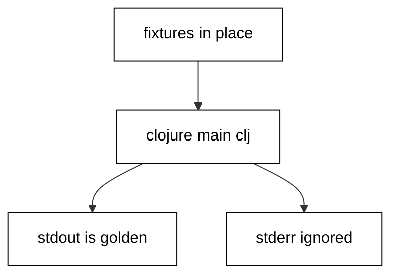

Prerequisites for this course: [lisp](/en/learn/courses/lisp/learning/overview) for basic syntax, the evaluation model, and REPL habits. Comfort reading short Clojure expressions is assumed from the first example.

## Why this exists -- the big idea

**The problem before the solution**: translated Clojure reads as Java or Python wearing parentheses: indexed loops where pipelines belong, stringly exceptions where data-shaped errors belong, and hand-rolled utilities where the standard library already answers. Each example in this course replaces one translated habit with the idiom the standard library itself uses. **Keep this if you forget everything else**: values flow through pipelines, updates return new values, and failures carry data.

## Tensions and trade-offs -- when NOT to reach for this

- **Idiom versus expedience**: threading a two-call nest adds ceremony without clarity, and a transducer for six elements optimizes nothing. Apply each idiom where its weight earns out: pipelines past two stages, transducers on hot paths, specs at boundaries.
- **Purity versus the platform**: file writes, clocks, and network calls are effects no idiom removes. Isolate them at the edges with pure cores inside, rather than pretending the program is total.
- **When NOT**: one-off REPL experiments need no namespaces, tests, or lock files. The engineering in this course earns its place when code runs twice: in CI, on someone else's machine, or six months from now when you have forgotten writing it.

## Lineage -- where this tool sits

Clojure is the hosted Lisp on the JVM in this series: the `lisp` primer introduces evaluation and macros, this course builds working fluency, and the later web-backend and database-migration courses assume exactly the idioms taught here. Java interop connects every example to the surrounding JVM ecosystem, while EDN, specs, and the testing workflow transfer to every Clojure codebase regardless of domain.

## How this course is organized

[Beginner](/en/learn/courses/clojure-essentials/learning/beginner) (Examples 1-25) sets idiomatic control flow and collections, the error-handling style, and the text, file, and time vocabulary. [Intermediate](/en/learn/courses/clojure-essentials/learning/intermediate) (Examples 26-53) organizes namespaces and hash-locked dependencies, tests with the standard workflow including properties, and generalizes with multimethods, protocols, transducers, and value semantics. [Advanced](/en/learn/courses/clojure-essentials/learning/advanced) (Examples 54-78) surveys concurrency primitives, standardizes tooling and style, and teaches layered reading of idiomatic code. The [capstone](/en/learn/courses/clojure-essentials/learning/capstone/overview) ships a tested word-frequency CLI with a verified transcript, and [drilling](/en/learn/courses/clojure-essentials/drilling/overview) turns the sixteen concepts into recall, katas, and checklists.

## About the runtime

Every example runs as `clojure main.clj` in the pinned Clojure 1.12.6 container with no network and a read-only course tree: only /tmp is writable, so scratch files live there with fixed names and fixed bytes. Fixtures ship beside each script and the working directory is the unit folder, so relative reads resolve to committed files. Concurrency demos use fixed buffers with rendezvous reads and sorted transcripts; property tests pin their seeds; dates are constructed fixed values, never clock reads. Standard output is the asserted transcript.

## Examples by Level

### Beginner (Examples 1–25)

- [Example 1: Basic Values and println](/en/learn/courses/clojure-essentials/learning/beginner#example-1-basic-values-and-println)
- [Example 2: Lists and Vectors](/en/learn/courses/clojure-essentials/learning/beginner#example-2-lists-and-vectors)
- [Example 3: Maps and Sets](/en/learn/courses/clojure-essentials/learning/beginner#example-3-maps-and-sets)
- [Example 4: Conditionals with if, when, and cond](/en/learn/courses/clojure-essentials/learning/beginner#example-4-conditionals-with-if-when-and-cond)
- [Example 5: Loop and Recur Without Growing the Stack](/en/learn/courses/clojure-essentials/learning/beginner#example-5-loop-and-recur-without-growing-the-stack)
- [Example 6: doseq, for, dotimes, and while](/en/learn/courses/clojure-essentials/learning/beginner#example-6-doseq-for-dotimes-and-while)
- [Example 7: Threading Macros That Read Top to Bottom](/en/learn/courses/clojure-essentials/learning/beginner#example-7-threading-macros-that-read-top-to-bottom)
- [Example 8: Destructuring That Names the Shape](/en/learn/courses/clojure-essentials/learning/beginner#example-8-destructuring-that-names-the-shape)
- [Example 9: try, catch, and finally That Return Values](/en/learn/courses/clojure-essentials/learning/beginner#example-9-try-catch-and-finally-that-return-values)
- [Example 10: ex-info Failures That Carry Their Context](/en/learn/courses/clojure-essentials/learning/beginner#example-10-ex-info-failures-that-carry-their-context)
- [Example 11: Pre and Post Conditions at the Front Door](/en/learn/courses/clojure-essentials/learning/beginner#example-11-pre-and-post-conditions-at-the-front-door)
- [Example 12: Nil Punning That Refuses to Throw](/en/learn/courses/clojure-essentials/learning/beginner#example-12-nil-punning-that-refuses-to-throw)
- [Example 13: Error Values for Expected Failures](/en/learn/courses/clojure-essentials/learning/beginner#example-13-error-values-for-expected-failures)
- [Example 14: Spec Validation That Answers True or False](/en/learn/courses/clojure-essentials/learning/beginner#example-14-spec-validation-that-answers-true-or-false)
- [Example 15: Retry Loops That Carry Their Own Budget](/en/learn/courses/clojure-essentials/learning/beginner#example-15-retry-loops-that-carry-their-own-budget)
- [Example 16: with-open Cleanup That Cannot Be Skipped](/en/learn/courses/clojure-essentials/learning/beginner#example-16-with-open-cleanup-that-cannot-be-skipped)
- [Example 17: Choosing the Error-Handling Shape](/en/learn/courses/clojure-essentials/learning/beginner#example-17-choosing-the-error-handling-shape)
- [Example 18: String Operations from clojure.string](/en/learn/courses/clojure-essentials/learning/beginner#example-18-string-operations-from-clojurestring)
- [Example 19: Regular Expressions That Stay Small](/en/learn/courses/clojure-essentials/learning/beginner#example-19-regular-expressions-that-stay-small)
- [Example 20: format and printf for Shaped Output](/en/learn/courses/clojure-essentials/learning/beginner#example-20-format-and-printf-for-shaped-output)
- [Example 21: Reading and Writing Files Beside the Code](/en/learn/courses/clojure-essentials/learning/beginner#example-21-reading-and-writing-files-beside-the-code)
- [Example 22: EDN Data That Round-Trips Exactly](/en/learn/courses/clojure-essentials/learning/beginner#example-22-edn-data-that-round-trips-exactly)
- [Example 23: Local Dates and Times Without a Clock](/en/learn/courses/clojure-essentials/learning/beginner#example-23-local-dates-and-times-without-a-clock)
- [Example 24: Instants, Durations, and Periods in Their Places](/en/learn/courses/clojure-essentials/learning/beginner#example-24-instants-durations-and-periods-in-their-places)
- [Example 25: Formatting Dates for People, Parsing for Machines](/en/learn/courses/clojure-essentials/learning/beginner#example-25-formatting-dates-for-people-parsing-for-machines)

### Intermediate (Examples 26–53)

- [Example 26: Namespace Anatomy That Names the Unit](/en/learn/courses/clojure-essentials/learning/intermediate#example-26-namespace-anatomy-that-names-the-unit)
- [Example 27: require with Alias and Refer Side by Side](/en/learn/courses/clojure-essentials/learning/intermediate#example-27-require-with-alias-and-refer-side-by-side)
- [Example 28: Dashes for People, Underscores for Files](/en/learn/courses/clojure-essentials/learning/intermediate#example-28-dashes-for-people-underscores-for-files)
- [Example 29: deps.edn That Declares Paths and Versions](/en/learn/courses/clojure-essentials/learning/intermediate#example-29-depsedn-that-declares-paths-and-versions)
- [Example 30: Reading a Hash-Locked Dependency File](/en/learn/courses/clojure-essentials/learning/intermediate#example-30-reading-a-hash-locked-dependency-file)
- [Example 31: Exact Pins Instead of Ranges or Latest](/en/learn/courses/clojure-essentials/learning/intermediate#example-31-exact-pins-instead-of-ranges-or-latest)
- [Example 32: Project Layout That Every Tool Expects](/en/learn/courses/clojure-essentials/learning/intermediate#example-32-project-layout-that-every-tool-expects)
- [Example 33: Classpath Inspection That Proves the Pins](/en/learn/courses/clojure-essentials/learning/intermediate#example-33-classpath-inspection-that-proves-the-pins)
- [Example 34: Choosing Dependencies by Strict Preference](/en/learn/courses/clojure-essentials/learning/intermediate#example-34-choosing-dependencies-by-strict-preference)
- [Example 35: deftest and is: the Standard Test Shape](/en/learn/courses/clojure-essentials/learning/intermediate#example-35-deftest-and-is-the-standard-test-shape)
- [Example 36: Fixtures That Wrap Each Test](/en/learn/courses/clojure-essentials/learning/intermediate#example-36-fixtures-that-wrap-each-test)
- [Example 37: Testing Private Helpers Through the Public Surface](/en/learn/courses/clojure-essentials/learning/intermediate#example-37-testing-private-helpers-through-the-public-surface)
- [Example 38: Property Tests That Hold Over All Inputs](/en/learn/courses/clojure-essentials/learning/intermediate#example-38-property-tests-that-hold-over-all-inputs)
- [Example 39: Generators That Speak the Domain](/en/learn/courses/clojure-essentials/learning/intermediate#example-39-generators-that-speak-the-domain)
- [Example 40: Selectors and Names That Organize the Suite](/en/learn/courses/clojure-essentials/learning/intermediate#example-40-selectors-and-names-that-organize-the-suite)
- [Example 41: Stubbing Boundaries with with-redefs](/en/learn/courses/clojure-essentials/learning/intermediate#example-41-stubbing-boundaries-with-with-redefs)
- [Example 42: Testing Lazy Sequences at Their Bounds](/en/learn/courses/clojure-essentials/learning/intermediate#example-42-testing-lazy-sequences-at-their-bounds)
- [Example 43: Reading the Suite Summary as Data](/en/learn/courses/clojure-essentials/learning/intermediate#example-43-reading-the-suite-summary-as-data)
- [Example 44: Failing-Test-First in One File](/en/learn/courses/clojure-essentials/learning/intermediate#example-44-failing-test-first-in-one-file)
- [Example 45: Multimethods That Dispatch on Anything](/en/learn/courses/clojure-essentials/learning/intermediate#example-45-multimethods-that-dispatch-on-anything)
- [Example 46: Protocols for Behavior, Records for Data](/en/learn/courses/clojure-essentials/learning/intermediate#example-46-protocols-for-behavior-records-for-data)
- [Example 47: One Seq Vocabulary Over Every Collection](/en/learn/courses/clojure-essentials/learning/intermediate#example-47-one-seq-vocabulary-over-every-collection)
- [Example 48: Transducers That Fuse the Pipeline](/en/learn/courses/clojure-essentials/learning/intermediate#example-48-transducers-that-fuse-the-pipeline)
- [Example 49: Updates That Return New Values](/en/learn/courses/clojure-essentials/learning/intermediate#example-49-updates-that-return-new-values)
- [Example 50: Transients That Build Fast Then Freeze](/en/learn/courses/clojure-essentials/learning/intermediate#example-50-transients-that-build-fast-then-freeze)
- [Example 51: Sorted Collections That Traverse in Order](/en/learn/courses/clojure-essentials/learning/intermediate#example-51-sorted-collections-that-traverse-in-order)
- [Example 52: Laziness That Computes Only on Demand](/en/learn/courses/clojure-essentials/learning/intermediate#example-52-laziness-that-computes-only-on-demand)
- [Example 53: Value Equality Across Types](/en/learn/courses/clojure-essentials/learning/intermediate#example-53-value-equality-across-types)

### Advanced (Examples 54–78)

- [Example 54: Futures That Deliver Off-Thread](/en/learn/courses/clojure-essentials/learning/advanced#example-54-futures-that-deliver-off-thread)
- [Example 55: Promises as One-Shot Mailboxes](/en/learn/courses/clojure-essentials/learning/advanced#example-55-promises-as-one-shot-mailboxes)
- [Example 56: Atoms for Synchronous Shared State](/en/learn/courses/clojure-essentials/learning/advanced#example-56-atoms-for-synchronous-shared-state)
- [Example 57: Refs That Commit Together or Not at All](/en/learn/courses/clojure-essentials/learning/advanced#example-57-refs-that-commit-together-or-not-at-all)
- [Example 58: Agents That Queue Asynchronous Actions](/en/learn/courses/clojure-essentials/learning/advanced#example-58-agents-that-queue-asynchronous-actions)
- [Example 59: core.async Channels That Decouple Stages](/en/learn/courses/clojure-essentials/learning/advanced#example-59-coreasync-channels-that-decouple-stages)
- [Example 60: go Blocks That Transform Without Threads](/en/learn/courses/clojure-essentials/learning/advanced#example-60-go-blocks-that-transform-without-threads)
- [Example 61: Choosing the Concurrency Primitive](/en/learn/courses/clojure-essentials/learning/advanced#example-61-choosing-the-concurrency-primitive)
- [Example 62: Print Control for Readable Output](/en/learn/courses/clojure-essentials/learning/advanced#example-62-print-control-for-readable-output)
- [Example 63: Linter Configuration Read as Data](/en/learn/courses/clojure-essentials/learning/advanced#example-63-linter-configuration-read-as-data)
- [Example 64: REPL-Driven Experiments Scripted Small](/en/learn/courses/clojure-essentials/learning/advanced#example-64-repl-driven-experiments-scripted-small)
- [Example 65: Names That Follow the Community Style](/en/learn/courses/clojure-essentials/learning/advanced#example-65-names-that-follow-the-community-style)
- [Example 66: Docstrings for Contracts, Comments for Why](/en/learn/courses/clojure-essentials/learning/advanced#example-66-docstrings-for-contracts-comments-for-why)
- [Example 67: Predicate Style with every? and some](/en/learn/courses/clojure-essentials/learning/advanced#example-67-predicate-style-with-every-and-some)
- [Example 68: Type Hints That Erase Reflection](/en/learn/courses/clojure-essentials/learning/advanced#example-68-type-hints-that-erase-reflection)
- [Example 69: memoize That Caches Pure Calls](/en/learn/courses/clojure-essentials/learning/advanced#example-69-memoize-that-caches-pure-calls)
- [Example 70: Choosing Tools by Job](/en/learn/courses/clojure-essentials/learning/advanced#example-70-choosing-tools-by-job)
- [Example 71: Reading Threading Pipelines Stage by Stage](/en/learn/courses/clojure-essentials/learning/advanced#example-71-reading-threading-pipelines-stage-by-stage)
- [Example 72: Reading Macroexpansions One Layer at a Time](/en/learn/courses/clojure-essentials/learning/advanced#example-72-reading-macroexpansions-one-layer-at-a-time)
- [Example 73: Reading Transducer Stacks by Naming Steps](/en/learn/courses/clojure-essentials/learning/advanced#example-73-reading-transducer-stacks-by-naming-steps)
- [Example 74: Reading Java Interop at the Boundary](/en/learn/courses/clojure-essentials/learning/advanced#example-74-reading-java-interop-at-the-boundary)
- [Example 75: Proxies, Reified Objects, and Platform Forms](/en/learn/courses/clojure-essentials/learning/advanced#example-75-proxies-reified-objects-and-platform-forms)
- [Example 76: Records That Print Their Type](/en/learn/courses/clojure-essentials/learning/advanced#example-76-records-that-print-their-type)
- [Example 77: Specs as Executable Documentation](/en/learn/courses/clojure-essentials/learning/advanced#example-77-specs-as-executable-documentation)
- [Example 78: Reading a Whole Module in Layers](/en/learn/courses/clojure-essentials/learning/advanced#example-78-reading-a-whole-module-in-layers)
