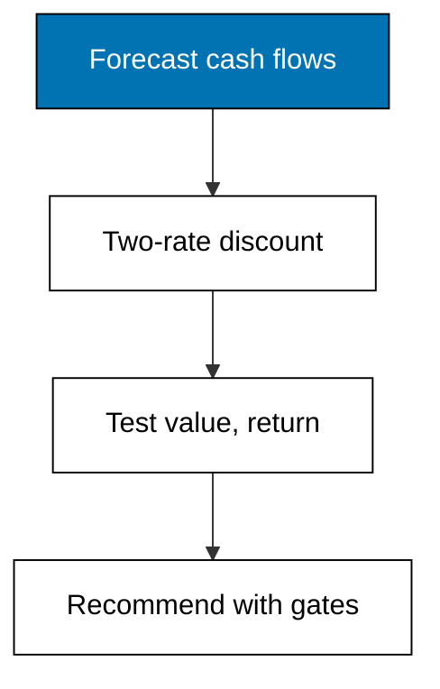

Merpati Trading Co. is fictional, and so is the choice in front of it: a second warehouse costs 400,000 today and promises five years of operating inflows as the reseller base grows. This capstone evaluates that expansion end to end: build the pro-forma cash flows, discount them at the firm's cost of capital, compute NPV and IRR, reprice the decision under a heavier-debt funding, and write the one-page recommendation with its assumptions stated. Every technique comes from Themes A through I; nothing new is introduced, because the point is combination under pressure.

## The decision

The warehouse adds storage for a second delivery region. The outlay of 400,000 covers the lease deposit, racking, and two vans. Management forecasts operating inflows of 90,000 in year one as the region ramps, then 110,000, 130,000, and 140,000 twice as routes mature. The question is whether those inflows repay the outlay at Merpati's hurdle, and whether a different funding mix changes the answer. The recommendation must fit on one page and survive the three gates of Example 48: value, return, and survival.



## Pro-forma cash flows and their assumptions

Pro-forma means as-if: the flows are the forecast, not the history. Year one is deliberately small because new routes run half-empty; years four and five flatten because the region saturates. The standing assumptions are a 25 percent tax rate already reflected in operating flows, no salvage value at the horizon, and working-capital needs funded inside the forecasted amounts. Anyone disputing the verdict should dispute these lines first, exactly as Example 43's receipt demands.

## Discounting at two funding costs

Structure A keeps the current funding and its 8.82 percent WACC from Example 31. Structure B shifts to fifty-fifty funding at 8.56 percent from Example 32, on the condition that coverage stays above the bank's 3.00 floor. Both rates exceed the risk-free floor and both keep equity dearer than debt, so both pass Example 33's audit before either prices a decision.

## Net present value and internal rate of return

Discounting the five pro-forma inflows at 8.82 percent gives an NPV of 68,062.34; at 8.56 percent the same flows give 71,496.28. Cheaper funding adds about three thousand of value without touching operations, the same effect Example 37 measured on the whole firm. Bisection finds the expansion's IRR at 14.66 percent, comfortably above either hurdle, so the return gate holds with room even if the WACC estimates drift upward.

## Capital structure choice

Structure B values the expansion more highly, but the extra debt thins coverage and consumes covenant headroom measured in Example 36. The trade is explicit: roughly three thousand of present value against a tighter distress margin for five years. Because the IRR clears both hurdles, the decision does not hinge on squeezing the last basis point from funding; it hinges on whether management wants the flexibility B gives up. The recommendation takes the value, names the cost, and attaches the monitoring that keeps the cost bounded.

## The one-page recommendation

Expand under structure B, within the covenant. The expansion creates value under either funding, returns 14.66 percent against hurdles below 9 percent, and survives its coverage test. Conditions: re-check coverage yearly against actual EBIT rather than forecast, cap further borrowing until the second region reaches its year-three run rate, and revisit the decision if the tax rate or the bank coupon moves. The assumptions behind the page are growth in reseller demand as forecasted, the two WACC blends from Examples 31 and 32, and no salvage value. If any of those breaks, reprice from the receipt rather than defending the verdict.

**`learning/capstone/code/capstone.py`**

```python
# Capstone: Merpati expansion decision, end to end.
# => Merpati Trading Co. is fictional; every number here is fixed.
# => A second warehouse costs 400,000 and unlocks five yearly inflows.
# => Pro-forma flows are discounted, then judged under two fundings.
from decimal import Decimal

# => The expansion outlay and its pro-forma operating inflows.
cost = Decimal("400000")  # => the second warehouse price
flows = [Decimal("90000"), Decimal("110000"), Decimal("130000")]  # => ramp years
flows += [Decimal("140000"), Decimal("140000")]  # => steady years
# => Structure A keeps the current blend: WACC 8.82 percent.
wacc_a = Decimal("0.0882")  # => two-thirds equity funding
# => Structure B adds debt: WACC 8.56 percent, coverage still above 3.00.
wacc_b = Decimal("0.0856")  # => fifty-fifty funding


# => NPV of the expansion at one funding's hurdle rate.
def npv(trial):  # => net value at one WACC
    # => Discount every pro-forma inflow at the trial rate.
    total = Decimal("0")  # => running present value
    for year, cash in enumerate(flows, start=1):  # => year-indexed discounting
        total += cash / ((Decimal("1") + trial) ** year)  # => one discounted slice
    return total - cost  # => net value at the trial WACC


# => Bisection finds the expansion's IRR between zero and fifty percent.
low = Decimal("0")  # => value here is positive
high = Decimal("0.50")  # => value here is negative
for _ in range(40):  # => forty halvings pin four decimals
    mid = (low + high) / Decimal("2")  # => the next trial
    if npv(mid) > Decimal("0"):  # => zero sits above
        low = mid  # => raise the floor
    else:  # => zero sits below
        high = mid  # => lower the ceiling
irr = (low + high) / Decimal("2")  # => converged internal rate
# => Both fundings clear zero; cheaper funding clears by more.
npv_a = npv(wacc_a)  # => value under current funding
npv_b = npv(wacc_b)  # => value under heavier-debt funding
# => The one-page recommendation, printed as the record.
print("npv-a:", npv_a.quantize(Decimal("0.01")))  # => Output current-funding value
print("npv-b:", npv_b.quantize(Decimal("0.01")))  # => Output proposed-funding value
print("irr:", (irr * 100).quantize(Decimal("0.01")))  # => Output internal rate
print("recommend: expand under structure B within covenant")  # => Output the page
```

**Output** (`learning/capstone/code/expected/main/main.stdout.txt`):

```text
npv-a: 68062.34
npv-b: 71496.28
irr: 14.66
recommend: expand under structure B within covenant
```

## What the numbers do not cover

The model prices cash, not strategy: a competitor entering the second region, a key reseller failing, or a rent increase all sit outside the five flows. The working-capital ramp of a new region can also run hotter than forecasted, repeating Example 10's lesson at larger scale. Treat the 14.66 percent IRR as compensation for exactly these unmodeled risks, and let the yearly coverage re-check catch them early. A model that cannot name its blind spots is a sales document; this one names three.
