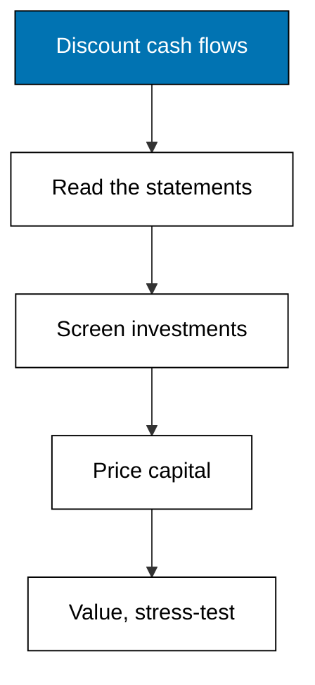

Prerequisites for this course: [accounting-foundations](/en/learn/courses/accounting-foundations/learning/overview) for the income statement, balance sheet, and cash-flow statement every ratio here is built from, and basic algebra for the discounting formulas. Comfort with reading a financial statement and rearranging one equation is assumed throughout.

## Why this exists -- the big idea

**The problem before the solution**: accounting records what already happened, but a business decision is always about what happens next, and nothing in the catalog teaches the forward-looking judgement that choice needs. **Keep this if you forget everything else**: a dollar today is worth more than a dollar later, and every finance decision in this course is that one idea applied to a different question.

## Tensions and trade-offs -- when NOT to reach for this

- **Precision versus judgement**: five decimals on a present value do not help when the cash-flow forecast itself is a guess. Compute exactly, then argue about the inputs, not the arithmetic.
- **Rules of thumb versus models**: a payback cutoff decides fast and ignores the time value of money; NPV decides slowly and honors it. Use the quick screen to kill obvious losers, never to crown winners.
- **When NOT**: bookkeeping mechanics belong in accounting-foundations; this course never debits or credits anything. Tax detail, audit procedure, and live-market data feeds are also out of scope: every company here is fictional and every number is fixed.

## Lineage -- where this judgement sits

Recording came first: journals, ledgers, and statements tell owners what the business did. Finance grew beside it as the forward-looking half: discounting converts future promises into present prices, ratios convert statements into comparisons, capital budgeting converts projects into go or no-go verdicts, and valuation converts all of it into one number with stated assumptions. The generic recording side lives in accounting-foundations; this course is the judgement side.

## How this course is organized

[Theme A](/en/learn/courses/corporate-finance-essentials/learning/theme-a-time-value-of-money) (Worked Examples 1-5) discounts and compounds single sums and annuities. [Theme B](/en/learn/courses/corporate-finance-essentials/learning/theme-b-financial-statement-analysis) (Examples 6-10) reads the three statements as one story. [Theme C](/en/learn/courses/corporate-finance-essentials/learning/theme-c-profitability-and-liquidity-ratios) (Examples 11-15) measures earning power and short-term health. [Theme D](/en/learn/courses/corporate-finance-essentials/learning/theme-d-leverage-and-efficiency-ratios) (Examples 16-21) measures debt load and asset use. [Theme E](/en/learn/courses/corporate-finance-essentials/learning/theme-e-capital-budgeting-npv-and-irr) (Examples 22-27) screens investments with NPV and IRR. [Theme F](/en/learn/courses/corporate-finance-essentials/learning/theme-f-cost-of-capital-and-wacc) (Examples 28-33) prices equity, debt, and their blend. [Theme G](/en/learn/courses/corporate-finance-essentials/learning/theme-g-capital-structure) (Examples 34-38) mixes the two and lives with the result. [Theme H](/en/learn/courses/corporate-finance-essentials/learning/theme-h-valuation-basics) (Examples 39-43) values the firm three simple ways. [Theme I](/en/learn/courses/corporate-finance-essentials/learning/theme-i-sensitivity-and-judgement) (Examples 44-48) stresses every conclusion before signing it. The [capstone](/en/learn/courses/corporate-finance-essentials/learning/capstone/overview) evaluates one fictional expansion decision end to end, and [drilling](/en/learn/courses/corporate-finance-essentials/drilling/overview) turns the concepts into recall, katas, and checklists.

## References

- Ross, Westerfield, and Jordan, Fundamentals of Corporate Finance, standard edition (time value of money, ratio families, NPV, IRR, WACC, and capital-structure intuition; the formulas in this course are textbook-stable). Accessed 2026-10-21.
- Brealey, Myers, and Allen, Principles of Corporate Finance (discounted cash flow valuation, cost of capital, and payout and leverage discussion). Accessed 2026-10-21.
- Accounting foundations vocabulary this course assumes: [accounting-foundations](/en/learn/courses/accounting-foundations/learning/overview) - accessed 2026-10-21; statement names and debit-credit mechanics come from that course, not from the legacy pages below.
- Legacy material this course migrates and re-verifies: corporate finance and business overview legacy pages - accessed 2026-10-21; every fact mined from those pages was re-checked against the textbooks above on the same date rather than copied as already correct.

## Examples by Theme

### Theme A: Time Value of Money (Examples 1-5)

- [Worked Example 1: Present Value of a Single Future Sum](/en/learn/courses/corporate-finance-essentials/learning/theme-a-time-value-of-money#worked-example-1-present-value-of-a-single-future-sum)
- [Worked Example 2: Future Value Under Compounding](/en/learn/courses/corporate-finance-essentials/learning/theme-a-time-value-of-money#worked-example-2-future-value-under-compounding)
- [Worked Example 3: Present Value of an Annuity](/en/learn/courses/corporate-finance-essentials/learning/theme-a-time-value-of-money#worked-example-3-present-value-of-an-annuity)
- [Worked Example 4: Loan Payment From the Annuity Formula](/en/learn/courses/corporate-finance-essentials/learning/theme-a-time-value-of-money#worked-example-4-loan-payment-from-the-annuity-formula)
- [Worked Example 5: One Cash Flow, Three Discount Rates](/en/learn/courses/corporate-finance-essentials/learning/theme-a-time-value-of-money#worked-example-5-one-cash-flow-three-discount-rates)

### Theme B: Financial Statement Analysis (Examples 6-10)

- [Worked Example 6: A Fictional Income Statement, Line by Line](/en/learn/courses/corporate-finance-essentials/learning/theme-b-financial-statement-analysis#worked-example-6-a-fictional-income-statement-line-by-line)
- [Worked Example 7: A Fictional Balance Sheet Snapshot](/en/learn/courses/corporate-finance-essentials/learning/theme-b-financial-statement-analysis#worked-example-7-a-fictional-balance-sheet-snapshot)
- [Worked Example 8: Common-Size Income Statement](/en/learn/courses/corporate-finance-essentials/learning/theme-b-financial-statement-analysis#worked-example-8-common-size-income-statement)
- [Worked Example 9: Year-over-Year Trend](/en/learn/courses/corporate-finance-essentials/learning/theme-b-financial-statement-analysis#worked-example-9-year-over-year-trend)
- [Worked Example 10: Profit Is Not Cash](/en/learn/courses/corporate-finance-essentials/learning/theme-b-financial-statement-analysis#worked-example-10-profit-is-not-cash)

### Theme C: Profitability and Liquidity Ratios (Examples 11-15)

- [Worked Example 11: Gross Margin](/en/learn/courses/corporate-finance-essentials/learning/theme-c-profitability-and-liquidity-ratios#worked-example-11-gross-margin)
- [Worked Example 12: Net Margin](/en/learn/courses/corporate-finance-essentials/learning/theme-c-profitability-and-liquidity-ratios#worked-example-12-net-margin)
- [Worked Example 13: Return on Assets and Equity](/en/learn/courses/corporate-finance-essentials/learning/theme-c-profitability-and-liquidity-ratios#worked-example-13-return-on-assets-and-equity)
- [Worked Example 14: Current Ratio](/en/learn/courses/corporate-finance-essentials/learning/theme-c-profitability-and-liquidity-ratios#worked-example-14-current-ratio)
- [Worked Example 15: Quick Ratio](/en/learn/courses/corporate-finance-essentials/learning/theme-c-profitability-and-liquidity-ratios#worked-example-15-quick-ratio)

### Theme D: Leverage and Efficiency Ratios (Examples 16-21)

- [Worked Example 16: Debt to Equity](/en/learn/courses/corporate-finance-essentials/learning/theme-d-leverage-and-efficiency-ratios#worked-example-16-debt-to-equity)
- [Worked Example 17: Debt Ratio and Equity Ratio](/en/learn/courses/corporate-finance-essentials/learning/theme-d-leverage-and-efficiency-ratios#worked-example-17-debt-ratio-and-equity-ratio)
- [Worked Example 18: Interest Coverage](/en/learn/courses/corporate-finance-essentials/learning/theme-d-leverage-and-efficiency-ratios#worked-example-18-interest-coverage)
- [Worked Example 19: Asset Turnover](/en/learn/courses/corporate-finance-essentials/learning/theme-d-leverage-and-efficiency-ratios#worked-example-19-asset-turnover)
- [Worked Example 20: Receivables Days](/en/learn/courses/corporate-finance-essentials/learning/theme-d-leverage-and-efficiency-ratios#worked-example-20-receivables-days)
- [Worked Example 21: Working Capital and the Cash Cycle](/en/learn/courses/corporate-finance-essentials/learning/theme-d-leverage-and-efficiency-ratios#worked-example-21-working-capital-and-the-cash-cycle)

### Theme E: Capital Budgeting (Examples 22-27)

- [Worked Example 22: Net Present Value of a Project](/en/learn/courses/corporate-finance-essentials/learning/theme-e-capital-budgeting-npv-and-irr#worked-example-22-net-present-value-of-a-project)
- [Worked Example 23: Internal Rate of Return by Bisection](/en/learn/courses/corporate-finance-essentials/learning/theme-e-capital-budgeting-npv-and-irr#worked-example-23-internal-rate-of-return-by-bisection)
- [Worked Example 24: Payback Period](/en/learn/courses/corporate-finance-essentials/learning/theme-e-capital-budgeting-npv-and-irr#worked-example-24-payback-period)
- [Worked Example 25: Profitability Index](/en/learn/courses/corporate-finance-essentials/learning/theme-e-capital-budgeting-npv-and-irr#worked-example-25-profitability-index)
- [Worked Example 26: When NPV and IRR Disagree](/en/learn/courses/corporate-finance-essentials/learning/theme-e-capital-budgeting-npv-and-irr#worked-example-26-when-npv-and-irr-disagree)
- [Worked Example 27: Choosing Between Two Real Projects](/en/learn/courses/corporate-finance-essentials/learning/theme-e-capital-budgeting-npv-and-irr#worked-example-27-choosing-between-two-real-projects)

### Theme F: Cost of Capital and WACC (Examples 28-33)

- [Worked Example 28: Cost of Equity With CAPM](/en/learn/courses/corporate-finance-essentials/learning/theme-f-cost-of-capital-and-wacc#worked-example-28-cost-of-equity-with-capm)
- [Worked Example 29: After-Tax Cost of Debt](/en/learn/courses/corporate-finance-essentials/learning/theme-f-cost-of-capital-and-wacc#worked-example-29-after-tax-cost-of-debt)
- [Worked Example 30: Capital Weights From Market Values](/en/learn/courses/corporate-finance-essentials/learning/theme-f-cost-of-capital-and-wacc#worked-example-30-capital-weights-from-market-values)
- [Worked Example 31: Weighted Average Cost of Capital](/en/learn/courses/corporate-finance-essentials/learning/theme-f-cost-of-capital-and-wacc#worked-example-31-weighted-average-cost-of-capital)
- [Worked Example 32: WACC When the Mix Changes](/en/learn/courses/corporate-finance-essentials/learning/theme-f-cost-of-capital-and-wacc#worked-example-32-wacc-when-the-mix-changes)
- [Worked Example 33: Judging Whether a WACC Input Is Reasonable](/en/learn/courses/corporate-finance-essentials/learning/theme-f-cost-of-capital-and-wacc#worked-example-33-judging-whether-a-wacc-input-is-reasonable)

### Theme G: Capital Structure (Examples 34-38)

- [Worked Example 34: Leverage Amplifies Returns on Equity](/en/learn/courses/corporate-finance-essentials/learning/theme-g-capital-structure#worked-example-34-leverage-amplifies-returns-on-equity)
- [Worked Example 35: Earnings per Share Under Two Structures](/en/learn/courses/corporate-finance-essentials/learning/theme-g-capital-structure#worked-example-35-earnings-per-share-under-two-structures)
- [Worked Example 36: The Coverage Constraint on Borrowing](/en/learn/courses/corporate-finance-essentials/learning/theme-g-capital-structure#worked-example-36-the-coverage-constraint-on-borrowing)
- [Worked Example 37: Firm Value Under Two Capital Structures](/en/learn/courses/corporate-finance-essentials/learning/theme-g-capital-structure#worked-example-37-firm-value-under-two-capital-structures)
- [Worked Example 38: Choosing a Structure With Judgement](/en/learn/courses/corporate-finance-essentials/learning/theme-g-capital-structure#worked-example-38-choosing-a-structure-with-judgement)

### Theme H: Valuation Basics (Examples 39-43)

- [Worked Example 39: A Mini Discounted Cash Flow Valuation](/en/learn/courses/corporate-finance-essentials/learning/theme-h-valuation-basics#worked-example-39-a-mini-discounted-cash-flow-valuation)
- [Worked Example 40: Price to Earnings Multiple](/en/learn/courses/corporate-finance-essentials/learning/theme-h-valuation-basics#worked-example-40-price-to-earnings-multiple)
- [Worked Example 41: Enterprise Value to EBITDA](/en/learn/courses/corporate-finance-essentials/learning/theme-h-valuation-basics#worked-example-41-enterprise-value-to-ebitda)
- [Worked Example 42: Book Value Versus Market Value](/en/learn/courses/corporate-finance-essentials/learning/theme-h-valuation-basics#worked-example-42-book-value-versus-market-value)
- [Worked Example 43: Writing Down the Assumptions](/en/learn/courses/corporate-finance-essentials/learning/theme-h-valuation-basics#worked-example-43-writing-down-the-assumptions)

### Theme I: Sensitivity and Judgement (Examples 44-48)

- [Worked Example 44: Sensitivity to the Discount Rate](/en/learn/courses/corporate-finance-essentials/learning/theme-i-sensitivity-and-judgement#worked-example-44-sensitivity-to-the-discount-rate)
- [Worked Example 45: Break-Even Discount Rate](/en/learn/courses/corporate-finance-essentials/learning/theme-i-sensitivity-and-judgement#worked-example-45-break-even-discount-rate)
- [Worked Example 46: Three Scenarios, One Decision](/en/learn/courses/corporate-finance-essentials/learning/theme-i-sensitivity-and-judgement#worked-example-46-three-scenarios-one-decision)
- [Worked Example 47: Margin of Safety](/en/learn/courses/corporate-finance-essentials/learning/theme-i-sensitivity-and-judgement#worked-example-47-margin-of-safety)
- [Worked Example 48: The One-Page Recommendation](/en/learn/courses/corporate-finance-essentials/learning/theme-i-sensitivity-and-judgement#worked-example-48-the-one-page-recommendation)
