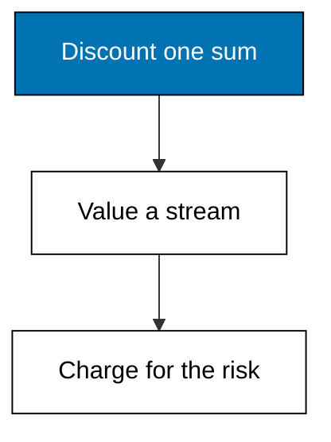
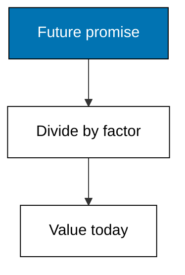
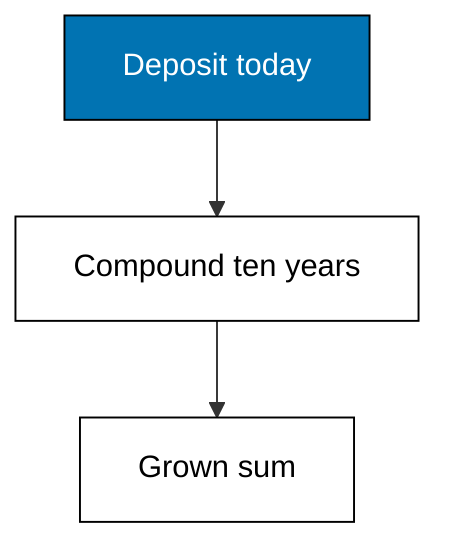
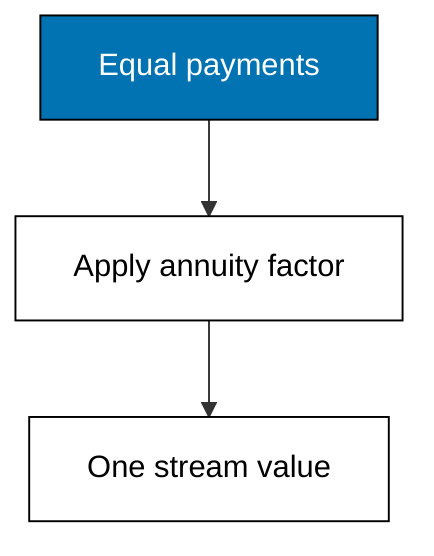
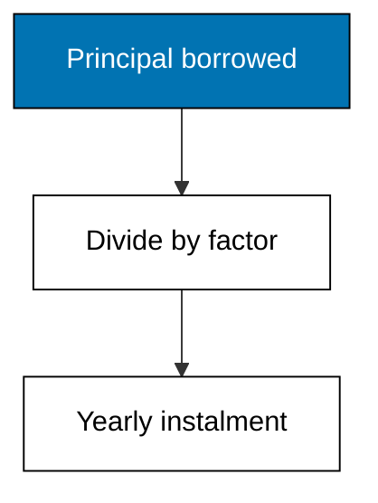
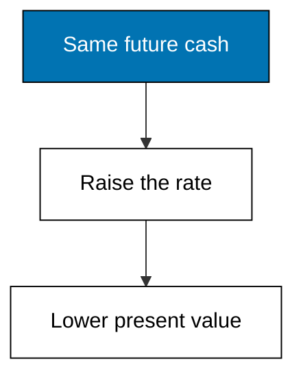

Examples 1-5 discount and compound the two simplest shapes in finance: one lump sum, and a stream of equal payments. Everything later, from NPV to WACC to DCF, reuses exactly these two moves, so read slowly here and quickly everywhere else.



### Worked Example 1: Present Value of a Single Future Sum

_Exercises co-01, co-04._

A customer promises Merpati 10,000 in five years. The promise is not worth 10,000 today, because money today can earn while it waits and because waiting carries risk. Present value converts the future promise into today's price by dividing it by one plus the discount rate, raised to the wait. **Check**: the discount factor reads 1.4693280768 and the value today is 6,805.83.



**`learning/code/ex-01-present-value-single-sum/main.py`**

```python
# Worked Example 1: Present Value of a Single Future Sum
# => Merpati Trading Co. is fictional; every number here is fixed.
# => A customer promises 10,000 in five years; what is it worth today?
# => Present value discounts the future back at the required return.
from decimal import Decimal

# => The promised future receipt, in whole currency units.
future = Decimal("10000")  # => what arrives in year five
# => The annual discount rate: time plus risk in one number.
rate = Decimal("0.08")  # => 8 percent demanded return
# => Years until the cash arrives.
years = 5  # => the waiting time
# => Discount factor: one plus the rate, raised to the wait.
factor = (Decimal("1") + rate) ** years  # => 1.08 to the fifth
# => Present value: future cash divided by the factor.
present = future / factor  # => worth less today than at arrival
# => Money prints with two decimals, never float dust.
print("future:", future)  # => Output repeats the promise
print("factor:", factor)  # => Output shows the discount factor
print("present:", present.quantize(Decimal("0.01")))  # => Output is the value today
```

**Output** (`learning/code/ex-01-present-value-single-sum/expected/main.stdout.txt`):

```text
future: 10000
factor: 1.4693280768
present: 6805.83
```

**Key takeaway**: dividing by the compounded rate turns any future sum into today's price.

**Why It Matters**: every quote, loan, and project in this course is a present-value comparison in disguise. If you can price one delayed payment, you can follow every later argument; if you cannot, each new formula looks like magic. The discount rate is doing double duty here, carrying both impatience and risk, which Example 5 unpacks. Practice this division until it feels like unit conversion, because that is what it becomes.

---

### Worked Example 2: Future Value Under Compounding

_Exercises co-02, co-04._

Run the same idea forward: 5,000 set aside today at 6 percent grows for ten years, and each year's interest earns its own interest afterwards. That interest-on-interest is compounding, and it is why the growth factor multiplies rather than adds. **Check**: the factor reads 1.79084769654285362176 and the grown sum is 8,954.24.



**`learning/code/ex-02-future-value-compounding/main.py`**

```python
# Worked Example 2: Future Value Under Compounding
# => Merpati Trading Co. is fictional; every number here is fixed.
# => Cash set aside today grows because each year's interest earns too.
# => Future value compounds the present forward at the earned rate.
from decimal import Decimal

# => Cash set aside today, in whole currency units.
present = Decimal("5000")  # => the deposit made now
# => The annual rate the deposit earns.
rate = Decimal("0.06")  # => 6 percent earned per year
# => Years the deposit stays invested.
years = 10  # => the compounding horizon
# => Growth factor: one plus the rate, raised to the horizon.
factor = (Decimal("1") + rate) ** years  # => 1.06 to the tenth
# => Future value: present cash multiplied by the factor.
future = present * factor  # => worth more later than now
# => Money prints with two decimals, never float dust.
print("present:", present)  # => Output repeats the deposit
print("factor:", factor)  # => Output shows the growth factor
print("future:", future.quantize(Decimal("0.01")))  # => Output is the grown sum
```

**Output** (`learning/code/ex-02-future-value-compounding/expected/main.stdout.txt`):

```text
present: 5000
factor: 1.79084769654285362176
future: 8954.24
```

**Key takeaway**: multiplying by the compounded rate moves any present sum forward in time.

**Why It Matters**: compounding is the engine behind every savings plan, loan balance, and reinvestment assumption in the course. Notice the factor keeps all twenty digits Decimal computes: rounding mid-course would leak error into every later year. Money prints with two decimals only at the end, never during the arithmetic. That discipline, exact inside and rounded outside, is the course's standing rule for every monetary amount.

---

### Worked Example 3: Present Value of an Annuity

_Exercises co-03, co-01._

A supplier contract pays 2,000 at each year-end for five years. Discounting five payments one by one works but wastes effort; the annuity factor prices the whole stream in one division. It equals one minus the inverse growth, all over the rate: 3.9927 at 8 percent. **Check**: five payments of 2,000 value at 7,985.42, less than their 10,000 face total.



**`learning/code/ex-03-present-value-annuity/main.py`**

```python
# Worked Example 3: Present Value of an Annuity
# => Merpati Trading Co. is fictional; every number here is fixed.
# => A supplier contract pays 2,000 at each year-end for five years.
# => An annuity is a stream of equal payments valued as one sum.
from decimal import Decimal

# => The equal payment arriving at each year-end.
payment = Decimal("2000")  # => five identical receipts
# => The annual discount rate applied to the whole stream.
rate = Decimal("0.08")  # => 8 percent demanded return
# => Number of equal payments in the stream.
years = 5  # => the stream length
# => One plus the rate, raised to the stream length.
growth = (Decimal("1") + rate) ** years  # => shared compounding base
# => Annuity factor: one minus the inverse growth, over the rate.
factor = (Decimal("1") - Decimal("1") / growth) / rate  # => 3.99 at 8 percent
# => Stream value: the payment multiplied by the factor.
value = payment * factor  # => one number for five payments
# => Money prints with two decimals, never float dust.
print("payment:", payment)  # => Output repeats the yearly receipt
print("factor:", factor.quantize(Decimal("0.0001")))  # => Output shows the factor
print("value:", value.quantize(Decimal("0.01")))  # => Output is the stream value
```

**Output** (`learning/code/ex-03-present-value-annuity/expected/main.stdout.txt`):

```text
payment: 2000
factor: 3.9927
value: 7985.42
```

**Key takeaway**: one factor replaces five separate discount divisions for any equal-payment stream.

**Why It Matters**: leases, loan schedules, and pension promises are all annuities wearing different clothes. Recognizing the shape saves the arithmetic and, more importantly, names the assumption: payments equal, timing regular, rate constant. When a real contract breaks any of the three, Example 22's payment-by-payment discounting is the fallback. Learn the shortcut and its boundary together, or the shortcut will mislead you exactly when the stakes rise.

---

### Worked Example 4: Loan Payment From the Annuity Formula

_Exercises co-03, co-02._

Merpati borrows 120,000 for a delivery van at 9 percent, repaying in four equal yearly instalments. A loan is an annuity in reverse: the bank buys a payment stream, so the instalment equals the principal divided by the annuity factor. **Check**: the yearly instalment is 37,040.24 and the four-year total is 148,160.96.



**`learning/code/ex-04-loan-payment-annuity/main.py`**

```python
# Worked Example 4: Loan Payment From the Annuity Formula
# => Merpati Trading Co. is fictional; every number here is fixed.
# => A 120,000 van loan at 9 percent repays in four equal instalments.
# => A loan is an annuity in reverse: the bank buys a payment stream.
from decimal import Decimal

# => The amount borrowed today, in whole currency units.
principal = Decimal("120000")  # => the van price financed
# => The annual interest rate charged on the loan.
rate = Decimal("0.09")  # => 9 percent per year
# => Number of equal yearly instalments.
years = 4  # => the repayment horizon
# => One plus the rate, raised to the horizon.
growth = (Decimal("1") + rate) ** years  # => shared compounding base
# => Annuity factor at the loan rate and horizon.
factor = (Decimal("1") - Decimal("1") / growth) / rate  # => converts sum to stream
# => Yearly instalment: principal divided by the factor.
payment = principal / factor  # => what the firm pays each year
# => Total repaid is the instalment times the horizon.
total = payment * years  # => principal plus all interest
# => Money prints with two decimals, never float dust.
print("principal:", principal)  # => Output repeats the amount borrowed
print("payment:", payment.quantize(Decimal("0.01")))  # => Output is the instalment
print("total:", total.quantize(Decimal("0.01")))  # => Output is the full repayment
```

**Output** (`learning/code/ex-04-loan-payment-annuity/expected/main.stdout.txt`):

```text
principal: 120000
payment: 37040.24
total: 148160.96
```

**Key takeaway**: the instalment is the principal divided by the annuity factor at the loan's rate.

**Why It Matters**: the 28,160.96 gap between principal and total is the price of borrowing, visible in one subtraction. Any refinancing offer can be judged the same way: recompute the instalment at the new rate and compare totals. Borrowers who skip this step compare monthly payments while lenders collect on totals. Always price the whole stream, never the instalment alone.

---

### Worked Example 5: One Cash Flow, Three Discount Rates

_Exercises co-04, co-01._

The same 50,000 arriving in year seven is worth 35,534.07 at 5 percent, 25,657.91 at 10 percent, and 18,796.85 at 15 percent. Nothing about the cash changed; the demanded return did. That is the whole meaning of the discount rate: the price of time plus the price of risk, so riskier cash is discounted harder and valued lower. **Check**: value falls monotonically as the rate rises.



**`learning/code/ex-05-one-cash-flow-three-rates/main.py`**

```python
# Worked Example 5: One Cash Flow, Three Discount Rates
# => Merpati Trading Co. is fictional; every number here is fixed.
# => The same 50,000 in year seven is worth less at higher risk.
# => The discount rate carries time and risk, so it moves every value.
from decimal import Decimal

# => The single future receipt, in whole currency units.
future = Decimal("50000")  # => what arrives in year seven
# => Years until the cash arrives.
years = 7  # => the waiting time
# => Three demanded returns: safe, normal, and risky.
rates = [Decimal("0.05"), Decimal("0.10"), Decimal("0.15")]  # => risk ladder
# => Discount each rate's factor and print the present worth.
for rate in rates:  # => one valuation per demanded return
    # => Discount factor for this rate and wait.
    factor = (Decimal("1") + rate) ** years  # => heavier wait at higher rates
    # => Present value falls as the demanded return rises.
    present = future / factor  # => the same cash, three prices
    # => Money prints with two decimals, never float dust.
    print(
        "rate:", rate, "present:", present.quantize(Decimal("0.01"))
    )  # => Output rows
```

**Output** (`learning/code/ex-05-one-cash-flow-three-rates/expected/main.stdout.txt`):

```text
rate: 0.05 present: 35534.07
rate: 0.10 present: 25657.91
rate: 0.15 present: 18796.85
```

**Key takeaway**: one cash flow has as many present values as there are views of its risk.

**Why It Matters**: arguments about valuation are almost always arguments about the discount rate wearing a costume. When two analysts differ on a project's worth, ask for their rates before debating their cash forecasts: the rate often explains the whole gap. Theme F teaches how to build that rate from market evidence instead of guessing it. Until then, remember the direction: higher risk, higher rate, lower value, every time.
