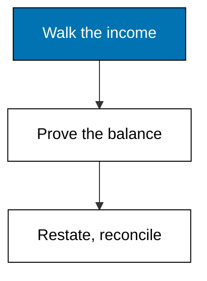
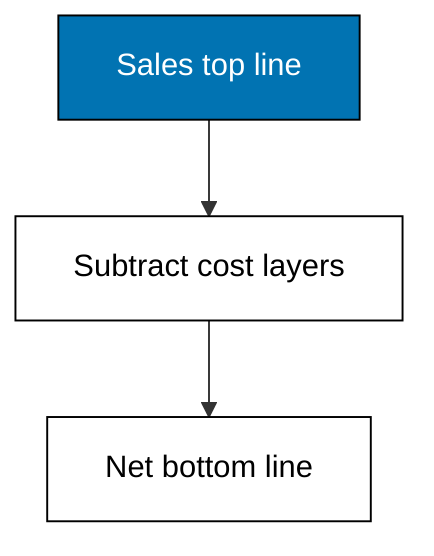
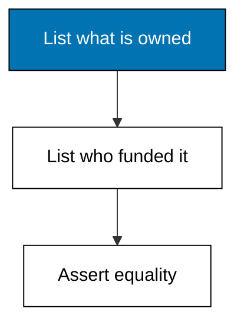
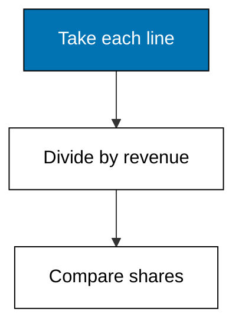
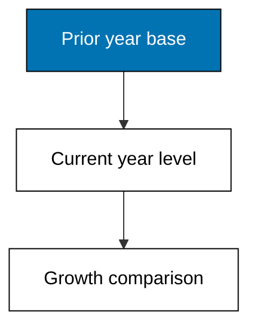
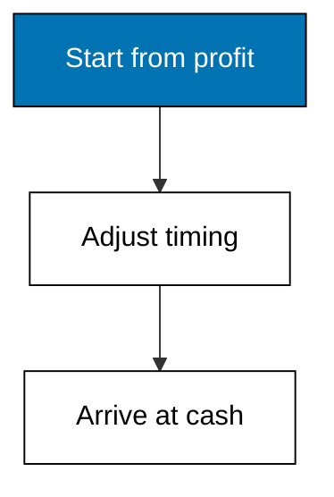

Examples 6-10 read Merpati's three statements as one story: the income statement walks from sales to profit, the balance sheet proves the funding balances, common-size and trend restatements make years comparable, and the cash reconciliation explains why profit and cash diverge.



### Worked Example 6: A Fictional Income Statement, Line by Line

_Exercises co-05._

Revenue of 1,200,000 loses 720,000 of goods cost to leave 480,000 gross, loses 300,000 of operating cost to leave 180,000 EBIT, loses 24,000 of interest to leave 156,000 pre-tax, and loses a quarter to tax to leave 117,000 net. Each line subtracts one cost family from the line above, so the walk names exactly where every sales unit went. **Check**: net prints 117000.00.



**`learning/code/ex-06-income-statement-lines/main.py`**

```python
# Worked Example 6: A Fictional Income Statement, Line by Line
# => Merpati Trading Co. is fictional; every number here is fixed.
# => The income statement walks from sales down to net income.
# => Each line subtracts one cost family from the line above it.
from decimal import Decimal

# => Sales to resellers for the year, in whole currency units.
revenue = Decimal("1200000")  # => the top line
# => Cost of the goods actually sold this year.
cogs = Decimal("720000")  # => wholesale cost of supplies
# => Gross profit: sales minus the cost of goods sold.
gross = revenue - cogs  # => what trading itself earned
# => Operating costs: warehouse rent, wages, delivery fuel.
opex = Decimal("300000")  # => running the business
# => Earnings before interest and tax, the operating result.
ebit = gross - opex  # => profit before financing and tax
# => Interest on the warehouse loan and the van loan.
interest = Decimal("24000")  # => the lenders' cut
# => Earnings before tax, after financing costs.
ebt = ebit - interest  # => profit the tax rate applies to
# => Corporate tax at a flat fictional 25 percent.
tax = ebt * Decimal("0.25")  # => the government share
# => Net income: the bottom line belonging to owners.
net = ebt - tax  # => what the year added to equity
# => Money prints with two decimals, never float dust.
print("revenue:", revenue)  # => Output repeats the top line
print("gross:", gross)  # => Output shows trading profit
print("ebit:", ebit)  # => Output shows operating profit
print("net:", net)  # => Output shows the bottom line
```

**Output** (`learning/code/ex-06-income-statement-lines/expected/main.stdout.txt`):

```text
revenue: 1200000
gross: 480000
ebit: 180000
net: 117000.00
```

**Key takeaway**: the income statement is a subtraction ladder, and each rung has its own name.

**Why It Matters**: ratios in Themes C and D all start from one of these rungs, so misreading a rung corrupts every ratio built on it. The common beginner error is comparing EBIT-based and net-based figures as if financing and tax were free. Keep the ladder in mind: gross belongs to trading, EBIT to operations, net to owners. Every margin later simply divides one rung by the top line.

---

### Worked Example 7: A Fictional Balance Sheet Snapshot

_Exercises co-09._

Merpati owns 1,000,000 of assets: 90,000 cash, 150,000 receivables, 210,000 inventory, and 550,000 of vans, racks, and fittings. Suppliers fund 120,000, lenders fund 380,000, and owners fund 500,000, which sums to the same 1,000,000. The balance is not a metaphor; the program asserts it. **Check**: balances prints True.



**`learning/code/ex-07-balance-sheet-snapshot/main.py`**

```python
# Worked Example 7: A Fictional Balance Sheet Snapshot
# => Merpati Trading Co. is fictional; every number here is fixed.
# => The balance sheet balances: assets equal liabilities plus equity.
# => What the firm owns is funded by lenders, suppliers, and owners.
from decimal import Decimal

# => Cash in the till and the bank, in whole currency units.
cash = Decimal("90000")  # => immediately spendable
# => Amounts resellers owe the firm from credit sales.
receivables = Decimal("150000")  # => collected within weeks
# => Office supplies on the warehouse shelves, at cost.
inventory = Decimal("210000")  # => sold over the next quarter
# => Vans, racks, and fittings net of depreciation.
ppe = Decimal("550000")  # => long-lived operating assets
# => Total assets: everything the firm owns.
assets = cash + receivables + inventory + ppe  # => must equal funding
# => Amounts owed to suppliers, due within weeks.
payables = Decimal("120000")  # => short-term supplier credit
# => Bank loan portion due within one year.
short_debt = Decimal("80000")  # => current debt slice
# => Loans due after one year: warehouse and van financing.
long_debt = Decimal("300000")  # => long-term lender funding
# => Owner funding: paid-in capital plus retained earnings.
equity = Decimal("500000")  # => the residual claim
# => Total funding: every lender, supplier, and owner claim.
funding = payables + short_debt + long_debt + equity  # => must equal assets
# => The balance check proves the snapshot is consistent.
print("assets:", assets)  # => Output totals what the firm owns
print("funding:", funding)  # => Output totals who funded it
print("balances:", assets == funding)  # => Output confirms the identity
```

**Output** (`learning/code/ex-07-balance-sheet-snapshot/expected/main.stdout.txt`):

```text
assets: 1000000
funding: 1000000
balances: True
```

**Key takeaway**: assets equal funding by construction, and the program checks it instead of assuming it.

**Why It Matters**: liquidity, leverage, and efficiency ratios all divide one side of this snapshot by the other. A balance sheet that does not balance poisons all three families at once, which is why the check is code rather than commentary. When you build your own statements later, assert the identity the same way before computing a single ratio. Owners are the residual claim: they are paid last precisely because this equation puts them last.

---

### Worked Example 8: Common-Size Income Statement

_Exercises co-05._

Restating every line as a share of revenue turns absolute rupiah into comparable percentages: goods cost 60.00, operations 25.00, interest 2.00, tax 3.25, and net keeps 9.75 of every 100 sold. A competitor twice Merpati's size can now be laid beside it line by line. **Check**: the five shares plus revenue's own 100 describe the whole statement.



**`learning/code/ex-08-common-size-statement/main.py`**

```python
# Worked Example 8: Common-Size Income Statement
# => Merpati Trading Co. is fictional; every number here is fixed.
# => Common-size restates every line as a share of revenue.
# => Percentages let a small firm compare itself with a giant.
from decimal import Decimal

# => Sales for the year, the common denominator.
revenue = Decimal("1200000")  # => one hundred percent by definition
# => The cost families from the income statement walk.
lines = {"cogs": Decimal("720000"), "opex": Decimal("300000")}  # => two cost blocks
lines["interest"] = Decimal("24000")  # => financing cost joins the map
lines["tax"] = Decimal("39000")  # => tax joins the map
lines["net"] = Decimal("117000")  # => the bottom line joins too
# => Each line divided by revenue, scaled to a percentage.
for name, amount in lines.items():  # => one share per line
    # => Percent with two decimals keeps comparisons honest.
    share = amount / revenue * Decimal("100")  # => the common-size value
    # => Output names the line and its share of every sales unit.
    print(name, share.quantize(Decimal("0.01")))  # => Output is the sized statement
```

**Output** (`learning/code/ex-08-common-size-statement/expected/main.stdout.txt`):

```text
cogs 60.00
opex 25.00
interest 2.00
tax 3.25
net 9.75
```

**Key takeaway**: dividing by revenue converts size into structure, which is what comparison needs.

**Why It Matters**: absolute profit flatters large firms and insults small ones; shares do neither. The 60.00 goods share immediately says trading terms decide Merpati's fate more than overhead does. Whenever a headline number impresses you, common-size it before admiring it. Structure travels across firms and years; size does not.

---

### Worked Example 9: Year-over-Year Trend

_Exercises co-05, co-08._

Revenue grew 11.11 percent while net income grew 21.88 percent, so margins widened: profit outran sales. Trend growth divides this year by last year minus one, on each line separately, which stops a big base year from hiding this year's story. **Check**: margin-widened prints True because bottom-line growth beats top-line growth.



**`learning/code/ex-09-year-over-year-trend/main.py`**

```python
# Worked Example 9: Year-over-Year Trend
# => Merpati Trading Co. is fictional; every number here is fixed.
# => A trend divides this year by last year, minus one.
# => Growth rates show direction; levels alone hide it.
from decimal import Decimal

# => Last year and this year revenue, in whole currency units.
prior_revenue = Decimal("1080000")  # => the base year
revenue = Decimal("1200000")  # => the current year
# => Last year and this year net income.
prior_net = Decimal("96000")  # => the base bottom line
net = Decimal("117000")  # => the current bottom line
# => Revenue growth: the change over the base, as a share.
revenue_growth = (revenue - prior_revenue) / prior_revenue  # => top-line momentum
# => Net income growth uses the same formula on the bottom line.
net_growth = (net - prior_net) / prior_net  # => bottom-line momentum
# => Profit grew faster than sales, so margins widened this year.
print("revenue-growth:", (revenue_growth * 100).quantize(Decimal("0.01")))  # => Output
print("net-growth:", (net_growth * 100).quantize(Decimal("0.01")))  # => Output faster
print("margin-widened:", net_growth > revenue_growth)  # => Output states the read
```

**Output** (`learning/code/ex-09-year-over-year-trend/expected/main.stdout.txt`):

```text
revenue-growth: 11.11
net-growth: 21.88
margin-widened: True
```

**Key takeaway**: compare growth rates across lines, not just levels within one year.

**Why It Matters**: a rising profit can still be a deteriorating business if sales rise faster, and a flat profit can be an improving one if sales fall faster. The two-line comparison takes seconds and reverses careless verdicts. It also disciplines forecasts: projecting net income without projecting its growth relative to sales is guessing with extra steps. Always read the pair.

---

### Worked Example 10: Profit Is Not Cash

_Exercises co-09._

Net income of 117,000 becomes 127,000 of operating cash once non-cash depreciation is added back and working-capital moves are honored: receivables and inventory growth consume cash, payables growth releases it. The 10,000 gap is neither fraud nor error; it is timing. **Check**: ocf prints 127000 against net of 117000.



**`learning/code/ex-10-profit-is-not-cash/main.py`**

```python
# Worked Example 10: Profit Is Not Cash
# => Merpati Trading Co. is fictional; every number here is fixed.
# => Net income counts promises; operating cash counts collections.
# => Working-capital moves explain the gap between the two.
from decimal import Decimal

# => The bottom line from the income statement walk.
net = Decimal("117000")  # => profit on paper
# => Depreciation: a real cost already paid, with no cash leaving now.
depreciation = Decimal("60000")  # => added back, not spent again
# => Receivables grew: sales booked but not yet collected.
receivables_up = Decimal("30000")  # => cash still with resellers
# => Inventory grew: cash converted into shelf stock.
inventory_up = Decimal("40000")  # => cash sitting in the warehouse
# => Payables grew: supplier cash kept a little longer.
payables_up = Decimal("20000")  # => cash not yet paid out
# => Operating cash flow: profit adjusted for non-cash and timing.
ocf = net + depreciation - receivables_up - inventory_up + payables_up  # => cash truth
# => The two numbers differ, and the adjustments name exactly why.
print("net:", net)  # => Output repeats accounting profit
print("ocf:", ocf)  # => Output shows cash generated
print("gap:", (net - ocf))  # => Output sizes the timing difference
```

**Output** (`learning/code/ex-10-profit-is-not-cash/expected/main.stdout.txt`):

```text
net: 117000
ocf: 127000
gap: -10000
```

**Key takeaway**: bridge profit to cash by reversing non-cash charges and working-capital swings.

**Why It Matters**: dividends, loan repayments, and payroll clear in cash, never in net income. A profitable firm that grows working capital faster than it collects can still run dry, which is exactly the trap Example 21's cash cycle measures in days. Read the cash reconciliation before celebrating any profit figure. Lenders do; owners should too.
