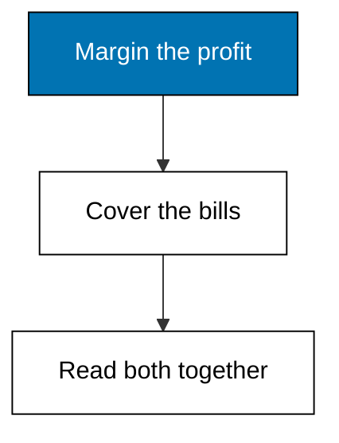
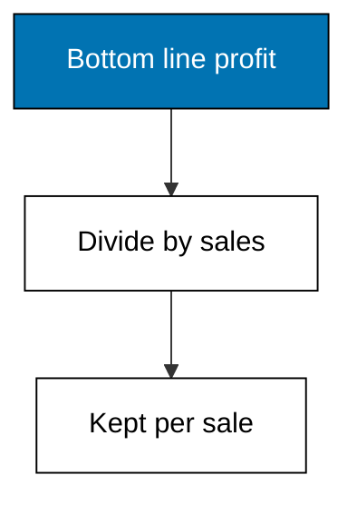
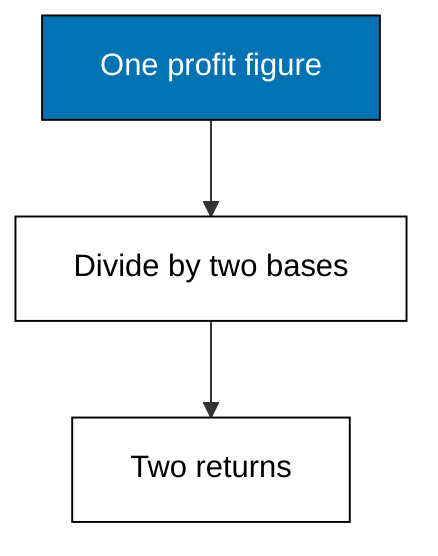

Examples 11-15 turn statement lines into verdicts: three margins measure earning power at three altitudes, and two coverage ratios measure whether near-term bills get paid. Profitability asks how well the firm earns; liquidity asks whether it survives the month.



### Worked Example 11: Gross Margin

_Exercises co-05._

Gross profit of 480,000 on revenue of 1,200,000 is a 40.00 percent gross margin: forty cents of trading profit per sales unit before overhead touches it. This is the purest read of buying-and-selling skill, unpolluted by rent, wages, or financing choices. **Check**: gross-margin prints 40.00.


**`learning/code/ex-11-gross-margin/main.py`**

```python
# Worked Example 11: Gross Margin
# => Merpati Trading Co. is fictional; every number here is fixed.
# => Gross margin keeps the trading result per unit of sales.
# => It answers whether the core buying-and-selling works.
from decimal import Decimal

# => Sales and cost of goods sold for the year.
revenue = Decimal("1200000")  # => the top line
cogs = Decimal("720000")  # => what the sold goods cost
# => Gross profit: sales minus the cost of goods sold.
gross = revenue - cogs  # => the trading result
# => Gross margin: trading result per unit of sales.
margin = gross / revenue * Decimal("100")  # => percent kept from trading
# => Forty cents of trading profit per currency unit sold.
print("gross:", gross)  # => Output shows the trading result
print("gross-margin:", margin.quantize(Decimal("0.01")))  # => Output is the ratio
```

**Output** (`learning/code/ex-11-gross-margin/expected/main.stdout.txt`):

```text
gross: 480000
gross-margin: 40.00
```

**Key takeaway**: gross margin isolates trading skill from everything the firm spends to exist.

**Why It Matters**: when gross margin slips, no amount of cost-cutting below it restores the business; the buying or pricing itself is broken. Suppliers raising wholesale prices show up here first, quarters before net margin complains. Watch this line the way a doctor watches a pulse: it rarely lies, and it moves first.

---

### Worked Example 12: Net Margin

_Exercises co-05._

Net income of 117,000 on the same revenue is a 9.75 percent net margin: under ten cents kept per sales unit after every cost family and tax. The distance between 40.00 gross and 9.75 net is the whole overhead, financing, and tax story in one subtraction. **Check**: net-margin prints 9.75.



**`learning/code/ex-12-net-margin/main.py`**

```python
# Worked Example 12: Net Margin
# => Merpati Trading Co. is fictional; every number here is fixed.
# => Net margin keeps the final profit per unit of sales.
# => It answers what owners keep after every cost family.
from decimal import Decimal

# => Sales and the bottom line for the year.
revenue = Decimal("1200000")  # => the top line
net = Decimal("117000")  # => profit after all costs and tax
# => Net margin: final profit per unit of sales.
margin = net / revenue * Decimal("100")  # => percent kept overall
# => Below ten percent: trading is fine, overhead is the story.
print("net:", net)  # => Output repeats the bottom line
print("net-margin:", margin.quantize(Decimal("0.01")))  # => Output is the ratio
```

**Output** (`learning/code/ex-12-net-margin/expected/main.stdout.txt`):

```text
net: 117000
net-margin: 9.75
```

**Key takeaway**: net margin is the owners' final keep-rate on every sales unit.

**Why It Matters**: two firms can share a 40 percent gross margin while one keeps 15 and the other keeps 5; the difference is discipline below the gross line. When net margin trails peers with similar gross margins, the investigation starts in operating costs, not in purchasing. Always read gross and net as a pair: the gap between them assigns the blame.

---

### Worked Example 13: Return on Assets and Equity

_Exercises co-05._

The same 117,000 of profit is an 11.70 percent return on the 1,000,000 asset base and a 23.40 percent return on the 500,000 of equity. ROE doubles ROA here because half the assets run on debt, which is leverage previewing Theme G. **Check**: roe prints exactly twice roa.



**`learning/code/ex-13-return-on-assets-and-equity/main.py`**

```python
# Worked Example 13: Return on Assets and Equity
# => Merpati Trading Co. is fictional; every number here is fixed.
# => ROA measures the whole asset base; ROE measures the owners' slice.
# => Debt makes ROE exceed ROA, which Theme G explores fully.
from decimal import Decimal

# => The bottom line, the asset base, and owner funding.
net = Decimal("117000")  # => profit belonging to owners
assets = Decimal("1000000")  # => everything the firm owns
equity = Decimal("500000")  # => the owners' slice of funding
# => Return on assets: profit per unit of everything owned.
roa = net / assets * Decimal("100")  # => whole-firm efficiency
# => Return on equity: profit per unit of owner funding.
roe = net / equity * Decimal("100")  # => owner-level return
# => ROE doubles ROA here because half the assets run on debt.
print("roa:", roa.quantize(Decimal("0.01")))  # => Output is the firm return
print("roe:", roe.quantize(Decimal("0.01")))  # => Output is the owner return
```

**Output** (`learning/code/ex-13-return-on-assets-and-equity/expected/main.stdout.txt`):

```text
roa: 11.70
roe: 23.40
```

**Key takeaway**: ROA judges the business; ROE judges the owners' deal, leverage included.

**Why It Matters**: a soaring ROE built on shrinking equity flatters managers while endangering the firm. Always ask which moved: profit, or the denominator. When ROE climbs while ROA stands still, the firm did not get better; it got more indebted. That distinction is the entire capital-structure debate in miniature.

---

### Worked Example 14: Current Ratio

_Exercises co-06._

Near-term resources of 450,000 against near-term bills of 200,000 give a 2.25 current ratio: two and a quarter covers for every bill due within the year. Above one means short-term survival is funded; far above one invites the question of idle resources. **Check**: current-ratio prints 2.25.


**`learning/code/ex-14-current-ratio/main.py`**

```python
# Worked Example 14: Current Ratio
# => Merpati Trading Co. is fictional; every number here is fixed.
# => The current ratio covers near-term bills with near-term resources.
# => Above one means short-term assets exceed short-term claims.
from decimal import Decimal

# => Resources convertible to cash within one year.
current_assets = Decimal("450000")  # => cash, receivables, inventory
# => Bills falling due within one year.
current_liabilities = Decimal("200000")  # => payables plus short debt
# => Current ratio: near-term resources per unit of near-term bills.
ratio = current_assets / current_liabilities  # => the coverage multiple
# => 2.25 times covered: comfortable, before asking what sits inside.
print("current-assets:", current_assets)  # => Output repeats resources
print("current-liabilities:", current_liabilities)  # => Output repeats bills
print("current-ratio:", ratio.quantize(Decimal("0.01")))  # => Output is the cover
```

**Output** (`learning/code/ex-14-current-ratio/expected/main.stdout.txt`):

```text
current-assets: 450000
current-liabilities: 200000
current-ratio: 2.25
```

**Key takeaway**: the current ratio is the firm's twelve-month survival multiple.

**Why It Matters**: profit without liquidity still bankrupts: bills clear in weeks while profit accrues over the year. A ratio sliding toward one deserves action before it arrives there, because restoring liquidity under pressure costs far more than maintaining it early. But read the next example before relaxing: the composition of those resources matters as much as their total.

---

### Worked Example 15: Quick Ratio

_Exercises co-06._

Dropping the slowest asset, 210,000 of inventory, leaves 240,000 of fast resources against the same 200,000 of bills: a 1.20 quick ratio. The firm pays its year without a fire sale of shelves, though the cushion is thinner than the current ratio suggested. **Check**: quick-ratio prints 1.20.


**`learning/code/ex-15-quick-ratio/main.py`**

```python
# Worked Example 15: Quick Ratio
# => Merpati Trading Co. is fictional; every number here is fixed.
# => The quick ratio drops inventory, the slowest current asset.
# => It asks whether the firm pays bills without a fire sale.
from decimal import Decimal

# => Near-term resources, bills, and the inventory inside them.
current_assets = Decimal("450000")  # => cash, receivables, inventory
inventory = Decimal("210000")  # => the slowest piece to convert
current_liabilities = Decimal("200000")  # => bills due within one year
# => Quick assets: everything near-term except inventory.
quick_assets = current_assets - inventory  # => cash plus receivables
# => Quick ratio: fast resources per unit of near-term bills.
ratio = quick_assets / current_liabilities  # => the strict coverage
# => 1.20 times covered: healthy even if the shelves stop moving.
print("quick-assets:", quick_assets)  # => Output shows fast resources
print("quick-ratio:", ratio.quantize(Decimal("0.01")))  # => Output is the cover
```

**Output** (`learning/code/ex-15-quick-ratio/expected/main.stdout.txt`):

```text
quick-assets: 240000
quick-ratio: 1.20
```

**Key takeaway**: the quick ratio tests survival when inventory cannot be sold in time.

**Why It Matters**: a healthy current ratio can hide a warehouse of slow stock, and lenders know it, which is why loan covenants often cite the quick ratio instead. The 1.05 gap between Merpati's two covers is exactly the inventory dependence to monitor. Whenever the headline cover looks comfortable, ask what carries it; the strict measure answers.
