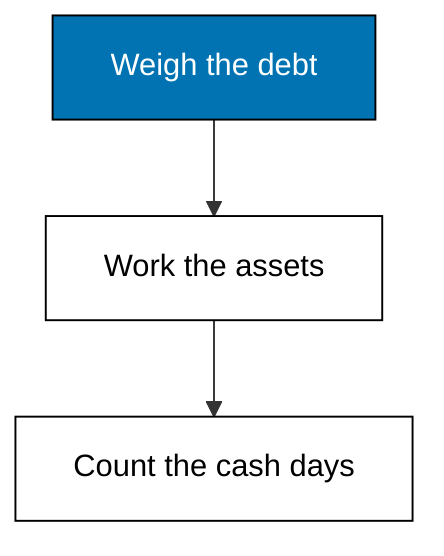
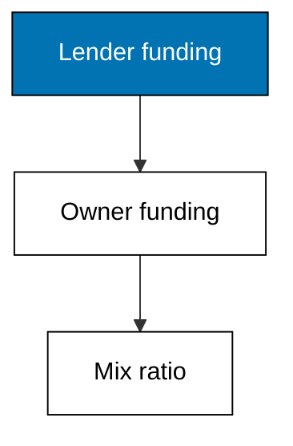
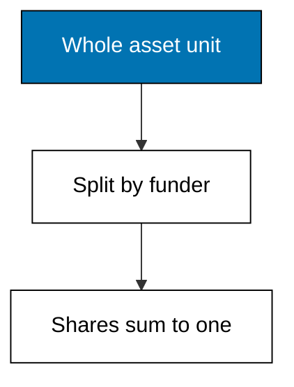
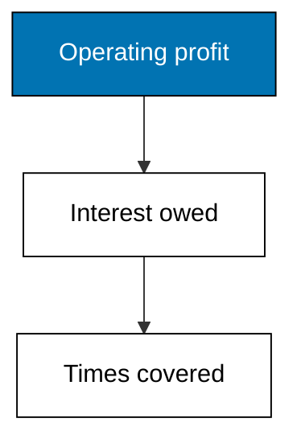
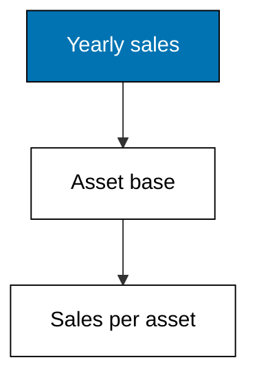

Examples 16-21 measure the two remaining families: leverage ratios weigh debt against equity and profit against interest, while efficiency ratios weigh sales against the assets and balances that produce them. The theme closes with working capital and the cash cycle in days.



### Worked Example 16: Debt to Equity

_Exercises co-07._

Interest-bearing debt of 380,000 against equity of 500,000 is a 0.76 debt-to-equity ratio: seventy-six cents of lender funding per owner unit. Below one means owners still fund more than lenders, the conservative side of the line Theme G will cross deliberately. **Check**: debt-to-equity prints 0.76.



**`learning/code/ex-16-debt-to-equity/main.py`**

```python
# Worked Example 16: Debt to Equity
# => Merpati Trading Co. is fictional; every number here is fixed.
# => Debt to equity compares lender funding with owner funding.
# => It is the simplest summary of how the firm is financed.
from decimal import Decimal

# => Interest-bearing loans, short slice plus long slice.
debt = Decimal("380000")  # => 80,000 short plus 300,000 long
# => Owner funding from the balance sheet snapshot.
equity = Decimal("500000")  # => the residual claim
# => Debt to equity: lender units per owner unit.
ratio = debt / equity  # => the financing mix in one number
# => 0.76: seventy-six cents of debt back each unit of equity.
print("debt:", debt)  # => Output repeats lender funding
print("equity:", equity)  # => Output repeats owner funding
print("debt-to-equity:", ratio.quantize(Decimal("0.01")))  # => Output is the mix
```

**Output** (`learning/code/ex-16-debt-to-equity/expected/main.stdout.txt`):

```text
debt: 380000
equity: 500000
debt-to-equity: 0.76
```

**Key takeaway**: one ratio summarizes who funds the firm, lenders versus owners.

**Why It Matters**: every borrowing decision moves this number, and covenants often cap it, so it is the ratio managers watch before signing loans. Note the construction choice: only interest-bearing debt counts here, not supplier payables, because the ratio prices funding risk rather than total claims. Say which debt you mean whenever you quote it, or two analysts will argue about different numbers.

---

### Worked Example 17: Debt Ratio and Equity Ratio

_Exercises co-07._

Liabilities of 500,000 fund half of every asset unit and equity funds the other half: a 0.50 debt ratio and a 0.50 equity ratio. The two always sum to one, which the program asserts as its own arithmetic receipt. **Check**: sums-to-one prints True.



**`learning/code/ex-17-debt-ratio-and-equity-ratio/main.py`**

```python
# Worked Example 17: Debt Ratio and Equity Ratio
# => Merpati Trading Co. is fictional; every number here is fixed.
# => These two ratios split every asset unit by who funded it.
# => They always sum to one, which checks the arithmetic.
from decimal import Decimal

# => All claims on the firm and everything they funded.
liabilities = Decimal("500000")  # => suppliers plus lenders
equity = Decimal("500000")  # => the owners' slice
assets = Decimal("1000000")  # => the funded whole
# => Debt ratio: the creditor-funded share of every asset unit.
debt_ratio = liabilities / assets  # => lender share
# => Equity ratio: the owner-funded share of every asset unit.
equity_ratio = equity / assets  # => owner share
# => The two shares sum to one by construction.
print("debt-ratio:", debt_ratio.quantize(Decimal("0.01")))  # => Output lender share
print("equity-ratio:", equity_ratio.quantize(Decimal("0.01")))  # => Output owner share
print("sums-to-one:", debt_ratio + equity_ratio == Decimal("1"))  # => Output checks
```

**Output** (`learning/code/ex-17-debt-ratio-and-equity-ratio/expected/main.stdout.txt`):

```text
debt-ratio: 0.50
equity-ratio: 0.50
sums-to-one: True
```

**Key takeaway**: the two funding shares always complete each other and sum to one.

**Why It Matters**: unlike debt-to-equity, these ratios bound themselves between zero and one, which makes them comparable across firms with wildly different scales. A debt ratio drifting past one-half deserves the same attention as a debt-to-equity crossing one: the firm is starting to belong to its creditors. The self-check habit matters too: identities that must hold should be asserted in code, not eyeballed.

---

### Worked Example 18: Interest Coverage

_Exercises co-07._

Operating profit of 180,000 covers 24,000 of interest 7.50 times over: profit could fall a long way before interest binds. Lenders read this as the distress margin, and covenants name a floor for it, which Example 36 turns into a borrowing ceiling. **Check**: coverage prints 7.50.



**`learning/code/ex-18-interest-coverage/main.py`**

```python
# Worked Example 18: Interest Coverage
# => Merpati Trading Co. is fictional; every number here is fixed.
# => Interest coverage counts how many times profit pays interest.
# => Lenders watch it because it measures the margin before distress.
from decimal import Decimal

# => Operating profit and the lenders' yearly cut.
ebit = Decimal("180000")  # => profit before interest and tax
interest = Decimal("24000")  # => interest owed for the year
# => Coverage: operating profit per unit of interest.
coverage = ebit / interest  # => the distress margin in one number
# => 7.50 times: profit could fall a long way before interest binds.
print("ebit:", ebit)  # => Output repeats operating profit
print("interest:", interest)  # => Output repeats the lenders' cut
print("coverage:", coverage.quantize(Decimal("0.01")))  # => Output is the margin
```

**Output** (`learning/code/ex-18-interest-coverage/expected/main.stdout.txt`):

```text
ebit: 180000
interest: 24000
coverage: 7.50
```

**Key takeaway**: coverage translates profit into the number of interest bills it pays.

**Why It Matters**: debt-to-equity describes the stock of borrowing; coverage describes the flow that services it, and flows kill first. A firm can carry heavy debt safely with strong coverage, or light debt dangerously with weak coverage. When the two ratios disagree, believe the flow: lenders foreclose on missed payments, not on balance-sheet proportions.

---

### Worked Example 19: Asset Turnover

_Exercises co-08._

Sales of 1,200,000 on assets of 1,000,000 give a 1.20 asset turnover: each asset unit supports one and a fifth sales units. It measures workload, not profitability: a busy firm can still be a poor one, and a quiet one can be rich. **Check**: turnover prints 1.20.



**`learning/code/ex-19-asset-turnover/main.py`**

```python
# Worked Example 19: Asset Turnover
# => Merpati Trading Co. is fictional; every number here is fixed.
# => Asset turnover counts sales units per asset unit.
# => It measures how hard the asset base works, not how profitable sales are.
from decimal import Decimal

# => Yearly sales and everything owned to produce them.
revenue = Decimal("1200000")  # => the year's sales
assets = Decimal("1000000")  # => the asset base behind them
# => Turnover: sales per unit of assets.
turnover = revenue / assets  # => the workload multiple
# => 1.20: each asset unit supports one and a fifth sales units.
print("revenue:", revenue)  # => Output repeats sales
print("turnover:", turnover.quantize(Decimal("0.01")))  # => Output is the workload
```

**Output** (`learning/code/ex-19-asset-turnover/expected/main.stdout.txt`):

```text
revenue: 1200000
turnover: 1.20
```

**Key takeaway**: turnover separates how busy assets are from how profitable sales are.

**Why It Matters**: margin times turnover explains return on assets, so a falling ROA can be diagnosed instantly: did prices slip, or did assets idle. Retailers live on high turnover with thin margins; wholesalers like Merpati sit in the middle. Never compare turnover across industries: a warehouse and a software firm turn different things.

---

### Worked Example 20: Receivables Days

_Exercises co-08._

Receivables of 150,000 against yearly sales of 1,200,000 convert to 45.62 collection days: cash waits a month and a half after each sale. Against thirty-day terms, that wait is a quiet loan from Merpati to its resellers. **Check**: days prints 45.62.


**`learning/code/ex-20-receivables-days/main.py`**

```python
# Worked Example 20: Receivables Days
# => Merpati Trading Co. is fictional; every number here is fixed.
# => Receivables days convert a balance into collection speed.
# => Slow collection is a quiet loan from the firm to its customers.
from decimal import Decimal

# => Uncollected credit sales and the year's total sales.
receivables = Decimal("150000")  # => cash still with resellers
revenue = Decimal("1200000")  # => the year's sales
# => Days in the year, the fixed conversion constant.
days = Decimal("365")  # => turns a share into days
# => Collection period: the receivables share scaled to days.
collection = receivables / revenue * days  # => how long cash waits
# => About forty-six days: slower than the thirty-day terms allow.
print("receivables:", receivables)  # => Output repeats the balance
print("days:", collection.quantize(Decimal("0.01")))  # => Output is the wait
```

**Output** (`learning/code/ex-20-receivables-days/expected/main.stdout.txt`):

```text
receivables: 150000
days: 45.62
```

**Key takeaway**: dividing a balance by its daily flow turns a stock into a waiting time.

**Why It Matters**: days are actionable where balances are not: forty-six days against thirty-day terms names a collections problem with a number. The same conversion prices inventory days and payables days in the next example, which is why the pattern matters more than this instance. Whenever a balance worries you, divide it by its flow and read the days.

---

### Worked Example 21: Working Capital and the Cash Cycle

_Exercises co-09, co-08._

Working capital of 250,000 funds the firm's day-to-day gap, and the cash cycle counts that gap at 91.25 days: 106.46 shelf days plus 45.62 collection days minus 60.83 supplier-lag days. Ninety-plus funded days explain exactly why Example 10's profit and cash diverged. **Check**: cash-cycle-days prints 91.25.


**`learning/code/ex-21-working-capital-and-cash-cycle/main.py`**

```python
# Worked Example 21: Working Capital and the Cash Cycle
# => Merpati Trading Co. is fictional; every number here is fixed.
# => Working capital funds the gap between paying and collecting.
# => The cash cycle counts the days that gap stays open.
from decimal import Decimal

# => Near-term resources and near-term bills.
current_assets = Decimal("450000")  # => cash, receivables, inventory
current_liabilities = Decimal("200000")  # => payables plus short debt
# => Working capital: the buffer funding day-to-day operations.
working = current_assets - current_liabilities  # => the operating cushion
# => The three cycle legs, each as a share of its flow times 365.
inventory_days = Decimal("210000") / Decimal("720000") * Decimal("365")  # => shelf wait
receivables_days = Decimal("150000") / Decimal("1200000") * Decimal("365")  # => collect
payables_days = (
    Decimal("120000") / Decimal("720000") * Decimal("365")
)  # => supplier lag
# => Cash cycle: waits funded by the firm minus the supplier lag.
cycle = inventory_days + receivables_days - payables_days  # => funded days
# => Ninety-plus funded days explain why profit and cash diverged in Example 10.
print("working-capital:", working)  # => Output is the cushion
print("cash-cycle-days:", cycle.quantize(Decimal("0.01")))  # => Output is the gap
```

**Output** (`learning/code/ex-21-working-capital-and-cash-cycle/expected/main.stdout.txt`):

```text
working-capital: 250000
cash-cycle-days: 91.25
```

**Key takeaway**: the cash cycle prices the working-capital gap in the days the firm funds.

**Why It Matters**: shortening any leg, faster shelves, tighter collections, or fairer supplier terms, frees cash without selling a single extra unit. That is why operators manage the cycle weekly while accountants close it monthly. A firm can be profitable, liquid on paper, and still thirsty for cash when this number runs long. Watch the days, not just the buffer.
