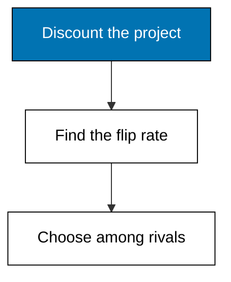
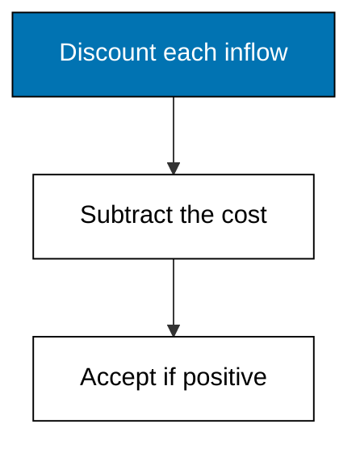
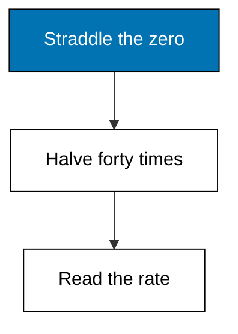
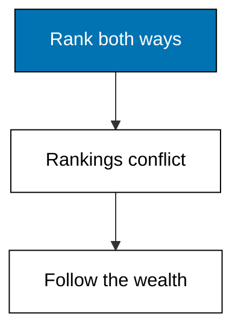
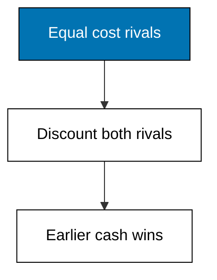

Examples 22-27 screen Merpati's delivery van and its rivals: NPV discounts and decides, IRR finds the break-even rate by bisection, payback and the profitability index answer narrower questions, and two head-to-head choices teach which rule wins when rules disagree.



### Worked Example 22: Net Present Value of a Project

_Exercises co-10._

The van costs 240,000 today and earns 70, 80, 90, 90, and 70 thousand over five years. Discounting each inflow at 10 percent gives 302,306.10 of present value, so NPV is 62,306.10: positive, therefore accept. NPV is the only rule that measures absolute wealth created. **Check**: accept prints True.



**`learning/code/ex-22-net-present-value-project/main.py`**

```python
# Worked Example 22: Net Present Value of a Project
# => Merpati Trading Co. is fictional; every number here is fixed.
# => A delivery van costs 240,000 and earns five yearly cash flows.
# => NPV discounts each inflow, sums them, and subtracts the cost.
from decimal import Decimal

# => The upfront outflow, in whole currency units.
cost = Decimal("240000")  # => the van price paid today
# => Demanded return for a project of this risk.
rate = Decimal("0.10")  # => 10 percent hurdle
# => Year-end operating cash inflows from the van.
flows = [Decimal("70000"), Decimal("80000"), Decimal("90000")]  # => first three years
flows += [Decimal("90000"), Decimal("70000")]  # => the last two years
# => Discount each inflow by its year and accumulate the total.
discounted = Decimal("0")  # => running sum of present values
for year, cash in enumerate(flows, start=1):  # => year one is undiscounted once
    # => Present value of this year's inflow at the hurdle rate.
    discounted += cash / ((Decimal("1") + rate) ** year)  # => one slice of value
# => Net present value: discounted inflows minus the upfront cost.
npv = discounted - cost  # => positive means the project creates value
# => Money prints with two decimals, never float dust.
print("discounted-inflows:", discounted.quantize(Decimal("0.01")))  # => Output value in
print("npv:", npv.quantize(Decimal("0.01")))  # => Output is the verdict number
print("accept:", npv > Decimal("0"))  # => Output states the rule
```

**Output** (`learning/code/ex-22-net-present-value-project/expected/main.stdout.txt`):

```text
discounted-inflows: 302306.10
npv: 62306.10
accept: True
```

**Key takeaway**: NPV converts a whole project into one wealth number with a built-in decision.

**Why It Matters**: the enumeration starts at one on purpose: year one's cash discounts exactly once, and off-by-one timing is the classic NPV bug. Positive means the project beats its hurdle after repaying its cost; negative means it destroys wealth even if its cash totals look generous. Every later rule in this theme is judged by whether it agrees with this one.

---

### Worked Example 23: Internal Rate of Return by Bisection

_Exercises co-11._

IRR is the discount rate where NPV equals exactly zero. Bisection traps it: NPV is positive below the answer and negative above, so halving the bracket forty times pins the van's IRR at 19.54 percent, far above the 10 percent hurdle. The check prints -0.00, which is zero to the cent. **Check**: irr prints 19.54.



**`learning/code/ex-23-internal-rate-of-return-bisection/main.py`**

```python
# Worked Example 23: Internal Rate of Return by Bisection
# => Merpati Trading Co. is fictional; every number here is fixed.
# => IRR is the discount rate where NPV equals exactly zero.
# => Bisection traps it: NPV is positive below IRR, negative above.
from decimal import Decimal

# => The same van project: cost plus five yearly inflows.
cost = Decimal("240000")  # => the upfront outflow
flows = [Decimal("70000"), Decimal("80000"), Decimal("90000")]  # => first three years
flows += [Decimal("90000"), Decimal("70000")]  # => the last two years
# => NPV at any trial rate, the helper bisection calls.
# => Positive trial NPV means the true IRR sits higher.
# => Negative trial NPV means the true IRR sits lower.


def npv_at(rate):  # => value of the project at one rate
    # => Discount every inflow at the trial rate and sum.
    total = Decimal("0")  # => running present value
    for year, cash in enumerate(flows, start=1):  # => year-indexed discounting
        total += cash / ((Decimal("1") + rate) ** year)  # => one discounted slice
    return total - cost  # => net value at the trial rate


# => Bracket the answer: NPV is positive at zero, negative at fifty percent.
low = Decimal("0")  # => NPV here is clearly positive
high = Decimal("0.50")  # => NPV here is clearly negative
# => Halve the bracket forty times; Decimal keeps every cut exact.
for _ in range(40):  # => forty halvings pin four decimals
    # => The midpoint rate splits the current bracket.
    mid = (low + high) / Decimal("2")  # => the next trial
    # => Keep the half whose ends still straddle zero.
    if npv_at(mid) > Decimal("0"):  # => zero sits above the midpoint
        low = mid  # => raise the floor
    else:  # => zero sits below the midpoint
        high = mid  # => lower the ceiling
# => The bracket center is the internal rate of return.
irr = (low + high) / Decimal("2")  # => converged estimate
# => About nineteen percent: far above the ten percent hurdle.
print("irr:", (irr * 100).quantize(Decimal("0.01")))  # => Output is the rate
print("npv-at-irr:", npv_at(irr).quantize(Decimal("0.01")))  # => Output near zero
```

**Output** (`learning/code/ex-23-internal-rate-of-return-bisection/expected/main.stdout.txt`):

```text
irr: 19.54
npv-at-irr: -0.00
```

**Key takeaway**: bisection finds IRR without any algebra, using only the sign of NPV.

**Why It Matters**: IRR speaks the language managers quote, percent returns, while NPV speaks wealth. The rate is comparable across projects of different sizes where NPV is not, which is exactly why the next examples keep both. Bisection also never needs a derivative or a solver library: forty halvings beat any closed form for reliability. Keep this helper; Examples 26 and 45 reuse its logic.

---

### Worked Example 24: Payback Period

_Exercises co-10._

Cumulative inflows reach 70, then 150, then exactly 240 thousand in year three: the van pays back in 3 years flat. Payback measures speed and ignores both discounting and everything after payback, so it screens but never decides. **Check**: payback-years prints 3.


**`learning/code/ex-24-payback-period/main.py`**

```python
# Worked Example 24: Payback Period
# => Merpati Trading Co. is fictional; every number here is fixed.
# => Payback counts years until cumulative inflows cover the cost.
# => It measures speed, not value: discounting is ignored on purpose.
from decimal import Decimal

# => The upfront outflow and the five yearly inflows.
cost = Decimal("240000")  # => the van price paid today
flows = [Decimal("70000"), Decimal("80000"), Decimal("90000")]  # => first three years
flows += [Decimal("90000"), Decimal("70000")]  # => the last two years
# => Walk the years, accumulating recovered cash.
recovered = Decimal("0")  # => cash paid back so far
payback = 0  # => the answer, filled when cost is covered
for year, cash in enumerate(flows, start=1):  # => year by year
    # => Add this year's inflow to the recovered total.
    recovered += cash  # => undiscounted, by payback's own rule
    # => The first year that reaches cost is the payback year.
    if recovered >= cost and payback == 0:  # => cover reached
        payback = year  # => record it once
# => Exactly three years: 70 plus 80 plus 90 equals the cost.
print("recovered:", recovered)  # => Output totals five-year inflows
print("payback-years:", payback)  # => Output is the speed answer
```

**Output** (`learning/code/ex-24-payback-period/expected/main.stdout.txt`):

```text
recovered: 400000
payback-years: 3
```

**Key takeaway**: payback answers when the money comes home, never whether the trip was worth it.

**Why It Matters**: a three-year payback feels safe, yet a project can pay back quickly and still destroy value if its later years bleed. Use payback to kill obvious losers early and to describe liquidity risk, then let NPV make the call. Any rule that ignores the time value of money is a pre-screen, never a verdict.

---

### Worked Example 25: Profitability Index

_Exercises co-10._

Discounted inflows of 302,306.10 against a 240,000 cost give an index of 1.26: each invested unit returns one and a quarter units of present value. Above one accepts the project, and under rationed capital the highest index wins. **Check**: index prints 1.26.


**`learning/code/ex-25-profitability-index/main.py`**

```python
# Worked Example 25: Profitability Index
# => Merpati Trading Co. is fictional; every number here is fixed.
# => The index scales discounted inflows per unit of upfront cost.
# => Above one means the project earns its keep; rank by it when rationing.
from decimal import Decimal

# => The upfront outflow, hurdle rate, and five yearly inflows.
cost = Decimal("240000")  # => the van price paid today
rate = Decimal("0.10")  # => 10 percent hurdle
flows = [Decimal("70000"), Decimal("80000"), Decimal("90000")]  # => first three years
flows += [Decimal("90000"), Decimal("70000")]  # => the last two years
# => Discount each inflow by its year and accumulate the total.
discounted = Decimal("0")  # => running sum of present values
for year, cash in enumerate(flows, start=1):  # => year-indexed discounting
    discounted += cash / ((Decimal("1") + rate) ** year)  # => one slice of value
# => Profitability index: value created per unit invested.
index = discounted / cost  # => the bang-per-buck multiple
# => 1.26: each invested unit returns one and a quarter in present value.
print("discounted-inflows:", discounted.quantize(Decimal("0.01")))  # => Output value in
print("index:", index.quantize(Decimal("0.01")))  # => Output is the multiple
```

**Output** (`learning/code/ex-25-profitability-index/expected/main.stdout.txt`):

```text
discounted-inflows: 302306.10
index: 1.26
```

**Key takeaway**: the index is NPV restated per unit invested, for ranking under a fixed budget.

**Why It Matters**: with unlimited funds every positive-NPV project runs, but with a capped budget the most value per unit wins. The index and NPV always agree on accept or reject for a single project; they can disagree on ranking, and then the budget size decides which to follow. Know which constraint you face before choosing your rule.

---

### Worked Example 26: When NPV and IRR Disagree

_Exercises co-10, co-11._

Project S is small and fast: NPV 21,487.60, IRR 25.69 percent. Project L is large and slow: NPV 21,890.58, IRR 14.96 percent. NPV crowns L for creating more wealth; IRR crowns S for the faster rate. When mutually exclusive projects conflict this way, follow the wealth. **Check**: npv-l exceeds npv-s while irr-s exceeds irr-l.



**`learning/code/ex-26-npv-and-irr-disagree/main.py`**

```python
# Worked Example 26: When NPV and IRR Disagree
# => Merpati Trading Co. is fictional; every number here is fixed.
# => A small fast project can outrank a large slow one on IRR only.
# => NPV measures absolute wealth, so NPV wins the argument.
from decimal import Decimal

# => Hurdle rate and the two rival projects.
rate = Decimal("0.10")  # => 10 percent demanded return
cost_s = Decimal("100000")  # => small project outlay
flows_s = [Decimal("70000"), Decimal("70000")]  # => small project inflows
cost_l = Decimal("200000")  # => large project outlay
flows_l = [Decimal("70000")] * 4  # => large project inflows


# => NPV of one schedule at one rate, reused for every verdict.
def value(cost, flows, trial):  # => net value at a trial rate
    # => Discount every inflow at the trial rate and sum.
    total = Decimal("0")  # => running present value
    for year, cash in enumerate(flows, start=1):  # => year-indexed discounting
        total += cash / ((Decimal("1") + trial) ** year)  # => one discounted slice
    return total - cost  # => net value at the trial rate


# => Bisection finds the rate where one schedule nets zero.
def irr(cost, flows):  # => internal rate of one schedule
    # => Bracket the answer between zero and fifty percent.
    low = Decimal("0")  # => value here is positive
    high = Decimal("0.50")  # => value here is negative
    for _ in range(40):  # => forty halvings pin four decimals
        mid = (low + high) / Decimal("2")  # => the next trial
        if value(cost, flows, mid) > Decimal("0"):  # => zero sits above
            low = mid  # => raise the floor
        else:  # => zero sits below
            high = mid  # => lower the ceiling
    return (low + high) / Decimal("2")  # => converged estimate


# => Same hurdle, opposite rankings: NPV crowns L, IRR crowns S.
npv_s = value(cost_s, flows_s, rate)  # => small project wealth gain
npv_l = value(cost_l, flows_l, rate)  # => large project wealth gain
irr_s = irr(cost_s, flows_s) * 100  # => small project rate
irr_l = irr(cost_l, flows_l) * 100  # => large project rate
# => Wealth and rate disagree; follow the wealth.
print("npv-s:", npv_s.quantize(Decimal("0.01")))  # => Output smaller gain
print("npv-l:", npv_l.quantize(Decimal("0.01")))  # => Output larger gain
print("irr-s:", irr_s.quantize(Decimal("0.01")))  # => Output faster rate
print("irr-l:", irr_l.quantize(Decimal("0.01")))  # => Output slower rate
```

**Output** (`learning/code/ex-26-npv-and-irr-disagree/expected/main.stdout.txt`):

```text
npv-s: 21487.60
npv-l: 21890.58
irr-s: 25.69
irr-l: 14.96
```

**Key takeaway**: scale and timing break the IRR ranking while NPV keeps measuring wealth.

**Why It Matters**: IRR silently assumes interim cash reinvests at the IRR itself, which flatters fast small projects with unrealistic reinvestment rates. NPV reinvests at the hurdle, the honest assumption. Neither rule is wrong in isolation; they answer different questions, and for mutually exclusive choices the question is wealth. When rankings split, pick the project that leaves owners richer.

---

### Worked Example 27: Choosing Between Two Real Projects

_Exercises co-10, co-11._

The van faces a warehouse refit costing the same 240,000. The refit totals more cash (410 versus 400 thousand) but arrives later, so discounting punishes it: NPV 57,001.57 against the van's 62,306.10. Timing decides, and the van wins. **Check**: choose-van prints True.



**`learning/code/ex-27-choosing-between-two-projects/main.py`**

```python
# Worked Example 27: Choosing Between Two Real Projects
# => Merpati Trading Co. is fictional; every number here is fixed.
# => The van (Example 22) faces a warehouse refit costing the same.
# => Refit inflows arrive later, so discounting punishes it harder.
from decimal import Decimal

# => Shared hurdle and the two equal-cost rivals.
rate = Decimal("0.10")  # => 10 percent demanded return
cost = Decimal("240000")  # => both projects cost the same
van = [Decimal("70000"), Decimal("80000"), Decimal("90000")]  # => van early years
van += [Decimal("90000"), Decimal("70000")]  # => van later years
refit = [Decimal("40000"), Decimal("60000"), Decimal("90000")]  # => refit early years
refit += [Decimal("110000"), Decimal("110000")]  # => refit later years


# => NPV of one schedule at the shared hurdle.
def npv(flows):  # => net value of one rival
    # => Discount every inflow and subtract the shared cost.
    total = Decimal("0")  # => running present value
    for year, cash in enumerate(flows, start=1):  # => year-indexed discounting
        total += cash / ((Decimal("1") + rate) ** year)  # => one discounted slice
    return total - cost  # => net value at the hurdle


# => The van's earlier cash wins despite equal five-year totals.
npv_van = npv(van)  # => early cash survives discounting
npv_refit = npv(refit)  # => late cash shrinks under discounting
# => Timing decides: the refit totals more (410 vs 400) yet values less.
print("npv-van:", npv_van.quantize(Decimal("0.01")))  # => Output larger value
print("npv-refit:", npv_refit.quantize(Decimal("0.01")))  # => Output smaller value
print("choose-van:", npv_van > npv_refit)  # => Output states the decision
```

**Output** (`learning/code/ex-27-choosing-between-two-projects/expected/main.stdout.txt`):

```text
npv-van: 62306.10
npv-refit: 57001.57
choose-van: True
```

**Key takeaway**: totals mislead; only discounted timing decides between schedules.

**Why It Matters**: sponsors always quote undiscounted totals because later cash flatters them for free. The refit looks bigger until the hurdle shrinks its distant years, which is precisely the optimism discounting exists to remove. Insist on same-hurdle NPV for every rival on the table. Any comparison run at different rates is two different questions pretending to be one.
