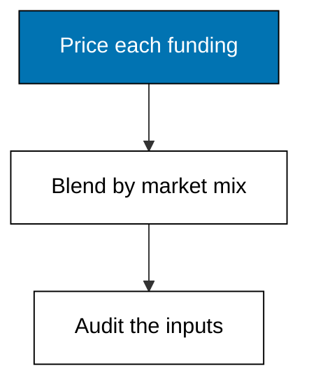
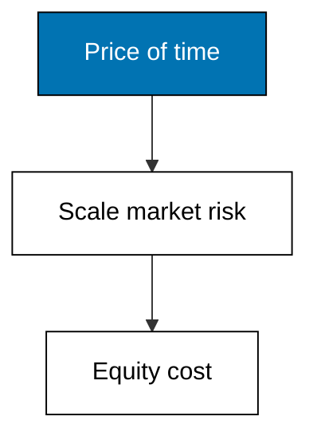
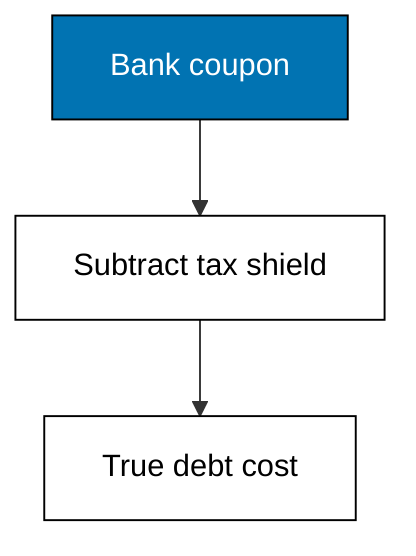
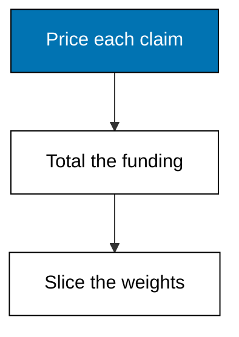
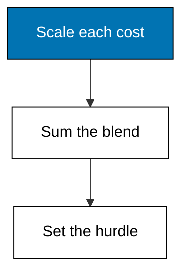
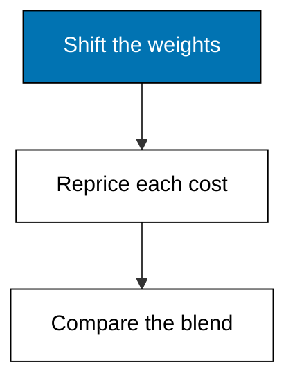
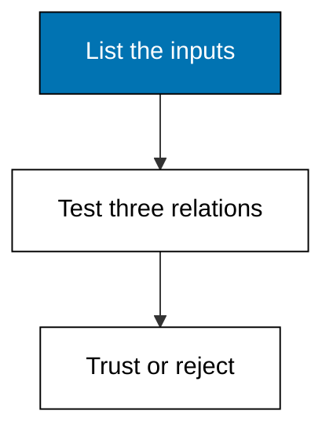

Examples 28-33 price the firm's funding: CAPM sets the equity cost, the tax shield sets the debt cost, market values set the weights, and the blend becomes the hurdle every project must clear. The theme closes by stressing the blend and auditing its inputs.



### Worked Example 28: Cost of Equity With CAPM

_Exercises co-12._

CAPM prices equity as time plus risk: a 4 percent risk-free yield plus a 1.2 beta scaled by a 5.5 percent market premium gives a 10.60 percent cost of equity. Beta above one means Merpati's shares swing harder than the market, so owners demand more. **Check**: cost-of-equity prints 10.60.



**`learning/code/ex-28-cost-of-equity-capm/main.py`**

```python
# Worked Example 28: Cost of Equity With CAPM
# => Merpati Trading Co. is fictional; every number here is fixed.
# => CAPM prices equity as time plus risk scaled by beta.
# => Riskier-than-market shares demand more than the market return.
from decimal import Decimal

# => The three CAPM inputs, all fictional but plausible.
risk_free = Decimal("0.04")  # => government yield, the price of time
market_premium = Decimal("0.055")  # => extra return the market demands
beta = Decimal("1.2")  # => the shares swing harder than the market
# => Cost of equity: time plus beta-scaled market risk.
equity_cost = risk_free + beta * market_premium  # => the owners' required return
# => 10.60 percent: equity is the dearest funding in the firm.
print("risk-free:", risk_free)  # => Output repeats the time price
print("beta:", beta)  # => Output repeats the risk scaler
print(
    "cost-of-equity:", (equity_cost * 100).quantize(Decimal("0.01"))
)  # => Output rate
```

**Output** (`learning/code/ex-28-cost-of-equity-capm/expected/main.stdout.txt`):

```text
risk-free: 0.04
beta: 1.2
cost-of-equity: 10.60
```

**Key takeaway**: equity costs the risk-free yield plus beta times the market's extra demand.

**Why It Matters**: equity feels free because it carries no coupon, yet at 10.60 percent it is Merpati's dearest funding. Managers who treat retained earnings as costless overinvest, which is why the hurdle must include this number explicitly. Beta is the only firm-specific input: estimate it from comparable listed firms, never from optimism.

---

### Worked Example 29: After-Tax Cost of Debt

_Exercises co-12._

A 7 percent bank coupon costs only 5.25 percent after the 25 percent tax shield, because interest is deducted before tax is computed. The shield is the one genuine discount in corporate finance, paid by the tax code rather than negotiated with the bank. **Check**: after-tax prints 5.25.



**`learning/code/ex-29-after-tax-cost-of-debt/main.py`**

```python
# Worked Example 29: After-Tax Cost of Debt
# => Merpati Trading Co. is fictional; every number here is fixed.
# => Interest is tax-deductible, so debt costs less than its coupon.
# => The tax shield is the one genuine discount in corporate finance.
from decimal import Decimal

# => The bank's quoted rate and the fictional flat tax rate.
pre_tax = Decimal("0.07")  # => 7 percent coupon on the loan
tax_rate = Decimal("0.25")  # => one quarter of profit goes to tax
# => After-tax cost: the coupon minus the tax saved on it.
after_tax = pre_tax * (Decimal("1") - tax_rate)  # => what debt truly costs
# => 5.25 percent: cheaper than equity even before risk is counted.
print("pre-tax:", pre_tax)  # => Output repeats the coupon
print("after-tax:", (after_tax * 100).quantize(Decimal("0.01")))  # => Output true cost
```

**Output** (`learning/code/ex-29-after-tax-cost-of-debt/expected/main.stdout.txt`):

```text
pre-tax: 0.07
after-tax: 5.25
```

**Key takeaway**: multiply any coupon by one minus the tax rate before comparing it with equity.

**Why It Matters**: forgetting the shield overstates debt cost by a third here, which understates every levered project's NPV. The shield only exists while the firm pays tax, though: loss-making firms deduct against nothing, and their debt costs the full coupon. Always pair the coupon with the firm's actual tax position.

---

### Worked Example 30: Capital Weights From Market Values

_Exercises co-13._

Fifty thousand shares at a fictional 15.20 trade for 760,000 of market equity beside 380,000 of debt at par: weights of 0.6667 and 0.3333. WACC blends by what claims trade for today, never by historical book values. **Check**: the weights sum to one.



**`learning/code/ex-30-capital-weights-market-values/main.py`**

```python
# Worked Example 30: Capital Weights From Market Values
# => Merpati Trading Co. is fictional; every number here is fixed.
# => WACC weights use market values, never accounting book values.
# => Markets price the claim investors actually hold today.
from decimal import Decimal

# => Fifty thousand shares at a fictional 15.20 market price.
shares = Decimal("50000")  # => shares outstanding
price = Decimal("15.20")  # => market price per share
# => Equity market value: what owners' claim trades for.
equity_value = shares * price  # => 760,000 of market equity
# => Debt market value, taken at par for this fictional loan.
debt_value = Decimal("380000")  # => the loan book at par
# => Total firm funding at market, the weighting base.
total = equity_value + debt_value  # => every funding unit
# => Each weight is its market slice of total funding.
equity_weight = equity_value / total  # => owners' share of funding
debt_weight = debt_value / total  # => lenders' share of funding
# => Two-thirds equity, one-third debt: the mix WACC will blend.
print("equity-value:", equity_value)  # => Output market equity
print("equity-weight:", equity_weight.quantize(Decimal("0.0001")))  # => Output share
print("debt-weight:", debt_weight.quantize(Decimal("0.0001")))  # => Output share
```

**Output** (`learning/code/ex-30-capital-weights-market-values/expected/main.stdout.txt`):

```text
equity-value: 760000.00
equity-weight: 0.6667
debt-weight: 0.3333
```

**Key takeaway**: weights come from market prices, because WACC prices the claims investors hold.

**Why It Matters**: book equity of 500,000 would overweight debt and understate the blend's equity share, silently lowering the hurdle and accepting weak projects. Market values move daily while books move yearly, so refresh weights when prices move materially. The rounding to four decimals is presentation; the blend downstream keeps full precision until it prints.

---

### Worked Example 31: Weighted Average Cost of Capital

_Exercises co-13._

Blending 10.60 percent equity at two-thirds weight with 5.25 percent debt at one-third gives a WACC of 8.82 percent: between the two costs, nearer the dearer equity. This single rate becomes the hurdle for every firm-wide project. **Check**: wacc prints 8.82 and weights-sum-one prints True.



**`learning/code/ex-31-weighted-average-cost-of-capital/main.py`**

```python
# Worked Example 31: Weighted Average Cost of Capital
# => Merpati Trading Co. is fictional; every number here is fixed.
# => WACC blends each funding cost by its market weight.
# => It becomes the hurdle rate for the whole firm's projects.
from decimal import Decimal

# => Component costs from Examples 28 and 29.
equity_cost = Decimal("0.106")  # => CAPM cost of equity
debt_cost = Decimal("0.0525")  # => after-tax cost of debt
# => Market weights from Example 30.
equity_weight = Decimal("760000") / Decimal("1140000")  # => two-thirds equity
debt_weight = Decimal("1") - equity_weight  # => one-third debt, exact complement
# => WACC: each cost scaled by its funding share, then summed.
wacc = equity_weight * equity_cost + debt_weight * debt_cost  # => the blend
# => 8.82 percent: between debt and equity, nearer the dearer equity.
print("wacc:", (wacc * 100).quantize(Decimal("0.01")))  # => Output is the hurdle
print(
    "weights-sum-one:", equity_weight + debt_weight == Decimal("1")
)  # => Output check
```

**Output** (`learning/code/ex-31-weighted-average-cost-of-capital/expected/main.stdout.txt`):

```text
wacc: 8.82
weights-sum-one: True
```

**Key takeaway**: WACC is the funding-weighted average that every project must beat.

**Why It Matters**: a single hurdle stops managers from shopping for the cheapest funding story per project: equity-funded ideas judged at 10.60 and debt-funded ones at 5.25 would accept and reject inconsistently. Note the construction trick: the debt weight is one minus the equity weight, so the pair sums to one exactly instead of accumulating rounding error. Small exactness habits compound into trustworthy blends.

---

### Worked Example 32: WACC When the Mix Changes

_Exercises co-13, co-14._

Moving to fifty-fifty funding raises equity's demand to 11.50 percent and the coupon to 7.50 percent, yet the blend falls to 8.56 percent: cheaper debt outweighs dearer equity this time. Recompute everything when the mix moves; freezing old inputs while changing weights is the classic WACC error. **Check**: below-old-882 prints True.



**`learning/code/ex-32-wacc-when-mix-changes/main.py`**

```python
# Worked Example 32: WACC When the Mix Changes
# => Merpati Trading Co. is fictional; every number here is fixed.
# => More debt means cheaper funding but riskier equity, both at once.
# => Recompute the whole blend; never move one input and freeze the rest.
from decimal import Decimal

# => Fifty-fifty market mix: the proposed heavier-debt funding.
equity_weight = Decimal("0.50")  # => owners fund half
debt_weight = Decimal("0.50")  # => lenders fund half
# => Equity holders demand more once leverage rises.
equity_cost = Decimal("0.115")  # => beta up, 11.50 percent
# => The bank charges more too, still shielded by tax.
debt_cost = Decimal("0.075") * (Decimal("1") - Decimal("0.25"))  # => 5.625 percent
# => The new blend under the proposed mix.
wacc = equity_weight * equity_cost + debt_weight * debt_cost  # => recomputed fully
# => 8.56 percent: cheaper debt outweighs dearer equity this time.
print("wacc-new:", (wacc * 100).quantize(Decimal("0.01")))  # => Output proposed blend
print("below-old-882:", wacc < Decimal("0.0882"))  # => Output compares with Example 31
```

**Output** (`learning/code/ex-32-wacc-when-mix-changes/expected/main.stdout.txt`):

```text
wacc-new: 8.56
below-old-882: True
```

**Key takeaway**: leverage moves every input at once, so reprice the whole blend or mislead yourself.

**Why It Matters**: the falling WACC looks like free value, but Example 37 shows the gain is modest and Theme G shows the risk is real: coverage thins and flexibility shrinks. A hurdle that falls while risk rises should trigger scrutiny, not celebration. The blend is arithmetic; the judgement about whether the risk is worth 26 basis points belongs to the next theme.

---

### Worked Example 33: Judging Whether a WACC Input Is Reasonable

_Exercises co-12, co-13._

Three checks audit the blend before anyone trusts it: equity must cost more than debt, the shield must actually shrink the coupon, and equity must clear the risk-free floor. All three hold for Merpati's inputs. Run this audit on every WACC you inherit. **Check**: all three verdicts print True.



**`learning/code/ex-33-judging-wacc-inputs/main.py`**

```python
# Worked Example 33: Judging Whether a WACC Input Is Reasonable
# => Merpati Trading Co. is fictional; every number here is fixed.
# => A WACC is only as honest as its three inputs.
# => Three checks catch the classic mistakes before they compound.
from decimal import Decimal

# => The inputs feeding the Example 31 blend.
equity_cost = Decimal("0.106")  # => CAPM equity cost
debt_pre_tax = Decimal("0.07")  # => bank coupon before shield
debt_cost = Decimal("0.0525")  # => after-tax debt cost
risk_free = Decimal("0.04")  # => government yield floor
# => Check one: equity must cost more than debt, or risk is mispriced.
equity_above_debt = equity_cost > debt_cost  # => risk demands reward
# => Check two: the tax shield must actually shrink the coupon.
shield_applied = debt_cost < debt_pre_tax  # => shield present
# => Check three: equity must clear the risk-free floor.
above_floor = equity_cost > risk_free  # => time plus risk beats time alone
# => All three hold: the blend earns trust, not just arithmetic.
print("equity-above-debt:", equity_above_debt)  # => Output first check
print("shield-applied:", shield_applied)  # => Output second check
print("above-floor:", above_floor)  # => Output third check
```

**Output** (`learning/code/ex-33-judging-wacc-inputs/expected/main.stdout.txt`):

```text
equity-above-debt: True
shield-applied: True
above-floor: True
```

**Key takeaway**: three ordering relations audit any WACC faster than recomputing it.

**Why It Matters**: inherited spreadsheets carry stale betas, book-value weights, and pre-tax coupons treated as final; each silently corrupts the hurdle and every decision made under it. The audit takes a minute and catches all three classics. Make it a habit: no WACC enters a recommendation without passing these gates. Precision in the blend is worthless when the inputs violate finance itself.
