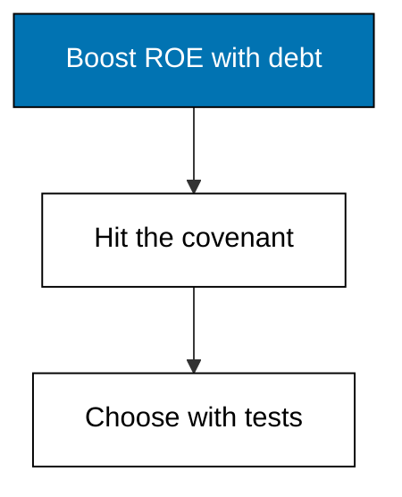
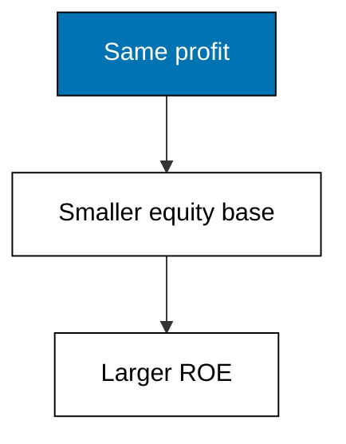
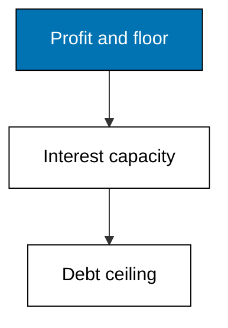
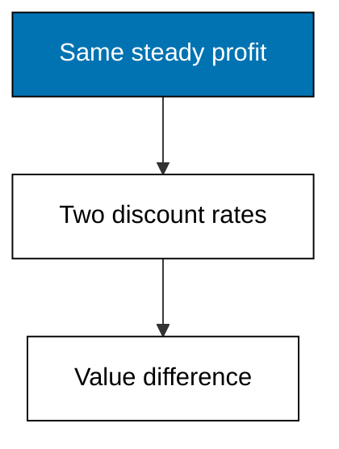

Examples 34-38 live with the debt-equity mix: leverage amplifies equity returns, lifts earnings per share, and runs into the coverage covenant; firm value responds to the blend; and a three-test scorecard frames the final choice. No formula picks the structure; judgement does, with numbers attached.



### Worked Example 34: Leverage Amplifies Returns on Equity

_Exercises co-14._

The same 180,000 of EBIT earns 23.40 percent on the levered 500,000 of equity but only 13.50 percent on an unlevered 1,000,000 base. Debt shrinks the equity denominator while interest only trims the numerator, so the same business looks twice as rewarding to owners. **Check**: roe-levered prints 23.40 against 13.50 unlevered.



**`learning/code/ex-34-leverage-amplifies-roe/main.py`**

```python
# Worked Example 34: Leverage Amplifies Returns on Equity
# => Merpati Trading Co. is fictional; every number here is fixed.
# => The same assets earn the same EBIT under either funding.
# => Debt shrinks the equity base, so the same profit looks larger on it.
from decimal import Decimal

# => Shared operating result and tax rate under both fundings.
ebit = Decimal("180000")  # => identical assets, identical EBIT
tax_rate = Decimal("0.25")  # => fictional flat rate
# => Levered funding: 380,000 of debt at 24,000 interest, 500,000 equity.
net_levered = (ebit - Decimal("24000")) * (Decimal("1") - tax_rate)  # => owners keep
roe_levered = net_levered / Decimal("500000") * 100  # => profit on a small base
# => Unlevered funding: no debt, so EBIT is taxed whole on 1,000,000 equity.
net_unlevered = ebit * (Decimal("1") - tax_rate)  # => larger profit, larger base
roe_unlevered = net_unlevered / Decimal("1000000") * 100  # => profit on a full base
# => Same business, double the ROE: leverage did the amplifying.
print("roe-levered:", roe_levered.quantize(Decimal("0.01")))  # => Output amplified
print("roe-unlevered:", roe_unlevered.quantize(Decimal("0.01")))  # => Output plain
```

**Output** (`learning/code/ex-34-leverage-amplifies-roe/expected/main.stdout.txt`):

```text
roe-levered: 23.40
roe-unlevered: 13.50
```

**Key takeaway**: leverage amplifies ROE by shrinking the base faster than interest trims profit.

**Why It Matters**: this amplification is the honest half of the leverage sales pitch, and Example 13 already showed it. The dishonest half hides the symmetry: leverage amplifies losses exactly as hard when EBIT falls. Any ROE comparison across firms with different funding is a leverage comparison first and a performance comparison second. Adjust for the mix before praising the number.

---

### Worked Example 35: Earnings per Share Under Two Structures

_Exercises co-14._

Structure A keeps 380,000 of debt and 50,000 shares for an EPS of 2.34; structure B repays 200,000 of debt by issuing 20,000 new shares, leaving EPS at 1.80. Borrowing concentrates profit on fewer shares while times are good. **Check**: eps-a prints 2.34 against 1.80.


**`learning/code/ex-35-eps-under-two-structures/main.py`**

```python
# Worked Example 35: Earnings per Share Under Two Structures
# => Merpati Trading Co. is fictional; every number here is fixed.
# => Borrowing lifts EPS while times are good by splitting profit fewer ways.
# => Structure B repays 200,000 of debt by issuing 20,000 new shares.
from decimal import Decimal

# => Shared operating result and tax rate.
ebit = Decimal("180000")  # => identical assets, identical EBIT
after_tax = Decimal("1") - Decimal("0.25")  # => the keep-rate after tax
# => Structure A: 380,000 debt costing 24,000 interest, 50,000 shares.
net_a = (ebit - Decimal("24000")) * after_tax  # => profit after lenders and tax
eps_a = net_a / Decimal("50000")  # => profit per existing share
# => Structure B: 180,000 debt costing 12,000 interest, 70,000 shares.
net_b = (ebit - Decimal("12000")) * after_tax  # => higher profit, more shares
eps_b = net_b / Decimal("70000")  # => profit per diluted share
# => Leverage wins EPS in good years and loses it in bad ones.
print("eps-a:", eps_a.quantize(Decimal("0.01")))  # => Output levered EPS
print("eps-b:", eps_b.quantize(Decimal("0.01")))  # => Output diluted EPS
```

**Output** (`learning/code/ex-35-eps-under-two-structures/expected/main.stdout.txt`):

```text
eps-a: 2.34
eps-b: 1.80
```

**Key takeaway**: debt concentrates earnings; new shares dilute them, and EPS records the trade.

**Why It Matters**: managers paid on EPS prefer borrowing even when shareholders would prefer safety, which is why boards look past EPS to coverage and flexibility. The 0.54 gap here measures exactly what dilution costs each existing share. Never let a per-share number decide a structure question alone: shares are the denominator, not the decision.

---

### Worked Example 36: The Coverage Constraint on Borrowing

_Exercises co-14, co-07._

The bank demands coverage of at least 3.00, so with 180,000 of EBIT the firm can carry at most 60,000 of interest, which at a 7 percent coupon prices 857,142.86 of debt. Against 380,000 already borrowed, headroom is 477,142.86: real room, but finite. **Check**: headroom prints 477142.86.



**`learning/code/ex-36-coverage-constraint-on-borrowing/main.py`**

```python
# Worked Example 36: The Coverage Constraint on Borrowing
# => Merpati Trading Co. is fictional; every number here is fixed.
# => The bank demands coverage of at least 3.00 before lending more.
# => That covenant caps interest, which caps the debt itself.
from decimal import Decimal

# => Operating profit, the covenant floor, and the new-loan coupon.
ebit = Decimal("180000")  # => profit available for interest
floor = Decimal("3.00")  # => minimum coverage the bank accepts
coupon = Decimal("0.07")  # => rate on any additional borrowing
# => Maximum interest the covenant tolerates.
max_interest = ebit / floor  # => profit divided by required cover
# => Maximum extra debt that interest buys at the coupon.
max_debt = max_interest / coupon  # => interest capacity priced into debt
# => Headroom above the existing 380,000 of interest-bearing debt.
headroom = max_debt - Decimal("380000")  # => room before the covenant binds
# => About 477,143 of headroom: real room exists, but it is finite.
print("max-interest:", max_interest.quantize(Decimal("0.01")))  # => Output cap
print("max-debt:", max_debt.quantize(Decimal("0.01")))  # => Output debt ceiling
print("headroom:", headroom.quantize(Decimal("0.01")))  # => Output free room
```

**Output** (`learning/code/ex-36-coverage-constraint-on-borrowing/expected/main.stdout.txt`):

```text
max-interest: 60000.00
max-debt: 857142.86
headroom: 477142.86
```

**Key takeaway**: a coverage covenant converts profit into a hard debt ceiling in two divisions.

**Why It Matters**: covenants bind in bad years, not good ones: halve the EBIT and today's headroom evaporates while the debt stays. Borrowing to the ceiling in a peak year is how firms breach in the trough. Treat headroom as insurance to keep, not capacity to spend. The next example prices what extra debt buys; this one prices what it risks.

---

### Worked Example 37: Firm Value Under Two Capital Structures

_Exercises co-14, co-13._

Valuing steady 135,000 of after-tax operating profit as a perpetuity gives 1,530,612.24 at the current 8.82 percent WACC and 1,577,102.80 at the proposed 8.56 percent: a 46,490.56 gain from cheaper capital on identical operations. **Check**: gain prints 46490.56.



**`learning/code/ex-37-firm-value-two-structures/main.py`**

```python
# Worked Example 37: Firm Value Under Two Capital Structures
# => Merpati Trading Co. is fictional; every number here is fixed.
# => A simple perpetuity values steady profit at each structure's WACC.
# => The cheaper-blend structure values the same profit more highly.
from decimal import Decimal

# => Steady after-tax operating profit, the valued stream.
nopat = Decimal("180000") * (Decimal("1") - Decimal("0.25"))  # => 135,000 forever
# => The two WACC blends from Examples 31 and 32.
wacc_now = Decimal("0.0882")  # => current two-thirds-equity blend
wacc_proposed = Decimal("0.0856")  # => proposed fifty-fifty blend
# => Perpetuity value: steady profit divided by its discount rate.
value_now = nopat / wacc_now  # => value at the current mix
value_proposed = nopat / wacc_proposed  # => value at the proposed mix
# => Same profit, higher value: cheaper capital is worth real money.
print("value-now:", value_now.quantize(Decimal("0.01")))  # => Output current value
print("value-proposed:", value_proposed.quantize(Decimal("0.01")))  # => Output new
print("gain:", (value_proposed - value_now).quantize(Decimal("0.01")))  # => Output gain
```

**Output** (`learning/code/ex-37-firm-value-two-structures/expected/main.stdout.txt`):

```text
value-now: 1530612.24
value-proposed: 1577102.80
gain: 46490.56
```

**Key takeaway**: a lower WACC reprices identical profit upward, and the gain is countable.

**Why It Matters**: 46,490.56 is the prize for the extra risk Theme G has been measuring: thinner coverage, harder covenants, less room for the next van. Whether the prize pays for the risk is the judgement the final example frames. Never quote a valuation gain without quoting the risk bought to get it. Value and vulnerability arrive in the same package.

---

### Worked Example 38: Choosing a Structure With Judgement

_Exercises co-14._

Three tests frame the choice: EPS crowns A at 2.34 against 1.80, a halved EBIT still clears the 3.00 covenant under both, and B keeps 200,000 more headroom for the next investment. A pays more today; B bends further before it breaks. **Check**: eps-winner prints A and both survival tests print True.


**`learning/code/ex-38-choosing-structure-with-judgement/main.py`**

```python
# Worked Example 38: Choosing a Structure With Judgement
# => Merpati Trading Co. is fictional; every number here is fixed.
# => No formula picks the structure; three scored tests frame the choice.
# => EPS rewards leverage, coverage punishes it, flexibility insures it.
from decimal import Decimal

# => The two structures' EPS, coverage, and covenant headroom.
eps_a = Decimal("2.34")  # => levered EPS from Example 35
eps_b = Decimal("1.80")  # => diluted EPS from Example 35
coverage_a = Decimal("180000") / Decimal("24000")  # => 7.50 times
coverage_b = Decimal("180000") / Decimal("12000")  # => 15.00 times
# => Test one: which structure pays owners more per share?
eps_winner = "A" if eps_a > eps_b else "B"  # => leverage wins good years
# => Test two: which structure survives a halved EBIT above 3.00 cover?
survives_a = coverage_a / Decimal("2") >= Decimal("3")  # => 3.75 holds
survives_b = coverage_b / Decimal("2") >= Decimal("3")  # => 7.50 holds easily
# => Test three: which keeps more covenant headroom for the next van?
room_a = Decimal("477142.86")  # => Example 36 headroom under A
room_b = room_a + Decimal("200000")  # => repaid debt returns as room
# => A pays more today; B bends further before it breaks.
print("eps-winner:", eps_a, eps_b, eps_winner)  # => Output the paying test
print("survives-halved-ebit:", survives_a, survives_b)  # => Output the stress test
print("headroom-b-minus-a:", room_b - room_a)  # => Output the flexibility gap
```

**Output** (`learning/code/ex-38-choosing-structure-with-judgement/expected/main.stdout.txt`):

```text
eps-winner: 2.34 1.80 A
survives-halved-ebit: True True
headroom-b-minus-a: 200000.00
```

**Key takeaway**: score paying power, stress survival, and price flexibility before choosing.

**Why It Matters**: capital structure is the course's first question with no computed answer, which makes it the rehearsal for valuation and recommendations. The discipline is to state the tests, run them honestly, and own the trade: A for payout today, B for room tomorrow. A memo that names what it gives up is more trustworthy than one that pretends nothing was given up. Judgement, written down, beats optimization performed silently.
