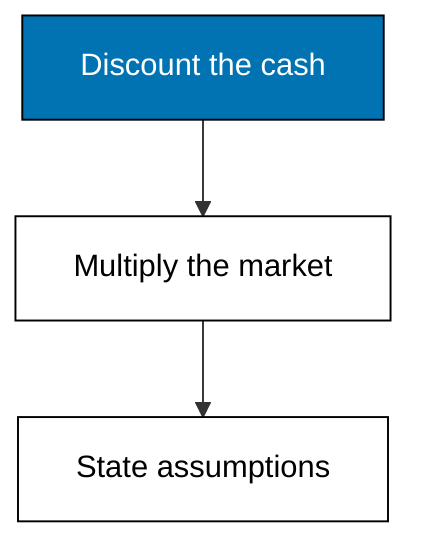
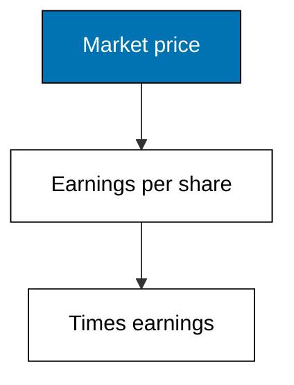
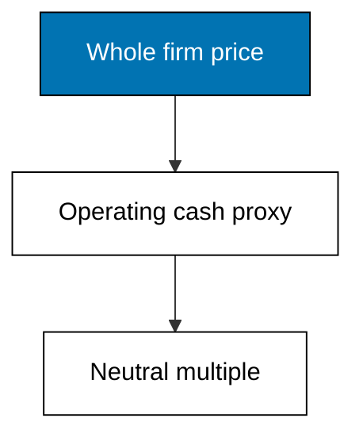
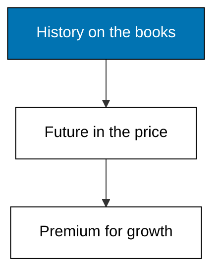
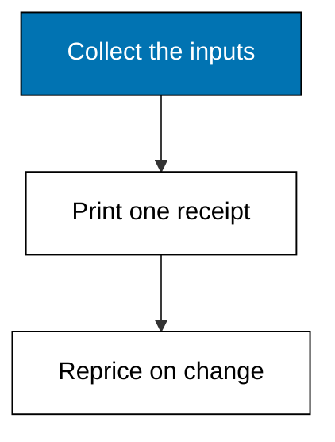

Examples 39-43 value Merpati three simple ways: a mini discounted cash flow with a terminal value, a price-to-earnings multiple, and an enterprise multiple, then book against market, and finally the assumption receipt every valuation owes its reader.



### Worked Example 39: A Mini Discounted Cash Flow Valuation

_Exercises co-15, co-01, co-10._

Five years of free cash flow growing at 3 percent, discounted at 10 percent, plus a terminal perpetuity growing forever at the same 3 percent, value Merpati at 1,471,428.57. The terminal value of 1,705,789.00 dominates the total, which is normal and is exactly why growth assumptions deserve interrogation. **Check**: enterprise prints 1471428.57.


**`learning/code/ex-39-mini-dcf-valuation/main.py`**

```python
# Worked Example 39: A Mini Discounted Cash Flow Valuation
# => Merpati Trading Co. is fictional; every number here is fixed.
# => A DCF values five years of free cash flow plus a terminal value.
# => Growth compounds the flows; the discount rate shrinks them.
from decimal import Decimal

# => Base free cash flow, growth, horizon, and discount rate.
base = Decimal("100000")  # => this year's free cash flow
growth = Decimal("0.03")  # => 3 percent yearly growth
rate = Decimal("0.10")  # => 10 percent discount rate
# => Project five growing flows and discount each to today.
enterprise = Decimal("0")  # => running firm value
flow = base  # => rolled forward one year at a time
for year in range(1, 6):  # => five forecast years
    # => Grow the flow, then discount it back to today.
    flow = flow * (Decimal("1") + growth)  # => next year's cash
    enterprise += flow / ((Decimal("1") + rate) ** year)  # => add its present slice
# => Terminal value: the growing perpetuity starting in year six.
terminal = flow * (Decimal("1") + growth) / (rate - growth)  # => beyond the horizon
enterprise += terminal / ((Decimal("1") + rate) ** 5)  # => discounted terminal
# => One number for the whole firm, before any assumption is questioned.
print("terminal:", terminal.quantize(Decimal("0.01")))  # => Output horizon value
print("enterprise:", enterprise.quantize(Decimal("0.01")))  # => Output firm value
```

**Output** (`learning/code/ex-39-mini-dcf-valuation/expected/main.stdout.txt`):

```text
terminal: 1705789.00
enterprise: 1471428.57
```

**Key takeaway**: a DCF is explicit forecasts plus a terminal perpetuity, all discounted once.

**Why It Matters**: the terminal value carries most of the weight, so small growth changes swing the headline: at 4 percent growth the terminal alone would reprice dramatically. That sensitivity is a feature, not a flaw, because it forces the growth debate into the open. Never present a DCF without showing the terminal share; hiding it is how aggressive valuations pass unchallenged.

---

### Worked Example 40: Price to Earnings Multiple

_Exercises co-15._

At a 15.20 market price over 2.34 of earnings per share, Merpati trades at 6.50 times earnings: buyers pay six and a half years of current profit for the share. Multiples compare in seconds and explain nothing, which is both their use and their danger. **Check**: pe prints 6.50.



**`learning/code/ex-40-price-to-earnings-multiple/main.py`**

```python
# Worked Example 40: Price to Earnings Multiple
# => Merpati Trading Co. is fictional; every number here is fixed.
# => P/E prices each unit of yearly earnings at the market's rate.
# => It compares firms fast and explains nothing about why they differ.
from decimal import Decimal

# => Market price per share and earnings per share.
price = Decimal("15.20")  # => what the market charges per share
eps = Decimal("2.34")  # => levered EPS from Example 35
# => The multiple: years of earnings the price contains.
multiple = price / eps  # => the market's price per earnings unit
# => 6.50: the market pays six and a half earnings for the share.
print("price:", price)  # => Output repeats the market price
print("eps:", eps)  # => Output repeats earnings per share
print("pe:", multiple.quantize(Decimal("0.01")))  # => Output is the multiple
```

**Output** (`learning/code/ex-40-price-to-earnings-multiple/expected/main.stdout.txt`):

```text
price: 15.20
eps: 2.34
pe: 6.50
```

**Key takeaway**: P/E converts a price into years of earnings for instant comparison.

**Why It Matters**: a low multiple can mean cheap or troubled, and the number alone never says which; Merpati's 6.50 could be either. Use multiples to flag candidates, then value the flagged ones properly with cash flows. Anyone who buys on the multiple alone is outsourcing the analysis to whoever set the price. Compare fast, decide slow.

---

### Worked Example 41: Enterprise Value to EBITDA

_Exercises co-15._

Enterprise value adds debt and subtracts cash from market equity: 760,000 plus 380,000 minus 90,000 is 1,050,000 for the whole firm. Against EBITDA of 240,000 that is a 4.38 multiple, neutral to funding choices in a way P/E is not. **Check**: ev-ebitda prints 4.38.



**`learning/code/ex-41-enterprise-value-to-ebitda/main.py`**

```python
# Worked Example 41: Enterprise Value to EBITDA
# => Merpati Trading Co. is fictional; every number here is fixed.
# => EV counts the whole firm: equity plus debt minus cash.
# => EBITDA strips financing and non-cash charges from operating profit.
from decimal import Decimal

# => Market equity, interest-bearing debt, and cash on hand.
equity_value = Decimal("760000")  # => 50,000 shares at 15.20
debt = Decimal("380000")  # => loans at par
cash = Decimal("90000")  # => cash offsets debt in EV
# => Enterprise value: the takeover price of the whole firm.
enterprise = equity_value + debt - cash  # => what buying it all costs
# => EBITDA: EBIT plus the depreciation deducted to reach it.
ebitda = Decimal("180000") + Decimal("60000")  # => operating cash proxy
# => The multiple: firm prices per operating-cash unit.
multiple = enterprise / ebitda  # => leverage-neutral comparison
# => 4.38: cheap or troubled, the multiple alone cannot say.
print("enterprise:", enterprise)  # => Output the firm price
print("ebitda:", ebitda)  # => Output the operating proxy
print("ev-ebitda:", multiple.quantize(Decimal("0.01")))  # => Output the multiple
```

**Output** (`learning/code/ex-41-enterprise-value-to-ebitda/expected/main.stdout.txt`):

```text
enterprise: 1050000
ebitda: 240000
ev-ebitda: 4.38
```

**Key takeaway**: EV prices the whole firm so differently funded rivals compare fairly.

**Why It Matters**: P/E punishes levered firms twice, once in interest and once in risk, while EV/EBITDA looks through funding to operations. For takeovers this is the right lens: buyers assume the debt and collect the cash. Still a multiple, still silent on why: pair it with the DCF whenever money is real.

---

### Worked Example 42: Book Value Versus Market Value

_Exercises co-15, co-05._

Accounting equity of 500,000 against market equity of 760,000 is a 1.52 market-to-book ratio: the market pays half again over recorded history for expected growth. The gap is unrecorded value, brands, relationships, and prospects, that the books never show. **Check**: market-to-book prints 1.52.



**`learning/code/ex-42-book-value-versus-market-value/main.py`**

```python
# Worked Example 42: Book Value Versus Market Value
# => Merpati Trading Co. is fictional; every number here is fixed.
# => Book value records history; market value prices the future.
# => The gap between them is expected growth the books never show.
from decimal import Decimal

# => Accounting equity and the market's verdict on the same claim.
book = Decimal("500000")  # => paid-in capital plus retained earnings
market = Decimal("760000")  # => 50,000 shares at 15.20
# => Market-to-book: how many history units the future is worth.
ratio = market / book  # => the expectations premium
# => 1.52: the market pays half again over history for growth.
print("book:", book)  # => Output repeats accounting equity
print("market:", market)  # => Output repeats market equity
print("market-to-book:", ratio.quantize(Decimal("0.01")))  # => Output the premium
```

**Output** (`learning/code/ex-42-book-value-versus-market-value/expected/main.stdout.txt`):

```text
book: 500000
market: 760000
market-to-book: 1.52
```

**Key takeaway**: market-to-book measures how much future the price holds beyond history.

**Why It Matters**: value investors hunt low ratios and growth investors accept high ones; both are betting on whether the premium is earned. A ratio sliding down can mean the price fell or the books grew, with opposite implications. Decompose before reacting: price moves and book moves tell different stories about the same number.

---

### Worked Example 43: Writing Down the Assumptions

_Exercises co-16, co-15._

Five numbers drove every valuation in Themes E through H: 3 percent growth, a 10 percent discount, a 9.75 percent margin, a 6.50 multiple, and a 25 percent tax rate. Printed as one receipt, anyone can reprice the firm when one changes. **Check**: the receipt lists all five inputs.



**`learning/code/ex-43-writing-down-assumptions/main.py`**

```python
# Worked Example 43: Writing Down the Assumptions
# => Merpati Trading Co. is fictional; every number here is fixed.
# => A valuation without stated assumptions is a price without a receipt.
# => Five named inputs let anyone reprice the firm when one changes.
from decimal import Decimal

# => The five inputs every valuation in Themes E to H quietly used.
assumptions = {"growth": Decimal("0.03"), "discount": Decimal("0.10")}  # => DCF pair
assumptions["margin"] = Decimal("0.0975")  # => net margin from Example 12
assumptions["pe"] = Decimal("6.50")  # => market multiple from Example 40
assumptions["tax"] = Decimal("0.25")  # => fictional flat tax rate
# => Print each assumption so the receipt is complete and checkable.
for name in ["growth", "discount", "margin", "pe", "tax"]:  # => fixed receipt order
    # => One line per input: name on the left, value on the right.
    print(name, assumptions[name])  # => Output is the assumption receipt
```

**Output** (`learning/code/ex-43-writing-down-assumptions/expected/main.stdout.txt`):

```text
growth 0.03
discount 0.10
margin 0.0975
pe 6.50
tax 0.25
```

**Key takeaway**: list every valuation input in one place, or nobody can audit your number.

**Why It Matters**: valuations are argued input by input, never number against number. A challenger who says growth should be 2 percent can reprice instantly from this receipt; one facing a bare 1,471,428.57 cannot engage at all. The receipt turns disagreement into arithmetic, which is the only form of disagreement finance can resolve. Theme I now changes these inputs on purpose.
