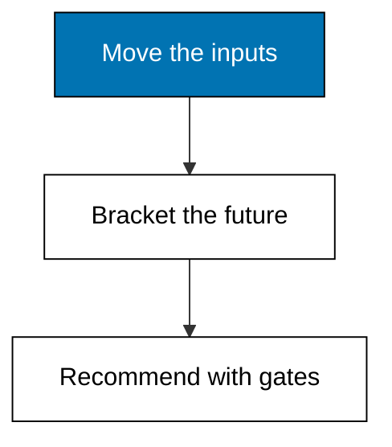
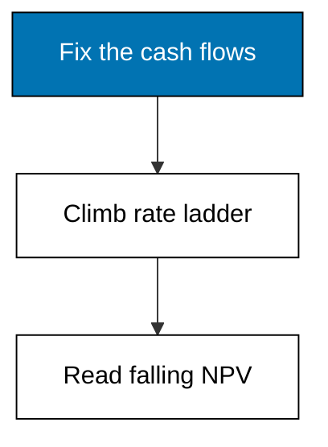
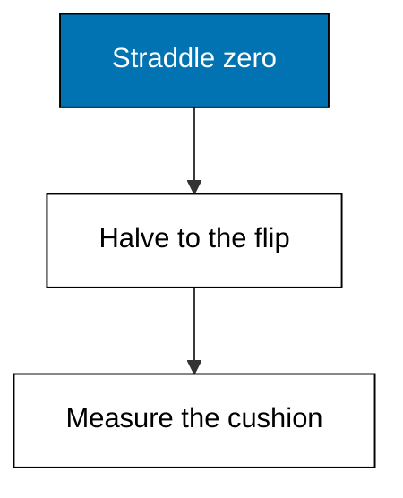
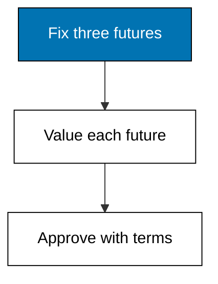
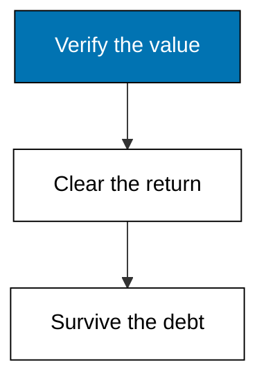

Examples 44-48 stress every conclusion the course built: the discount rate moves, scenarios bracket the future, a safety margin prices error, and a three-gate recommendation says yes with conditions. Sensitivity does not remove uncertainty; it maps it so judgement can walk the map.



### Worked Example 44: Sensitivity to the Discount Rate

_Exercises co-16, co-10._

The van's NPV reads 78,640.33 at 8 percent, 62,306.10 at 10, and 47,252.24 at 12: positive across the ladder, but each two-point rise erases roughly fifteen thousand of value. Distant cash moves most, which is why long projects fear rate rises. **Check**: npv falls monotonically across the three rungs.



**`learning/code/ex-44-sensitivity-to-discount-rate/main.py`**

```python
# Worked Example 44: Sensitivity to the Discount Rate
# => Merpati Trading Co. is fictional; every number here is fixed.
# => The van's NPV at 8, 10, and 12 percent shows how rate risk bites.
# => Distant cash moves most, which is why long projects fear rate rises.
from decimal import Decimal

# => The van project's cost and five yearly inflows.
cost = Decimal("240000")  # => the upfront outflow
flows = [Decimal("70000"), Decimal("80000"), Decimal("90000")]  # => first three years
flows += [Decimal("90000"), Decimal("70000")]  # => the last two years
# => One NPV per rate on the sensitivity ladder.
for rate in [Decimal("0.08"), Decimal("0.10"), Decimal("0.12")]:  # => low to high
    # => Discount every inflow at this rung and subtract the cost.
    total = Decimal("0")  # => running present value
    for year, cash in enumerate(flows, start=1):  # => year-indexed discounting
        total += cash / ((Decimal("1") + rate) ** year)  # => one discounted slice
    # => Each rung prints its own verdict number.
    print("rate:", rate, "npv:", (total - cost).quantize(Decimal("0.01")))  # => Output
```

**Output** (`learning/code/ex-44-sensitivity-to-discount-rate/expected/main.stdout.txt`):

```text
rate: 0.08 npv: 78640.33
rate: 0.10 npv: 62306.10
rate: 0.12 npv: 47252.24
```

**Key takeaway**: a rate ladder shows how much of the verdict belongs to the hurdle.

**Why It Matters**: single-rate NPV hides its own fragility; the ladder exposes it for the price of a loop. When a project passes only at the lowest plausible rate, the recommendation should say so instead of quoting the base case. Decision-makers can handle bad news; what blindsides them is certainty that was never there. Show the slope, not just the point.

---

### Worked Example 45: Break-Even Discount Rate

_Exercises co-16, co-11._

Bisecting the van's NPV between zero and fifty percent for forty halvings finds the flip point at 19.54 percent: any demanded return below it keeps NPV positive. The 9.54-point cushion above the 10 percent hurdle is the project's rate-risk budget. **Check**: cushion prints 9.54.



**`learning/code/ex-45-break-even-discount-rate/main.py`**

```python
# Worked Example 45: Break-Even Discount Rate
# => Merpati Trading Co. is fictional; every number here is fixed.
# => The break-even rate is the IRR wearing a decision-maker's hat.
# => Any demanded return below it keeps the van's NPV positive.
from decimal import Decimal

# => The van project's cost and five yearly inflows.
cost = Decimal("240000")  # => the upfront outflow
flows = [Decimal("70000"), Decimal("80000"), Decimal("90000")]  # => first three years
flows += [Decimal("90000"), Decimal("70000")]  # => the last two years


# => NPV of the van at one trial rate.
def value(trial):  # => net value at a trial rate
    # => Discount every inflow at the trial rate and sum.
    total = Decimal("0")  # => running present value
    for year, cash in enumerate(flows, start=1):  # => year-indexed discounting
        total += cash / ((Decimal("1") + trial) ** year)  # => one discounted slice
    return total - cost  # => net value at the trial rate


# => Bisect between zero and fifty percent for forty halvings.
low = Decimal("0")  # => value here is positive
high = Decimal("0.50")  # => value here is negative
for _ in range(40):  # => forty halvings pin four decimals
    mid = (low + high) / Decimal("2")  # => the next trial
    if value(mid) > Decimal("0"):  # => zero sits above
        low = mid  # => raise the floor
    else:  # => zero sits below
        high = mid  # => lower the ceiling
# => The converged rate is where the decision flips.
breakeven = (low + high) / Decimal("2")  # => the flip point
# => Near nineteen percent: a wide cushion above the ten percent hurdle.
print("breakeven:", (breakeven * 100).quantize(Decimal("0.01")))  # => Output the flip
print(
    "cushion:", ((breakeven - Decimal("0.10")) * 100).quantize(Decimal("0.01"))
)  # => gap
```

**Output** (`learning/code/ex-45-break-even-discount-rate/expected/main.stdout.txt`):

```text
breakeven: 19.54
cushion: 9.54
```

**Key takeaway**: the break-even rate converts rate risk into a single consumable budget.

**Why It Matters**: cushions are comparable where NPVs are not: a 9.54-point margin survives rate reassessment that would kill a 1-point margin at the same NPV. When the hurdle itself is estimated, and it always is, the cushion is the honest headline and the point NPV is the footnote. Report both, lead with the margin.

---

### Worked Example 46: Three Scenarios, One Decision

_Exercises co-16._

Pessimistic inflows of 50,000 a year give an NPV of -50,460.66, while base and optimistic give 62,306.10 and 101,170.81. The project survives its plan but not its gloom: approve only with the demand evidence that rules the weak case out. **Check**: pessimistic prints negative while base prints positive.



**`learning/code/ex-46-three-scenarios-one-decision/main.py`**

```python
# Worked Example 46: Three Scenarios, One Decision
# => Merpati Trading Co. is fictional; every number here is fixed.
# => Pessimistic, base, and optimistic inflows bracket the van's future.
# => A project that survives its pessimistic case earns its approval.
from decimal import Decimal

# => Shared cost and hurdle; only the inflows vary by scenario.
cost = Decimal("240000")  # => the upfront outflow
rate = Decimal("0.10")  # => 10 percent demanded return
scenarios = {"pessimistic": [Decimal("50000")] * 5}  # => weak demand years
scenarios["base"] = [Decimal("70000"), Decimal("80000"), Decimal("90000")]  # => plan
scenarios["base"] += [Decimal("90000"), Decimal("70000")]  # => plan later years
scenarios["optimistic"] = [Decimal("90000")] * 5  # => strong demand years
# => One NPV per scenario, printed in fixed order.
for name in ["pessimistic", "base", "optimistic"]:  # => gloom to boom
    # => Discount this scenario's inflows and subtract the cost.
    total = Decimal("0")  # => running present value
    for year, cash in enumerate(scenarios[name], start=1):  # => year-indexed
        total += cash / ((Decimal("1") + rate) ** year)  # => one discounted slice
    # => Even the gloom case prints its number for the record.
    print(name, (total - cost).quantize(Decimal("0.01")))  # => Output per scenario
```

**Output** (`learning/code/ex-46-three-scenarios-one-decision/expected/main.stdout.txt`):

```text
pessimistic -50460.66
base 62306.10
optimistic 101170.81
```

**Key takeaway**: scenarios bracket the future so the decision can be conditioned on evidence.

**Why It Matters**: the base case alone would approve unconditionally; the pessimistic case adds the condition that makes approval responsible. Scenario analysis earns its keep precisely when it changes the shape of yes into yes-if. Demand forecasts, not arithmetic, are now the binding constraint, which tells management where to spend its diligence budget. Model the spread, then investigate its edges.

---

### Worked Example 47: Margin of Safety

_Exercises co-16, co-15._

Against your own DCF value of 1,471,428.57, a seller asking 1,300,000 leaves an 11.65 percent margin of safety: the error budget for every forecast you cannot see coming. Price above value and the margin goes negative, meaning you pay for your own mistakes upfront. **Check**: safety prints 11.65.


**`learning/code/ex-47-margin-of-safety/main.py`**

```python
# Worked Example 47: Margin of Safety
# => Merpati Trading Co. is fictional; every number here is fixed.
# => Margin of safety is the discount to your own valuation.
# => It pays for every forecast error you cannot see coming.
from decimal import Decimal

# => The mini-DCF value recomputed, plus a seller's asking price.
base = Decimal("100000")  # => this year's free cash flow
growth = Decimal("0.03")  # => 3 percent yearly growth
rate = Decimal("0.10")  # => 10 percent discount rate
asking = Decimal("1300000")  # => the seller's price for the firm
# => Five growing flows discounted to today, as in Example 39.
enterprise = Decimal("0")  # => running firm value
flow = base  # => rolled forward one year at a time
for year in range(1, 6):  # => five forecast years
    flow = flow * (Decimal("1") + growth)  # => next year's cash
    enterprise += flow / ((Decimal("1") + rate) ** year)  # => add its present slice
# => Terminal value beyond the horizon, discounted back too.
terminal = flow * (Decimal("1") + growth) / (rate - growth)  # => year-six perpetuity
enterprise += terminal / ((Decimal("1") + rate) ** 5)  # => add discounted terminal
# => Safety is the share of your own value you refuse to pay for.
safety = (enterprise - asking) / enterprise * 100  # => the error budget
# => A double-digit cushion: the price survives a wrong forecast or two.
print("value:", enterprise.quantize(Decimal("0.01")))  # => Output own valuation
print("safety:", safety.quantize(Decimal("0.01")))  # => Output the cushion
```

**Output** (`learning/code/ex-47-margin-of-safety/expected/main.stdout.txt`):

```text
value: 1471428.57
safety: 11.65
```

**Key takeaway**: safety is the share of your valuation you insist on keeping as error budget.

**Why It Matters**: every input in Example 43's receipt is a guess wearing a decimal; safety is what lets guesses be wrong without making the decision wrong. Demanding a margin turns valuation from prediction into discipline: you buy only when the price forgives your errors. The seller's optimism is their problem; your margin is yours.

---

### Worked Example 48: The One-Page Recommendation

_Exercises co-16, co-10._

Three gates decide the van: verified NPV of 62,306.10 clears zero, the recomputed IRR clears the 10 percent hurdle, and coverage of 7.50 survives the new loan. The memo's rounded 62,300 matches the recomputation within hundreds, and all three gates print True. **Check**: approve prints True.



**`learning/code/ex-48-one-page-recommendation/main.py`**

```python
# Worked Example 48: The One-Page Recommendation
# => Merpati Trading Co. is fictional; every number here is fixed.
# => A recommendation is three gates: value, return, and survival.
# => The van passes all three, so the memo says yes with conditions.
from decimal import Decimal

# => Gate inputs gathered from Examples 22, 23, and 18.
memo = Decimal("62300")  # => memo rounded to hundreds, checked loosely below
rate = Decimal("0.10")  # => 10 percent demanded return
cost = Decimal("240000")  # => the upfront outflow
flows = [Decimal("70000"), Decimal("80000"), Decimal("90000")]  # => first three years
flows += [Decimal("90000"), Decimal("70000")]  # => the last two years
# => Recompute NPV at the hurdle instead of trusting the memo above.
total = Decimal("0")  # => running present value
for year, cash in enumerate(flows, start=1):  # => year-indexed discounting
    total += cash / ((Decimal("1") + rate) ** year)  # => one discounted slice
checked = total - cost  # => independently verified verdict number
# => Bisect the van's IRR here so gate two tests a computed rate.
low = Decimal("0")  # => value here is positive
high = Decimal("0.50")  # => value here is negative
for _ in range(40):  # => forty halvings pin four decimals
    mid = (low + high) / Decimal("2")  # => the next trial
    trial = Decimal("0")  # => trial present value
    for year, cash in enumerate(flows, start=1):  # => year-indexed discounting
        trial += cash / ((Decimal("1") + mid) ** year)  # => one discounted slice
    if trial - cost > Decimal("0"):  # => zero sits above
        low = mid  # => raise the floor
    else:  # => zero sits below
        high = mid  # => lower the ceiling
irr = (low + high) / Decimal("2")  # => converged internal rate
# => Gate one: verified NPV must clear zero.
gate_value = checked > Decimal("0")  # => the wealth test
# => Gate two: the computed IRR must clear the hurdle with room.
gate_return = irr > rate  # => nineteen percent beats ten
# => Gate three: Example 18 coverage of 7.50 must survive the new loan.
gate_survival = Decimal("7.50") > Decimal("3.00")  # => the distress test
# => Three green gates: approve, with fuel-price monitoring attached.
print("npv-checked:", checked.quantize(Decimal("0.01")))  # => Output verified value
print("matches-memo:", abs(checked - memo) < Decimal("1000"))  # => Output receipt
print("approve:", gate_value and gate_return and gate_survival)  # => Output decision
```

**Output** (`learning/code/ex-48-one-page-recommendation/expected/main.stdout.txt`):

```text
npv-checked: 62306.10
matches-memo: True
approve: True
```

**Key takeaway**: a recommendation is gates with evidence, never a bare verdict.

**Why It Matters**: the memo pattern generalizes to every decision in the course: recompute the key number instead of quoting it, test the return against its hurdle, and confirm survival before value. matches-memo exists because memos drift from models; verifying the drift is small is part of signing. Approve with the monitoring condition written down, or the approval outlives its assumptions.
