Examples 54-78 survey what fluency touches next: concurrency primitives first (Examples 54-61), showing async Main, fan-out joins, cancellation, locks, concurrent tables, channels, bounded parallelism, and atomic adds, all deterministic; then tooling, linting, and style (Examples 62-70), covering nullable analysis, warning gates, naming, file-scoped layout, modern syntax, small functions, flat control flow, interop sizes, and argument contracts; finally reading and explaining idiomatic code (Examples 71-78), walking LINQ stages, awaits, constructors, asserts, switches, attributes, using chains, and whole programs. Every example is a complete, runnable .NET console project under `learning/code/`; run each with the command in its own `run.yaml`.

---

### Example 54: Async Main Awaits

Top-level statements can await: the program pauses without blocking a thread and resumes in order when the task completes. This example opens the kitchen, awaits one simmer, and reports the portions. (Concepts: co-09.)

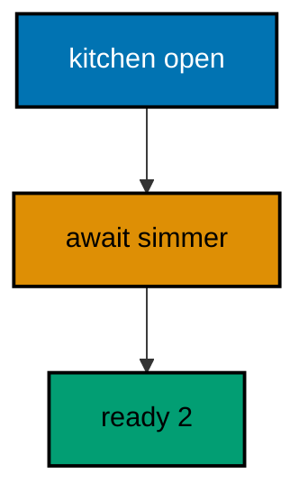

**`learning/code/ex-54-async-main-awaits/Program.cs`**:

```csharp
// => Example 54: Async Main Awaits.
// => Top-level statements can await: the program pauses without blocking a thread.
Console.WriteLine("kitchen open"); // => prints before any async work starts

// => await pauses here and resumes when the task completes: order guaranteed
int portions = await SimmerAsync("rendang"); // => async work runs, Main waits
Console.WriteLine($"ready: {portions}"); // => Output: ready: 2

// => async local function: completed task, so the run stays instant and exact
async Task<int> SimmerAsync(string dish) // => task in name, int out on completion
{
    // => await a completed task: async shape with zero timing involved
    await Task.CompletedTask; // => yields once; nothing sleeps, nothing races
    return dish == "rendang" ? 2 : 1; // => the answer the await above delivers
}
```

**Output** (`learning/code/ex-54-async-main-awaits/expected/main.stdout.txt`):

```text
kitchen open
ready: 2
```

**Key takeaway**: Await in Main pauses without blocking; resumes stay in order.

**Why it matters**: Blocking waits on async work deadlock UI threads and starve servers, while await keeps the thread free until the answer lands. Top-level await makes the entry point itself asynchronous, so console tools and services share the same non-blocking shape. Completed tasks keep the learning runs instant while the pause-and-resume order stays exactly the production one.

### Example 55: When All Fans Out

WhenAll starts every task, then awaits them together: the join is one line and results arrive in task order. This example joins three ready plates and prints them in the same fixed order. (Concepts: co-09.)

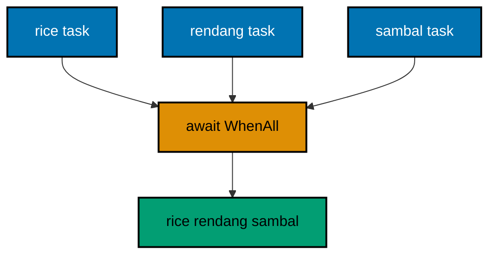

**`learning/code/ex-55-when-all-fans-out/Program.cs`**:

```csharp
// => Example 55: When All Fans Out.
// => WhenAll starts every task, then awaits them together: the join is one line.
var rice = Task.FromResult("rice"); // => completed task: no thread, no timing
var rendang = Task.FromResult("rendang"); // => second completed task beside it
var sambal = Task.FromResult("sambal"); // => third completed task beside those

// => WhenAll joins the three: results arrive in task order, always
string[] plates = await Task.WhenAll(rice, rendang, sambal); // => order follows the arguments

// => Join prints the joined results in the same fixed order every run
Console.WriteLine(string.Join(",", plates)); // => Output: rice,rendang,sambal
```

**Output** (`learning/code/ex-55-when-all-fans-out/expected/main.stdout.txt`):

```text
rice,rendang,sambal
```

**Key takeaway**: WhenAll fans work out and gathers results in task order.

**Why it matters**: Sequential awaits serialize independent work, paying full latency per task while the kitchen idles. Fanning out with WhenAll overlaps the waits and gathers every result in one resume, which is the shape behind parallel fetches and batch cooking alike. Task-order results keep the transcript deterministic no matter which task finished first underneath.

### Example 56: Cancel with Token

Cancellation is cooperative: the token carries the request and the work checks it, so cancelling before the start makes the outcome fully deterministic. This example cancels up front and proves both the flag and the throw. (Concepts: co-09.)

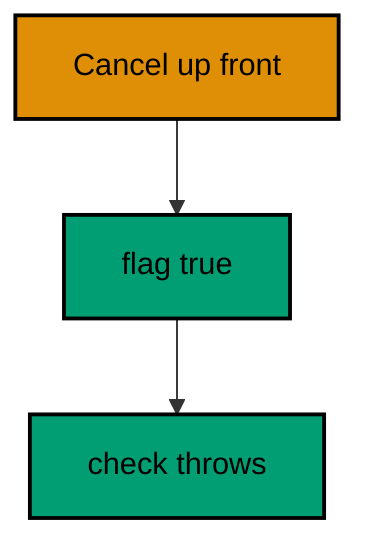

**`learning/code/ex-56-cancel-with-token/Program.cs`**:

```csharp
// => Example 56: Cancel with Token.
// => Cancel before the work starts: the token is already dead, so the outcome is fixed.
using var source = new CancellationTokenSource(); // => the token factory for this demo

// => cancel before any work: pre-cancelled tokens make the outcome fixed
source.Cancel(); // => cancel up front: deterministic, no race with the work

// => IsCancellationRequested answers true: the work below never starts
// => checking first is the cooperative rule: never start dead work
Console.WriteLine($"canceled: {source.Token.IsCancellationRequested}"); // => Output: canceled: True
try // => ThrowIfCancellationRequested turns the dead token into the standard throw
{
    source.Token.ThrowIfCancellationRequested(); // => the cooperative check every loop needs
}
catch (OperationCanceledException) // => the exact type cancellation promises
{
    Console.WriteLine("work stood down"); // => Output: work stood down
}
```

**Output** (`learning/code/ex-56-cancel-with-token/expected/main.stdout.txt`):

```text
canceled: True
work stood down
```

**Key takeaway**: Tokens carry cancellation; work cooperates by checking and standing down.

**Why it matters**: Uncancellable work cannot shut down cleanly: servers hang on deploy and CLIs ignore interrupts until the OS kills them. The token pattern separates requesting from honoring, so libraries check at safe points instead of aborting mid-write. ThrowIfCancellationRequested standardizes the stand-down into the one exception type every caller already handles, which keeps shutdown paths uniform across an entire codebase.

### Example 57: Lock Guards Total

Parallel threads add under one lock: the lock serializes the increments so a hundred adds of 370 land exactly. This example splits the adds across threads and prints the deterministic sum. (Concepts: co-09.)

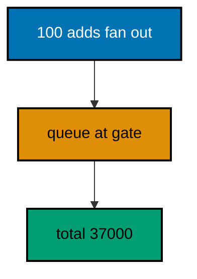

**`learning/code/ex-57-lock-guards-total/Program.cs`**:

```csharp
// => Example 57: Lock Guards Total.
// => Parallel threads add under one lock: the total lands exactly every run.
object gate = new(); // => target-typed new: the lock object itself
int total = 0; // => shared total: touched only inside the lock below

// => Parallel.For splits 100 adds across threads: the lock serializes them
Parallel.For(
    0,
    100,
    i => // => i runs 0 to 99 on whatever threads come
    {
        // => lock admits one thread: the add below never interleaves
        lock (gate) // => every iteration waits its turn on the same gate
        {
            total += 370; // => 100 adds of 370: the sum cannot drift
        }
    }
);

// => the guarded sum is exact: 37000 on every machine, every run
Console.WriteLine($"total: {total}"); // => Output: total: 37000
```

**Output** (`learning/code/ex-57-lock-guards-total/expected/main.stdout.txt`):

```text
total: 37000
```

**Key takeaway**: Lock the shared mutation; the guarded sum lands exactly every run.

**Why it matters**: Unsynchronized read-modify-write loses updates under contention: two threads read the same total and one add vanishes. The lock turns the increment into an indivisible step, trading a little contention for exactness where exactness is owed. Dedicating one private lock object per guarded state keeps the critical sections obvious and deadlock-free by construction.

### Example 58: Concurrent Dictionary Counts

ConcurrentDictionary tallies from many threads with no lock in sight: AddOrUpdate adds fresh or increments atomically per key. This example counts five order lines in parallel and prints the sorted table. (Concepts: co-09.)

**`learning/code/ex-58-concurrent-dictionary-counts/Program.cs`**:

```csharp
// => Example 58: Concurrent Dictionary Counts.
// => ConcurrentDictionary counts from many threads: AddOrUpdate is atomic.
var counts = new System.Collections.Concurrent.ConcurrentDictionary<string, int>(); // => thread-safe table
string[] orders = { "rice", "rendang", "rice", "sambal", "rice" }; // => fixed orders, five lines

// => Parallel.ForEach tallies together: no lock needed, updates never collide
Parallel.ForEach(
    orders,
    dish => // => each dish lands on some thread
    {
        // => AddOrUpdate adds 1 fresh or increments: atomic per key, always
        counts.AddOrUpdate(dish, 1, (_, old) => old + 1); // => rice climbs to 3
    }
);

// => sort before printing: thread completion order never reaches the transcript
foreach (var pair in counts.OrderBy(p => p.Key, StringComparer.Ordinal)) // => ordinal: stable everywhere
{
    Console.WriteLine($"{pair.Key}: {pair.Value}"); // => Output: rendang: 1, rice: 3, sambal: 1
}
```

**Output** (`learning/code/ex-58-concurrent-dictionary-counts/expected/main.stdout.txt`):

```text
rendang: 1
rice: 3
sambal: 1
```

**Key takeaway**: ConcurrentDictionary updates atomically per key; sort before printing.

**Why it matters**: Locking a whole dictionary around every increment serializes independent keys for no reason, while lock-free tables keep per-key updates atomic and parallel. AddOrUpdate folds the add-or-increment branch into one call, removing the check-then-act race that hand-rolled tallies always carry. Sorting before printing keeps thread timing out of the transcript, so parallel work still produces output a test can pin.

### Example 59: Channel Pipes Work

A channel carries plates from writer to reader in order: three writes, one Complete, and the reader drains until the end arrives. This example pipes three dishes through one channel. (Concepts: co-09.)

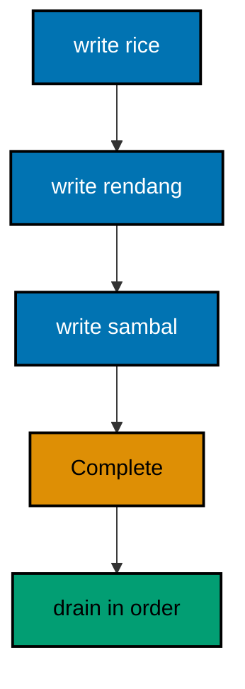

**`learning/code/ex-59-channel-pipes-work/Program.cs`**:

```csharp
// => Example 59: Channel Pipes Work.
// => A Channel carries plates from writer to reader: Complete ends the stream.
var pipe = System.Threading.Channels.Channel.CreateUnbounded<string>(); // => unbounded: writes never block here

// => the writer serves three plates, then completes: the menu for this demo
await pipe.Writer.WriteAsync("rice"); // => first plate enters the pipe
await pipe.Writer.WriteAsync("rendang"); // => second plate enters the pipe
await pipe.Writer.WriteAsync("sambal"); // => third plate enters the pipe
pipe.Writer.Complete(); // => complete: the reader below sees the end coming

// => ReadAllAsync drains in write order: pipes preserve the serving sequence
await foreach (string plate in pipe.Reader.ReadAllAsync()) // => ends when Complete arrives
{
    Console.WriteLine($"served: {plate}"); // => Output: rice, rendang, sambal in order
}
```

**Output** (`learning/code/ex-59-channel-pipes-work/expected/main.stdout.txt`):

```text
served: rice
served: rendang
served: sambal
```

**Key takeaway**: Channels pipe values in order; Complete tells the reader the end arrived.

**Why it matters**: Shared queues with manual locking tangle producers and consumers through one contended structure. Channels separate the roles cleanly: writers write, readers read, and completion flows through the same pipe as the data. The async enumerable drains with one loop, so pipelines read sequentially while running concurrently underneath, which is the simplest correct shape for work-passing designs.

### Example 60: Parallel Bounded Forest

MaxDegreeOfParallelism bounds the crew: five dishes cook with at most two at once, and sorting the results keeps thread timing out of the transcript. This example checks five stoves with a crew of two. (Concepts: co-09.)

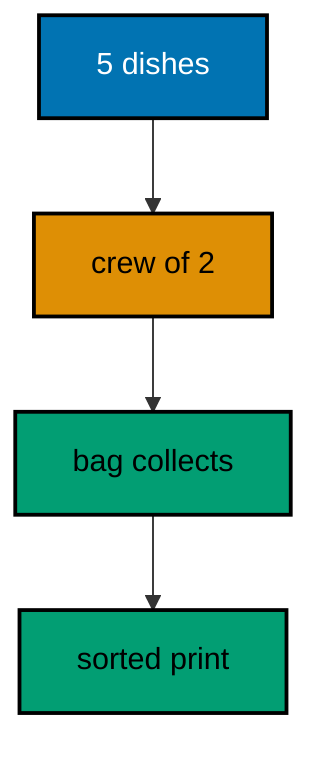

**`learning/code/ex-60-parallel-bounded-forest/Program.cs`**:

```csharp
// => Example 60: Parallel Bounded Forest.
// => MaxDegreeOfParallelism bounds the crew: two cooks, eight stoves to check.
var bag = new System.Collections.Concurrent.ConcurrentBag<string>(); // => thread-safe sack for results

// => ParallelOptions caps the workers at two: the bound is the lesson
var options = new ParallelOptions { MaxDegreeOfParallelism = 2 }; // => two at once, never more
Parallel.ForEach(
    new[] { "rice", "rendang", "sambal", "soto", "gado" },
    options,
    dish => // => five dishes, two cooks
    {
        bag.Add($"{dish} ok"); // => order of arrival varies: sorted below before print
    }
);

// => OrderBy restores a fixed transcript: thread timing never leaks into output
foreach (string line in bag.OrderBy(s => s, StringComparer.Ordinal)) // => ordinal: stable everywhere
{
    Console.WriteLine(line); // => Output: gado ok, rendang ok, rice ok, sambal ok, soto ok
}
```

**Output** (`learning/code/ex-60-parallel-bounded-forest/expected/main.stdout.txt`):

```text
gado ok
rendang ok
rice ok
sambal ok
soto ok
```

**Key takeaway**: Bound the crew with ParallelOptions; sort shared results before printing.

**Why it matters**: Unbounded parallelism overwhelms disks, sockets, and downstream services exactly when load peaks: the retry storm that follows is worse than the queue it skipped. Naming the degree turns capacity into a reviewed decision instead of an accident of core count. Collect-then-sort keeps the bound honest in transcripts while the work itself stays parallel.

### Example 61: Interlocked Adds Atomically

Interlocked.Add sums without any lock object: the hardware performs read-plus-write as one indivisible step. This example lands a hundred adds exactly with no critical section. (Concepts: co-09.)

**`learning/code/ex-61-interlocked-adds-atomically/Program.cs`**:

```csharp
// => Example 61: Interlocked Adds Atomically.
// => Interlocked.Add sums without any lock: the hardware performs the add.
int total = 0; // => shared total: touched only through Interlocked below

// => 100 iterations add 370 each: no lock object, no critical section
Parallel.For(
    0,
    100,
    _ => // => discard: the index plays no role in the sum
    {
        // => atomic add: read-plus-write happens as one indivisible step
        Interlocked.Add(ref total, 370); // => 100 adds land exactly, never lost
    }
);

// => lock-free yet exact: 37000 on every machine, every run
Console.WriteLine($"total: {total}"); // => Output: total: 37000
```

**Output** (`learning/code/ex-61-interlocked-adds-atomically/expected/main.stdout.txt`):

```text
total: 37000
```

**Key takeaway**: Interlocked atomics sum lock-free; totals land exactly.

**Why it matters**: Counters and totals sit on the hottest paths in concurrent code, and a lock per increment serializes the very parallelism you parallelized for. Hardware atomics keep the add indivisible without any lock object, so contended counters scale instead of queueing. Reaching for Interlocked first for single-variable updates reserves locks for the multi-step critical sections that truly need them.

### Example 62: Nullable Flags Missing Nulls

Nullable reference types make string question-mark honest: the lookup may miss, so the compiler rejects silent dereferences until a guard proves safety. This example finds rendang, misses sushi, and passes the warnings-as-errors gate. (Concepts: co-12.)

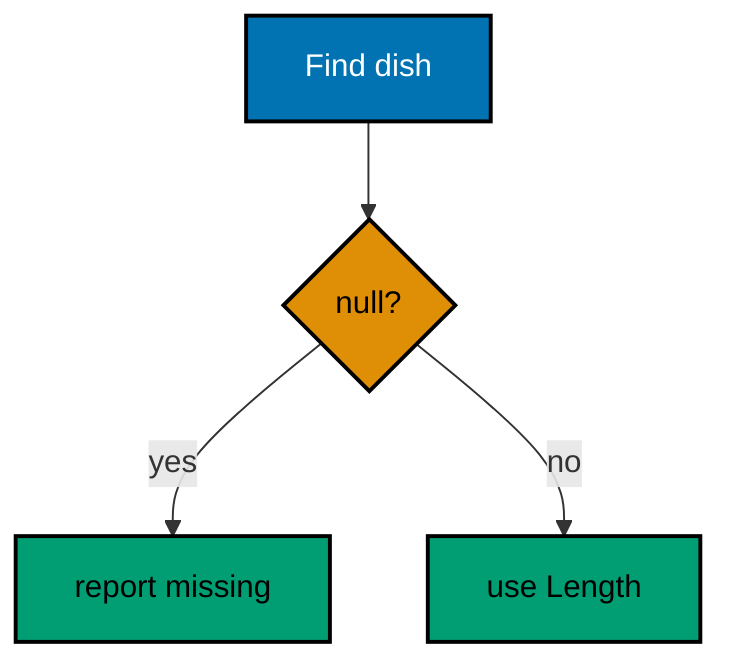

**`learning/code/ex-62-nullable-flags-missing-nulls/Program.cs`**:

```csharp
// => Example 62: Nullable Flags Missing Nulls.
// => Nullable enable makes string? honest: the compiler rejects silent nulls.
string? maybe = Find("rendang"); // => string? admits null: the lookup may miss

// => the null check below is load-bearing: remove it and the build warns
if (maybe is not null) // => is not null: the only dereference the compiler trusts
{
    Console.WriteLine($"found: {maybe.Length} letters"); // => Output: found: 7 letters
}

// => missing dishes return null: the caller above must ask before touching
string? missing = Find("sushi"); // => null: honestly typed, honestly handled
Console.WriteLine($"missing: {missing is null}"); // => Output: missing: True

// => Find returns null for unknown dishes: the ? in the signature promises it
string? Find(string dish) // => local function: dish in, dish or null out
{
    // => expression body with a switch: known dishes answer, the rest miss
    return dish switch // => the menu lives in this one expression
    {
        "rendang" => dish, // => known: the dish itself answers
        "rice" => dish, // => known: the dish itself answers
        _ => null, // => unknown: null, and the signature says so
    };
}
```

**Output** (`learning/code/ex-62-nullable-flags-missing-nulls/expected/main.stdout.txt`):

```text
found: 7 letters
missing: True
```

**Key takeaway**: Annotate may-miss with question-mark; guards earn every dereference.

**Why it matters**: NullReferenceException is the most common production crash in C# history, and it always means someone touched what was never there. Nullable annotations move that discovery from runtime to compile time: the question mark advertises the miss, and the analyzer rejects unguarded touches. Code that passes the warnings-as-errors gate with nullables on has proven its null story before shipping.

### Example 63: Pragma Tames One Warning

Pragma warning disable silences one warning ID in the smallest scope, and restore re-arms immediately after: acknowledged, not fixed, and precisely bounded. This example holds four tables and still passes the warnings-as-errors gate. (Concepts: co-12.)

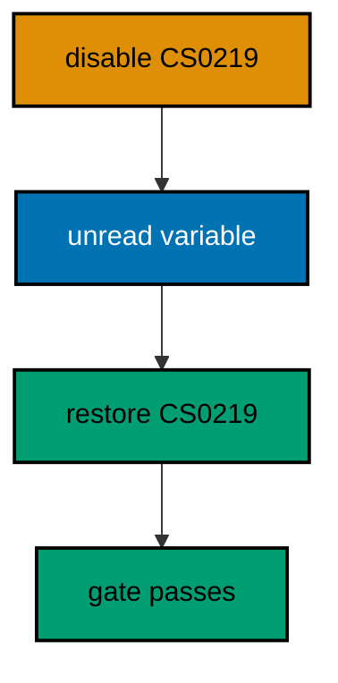

**`learning/code/ex-63-pragma-tames-one-warning/Program.cs`**:

```csharp
// => Example 63: Pragma Tames One Warning.
// => pragma warning disable silences one warning ID in the smallest scope.
#pragma warning disable CS0219 // => unused variable below: acknowledged, not fixed
int reservedTables = 4; // => kept for the seating plan: intentionally unread
#pragma warning restore CS0219 // => restore: later warnings fire normally again
// => the gated build treats warnings as errors: this file still passes clean
Console.WriteLine("seating plan kept"); // => Output: seating plan kept

// => reservedTables stays unread on purpose: the pragma names the exact ID
Console.WriteLine("tables held for regulars"); // => Output: tables held for regulars
```

**Output** (`learning/code/ex-63-pragma-tames-one-warning/expected/main.stdout.txt`):

```text
seating plan kept
tables held for regulars
```

**Key takeaway**: Suppress one warning ID in the smallest scope; restore right after.

**Why it matters**: Blanket warning suppression hides real defects behind acknowledged noise, while fixing every warning immediately blocks intentional holds like reserved capacity. The scoped pragma records the exact trade: this ID, these lines, still intentional. Pairing every suppression with a restore keeps the rest of the file under full analysis, so the gate stays strict everywhere else.

### Example 64: Names Follow the Guide

PascalCase for types and members, camelCase for locals and parameters, underscore-camelCase for private fields: three casings covering every name. This example shows all three in one small kitchen. (Concepts: co-14.)

**`learning/code/ex-64-names-follow-the-guide/Program.cs`**:

```csharp
// => Example 64: Names Follow the Guide.
// => PascalCase for members, camelCase for locals, _camelCase for private fields.
var kitchen = new Kitchen("Sari"); // => local is camelCase: starts lowercase
Console.WriteLine(kitchen.HeadChef); // => Output: Sari
Console.WriteLine(kitchen.OpenOrder("rendang")); // => Output: rendang x1

// => type follows the statements; its members show the three casings at once
class Kitchen // => PascalCase type: nouns for types, verbs for methods
{
    private readonly string _headChef; // => _camelCase field: private state

    public Kitchen(string headChef) => _headChef = headChef; // => parameter is camelCase

    public string HeadChef => _headChef; // => PascalCase property: public face

    public string OpenOrder(string dish) => $"{dish} x1"; // => PascalCase method, camelCase parameter
}
```

**Output** (`learning/code/ex-64-names-follow-the-guide/expected/main.stdout.txt`):

```text
Sari
rendang x1
```

**Key takeaway**: PascalCase members, camelCase locals, underscore fields; no exceptions.

**Why it matters**: Casing encodes access and role at a glance: readers tell fields from locals from members without hunting declarations. Uniform casing across a codebase removes an entire class of review comments, letting reviews discuss design instead of spelling. Following the community guide also makes your code read like the standard library, which every C# developer already knows.

### Example 65: File Scoped Namespace Tidies

One file-scoped line replaces the namespace block: the whole file joins Warung with no braces and no indent tax. This example scopes, names its entry point, and answers from the same scope. (Concepts: co-14.)

**`learning/code/ex-65-file-scoped-namespace-tidies/Program.cs`**:

```csharp
// => Example 65: File Scoped Namespace Tidies.
// => One line scopes the file: namespace Warung, no braces, no indent tax.
// => file-scoped namespace: the whole file below joins Warung
namespace Warung; // => semicolon, not braces: the file is the scope

// => explicit Program: file-scoped files name their entry point plainly
static class Program // => static: the entry point holds no instance state
{
    static void Main() // => Main: the runtime starts here
    {
        // => Stove lives in the same file scope: no qualification needed
        System.Console.WriteLine(Stove.DishOfTheDay()); // => Output: rendang
    }
}

// => Stove shares the file scope: same namespace, zero nesting added
static class Stove // => static: a bag of answers, never instantiated
{
    // => expression body: the file-scoped style favors short members
    public static string DishOfTheDay() => "rendang"; // => one line, one answer
}
```

**Output** (`learning/code/ex-65-file-scoped-namespace-tidies/expected/main.stdout.txt`):

```text
rendang
```

**Key takeaway**: One file-scoped line groups the file; everything inside shares it indentation-free.

**Why it matters**: Block-scoped namespaces indent every line of every file one level for no local benefit, which pushes real logic rightward across whole codebases. The file-scoped form spends one line to buy back that column everywhere, and files with one namespace each which is nearly all of them read flat. Less nesting means the structure that remains actually signals something.

### Example 66: New Syntax Says Less

Target-typed new, collection expressions, index-from-end, and raw strings cut the ceremony while keeping every type explicit enough to read. This example builds a menu, prices its last item, and prints a quoted sign. (Concepts: co-14, co-15.)

**`learning/code/ex-66-new-syntax-says-less/Program.cs`**:

```csharp
// => Example 66: New Syntax Says Less.
// => Target-typed new, collection expressions, and raw strings cut the noise.
List<string> menu = ["rice", "rendang", "sambal"]; // => collection expression: no new, no braces tax
Dictionary<string, int> prices = new() // => target-typed new: the type sits on the left
{
    ["rice"] = 12000, // => the price the receipt below multiplies
    ["rendang"] = 25000, // => the price the receipt below multiplies
    ["sambal"] = 5000, // => the last item needs its price too
};

// => raw string literal: quotes and backslashes need no escaping inside
string sign = """The "warung" opens at 09:00"""; // => triple quotes hold the inner quotes
Console.WriteLine(sign); // => Output: The "warung" opens at 09:00

// => index from end: ^1 names the last item without counting the length
Console.WriteLine($"{menu[^1]} costs {prices[menu[^1]]}"); // => Output: sambal costs 5000
```

**Output** (`learning/code/ex-66-new-syntax-says-less/expected/main.stdout.txt`):

```text
The "warung" opens at 09:00
sambal costs 5000
```

**Key takeaway**: Modern syntax removes ceremony; types stay readable at the declaration.

**Why it matters**: Ceremony hides intent: when every list needs new plus braces plus type twice, readers skim past the values to find the shape. Collection expressions and target-typed new leave the values and the single type visible, while raw strings end escaping gymnastics for quoted text. Less noise per line compounds across a codebase into genuinely faster reading.

### Example 67: Small Functions Do One Thing

Expression-bodied members keep one-liners visible: name, arrow, answer, with each helper doing exactly what its name promises. This example labels, totals, and judges one order through three tiny functions. (Concepts: co-14.)

**`learning/code/ex-67-small-functions-do-one-thing/Program.cs`**:

```csharp
// => Example 67: Small Functions Do One Thing.
// => Expression-bodied members keep one-liners visible: name, arrow, answer.
Console.WriteLine(Label("rendang", 25000)); // => Output: rendang: 25000
Console.WriteLine(Total(12000, 25000)); // => Output: 37000

// => each helper below does exactly one thing its name already promises
string Label(string dish, int price) => $"{dish}: {price}"; // => format one receipt line
int Total(int first, int second) => first + second; // => add two lines, nothing else
bool Pricey(int price) => price > 20000; // => one comparison, one boolean answer

// => the third helper joins the transcript: rendang clears the pricey bar
Console.WriteLine($"pricey: {Pricey(25000)}"); // => Output: pricey: True
```

**Output** (`learning/code/ex-67-small-functions-do-one-thing/expected/main.stdout.txt`):

```text
rendang: 25000
37000
pricey: True
```

**Key takeaway**: One-liner helpers get expression bodies; each name promises one thing.

**Why it matters**: Multi-line bodies for single expressions bury the answer under braces and returns, training readers to skim instead of read. The arrow form shows the whole function in one glance, which makes wrong functions obvious and right ones boring. Small named helpers also give tests and callers vocabulary: Label, Total, and Pricey name domain concepts the codebase reuses.

### Example 68: Flat Beats Nested

Guards plus a switch expression replace three nesting levels with one flat margin: the nested version retires while the flat rewrite prints identical answers. This example runs both shapes side by side. (Concepts: co-14, co-01.)

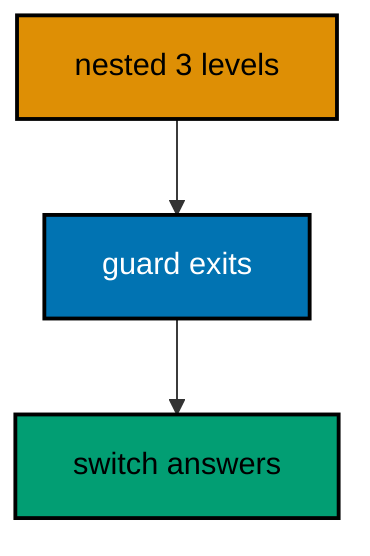

**`learning/code/ex-68-flat-beats-nested/Program.cs`**:

```csharp
// => Example 68: Flat Beats Nested.
// => Guards plus a switch expression replace three nesting levels with one.
// => the nested version below is what the flat rewrite underneath retires
Console.WriteLine(Nested("rendang", 2)); // => Output: 50000
Console.WriteLine(Flat("rendang", 2)); // => Output: 50000

// => nested: every condition indents the answer one level deeper
// => the pyramid taxes readers: each level holds conditions in mind at once
int Nested(string dish, int qty) // => the shape to retire: pyramid of doom
{
    // => level one decides quantity: everything below indents under it
    if (qty > 0) // => level one: quantity must be positive
    {
        // => level two decides the dish: the answer sinks another level
        if (dish == "rendang") // => level two: dish must match
        {
            return 25000 * qty; // => answer hides two levels deep
        }
    }
    // => the failure value sits far from the conditions that chose it
    return 0; // => failure value far from the conditions that chose it
}

// => flat: guards exit early, the switch answers at the margin
// => same answers, new shape: the rewrite below changes structure only
int Flat(string dish, int qty) // => the idiomatic rewrite: same answers
{
    // => guard first: bad quantity exits before any dish logic runs
    // => inverted conditions exit: failures return instead of nesting
    if (qty <= 0) // => inverted condition: failure returns immediately
    {
        return 0; // => early exit keeps the rest flat
    }
    return dish switch // => one expression answers at the left margin
    {
        "rendang" => 25000 * qty, // => the only dish this kitchen prices
        _ => 0, // => unknown dishes still total zero, flatly
    };
}
```

**Output** (`learning/code/ex-68-flat-beats-nested/expected/main.stdout.txt`):

```text
50000
50000
```

**Key takeaway**: Guards exit early; the switch answers at the margin; nesting retires.

**Why it matters**: Deep nesting forces readers to hold every open condition while hunting the answer, which exhausts working memory by the third level. Flat code spends one line per refusal and answers at the margin, so each line means exactly what it says. Running both shapes against the same inputs proves the rewrite changed structure without changing behavior.

### Example 69: Sizeof Maps the Interop Edge

Marshal.SizeOf reports the unmanaged size each type occupies across the native boundary: the number the foreign side sees, answered by the runtime itself. This example prints the sizes the interop edge must agree on. (Concepts: co-13.)

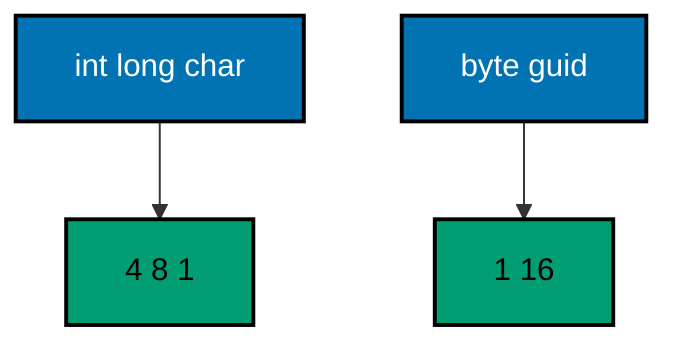

**`learning/code/ex-69-sizeof-maps-the-interop-edge/Program.cs`**:

```csharp
// => Example 69: Sizeof Maps the Interop Edge.
// => Marshal.SizeOf reports the unmanaged size: the number the native side sees.
Console.WriteLine($"int: {System.Runtime.InteropServices.Marshal.SizeOf<int>()}"); // => Output: int: 4
Console.WriteLine($"long: {System.Runtime.InteropServices.Marshal.SizeOf<long>()}"); // => Output: long: 8
Console.WriteLine($"char: {System.Runtime.InteropServices.Marshal.SizeOf<char>()}"); // => Output: char: 1

// => sizes are platform facts the runtime answers: no guessing at the boundary
Console.WriteLine($"byte: {sizeof(byte)}"); // => Output: byte: 1

// => Guid spans 16 bytes: the size a native GUID struct must also reserve
Console.WriteLine($"guid: {System.Runtime.InteropServices.Marshal.SizeOf<Guid>()}"); // => Output: guid: 16
```

The declaration below shows the shape real interop takes; it is a fragment, not a runnable unit, because calling it needs a native library the course never ships.

<!-- harness: illustration -->

```csharp
// Fragment: the DllImport shape behind the sizes above.
[System.Runtime.InteropServices.DllImport("kitchen")]
static extern int Simmer(byte dish, int minutes);
```

**Output** (`learning/code/ex-69-sizeof-maps-the-interop-edge/expected/main.stdout.txt`):

```text
int: 4
long: 8
char: 1
byte: 1
guid: 16
```

**Key takeaway**: Query sizes from the runtime; declare native entries with DllImport.

**Why it matters**: Interop bugs corrupt memory silently: one wrong size shifts every field after it, and the crash lands far from the declaration. Asking the runtime for each size removes guessing, while the DllImport fragment shows where those sizes get spent. Surveying the boundary here means recognizing it later instead of discovering it through heap corruption.

### Example 70: Args Carry the CLI Contract

The harness runs this unit with three arguments, and args arrives verbatim: length first, then each word with its position, then a flag check. This example echoes its command line exactly. (Concepts: co-13.)

**`learning/code/ex-70-args-carry-the-cli-contract/Program.cs`**:

```csharp
// => Example 70: Args Carry the CLI Contract.
// => The harness runs this with --format json sari: args arrive verbatim.
// => Length first: the contract starts with how many words followed the dll
Console.WriteLine($"args: {args.Length}"); // => Output: args: 3

// => echo every argument with its position: order is part of the contract
for (int i = 0; i < args.Length; i++) // => index loop: position matters here
{
    Console.WriteLine($"[{i}]={args[i]}"); // => Output: [0]=--format, [1]=json, [2]=sari
}

// => Contains checks flags without caring where they sit in the order
Console.WriteLine($"json: {args.Contains("--format")}"); // => Output: json: True
```

**Output** (`learning/code/ex-70-args-carry-the-cli-contract/expected/main.stdout.txt`):

```text
args: 3
[0]=--format
[1]=json
[2]=sari
json: True
```

**Key takeaway**: Args arrive verbatim; length, positions, and flags form the CLI contract.

**Why it matters**: Command lines are the oldest inter-process contract: order, flags, and counts carry meaning with no schema to consult. Echoing them with positions makes the contract visible, so dispatch code like Example 75 can rely on shapes this example proves. Testing CLIs means pinning these exact words, which is precisely what the recorded transcript does.

### Example 71: Read LINQ by Stages

Read a pipeline stage by stage: source, filter, shape, then materialize, naming what each stage keeps and drops. This example filters four dishes by length, upper-cases the survivors, and materializes the sign. (Concepts: co-16, co-03.)

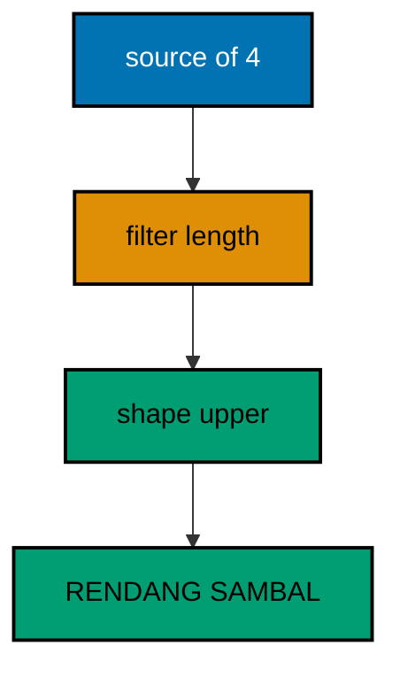

**`learning/code/ex-71-read-linq-by-stages/Program.cs`**:

```csharp
// => Example 71: Read LINQ by Stages.
// => Read a pipeline stage by stage: source, filter, shape, then materialize.
var dishes = new[] { "rice", "rendang", "sambal", "soto" }; // => stage zero: the source names four dishes

// => stage one filters by length: only names longer than four letters pass
var longNames = dishes.Where(d => d.Length > 4); // => rice and soto fall out here

// => stage two shapes: upper-case the survivors for the signboard
var sign = longNames.Select(d => d.ToUpperInvariant()); // => RENDANG and SAMBAL take shape

// => stage three materializes: ToList runs the two stages above in one pass
Console.WriteLine(string.Join(",", sign.ToList())); // => Output: RENDANG,SAMBAL
```

**Output** (`learning/code/ex-71-read-linq-by-stages/expected/main.stdout.txt`):

```text
RENDANG,SAMBAL
```

**Key takeaway**: Read pipelines as numbered stages: source, filter, shape, materialize.

**Why it matters**: Unfamiliar LINQ reads as alphabet soup until you assign each call a stage number and ask what enters and leaves. The stage discipline turns any pipeline into a short story with a fixed plot, which is how experienced developers skim data code at speed. Practicing on a four-dish pipeline builds the reflex that later untangles production queries with six stages and three joins.

### Example 72: Read Async by Awaits

Read an async method by its awaits: each await is a pause with a resume value, and sequential awaits mean sequential work. This example opens, awaits rice, then awaits rendang, printing in pause order. (Concepts: co-16, co-09.)

**`learning/code/ex-72-read-async-by-awaits/Program.cs`**:

```csharp
// => Example 72: Read Async by Awaits.
// => Read an async method by its awaits: each await is a pause with a resume.
Console.WriteLine("open"); // => runs first: nothing async has started yet

// => first await pauses Main until the rice task completes below
string first = await CookAsync("rice"); // => resume value: the finished plate
Console.WriteLine($"first: {first}"); // => Output: first: rice ready

// => second await pauses again: sequential awaits mean sequential work
string second = await CookAsync("rendang"); // => starts only after rice printed
Console.WriteLine($"second: {second}"); // => Output: second: rendang ready

// => the method below never sleeps: completed tasks keep the transcript exact
async Task<string> CookAsync(string dish) // => local function: dish in, plate out
{
    // => the single await: pause here, resume with the task result below
    await Task.CompletedTask; // => shape of waiting with none of the timing
    return $"{dish} ready"; // => resume value the caller above receives
}
```

**Output** (`learning/code/ex-72-read-async-by-awaits/expected/main.stdout.txt`):

```text
open
first: rice ready
second: rendang ready
```

**Key takeaway**: Each await is a pause plus resume; sequential awaits serialize the work.

**Why it matters**: Async code confuses readers who treat it as threaded code: they imagine parallelism where the awaits enforce sequence. Reading pause-by-pause shows the true order, which is what print-statement debugging confirms. This discipline also reveals the missing WhenAll: two sequential awaits on independent tasks are the exact shape Example 55 teaches to fan out.

### Example 73: Read Type by Constructors

Read a type by its constructors first: they list every valid birth, and the chaining shows which birth does the real work. This example births two tickets and prints both through their shared shape. (Concepts: co-16, co-06.)

**`learning/code/ex-73-read-type-by-constructors/Program.cs`**:

```csharp
// => Example 73: Read Type by Constructors.
// => Read a type by its constructors first: they list every valid birth.
// => the two births below are the whole public story of a ticket
// => births before behavior: the legal states come before the methods
var quick = new Ticket("rice"); // => one argument: quantity defaults to one
var feast = new Ticket("rendang", 3); // => two arguments: dish plus quantity
Console.WriteLine(quick); // => Output: rice x1
Console.WriteLine(feast); // => Output: rendang x3

// => the type below offers exactly two births: default quantity or explicit
// => sealed birth list: no subclass can add a third way to be born
sealed class Ticket // => sealed: the birth list below is complete
{
    public string Dish { get; } // => get-only: set at birth, read forever
    public int Qty { get; } // => get-only: the second birth decides it

    // => convenience chains to the real birth: defaults live in one place
    public Ticket(string dish)
        : this(dish, 1) // => chains: one plate by default
    { }

    public Ticket(string dish, int qty) // => the real birth: both fields set here
    {
        Dish = dish; // => the dish every ticket must name
        Qty = qty; // => the quantity the caller chose
    }

    public override string ToString() => $"{Dish} x{Qty}"; // => the print shape above
}
```

**Output** (`learning/code/ex-73-read-type-by-constructors/expected/main.stdout.txt`):

```text
rice x1
rendang x3
```

**Key takeaway**: Constructors list the valid births; chaining names the real one.

**Why it matters**: Jumping to methods first leaves readers guessing which states are even possible, while constructors enumerate the legal starting shapes up front. Chained constructors reveal the defaults the type chose, which is where most behavior assumptions hide. Reading births before behavior turns unfamiliar types into short catalogs instead of mazes, and the catalog fits in far less working memory.

### Example 74: Read Test by Asserts

Read a test backwards from its asserts: each assert names one promise, and the code above exists to serve those promises. This example pins a two-line total and the empty-menu zero. (Concepts: co-16, co-08.)

**`learning/code/ex-74-read-test-by-asserts/Program.cs`**:

```csharp
// => Example 74: Read Test by Asserts.
// => Read a test backwards from its asserts: each assert names one promise.
int passed = 0; // => counts the promises the transcript proves below

// => first promise first: the total of rice plus rendang is 37000
Check(MenuTotal(new() { ["rice"] = 12000, ["rendang"] = 25000 }) == 37000, "total is 37000"); // => Output: PASS

// => second promise: an empty menu totals zero, not garbage
Check(MenuTotal(new()) == 0, "empty menu is 0"); // => Output: PASS

// => the summary closes the read: two promises named, two promises kept
Console.WriteLine($"passed: {passed}"); // => Output: passed: 2

// => Check stays tiny: the asserts above carry the meaning, not the helper
void Check(bool condition, string name) // => local function: promise plus name
{
    // => false throws: a red transcript names the broken promise exactly
    if (!condition) // => the promise under test decides here
    {
        throw new Exception($"FAIL: {name}"); // => FAIL text is the reading guide
    }
    Console.WriteLine($"PASS: {name}"); // => green: one promise read and kept
    passed++; // => count it for the summary line above
}

// => the code under check: sums any menu dictionary it receives
int MenuTotal(Dictionary<string, int> menu) => menu.Values.Sum(); // => local function: menu in, total out
```

**Output** (`learning/code/ex-74-read-test-by-asserts/expected/main.stdout.txt`):

```text
PASS: total is 37000
PASS: empty menu is 0
passed: 2
```

**Key takeaway**: Read tests assert-first; each assert names the promise the code serves.

**Why it matters**: Tests document intent better than comments because the compiler enforces them: reading the asserts first tells you what the code must do before you study how. Helpers and fixtures exist to serve those promises, so understanding flows from promise to machinery instead of the reverse. This backwards reading is the fastest way to inherit an unfamiliar suite with confidence.

### Example 75: Read CLI by Switch

Read a CLI by its argument switch: the verb decides, each arm is one command the tool owns, and unknown verbs teach usage. This example dispatches menu, price, and nonsense through one switch. (Concepts: co-16, co-01.)

**`learning/code/ex-75-read-cli-by-switch/Program.cs`**:

```csharp
// => Example 75: Read CLI by Switch.
// => Read a CLI by its argument switch: each arm is one command the tool owns.
Console.WriteLine(Dispatch(new[] { "menu" })); // => Output: rice, rendang, sambal
Console.WriteLine(Dispatch(new[] { "price", "rice" })); // => Output: 12000
Console.WriteLine(Dispatch(new[] { "unknown" })); // => Output: usage: menu | price <dish>

// => Dispatch reads the verb first, then the nouns: the CLI reading order
// => verb plus nouns: the command shape every CLI shares underneath
string Dispatch(string[] cmd) // => local function: words in, answer out
{
    // => empty input answers usage: every CLI teaches itself first
    // => self-teaching tools need no manual for their first command
    if (cmd.Length == 0) // => no verb: nothing to dispatch on
    {
        return "usage: menu | price <dish>"; // => the self-teaching line
    }
    return cmd[0] switch // => the verb decides: one arm per command
    {
        "menu" => "rice, rendang, sambal", // => menu lists the dishes, no nouns needed
        // => guarded arm: price demands its noun before answering
        "price" when cmd.Length > 1 => Price(cmd[1]).ToString(), // => price needs a dish noun
        _ => "usage: menu | price <dish>", // => unknown verbs teach usage too
    };
}

// => Price answers from the fixed menu the commands above promise
int Price(string dish) =>
    dish switch // => local function: dish in, price out
    {
        "rice" => 12000, // => the price the price command prints
        "rendang" => 25000, // => known dish, fixed answer
        _ => 0, // => unknown dishes cost nothing in this demo
    };
```

**Output** (`learning/code/ex-75-read-cli-by-switch/expected/main.stdout.txt`):

```text
rice, rendang, sambal
12000
usage: menu | price <dish>
```

**Key takeaway**: Verbs dispatch, arms own commands, unknown input teaches usage.

**Why it matters**: Real CLIs sprawl across flags and subcommands until no single reader holds the whole surface. The verb-switch compresses the surface into one readable table: each arm owns exactly one command with its nouns. Unknown verbs answering usage turns the tool self-teaching, which is the property that lets strangers operate your CLI without reading its manual first.

### Example 76: Read JSON Attributes as Contract

JsonPropertyName maps fields to wire names: read the attributes as the contract, because renaming them changes what travels. This example serializes a ticket through two renamed fields. (Concepts: co-16, co-04.)

**`learning/code/ex-76-read-json-attributes-as-contract/Program.cs`**:

```csharp
// => Example 76: Read JSON Attributes as Contract.
// => JsonPropertyName maps fields to wire names: read the attributes as the contract.
var ticket = new Ticket { Dish = "rendang", Qty = 2 }; // => the object the wire must carry

// => Serialize honors the attributes: dish_name and qty travel, not Dish and Qty
string json = System.Text.Json.JsonSerializer.Serialize(ticket); // => the contract rendered
Console.WriteLine(json); // => Output: {"dish_name":"rendang","qty":2}

// => the attributes below are the contract: rename them and the wire changes
sealed class Ticket // => sealed: the contract shape ends here
{
    [System.Text.Json.Serialization.JsonPropertyName("dish_name")] // => wire name, not field name
    public string Dish { get; set; } = ""; // => the field the attribute renames

    [System.Text.Json.Serialization.JsonPropertyName("qty")] // => short wire name for quantity
    public int Qty { get; set; } // => the field the attribute shortens
}
```

**Output** (`learning/code/ex-76-read-json-attributes-as-contract/expected/main.stdout.txt`):

```text
{"dish_name":"rendang","qty":2}
```

**Key takeaway**: Serialization attributes are the wire contract; read them before the fields.

**Why it matters**: Field names refactor constantly while wire formats must stay stable: without attributes, every rename breaks every consumer. The attribute pins the traveling name independently of the code name, so refactors stay local. Reading attributes first shows the true external shape, which is what compatibility reviews and debugging sessions actually need.

### Example 77: Read Using Chains Inside Out

Read nested usings inside-out: the innermost acquisition releases first, so tracing three burners prints lit-stove-wok-oil then out-oil-wok-stove. This example chains three burners around one fry. (Concepts: co-16, co-04.)

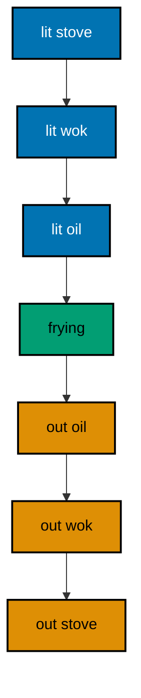

**`learning/code/ex-77-read-using-chains-inside-out/Program.cs`**:

```csharp
// => Example 77: Read Using Chains Inside Out.
// => Read nested usings inside-out: the innermost acquisition releases first.
using (var stove = new Burner("stove")) // => acquired first, released last
// => second level nests under the first: acquisitions stack in order
using (var wok = new Burner("wok")) // => acquired second, released second
// => third level nests deepest: innermost acquires last, releases first
using (var oil = new Burner("oil")) // => acquired last, released first
{
    Console.WriteLine("frying"); // => the body all three acquisitions protect
}

// => release order mirrors acquisition: oil, wok, stove, exactly reversed
// => the mirror is the lesson: read chains inside-out, never line by line
// => the tool below logs its own lifecycle so the order is inspectable
sealed class Burner : IDisposable // => sealed: the lifecycle shape ends here
{
    private readonly string _name; // => which burner this instance tends

    public Burner(string name) // => construction announces the acquisition
    {
        _name = name; // => keep the name for the release line below
        // => lit lines print in nesting order: stove, wok, oil
        Console.WriteLine($"lit {_name}"); // => acquisition prints in nesting order
    }

    public void Dispose() // => runs on using exit, innermost first
    {
        // => out lines print reversed: oil, wok, stove, the mirror image
        Console.WriteLine($"out {_name}"); // => release prints in reverse order
    }
}
```

**Output** (`learning/code/ex-77-read-using-chains-inside-out/expected/main.stdout.txt`):

```text
lit stove
lit wok
lit oil
frying
out oil
out wok
out stove
```

**Key takeaway**: Read nested usings inside-out; releases mirror acquisitions exactly.

**Why it matters**: Three-deep nesting defeats line-by-line reading: the acquisitions and releases interleave across seven lines that only make sense as a mirror. The inside-out rule collapses the chain into one image, so the release order becomes obvious before running. This is the same skill behind reading lock nesting and transaction scopes, where the mirror order is equally load-bearing.

### Example 78: Read Program Top Down

Read a whole program top-down: entry verb, dispatch, helpers, then leaf types at the foot, following each call one level deeper. This example runs a menu command and a total command through four levels. (Concepts: co-16.)

**`learning/code/ex-78-read-program-top-down/Program.cs`**:

```csharp
// => Example 78: Read Program Top Down.
// => Read a whole program top-down: entry, verbs, helpers, then types at the foot.
Console.WriteLine(Run("menu")); // => Output: rice, rendang, sambal
Console.WriteLine(Run("total rice rendang")); // => Output: 37000

// => Run is the entry verb: split the line, dispatch on the first word
string Run(string line) // => local function: one line in, one answer out
{
    // => Split separates the verb from its nouns: menu has none, total has two
    string[] parts = line.Split(' ', StringSplitOptions.RemoveEmptyEntries); // => words of the command
    return parts[0] switch // => the verb decides, exactly like Example 75
    {
        "menu" => Menu(), // => no nouns: the whole menu answers
        "total" => Total(parts[1..]).ToString(), // => range passes the nouns along
        _ => "usage: menu | total <dishes>", // => unknown verbs teach usage
    };
}

// => Menu answers the fixed dishes: the nouns no command needs
string Menu() => "rice, rendang, sambal"; // => local function: no input, full menu

// => Total prices each noun and sums: the nouns the total verb carried
int Total(string[] dishes) => dishes.Sum(Price); // => Sum over the price of each

// => Price is the foot of the program: the leaf every path above reaches
int Price(string dish) =>
    dish switch // => local function: dish in, price out
    {
        "rice" => 12000, // => the leaf answer for rice
        "rendang" => 25000, // => the leaf answer for rendang
        _ => 0, // => unknown nouns cost nothing in this demo
    };
```

**Output** (`learning/code/ex-78-read-program-top-down/expected/main.stdout.txt`):

```text
rice, rendang, sambal
37000
```

**Key takeaway**: Read top-down: entry, verbs, helpers, leaves; follow each call one level.

**Why it matters**: Diving into helpers first strands readers without a map: every function looks equally important until the call graph says otherwise. Top-down reading spends attention where traffic flows, reaching leaves only when the path demands them. This is the systematic way the brief's final objective asks for: read and explain a non-trivial idiomatic sample written by someone else, level by level.
