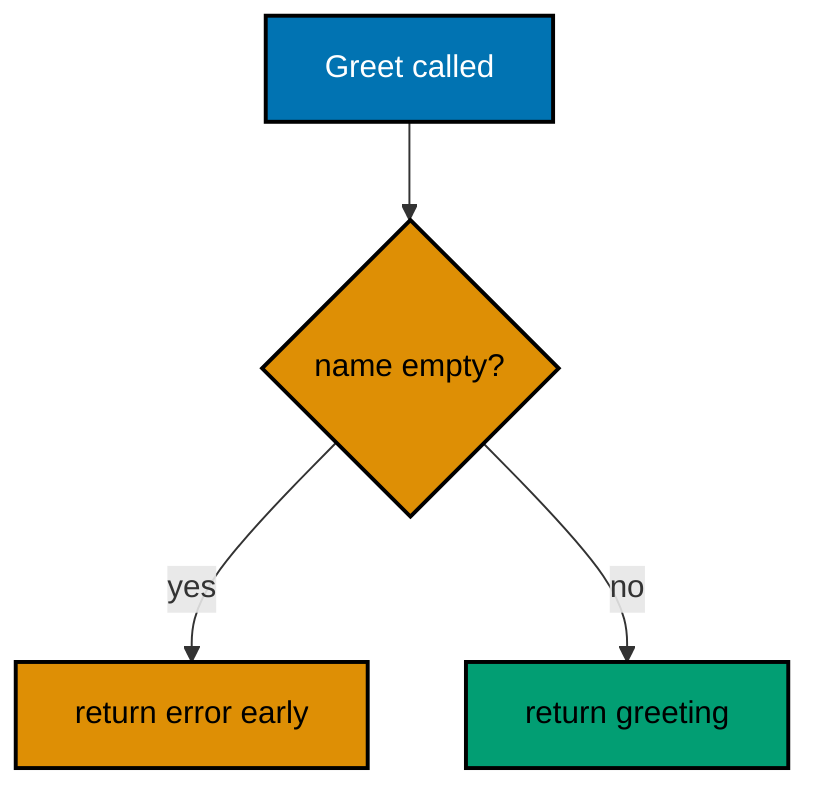
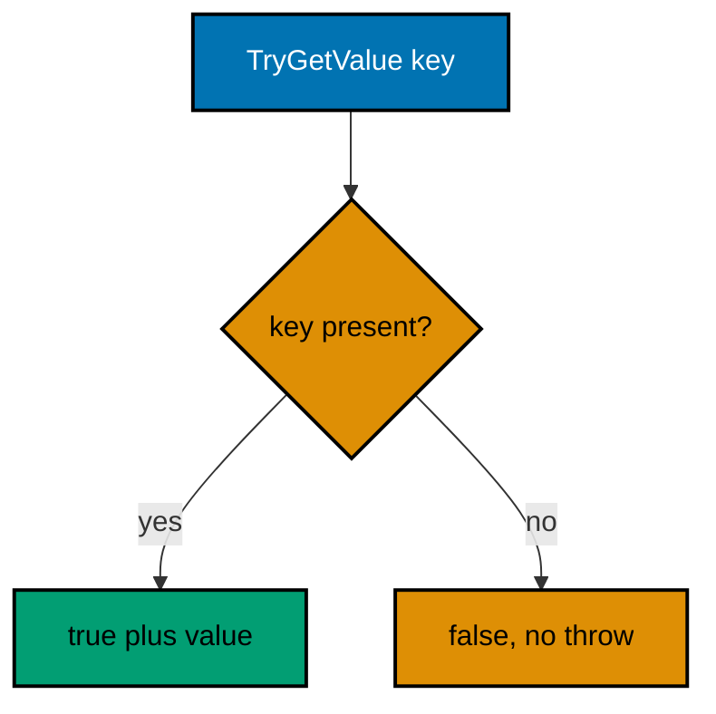
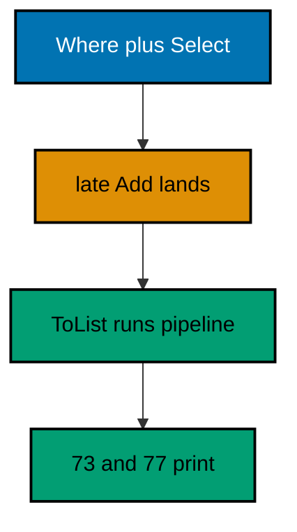
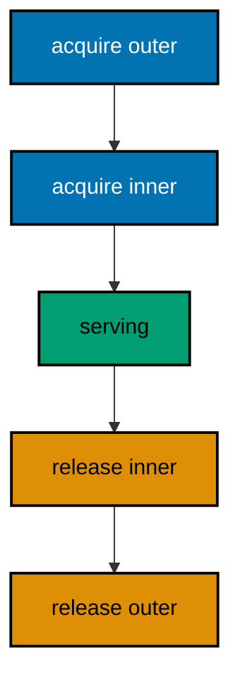
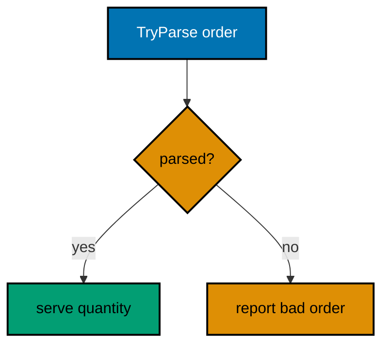
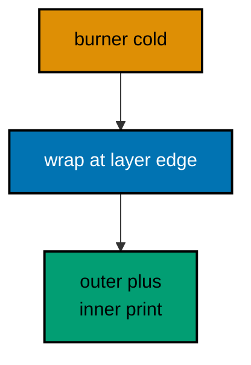
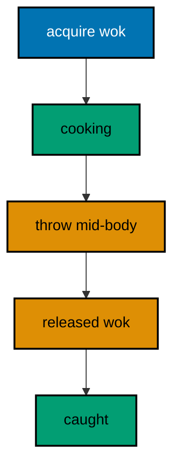
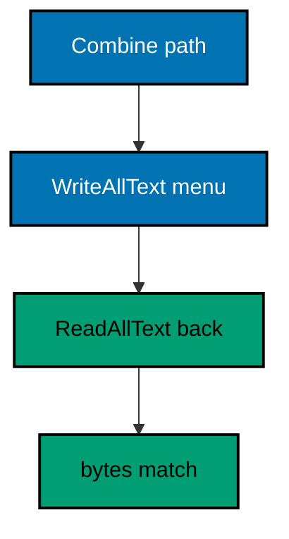
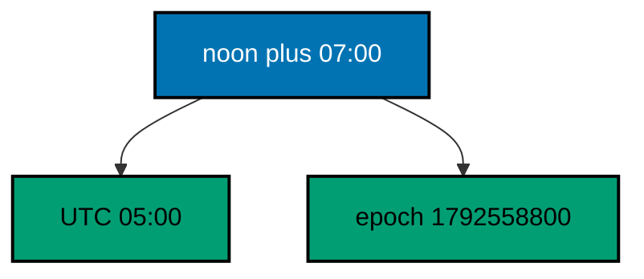

Examples 1–25 build C# fluency from the ground up: idiomatic control flow and collections first (Examples 1–8), showing guard clauses, switch expressions, foreach over anything enumerable, lists, dictionaries, deferred LINQ pipelines, ordinal sorting, and deterministic disposal; then the error-handling idiom in full (Examples 9–17), from throwing for the exceptional through the Try-pattern, exception filters, custom types, inner chains, null guards, aggregates, boundary catches, and disposal that outlives failure; finally the standard library for daily text, file, and time work (Examples 18–25), covering builders, interpolation, regular expressions, file round-trips, JSON, calendar types, durations, and offsets. Every example is a complete, runnable .NET console project under `learning/code/`; run each with the command in its own `run.yaml`.

---

### Example 1: Guard Clause Greeting

The first C# habit to build is checking the failure first and returning it, so the happy path stays at the left margin instead of nesting inside an if block. This example greets a name but refuses an empty one before it ever prints. (Concepts: co-01, co-02.)



**`learning/code/ex-01-guard-clause-greeting/Program.cs`**:

```csharp
// => Example 1: Guard Clause Greeting.
// => C# checks the failure first and returns, so the happy path stays flat.
string Greet(string name) // => local function: the demo stays in one file
{
    // => guard clause first: refuse input this function cannot serve
    if (string.IsNullOrEmpty(name)) // => IsNullOrEmpty covers null and "" alike
    {
        return "error: name is empty"; // => failure travels as data, not an exception
    }
    return $"hello, {name}"; // => past the guard the name is safe to use
}

// => empty input trips the guard before any greeting builds
Console.WriteLine(Greet("")); // => Output: error: name is empty

// => valid input skips the guard and reaches the greeting
Console.WriteLine(Greet("Sari")); // => Output: hello, Sari
```

**Output** (`learning/code/ex-01-guard-clause-greeting/expected/main.stdout.txt`):

```text
error: name is empty
hello, Sari
```

**Key takeaway**: Check the failure first and return it; the happy path stays flat.

**Why it matters**: Guard clauses keep nesting shallow, which is why idiomatic C# reads as a sequence of refusals followed by one straight happy path. Returning the failure as data instead of throwing keeps expected failures cheap and local. Callers meet the normal flow without holding failure conditions in mind, and every refusal sits exactly where the bad input arrives.

### Example 2: Switch Expression Grades

C# maps inputs to answers with switch expressions: each arm pairs a pattern with a value, the arms evaluate top-down, and the discard arm catches everything left over. This example grades scores without a single if or fallthrough. (Concepts: co-01.)

**`learning/code/ex-02-switch-expression-grades/Program.cs`**:

```csharp
// => Example 2: Switch Expression Grades.
// => A switch expression maps an input to exactly one arm, no fallthrough.
string Grade(int score) // => local function: score in, letter out
{
    // => relational patterns list the bands top-down, highest first
    return score switch // => the subject sits after switch, before the arms
    {
        >= 90 => "A", // => 90 and up earns an A
        >= 80 => "B", // => 80 to 89 earns a B
        >= 70 => "C", // => 70 to 79 earns a C
        >= 60 => "D", // => 60 to 69 earns a D
        _ => "F", // => discard arm: every other score fails
    }; // => every arm yields a value: the expression has a result
}

// => each call below prints the letter its band awards
Console.WriteLine(Grade(95)); // => Output: A
Console.WriteLine(Grade(82)); // => Output: B
Console.WriteLine(Grade(58)); // => Output: F
```

**Output** (`learning/code/ex-02-switch-expression-grades/expected/main.stdout.txt`):

```text
A
B
F
```

**Key takeaway**: Switch expressions map inputs to values arm by arm, with the discard catching the rest.

**Why it matters**: Switch expressions replace ladders of ifs with a table the reader scans top-down. Relational and property patterns name the bands directly, so the grading rule reads as data rather than control flow. Because every arm yields a value, the compiler forces exhaustiveness thinking: the discard arm makes the fallback explicit instead of accidental.

### Example 3: Foreach over Anything

One loop shape walks every enumerable: arrays, lists, strings, and iterator methods all answer foreach the same way. This example serves the same toppings from an array and from a yielding iterator. (Concepts: co-01, co-03.)

**`learning/code/ex-03-foreach-over-anything/Program.cs`**:

```csharp
// => Example 3: Foreach Over Anything.
// => foreach walks any enumerable the same way: arrays, lists, strings.
IEnumerable<string> Toppings() // => local iterator: yields one item at a time
{
    // => yield return pauses here and resumes on the next MoveNext
    yield return "rice"; // => first topping out of the iterator
    yield return "rendang"; // => second topping out of the iterator
    yield return "sambal"; // => third topping out of the iterator
}

// => the same loop shape serves an array, a list, and a yielded sequence
// => one traversal to learn instead of one per collection type
foreach (string item in new[] { "rice", "rendang" }) // => foreach over an array
{
    Console.WriteLine($"pantry: {item}"); // => Output: pantry: rice, then rendang
}

// => List<string> walks exactly like the array above: one shape, many types
// => iterators join the same shape: laziness needs no special loop
foreach (string item in Toppings()) // => foreach over the iterator method
{
    Console.WriteLine($"plate: {item}"); // => Output: plate: rice, rendang, sambal
}
```

**Output** (`learning/code/ex-03-foreach-over-anything/expected/main.stdout.txt`):

```text
pantry: rice
pantry: rendang
plate: rice
plate: rendang
plate: sambal
```

**Key takeaway**: foreach walks any enumerable with one shape; iterators yield lazily into it.

**Why it matters**: Learning one traversal shape pays off across every collection type the standard library offers. Iterator methods with yield return turn pull-based sequences into plain loops, so lazy streams read like eager lists. When every walk looks the same, the reader's attention stays on what each item means rather than how the walk works.

### Example 4: List Grows on Add

List of T starts empty and grows as you Add: the list owns its capacity, so you read Count and let growth happen. This example fills a ledger and reads it back by count, membership, and index. (Concepts: co-03.)

**`learning/code/ex-04-list-grows-on-add/Program.cs`**:

```csharp
// => Example 4: List Grows on Add.
// => List<T> starts empty and grows as you Add: read Count, not capacity.
var ledger = new List<string>(); // => target-typed new: the type sits on the left

// => Count reports how many items the list holds right now
Console.WriteLine($"count: {ledger.Count}"); // => Output: count: 0
ledger.Add("rice"); // => first Add: the list grows from empty to one
ledger.Add("rendang"); // => second Add: growth needs no resize call from you

// => Count follows the Adds: two items live in the list now
Console.WriteLine($"count: {ledger.Count}"); // => Output: count: 2

// => Contains asks membership without exposing any index bookkeeping
Console.WriteLine($"has rice: {ledger.Contains("rice")}"); // => Output: has rice: True

// => the indexer reads back exactly what the matching Add stored
Console.WriteLine($"first: {ledger[0]}"); // => Output: first: rice
```

**Output** (`learning/code/ex-04-list-grows-on-add/expected/main.stdout.txt`):

```text
count: 0
count: 2
has rice: True
first: rice
```

**Key takeaway**: Lists grow on Add; Count, Contains, and the indexer are the everyday reads.

**Why it matters**: List of T is the default working collection in C#, and its contract is small: Add grows, Count reports, the indexer reads. Reaching for it first keeps code uniform across codebases, and its growth strategy amortizes appends so everyday code never manages capacity by hand. Knowing the three reads by heart removes the most common collection friction.

### Example 5: Dictionary Try Get

Dictionaries answer membership plus value in one call: TryGetValue returns true and hands the value out, or false with no exception. This example prices rice and admits that sambal is not on the menu. (Concepts: co-03.)



**`learning/code/ex-05-dictionary-try-get/Program.cs`**:

```csharp
// => Example 5: Dictionary Try Get.
// => Dictionaries answer membership plus value in one call: TryGetValue.
var prices = new Dictionary<string, int> // => string keys map to integer prices
{
    ["rice"] = 12000, // => collection expression style would work too; this is explicit
    ["rendang"] = 25000, // => each key appears exactly once in the table
};

// => TryGetValue returns true and hands the value out: no exception path
// => one call replaces the Contains-then-index pair, which reads twice
if (prices.TryGetValue("rice", out int rice)) // => rice receives 12000 on success
{
    Console.WriteLine($"rice: {rice}"); // => Output: rice: 12000
}

// => a missing key returns false instead of throwing: the false branch runs
// => misses stay ordinary outcomes here, never exceptional ones
if (!prices.TryGetValue("sambal", out int missing)) // => missing stays 0, unused
{
    // => the miss branch reads as data handling, not error handling
    Console.WriteLine("sambal: not on the menu"); // => Output: sambal: not on the menu
}
```

**Output** (`learning/code/ex-05-dictionary-try-get/expected/main.stdout.txt`):

```text
rice: 12000
sambal: not on the menu
```

**Key takeaway**: TryGetValue answers membership and value together, with no exception for misses.

**Why it matters**: The indexer throws on missing keys, which turns every lookup into a gamble unless you check Contains first. TryGetValue folds the check and the read into one atomic-shaped call, so the miss branch reads as a normal outcome rather than an error. Idiomatic C# reaches for it everywhere a key might be absent.

### Example 6: LINQ Deferred Pipeline

Where and Select build a query without running it: nothing executes until you enumerate, so the query still sees late arrivals and filters them like the rest. This example filters scores, bonuses them, and materializes after one more score lands. (Concepts: co-03.)



**`learning/code/ex-06-linq-deferred-pipeline/Program.cs`**:

```csharp
// => Example 6: LINQ Deferred Pipeline.
// => Where and Select build a query; nothing runs until you enumerate it.
var scores = new List<int> { 41, 55, 68, 72 }; // => the source the query reads

// => no loop runs here: passing and withHonors only describe the pipeline
var passing = scores.Where(s => s >= 60); // => Where keeps scores of 60 and up
var withHonors = passing.Select(s => s + 5); // => Select adds the honors bonus
scores.Add(59); // => late arrival: the query has not run yet, so it still sees this

// => ToList enumerates now: the late 59 plus bonus flows through the pipeline
Console.WriteLine(string.Join(",", withHonors.ToList())); // => Output: 73,77

// => the source list itself never changed: queries project, they do not mutate
Console.WriteLine($"source still: {scores.Count}"); // => Output: source still: 5
```

**Output** (`learning/code/ex-06-linq-deferred-pipeline/expected/main.stdout.txt`):

```text
73,77
source still: 5
```

**Key takeaway**: LINQ queries describe work; enumeration runs it, seeing even late changes.

**Why it matters**: Deferred execution is the LINQ behavior that surprises every newcomer exactly once, usually in production. Understanding that Where and Select only describe lets you compose pipelines freely and materialize deliberately with ToList. It also explains why queries never mutate their source: projection builds new sequences while the original list keeps every item.

### Example 7: OrderBy Ordinal

OrderBy with an explicit comparer sorts the same on every machine: ordinal comparison reads code points, so cultures and containers cannot shift the order. This example sorts members by last name with an ordinal tiebreak. (Concepts: co-03, co-15.)

**`learning/code/ex-07-orderby-ordinal/Program.cs`**:

```csharp
// => Example 7: OrderBy Ordinal.
// => OrderBy with an explicit comparer sorts the same on every machine.
var members = new List<(string First, string Last)> // => value tuples pair the names
{
    ("Sari", "Nugroho"), // => sorts second by last name under ordinal rules
    ("budi", "Santoso"), // => lowercase b: ordinal puts uppercase first
    ("Ayu", "Nugroho"), // => ties on last name: the tiebreak decides below
};

// => Ordinal compares code points: stable across cultures and containers
var ordered = members.OrderBy(m => m.Last, StringComparer.Ordinal); // => last name first

// => ThenBy breaks the Nugroho tie by first name, ordinal again
ordered = ordered.ThenBy(m => m.First, StringComparer.Ordinal); // => Ayu before Sari

// => one line per member in the final order: Ayu, Sari, then budi
foreach (var m in ordered) // => the query runs as the loop pulls each row
{
    Console.WriteLine($"{m.First} {m.Last}"); // => Output: Ayu Nugroho / Sari Nugroho / budi Santoso
}
```

**Output** (`learning/code/ex-07-orderby-ordinal/expected/main.stdout.txt`):

```text
Ayu Nugroho
Sari Nugroho
budi Santoso
```

**Key takeaway**: Pass an explicit comparer to OrderBy; ordinal keeps the order stable everywhere.

**Why it matters**: Default string comparison follows the current culture, so the same sort prints different orders on different machines. Naming StringComparer.Ordinal turns sorting into a pure function of the data, which is exactly what deterministic transcripts and tests need. ThenBy chains keep multi-key sorts readable instead of packing the logic into one comparer.

### Example 8: Using Disposes Cleanup

The using statement releases each resource in reverse acquisition order, guaranteed, on the happy path and the failure path alike. This example nests two scoops around a serving and logs the exact order. (Concepts: co-01, co-04.)



**`learning/code/ex-08-using-disposes-cleanup/Program.cs`**:

```csharp
// => Example 8: Using Disposes Cleanup.
// => using releases each resource in reverse order, even on the happy path.
// => nested usings acquire inside-out and release outside-in, guaranteed
// => the language owns the order here, not programmer discipline
using (var outer = new Scoop("outer")) // => acquired outer prints first
// => each nesting level adds one acquire and guarantees one release
using (var inner = new Scoop("inner")) // => acquired inner prints second
{
    Console.WriteLine("serving"); // => the body runs between acquire and release
} // => released inner prints third, released outer prints last

// => type declarations follow the top-level statements in one file
sealed class Scoop : IDisposable // => sealed: no subclass will extend this tool
{
    // => one field names the instance: disposal reports which scoop releases
    private readonly string _name; // => readonly: set once, read forever after

    public Scoop(string name) // => constructor announces the acquisition
    {
        _name = name; // => remember which scoop this one is for disposal
        // => announcing acquisition makes the release order inspectable later
        Console.WriteLine($"acquired {_name}"); // => acquisition prints immediately
    }

    public void Dispose() // => Dispose runs when the using block exits
    {
        // => release mirrors acquisition: the guarantee the transcript proves
        Console.WriteLine($"released {_name}"); // => release prints in reverse order
    }
}
```

**Output** (`learning/code/ex-08-using-disposes-cleanup/expected/main.stdout.txt`):

```text
acquired outer
acquired inner
serving
released inner
released outer
```

**Key takeaway**: using guarantees reverse-order disposal; nesting composes the guarantee outward.

**Why it matters**: Manual cleanup calls get skipped on early returns and exceptions, which is how handles leak in long-running services. The using statement moves disposal into the language, so the release order becomes a readable property of the nesting rather than a hope about every exit path. C# developers read nested usings as acquire-inside-out, release-outside-in without thinking.

### Example 9: Throw for Exceptional

C# throws for the truly exceptional: empty orders violate the contract, so the kitchen throws and the caller catches exactly where it can act. This example serves Sari and catches the empty order at the call site. (Concepts: co-02.)

**`learning/code/ex-09-throw-for-exceptional/Program.cs`**:

```csharp
// => Example 9: Throw for Exceptional.
// => C# throws for the truly exceptional; callers catch where they can act.
int Serve(string name) // => local function: portions out, or throws trying
{
    // => validate first: an empty order is a contract violation, not data
    // => contract violations throw because callers cannot predict them
    if (string.IsNullOrEmpty(name)) // => guard decides before any work starts
    {
        throw new InvalidOperationException("name is empty"); // => throw carries the reason
    }
    return name == "Sari" ? 2 : 1; // => happy path: portions depend on appetite
}

// => try wraps only the call that can throw, nothing more
// => small tries keep the risky call obvious and the handling adjacent
try // => the risky call lives inside, the handling right below it
{
    Console.WriteLine($"portions: {Serve("Sari")}"); // => Output: portions: 2
    // => the second call throws: the catch below translates it to words
    Console.WriteLine($"portions: {Serve("")}"); // => empty name throws here
}
catch (InvalidOperationException ex) // => catch the exact type thrown above
{
    // => exact-type catches never swallow unrelated faults by accident
    Console.WriteLine($"caught: {ex.Message}"); // => Output: caught: name is empty
}
```

**Output** (`learning/code/ex-09-throw-for-exceptional/expected/main.stdout.txt`):

```text
portions: 2
caught: name is empty
```

**Key takeaway**: Throw for contract violations; catch the exact type where you can act on it.

**Why it matters**: Exceptions in C# are for the exceptional: failures the caller cannot reasonably predict or prevent. Catching the exact type keeps handling precise instead of swallowing unrelated faults, and wrapping only the risky call keeps the try small enough to reason about. This discipline is what makes large C# codebases survivable: throws stay rare, catches stay local.

### Example 10: Try Pattern Instead

Expected failures return false instead of throwing: int.TryParse answers true plus the value, or false with zero, so one loop handles good orders and typos alike. This example serves two quantities and reports one typo. (Concepts: co-02.)



**`learning/code/ex-10-try-pattern-instead/Program.cs`**:

```csharp
// => Example 10: Try Pattern Instead.
// => Expected failures return false: int.TryParse never throws for bad input.
string[] orders = { "12", "abc", "30" }; // => two good quantities, one typo

// => the same loop shape handles success and failure without any catch
// => typos are routine input, so branching beats throwing on cost alone
foreach (string raw in orders) // => each raw order faces the same question
{
    // => TryParse answers true plus the value, or false with value zero
    // => out declares qty inline: the value lives exactly where it is needed
    if (int.TryParse(raw, out int qty)) // => qty receives 12, then 30
    {
        Console.WriteLine($"serving {qty}"); // => Output: serving 12, then serving 30
    }
    else // => false means bad input: an expected failure, not an exception
    {
        Console.WriteLine($"bad order: {raw}"); // => Output: bad order: abc
    }
}
```

**Output** (`learning/code/ex-10-try-pattern-instead/expected/main.stdout.txt`):

```text
serving 12
bad order: abc
serving 30
```

**Key takeaway**: Try-methods return success plus value; expected failures stay out of exceptions.

**Why it matters**: Parsing user input fails constantly, and exceptions cost far more than a boolean check on hot paths. The Try-pattern turns the most common failure in C# programs into ordinary branching, which keeps request loops fast and transcripts honest. Whenever a failure is expected rather than exceptional, reach for Try first and throw never.

### Example 11: When Filters Exceptions

Catch-when handles only the failures you recognize: filters sort by content, and anything unmatched falls through to the next arm or onward. This example sorts two kitchen failures by their messages with no ifs. (Concepts: co-02.)

**`learning/code/ex-11-when-filters-exceptions/Program.cs`**:

```csharp
// => Example 11: When Filters Exceptions.
// => catch-when handles only the failures you recognize and rethrows the rest.
void Handle(InvalidOperationException ex) // => local function: sort one failure
{
    // => the throw below stands in for real failing work the filters sort
    try // => the risky statement is the throw below, standing in for real work
    {
        throw ex; // => rethrow the received failure so the filters can sort it
    }
    // => first arm owns empty orders: the filter names the content it matches
    catch (InvalidOperationException e) when (e.Message.Contains("empty")) // => filter on content
    {
        Console.WriteLine("refused: empty order"); // => Output: refused: empty order
    }
    // => second arm owns the remainder: no filter, so it catches what skipped
    catch (InvalidOperationException e) // => no filter: catches what the first arm skipped
    {
        // => e.Message carries the unrecognized failure through to the transcript
        Console.WriteLine($"failed: {e.Message}"); // => Output: failed: kitchen closed
    }
}

// => the same handler sorts two failures by their messages, no ifs needed
// => declarative arms beat catch-plus-if: sorting stays out of the handling
Handle(new InvalidOperationException("name is empty")); // => first filter matches
Handle(new InvalidOperationException("kitchen closed")); // => falls to the plain arm
```

**Output** (`learning/code/ex-11-when-filters-exceptions/expected/main.stdout.txt`):

```text
refused: empty order
failed: kitchen closed
```

**Key takeaway**: Exception filters sort failures by content; unmatched ones keep traveling.

**Why it matters**: Without filters, handlers catch broadly and re-test with ifs, which buries the sorting logic inside the handling logic. When-clauses keep each arm declarative: this arm owns empty orders, the next owns everything else. Filters also preserve the stack better than catch-and-rethrow, since unmatched exceptions continue unwinding as if the arm never existed.

### Example 12: Custom Exception Carries Data

A custom exception type carries the fields the handler needs to react: dish names the retry, minimum sets it. This example throws a short-order failure and rebuilds the order from its fields. (Concepts: co-02.)

**`learning/code/ex-12-custom-exception-carries-data/Program.cs`**:

```csharp
// => Example 12: Custom Exception Carries Data.
// => A custom exception type carries the fields the handler needs to react.
// => the type declaration follows the statements, as single-file order demands
try // => the order below violates the field rule the type enforces
{
    // => zero portions violates the house rule the type below encodes
    throw new ShortOrderException("rice", 0); // => zero portions: invalid order
}
catch (ShortOrderException ex) // => catch the custom type, not its base
{
    // => the handler reads the fields: dish names the retry, minimum sets it
    // => typed fields beat message parsing: renames cannot break this handler
    Console.WriteLine($"reorder {ex.Dish} with at least {ex.Minimum}"); // => Output: reorder rice with at least 1
}

// => custom type: dish plus minimum travel with the failure itself
// => failures as contracts: the compiler checks what strings never could
sealed class ShortOrderException : Exception // => sealed: this taxonomy ends here
{
    public string Dish { get; } // => get-only: the failure facts never change
    public int Minimum { get; } // => the smallest order the kitchen accepts

    // => ordered explains the cause while dish and minimum serve the handler
    public ShortOrderException(string dish, int ordered) // => ordered explains the cause
        : base($"ordered {ordered} of {dish}") // => base message keeps the story
    {
        Dish = dish; // => remember the dish for the handler
        Minimum = 1; // => the house rule lives with the type
    }
}
```

**Output** (`learning/code/ex-12-custom-exception-carries-data/expected/main.stdout.txt`):

```text
reorder rice with at least 1
```

**Key takeaway**: Custom exceptions carry typed fields so handlers react to data, not strings.

**Why it matters**: Parsing failure details out of messages is brittle: one rewording breaks every handler. A custom type with get-only properties turns the failure into a small contract the compiler checks, so handlers read fields instead of substrings. Sealing the type keeps the taxonomy closed, which is exactly what catch-sorting needs to stay predictable.

### Example 13: Inner Exception Chain

Wrap once per layer so the outer message explains and the inner proves: callers read the layer language, debuggers read the root cause. This example wraps a cold burner in a stalled rendang and prints both. (Concepts: co-02.)



**`learning/code/ex-13-inner-exception-chain/Program.cs`**:

```csharp
// => Example 13: Inner Exception Chain.
// => Wrap once per layer so the outer message explains and the inner proves.
try // => the outer layer translates a low failure into kitchen language
{
    // => nesting shows the layers: inner meets it raw, outer translates it
    try // => the inner layer meets the raw failure first
    {
        throw new InvalidOperationException("burner 2 is cold"); // => the root cause
    }
    catch (Exception inner) // => catch the raw failure at the layer edge
    {
        // => wrap exactly here: context outside for callers, cause inside for logs
        throw new InvalidOperationException("cannot start rendang", inner); // => wrap: context outside, cause inside
    }
}
catch (Exception outer) // => the caller sees the wrapped layer failure
{
    // => outer speaks kitchen language: the layer the caller understands
    // => callers read Message: the actionable layer without digging deeper
    Console.WriteLine($"outer: {outer.Message}"); // => Output: outer: cannot start rendang
    // => inner speaks burner language: the root cause debuggers need
    // => the ?. guards a missing inner: chains this short always carry one
    Console.WriteLine($"inner: {outer.InnerException?.Message}"); // => Output: inner: burner 2 is cold
}
```

**Output** (`learning/code/ex-13-inner-exception-chain/expected/main.stdout.txt`):

```text
outer: cannot start rendang
inner: burner 2 is cold
```

**Key takeaway**: Wrap once per layer; the outer message explains, the inner exception proves.

**Why it matters**: Bare rethrows lose the original cause, and swallowing loses everything. The inner-exception chain preserves the full causal path while letting each layer speak its own language, which is what makes production failures diagnosable from logs alone. Wrap at layer edges only: wrapping every line buries the signal under repetition instead of adding context.

### Example 14: Throw If Null Guards

ArgumentNullException.ThrowIfNull states the contract in one line: null never passes here, and the parameter name travels with the throw. This example plates rendang and reports the guarded parameter for null. (Concepts: co-02, co-14.)

**`learning/code/ex-14-throw-if-null-guards/Program.cs`**:

```csharp
// => Example 14: Throw If Null Guards.
// => ThrowIfNull states the contract in one line: null never passes here.
string Plate(string? dish) // => string? admits null: the guard decides next
{
    // => one line replaces the if-null-throw ladder every method repeats
    // => the parameter name travels with the throw for free: no message to craft
    ArgumentNullException.ThrowIfNull(dish); // => throws before any use of dish
    return $"plated {dish}"; // => past the guard dish is non-null: warnings agree
}

// => valid input sails through the guard to the happy path
// => the guard is invisible on success: contracts cost nothing when honored
Console.WriteLine(Plate("rendang")); // => Output: plated rendang
try // => null input must trip the guard before anything else runs
{
    Console.WriteLine(Plate(null)); // => never prints: the guard throws first
}
catch (ArgumentNullException ex) // => the guard throws this exact type
{
    Console.WriteLine($"param: {ex.ParamName}"); // => Output: param: dish
}
```

**Output** (`learning/code/ex-14-throw-if-null-guards/expected/main.stdout.txt`):

```text
plated rendang
param: dish
```

**Key takeaway**: ThrowIfNull guards nullable inputs in one line, naming the refused parameter.

**Why it matters**: Null checks open nearly every public method, and hand-written ladders drift: some throw ArgumentNullException, others throw NullReferenceException later and mysteriously. The one-line guard standardizes the contract, feeds the nullable analyzer so warnings agree past the guard, and puts the parameter name in the throw for free. Uniform guards make null behavior reviewable at a glance.

### Example 15: When All Aggregates

WhenAll gathers every fault instead of the first: Wait wraps them in one AggregateException with inners in task order. This example faults two burners and prints both failures from the aggregate. (Concepts: co-02, co-09.)

**`learning/code/ex-15-when-all-aggregates/Program.cs`**:

```csharp
// => Example 15: When All Aggregates.
// => WhenAll gathers every fault: Wait wraps them in one AggregateException.
var first = Task.FromException<int>(new InvalidOperationException("burner cold")); // => fault one, pre-made

// => pre-made faults remove timing: the aggregate order is task order, always
var second = Task.FromException<int>(new InvalidOperationException("rice short")); // => fault two, pre-made
try // => Wait blocks and throws the aggregate: both faults travel together
{
    // => Wait (not await) surfaces the aggregate: await would show only the first
    Task.WhenAll(first, second).Wait(); // => pre-faulted tasks: deterministic order
}
catch (AggregateException agg) // => AggregateException carries every inner fault
{
    // => InnerExceptions keeps task order: first fault prints first, always
    // => the full picture in one catch: no hidden second failure to chase later
    foreach (var inner in agg.InnerExceptions) // => exactly the two faults above
    {
        Console.WriteLine($"fault: {inner.Message}"); // => Output: burner cold, then rice short
    }
}
```

**Output** (`learning/code/ex-15-when-all-aggregates/expected/main.stdout.txt`):

```text
fault: burner cold
fault: rice short
```

**Key takeaway**: WhenAll plus Wait reports every fault together in task order.

**Why it matters**: Awaiting tasks one by one reports only the first failure and hides the rest, which sends debugging down one hole while two more wait. The aggregate carries the complete failure picture, so a single catch can report everything that went wrong across parallel work. Reading InnerExceptions in order turns parallel failures into a deterministic transcript instead of a race.

### Example 16: Exceptions Stay at Boundary

Libraries throw while only the program edge catches: one boundary catch turns failures into messages, and everything inside stays throw-honest. This example cooks rendang and translates the empty dish once, at the edge. (Concepts: co-02.)

**`learning/code/ex-16-exceptions-stay-at-boundary/Program.cs`**:

```csharp
// => Example 16: Exceptions Stay at Boundary.
// => Libraries throw; only the program edge catches and turns them into words.
// => the boundary catch below is the only catch in the whole example
try // => the edge of the program: the single place failures become messages
{
    Console.WriteLine(Cook("rendang")); // => Output: rendang simmers 4 hours
    // => the second call throws: exactly one catch below translates it
    Console.WriteLine(Cook("")); // => empty dish throws: caught once, at the edge
}
catch (Exception ex) // => edge catch: translate, never swallow silently
{
    // => translation, not swallowing: the message reaches the user intact
    Console.WriteLine($"kitchen says: {ex.Message}"); // => Output: kitchen says: dish is empty
}

// => Cook throws honestly instead of returning a magic failure string
// => magic values force every caller to check: throws force exactly one catch
string Cook(string dish) // => no try inside: failures propagate to the edge
{
    // => guard throws: the library refuses bad input loudly
    if (string.IsNullOrEmpty(dish)) // => empty input violates the contract
    {
        throw new InvalidOperationException("dish is empty"); // => one throw, one edge catch
    }
    return $"{dish} simmers 4 hours"; // => happy path returns plain data
}
```

**Output** (`learning/code/ex-16-exceptions-stay-at-boundary/expected/main.stdout.txt`):

```text
rendang simmers 4 hours
kitchen says: dish is empty
```

**Key takeaway**: Throw inside, catch once at the edge; middle layers stay catch-free.

**Why it matters**: Catches sprinkled through middle layers swallow failures, translate them twice, or convert them into magic return values callers forget to check. One boundary catch makes the failure policy visible: everything inside throws honestly, and exactly one place decides what the user sees. The result reads top-down with no hidden handling between the throw and its translation.

### Example 17: Dispose Despite Errors

A throw inside using still disposes: cleanup outlives the failure, and the log proves release beat the handler. This example cooks, fails mid-body, and records the exact lifecycle order. (Concepts: co-02, co-01.)



**`learning/code/ex-17-dispose-despite-errors/Program.cs`**:

```csharp
// => Example 17: Dispose Despite Errors.
// => A throw inside using still disposes: cleanup outlives the failure.
// => the log below proves disposal ran even though the body threw
var log = new List<string>(); // => records the order: acquire, fail, release

// => the list is the transcript: every lifecycle event lands here in order
try // => the throw inside the using must not skip the release below it
{
    using (var pan = new Pan(log, "wok")) // => acquired wok lands in the log
    {
        log.Add("cooking"); // => body work happens between acquire and release
        // => mid-body failure: the release below must still precede the catch
        throw new InvalidOperationException("oil smoking"); // => failure mid-body
    }
}
catch (InvalidOperationException) // => edge catch: the failure is expected here
{
    // => caught lands last: disposal already ran before this handler woke
    log.Add("caught"); // => caught lands after the release, never before it
}

// => released wok precedes caught: disposal beat the handler to the log
// => Join renders the transcript: one line proves the whole lifecycle order
Console.WriteLine(string.Join(" | ", log)); // => Output: acquired wok | cooking | released wok | caught

// => Pan writes its whole lifecycle into the shared log for inspection
sealed class Pan : IDisposable // => sealed: the lifecycle shape ends here
{
    // => shared log plus name: the whole lifecycle stays inspectable after
    private readonly List<string> _log; // => shared log owned by the caller
    private readonly string _name; // => which pan this disposal belongs to

    public Pan(List<string> log, string name) // => construction logs the acquire
    {
        _log = log; // => keep the log for the Dispose call below
        _name = name; // => keep the name for the release line
        // => acquire logs first: the transcript opens with the construction
        _log.Add($"acquired {_name}"); // => acquire prints first in the final order
    }

    public void Dispose() // => runs on using exit, throw or not
    {
        // => release logs before any catch: the guarantee made visible
        _log.Add($"released {_name}"); // => release precedes the catch, guaranteed
    }
}
```

**Output** (`learning/code/ex-17-dispose-despite-errors/expected/main.stdout.txt`):

```text
acquired wok | cooking | released wok | caught
```

**Key takeaway**: using disposes before the catch runs; the log order proves the guarantee.

**Why it matters**: This is the guarantee that makes using trustworthy for locks, handles, and transactions: the failure path releases exactly like the happy path. Without it, every throw would need a finally twin, and one forgotten twin would leak under load. Seeing release precede caught in a real transcript turns the guarantee from documentation into observed behavior.

### Example 18: String Builder Joins Lines

StringBuilder appends without reallocating the whole string per line, then ToString freezes the buffer once at the end. This example builds a three-line ticket and reports its exact length. (Concepts: co-04.)

**`learning/code/ex-18-string-builder-joins-lines/Program.cs`**:

```csharp
// => Example 18: String Builder Joins Lines.
// => StringBuilder appends without re-allocating the whole string per line.
var ticket = new System.Text.StringBuilder(); // => mutable buffer, not a string yet

// => AppendLine adds the line plus the newline: no plus operator in sight
ticket.AppendLine("warung sari"); // => header line lands in the buffer first
ticket.AppendLine("rice x2"); // => order lines accumulate without copies
ticket.AppendLine("rendang x1"); // => each Append mutates the same buffer

// => ToString freezes the buffer into one string exactly once, at the end
Console.Write(ticket.ToString()); // => Output: the three lines above, each ended

// => Length reports the built characters: 11 plus 7 plus 10 plus 3 newlines
Console.WriteLine($"chars: {ticket.Length}"); // => Output: chars: 31
```

**Output** (`learning/code/ex-18-string-builder-joins-lines/expected/main.stdout.txt`):

```text
warung sari
rice x2
rendang x1
chars: 31
```

**Key takeaway**: Append into a builder in loops; freeze once with ToString at the end.

**Why it matters**: String concatenation in a loop allocates a new string per plus, which turns receipt printing into quadratic garbage under load. StringBuilder amortizes the growth the same way List does, so building tickets, logs, and reports stays linear. Reaching for it whenever appends happen in a loop is one of the cheapest performance habits in C#.

### Example 19: Interpolation and Format

Interpolated strings embed values directly while alignment and format verbs shape them; composite format numbers its holes for the oldest style. This example prints one dish four ways. (Concepts: co-04.)

**`learning/code/ex-19-interpolation-and-format/Program.cs`**:

```csharp
// => Example 19: Interpolation and Format.
// => Interpolated strings embed values; alignment and format verbs shape them.
string dish = "rendang"; // => the value every format below displays
int price = 25000; // => plain integer: verbs decide how it prints

// => plain hole: the value renders with its default shape
Console.WriteLine($"dish: {dish}"); // => Output: dish: rendang

// => alignment pads to 12: the receipt column stays straight
Console.WriteLine($"|{dish, 12}|"); // => Output: |     rendang|

// => N0 thousands-separates with the invariant shape used across this course
Console.WriteLine($"{price.ToString("N0", System.Globalization.CultureInfo.InvariantCulture)}"); // => Output: 25,000

// => composite format numbers its holes: the oldest shaping style still works
Console.WriteLine(string.Format("{0} x{1}", dish, 2)); // => Output: rendang x2
```

**Output** (`learning/code/ex-19-interpolation-and-format/expected/main.stdout.txt`):

```text
dish: rendang
|     rendang|
25,000
rendang x2
```

**Key takeaway**: Interpolate by default; align columns and pin the culture for numbers.

**Why it matters**: Receipts, logs, and tables live or die by consistent shaping, and interpolation puts the shape next to the value instead of in a separate format call. Explicit alignment keeps columns straight without manual padding math, while the invariant culture pins thousands separators so transcripts match on every machine. These three moves cover nearly all everyday output.

### Example 20: Regex Finds Patterns

Regex.Matches scans fixed text and reports every hit with its position, and named groups read like fields. This example finds two orders hiding in one line and prints each dish with its count. (Concepts: co-04.)

**`learning/code/ex-20-regex-finds-patterns/Program.cs`**:

```csharp
// => Example 20: Regex Finds Patterns.
// => Regex.Matches scans fixed text and reports every hit with its position.
var line = "order 12 rice, order 30 rendang"; // => fixed input: two orders hide here

// => the pattern names its capture: count holds the digits for each order
var matches = System.Text.RegularExpressions.Regex.Matches(
    line,
    @"order (?<count>\d+) (?<dish>\w+)"
); // => verbatim string: backslashes stay literal

// => Count reports the hits: exactly the two orders above
Console.WriteLine($"orders: {matches.Count}"); // => Output: orders: 2

// => named groups read like fields: count plus dish per hit, in order
foreach (System.Text.RegularExpressions.Match m in matches) // => Matches returns in scan order
{
    Console.WriteLine($"{m.Groups["dish"].Value} x{m.Groups["count"].Value}"); // => Output: rice x12, then rendang x30
}
```

**Output** (`learning/code/ex-20-regex-finds-patterns/expected/main.stdout.txt`):

```text
orders: 2
rice x12
rendang x30
```

**Key takeaway**: Matches plus named groups turn pattern scans into field reads.

**Why it matters**: Logs, tickets, and pasted reports arrive as text, and hand-walking characters to extract fields is slow and error-prone. One pattern with named groups replaces a page of substring math, and Matches returns hits in scan order so transcripts stay deterministic. Verbatim strings keep the backslashes literal, which removes the most common regex authoring friction.

### Example 21: Read and Write Files

WriteAllText then ReadAllText round-trips a small file through the disk: one call writes the whole menu, one call brings the exact bytes back. This example writes beside the binary and proves the round trip. (Concepts: co-04.)



**`learning/code/ex-21-read-and-write-files/Program.cs`**:

```csharp
// => Example 21: Read and Write Files.
// => WriteAllText then ReadAllText round-trips a small file through the disk.
string name = "today.txt"; // => relative name: lives beside the binary, portable

// => Combine joins segments with the platform separator, no hardcoded slash
string path = Path.Combine(".", name); // => ./today.txt on every platform here
File.WriteAllText(path, "rice x2\nrendang x1\n"); // => the whole menu in one call

// => ReadAllText brings the exact bytes back: the round trip proves the write
string back = File.ReadAllText(path); // => back equals what the write stored
Console.Write(back); // => Output: rice x2, then rendang x1, each on its line

// => Exists confirms the file the write created before this process exits
Console.WriteLine($"exists: {File.Exists(path)}"); // => Output: exists: True
```

**Output** (`learning/code/ex-21-read-and-write-files/expected/main.stdout.txt`):

```text
rice x2
rendang x1
exists: True
```

**Key takeaway**: WriteAllText and ReadAllText move small files in one call each; Combine builds portable paths.

**Why it matters**: Small-file I/O covers configuration, fixtures, and daily reports, and the one-call shapes remove all stream bookkeeping for that size. Path.Combine keeps separators portable so the same code runs on developer machines and containers. Relative names keep the files beside the binary, which is exactly what fresh-copy harnesses and tests need for isolation.

### Example 22: JSON Round Trip

System.Text.Json serializes a record and parses it back with no packages: the JSON string carries the dish and quantity, and deserialization rebuilds the equal record. This example round-trips one order. (Concepts: co-04.)

**`learning/code/ex-22-json-round-trip/Program.cs`**:

```csharp
// => Example 22: JSON Round Trip.
// => System.Text.Json serializes a record and parses it back with no packages.
var order = new Order("rendang", 2); // => record: value shape with two fields

// => Serialize turns the record into a JSON object string with camel keys
string json = System.Text.Json.JsonSerializer.Serialize(order); // => {"Dish":"rendang","Qty":2}
Console.WriteLine(json); // => Output: {"Dish":"rendang","Qty":2}

// => Deserialize rebuilds the record: the JSON above parses back exactly
var back = System.Text.Json.JsonSerializer.Deserialize<Order>(json); // => back equals order
Console.WriteLine($"{back?.Dish} x{back?.Qty}"); // => Output: rendang x2

// => record declaration follows the statements in single-file order
record Order(string Dish, int Qty); // => positional record: equality by value
```

**Output** (`learning/code/ex-22-json-round-trip/expected/main.stdout.txt`):

```text
{"Dish":"rendang","Qty":2}
rendang x2
```

**Key takeaway**: JsonSerializer round-trips records with no packages; records deserialize by shape.

**Why it matters**: JSON is the wire format for configuration, storage, and services, and the inbox serializer covers it without adding a single dependency. Records map naturally to JSON objects because both are shaped data with value equality, so round-trips compose without custom converters. Proving the trip in both directions turns the format from a hope into a checked property.

### Example 23: Date and TimeOnly

DateOnly carries the calendar day while TimeOnly carries the wall-clock time: each type answers its own arithmetic without dragging time zones along. This example steps a fixed date and measures the open window. (Concepts: co-05.)

**`learning/code/ex-23-date-and-timeonly/Program.cs`**:

```csharp
// => Example 23: Date and TimeOnly.
// => DateOnly carries the calendar day; TimeOnly carries the wall-clock time.
var open = new DateOnly(2026, 10, 21); // => fixed date: no clock read anywhere
var opensAt = new TimeOnly(9, 0); // => the warung opens at nine sharp
var closesAt = new TimeOnly(21, 0); // => and closes at nine in the evening

// => AddDays moves the calendar without touching any clock or time zone
Console.WriteLine(open.AddDays(1).ToString("yyyy-MM-dd")); // => Output: 2026-10-22

// => TimeOnly subtracts to a TimeSpan: the open window measures twelve hours
Console.WriteLine(closesAt - opensAt); // => Output: 12:00:00

// => DayOfWeek names the weekday of the fixed date above
Console.WriteLine(open.DayOfWeek); // => Output: Wednesday
```

**Output** (`learning/code/ex-23-date-and-timeonly/expected/main.stdout.txt`):

```text
2026-10-22
12:00:00
Wednesday
```

**Key takeaway**: DateOnly for days, TimeOnly for times; each does its own arithmetic cleanly.

**Why it matters**: DateTime mixes dates, times, and zones in one type, which is how midnight bugs and zone leaks start. Splitting the day from the time of day makes each value say exactly what it means, so opening hours and due dates stop carrying phantom midnights. Fixed dates keep every transcript deterministic while the arithmetic stays exactly the production shape.

### Example 24: TimeSpan Arithmetic

TimeSpan measures durations: parse it from the colon shape, add it like a number, and report it in one unit. This example cooks rendang for four hours plus a half hour of prep. (Concepts: co-05.)

**`learning/code/ex-24-timespan-arithmetic/Program.cs`**:

```csharp
// => Example 24: TimeSpan Arithmetic.
// => TimeSpan measures durations: parse it, add it, compare it, print it.
var simmer = TimeSpan.FromHours(4); // => rendang simmers four hours, fixed span
var prep = TimeSpan.FromMinutes(30); // => prep adds a fixed half hour

// => spans add like numbers: the whole cook takes four and a half hours
Console.WriteLine(simmer + prep); // => Output: 04:30:00

// => Parse reads the colon shape back into the same four-hour span
Console.WriteLine(TimeSpan.Parse("4:00:00") == simmer); // => Output: True

// => TotalMinutes reports the duration in one unit: 270 minutes exactly
Console.WriteLine((simmer + prep).TotalMinutes); // => Output: 270
```

**Output** (`learning/code/ex-24-timespan-arithmetic/expected/main.stdout.txt`):

```text
04:30:00
True
270
```

**Key takeaway**: TimeSpans add, parse, and compare as values; TotalMinutes reports one unit.

**Why it matters**: Durations stored as raw numbers lose their unit, which is how seconds-vs-milliseconds bugs ship. TimeSpan carries the unit with the value, so adding prep to simmer cannot confuse hours with minutes. Parsing the colon shape back proves the printed form round-trips, keeping durations readable in logs and exact in math.

### Example 25: Offset Anchors Instants

DateTimeOffset pins the instant plus its offset: the same noon in Jakarta converts to a fixed UTC time and a fixed epoch count with no time-zone database involved. This example anchors lunch and converts it twice. (Concepts: co-05.)



**`learning/code/ex-25-offset-anchors-instants/Program.cs`**:

```csharp
// => Example 25: Offset Anchors Instants.
// => DateTimeOffset pins the instant plus its offset: no time-zone database needed.
var lunch = new DateTimeOffset(2026, 10, 21, 12, 0, 0, TimeSpan.FromHours(7)); // => noon in Jakarta, fixed instant

// => ToUniversalTime shifts the same instant to offset zero, date math stays exact
Console.WriteLine(lunch.ToUniversalTime().ToString("HH:mm")); // => Output: 05:00

// => ToUnixTimeSeconds counts seconds since the epoch: one fixed number
Console.WriteLine(lunch.ToUnixTimeSeconds()); // => Output: 1792558800

// => the offset itself prints as seven hours: the anchor travels with the value
Console.WriteLine(lunch.Offset); // => Output: 07:00:00
```

**Output** (`learning/code/ex-25-offset-anchors-instants/expected/main.stdout.txt`):

```text
05:00
1792558800
07:00:00
```

**Key takeaway**: DateTimeOffset pairs the instant with its offset; conversions stay exact and zone-free.

**Why it matters**: Storing local times without offsets makes every conversion a guess about which zone the writer meant. The offset travels with the value, so UTC and epoch conversions are pure arithmetic that needs no database and cannot drift between machines. For fixed business instants like lunch service, this is the type that keeps everyone honest.
