Examples 26-53 move from writing C# to shipping it: modules, packages, and dependencies first (Examples 26-34), showing namespaces, one-type-per-file layout, access modifiers, the classic Program shape, framework pins, stdlib-only builds, version stamps, XML docs, and build modes; then the testing convention in full (Examples 35-44), from first checks through failing-first, data rows, helpers, throws-testing, async checks, fakes, slow-suite opt-outs, fixtures, and sequence comparison; finally generics with value semantics (Examples 45-53), covering generic methods, constraints, generic collections, inference, struct copies, records, lazy iterators, and frozen lookups. Every example is a complete, runnable .NET console project under `learning/code/`; run each with the command in its own `run.yaml`.

---

### Example 26: Namespaces Organize Code

Namespaces group related types so names stay short inside and unambiguous outside: the menu below lives in Warung.Menu, and the entry point reaches it by its full name. This example scopes one file and calls across it. (Concepts: co-06.)

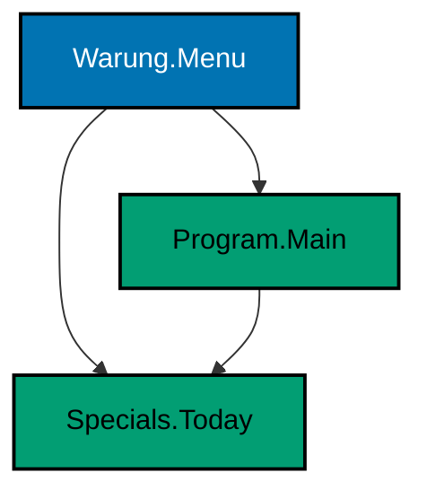

**`learning/code/ex-26-namespaces-organize-code/Program.cs`**:

```csharp
// => Example 26: Namespaces Organize Code.
// => Namespaces group related types: the menu below lives in Warung.Menu.
// => file-scoped namespace: everything in this file joins Warung.Menu
namespace Warung.Menu; // => one line scopes the whole file, no braces needed

// => explicit Program: with a namespace present, Main replaces top-level code
static class Program // => static: the entry point holds no instance state
{
    static void Main() // => Main: the runtime calls this method to start
    {
        // => fully qualified name: namespace plus type, unambiguous everywhere
        System.Console.WriteLine(Warung.Menu.Specials.Today()); // => Output: rendang
    }
}

// => Specials lives in the same namespace, so Main reaches it directly
static class Specials // => static: a bag of functions, never instantiated
{
    // => Today answers the one question the menu always asks
    public static string Today() => "rendang"; // => expression body: one line, one answer
}
```

**Output** (`learning/code/ex-26-namespaces-organize-code/expected/main.stdout.txt`):

```text
rendang
```

**Key takeaway**: File-scoped namespaces group a file's types with one line and no nesting.

**Why it matters**: Flat global namespaces collide as projects grow: two Menu types from two features cannot coexist without grouping. File-scoped namespaces add the grouping for the price of one line, keeping small files readable while giving large solutions their hierarchy. Qualifying the call shows the unambiguous form every ambiguous call can fall back to.

### Example 27: One Type per File

Small projects keep one type per file: Program starts the program while Catalog answers the data questions from beside it. This example splits the entry point from its data across two files in one build. (Concepts: co-06.)

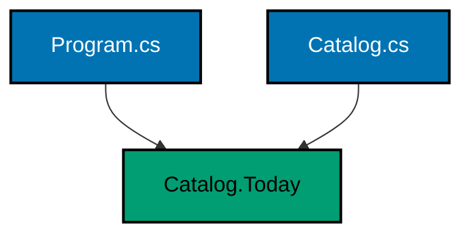

**`learning/code/ex-27-one-type-per-file/Program.cs`**:

```csharp
// => Example 27: One Type per File.
// => Small projects keep one type per file: Program starts, Catalog answers.
// => this file holds the entry point only; Catalog.cs beside it holds the data
Console.WriteLine($"today: {Catalog.Today()}"); // => Output: today: rendang
Console.WriteLine($"count: {Catalog.Dishes().Count}"); // => Output: count: 3
```

**`learning/code/ex-27-one-type-per-file/Catalog.cs`**:

```csharp
// => Catalog.cs: the data type for Example 27, living in its own file.
// => one public type per file: findable by name, reviewable in isolation
static class Catalog // => static: shared menu data, never instantiated
{
    // => Today answers the headline question the menu always asks first
    public static string Today() => "rendang"; // => expression body: one line, one answer

    // => Dishes lists the full menu: a new list per call, safe to share
    public static List<string> Dishes() => new() { "rice", "rendang", "sambal" }; // => target-typed new keeps it short
}
```

**Output** (`learning/code/ex-27-one-type-per-file/expected/main.stdout.txt`):

```text
today: rendang
count: 3
```

**Key takeaway**: One public type per file; the build globs them into a single unit.

**Why it matters**: Files named after their type are findable by name in every editor, review tool, and stack trace. The SDK-style project globs every source file automatically, so splitting costs no project bookkeeping while buying small, reviewable units. When a file holds exactly one story, diffs stay focused and merges stop colliding on shared files.

### Example 28: Access Modifiers Draw Lines

Public invites callers in, private hides state away, and internal shares across one assembly: the three lines in one small till. This example totals through the public face and notes what stays hidden. (Concepts: co-06.)

**`learning/code/ex-28-access-modifiers-draw-lines/Program.cs`**:

```csharp
// => Example 28: Access Modifiers Draw Lines.
// => public invites, private hides, internal shares within one assembly.
// => the cashier below shows all three lines in one small type
var till = new Till(); // => construct the cashier the demo operates
Console.WriteLine($"total: {till.Total()}"); // => Output: total: 37000

// => private balance stays hidden: the line below would not compile
// => Console.WriteLine(till.balance);
Console.WriteLine($"open: {Till.Open}"); // => Output: open: True

// => type declarations follow the statements in single-file order
sealed class Till // => sealed: the cashier design ends here
{
    private int _balance = 37000; // => private: only Till methods touch this
    internal static bool Open = true; // => internal: visible across this assembly

    public int Total() => _balance; // => public: the one reading the outside gets
}
```

**Output** (`learning/code/ex-28-access-modifiers-draw-lines/expected/main.stdout.txt`):

```text
total: 37000
open: True
```

**Key takeaway**: Private hides, internal shares in-assembly, public invites the world.

**Why it matters**: Every member is a promise to maintain, so the narrowest workable access keeps future refactors possible. Private fields let the type change its storage without telling anyone, while internal members share across a project's files without becoming public API. Reading the three lines in one type teaches the reflex: default to private, widen only with a reason.

### Example 29: Program Class Shape

The classic shape names its entry point: a static Program class with static Main, taking the command-line args the runtime hands over. This example counts its args and greets through a private helper. (Concepts: co-06.)

**`learning/code/ex-29-program-class-shape/Program.cs`**:

```csharp
// => Example 29: Program Class Shape.
// => The classic shape names its entry point: class Program with static Main.
// => no top-level statements here: Main below is the only entry point
static class Program // => static: the entry point holds no instance state
{
    static void Main(string[] args) // => args arrive from the command line
    {
        // => Length reports how many words followed the dll name, if any
        System.Console.WriteLine($"args: {args.Length}"); // => Output: args: 0
        // => Greet is a private helper: Main stays the only public story
        System.Console.WriteLine(Greet("Sari")); // => Output: hello, Sari
    }

    // => private helper: the greeting logic lives outside Main but beside it
    private static string Greet(string name) => $"hello, {name}"; // => one line, one answer
}
```

**Output** (`learning/code/ex-29-program-class-shape/expected/main.stdout.txt`):

```text
args: 0
hello, Sari
```

**Key takeaway**: Classic Main names the entry point and receives args; helpers stay private beside it.

**Why it matters**: Top-level statements hide the entry point, which is convenient until a reader asks where the program starts or how args arrive. The classic shape answers both questions structurally: Main is the start, its parameter is the command line. Recognizing both shapes matters because real codebases mix them, and the explicit form is where advanced entry-point needs like return codes live.

### Example 30: Target Framework Pins Runtime

TargetFramework names the runtime the binary expects: the NET10_0 symbol exists only when the project pins net10.0, so conditional compilation can prove the pin. This example prints the moniker its own build defined. (Concepts: co-07.)

**`learning/code/ex-30-target-framework-pins-runtime/Program.cs`**:

```csharp
// => Example 30: Target Framework Pins Runtime.
// => TargetFramework names the runtime: NET10_0 is defined only for net10.0.
string moniker = // => the moniker below is chosen at compile time, not runtime
#if NET10_0 // => defined by the SDK when TargetFramework is net10.0
    "net10.0"; // => matches the csproj TargetFramework exactly
#else // => any other framework would take this arm instead
    "other"; // => unreachable while the csproj pins net10.0
#endif

// => the printed moniker proves which framework compiled this binary
Console.WriteLine($"runs on: {moniker}"); // => Output: runs on: net10.0
```

**Output** (`learning/code/ex-30-target-framework-pins-runtime/expected/main.stdout.txt`):

```text
runs on: net10.0
```

**Key takeaway**: TargetFramework pins the runtime; framework symbols let code prove the pin.

**Why it matters**: Multi-targeted libraries behave differently per framework, and the wrong runtime turns new APIs into MissingMethodException at the worst moment. Pinning net10.0 in the project file makes the expectation explicit and reviewable, while the conditional symbol lets shared code adapt honestly instead of guessing. The printed moniker closes the loop from project file to running binary.

### Example 31: Stdlib Only, No Restore

No PackageReference means restore is a no-op: everything this unit touches ships in the shared framework, so it builds with no network and no supply chain. This example sorts and joins using the base class library alone. (Concepts: co-07.)

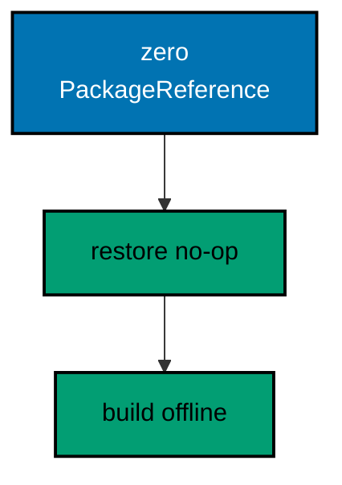

**`learning/code/ex-31-stdlib-only-no-restore/Program.cs`**:

```csharp
// => Example 31: Stdlib Only, No Restore.
// => No PackageReference means restore is a no-op: this unit builds offline.
var menu = new[] { "rice", "rendang", "sambal" }; // => array literal: BCL type, no package

// => string.Join and OrderBy both ship in the shared framework itself
string line = string.Join(" | ", menu.OrderBy(m => m, StringComparer.Ordinal)); // => sorted, joined
Console.WriteLine(line); // => Output: rendang | rice | sambal

// => the csproj beside this file names zero packages: that absence is the lesson
Console.WriteLine($"items: {menu.Length}"); // => Output: items: 3
```

**`learning/code/ex-31-stdlib-only-no-restore/app.csproj`**:

```xml
<Project Sdk="Microsoft.NET.Sdk">
  <PropertyGroup>
    <OutputType>Exe</OutputType>
    <TargetFramework>net10.0</TargetFramework>
    <Nullable>enable</Nullable>
    <ImplicitUsings>enable</ImplicitUsings>
  </PropertyGroup>
</Project>
```

**Output** (`learning/code/ex-31-stdlib-only-no-restore/expected/main.stdout.txt`):

```text
rendang | rice | sambal
items: 3
```

**Key takeaway**: Zero PackageReferences means offline builds; the standard library covers daily work.

**Why it matters**: Every dependency spends supply-chain budget: version drift, vulnerability windows, and restore failures in locked-down environments. The base class library already covers text, collections, files, time, JSON, and concurrency, so reaching outward should follow a proven gap rather than habit. This unit's project file is the template: nothing to restore, nothing to audit, nothing to break.

### Example 32: Version Pins the Build

Version in the project file stamps the assembly: readers can ask any binary what it is, and releases stop being mystery meat. This example stamps 1.2.3 and reads the stamp back at runtime. (Concepts: co-07.)

**`learning/code/ex-32-version-pins-the-build/Program.cs`**:

```csharp
// => Example 32: Version Pins the Build.
// => Version in the csproj stamps the assembly: readers can ask what they run.
var version = typeof(Program).Assembly.GetName().Version; // => Program names this assembly itself

// => the csproj pins 1.2.3: the stamp below proves the pin traveled into the binary
Console.WriteLine($"menu-api: {version}"); // => Output: menu-api: 1.2.3.0

// => top-level programs still expose their assembly through typeof(Program)
Console.WriteLine($"name: {typeof(Program).Assembly.GetName().Name}"); // => Output: name: app
```

**`learning/code/ex-32-version-pins-the-build/app.csproj`**:

```xml
<Project Sdk="Microsoft.NET.Sdk">
  <PropertyGroup>
    <OutputType>Exe</OutputType>
    <TargetFramework>net10.0</TargetFramework>
    <Nullable>enable</Nullable>
    <ImplicitUsings>enable</ImplicitUsings>
    <Version>1.2.3</Version>
  </PropertyGroup>
</Project>
```

**Output** (`learning/code/ex-32-version-pins-the-build/expected/main.stdout.txt`):

```text
menu-api: 1.2.3.0
name: app
```

**Key takeaway**: Pin Version in the project file; the assembly stamp proves the pin shipped.

**Why it matters**: Unversioned binaries turn every bug report into archaeology: nobody can say which build misbehaved. The Version property stamps the assembly at compile time, so support questions start from a fact instead of a guess. Reading the stamp back at runtime closes the loop and teaches every developer where the number lives.

### Example 33: XML Docs Travel with Build

GenerateDocumentationFile writes the triple-slash comments into an XML file beside the binary, and the program can read its own documentation back. This example documents one method and prints its summary from the generated file. (Concepts: co-06, co-12.)

**`learning/code/ex-33-xml-docs-travel-with-build/Program.cs`**:

```csharp
// => Example 33: XML Docs Travel with Build.
// => GenerateDocumentationFile writes app.xml beside the dll; this reads it back.
var doc = System.Xml.Linq.XDocument.Load(
    System.IO.Path.Combine(AppContext.BaseDirectory, "app.xml")
); // => the doc file the build generated

// => find the Today member and print the summary the triple-slash wrote
var member = doc.Descendants("member")
    .First(m => (m.Attribute("name")?.Value ?? "").Contains("Today")); // => the documented method below
Console.WriteLine(member.Element("summary")?.Value.Trim()); // => Output: Names the dish of the day.

// => type declarations follow the statements; only members carry XML docs
/// <summary>Holds the documented menu answers.</summary>
public static class Specials // => public: the doc file records visible members
{
    /// <summary>Names the dish of the day.</summary>
    public static string Today() => "rendang"; // => documented member the query finds
}
```

**Output** (`learning/code/ex-33-xml-docs-travel-with-build/expected/main.stdout.txt`):

```text
Names the dish of the day.
```

**Key takeaway**: Triple-slash comments plus the doc-file switch turn comments into queryable data.

**Why it matters**: Documentation that lives only in source rots where tooling cannot see it, while the generated XML feeds editors, doc sites, and analyzers from one source of truth. Reading the file back at runtime proves the pipeline end to end: comment, compile, artifact, query. Teams that keep this loop green get hover-docs and references for free instead of as a separate chore.

### Example 34: Debug and Release Modes

DEBUG is defined for debug builds only, so the same source prints its own mode: one run proves debug, a release build plus run proves release. This example carries both runs in one unit. (Concepts: co-07.)

**`learning/code/ex-34-debug-and-release-modes/Program.cs`**:

```csharp
// => Example 34: Debug and Release Modes.
// => DEBUG is defined for debug builds only: the same source prints its mode.
#if DEBUG // => debug builds define this symbol automatically
Console.WriteLine("mode: debug"); // => Output in the debug run: mode: debug
#else // => release builds take this arm instead
Console.WriteLine("mode: release"); // => Output in the release run: mode: release
#endif
```

**Output** (`learning/code/ex-34-debug-and-release-modes/expected/debug.stdout.txt`):

```text
mode: debug
```

**Output** (`learning/code/ex-34-debug-and-release-modes/expected/release.stdout.txt`):

```text
mode: release
```

**Key takeaway**: Build configurations change defined symbols; one source can prove both modes.

**Why it matters**: Debug-only checks, verbose logging, and test hooks must never leak into release binaries, and hoping the flags are right is not a strategy. Compiling both configurations in one unit proves the split mechanically: each transcript pins what its mode prints. This is the smallest honest build-matrix, and it generalizes to every configuration a project adds later.

### Example 35: First Check Arrange Act Assert

Every check arranges its input, acts once, then asserts the outcome: the Check helper prints PASS for held promises and throws with the name for broken ones. This example pins a two-line total and its count. (Concepts: co-08.)

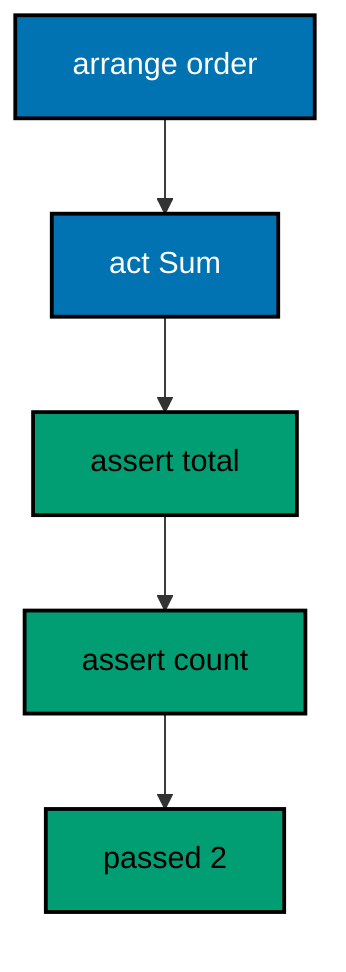

**`learning/code/ex-35-first-check-arrange-act-assert/Program.cs`**:

```csharp
// => Example 35: First Check, Arrange Act Assert.
// => Every check arranges its input, acts once, then asserts the outcome.
int passed = 0; // => counts the green checks at the end of the transcript

// => Check is the whole framework here: one helper, honest PASS lines
void Check(bool condition, string name) // => local function: condition plus name
{
    // => a failed condition throws: the transcript stops at the first red
    if (!condition) // => false means the code under check is wrong
    {
        throw new Exception($"FAIL: {name}"); // => FAIL names the broken promise
    }
    Console.WriteLine($"PASS: {name}"); // => PASS proves one promise held
    passed++; // => count the green so the summary line can report it
}

// => arrange: the order under check; act: total it; assert: compare
var order = new List<int> { 12000, 25000 }; // => arrange: rice plus rendang
int total = order.Sum(); // => act: the one behavior this check exercises
Check(total == 37000, "total sums two lines"); // => assert: 37000 is the promise

// => second check: arrange-act-assert again for the item count
Check(order.Count == 2, "order holds two lines"); // => assert on the count

// => the summary line closes the transcript with the green count
Console.WriteLine($"passed: {passed}"); // => Output: passed: 2
```

**Output** (`learning/code/ex-35-first-check-arrange-act-assert/expected/main.stdout.txt`):

```text
PASS: total sums two lines
PASS: order holds two lines
passed: 2
```

**Key takeaway**: Arrange, act once, assert; PASS lines plus a count close the transcript.

**Why it matters**: Tests without structure rot into scripts nobody trusts: setup tangles with assertions until failures point nowhere. The three-phase rhythm separates what is being set up from what is being exercised from what is promised, so a red line names its broken promise exactly. This tiny helper carries the whole convention that xUnit and NUnit scale up: same rhythm, richer runner.

### Example 36: Failing First Proves Check

A check that never fails proves nothing: run it against the old broken code to watch it go red, then fix the code and watch it go green. This example fails an off-by-one reversal before passing the fix. (Concepts: co-08.)

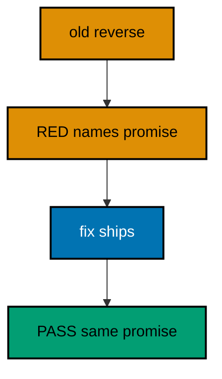

**`learning/code/ex-36-failing-first-proves-check/Program.cs`**:

```csharp
// => Example 36: Failing First Proves Check.
// => A check that never fails proves nothing: watch it fail, then fix the code.
// => the transcript below shows RED first, then GREEN after the one-line fix
try // => run the old code against the check: it must fail loudly
{
    Check(ReverseOld("rice") == "ecir", "reverse flips rice"); // => old code drops a letter
}
catch (Exception ex) // => RED: the catch prints the failure instead of crashing
{
    Console.WriteLine($"RED: {ex.Message}"); // => Output: RED: FAIL: reverse flips rice
}

// => the fix ships: the same check now runs against corrected code
Check(Reverse("rice") == "ecir", "reverse flips rice"); // => Output: PASS: reverse flips rice

// => one helper serves both runs: fail loudly, pass explicitly
void Check(bool condition, string name) // => local function shared by RED and GREEN
{
    // => false throws with the check name: the transcript shows what broke
    if (!condition) // => the old reverse trips this branch above
    {
        throw new Exception($"FAIL: {name}"); // => FAIL text becomes the RED line
    }
    Console.WriteLine($"PASS: {name}"); // => GREEN prints only when the promise holds
}

// => the old code: drops the last character, so the check fails honestly
string ReverseOld(string s) => new(s.Reverse().Skip(1).ToArray()); // => BUG: Skip(1) eats a letter

// => the fix: reverse every character, skip nothing
string Reverse(string s) => new(s.Reverse().ToArray()); // => GREEN: full reversal
```

**Output** (`learning/code/ex-36-failing-first-proves-check/expected/main.stdout.txt`):

```text
RED: FAIL: reverse flips rice
PASS: reverse flips rice
```

**Key takeaway**: Watch the check fail on old code before trusting it on the fix.

**Why it matters**: A passing check might assert nothing: a typo in the expectation can make it green forever while the bug ships. Failing first proves the check actually exercises the behavior, which is the entire point of the failing-test-first workflow real teams practice. The red-green pair in one transcript makes the proof visible instead of a remembered discipline.

### Example 37: Data Rows Drive Cases

Table checks list cases as data: one row per case carrying inputs plus promise, one loop asserting them all, so new cases add rows instead of code. This example prices three dishes from three rows. (Concepts: co-08.)

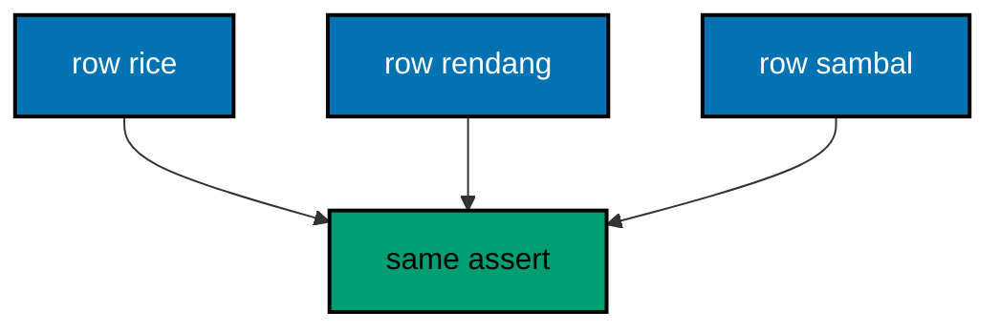

**`learning/code/ex-37-data-rows-drive-cases/Program.cs`**:

```csharp
// => Example 37: Data Rows Drive Cases.
// => Table checks list cases as data: one row per case, one loop, no copies.
var cases = new (string Dish, int Qty, int Expected)[] // => value tuples: input plus promise
{
    ("rice", 2, 24000), // => row one: two rice at 12000 each
    ("rendang", 1, 25000), // => row two: one rendang at 25000
    ("sambal", 3, 15000), // => row three: three sambal at 5000 each
};

// => the loop runs the same assertion per row: new cases add rows, not code
foreach (var c in cases) // => c carries the dish, quantity, and promise
{
    // => act per row: look up the price and multiply by the quantity
    int got = Price(c.Dish) * c.Qty; // => Price answers from the fixed menu
    // => assert per row: the receipt line must match its promise exactly
    Console.WriteLine($"{c.Dish}: {(got == c.Expected ? "PASS" : "FAIL")}"); // => Output: three PASS lines
}

// => fixed menu: the prices the rows above promise against
int Price(string dish) =>
    dish switch // => local function: dish in, price out
    {
        "rice" => 12000, // => row one depends on this price
        "rendang" => 25000, // => row two depends on this price
        "sambal" => 5000, // => row three depends on this price
        _ => 0, // => unknown dishes cost nothing in this demo
    };
```

**Output** (`learning/code/ex-37-data-rows-drive-cases/expected/main.stdout.txt`):

```text
rice: PASS
rendang: PASS
sambal: PASS
```

**Key takeaway**: Rows hold cases, one loop asserts them; adding coverage means adding rows.

**Why it matters**: Copy-pasted checks drift: the third copy gets a different assertion shape than the first, and reviewers stop reading. Data rows keep every case in the same shape by construction, so the suite grows by editing data instead of logic. This is the Theory pattern from xUnit in miniature: same assertion, many inputs, per-row verdicts that name their dish.

### Example 38: Helpers Name the Why

Named helpers say what equality means at the call site: CheckEqual compares values and prints both sides on mismatch, CheckTrue names boolean promises. This example pins a total and a name check through both helpers. (Concepts: co-08, co-14.)

**`learning/code/ex-38-helpers-name-the-why/Program.cs`**:

```csharp
// => Example 38: Helpers Name the Why.
// => Named helpers say what equality means: CheckEqual, CheckTrue, CheckFalse.
int passed = 0; // => counts the green checks the summary line reports

// => CheckEqual compares values and prints both sides on mismatch
void CheckEqual<T>(T expected, T actual, string name) // => generic: any comparable type
{
    // => EqualityComparer handles nulls and value types without special cases
    if (!EqualityComparer<T>.Default.Equals(expected, actual)) // => mismatch fails loudly
    {
        throw new Exception($"FAIL: {name}: expected {expected}, got {actual}"); // => both sides print
    }
    Console.WriteLine($"PASS: {name}"); // => the promise held: name the green
    passed++; // => count it for the summary line below
}

// => CheckTrue names boolean promises: the intent reads at the call site
void CheckTrue(bool condition, string name) // => thin wrapper with a clear name
{
    CheckEqual(true, condition, name); // => reuse: one comparison engine underneath
}

// => the checks below read like specifications, not like comparisons
CheckEqual(37000, new List<int> { 12000, 25000 }.Sum(), "total sums two lines"); // => Output: PASS
CheckTrue("rendang".Length > 3, "dish name is not empty"); // => Output: PASS

// => the summary closes the transcript with the exact green count
Console.WriteLine($"passed: {passed}"); // => Output: passed: 2
```

**Output** (`learning/code/ex-38-helpers-name-the-why/expected/main.stdout.txt`):

```text
PASS: total sums two lines
PASS: dish name is not empty
passed: 2
```

**Key takeaway**: Name helpers after the promise: CheckEqual, CheckTrue, and friends.

**Why it matters**: Bare boolean asserts force every reader to decode what equality was meant, and failure messages print nothing useful. Named helpers move the meaning to the call site and the diagnostics into the helper, so transcripts read like specifications. One generic comparison engine underneath keeps every helper honest while the names multiply to fit each promise shape.

### Example 39: Throws Means Failure Tested

CheckThrows proves the failure path: the promise is that bad input throws exactly the specified type, and silence counts as failure. This example pins the empty-order throw and the happy path beside it. (Concepts: co-08.)

**`learning/code/ex-39-throws-means-failure-tested/Program.cs`**:

```csharp
// => Example 39: Throws Means Failure Tested.
// => CheckThrows proves the failure path: the promise is that bad input throws.
int passed = 0; // => counts the green checks the summary line reports

// => CheckThrows runs the action and demands exactly the promised exception
void CheckThrows<T>(Action action, string name)
    where T : Exception // => generic over the exception type
{
    // => the action runs inside: the only question is whether it throws
    try // => run the action that must throw
    {
        action(); // => if this returns, the promise broke: no throw happened
        // => reaching here means silence: the failure path failed to fire
        throw new Exception($"FAIL: {name}: nothing thrown"); // => silence is failure here
    }
    catch (T) // => the promised type: the failure path works as specified
    {
        // => exact-type catch: wrong exception types still escape loudly
        Console.WriteLine($"PASS: {name}"); // => green: the right failure fired
        passed++; // => count it for the summary line below
    }
}

// => empty orders must throw: the kitchen refuses them loudly by contract
CheckThrows<InvalidOperationException>(() => Serve(""), "empty order throws"); // => Output: PASS

// => valid orders must not throw: the happy path still serves
Console.WriteLine(Serve("Sari")); // => Output: Sari gets 2 portions
Console.WriteLine($"passed: {passed}"); // => Output: passed: 1

// => Serve throws for empty names exactly like Example 9 taught
// => guards stay honest only while a check demands their throws
string Serve(string name) // => local function: the behavior under check
{
    // => guard throws: this is the failure the check above demands
    if (string.IsNullOrEmpty(name)) // => empty input violates the contract
    {
        throw new InvalidOperationException("name is empty"); // => the promised throw
    }
    return $"{name} gets 2 portions"; // => happy path serves plain data
}
```

**Output** (`learning/code/ex-39-throws-means-failure-tested/expected/main.stdout.txt`):

```text
PASS: empty order throws
Sari gets 2 portions
passed: 1
```

**Key takeaway**: Assert.Throws-style checks pin failure paths; unthrown promises fail loudly.

**Why it matters**: Failure paths are the least-tested code in most suites because proving a throw takes more machinery than proving a value. The generic CheckThrows makes throwing a first-class promise: the type parameter names the expected failure, and silence fails the check instead of passing it. Guards and validation only stay honest while a check demands their throws.

### Example 40: Async Checks Await

Async checks await the task first and assert after: never assert on an unstarted promise, and keep the run instant with completed tasks. This example totals asynchronously and pins the sum. (Concepts: co-08, co-09.)

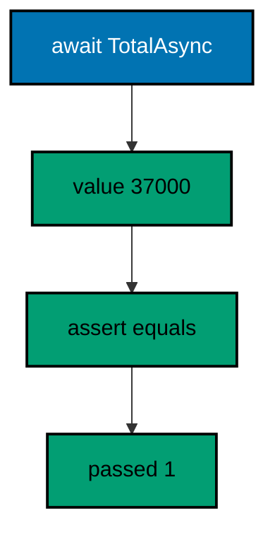

**`learning/code/ex-40-async-checks-await/Program.cs`**:

```csharp
// => Example 40: Async Checks Await.
// => Async checks await the task first: never assert on an unstarted promise.
int passed = 0; // => counts the green checks the summary line reports

// => Check awaits nothing itself: callers pass already-awaited values
void Check(bool condition, string name) // => local function: promise plus name
{
    // => false throws: the transcript stops at the first broken promise
    if (!condition) // => the awaited value decides here, synchronously
    {
        throw new Exception($"FAIL: {name}"); // => FAIL names the broken promise
    }
    Console.WriteLine($"PASS: {name}"); // => green: the awaited answer held
    passed++; // => count it for the summary line below
}

// => top-level statements can await: the check runs after the task finishes
int total = await TotalAsync(new List<int> { 12000, 25000 }); // => await first, assert after
Check(total == 37000, "async total sums two lines"); // => Output: PASS
Console.WriteLine($"passed: {passed}"); // => Output: passed: 1

// => TotalAsync pretends to fetch each line: completed tasks, no delays
async Task<int> TotalAsync(List<int> lines) // => async local function: task in, total out
{
    // => await a completed task: the shape is async, the run stays instant
    await Task.CompletedTask; // => yields once without sleeping or timing out
    return lines.Sum(); // => the same sum the sync checks assert elsewhere
}
```

**Output** (`learning/code/ex-40-async-checks-await/expected/main.stdout.txt`):

```text
PASS: async total sums two lines
passed: 1
```

**Key takeaway**: Await the task, then assert on its value; completed tasks keep it instant.

**Why it matters**: Async production code fails in ways sync tests never catch: unobserved exceptions, deadlocks from blocking waits, and assertions running before completion. Awaiting inside the check preserves the production shape while completed tasks remove timing from the transcript. This is the pattern xUnit's async tests follow at full scale: await first, assert the settled value.

### Example 41: Fake Console Captures Output

StringWriter stands in for the console: production code writes to any TextWriter, so tests point it at a fake and assert the exact text. This example captures a two-line ticket and compares it newline-exact. (Concepts: co-08.)

**`learning/code/ex-41-fake-console-captures-output/Program.cs`**:

```csharp
// => Example 41: Fake Console Captures Output.
// => StringWriter stands in for the console: write to the fake, assert the text.
var fake = new System.IO.StringWriter(); // => the fake console: captures every line

// => the code under check writes to any TextWriter, console or fake alike
fake.WriteLine("rice x2"); // => production call shape, pointed at the fake
fake.WriteLine("rendang x1"); // => second line lands in the same buffer

// => ToString freezes the buffer: the transcript below is the assertion input
string got = fake.ToString().Replace("\r\n", "\n"); // => normalize newlines: stable on every OS
string want = "rice x2\nrendang x1\n"; // => the promised ticket text, newline-exact

// => the comparison prints both sides only when the fake disagrees
Console.WriteLine(got == want ? "PASS: ticket text matches" : $"FAIL: got {got}"); // => Output: PASS
```

**Output** (`learning/code/ex-41-fake-console-captures-output/expected/main.stdout.txt`):

```text
PASS: ticket text matches
```

**Key takeaway**: Write to TextWriter, fake it with StringWriter, assert the captured text.

**Why it matters**: Console output is untestable only while code hardcodes Console: the moment output flows through an injected TextWriter, every printed line becomes assertable. StringWriter captures without files, pipes, or processes, and normalizing newlines keeps the comparison stable across operating systems. This seam is how receipt printers, loggers, and reports all become testable.

### Example 42: Slow Checks Opt Out

Slow suites read one variable: SLOW_TESTS set to 1 runs them, anything else records an honest SKIP. This example always runs its fast check and skips the 200-dish audit unless asked. (Concepts: co-08, co-13.)

**`learning/code/ex-42-slow-checks-opt-out/Program.cs`**:

```csharp
// => Example 42: Slow Checks Opt Out.
// => Slow suites read one variable: SLOW_TESTS=1 runs them, anything else skips.
string? flag = Environment.GetEnvironmentVariable("SLOW_TESTS"); // => the harness pins SLOW_TESTS=0

// => the fast check always runs: it costs nothing and guards the happy path
Console.WriteLine("PASS: rice costs 12000"); // => fast suite: always green here

// => the slow check runs only on demand: the transcript says skipped, honestly
if (flag == "1") // => opt-in: only an explicit 1 pays for the slow suite
{
    Console.WriteLine("PASS: full menu audit over 200 dishes"); // => runs only when asked
}
else // => skipped is a verdict too: recorded, never silent
{
    Console.WriteLine($"SKIP: slow suite (SLOW_TESTS={flag})"); // => Output: SKIP: slow suite (SLOW_TESTS=0)
}
```

**Output** (`learning/code/ex-42-slow-checks-opt-out/expected/main.stdout.txt`):

```text
PASS: rice costs 12000
SKIP: slow suite (SLOW_TESTS=0)
```

**Key takeaway**: Gate slow checks behind one variable; SKIP is a recorded verdict, not silence.

**Why it matters**: Suites that always run everything eventually run nothing: developers skip the whole suite when the slow part drags. One variable splits fast feedback from deep audits, and printing SKIP keeps the skipped work visible instead of forgotten. The run.yaml pins the variable, so the transcript proves which suite ran rather than leaving it to tribal memory.

### Example 43: Using Resets Fixtures

A fixture type sets up in its constructor and resets in Dispose, so each check gets a fresh menu through using and mutations never leak across checks. This example grows one fixture and proves the next starts clean. (Concepts: co-08.)

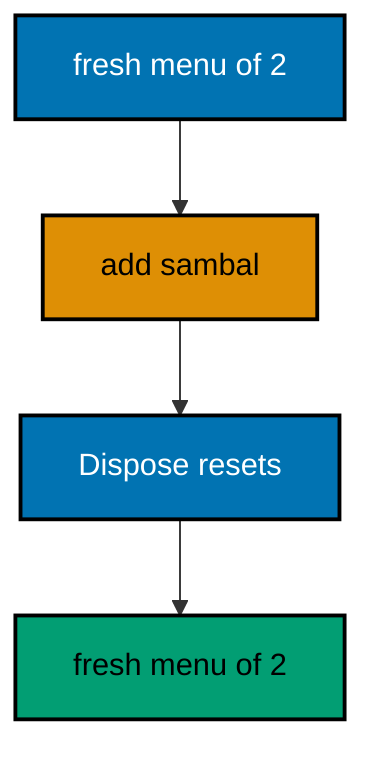

**`learning/code/ex-43-using-resets-fixtures/Program.cs`**:

```csharp
// => Example 43: Using Resets Fixtures.
// => A fixture type sets up in its constructor and resets in Dispose per check.
using (var fx = new MenuFixture()) // => first check gets a fresh two-dish menu
{
    // => mutate freely: this menu dies with the block, never leaking out
    fx.Menu.Add("sambal"); // => the check mutates its own fixture freely
    Console.WriteLine($"first sees: {fx.Menu.Count}"); // => Output: first sees: 3
} // => Dispose runs here: a fresh fixture starts below, never polluted

// => the second block starts from two: isolation made structural, not hoped
using (var fx = new MenuFixture()) // => second check starts from two again
{
    Console.WriteLine($"second sees: {fx.Menu.Count}"); // => Output: second sees: 2
}

// => the fixture owns setup plus reset: checks share the shape, never state
// => shape shared, state fresh: the rule that ends order-dependent suites
sealed class MenuFixture : IDisposable // => sealed: the fixture design ends here
{
    public List<string> Menu { get; } = new() { "rice", "rendang" }; // => fresh two-dish menu per fixture

    public void Dispose() // => reset point: release or verify here in real suites
    {
        // => nothing shared escapes: the list dies with the fixture itself
    }
}
```

**Output** (`learning/code/ex-43-using-resets-fixtures/expected/main.stdout.txt`):

```text
first sees: 3
second sees: 2
```

**Key takeaway**: Fixtures own setup plus reset; using gives each check a fresh one.

**Why it matters**: Shared mutable state between tests creates order-dependent suites where each check passes alone and fails together. Constructing a fixture per check through using makes isolation structural rather than disciplined: disposal draws the line that mutations cannot cross. This is the hand-rolled shape of xUnit's fixture interfaces, and it scales to databases and servers unchanged.

### Example 44: Sequence Equal Compares Lists

SequenceEqual compares order plus items pairwise: the same items shuffled still fail, which is exactly what ticket-order checks need. This example passes the ordered ticket and fails its shuffle. (Concepts: co-08, co-03.)

**`learning/code/ex-44-sequence-equal-compares-lists/Program.cs`**:

```csharp
// => Example 44: Sequence Equal Compares Lists.
// => SequenceEqual compares order plus items: same items shuffled still fail.
var got = new List<string> { "rice", "rendang", "sambal" }; // => the order the code produced
var want = new List<string> { "rice", "rendang", "sambal" }; // => the promised ticket order

// => SequenceEqual walks both lists pairwise: length plus every position
Console.WriteLine(got.SequenceEqual(want) ? "PASS: ticket order matches" : "FAIL: order drifted"); // => Output: PASS

// => shuffled input proves the comparison is order-sensitive, not bag-like
var shuffled = new List<string> { "rendang", "rice", "sambal" }; // => same items, wrong order
Console.WriteLine(shuffled.SequenceEqual(want) ? "PASS" : "FAIL: shuffled is not equal"); // => Output: FAIL
```

**Output** (`learning/code/ex-44-sequence-equal-compares-lists/expected/main.stdout.txt`):

```text
PASS: ticket order matches
FAIL: shuffled is not equal
```

**Key takeaway**: SequenceEqual pins order plus items; shuffles fail as they should.

**Why it matters**: Set-equality lies about sequences: tickets, logs, and ledgers are ordered, and a comparison that ignores order approves wrong output. SequenceEqual walks pairwise, so length and every position must match, which is precisely the promise an ordered transcript makes. The deliberate FAIL line in the transcript proves the comparison is order-sensitive rather than bag-like.

### Example 45: One Min for All Types

A generic method with an IComparable constraint works for every orderable type at once: one body serves ints and strings because the constraint names the power. This example takes the min of two prices and two dishes. (Concepts: co-10.)

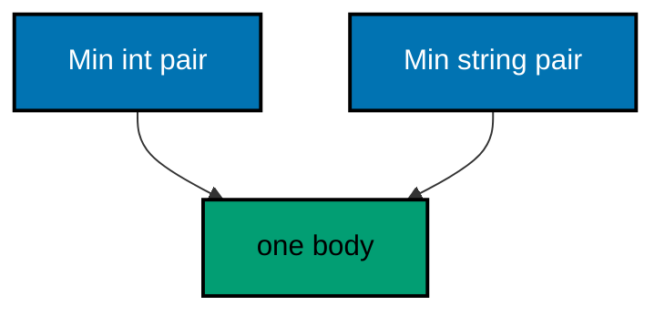

**`learning/code/ex-45-one-min-for-all-types/Program.cs`**:

```csharp
// => Example 45: One Min for All Types.
// => A generic method with IComparable works for every orderable type at once.
// => one method serves ints, strings, and dates: the constraint names the power
Console.WriteLine(Min(12000, 25000)); // => Output: 12000
Console.WriteLine(Min("rice", "rendang")); // => Output: rendang

// => generic Min: T must compare itself, or the method cannot choose
T Min<T>(T a, T b)
    where T : IComparable<T> // => the constraint is the contract
{
    // => CompareTo decides: negative means a sorts first, so a wins
    return a.CompareTo(b) <= 0 ? a : b; // => one body, every orderable T
}
```

**Output** (`learning/code/ex-45-one-min-for-all-types/expected/main.stdout.txt`):

```text
12000
rendang
```

**Key takeaway**: Constraints name the operations; one generic body serves every matching type.

**Why it matters**: Copy-pasted Min overloads for int, string, and DateTime drift apart the moment one gets a fix the others miss. The constraint turns the requirement into a compiler-checked contract, so one tested body serves every orderable type present and future. Generics earn their keep exactly here: shared logic with per-type safety, no casts, no duplication.

### Example 46: Constraints Name Operations

Constraints list what the type parameter can do: new it, compare it, or keep it a reference, and the body may only use named powers. This example constructs two plate types through a new constraint. (Concepts: co-10.)

**`learning/code/ex-46-constraints-name-operations/Program.cs`**:

```csharp
// => Example 46: Constraints Name Operations.
// => Constraints list what T can do: new it, compare it, or keep it a class.
// => NewPlate needs new(): the factory promise lives in the constraint
// => callers name the type, the constraint guarantees the construction
Console.WriteLine(NewPlate<Plate>().Label); // => Output: empty plate
Console.WriteLine(NewPlate<Special>().Label); // => Output: rendang special

// => new() promises a parameterless constructor: the body can construct T
// => without the constraint this line would not compile: power must be named
T NewPlate<T>()
    where T : new() // => the constraint unlocks the new expression
{
    return new T(); // => legal only because new() names the power
}

// => types follow the statements; each honors the new() promise differently
class Plate // => plain plate: the default constructor suffices
{
    public string Label => "empty plate"; // => expression body: one line, one answer
}

class Special // => special: its constructor sets the label itself
{
    public string Label { get; } = "rendang special"; // => initializer runs in new()
}
```

**Output** (`learning/code/ex-46-constraints-name-operations/expected/main.stdout.txt`):

```text
empty plate
rendang special
```

**Key takeaway**: where clauses unlock operations; new() promises constructibility.

**Why it matters**: Unconstrained type parameters can do almost nothing: no construction, no comparison, no operators. Each constraint adds back one named power, so the signature documents exactly what the body needs instead of discovering it through compiler errors. Reading constraints first tells you what a generic method demands before you read what it does.

### Example 47: Generic Collections Hold Anything

List and Dictionary take any type argument: one collection shape serves strings, ints, and pairs without a single cast. This example runs a price table, a stack, and a sorted key listing. (Concepts: co-10, co-03.)

**`learning/code/ex-47-generic-collections-hold-anything/Program.cs`**:

```csharp
// => Example 47: Generic Collections Hold Anything.
// => List and Dictionary take any T: one collection shape, every item type.
var prices = new Dictionary<string, int> // => string keys, int values: T named twice
{
    ["rice"] = 12000, // => add through the indexer: upsert in one move
    ["rendang"] = 25000, // => second pair joins the same table
};

// => Keys reports the table contents: sorted here for a stable transcript
Console.WriteLine(string.Join(",", prices.Keys.OrderBy(k => k, StringComparer.Ordinal))); // => Output: rendang,rice

// => Stack is last-in-first-out: the last plate stacked serves first
var stack = new Stack<string>(); // => generic stack of dish names
stack.Push("rice"); // => first in sits at the bottom
stack.Push("rendang"); // => last in sits on top, served first
Console.WriteLine(stack.Pop()); // => Output: rendang
```

**Output** (`learning/code/ex-47-generic-collections-hold-anything/expected/main.stdout.txt`):

```text
rendang,rice
rendang
```

**Key takeaway**: One generic collection shape holds every type; no casts anywhere.

**Why it matters**: Pre-generic collections stored objects and cast on every read, which moved type errors from compile time to runtime. Type arguments pin the item type once, so the compiler rejects the wrong dish at the call site instead of the runtime rejecting it mid-service. Learning the five shapes by heart covers nearly every in-memory need without a custom container.

### Example 48: Inference Keeps Calls Clean

The compiler infers type arguments from the call's arguments: write Swap once with T, call it plainly, and both sides stay readable. This example swaps two dishes twice, inferred then explicit. (Concepts: co-10.)

**`learning/code/ex-48-inference-keeps-calls-clean/Program.cs`**:

```csharp
// => Example 48: Inference Keeps Calls Clean.
// => The compiler infers T from the arguments: write Swap once, call it plainly.
string first = "rice"; // => two strings to swap: T infers as string
string second = "rendang"; // => the swap below exchanges these two
Swap(ref first, ref second); // => no type arguments: string is inferred

// => inference read the arguments: first now holds rendang, second holds rice
Console.WriteLine($"{first},{second}"); // => Output: rendang,rice

// => explicit arguments still work: the noisy form means the same thing
Swap<string>(ref first, ref second); // => explicit T: swaps them back again
Console.WriteLine($"{first},{second}"); // => Output: rice,rendang

// => ref passes the variables themselves: the swap sticks after the call
void Swap<T>(ref T a, ref T b) // => local function: generic over any T
{
    // => tuple deconstruction swaps without any temporary variable
    (a, b) = (b, a); // => right side reads first, then both assign at once
}
```

**Output** (`learning/code/ex-48-inference-keeps-calls-clean/expected/main.stdout.txt`):

```text
rendang,rice
rice,rendang
```

**Key takeaway**: Type arguments infer from call arguments; write them only when inference fails.

**Why it matters**: Explicit type arguments on every generic call bury the call's meaning under angle brackets, especially for nested generics. Inference reads the arguments you already wrote, so calls stay as clean as their non-generic twins while keeping full type safety. Knowing the explicit form still matters for the cases inference cannot solve, like conversions between the arguments.

### Example 49: Struct Copies, Class Shares

Assigning a struct copies the whole value while assigning a class shares the one heap object: the same assignment shape means opposite things. This example mutates a copy and an alias side by side. (Concepts: co-11.)

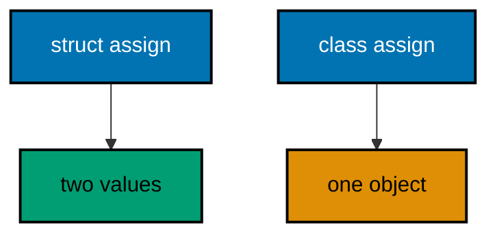

**`learning/code/ex-49-struct-copies-class-shares/Program.cs`**:

```csharp
// => Example 49: Struct Copies, Class Shares.
// => Assigning a struct copies the value; assigning a class shares the object.
var sari = new Serving { Dish = "rice", Qty = 2 }; // => struct value on the stack
var same = sari; // => struct assignment copies every field into same
same.Qty = 9; // => mutating the copy leaves the original untouched

// => sari still holds 2: the copy took its own path at assignment
Console.WriteLine($"struct kept: {sari.Qty}"); // => Output: struct kept: 2
var order = new Order { Dish = "rice", Qty = 2 }; // => class instance on the heap
var alias = order; // => class assignment copies the reference, not the dish
alias.Qty = 9; // => mutating through the alias mutates the one object

// => order reads 9: alias and order name the same heap object
Console.WriteLine($"class shared: {order.Qty}"); // => Output: class shared: 9

// => types follow the statements: value shape first, reference shape second
struct Serving // => struct: assignment copies the whole value
{
    public string Dish; // => mutable field: the demo mutates copies freely
    public int Qty; // => copied alongside Dish on every assignment
}

class Order // => class: assignment shares the single instance
{
    public string Dish = ""; // => default keeps the warnings quiet
    public int Qty; // => one Qty cell shared by every alias
}
```

**Output** (`learning/code/ex-49-struct-copies-class-shares/expected/main.stdout.txt`):

```text
struct kept: 2
class shared: 9
```

**Key takeaway**: Struct assignment copies; class assignment aliases; mutations prove which.

**Why it matters**: This is the semantic split behind half of all C# aliasing bugs: developers mutate through what they believe is a copy and corrupt shared state, or copy what they meant to share and lose updates. Choosing struct for small values and class for identity makes the assignment shape match the intent. The two transcripts side by side turn the abstract rule into muscle memory.

### Example 50: Readonly Record With

The with expression copies a record while changing named fields: the original survives untouched and the sibling carries the single change. This example discounts a plate while keeping the original price. (Concepts: co-11.)

**`learning/code/ex-50-readonly-record-with/Program.cs`**:

```csharp
// => Example 50: Readonly Record With.
// => with copies a record while changing named fields: the original survives.
var today = new Plate("rendang", 25000); // => the original record, immutable

// => with builds a sibling: price changes, dish carries over, today untouched
var promo = today with
{
    Price = 20000,
}; // => copy plus one named change
Console.WriteLine($"{today.Dish} {today.Price}"); // => Output: rendang 25000
Console.WriteLine($"{promo.Dish} {promo.Price}"); // => Output: rendang 20000

// => record declaration follows the statements in single-file order
record Plate(string Dish, int Price); // => positional record: init-only by default
```

**Output** (`learning/code/ex-50-readonly-record-with/expected/main.stdout.txt`):

```text
rendang 25000
rendang 20000
```

**Key takeaway**: with copies plus named changes; originals survive every variation.

**Why it matters**: Mutating shared records to make a variation corrupts every reader holding the original, which is how promo prices leak into regular receipts. Non-destructive mutation builds the variation as a new value, so the original stays trustworthy for everyone else. This is the immutable-update pattern that makes concurrent and audited code safe by construction.

### Example 51: Record Equals by Value

Records compare by value while classes compare by reference: same fields means equal for records, and different objects means unequal for classes. This example proves both rules in four lines. (Concepts: co-11.)

**`learning/code/ex-51-record-equals-by-value/Program.cs`**:

```csharp
// => Example 51: Record Equals by Value.
// => Records compare by value: same fields means equal, whatever the instance.
var first = new Dish("rendang", 25000); // => first instance with these fields
var second = new Dish("rendang", 25000); // => second instance, same fields

// => == on records answers by value: two instances, one shared meaning
Console.WriteLine(first == second); // => Output: True

// => classes answer by reference: identical fields still mean different objects
var a = new Plate("rendang"); // => one heap object named a
var b = new Plate("rendang"); // => another heap object with the same dish
Console.WriteLine(a == b); // => Output: False

// => types follow the statements: value semantics first, reference second
record Dish(string Name, int Price); // => record: equality over every field

class Plate // => class: equality over identity unless overridden
{
    public string Dish; // => same data shape, opposite equality rule

    public Plate(string dish) => Dish = dish; // => constructor sets the dish
}
```

**Output** (`learning/code/ex-51-record-equals-by-value/expected/main.stdout.txt`):

```text
True
False
```

**Key takeaway**: Records equal by value; classes equal by identity unless they override.

**Why it matters**: Value objects like dishes, prices, and tickets should compare by content: two identical tickets are the same ticket for business purposes. Hand-writing Equals plus GetHashCode for every such type is sixteen lines of drift-prone ceremony that records generate correctly. Reserving classes for identity keeps the equality rule honest on both sides of the split.

### Example 52: Yield Builds Lazy Pipelines

Yield return streams items one pull at a time: stopping after two plates leaves the third uncooked, and the counter proves the pipeline ran only what the loop demanded. This example serves two and counts two cooked. (Concepts: co-03, co-10.)

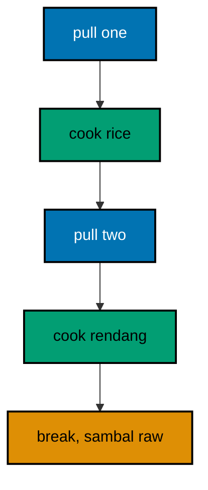

**`learning/code/ex-52-yield-builds-lazy-pipelines/Program.cs`**:

```csharp
// => Example 52: Yield Builds Lazy Pipelines.
// => yield return streams items: stopping after two leaves the third uncooked.
int cooked = 0; // => counts the dishes the iterator actually prepared
int served = 0; // => counts the plates the loop below accepted

// => two counters tell the story: pulls accepted versus dishes cooked
// => the loop stops after two: the third yield never runs, laziness proven
foreach (string dish in StreamMenu()) // => the loop pulls; the iterator yields
{
    Console.WriteLine($"served: {dish}"); // => Output: served: rice, served: rendang
    // => two accepted ends the pulls: the iterator pauses forever after
    if (++served == 2) // => two plates accepted: stop pulling from the stream
    {
        break; // => break abandons the iterator: sambal never cooks
    }
}

// => cooked counts two: the pipeline ran only what the loop demanded
Console.WriteLine($"cooked: {cooked}"); // => Output: cooked: 2

// => iterator method: each yield pauses until the loop asks for more
IEnumerable<string> StreamMenu() // => local iterator: lazy by construction
{
    cooked++; // => side effect proves when each dish actually cooks
    yield return "rice"; // => first pull cooks rice, then pauses here
    cooked++; // => runs only when the loop pulls the second plate
    yield return "rendang"; // => second pull cooks rendang, then pauses
    cooked++; // => unreachable: the break above stopped the pulls
    yield return "sambal"; // => never cooked: laziness you can count
}
```

**Output** (`learning/code/ex-52-yield-builds-lazy-pipelines/expected/main.stdout.txt`):

```text
served: rice
served: rendang
cooked: 2
```

**Key takeaway**: Iterators cook on pull; early exits leave the rest unrun and countable.

**Why it matters**: Eager pipelines cook the whole menu before serving the first plate, which wastes work whenever the consumer stops early. Lazy iterators invert the control: the loop's pulls drive the cooking, so Take-style cutoffs skip work that never mattered. The side-effect counter makes the laziness observable instead of theoretical, which is how you learn to trust deferred shapes.

### Example 53: Frozen Lookup Is Fast

FrozenDictionary snapshots a mutable builder into a read-optimized table: built once for reads, never locked, ideal for hot lookup paths. This example freezes a three-dish menu and reads it back. (Concepts: co-11, co-15.)

**`learning/code/ex-53-frozen-lookup-is-fast/Program.cs`**:

```csharp
// => Example 53: Frozen Lookup Is Fast.
// => FrozenDictionary freezes a lookup table for reads: built once, read fast.
var menu = new Dictionary<string, int> // => mutable builder first, frozen second
{
    ["rice"] = 12000, // => entries land in the builder like any dictionary
    ["rendang"] = 25000, // => second entry joins the builder table
    ["sambal"] = 5000, // => third entry completes the menu
};

// => ToFrozenDictionary snapshots the builder: reads after this never lock
var frozen = System.Collections.Frozen.FrozenDictionary.ToFrozenDictionary(menu); // => frozen: optimized for reads

// => lookups hit the frozen table: same answers, faster shape for hot paths
Console.WriteLine(frozen["rendang"]); // => Output: 25000

// => Count survives the freeze: three entries traveled into the snapshot
Console.WriteLine($"items: {frozen.Count}"); // => Output: items: 3
```

**Output** (`learning/code/ex-53-frozen-lookup-is-fast/expected/main.stdout.txt`):

```text
25000
items: 3
```

**Key takeaway**: Freeze read-heavy tables once; lookups stay fast and lock-free.

**Why it matters**: Dictionaries pay for mutability on every read: buckets sized for growth, version checks, and lock contention under sharing. Menus, routes, and configuration freeze after startup, so snapshotting them into a read-optimized shape removes that tax exactly where traffic is highest. Building mutable then freezing keeps construction ergonomic while reads take the fast path.
