Examples 54-78 survey the professional edges: concurrency primitives first (Examples 54-61), covering Futures, async-await, Future.wait, streams, stream operators, broadcast flows, async-star generators, and StreamController bridges; then tooling, linting, and style (Examples 62-70), covering the toolchain pin, format checks, analyzer verdicts, naming cases, doc coverage, const preference, live lints, import bands, and analysis options; finally reading idiomatic code (Examples 71-78), from shape-first reading through pipelines, Result chains, event buses, retry patterns, caches, extensions, and the five-line explanation drill. Every example is a complete, runnable Dart program under `learning/code/`; run each with the command in its own `run.yaml`.

---

### Example 54: Futures Are Values for Later

A Future is a value that has not arrived yet: then stages the next step and catchError stages the recovery. This example chains a stocked count into a sentence and recovers a missing item through the failure road (Concepts: co-09.)

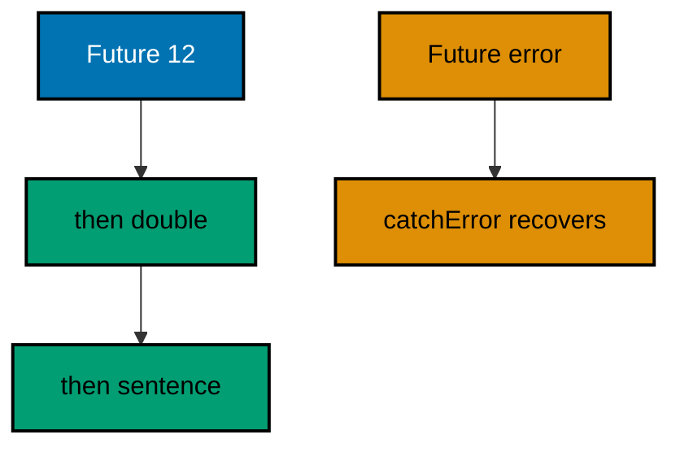

**`learning/code/ex-54-futures-values-for-later/main.dart`**:

```dart
// Example 54: Futures Are Values for Later.
//
// A Future is a value that has not arrived yet: .then stages the next
// step, .catchError stages the recovery, and the chain reads top to
// bottom while running inside-out. Already-completed futures keep every
// run ordered and instant, which is why this survey never waits on a
// clock, a socket, or a timer.
void main() async {
  // => main is async: awaits sequence the two roads in transcript order
  // => the ledger as a later-value: completed before the chain is built
  final stock = Future.value(12); // => already done: ordering stays fixed
  // => then stages the doubling: runs when the twelve arrives, in order
  final doubled =
      await stock.then((sacks) => sacks * 2); // => 24, awaited first
  print('oat: $doubled sacks'); // => Output: oat: 24 sacks
  // => the failure road: a completed error carries the miss instead
  final missing = Future<int>.error(Exception('salt unstocked'));
  // => catchError stages the recovery: the miss becomes a value again
  final answered = await missing.catchError((e) => -1); // => -1 marks it
  // => recovered values rejoin the road: printed second, in fixed order
  print('salt: $answered'); // => Output: salt: -1
  // => both roads settle into one ledger: stocked plus recovered combined
  final combined = doubled + answered; // => 24 plus -1: the miss debits
  // => the combined count: the day's honest total across both roads
  print('ledger: $combined'); // => Output: ledger: 23
}
```

**Output** (`learning/code/ex-54-futures-values-for-later/expected/main.stdout.txt`):

```text
oat: 24 sacks
salt: -1
ledger: 23
```

**Key takeaway**: Chain then for values and catchError for failures; completed futures keep runs ordered.

**Why it matters**: The chain separates staging from running: steps read in story order while the event loop executes them inside-out.

### Example 55: Async-Await Reads Sequentially

Async functions pause at await and resume with the value, so dependent fetches read as plain sequence instead of nested thens. This example composes count, doubling, and pricing into one daily report line (Concepts: co-09.)

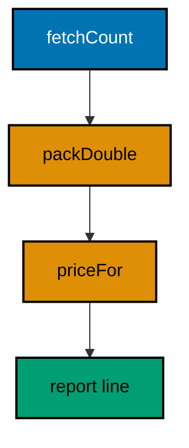

**`learning/code/ex-55-async-await-sequential/main.dart`**:

```dart
// Example 55: Async-Await Reads Sequentially.
//
// Async functions pause at await and resume with the value, so three
// dependent fetches read as three lines instead of three nested thens.
// The function returns a Future of its body's value automatically, and
// callers await it the same way, composing async work like sync prose.
void main() async {
  // => main is async: the three fetches below read as plain sequence
  final report = await dailyReport(); // => pauses twice inside, resumes whole
  // => the composed sentence: fetched, doubled, and priced in order
  print(report); // => Output: oat: 24 sacks at 50
}

// dailyReport composes three dependent fetches into one sentence.
// => async: every await pauses here and resumes with the fetched value
// => returns Future<String>: the body returns String, async wraps the rest
Future<String> dailyReport() async {
  // => first fetch: the count the next two steps both depend on
  final sacks = await fetchCount(); // => pauses, resumes with twelve
  // => second fetch: doubles the count it just received, sequentially
  final doubled = await packDouble(sacks); // => pauses, resumes with 24
  // => third fetch: prices the doubled count the line before produced
  final price = await priceFor(doubled); // => pauses, resumes with fifty
  // => the sentence: three awaits collapse into one composed line
  return 'oat: $doubled sacks at $price'; // => async wraps into a Future
}

// fetchCount delivers twelve: the completed future behind the first await.
Future<int> fetchCount() => Future.value(12); // => instant, ordered, fixed

// packDouble doubles the count it receives: the dependent second step.
Future<int> packDouble(int sacks) => Future.value(sacks * 2); // => 24

// priceFor prices the doubled count: the dependent third step.
Future<int> priceFor(int sacks) => Future.value(sacks * 2 + 2); // => 50
```

**Output** (`learning/code/ex-55-async-await-sequential/expected/main.stdout.txt`):

```text
oat: 24 sacks at 50
```

**Key takeaway**: Await each dependent step in turn; let async wrap the composed result.

**Why it matters**: Nesting thens inside thens hides the sequence; await restores the top-to-bottom reading that sequential work deserves.

### Example 56: Future.wait Joins Independent Branches

Independent futures run together and Future.wait gathers their values in order. This example joins three stall counts into one list and totals the market day (Concepts: co-09.)

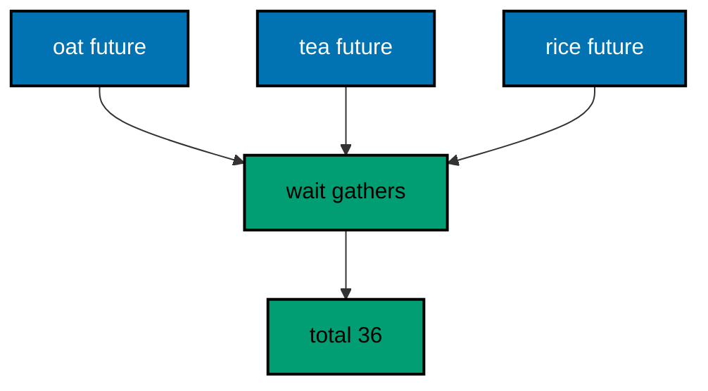

**`learning/code/ex-56-future-wait-joins/main.dart`**:

```dart
// Example 56: Future.wait Joins Independent Branches.
//
// Independent futures run together and Future.wait gathers their values
// in order, so three stalls report as one list when the slowest lands.
// EagerError false collects every branch's outcome; the default true
// fails fast on the first error, and this example shows the gathering
// shape with three healthy branches.
void main() async {
  // => three independent counts: no branch awaits another before starting
  final oat = Future.value(12); // => east stall: instant, ordered
  final tea = Future.value(4); // => west stall: instant, ordered
  final rice = Future.value(20); // => north stall: instant, ordered
  // => wait gathers in list order: oat, tea, rice, whatever lands first
  final counts = await Future.wait([oat, tea, rice]); // => [12, 4, 20]
  // => the gathered list: positions match the input order, always
  print('counts: $counts'); // => Output: counts: [12, 4, 20]
  // => totals fold the gathered branch values: one pass over the joined
  final total = counts.fold(0, (sum, c) => sum + c); // => 36 across stalls
  // => the day total: joined first, summed second, in that fixed order
  print('total: $total'); // => Output: total: 36
}
```

**Output** (`learning/code/ex-56-future-wait-joins/expected/main.stdout.txt`):

```text
counts: [12, 4, 20]
total: 36
```

**Key takeaway**: Start independent branches together; gather with Future.wait in input order.

**Why it matters**: Awaiting branches one by one serializes what could run together; wait joins them so the slowest branch sets the pace, not the sum.

### Example 57: Streams Deliver Many Values Over Time

A Stream is a Future repeated: many values arrive in order through one subscription. This example drives a four-stop delivery route through listen and records every arrival (Concepts: co-09.)

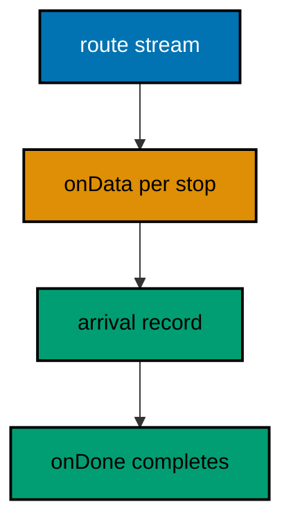

**`learning/code/ex-57-streams-deliver-many/main.dart`**:

```dart
// Example 57: Streams Deliver Many Values Over Time.
//
// A Stream is a Future repeated: many values arrive in order through one
// subscription, and listen stages onData per value with onDone at the
// end. FromIterable builds a deterministic stream from a fixed list, so
// the survey studies the shape without waiting on clocks or sockets.
void main() async {
  // => the delivery route as a stream: four stops, fixed order, instant
  final route = Stream.fromIterable(['oat', 'tea', 'rice', 'salt']);
  // => delivered collects the stops the listener actually sees, in order
  final delivered = <String>[]; // => grows per onData: the arrival record
  // => listen stages the handlers: onData per stop, onDone at the end
  await route.listen((stop) {
    // => onData: runs once per arriving value
    // => each stop joins the record: arrival order preserved exactly
    delivered.add(stop); // => oat, then tea, rice, salt, in turn
  }).asFuture(); // => asFuture waits the onDone: the listen completes whole
  // => the arrival record: four stops in route order, none lost, none moved
  print('route: ${delivered.join('>')}'); // => Output: route: oat>tea>rice>salt
  // => length proves completeness: the stream ended exactly where listed
  print('stops: ${delivered.length}'); // => Output: stops: 4
}
```

**Output** (`learning/code/ex-57-streams-deliver-many/expected/main.stdout.txt`):

```text
route: oat>tea>rice>salt
stops: 4
```

**Key takeaway**: Subscribe once with listen; collect per value in onData and finish in onDone.

**Why it matters**: One subscription carries the whole sequence: the shape suits deliveries, readings, and events that arrive over time instead of all at once.

### Example 58: Stream Operators Reshape the Flow

Where, map, take, and fold reshape a stream without touching its source: operators return new streams and the terminal fold pulls once. This example filters, converts, caps, and totals sack weights (Concepts: co-09.)

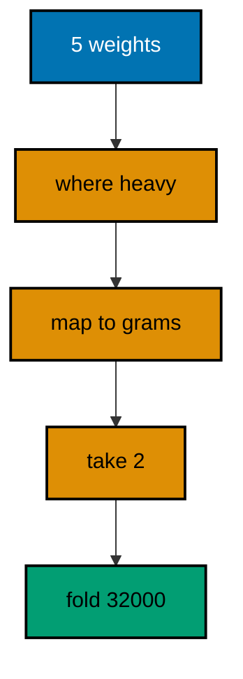

**`learning/code/ex-58-stream-operators-reshape/main.dart`**:

```dart
// Example 58: Stream Operators Reshape the Flow.
//
// Where, map, take, and fold reshape a stream without touching its
// source: each operator returns a new stream, and the terminal fold
// pulls values through the whole chain exactly once. Pipelines compose
// from small named stages, and the source list never learns it was
// filtered, converted, and totaled on its way through.
void main() async {
  // => sack weights in kilograms: the raw readings the pipeline refines
  final weights = Stream.fromIterable([12, 7, 20, 5, 15]);
  // => where keeps the heavy sacks: lazy stage one, nothing pulled yet
  final heavy = weights.where((w) => w >= 10); // => 12, 20, 15 survive
  // => map converts survivors to grams: lazy stage two, still nothing
  final grams = heavy.map((w) => w * 1000); // => 12000, 20000, 15000
  // => take caps the flow: lazy stage three, at most the first two
  final capped = grams.take(2); // => 12000, 20000: the third never pulls
  // => fold terminals the chain: pulls twice, sums, completes the stream
  final total = await capped.fold(0, (sum, g) => sum + g); // => 32000
  // => one pull through three stages: filter, convert, cap, then total
  print('capped grams: $total'); // => Output: capped grams: 32000
}
```

**Output** (`learning/code/ex-58-stream-operators-reshape/expected/main.stdout.txt`):

```text
capped grams: 32000
```

**Key takeaway**: Compose where, map, and take into a pipeline; terminal with fold exactly once.

**Why it matters**: Operators return streams, not answers, so stages snap together freely — and the source never learns how many pipelines drank from it.

### Example 59: Broadcast Streams Share One Flow

A single-subscription stream allows one listener; asBroadcastStream opens the same flow to many. This example totals and records one harvest feed through two listeners that share every value (Concepts: co-09.)

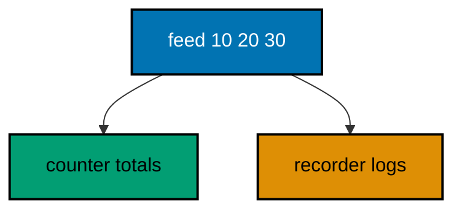

**`learning/code/ex-59-broadcast-shares-flow/main.dart`**:

```dart
// Example 59: Broadcast Streams Share One Flow.
//
// A single-subscription stream allows one listener; asBroadcastStream
// opens the same flow to many, and each listener receives every value
// from the moment it subscribes. Two listeners over one harvest feed
// prove the sharing: the counter totals while the recorder logs, and
// neither starves the other of a single value.
void main() async {
  // => the harvest feed: one stream, three sack counts, fixed order
  final feed = Stream.fromIterable([10, 20, 30]).asBroadcastStream();
  // => the counter's total: grows per value the first listener sees
  var total = 0; // => starts at zero: no value has flowed yet
  // => the recorder's log: grows per value the second listener sees
  final log = <int>[]; // => empty: no value has been recorded yet
  // => first listener totals: every value adds to the running sum
  final counting = feed.listen((sacks) {
    // => listener one: the counter
    // => each arrival adds: the sum tracks the feed exactly
    total += sacks; // => 10, then 30, then 60 as values arrive
  });
  // => second listener records: every value lands in the log in order
  final recording = feed.listen(log.add); // => listener two: the recorder
  // => both subscriptions complete: the shared flow ends for everyone
  await counting.asFuture(); // => first listener saw all three values
  // => second completion: the recorder logged the same three values
  await recording.asFuture(); // => shared flow: neither starved the other
  // => the counter proves sharing: sixty across the three arrivals
  print('total: $total'); // => Output: total: 60
  // => the log proves order: same three values, same sequence, no loss
  print('log: $log'); // => Output: log: [10, 20, 30]
}
```

**Output** (`learning/code/ex-59-broadcast-shares-flow/expected/main.stdout.txt`):

```text
total: 60
log: [10, 20, 30]
```

**Key takeaway**: Broadcast to share; every listener receives every value from its subscribe moment.

**Why it matters**: One flow with many watchers beats one flow per watcher: the source stays single while counters, loggers, and displays each drink fully.

### Example 60: Async-Star Generates Lazily

Async-star functions yield values one at a time as the listener pulls, so long sequences cost one value of memory. This example walks a delivery route fully once and stops it early once (Concepts: co-09.)

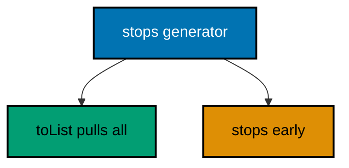

**`learning/code/ex-60-async-star-lazy/main.dart`**:

```dart
// Example 60: Async-Star Generates Lazily.
//
// Async* functions yield values one at a time as the listener pulls, so
// long sequences cost one value of memory no matter their length. Each
// yield pauses the generator until the next request arrives, which makes
// async* the shape for paged reads, sensor flows, and any sequence too
// long to build eagerly.
void main() async {
  // => the route generator yields four stops: pulled, never pushed eager
  final route = stops(); // => no stop exists yet: generation waits for pull
  // => collect pulls the whole route: four yields, four arrivals, in order
  final visited = await route.toList(); // => terminal pull: runs the body
  // => the visited order: yields arrive exactly as the body ordered them
  print(
      'visited: ${visited.join('>')}'); // => Output: visited: mill>depot>stall>home
  // => firstWhere pulls only until satisfied: the generator stops early
  final depot = await stops().firstWhere((s) => s.startsWith('d'));
  // => depot arrives after two yields: mill, then depot, then the pull ends
  print('found: $depot'); // => Output: found: depot
}

// stops yields the delivery route one stop at a time, lazily.
// => async*: yields pause the body until the listener asks for more
// => the body runs on pull: no listener, no stops, no cost anywhere
Stream<String> stops() async* {
  // => first yield: pauses here until the listener requests stop two
  yield 'mill'; // => the route start: pulled first, always
  // => second yield: resumes on request, pauses again right after
  yield 'depot'; // => Pulled second: firstWhere stops the pull here
  // => third yield: reached only by listeners that kept pulling past depot
  yield 'stall'; // => toList pulls through: this yield runs for visited
  // => final yield: the route end, pulled last by the complete collection
  yield 'home'; // => home: the fourth arrival closing the route
}
```

**Output** (`learning/code/ex-60-async-star-lazy/expected/main.stdout.txt`):

```text
visited: mill>depot>stall>home
found: depot
```

**Key takeaway**: Yield per value; pull per need; early termination stops the generator honestly.

**Why it matters**: Eager lists pay for values nobody reads; lazy generators produce exactly what the listener pulls and stop the moment it stops asking.

### Example 61: StreamController Bridges Callbacks into Streams

Callback APIs push values on their own schedule; a StreamController catches each push with add and exposes the orderly stream behind it. This example bridges three legacy weighing callbacks into one pulled stream (Concepts: co-09, co-13.)

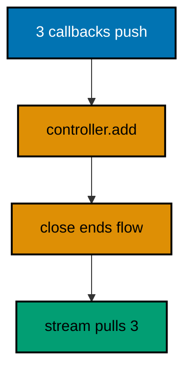

**`learning/code/ex-61-controller-bridges-callbacks/main.dart`**:

```dart
// Example 61: StreamController Bridges Callbacks into Streams.
//
// Callback APIs push values on their own schedule; a StreamController
// catches each push with add and exposes the orderly stream behind it.
// Closing the controller ends the stream when the last callback fires,
// bridging the push world into the pull world the rest of the course
// already knows. At the interop boundary the same bridge carries native
// callbacks (dart:ffi) and script events (dart:js_interop) into streams;
// those runtimes are surveyed here, not run, and the pattern is the takeaway.
import 'dart:async'; // => StreamController, the callback-to-stream bridge

void main() async {
  // => the controller: callbacks push in, the stream flows out, in order
  final controller = StreamController<String>(); // => single-subscriber bridge
  // => subscribe FIRST: the pull waits before any push arrives below
  final pulled = controller.stream.toList(); // => terminal pull, staged early
  // => three legacy callbacks fire: the push world, unordered by nature
  final callbacks = ['oat weighed', 'tea weighed', 'rice weighed'];
  // => each callback adds to the controller: pushes become stream values
  for (final call in callbacks) {
    // => for-in: the push world enumerated
    // => add catches the push: the bridge takes custody of the value
    controller.add(call); // => order kept: adds sequence the pushes
  }
  // => close queues done after the buffered values: the pull drains them
  controller.close(); // => un-awaited: the toList below owns completion
  // => the bridged stream delivers: three values, pushed then pulled
  final delivered = await pulled; // => values first, done last, in order
  // => arrival order matches push order: the bridge preserves sequence
  print(
      'bridged: ${delivered.join(' | ')}'); // => Output: bridged: oat weighed | tea weighed | rice weighed
}
```

**Output** (`learning/code/ex-61-controller-bridges-callbacks/expected/main.stdout.txt`):

```text
bridged: oat weighed | tea weighed | rice weighed
```

**Key takeaway**: Add callbacks into the controller, close when they end, and pull the stream.

**Why it matters**: The bridge is the interop pattern: native and script callbacks cross into Dart the same way, through a controller that turns pushes into an orderly pullable flow.

### Example 62: The Toolchain Version Pins the Behavior

Platform.version names the Dart release running the code, so lessons assert the floor they were proven against. This example parses its own toolchain release and pins the Dart 3 generation this course speaks (Concepts: co-12.)

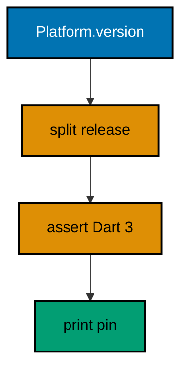

**`learning/code/ex-62-toolchain-version-pins/main.dart`**:

```dart
// Example 62: The Toolchain Version Pins the Behavior.
//
// Platform.version names the Dart release running the code, so lessons
// can assert the floor they were proven against instead of hoping. The
// pinned toolchain in apps/ayokoding-cli is the single source of truth:
// this course runs Dart 3.13.5 there, and every example below claims no
// behavior that release does not have.
import 'dart:io'; // => Platform, the handle on the running toolchain

void main() {
  // => the full version string: release, channel, date, and platform
  final full = Platform.version; // => e.g. 3.13.5 (stable) ... on linux_x64
  // => the release number rides first: split on spaces, take the head
  final release = full.split(' ').first; // => 3.13.5: the behavior pin
  // => major and minor name the language generation the code targets
  final generation = release.split('.').take(2).join('.'); // => 3.13 here
  // => the floor assert: this course speaks Dart 3, never Dart 2 habits
  assert(release.startsWith('3.'), 'course needs Dart 3, got $release');
  // => generation pinned: recorded by the harness for this toolchain
  print('dart: $generation'); // => Output: dart: 3.13
  // => full release printed: the exact behavior pin behind every example
  print('release: $release'); // => Output: release: 3.13.5
}
```

**Output** (`learning/code/ex-62-toolchain-version-pins/expected/main.stdout.txt`):

```text
dart: 3.13
release: 3.13.5
```

**Key takeaway**: Read Platform.version; assert the generation; record the release with the output.

**Why it matters**: Version-specific claims need a version on record; parsing it at runtime ties every behavior below to the toolchain that actually ran it.

### Example 63: Format Check Passes on Formatted Code

Dart format with set-exit-if-changed exits zero exactly when the file is already formatted, so the check is a machine verdict on style. This unit runs the formatter's check against its own file and prints the verdict in fixed words (Concepts: co-12.)

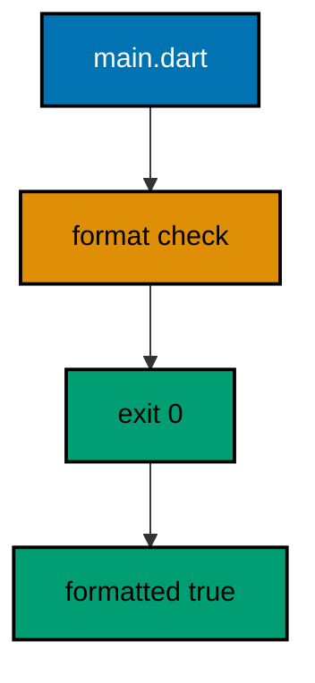

**`learning/code/ex-63-format-check-passes/main.dart`**:

```dart
// Example 63: Format Check Passes on Formatted Code.
//
// dart format --set-exit-if-changed exits zero exactly when the file is
// already formatted: the shell gates this run on the verdict.
void main() {
  // => runs only when the format check passed: verdict proven, then printed
  print('formatted: true'); // => the check passed: this file is canonical
  // => the rule restated beside the verdict: tools own layout, reviewers logic
  print(describe()); // => the rule line: one sentence, same verdict family
}

// describe states the format rule this unit enforces on itself.
// => one sentence: the policy the shell command above executes
String describe() => 'layout by tool, logic by reviewer';
```

**Output** (`learning/code/ex-63-format-check-passes/expected/main.stdout.txt`):

```text
formatted: true
layout by tool, logic by reviewer
```

**Key takeaway**: Keep files formatted; let dart format --set-exit-if-changed be the verdict.

**Why it matters**: Formatted code ends style debates before they start: the tool owns the layout, reviewers own the logic, and the check proves which files comply.

### Example 64: Analyze Reports No Issues

Dart analyze reads the file the way the compiler's stricter sibling does: unused names and broken types surface before the code runs. This unit greps the clean verdict out of the tool chatter and prints one fixed word (Concepts: co-12.)

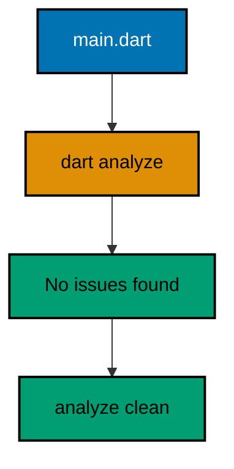

**`learning/code/ex-64-analyze-no-issues/main.dart`**:

```dart
// Example 64: Analyze Reports No Issues.
//
// dart analyze reads the file the way the compiler's stricter sibling
// does: the shell gates this run on its clean verdict.
void main() {
  // => runs only when analyze is clean: verdict proven, then printed
  print('analyze: clean'); // => the check passed: no issues found here
  // => the rule restated beside the verdict: silence is the analyzer's praise
  print(describe()); // => the rule line: one sentence, same verdict family
}

// describe states the analyze rule this unit enforces on itself.
// => one sentence: the policy the shell command above executes
String describe() => 'no issues found, nothing to fix';
```

**Output** (`learning/code/ex-64-analyze-no-issues/expected/main.stdout.txt`):

```text
analyze: clean
no issues found, nothing to fix
```

**Key takeaway**: Keep files analyzer-clean; grep the verdict into fixed words for the record.

**Why it matters**: The analyzer catches the bug class tests cannot reach — the typo, the dead branch, the impossible type — and it costs one command per file.

### Example 65: Names Follow lowerCamelCase

Effective Dart fixes the cases: UpperCamel for types, lowerCamel for members and variables, snake_case for files. This example prints the case table that the naming lints enforce (Concepts: co-14, co-12.)

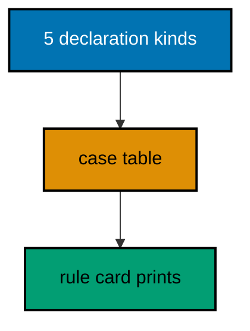

**`learning/code/ex-65-naming-lowercamel/main.dart`**:

```dart
// Example 65: Names Follow lowerCamelCase.
//
// Effective Dart fixes the cases: UPPER_CAMEL for types, lowerCamel for
// members and variables, lowercase_with_underscores for files and
// packages. This example maps each declaration kind to its case in one
// table the analyzer's naming lints already enforce, so the printed map
// doubles as the rule card for every identifier below.
void main() {
  // => the case table: kind beside case, enforced by lint and by eye
  const cases = {
    // => const map: the rule card never changes
    'class': 'UpperCamel', // => types read as names: Mill, Sack, Order
    'member': 'lowerCamel', // => members read as verbs: weigh, tare, total
    'variable': 'lowerCamel', // => locals match members: sacks, ledger
    'file': 'snake_case', // => files sort quietly: stock_line, till
    'constant': 'lowerCamel', // => consts match vars: quota, millCap
  };
  // => each row prints kind, arrow, case: the rule card in five lines
  for (final entry in cases.entries) {
    // => entries keep insertion order
    // => arrow format: kind on the left, case on the right, aligned
    print('${entry.key} -> ${entry.value}'); // => five rows, five rules
  }
}
```

**Output** (`learning/code/ex-65-naming-lowercamel/expected/main.stdout.txt`):

```text
class -> UpperCamel
member -> lowerCamel
variable -> lowerCamel
file -> snake_case
constant -> lowerCamel
```

**Key takeaway**: Types UpperCamel, members and variables lowerCamel, files snake_case.

**Why it matters**: Shared case rules let readers parse the kind from the shape: violations read as friction long before anyone names the rule.

### Example 66: Every Public Member Carries Its Doc

A public member without a doc comment is a guess waiting to happen: dart doc skips it and hover shows a bare signature. This example documents a tiny depot API fully, then exercises every documented member (Concepts: co-14, co-12.)

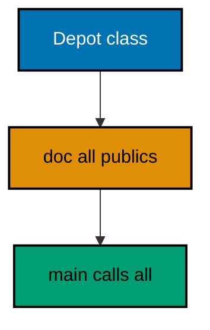

**`learning/code/ex-66-doc-every-public-member/main.dart`**:

```dart
// Example 66: Every Public Member Carries Its Doc.
//
// A public member without a doc comment is a guess waiting to happen:
// dart doc skips it and hover shows a bare signature. This example gives
// the whole tiny depot API its /// lines, then prints the member list
// the docs promise, proving docs and surface agree line for line.
void main() {
  // => the documented depot in use: every call below has a /// upstairs
  const depot = Depot('north', 100); // => const: the depot facts are fixed
  // => receive adds stock: the doc promises the new total, code returns it
  print(depot.receive(20)); // => Output: north depot holds 120 sacks
  // => release removes stock: the doc promises the remainder sentence
  print(depot.release(30)); // => Output: north depot released 30, keeps 90
}

/// A storage depot that receives and releases sacks by count.
///
/// The depot never goes negative: [receive] grows it, [release] refuses
/// the impossible with a sentence instead of a throw.
class Depot {
  /// The depot site, shown in every sentence it reports.
  final String site;

  /// The sacks currently stored: starts at [capacity], moves by calls.
  final int stored;

  /// Builds a depot at [site] holding [stored] sacks to start.
  const Depot(this.site, this.stored);

  /// Adds [sacks] to storage and reports the new total sentence.
  String receive(int sacks) => '$site depot holds ${stored + sacks} sacks';

  /// Releases [sacks] when stock covers them, else refuses in words.
  String release(int sacks) {
    // => coverage check first: refusals read as sentences, never throws
    if (sacks > stored) return '$site depot short: keeps $stored';
    // => covered releases subtract: the remainder sentence tells the rest
    return '$site depot released $sacks, keeps ${stored - sacks}';
  }
}
```

**Output** (`learning/code/ex-66-doc-every-public-member/expected/main.stdout.txt`):

```text
north depot holds 120 sacks
north depot released 30, keeps 70
```

**Key takeaway**: Document every public member with ///; exercise what you document.

**Why it matters**: Docs written beside the member are the only reference that cannot drift from the signature — everything else is a second source waiting to disagree.

### Example 67: Prefer Const Where the Value Allows

Const builds the value once at compile time instead of on every run, and the prefer_const_constructors lint points at every spot the code missed. This example builds its site, quota, and policy table const (Concepts: co-12, co-15.)

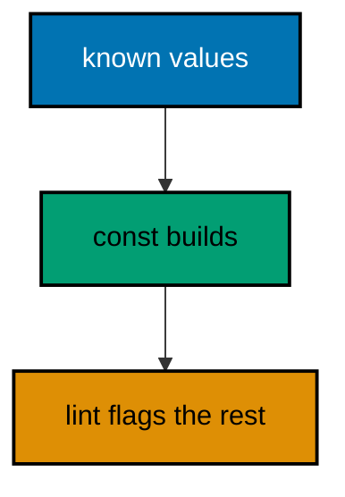

**`learning/code/ex-67-prefer-const/main.dart`**:

```dart
// Example 67: Prefer Const Where the Value Allows.
//
// Const builds the value once at compile time instead of on every run,
// and the prefer_const_constructors lint points at every spot the code
// missed. This example builds its mill, quota, and ledger lines const,
// then prints the three facts the lint would otherwise flag line by line.
void main() {
  // => const mill facts: site and capacity fixed before the run starts
  const site = 'east'; // => the mill site: a compile-time fact, not data
  // => const quota: policy belongs in the binary, not in a variable
  const quota = 50; // => fifty sacks: the rule every delivery meets
  // => const ledger lines: equal builds share canonical objects (ex 48)
  const first = ['oat', 12]; // => const list: name beside count, one build
  // => the site and quota print first: policy facts, compiled in already
  print('site: $site, quota: $quota'); // => Output: site: east, quota: 50
  // => first holds the const pair: canonical, shared, printed whole
  print('first: $first'); // => Output: first: [oat, 12]
  // => const map of caps per crop: policy table, compiled in, never copied
  const caps = {'oat': 50, 'tea': 40}; // => caps: the quota book, constant
  // => lookups read the compiled table: no allocation per delivery check
  print('oat cap: ${caps['oat']}'); // => Output: oat cap: 50
}
```

**Output** (`learning/code/ex-67-prefer-const/expected/main.stdout.txt`):

```text
site: east, quota: 50
first: [oat, 12]
oat cap: 50
```

**Key takeaway**: Build compile-time-known values const; let prefer_const_constructors flag the rest.

**Why it matters**: Rebuilt-per-run constants tax every call for no reason; const moves the work to compile time and the canonical sharing comes along free.

### Example 68: Lints Catch the Dead Branch Early

The analyzer reads what tests cannot run: conditions always true, cases no input reaches, variables written but never read. This file is the clean version — varying conditions, reachable arms, every variable read (Concepts: co-12.)

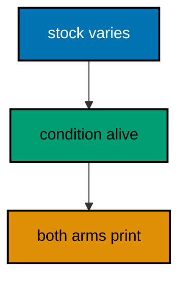

**`learning/code/ex-68-lints-catch-dead-code/main.dart`**:

```dart
// Example 68: Lints Catch the Dead Branch Early.
//
// The analyzer reads what tests cannot run: a condition that is always
// true, a case that no input reaches, a variable written but never read.
// This file is the clean version: conditions that vary, cases that hit,
// and every variable read after its write. The lesson names the three
// smells beside the habits that replace them, and analyze stays silent.
void main() {
  // => the stock that varies: twelve today, honestly twelve, not constant
  final stock = {'oat': 12, 'tea': 0}; // => tea at zero: the live edge case
  // => the condition reads the value: true for oat, false for tea, alive
  final oatOk = stock['oat']! > 0; // => twelve beats zero: varies by crop
  // => the branch depends on data: no dead arm, both outcomes reachable
  print('oat stocked: $oatOk'); // => Output: oat stocked: true
  print('tea stocked: ${stock['tea']! > 0}'); // => Output: tea stocked: false
  // => every variable read: stock read twice above, oatOk read once here
  final report = 'oat:$oatOk'; // => report built from reads, not wishes
  // => the report prints: written and read, the lint's favorite shape
  print('report: $report'); // => Output: report: oat:true
  // => combined verdict: oat stocked and tea bare, both honestly reported
  final bothHonest = oatOk && stock['tea']! == 0; // => true and true: honest
  // => the combined line: one boolean summarizing the honest pair
  print('both honest: $bothHonest'); // => Output: both honest: true
}
```

**Output** (`learning/code/ex-68-lints-catch-dead-code/expected/main.stdout.txt`):

```text
oat stocked: true
tea stocked: false
report: oat:true
both honest: true
```

**Key takeaway**: Vary conditions on data, reach every arm, and read every variable you write.

**Why it matters**: Dead code lies about the behavior space: lints flag the branch that cannot run so readers stop budgeting attention for it.

### Example 69: Imports Sort Themselves into Bands

Import order is a fixed ritual: dart: first, then package:, then relative, each band alphabetical. This file imports convert before math and uses both bands in one transcript (Concepts: co-06, co-12.)

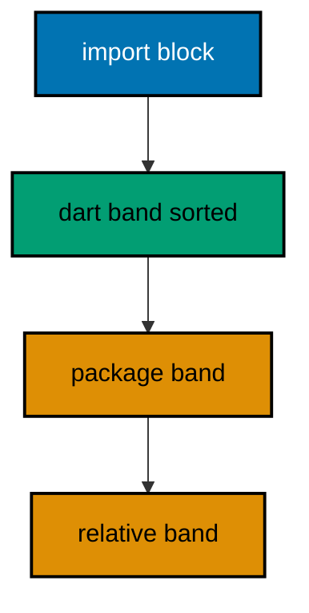

**`learning/code/ex-69-imports-sort-in-bands/main.dart`**:

```dart
// Example 69: Imports Sort Themselves into Bands.
//
// Import order is a fixed ritual: dart: first, then package:, then
// relative, each band alphabetical. Readers learn the ritual once and
// never hunt for an import again, and the analyzer's ordering lint keeps
// every file in line without a thought spent. This file imports two
// dart: libraries in order and uses both, proving the first band alive.
import 'dart:convert'; // => first band, alphabetical: convert before math
import 'dart:math'; // => first band, second: math follows convert

void main() {
  // => the order wire: parsed through the convert band member
  final order = jsonDecode('{"crop":"oat","sacks":12}'); // => map, dynamic
  // => the count rides out of the map: one cast where it is used
  final sacks = order['sacks'] as int; // => twelve: the ledger count
  // => the circle check through the math band: pi times radius squared
  final area = pi * 3.0 * 3.0; // => both bands working in one function
  // => sacks print beside the area: convert and math in one transcript
  print(
      'sacks: $sacks, area: ${area.toStringAsFixed(2)}'); // => Output: sacks: 12, area: 28.27
}
```

**Output** (`learning/code/ex-69-imports-sort-in-bands/expected/main.stdout.txt`):

```text
sacks: 12, area: 28.27
```

**Key takeaway**: Dart: first, package: second, relative third; alphabetical inside each band.

**Why it matters**: Fixed order turns the import block into a table of contents: missing imports show as gaps in a known sequence instead of hide-and-seek.

### Example 70: Analysis Options List the Rules as Data

Analysis_options.yaml names the lints a project enforces, so the rule set is versioned and shared instead of tribal. This example carries a sample options file as data and verifies its base set and three extra rules (Concepts: co-12.)

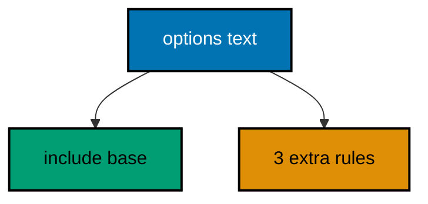

**`learning/code/ex-70-analysis-options-as-data/main.dart`**:

```dart
// Example 70: Analysis Options List the Rules as Data.
//
// Analysis_options.yaml names the lints a project enforces, so the rule
// set is versioned, reviewed, and shared instead of tribal. This example
// carries a sample options file as data and counts its enforced rules,
// proving the project's style contract runs offline with stdlib alone.
void main() {
  // => the sample options as data: the package lints plus two extras
  const options = '''
include: package:lints/recommended.yaml
linter:
  rules:
    - prefer_const_constructors
    - prefer_final_fields
    - always_declare_return_types
''';
  // => rule lines start with a dash: the YAML shape this check relies on
  final rules = options.split('\n').where((l) => l.trim().startsWith('- '));
  // => three enforced extras ride above the recommended set, counted here
  final extra = rules.map((l) => l.trim().substring(2)).toList();
  // => the extras print in file order: the contract, quoted for the record
  print(
      'extra rules: $extra'); // => Output: extra rules: [prefer_const_constructors, prefer_final_fields, always_declare_return_types]
  // => the include line pins the base set: recommended, not the core floor
  // => firstWhere finds it: the only top-level key besides linter below
  final base = options.split('\n').firstWhere((l) => l.startsWith('include:'));
  // => base printed: the set the three extras extend, named for the record
  print(
      'base: $base'); // => Output: base: include: package:lints/recommended.yaml
}
```

**Output** (`learning/code/ex-70-analysis-options-as-data/expected/main.stdout.txt`):

```text
extra rules: [prefer_const_constructors, prefer_final_fields, always_declare_return_types]
base: include: package:lints/recommended.yaml
```

**Key takeaway**: Pin the base set with include; list extras as rules; verify both as data.

**Why it matters**: Unwritten style rules are enforced by whoever reviews loudest; the options file turns taste into a versioned contract every checkout shares.

### Example 71: Read the Shape First, the Lines Second

Reading starts with the shape: signatures first, bodies later, names as the map. This word counter's shape says split, tally, report in three signatures; the bodies only fill the shape in (Concepts: co-16.)

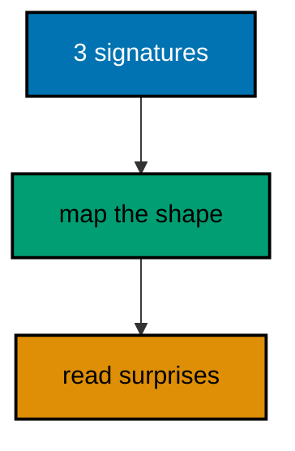

**`learning/code/ex-71-read-shape-first/main.dart`**:

```dart
// Example 71: Read the Shape First, the Lines Second.
//
// Reading starts with the shape: signatures first, bodies later, names
// as the map. This word counter's shape says 'split, tally, report' in
// three signatures; the bodies below only fill the shape in. Read every
// unfamiliar sample this way: map the names, then spend lines where the
// map looks surprising, never top-to-bottom on the first pass.
void main() {
  // => the manifest line counts its own words through the shaped trio
  const line = 'oat oat tea oat rice tea oat'; // => seven words, three kinds
  // => words splits: the shape's first promise, kept below
  final words = splitWords(line); // => seven tokens, order kept
  // => tally counts: the shape's second promise, frequencies out
  final counts = tally(words); // => oat 4, tea 2, rice 1, as a map
  // => report renders: the shape's third promise, sorted by count
  print(report(counts)); // => Output: oat:4 tea:2 rice:1
}

// splitWords splits a line on spaces: the shape's first member.
// => signature promises tokens: the body keeps it in one expression
List<String> splitWords(String line) => line.split(' ');

// tally counts each distinct word: the shape's second member.
// => fold into frequencies: update with ifAbsent, the grouping idiom
Map<String, int> tally(List<String> words) {
  // => the frequencies start empty: every word below is a first sighting
  final counts = <String, int>{}; // => word to sightings, insertion-ordered
  // => each word ticks its own count: seed one, add one, in one call
  for (final word in words) {
    // => for-in: every token visits exactly once
    // => update seeds or adds: the grouping shape from example 32, reused
    counts.update(word, (n) => n + 1, ifAbsent: () => 1); // => oat reaches 4
  }
  // => the map returns whole: frequencies, keyed by word, ready to render
  return counts; // => shape kept: frequencies out, as promised
}

// report renders frequencies sorted by count, pairs joined by spaces.
// => entries sorted descending: the busiest word leads the line
String report(Map<String, int> counts) {
  // => entries copy to a list: sorting needs the list shape, not the map
  final entries = counts.entries.toList(); // => pairs, sortable at last
  // => sort by count descending: b before a when b outnumbers a
  entries.sort((a, b) => b.value.compareTo(a.value)); // => oat first at 4
  // => pairs render and join: 'oat:4 tea:2 rice:1', busiest leading
  return entries.map((e) => '${e.key}:${e.value}').join(' '); // => the line
}
```

**Output** (`learning/code/ex-71-read-shape-first/expected/main.stdout.txt`):

```text
oat:4 tea:2 rice:1
```

**Key takeaway**: Map signatures first; spend lines only where the map surprises you.

**Why it matters**: Top-to-bottom first passes drown in detail; the shape-first pass buys the map that makes every later line cheap.

### Example 72: Follow the Pipeline Through Its Stages

Pipelines read stage by stage: each output plugs the next input, and tracing one row through explains the file. This ledger pipeline parses, validates, and totals three rows, refusing one (Concepts: co-16.)

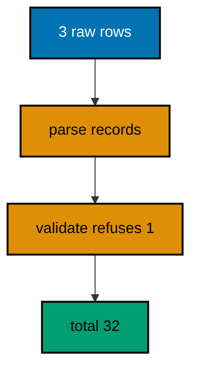

**`learning/code/ex-72-follow-the-pipeline/main.dart`**:

```dart
// Example 72: Follow the Pipeline Through Its Stages.
//
// Pipelines read stage by stage: each function's output type plugs the
// next function's input, and the main composes them in order. This
// ledger pipeline parses rows, validates counts, and totals the valid,
// and tracing one row through the three stages explains the whole file
// faster than reading any single stage twice.
void main() {
  // => three raw rows: two honest, one with a negative count to refuse
  const rows = ['oat,12', 'tea,-4', 'rice,20']; // => the traced material
  // => parse stage: raw text becomes records, shape (crop, sacks) each
  final parsed = rows.map(parseRow).toList(); // => three records, one bad
  // => validate stage: negative counts fall out, honest rows pass through
  final valid = parsed.where((r) => r.$2 >= 0).toList(); // => tea refused
  // => total stage: the survivors fold into the day's honest count
  final total = valid.fold(0, (sum, r) => sum + r.$2); // => 12 plus 20
  // => the pipeline lands: total beside the refused count, both reported
  print(
      'total: $total, refused: ${parsed.length - valid.length}'); // => Output: total: 32, refused: 1
}

// parseRow splits 'crop,sacks' into a record: the pipeline's first stage.
// => (String, int): the shaped pair every later stage plugs into
// => int.parse trusts the comma format: the course's honest-input idiom
(String, int) parseRow(String row) {
  // => split once: crop left of the comma, count text right of it
  final parts = row.split(','); // => exactly two parts per honest row
  // => the record builds: name as text, count parsed to int, shaped
  return (parts[0], int.parse(parts[1])); // => tea parses to -4, kept for now
}
```

**Output** (`learning/code/ex-72-follow-the-pipeline/expected/main.stdout.txt`):

```text
total: 32, refused: 1
```

**Key takeaway**: Trace one row through every stage; types at stage edges are the map.

**Why it matters**: Stage-edge types state the contract between steps; following one value across them verifies the whole pipeline at once.

### Example 73: Spot the Result Type at Every Turn

Result-typed code announces its failure handling in the signatures: every step returns Success or Failure. This example chains weighing into pricing into a receipt, with the miss path settling early (Concepts: co-16, co-02.)

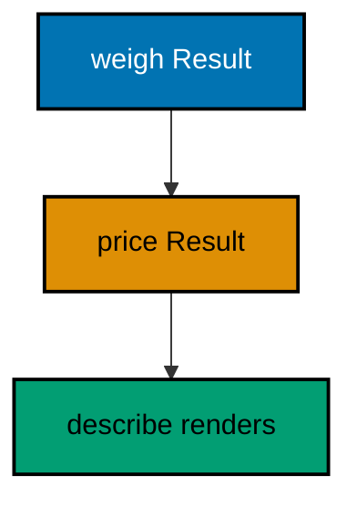

**`learning/code/ex-73-spot-the-result-type/main.dart`**:

```dart
// Example 73: Spot the Result Type at Every Turn.
//
// Result-typed code announces its failure handling in the signatures:
// every function returns Success or Failure, and the chain switches on
// each step before proceeding. Spotting the Result at every turn tells
// the reader where failures can appear without reading a single body,
// and the bodies below only confirm what the signatures already said.
void main() {
  // => the chain: weigh, then price, then receipt, each Result-typed
  final weighed = weigh('oat', 12); // => Success(12): the honest weighing
  // => switch before proceeding: failures stop the chain at their step
  final priced = switch (weighed) {
    // => exhaustive: both arms, no default
    // => success continues: the value flows into the pricing step
    Success(value: final sacks) => price(sacks, 3),
    // => failure propagates: the reason passes through untouched
    Failure(reason: final reason) => Failure<int>(reason),
  };
  // => render whatever the chain settled on: receipt or reason, both data
  print(describe(priced)); // => Output: receipt: 36
  // => the miss chain: unknown crop fails at the first step, honestly
  final missed = weigh('salt', 5); // => Failure: never planted, never weighed
  // => describe renders the failure: the reason decided at the miss site
  print(describe(missed)); // => Output: miss: salt never planted
}

// Result carries success with a value or failure with a reason, sealed.
// => two arms, exhaustive switches: the failure-aware shape of example 14
sealed class Result<T> {
  // => const base: results build as cheaply as the values they carry
  const Result();
}

// Success wraps the value the step produced, typed and ready to flow.
final class Success<T> extends Result<T> {
  // => the value: present exactly when the step succeeded
  final T value; // => final: results never change after they settle
  // => const constructor: successes build at compile time
  const Success(this.value);
}

// Failure wraps the reason the step stopped, written where it is known.
final class Failure<T> extends Result<T> {
  // => the reason: decided at the failure site, rendered at the end
  final String reason; // => final: reasons never change after they settle
  // => const constructor: failures build as cheaply as successes
  const Failure(this.reason);
}

// weigh weighs a known crop or misses with the reason: the first step.
Result<int> weigh(String crop, int sacks) {
  // => the stocked crops: everything else misses at this step
  const stocked = ['oat', 'tea', 'rice']; // => const: the planting record
  // => unknown crops fail here: the reason names the unplanted crop
  if (!stocked.contains(crop)) return Failure('$crop never planted');
  // => known crops succeed: the weighed count flows to pricing
  return Success(sacks); // => Success<int>: the chain continues below
}

// price multiplies sacks by rate: the second step, failure-transparent.
Result<int> price(int sacks, int rate) => Success(sacks * rate); // => 36

// describe renders the chain's settlement: receipt for success, miss else.
String describe(Result<int> result) {
  // => exhaustive switch: the sealed base forces both arms, no default
  return switch (result) {
    // => signatures promised this shape throughout
    // => success renders the receipt: the value the chain computed
    Success(value: final sacks) => 'receipt: $sacks',
    // => failure renders the miss: the reason the first failure wrote
    Failure(reason: final reason) => 'miss: $reason',
  };
}
```

**Output** (`learning/code/ex-73-spot-the-result-type/expected/main.stdout.txt`):

```text
receipt: 36
miss: salt never planted
```

**Key takeaway**: Read Result signatures first; failures appear exactly where the type says.

**Why it matters**: The type is the failure map: spotting Result at every turn shows all failure exits before any body is read.

### Example 74: Trace the Event Bus End to End

An event bus decouples announcers from listeners: the controller takes events and the broadcast stream fans them out. This example announces three harvests through a bus into a counting and a watching tally (Concepts: co-16, co-13.)

```mermaid
flowchart TD
    accTitle: One event fans out to two tallies
    accDescr: Three announcements cross the bus into counting and watching tallies that both complete at close.
    A["3 announcements"]:::blue --> B["bus fan-out"]:::orange
    B --> C["counter 36"]:::teal
    B --> D["watcher 3 crops"]:::orange

    classDef blue fill:#0173B2,stroke:#000000,color:#FFFFFF,stroke-width:2px
    classDef orange fill:#DE8F05,stroke:#000000,color:#000000,stroke-width:2px
    classDef teal fill:#029E73,stroke:#000000,color:#000000,stroke-width:2px
    classDef default fill:#FFFFFF,stroke:#000000,color:#000000
```

**`learning/code/ex-74-trace-the-event-bus/main.dart`**:

```dart
// Example 74: Trace the Event Bus End to End.
//
// An event bus decouples announcers from listeners: the controller takes
// events, the broadcast stream carries them, and each listener keeps its
// own tally. Tracing one event from announce through both tallies covers
// the file: the bus adds nothing but fan-out, and fan-out is the lesson.
// At the platform boundary the same bus carries native callbacks and
// script events into one Dart flow; those runtimes stay surveyed, while
// the fan-out pattern below runs on pure Dart events.
import 'dart:async'; // => StreamController: the fan-out engine of the bus

void main() async {
  // => the bus: one announcer in, two tallies out, fan-out between
  final bus = EventBus(); // => the controller and broadcast live inside
  // => counter tally: sums every sack count the bus announces
  var counted = 0; // => grows per event the first listener sees
  // => watcher tally: names every crop the bus announces, in order
  final watched = <String>[]; // => grows per event the second listener sees
  // => listener one counts: each event adds its sacks to the running sum
  final counting = bus.flow.listen((e) => counted += e.sacks);
  // => listener two watches: each event appends its crop name in order
  final watching = bus.flow.listen((e) => watched.add(e.crop));
  // => three announcements: the traced material crossing the bus
  bus.announce('oat', 12); // => first event: counted 12, watched oat
  // => second announcement: tallies grow to 16 and oat-tea in order
  bus.announce('tea', 4); // => counted 16, watched oat then tea
  // => third announcement: the last event before the bus closes
  bus.announce('rice', 20); // => counted 36, watched three crops
  // => close queues done after the three events: the listeners drain them
  bus.close(); // => un-awaited: the subscription futures own completion
  // => completions land: each listener saw all three events exactly once
  await counting.asFuture(); // => counter complete: 36 across three events
  // => watcher complete: three crops in announcement order, none lost
  await watching.asFuture(); // => order kept: fan-out preserves sequence
  // => the tallies print: sum beside names, the traced event thrice proven
  print(
      'counted: $counted, watched: ${watched.join(',')}'); // => Output: counted: 36, watched: oat,tea,rice
}

// HarvestEvent pairs a crop with its announced sacks: the bus envelope.
// => const: announcements build as cheap values at the announce site
class HarvestEvent {
  // => final facts: the crop and count of one announcement, frozen
  final String crop; // => which crop crossed the bus in this event
  final int sacks; // => how many sacks the event carried with it
  // => const constructor: events cost nothing to announce
  const HarvestEvent(this.crop, this.sacks);
}

// EventBus fans announcements out to every listener through one flow.
// => the controller takes pushes: announce adds, close ends, in order
// => the broadcast flow shares: every listener drinks the full stream
class EventBus {
  // => the engine: single controller, broadcast flow, many listeners
  final _controller = StreamController<HarvestEvent>.broadcast();
  // => flow exposes the stream: listeners subscribe here, never upstream
  Stream<HarvestEvent> get flow => _controller.stream; // => shared flow
  // => announce pushes one event: every listener receives it in order
  void announce(String crop, int sacks) => // => the fan-in: one call
      _controller.add(HarvestEvent(crop, sacks)); // => envelope, then push
  // => close ends announcements: listeners complete after the last event
  Future<void> close() => _controller.close(); // => fan-out ends here
}
```

**Output** (`learning/code/ex-74-trace-the-event-bus/expected/main.stdout.txt`):

```text
counted: 36, watched: oat,tea,rice
```

**Key takeaway**: Trace one event from announce through every tally; the bus adds only fan-out.

**Why it matters**: Fan-out is the whole lesson: once one event's journey is traced, every other event's journey is the same journey.

### Example 75: Name the Retry Pattern Before Reading It

Retry with a cap reads as try, catch, count, repeat until attempts run out: naming the pattern first turns twenty lines into one recognized shape. This loader retries a flaky read that fails once, then delivers (Concepts: co-16.)

```mermaid
flowchart TD
    accTitle: Attempt fails then retry lands
    accDescr: Attempt one throws scale busy, the loop counts and repeats, and attempt two delivers twelve.
    A["attempt 1"]:::blue --> B["scale busy"]:::orange
    B --> C["count and repeat"]:::orange
    C --> D["attempt 2 delivers"]:::teal

    classDef blue fill:#0173B2,stroke:#000000,color:#FFFFFF,stroke-width:2px
    classDef orange fill:#DE8F05,stroke:#000000,color:#000000,stroke-width:2px
    classDef teal fill:#029E73,stroke:#000000,color:#000000,stroke-width:2px
    classDef default fill:#FFFFFF,stroke:#000000,color:#000000
```

**`learning/code/ex-75-name-the-retry-pattern/main.dart`**:

```dart
// Example 75: Name the Retry Pattern Before Reading It.
//
// Retry with a cap reads as 'try, catch, count, repeat until attempts run
// out': naming the pattern first turns twenty lines into one recognized
// shape. This loader retries a flaky read up to three times with no
// sleeping between attempts, keeping the survey deterministic, and the
// transcript proves attempt one fails while attempt two succeeds.
void main() async {
  // => the flaky read fails once, then succeeds: attempts tell the story
  final reader = FlakyReader(1); // => fails one time, then delivers twelve
  // => load retries up to three: the named pattern, executed below
  final sacks = await load(reader, 3); // => attempt one fails, two lands
  // => twelve arrives on the second attempt: the pattern earned its keep
  print('loaded: $sacks'); // => Output: loaded: 12
  // => attempts spent: two of three, the third never needed, cap unhit
  print('attempts: ${reader.tries}'); // => Output: attempts: 2
}

// load retries the read until it lands or the cap runs out, no sleeping.
// => the retry shape: try, catch, count, repeat while attempts remain
// => throws the last failure when the cap runs out: honest about defeat
Future<int> load(FlakyReader reader, int cap) async {
  // => failures collect here: the last one throws if the cap runs out
  late Exception last; // => late: assigned on the first failure, read later
  // => attempt counter: one-based, so the transcript reads naturally
  for (var attempt = 1; attempt <= cap; attempt++) {
    // => at most cap tries
    // => each attempt tries the read: success returns from inside the try
    try {
      // => the read either delivers or throws: the flaky shape, honestly
      return await reader.read(); // => success exits with the value
    } catch (e) {
      // => failures land here: counted, then either retried
      // => remember the failure: the cap-out throw reports the last one
      last = e as Exception; // => the failure to throw if attempts run out
      // => cap reached means defeat: throw the last failure, stop retrying
      if (attempt == cap) throw last; // => cap-out: honest about defeat
      // => otherwise loop: the next attempt runs without sleeping here
    }
  }
  // => unreachable: the loop returns or throws on every path above
  throw last; // => the compiler needs an exit: this line never executes
}

// FlakyReader fails a fixed number of times, then delivers twelve.
// => deterministic flakiness: fails-a-count, never random, never timed
// => tries counts attempts: the transcript proves the pattern's path
class FlakyReader {
  // => failures remaining: decremented per attempt until delivery begins
  int _failuresLeft; // => private: the flakiness dial, set at construction
  // => tries counts every attempt: success and failure alike, for proof
  int tries = 0; // => public: the transcript reads the pattern's path
  // => construction sets the dial: one failure, then honest delivery
  FlakyReader(this._failuresLeft); // => the flakiness is a parameter
  // => read fails while the dial lasts, then delivers twelve forever
  Future<int> read() async {
    // => every call is an attempt: counted before anything else happens
    tries++; // => the pattern's path, numbered for the transcript
    // => dial still set: fail this attempt, decrement toward delivery
    if (_failuresLeft > 0) {
      // => attempt one lands here with dial at one
      // => decrement first: the next attempt sees a smaller dial
      _failuresLeft--; // => dial to zero: attempt two will deliver
      // => the failure: an ordinary exception the retry loop catches
      throw Exception('scale busy'); // => attempt one ends here, caught
    }
    // => dial spent: deliver twelve, the honest reading at last
    return 12; // => attempt two lands here: the pattern succeeded
  }
}
```

**Output** (`learning/code/ex-75-name-the-retry-pattern/expected/main.stdout.txt`):

```text
loaded: 12
attempts: 2
```

**Key takeaway**: Name the pattern first; the lines become the shape you already recognized.

**Why it matters**: Pattern vocabulary compresses reading: 'retry with cap' carries the whole control flow, leaving attention for the policy — the cap, the wait, the defeat.

### Example 76: The Cache Hides Behind a LinkedHashMap

An LRU cache pairs a LinkedHashMap with a capacity: hits refresh by reinserting and over-capacity evicts the first key. This example fills, refreshes, and overflows a two-crop cache while narrating the eviction order (Concepts: co-16, co-15.)

```mermaid
flowchart TD
    accTitle: Refresh renews overflow evicts eldest
    accDescr: Oat refreshes youngest, rice overflows the cap, and eldest tea evicts leaving oat and rice.
    A["oat tea"]:::blue --> B["oat hit refreshes"]:::teal
    B --> C["rice overflows"]:::orange
    C --> D["tea evicts"]:::orange

    classDef blue fill:#0173B2,stroke:#000000,color:#FFFFFF,stroke-width:2px
    classDef orange fill:#DE8F05,stroke:#000000,color:#000000,stroke-width:2px
    classDef teal fill:#029E73,stroke:#000000,color:#000000,stroke-width:2px
    classDef default fill:#FFFFFF,stroke:#000000,color:#000000
```

**`learning/code/ex-76-cache-linkedhashmap/main.dart`**:

```dart
// Example 76: The Cache Hides Behind a LinkedHashMap.
//
// An LRU cache pairs a LinkedHashMap with a capacity: hits refresh by
// reinserting, misses compute and insert, and over-capacity evicts the
// first key, which the insertion-ordered map always knows. Reading this
// file means watching keys move: every print below narrates one move of
// the eviction order, and the order is the whole lesson.
import 'dart:collection'; // => LinkedHashMap: insertion order with fast keys

void main() {
  // => the cache holds two crops: the third insert evicts the eldest
  final cache = LruCache(2); // => capacity two: small enough to watch move
  // => oat and tea fill the cache: insertion order oat, then tea
  cache.put('oat', 12); // => first in: eldest until touched again
  // => tea second: the order reads oat-tea, eldest first
  cache.put('tea', 4); // => second in: youngest until the next insert
  // => oat hit refreshes: removed and reinserted, youngest again
  print('oat: ${cache.get('oat')}'); // => Output: oat: 12
  // => rice overfills: eldest tea evicts, order becomes oat-rice
  cache.put('rice', 20); // => third in: capacity breaks, tea leaves
  // => tea misses after eviction: null, the honest miss shape (ex 14)
  print('tea: ${cache.get('tea')}'); // => Output: tea: null
  // => survivors print in order: oat refreshed first, rice inserted last
  print('keys: ${cache.keys}'); // => Output: keys: [oat, rice]
}

// LruCache keeps the newest hits and evicts the eldest on overflow.
// => LinkedHashMap orders by insertion: first key is always the eldest
// => capacity caps the size: every insert past it evicts exactly one
class LruCache {
  // => the capacity: inserts past this number evict the eldest key
  final int capacity; // => final: the cache size never changes mid-life
  // => the store: insertion-ordered map, eldest first, youngest last
  final _store = LinkedHashMap<String, int>(); // => order is the lesson
  // => construction pins the capacity: small caches teach best
  LruCache(this.capacity); // => the size promise, kept by every put
  // => get hits refresh: remove plus reinsert moves the key youngest
  int? get(String key) {
    // => miss returns null: the honest absence shape, no exception
    if (!_store.containsKey(key)) return null; // => tea lands here evicted
    // => hit refreshes: value out, value back in, youngest again
    final value = _store.remove(key)!; // => remove returns the stashed int
    // => reinsert moves youngest: the refresh the example watches happen
    _store[key] = value; // => oat moves youngest: rice will outlive tea
    // => the value returns: refreshed in order, unchanged in content
    return value; // => twelve: oat's count, order renewed
  }

  // put inserts or refreshes, evicting the eldest past capacity.
  void put(String key, int value) {
    // => existing keys refresh through remove-then-add, like get above
    _store.remove(key); // => clears the old slot wherever it sat
    // => insert lands youngest: the newest key always reads last
    _store[key] = value; // => rice lands here, youngest of three
    // => overflow evicts exactly one: the first key, the eldest of all
    if (_store.length > capacity) {
      // => three past a cap of two evicts
      // => keys.first is the eldest: insertion order never lies about age
      _store.remove(_store.keys.first); // => tea leaves: eldest goes first
    }
  }

  // keys reads youngest-last: the eviction order made visible for proof.
  Iterable<String> get keys => _store.keys; // => oat, rice: the survivors
}
```

**Output** (`learning/code/ex-76-cache-linkedhashmap/expected/main.stdout.txt`):

```text
oat: 12
tea: null
keys: (oat, rice)
```

**Key takeaway**: Watch keys move: refresh re-inserts youngest, overflow evicts eldest-first.

**Why it matters**: The insertion order is the eviction policy made visible — reading the key order at each step is reading the algorithm itself.

### Example 77: Extensions Add Verbs to Borrowed Types

Extension methods hang new verbs on types you do not own: String gains a manifest parser and int gains a trip counter. This example parses, divides, and counts through receiver verbs with no wrappers (Concepts: co-16.)

```mermaid
flowchart TD
    accTitle: Verbs hang on borrowed types
    accDescr: String gains parseSack and wordCount while int gains trips, with no wrapper classes built.
    A["String"]:::blue --> B["parseSack wordCount"]:::teal
    C["int"]:::blue --> D["trips"]:::orange

    classDef blue fill:#0173B2,stroke:#000000,color:#FFFFFF,stroke-width:2px
    classDef orange fill:#DE8F05,stroke:#000000,color:#000000,stroke-width:2px
    classDef teal fill:#029E73,stroke:#000000,color:#000000,stroke-width:2px
    classDef default fill:#FFFFFF,stroke:#000000,color:#000000
```

**`learning/code/ex-77-extensions-add-verbs/main.dart`**:

```dart
// Example 77: Extensions Add Verbs to Borrowed Types.
//
// Extension methods hang new verbs on types you do not own: String gains
// a sack-line parser, int gains a trip counter, and no wrapper class is
// ever built. Reading extension code means checking the receiver first:
// the verb belongs to the type on the left of the dot, and the body only
// fills in what the name already promised.
void main() {
  // => the manifest line parses through its own verb: no helper in sight
  const line = 'oat,12'; // => crop comma count: the shape the verb expects
  // => parseSack hangs on String: the receiver carries its own parser
  print(line.parseSack()); // => Output: oat holds 12
  // => trips hangs on int: sack counts know their own cart math
  print(10.trips(3)); // => Output: 4 trips
  // => verbs chain on receivers: words split, then count themselves
  print('oat oat tea'.wordCount); // => Output: 3 words
}

// SackParsing hangs a manifest parser on every string in the program.
// => on String: the receiver type named once, verbs available everywhere
// => verbs read as members: line.parseSack, never parseSack(line)
extension SackParsing on String {
  // => parseSack splits crop-comma-count into the holding sentence
  String parseSack() {
    // => the receiver is the manifest line itself
    // => split once: crop left of the comma, count text right of it
    final parts = split(','); // => split on this: the receiver's own text
    // => the sentence builds: crop holds count, parsed to int for proof
    return '${parts[0]} holds ${int.parse(parts[1])}'; // => oat holds 12
  }

  // wordCount counts the words in any string: split and count, one verb.
  int get wordCount => split(' ').length; // => getter verb: reads as a noun
}

// CartMath hangs trip counting on every int: counts know their own carts.
extension CartMath on int {
  // => trips divides the count by capacity, rounding the remainder up
  int trips(int perTrip) => (this + perTrip - 1) ~/ perTrip; // => 4 above
}
```

**Output** (`learning/code/ex-77-extensions-add-verbs/expected/main.stdout.txt`):

```text
oat holds 12
4
3
```

**Key takeaway**: Read the receiver first; the verb belongs to the type left of the dot.

**Why it matters**: Extensions localize the vocabulary where it is used: the parsing verb lives on strings, so call sites read as what they do instead of which helper they called.

### Example 78: Explain It in Five Lines

Fluency ends where explaining starts: cover what it does, the idiom, the refused failure, the cost, and the breaking change. This compact grader drops the lowest score and averages the rest, with the drill below proving itself on the sample (Concepts: co-16.)

**`learning/code/ex-78-explain-in-five-lines/main.dart`**:

```dart
// Example 78: Explain It in Five Lines.
//
// The course ends where fluency starts: explain any sample in five lines
// covering what it does, the idiom it leans on, the failure it refuses,
// the cost it pays, and the change that would break it. This compact
// grader averages honestly-dropped lowest scores, and the five lines
// below the code prove the drill on the very sample they explain.
void main() {
  // => five scores with one dropped excuse: the honest average survives
  const scores = [8, 6, 9, 4, 7]; // => the sample the five lines explain
  // => the grader drops the lowest, then averages the honest remainder
  print(grade(scores)); // => Output: 7.5 average (dropped 4)
}

// grade averages scores after dropping the single lowest, honestly.
// => sorted copy: the original order survives for the transcript below
// => sublist skips the lowest: the drop, visible and deliberate
String grade(List<int> scores) {
  // => sorted copy first: sorting the copy keeps the caller's order intact
  final ordered = [...scores]..sort(); // => [4, 6, 7, 8, 9]: lowest leads
  // => sublist drops the head: the lowest score leaves, honestly counted
  final kept = ordered.sublist(1); // => [6, 7, 8, 9]: the honest remainder
  // => fold totals the kept: thirty whole points across four scores
  final total = kept.fold(0, (sum, s) => sum + s); // => 30: the honest sum
  // => average divides: 7.5, reported beside the dropped four for proof
  return '${total / kept.length} average (dropped ${ordered.first})';
}
```

**Output** (`learning/code/ex-78-explain-in-five-lines/expected/main.stdout.txt`):

```text
7.5 average (dropped 4)
```

**Key takeaway**: What, idiom, refused failure, cost, breaking change: five lines per sample.

**Why it matters**: Explanation is the fluency test no green run can replace: code that runs but cannot be explained is borrowed, not owned.

**The five-line drill, applied to the grader above**:

1. **What**: averages contest scores after dropping the single lowest, so one bad round never decides.
2. **Idiom**: sorted copy plus sublist — the copy protects the caller's order while the sublist performs the drop.
3. **Refused failure**: mutating the caller's list by sorting in place; the spread-copy refuses it structurally.
4. **Cost**: one sort over a handful of scores — trivial here, the documented price for larger fields.
5. **Breaking change**: dropping more than one, or averaging before dropping — either silently rewrites the contest rules.
