Examples 1-25 build Dart fluency from the ground up: idiomatic control flow and collections first (Examples 1-8), covering early returns, the three loop shapes, while and switch, lists, maps, sets, and lazy iterables; then the error-handling idiom in full (Examples 9-17), from try-catch through specific catches, rethrow, finally, custom exceptions, sealed Results, null safety, asserts, and async failures; finally the standard library for daily text, file, and time work (Examples 18-25), covering StringBuffer, RegExp, JSON, URIs, DateTime, file IO, Durations, and string shaping. Every example is a complete, runnable Dart program under `learning/code/`; run each with the command in its own `run.yaml`.

---

### Example 1: Hello with an Early Return

The first Dart habit to build is checking the failure first and returning it, so the happy path stays flat. This example greets a name but refuses an empty one before it ever builds a greeting string (Concepts: co-01, co-02.)

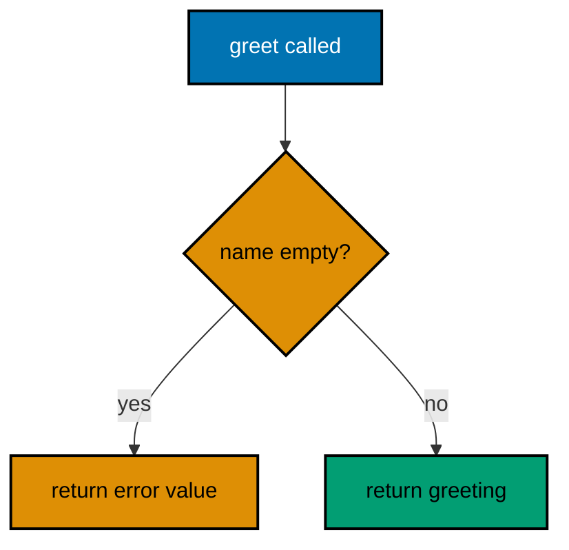

**`learning/code/ex-01-early-return-hello/main.dart`**:

```dart
// Example 1: Hello with an Early Return.
//
// Dart checks the failure first and returns it, so the happy path stays
// at the left margin instead of nesting inside an if block.
void main() {
  // => one call shape for both inputs: print whatever greet returns
  print(greet('')); // => Output: error: name is empty
  // => same call shape, valid input: the greeting prints instead
  print(greet('Sari')); // => Output: hello, Sari
}

// greet refuses an empty name before it ever builds a greeting.
// => the return type is honest: a String comes back on every path
// => failures travel as ordinary values, not as thrown exceptions
String greet(String name) {
  // => guard clause first: the failure case is decided up front
  if (name.isEmpty) {
    // => the one input this function cannot serve
    // => leave immediately: no greeting is built for an empty name
    return 'error: name is empty'; // => failure value, same type as success
  }
  // => past the guard, the name is safe to use without further checks
  return 'hello, $name'; // => string interpolation reads the value inline
}
```

**Output** (`learning/code/ex-01-early-return-hello/expected/main.stdout.txt`):

```text
error: name is empty
hello, Sari
```

**Key takeaway**: Check the failure first and return it; the happy path stays flat.

**Why it matters**: Guard clauses keep nesting shallow, which is why idiomatic Dart reads as a sequence of exits followed by one straight happy path.

### Example 2: For Loops Come in Three Shapes

Dart repeats with for-in over values, a counted for over indexes, and forEach when the body is already a function. This example sums one list all three ways so you can match each shape to its job (Concepts: co-01, co-03.)

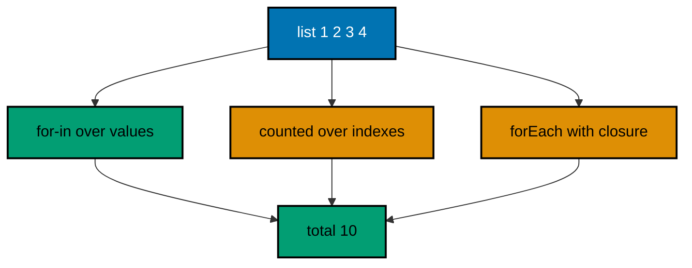

**`learning/code/ex-02-for-loops-three-shapes/main.dart`**:

```dart
// Example 2: For Loops Come in Three Shapes.
//
// Dart repeats with for-in over values, a counted for over indexes, and
// forEach when the body is already a function. Each shape below sums the
// same list so you can match the shape to the job.
void main() {
  // => one list feeds all three loop shapes below
  final nums = [1, 2, 3, 4]; // => final: the binding never points elsewhere
  // => for-in reads each value directly: no index to get wrong
  var total = 0; // => accumulator starts at the additive identity
  // => value takes each element in turn, first to last
  for (final value in nums) {
    // => for-in: the shape for whole collections
    total += value; // => add the value itself, not nums[i]
  }
  // => counted for owns the index: the shape for neighbors and windows
  print('for-in: $total'); // => Output: for-in: 10
  var indexed = 0; // => second accumulator, same identity start
  // => i walks the valid indexes; length keeps the bound always correct
  for (var i = 0; i < nums.length; i++) {
    // => counted: init, test, step
    indexed += nums[i]; // => index access when position itself matters
  }
  // => forEach takes a function: the shape when the body already exists
  print('indexed: $indexed'); // => Output: indexed: 10
  var each = 0; // => third accumulator for the callback shape
  // => the closure runs once per element in encounter order
  nums.forEach((value) {
    // => forEach: value in, no result out
    each += value; // => closure captures the accumulator from outside
  });
  // => all three shapes agree: the list sums to ten
  print('forEach: $each'); // => Output: forEach: 10
}
```

**Output** (`learning/code/ex-02-for-loops-three-shapes/expected/main.stdout.txt`):

```text
for-in: 10
indexed: 10
forEach: 10
```

**Key takeaway**: Read values with for-in, reach for the index only when position matters, and pass a function to forEach.

**Why it matters**: Picking the shape that fits removes a whole class of off-by-one mistakes: for-in cannot overrun, and forEach cannot forget the step.

### Example 3: While and Do-While Wait for a Condition

While checks before each pass and do-while checks after the first one, so do-while always runs its body at least once. This example drains a counter with while and retries with do-while, break, and continue (Concepts: co-01.)

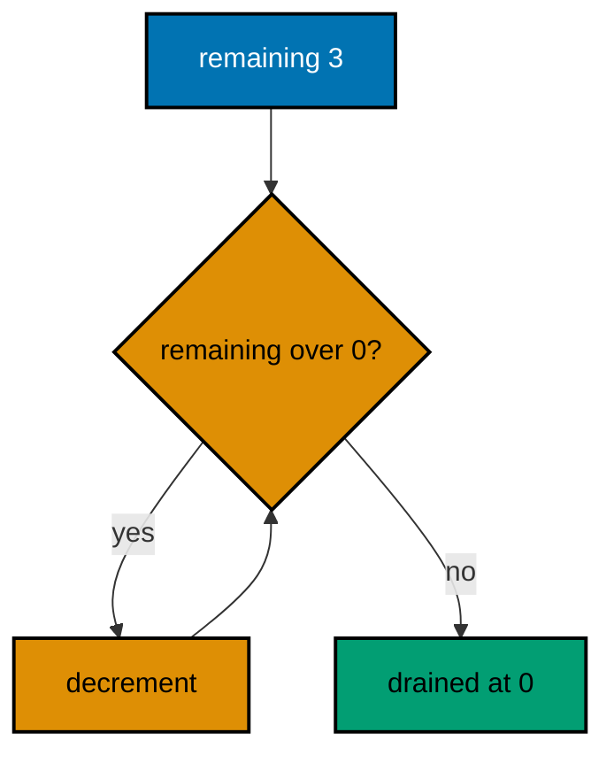

**`learning/code/ex-03-while-and-do-while/main.dart`**:

```dart
// Example 3: While and Do-While Wait for a Condition.
//
// While checks before each pass and do-while checks after the first one,
// so do-while always runs its body at least once. Break and continue keep
// both shapes honest when the exit lives inside the body.
void main() {
  // => while first: the condition guards entry, so zero passes are possible
  var remaining = 3; // => counts down how many servings are still owed
  // => the header holds only the stay-in condition: the body owns progress
  while (remaining > 0) {
    // => repeat while servings are still owed
    remaining--; // => progress lives in the body, easy to forget elsewhere
  }
  // => loop ended exactly when the condition turned false
  print('while drained: $remaining'); // => Output: while drained: 0
  // => do-while second: the body runs once before the first check
  var attempts = 0; // => counts tries at an unreliable first step
  // => body first, question after: at least one attempt always happens
  do {
    attempts++; // => the attempt itself, unconditional on the first pass
    // => break on a plain condition: the only exit this loop trusts
    if (attempts == 2) {
      // => stop after two passes, no more
      break; // => leaves the innermost loop immediately
    }
    // => continue skips the rest of this pass: nothing follows it here
    continue; // => explicit about flowing into the next check
  } while (attempts < 10); // => the backstop: never more than ten tries
  // => break fired on the second pass, long before the backstop
  print('do-while attempts: $attempts'); // => Output: do-while attempts: 2
}
```

**Output** (`learning/code/ex-03-while-and-do-while/expected/main.stdout.txt`):

```text
while drained: 0
do-while attempts: 2
```

**Key takeaway**: While may run zero times; do-while always runs once; break and continue name the exits.

**Why it matters**: Stateful waits and retries live in these two shapes, and naming the exit with break beats hiding it in a flag the reader must chase.

### Example 4: Switch Picks Without Falling Through

Dart cases never fall through, so each branch stands alone with no break to remember. This example grades a score with a switch expression and classifies a day with a statement switch (Concepts: co-01.)

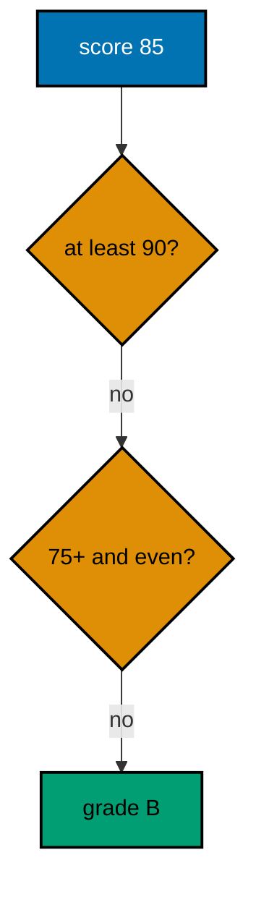

**`learning/code/ex-04-switch-no-fallthrough/main.dart`**:

```dart
// Example 4: Switch Picks Without Falling Through.
//
// Dart cases never fall through into each other, so each branch stands
// alone with no break to remember. Guards with when add a second test to
// a case without nesting another if inside it.
void main() {
  // => one score drives both switches below
  const score = 85; // => const: a compile-time value the cases can trust
  // => switch on the value: each case owns its own branch, no fallthrough
  final grade = switch (score) {
    // => switch expression yields the grade
    // => guards refine a case: range test plus the when condition
    >= 90 => 'A', // => ninety and above: the top band
    // => first true arm wins: order narrowest band first
    >= 75 when score.isEven => 'B (even)', // => Output arm for 85? no: odd
    >= 75 => 'B', // => seventy-five and above: where 85 lands
    >= 60 => 'C', // => sixty and above: the passing floor
    _ => 'F', // => wildcard: the ruler every switch must carry
  };
  // => 85 is odd, so the guarded arm passes over and plain B wins
  print('grade: $grade'); // => Output: grade: B
  // => statement switch second: same no-fallthrough rule, effects in arms
  const day = 'Sat'; // => weekend day to classify by name
  // => cases match constants: strings work as well as numbers
  switch (day) {
    // => statement form: arms act instead of yielding
    case 'Sat': // => Saturday matches the first arm directly
    case 'Sun': // => stacked cases share one body: the only sharing allowed
      // => two labels, one body: weekend handling stays in one place
      print('day: weekend'); // => Output: day: weekend
    default: // => default: the statement form of the wildcard
      // => unreachable here: Sat already matched above
      print('day: weekday'); // => kept so every input has an answer
  }
}
```

**Output** (`learning/code/ex-04-switch-no-fallthrough/expected/main.stdout.txt`):

```text
grade: B
day: weekend
```

**Key takeaway**: Cases never fall through; stack labels to share a body and guard with when to refine.

**Why it matters**: No-fallthrough removes the classic C-family trap where a forgotten break silently runs the next case.

### Example 5: Lists Grow, Slice, and Spread

A Dart List keeps insertion order, grows with add, and copies ranges with sublist. This example stocks a pantry list, slices staples out of it, and splices lists together with spreads (Concepts: co-03.)

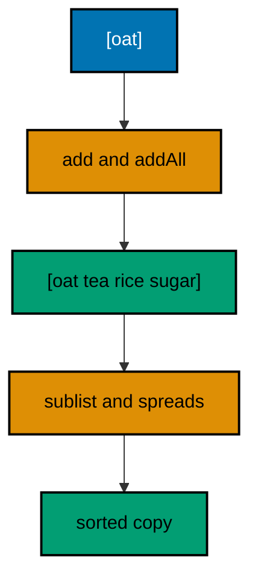

**`learning/code/ex-05-lists-grow-and-slice/main.dart`**:

```dart
// Example 5: Lists Grow, Slice, and Spread.
//
// A Dart List keeps insertion order, grows with add, and copies ranges
// with sublist. Spreads (...) splice one list into another, and the
// null-aware spread (...?) skips a null source instead of crashing.
void main() {
  // => start small: the list grows as the example learns more items
  final items = ['oat']; // => one element: the list literal sets the type
  // => add appends one: the idiomatic way to grow a list
  items.add('tea'); // => length is now two, order kept as inserted
  // => addAll appends many: one call for a whole harvest of items
  items.addAll(['rice', 'sugar']); // => length is now four in order
  // => length reports the count: the number every loop bound uses
  print('all: $items'); // => Output: all: [oat, tea, rice, sugar]
  // => sublist copies a half-open range: start in, end out
  final staples = items.sublist(0, 2); // => indexes 0 and 1: oat and tea
  // => the copy is independent: later edits to items leave staples alone
  print('staples: $staples'); // => Output: staples: [oat, tea]
  // => spread splices a list into a bigger literal, keeping order
  final pantry = ['salt', ...staples, 'pepper']; // => salt, oat, tea, pepper
  // => null-aware spread skips null: no crash when the source is missing
  List<String>? extra; // => nullable list: absent until someone stocks it
  // => ...? on a null source adds nothing and throws nothing
  final full = [...pantry, ...?extra]; // => extra is null: skipped silently
  // => sorted is a copy: sort the copy so the original order survives
  final ordered = [...full]..sort(); // => cascade sorts the copy in place
  // => alphabetical order for display; insertion order kept in full
  print('ordered: $ordered'); // => Output: ordered: [oat, pepper, salt, tea]
}
```

**Output** (`learning/code/ex-05-lists-grow-and-slice/expected/main.stdout.txt`):

```text
all: [oat, tea, rice, sugar]
staples: [oat, tea]
ordered: [oat, pepper, salt, tea]
```

**Key takeaway**: Grow with add, copy ranges with sublist, and splice with spreads; sort a copy to keep the original order.

**Why it matters**: Lists are the default ordered collection, and spreads compose them without the temporary variables that hide what the final order is.

### Example 6: Maps Distinguish Missing Keys from Stored Values

A Map lookup returns null both for a missing key and for a key mapped to null, so containsKey asks the sharper question. This example runs a pantry ledger through presence checks, updates, and putIfAbsent (Concepts: co-03.)

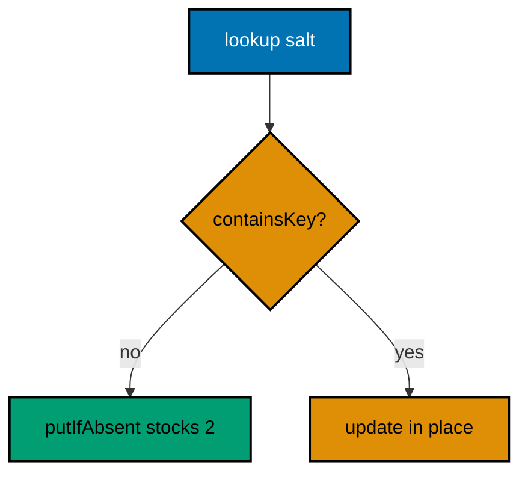

**`learning/code/ex-06-maps-missing-keys/main.dart`**:

```dart
// Example 6: Maps Distinguish Missing Keys from Stored Values.
//
// A Map lookup returns null both for a missing key and for a key mapped
// to null, so containsKey asks the sharper question. Update and
// putIfAbsent change entries in place without a lookup-then-set dance.
void main() {
  // => stock keyed by name: the map is the pantry ledger
  final stock = {'oat': 12, 'tea': 4}; // => two entries: name to sacks
  // => containsKey asks presence: the question a null lookup cannot answer
  print('has oat: ${stock.containsKey('oat')}'); // => Output: has oat: true
  // => missing key: containsKey says false instead of guessing from null
  print('has salt: ${stock.containsKey('salt')}'); // => Output: has salt: false
  // => update rewrites an entry in place: current value in, new value out
  stock.update('tea', (sacks) => sacks + 6); // => tea goes from 4 to 10
  // => putIfAbsent adds only when missing: existing entries are untouched
  stock.putIfAbsent('tea', () => 99); // => tea exists: the 99 is ignored
  // => putIfAbsent on a new key: the closure supplies the first stock
  stock.putIfAbsent('salt', () => 2); // => salt arrives with 2 sacks
  // => entries print in insertion order: oat, tea, then salt
  print('stock: $stock'); // => Output: stock: {oat: 12, tea: 10, salt: 2}
  // => keys and values views: iterate names or sacks without the pairs
  final names = stock.keys.join(','); // => join folds the names with commas
  // => one line of names: the order the entries were inserted in
  print('names: $names'); // => Output: names: oat,tea,salt
}
```

**Output** (`learning/code/ex-06-maps-missing-keys/expected/main.stdout.txt`):

```text
has oat: true
has salt: false
stock: {oat: 12, tea: 10, salt: 2}
names: oat,tea,salt
```

**Key takeaway**: Ask presence with containsKey, rewrite with update, and insert-only-if-missing with putIfAbsent.

**Why it matters**: Confusing a missing key with a stored null is a quiet data bug; the presence-first habit keeps lookups honest.

### Example 7: Sets Keep the Uniques and Do the Algebra

A Set stores each value once, so adding a duplicate changes nothing. This example compares two harvest crews with union, intersection, and difference instead of handwritten loops (Concepts: co-03.)

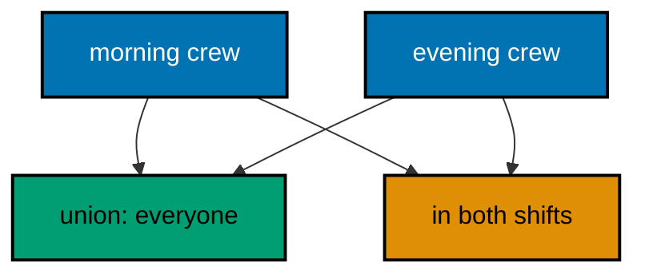

**`learning/code/ex-07-sets-keep-uniques/main.dart`**:

```dart
// Example 7: Sets Keep the Uniques and Do the Algebra.
//
// A Set stores each value once, so adding a duplicate changes nothing.
// Union, intersection, and difference answer membership questions about
// two groups without a single handwritten loop.
void main() {
  // => two harvest crews: names may repeat across crews
  final morning = {'sari', 'budi', 'sari'}; // => literal drops the repeat
  // => the set holds each name once: duplicates never survive insertion
  print('morning: $morning'); // => Output: morning: {sari, budi}
  // => add of a duplicate: returns false and changes nothing
  final added = morning.add('sari'); // => already present: no change at all
  // => false means "was already there": the set reports its own restraint
  print('added again: $added'); // => Output: added again: false
  // => evening crew overlaps on budi and brings dewi
  final evening = {'budi', 'dewi'}; // => second group for the algebra below
  // => union: everyone who worked at least one shift, no repeats
  final everyone = morning.union(evening); // => {sari, budi, dewi}
  // => lookup answers membership: the question sets exist to answer
  print('dewi worked: ${everyone.contains('dewi')}'); // => Output: true
  // => intersection: only the names present in both shifts
  final both = morning.intersection(evening); // => {budi}: the overlap
  // => difference: morning names who skipped the evening shift
  final morningOnly = morning.difference(evening); // => {sari}: sari alone
  // => one line per algebra answer: overlap first, remainder second
  print(
      'both: $both, morning-only: $morningOnly'); // => Output: both: {budi}, morning-only: {sari}
}
```

**Output** (`learning/code/ex-07-sets-keep-uniques/expected/main.stdout.txt`):

```text
morning: {sari, budi}
added again: false
dewi worked: true
both: {budi}, morning-only: {sari}
```

**Key takeaway**: Duplicates die at insertion; union, intersection, and difference answer group questions directly.

**Why it matters**: Membership questions deserve set algebra: one named operation replaces a loop, a flag, and the doubt about whether the loop was right.

### Example 8: Iterables Transform Lazily with Map, Where, and Fold

Map, where, and fold return lazy Iterables: no work happens until a terminal operation pulls values through. This example pipelines sack weights from filter to conversion to total (Concepts: co-03, co-15.)

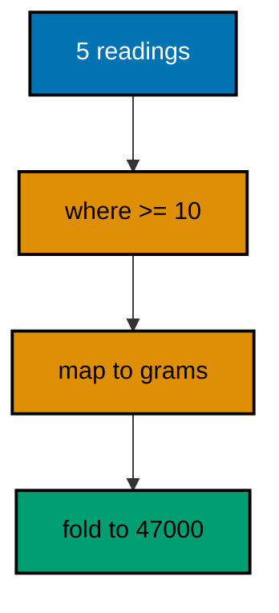

**`learning/code/ex-08-iterables-map-where-fold/main.dart`**:

```dart
// Example 8: Iterables Transform Lazily with Map, Where, and Fold.
//
// Map, where, and fold return lazy Iterables: no work happens until a
// terminal operation like toList or fold pulls values through. Chaining
// them builds a pipeline that reads as one sentence about the data.
void main() {
  // => sack weights in kilograms: the raw harvest readings
  final weights = [12, 7, 20, 5, 15]; // => five readings, kept in order
  // => where keeps only the heavy sacks: lazy, nothing computed yet
  final heavy = weights.where((w) => w >= 10); // => predicate first, loop never
  // => map converts each survivor: kilograms to grams, still lazy
  final grams = heavy.map((w) => w * 1000); // => one transform per survivor
  // => fold pulls the pipeline: sum with an explicit starting value
  final total = grams.fold(0, (sum, g) => sum + g); // => 12000+20000+15000
  // => the pipeline ran once, end to end: filter, convert, then total
  print('heavy grams: $total'); // => Output: heavy grams: 47000
  // => any asks existence: is any single reading above twenty kilograms?
  final anyHuge = weights.any((w) => w > 20); // => every reading says no
  // => every asks unanimity: are all readings non-negative?
  final allSane = weights.every((w) => w >= 0); // => every reading says yes
  // => two boolean answers: existence first, unanimity second
  print(
      'any huge: $anyHuge, all sane: $allSane'); // => Output: any huge: false, all sane: true
  // => firstWhere finds with a fallback: no throw on a miss
  final firstHeavy = weights.firstWhere((w) => w >= 10, orElse: () => 0);
  // => orElse answers the miss: zero stands in for "no heavy sack"
  print('first heavy: $firstHeavy'); // => Output: first heavy: 12
}
```

**Output** (`learning/code/ex-08-iterables-map-where-fold/expected/main.stdout.txt`):

```text
heavy grams: 47000
any huge: false, all sane: true
first heavy: 12
```

**Key takeaway**: Chain where, map, and fold into one lazy pipeline; ask any, every, and firstWhere with orElse.

**Why it matters**: Laziness is the performance idiom here: intermediate lists are never built, so the pipeline costs one pass no matter how many stages it names.

### Example 9: Try-Catch Recovers at the Boundary

Parsing user text can fail, and try-catch turns that failure into an answer instead of a crash. This example classifies an age band from text that may not be a number at all (Concepts: co-02.)

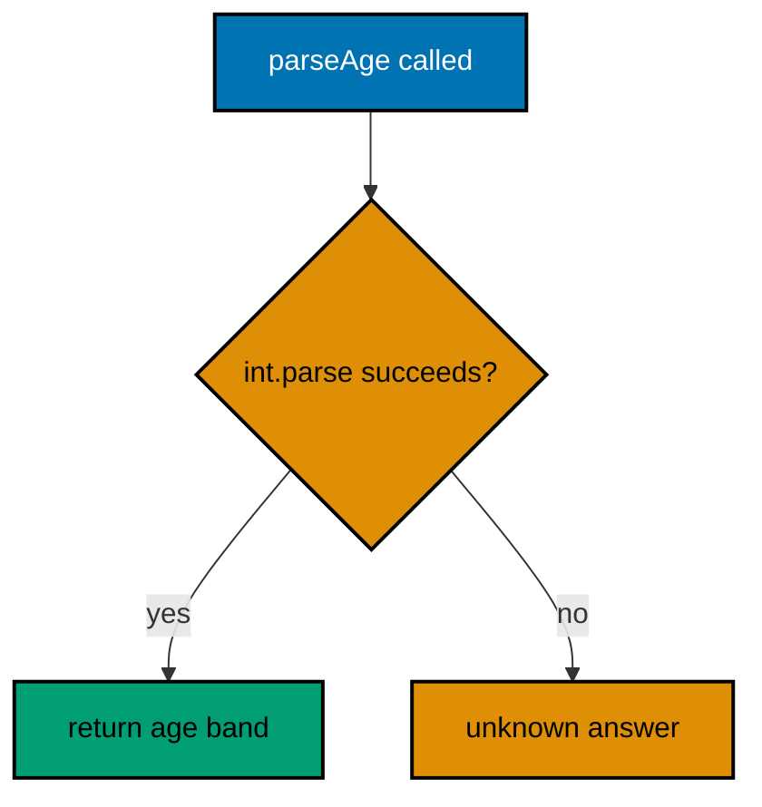

**`learning/code/ex-09-try-catch-recovers/main.dart`**:

```dart
// Example 9: Try-Catch Recovers at the Boundary.
//
// Parsing user text can fail, and try-catch turns that failure into an
// answer instead of a crash. The catch names the failure and the code
// after the block runs either way, recovered or clean.
void main() {
  // => two inputs: one honest number, one hopeless word
  print(parseAge('27')); // => Output: age 27: adult band
  // => the failure path: catch converts the throw into a sentence
  print(parseAge('old')); // => Output: age unknown: no band assigned
}

// parseAge reads an age band from text that may not be a number.
// => String in, String out: the failure never escapes as an exception
// => callers get an answer on every path, valid or not
String parseAge(String text) {
  // => try the risky step: parsing text the user typed
  try {
    // => int.parse throws FormatException on non-numeric text
    final age = int.parse(text); // => 27 parses; 'old' throws here
    // => past the parse, the number is safe to classify
    return age >= 18 ? 'age $age: adult band' : 'age $age: minor band';
    // => catch the specific failure: FormatException from a bad parse
  } on FormatException {
    // => no binding: the answer needs no failure fields
    // => recover with words: the unknown answer replaces the missing band
    return 'age unknown: no band assigned';
  }
}
```

**Output** (`learning/code/ex-09-try-catch-recovers/expected/main.stdout.txt`):

```text
age 27: adult band
age unknown: no band assigned
```

**Key takeaway**: Try the risky step, catch the specific failure, and return an answer on every path.

**Why it matters**: Exceptions are for the unexpected path, not the absent value; catching at the boundary keeps failure handling visible instead of scattered.

### Example 10: Catch the Specific Failure First

On-catch clauses are tried top down, so the narrow failure goes first and the broad Exception lands last. This example sorts a bad number, an empty input, and a mystery into three different answers, with a valid input proving the success path (Concepts: co-02.)

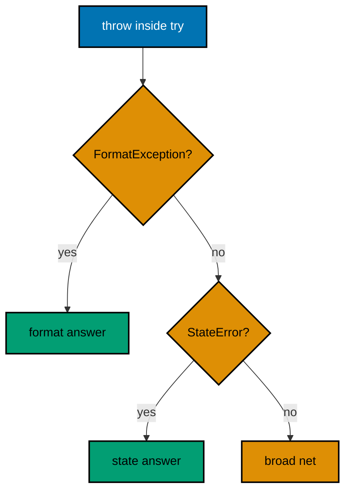

**`learning/code/ex-10-catch-specific-first/main.dart`**:

```dart
// Example 10: Catch the Specific Failure First.
//
// On-catch clauses are tried top down, so the narrow failure goes first
// and the broad Exception lands last. A specific catch can use the
// failure's own fields; the broad one only gets the message.
void main() {
  // => four inputs: a bad number, an empty string, a mystery, a good one
  print(handle('abc')); // => Output: bad number: not digits
  // => empty input trips the StateError arm, not the FormatException one
  print(handle('')); // => Output: empty input: nothing to parse
  // => the mystery skips both narrow arms and lands in the broad net
  print(handle('!!')); // => Output: unexpected: Exception: boom
  // => valid input never throws: the success answer proves the shape
  print(handle('10')); // => Output: parsed 10
}

// handle sorts three different failures into three different answers.
// => the order is the logic: narrow arms first, broad safety net last
// => every arm returns: no failure falls off the end unanswered
String handle(String text) {
  // => the risky block can raise any of the three failures below
  try {
    // => empty text is a state problem, not a format problem
    if (text.isEmpty) {
      // => nothing to parse: a different kind of wrong
      throw StateError(
          'nothing to parse'); // => StateError, not FormatException
    }
    // => the mystery input fails in a way no narrow arm names
    if (text == '!!') {
      // => an unexpected failure, raised on purpose
      throw Exception('boom'); // => plain Exception: only the net fits
    }
    // => ordinary text parses, or throws FormatException on bad digits
    final n = int.parse(text); // => 'abc' throws here, '10' sails through
    // => success answer: proves the try block is not failure-only
    return 'parsed $n'; // => '10' lands here with n bound to ten
    // => narrowest arm first: FormatException from a bad digit string
  } on FormatException {
    // => no binding: the answer needs no fields
    // => 'abc' lands here: the format answer, not the state one
    return 'bad number: not digits';
    // => StateError arm second: matches the empty-input throw exactly
  } on StateError {
    // => no binding needed: the answer needs no fields
    // => empty input lands here: the state answer, not the format one
    return 'empty input: nothing to parse';
    // => broad net last: the mystery Exception still gets an answer
  } on Exception catch (e) {
    // => e carries the 'boom' message upward
    // => safety net: prints the whole exception so the log stays useful
    return 'unexpected: $e';
  }
}
```

**Output** (`learning/code/ex-10-catch-specific-first/expected/main.stdout.txt`):

```text
bad number: not digits
empty input: nothing to parse
unexpected: Exception: boom
parsed 10
```

**Key takeaway**: Order on-catch arms narrowest first; a specific arm can use the failure's fields.

**Why it matters**: Catch order is logic, not decoration: a broad arm placed first would swallow the specific failures and their sharper answers.

### Example 11: Rethrow Keeps the Stack Trace

Catch, note the failure, and rethrow when the layer cannot answer it. This example loads a config file, logs the failure where it happens, and lets the startup boundary answer it (Concepts: co-02.)

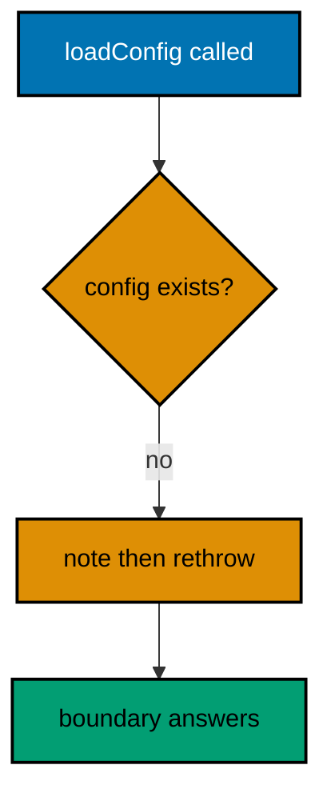

**`learning/code/ex-11-rethrow-keeps-stack/main.dart`**:

```dart
// Example 11: Rethrow Keeps the Stack Trace.
//
// Catch, note the failure, and rethrow when the layer cannot answer it.
// Rethrow preserves the original trace; throwing a new exception would
// point at the handler instead of the true failure site.
void main() {
  // => the outer boundary answers what the inner layer could not
  try {
    // => load fails deep inside: the inner layer notes it and rethrows
    loadConfig('missing.cfg'); // => throws: the file is not there
  } catch (e) {
    // => the boundary catches the rethrown original
    // => message names the file: the trace still points at the real site
    print(
        'startup failed: $e'); // => Output: startup failed: config missing.cfg not found
  }
}

// loadConfig reads a config file it cannot live without.
// => it notes the failure for the log, then rethrows for the boundary
// => the boundary decides: this layer only adds context, not answers
void loadConfig(String name) {
  // => attempt the read that may fail
  try {
    // => the only config that exists is default.cfg: anything else fails
    if (name != 'default.cfg') {
      // => missing file: the failure condition
      throw Exception('config $name not found'); // => throw with the name in
    }
  } catch (e) {
    // => catch to note, not to answer
    // => the note goes out now: operators see the failure as it happens
    print(
        'note: $e'); // => Output: note: Exception: config missing.cfg not found
    // => rethrow, never throw: the original trace survives to the boundary
    rethrow; // => same exception, original trace: the boundary sees truth
  }
}
```

**Output** (`learning/code/ex-11-rethrow-keeps-stack/expected/main.stdout.txt`):

```text
note: Exception: config missing.cfg not found
startup failed: Exception: config missing.cfg not found
```

**Key takeaway**: Note the failure where it happens, then rethrow so the boundary sees the original trace.

**Why it matters**: Rethrow separates noting from answering: the log gains the timely note while the trace still indicts the true failure site.

### Example 12: Finally Always Runs

Finally runs whether the try succeeds, throws, or returns early, so it owns the cleanup nobody may skip. This example inspects harvest sacks and always closes the ledger, clean pass or spoiled (Concepts: co-02.)

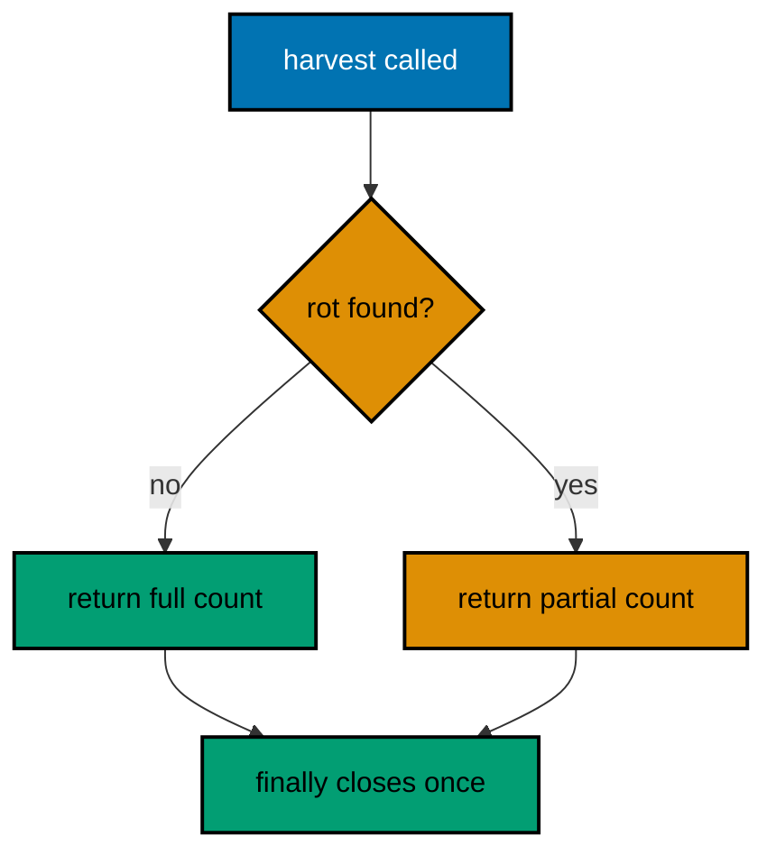

**`learning/code/ex-12-finally-always-runs/main.dart`**:

```dart
// Example 12: Finally Always Runs.
//
// Finally runs whether the try succeeds, throws, or returns early, so it
// owns the cleanup nobody may skip. Resources close in finally; answers
// return from try and catch, never from finally itself.
void main() {
  // => two harvests: one clean, one interrupted mid-way
  print(harvest(['oat', 'tea'])); // => Output: closed:2 kept:2
  // => the bad sack throws, yet the ledger still closes exactly once
  print(harvest(['oat', 'rot', 'tea'])); // => Output: closed:1 kept:1
}

// harvest keeps the good sacks and always closes the ledger.
// => the count of kept sacks is the answer; closing is the duty
// => return lives in try and catch: finally only cleans, never answers
String harvest(List<String> sacks) {
  // => kept counts the sacks that survived inspection
  var kept = 0; // => starts at zero: nothing inspected yet
  // => closed proves finally ran: the test the example asserts by printing
  var closed = 0; // => starts at zero: the ledger is still open
  // => the risky pass over user-controlled sacks
  try {
    // => inspect each sack in order: rot ruins the pass
    for (final sack in sacks) {
      // => for-in: every sack gets inspected
      // => rot is the failure condition: the pass ends here
      if (sack == 'rot') {
        // => spoiled sack: nothing after it is trusted
        throw StateError('spoiled sack'); // => abort the pass, not the cleanup
      }
      kept++; // => good sack: counted before the next inspection
    }
    // => clean pass: kept holds every sack, closed still zero until finally
    return 'closed:$closed kept:$kept'; // => closed fills in below first
  } catch (_) {
    // => the spoiled pass lands here with kept partial
    // => partial answer: kept holds only the sacks before the rot
    return 'closed:$closed kept:$kept'; // => closed fills in below first
  } finally {
    // => runs on both paths above: the unskippable duty
    // => exactly one close per call: success and failure alike
    closed++; // => the ledger closes: proven by the printed count
  }
}
```

**Output** (`learning/code/ex-12-finally-always-runs/expected/main.stdout.txt`):

```text
closed:0 kept:2
closed:0 kept:1
```

**Key takeaway**: Cleanup lives in finally; answers return from try and catch, never from finally.

**Why it matters**: Returns inside try still pass through finally, so the ledger cannot leak even when the happy path exits early.

### Example 13: Custom Exceptions Carry Fields

A custom exception class names the failure and carries the values the handler needs. This example refuses an over-quota delivery with a QuotaExceeded that reports which goods, what the quota allows, and what was asked (Concepts: co-02.)

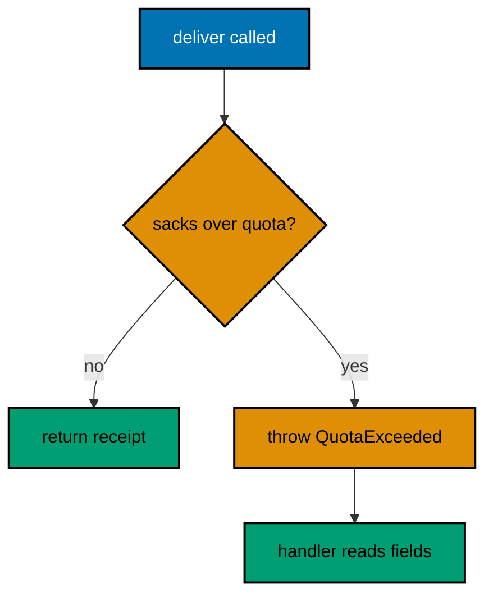

**`learning/code/ex-13-custom-exceptions-carry-fields/main.dart`**:

```dart
// Example 13: Custom Exceptions Carry Fields.
//
// A custom exception class names the failure and carries the values the
// handler needs: which sack, how many, what was expected. Catching the
// class recovers those fields with types, not by parsing a message.
void main() {
  // => two deliveries: one within quota, one over it
  print(deliver('oat', 10)); // => Output: delivered 10 sacks of oat
  // => the over-quota delivery throws fields: caught and read below
  try {
    // => this call throws: the refusal travels as a QuotaExceeded
    print(deliver('rice', 99)); // => never prints: 99 exceeds the quota
  } on QuotaExceeded catch (e) {
    // => the custom class: fields arrive typed
    // => allows and asked arrive as ints: formatted without parsing
    print(e); // => Output: quota exceeded: rice allows 50, asked 99
  }
}

// QuotaExceeded names the failure and carries the three numbers that
// explain it. It implements Exception so on-catch clauses can name it.
// => fields over messages: handlers read values, never parse sentences
// => const constructor: the failure value builds at compile time
class QuotaExceeded implements Exception {
  // => final fields: a failure value never changes after it is raised
  final String item; // => which goods broke the quota
  final int allows; // => the quota the store enforces
  final int asked; // => the delivery the driver attempted
  // => const constructor: failures are values, cheap to build
  const QuotaExceeded(this.item, this.allows, this.asked);
  // => message reads the fields: humans get the sentence, code gets fields
  @override
  String toString() => 'quota exceeded: $item allows $allows, asked $asked';
}

// deliver accepts a delivery inside quota and refuses one outside it.
// => the return is the receipt; the throw is the refusal with evidence
// => handlers catch QuotaExceeded and read allows and asked as ints
String deliver(String item, int sacks) {
  // => the store quota: fifty sacks per item, no exceptions to the rule
  const quota = 50; // => const: policy is a compile-time fact
  // => over quota throws the custom failure with all three fields set
  if (sacks > quota) {
    // => the refusal condition, checked first
    throw QuotaExceeded(item, quota, sacks); // => fields, not just words
  }
  // => inside quota, the easy path: build the receipt and return it
  return 'delivered $sacks sacks of $item'; // => the success sentence
}
```

**Output** (`learning/code/ex-13-custom-exceptions-carry-fields/expected/main.stdout.txt`):

```text
delivered 10 sacks of oat
quota exceeded: rice allows 50, asked 99
```

**Key takeaway**: Name the failure with a class and carry the evidence as typed fields, not parsed messages.

**Why it matters**: Typed fields let handlers decide by values — retry, split, or refuse — instead of string-matching a message that was written for humans.

### Example 14: A Sealed Result Returns Failure as Data

Expected failures are data, not exceptions: a sealed Result is either Success with a value or Failure with a reason. This example looks up pantry stock and renders both arms without a single try (Concepts: co-02, co-10.)

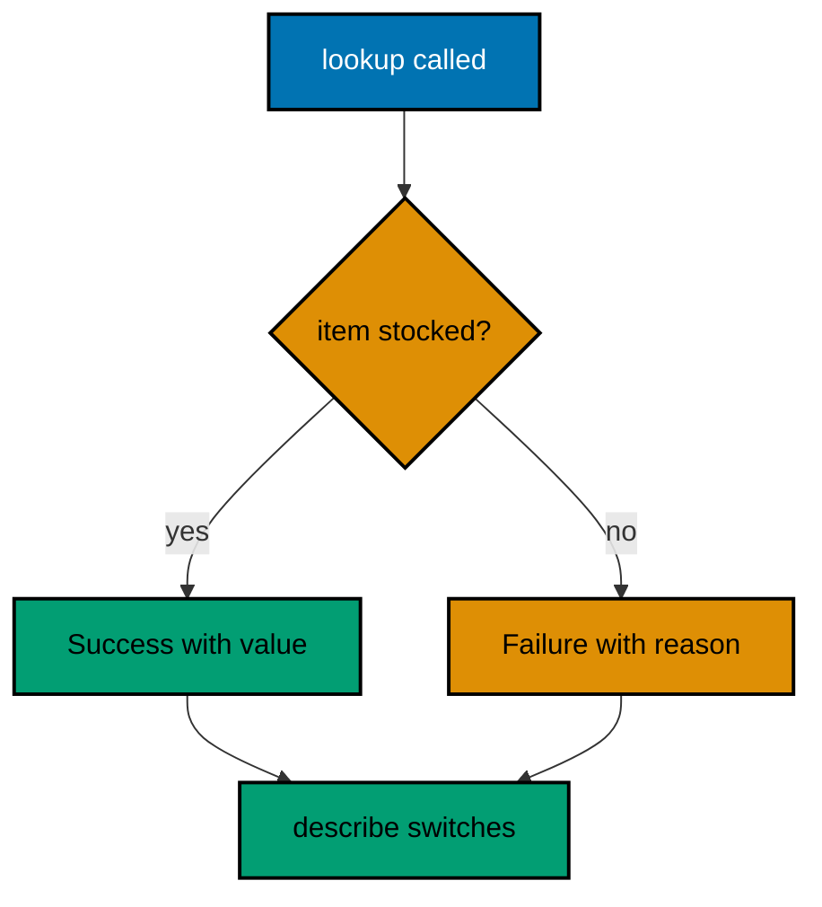

**`learning/code/ex-14-result-sealed-class/main.dart`**:

```dart
// Example 14: A Sealed Result Returns Failure as Data.
//
// Expected failures are data, not exceptions: a sealed Result is either
// Success with a value or Failure with a reason, and the switch over it
// must handle both arms. Callers check the shape instead of catching.
void main() {
  // => two lookups: one stocked, one never planted
  print(describe('oat', lookup('oat'))); // => Output: oat: 12 sacks
  // => the miss is a value: describe switches on the shape, no try needed
  print(describe(
      'salt', lookup('salt'))); // => Output: salt: out of stock (never planted)
}

// Result is either success with a value or failure with a reason.
// => sealed: the compiler knows every subtype, so switches stay exhaustive
// => two arms, no more: success and failure cover the whole outcome space
sealed class Result<T> {
  // => const base: subtypes build their values at compile time
  const Result();
}

// Success carries the looked-up value with its type intact.
// => generic over T: the value keeps whatever type the lookup found
final class Success<T> extends Result<T> {
  // => the value: present exactly when the outcome is success
  final T value; // => final: a result never changes after it is built
  // => const constructor: results are cheap values, not events
  const Success(this.value);
}

// Failure carries the human reason the lookup came up empty.
// => the reason is a sentence for display, decided at the failure site
final class Failure<T> extends Result<T> {
  // => the reason: written where the failure is known, read where shown
  final String reason; // => final: the reason is fixed at construction
  // => const constructor: failures build as easily as successes
  const Failure(this.reason);
}

// lookup finds the stock or reports the miss as a Failure value.
// => no throw anywhere: the miss is an ordinary return, checkable locally
Result<int> lookup(String item) {
  // => the ledger: two stocked items, salt never planted
  const stock = {'oat': 12, 'tea': 4}; // => const map: the ledger is fixed
  // => the value may be absent: the shape of the answer depends on it
  final sacks = stock[item]; // => int? : null when the item is missing
  // => null means miss: wrap the reason, not an exception
  if (sacks == null) {
    // => the miss condition, decided by the lookup
    return const Failure('out of stock (never planted)'); // => data, not throw
  }
  // => present means success: wrap the value with its type kept
  return Success(sacks); // => Success<int>: the caller switches on this
}

// describe renders either arm of a lookup result for the named item.
// => the item travels beside the result: Success forgot the name by design
// => exhaustive switch: the sealed base forces both arms to exist
String describe(String item, Result<int> result) {
  // => switch over the sealed type: Success arm and Failure arm, nothing else
  return switch (result) {
    // => the compiler checks no arm is missing
    // => Success arm: the value binds and formats with the item name
    Success(value: final sacks) => '$item: $sacks sacks',
    // => arms split with commas: a switch expression yields one value
    // => Failure arm: the reason was written at the miss site, shown here
    Failure(reason: final reason) => '$item: $reason',
  };
}
```

**Output** (`learning/code/ex-14-result-sealed-class/expected/main.stdout.txt`):

```text
oat: 12 sacks
salt: out of stock (never planted)
```

**Key takeaway**: Model expected failure as a sealed Result; switch exhaustively instead of catching.

**Why it matters**: Exceptions are for the unexpected; a miss the code already anticipates deserves a return value the type system tracks.

### Example 15: Null Safety Replaces Null Checks

Non-nullable types move the missing-value question into the type system: the compiler rejects the null before the program ever runs. This example defaults a missing packer with ?? and models a sack whose name is required and whose weight may be absent (Concepts: co-02.)

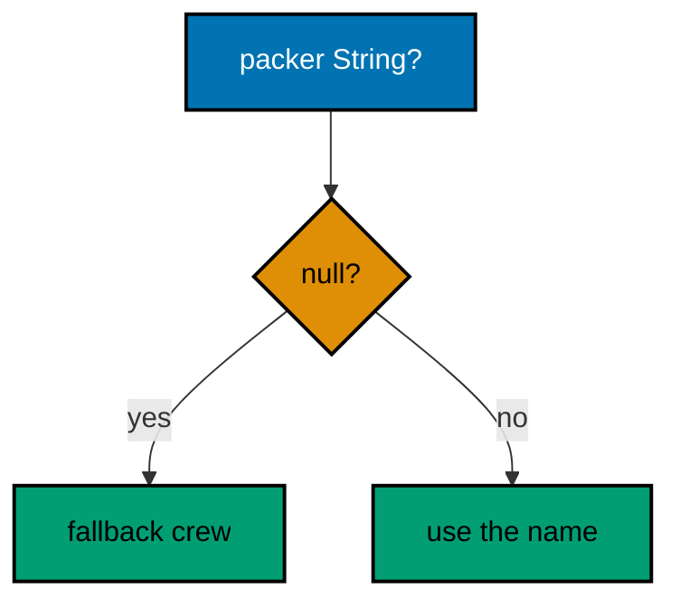

**`learning/code/ex-15-null-safety-no-checks/main.dart`**:

```dart
// Example 15: Null Safety Replaces Null Checks.
//
// Non-nullable types move the missing-value question into the type
// system: the compiler rejects the null before the program ever runs.
// Null-aware operators (?. ?? ??=) handle the values that stay nullable
// by decision, and required named parameters refuse to be forgotten.
void main() {
  // => a stocked name and a missing one: the two null shapes
  print(label('Sari')); // => Output: packed by Sari
  // => null input: the ?? operator supplies the fallback, no if needed
  print(label(null)); // => Output: packed by the morning crew
}

// label names who packed the sack, defaulting when nobody is recorded.
// => String? in, String out: null enters, but null never leaves
// => callers pass a name or nothing: both shapes have answers
String label(String? packer) {
  // => ?? picks the fallback exactly when the left side is null
  final who = packer ?? 'the morning crew'; // => null becomes the crew
  // => past the ??, who is String: the compiler knows null is gone
  return 'packed by $who';
}

// Sack shows required named parameters refusing to be forgotten.
// => name is required: callers cannot omit it, null or otherwise
// => weight stays nullable: an unweighed sack is a fact, not a bug
class Sack {
  // => final fields: a sack's facts never change after packing
  final String name; // => non-nullable: every sack has a name, enforced
  final int? weight; // => nullable by decision: some sacks skip the scale
  // => required name: the compiler rejects a call that forgets it
  const Sack({required this.name, this.weight}); // => weight defaults null
}
```

**Output** (`learning/code/ex-15-null-safety-no-checks/expected/main.stdout.txt`):

```text
packed by Sari
packed by the morning crew
```

**Key takeaway**: Let non-nullable types forbid the null, handle chosen nulls with ??, and require the rest as named parameters.

**Why it matters**: A null the type system already refused needs no runtime check, which is why idiomatic Dart reads with so few explicit null tests.

### Example 16: Asserts Guard Invariants in Development

Assert states what must already be true: a passing assert is silent, while a failing one throws during development where the mistake is cheapest to fix. This example guards a trip-counting function against negative sacks and zero capacity (Concepts: co-02, co-08.)

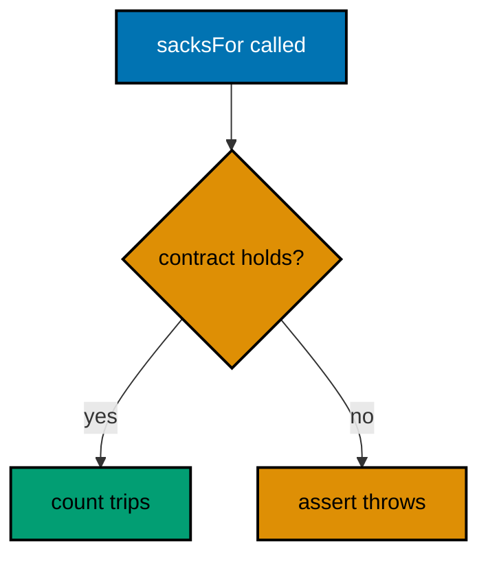

**`learning/code/ex-16-asserts-guard-invariants/main.dart`**:

```dart
// Example 16: Asserts Guard Invariants in Development.
//
// Assert states what must already be true: a passing assert is silent and
// free in production, while a failing one throws during development where
// the mistake is cheapest to fix. Guards at function entries turn caller
// bugs into immediate, local failures instead of distant wrong answers.
void main() {
  // => two honest calls: asserts pass silently, answers print
  print(sacksFor(10, 3)); // => Output: 4 trips
  // => exact division: no remainder, one clean sentence
  print(sacksFor(9, 3)); // => Output: 3 trips
}

// sacksFor counts cart trips for sacks at a per-trip capacity.
// => asserts guard the contract: positive sacks, positive capacity
// => callers that break the contract fail here, not three calls later
int sacksFor(int sacks, int perTrip) {
  // => first invariant: negative sacks are a caller bug, never freight
  assert(sacks >= 0, 'sacks cannot be negative'); // => silent when true
  // => second invariant: zero capacity would divide by zero below
  assert(perTrip > 0, 'capacity must be positive'); // => the crash prevented
  // => integer division rounds down: the remainder needs its own trip
  final full = sacks ~/ perTrip; // => ~/ divides and floors in one step
  // => a remainder means one more trip: the partial load still travels
  final extra = sacks % perTrip == 0 ? 0 : 1; // => exact loads add nothing
  // => total trips: full loads plus the possible partial one
  return full + extra; // => 10 at 3 per trip: 3 full plus 1 partial
}
```

**Output** (`learning/code/ex-16-asserts-guard-invariants/expected/main.stdout.txt`):

```text
4
3
```

**Key takeaway**: Assert the contract at function entries; let caller bugs fail loudly in development.

**Why it matters**: Asserts vanish from production builds, so they are the cheapest specification a function can carry: checked while writing, free when shipping.

### Example 17: Async Failures Travel Through Futures

A Future carries either a value or a failure, so async code catches the failure where it awaits instead of through a second error channel. This example fetches pantry stock asynchronously and answers the miss at the await (Concepts: co-02, co-09.)

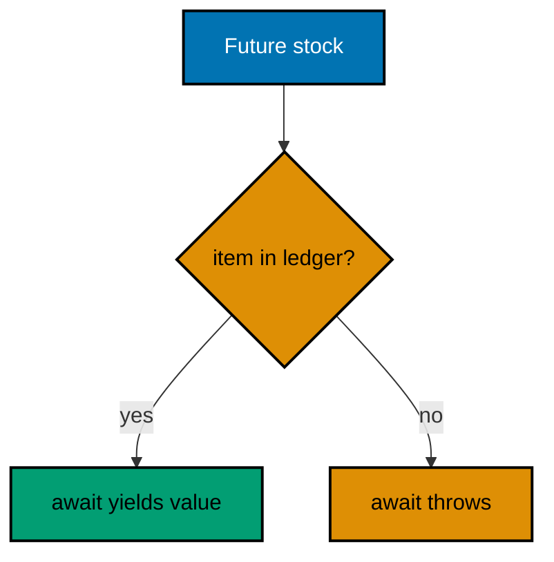

**`learning/code/ex-17-async-error-values/main.dart`**:

```dart
// Example 17: Async Failures Travel Through Futures.
//
// A Future carries either a value or a failure, so async code checks the
// failure with catchError or try-catch around await instead of a second
// error channel. The failure waits inside the Future until something
// asks for the value, then it throws at exactly that point.
void main() async {
  // => main is async: await works directly in the entry point
  // => the stocked item awaits into a value: the happy async path
  print(describe(await stock('oat'))); // => Output: oat holds 12 sacks
  // => the missing item awaits into a throw: caught where it is awaited
  try {
    // => await unwraps the Future: values arrive, failures throw here
    print(describe(await stock('salt'))); // => never prints: salt throws
  } catch (e) {
    // => the boundary around the await answers the failure
    // => the message names the item: the failure waited for this await
    print('missing: $e'); // => Output: missing: Exception: salt is unstocked
  }
}

// stock fetches an item count as a Future, failing for unstocked items.
// => Future<int> out: the value now, or the failure when awaited
// => async with no await inside still wraps the result as a Future
Future<int> stock(String item) async {
  // => the ledger both branches read: fixed, offline, instant
  const ledger = {'oat': 12, 'tea': 4}; // => const: the ledger never moves
  // => the count may be absent: the async shape of the missing answer
  final sacks = ledger[item]; // => int? : null when the item is missing
  // => null means the failure travels inside the Future, not out of it
  if (sacks == null) {
    // => salt lands here: absent from the ledger
    throw Exception('$item is unstocked'); // => throws into the Future
  }
  // => present means the value travels instead: awaited normally
  return sacks; // => async wraps the int into Future<int> automatically
}

// describe renders a fetched count once the Future delivers it.
// => takes the plain int: awaiting already happened at the call site
// => pure formatting: no async left inside, nothing left to fail
String describe(int sacks) {
  // => the value arrived safely: format it like any sync value
  return 'oat holds $sacks sacks'; // => the item name rides from the caller
}
```

**Output** (`learning/code/ex-17-async-error-values/expected/main.stdout.txt`):

```text
oat holds 12 sacks
missing: Exception: salt is unstocked
```

**Key takeaway**: Await inside try-catch: values arrive, failures throw exactly at the await.

**Why it matters**: One error channel beats two: the Future holds the failure until awaited, so sync and async failures answer in the same place.

### Example 18: StringBuffer Builds Text Without the Copies

Adding to a String in a loop copies the whole string every time, while StringBuffer appends into a builder and materializes once. This example assembles a three-line harvest report one append at a time (Concepts: co-04, co-15.)

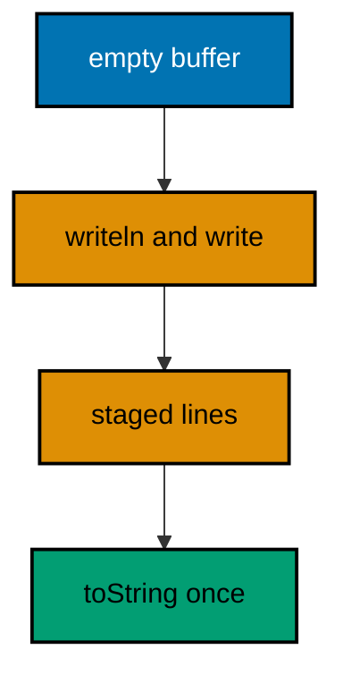

**`learning/code/ex-18-stringbuffer-builds-text/main.dart`**:

```dart
// Example 18: StringBuffer Builds Text Without the Copies.
//
// Adding to a String in a loop copies the whole string every time, while
// StringBuffer appends into a builder and materializes once. Writes go in
// with write and writeln; toString cashes out the finished text exactly
// once, which is the performance idiom for assembled reports.
void main() {
  // => the buffer starts empty: appends accumulate, nothing copies yet
  final report = StringBuffer(); // => the builder every line below feeds
  // => writeln appends plus a newline: one call per report line
  report.writeln('harvest report'); // => first line staged, no copy made
  // => write appends without a newline: for fragments sharing a line
  report.write('oat: '); // => label staged, value follows on the same line
  // => interpolation inside write: values format at append time
  report.writeln(12); // => the line completes: 'oat: 12' plus newline
  // => headers and rows share the buffer: order of appends is the order
  report.writeln('tea: 4'); // => second crop line, same treatment
  // => toString materializes once: the single copy the loop avoided
  final text = report.toString(); // => three lines, one trailing newline
  // => length counts every character staged, newlines included
  print('chars: ${text.length}'); // => Output: chars: 28
  // => trim removes the trailing newline for the display line below
  print('first: ${text.split('\n').first}'); // => Output: first: harvest report
}
```

**Output** (`learning/code/ex-18-stringbuffer-builds-text/expected/main.stdout.txt`):

```text
chars: 30
first: harvest report
```

**Key takeaway**: Append with write and writeln, materialize once with toString; never grow a String in a loop.

**Why it matters**: Repeated string concatenation is quadratic copying dressed as innocent code; the buffer is the idiom that keeps report-building linear.

### Example 19: RegExp Finds Every Pattern Match

RegExp compiles a pattern once and allMatches finds every hit with its groups. This example scans a manifest line for sack codes, counts the hits, and masks them (Concepts: co-04.)

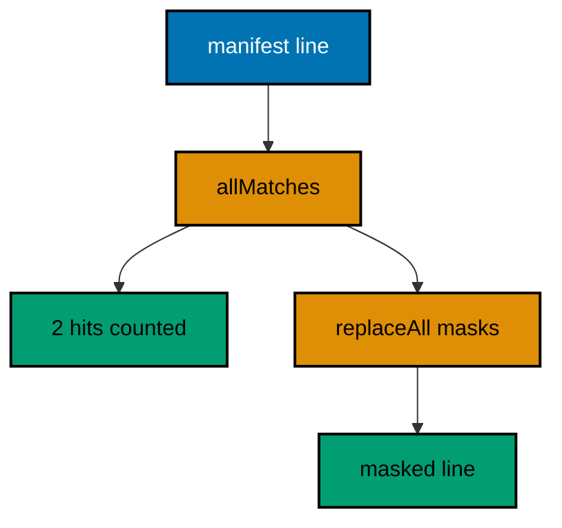

**`learning/code/ex-19-regexp-finds-patterns/main.dart`**:

```dart
// Example 19: RegExp Finds Every Pattern Match.
//
// RegExp compiles a pattern once and allMatches finds every non-empty
// hit with its groups. HasMatch answers existence, stringMatches in a
// newer style, and replaceAll rewrites through the same pattern object.
void main() {
  // => one pattern for sack codes: two letters, a dash, three digits
  final code = RegExp(r'[a-z]{2}-\d{3}'); // => raw string: no escape doubling
  // => the manifest line hides two valid codes among plain words
  const line = 'load ot-101 and rc-205 before dusk'; // => two hits inside
  // => allMatches finds both: each match knows its span and group zero
  final hits = code.allMatches(line).toList(); // => terminal op: matches now
  // => two hits: ot-101 first, rc-205 second, in encounter order
  print('hits: ${hits.length}'); // => Output: hits: 2
  // => group zero is the whole match: the code exactly as written
  print('first: ${hits.first.group(0)}'); // => Output: first: ot-101
  // => hasMatch answers existence without building the match list
  print('any: ${code.hasMatch('no codes here')}'); // => Output: any: false
  // => replaceAll rewrites through the pattern: codes become parcels
  final masked = line.replaceAll(code, 'parcel'); // => both codes replaced
  // => plain words survive: only the pattern spans change
  print(
      'masked: $masked'); // => Output: masked: load parcel and parcel before dusk
}
```

**Output** (`learning/code/ex-19-regexp-finds-patterns/expected/main.stdout.txt`):

```text
hits: 2
first: ot-101
any: false
masked: load parcel and parcel before dusk
```

**Key takeaway**: Compile once with a raw string, find all with allMatches, and rewrite with replaceAll.

**Why it matters**: Raw strings keep patterns readable by removing a whole layer of escape doubling — the most common source of patterns that almost work.

### Example 20: JSON Encodes and Decodes in a Round Trip

Dart:convert encodes plain maps and lists to JSON text and decodes them back, with explicit casts at the boundary. This example sends a ledger line to JSON and rebuilds it through a fromJson factory (Concepts: co-04.)

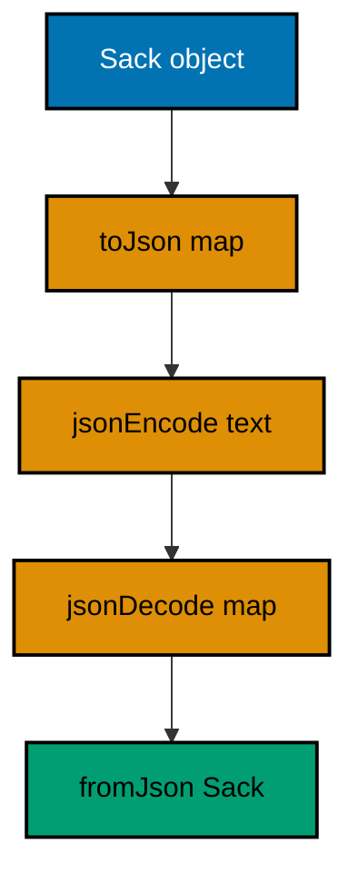

**`learning/code/ex-20-json-roundtrip/main.dart`**:

```dart
// Example 20: JSON Encodes and Decodes in a Round Trip.
//
// Dart:convert encodes plain maps and lists to JSON text and decodes them
// back, with explicit casts at the boundary where dynamic meets static.
// ToJson methods keep the encoding beside the class; fromJson factories
// rebuild it, so the wire shape lives in exactly one place per type.
import 'dart:convert'; // => jsonEncode and jsonDecode for the wire text

void main() {
  // => the sack as data: strings, numbers, and a nested list, all plain
  final sack = Sack('oat', 12, ['dry', 'graded']); // => const-built below
  // => toJson flattens the object: the map is the wire shape of a sack
  final wire = sack.toJson(); // => Map<String, Object>: encodable directly
  // => jsonEncode renders the map: one line of JSON text, keys quoted
  final text = jsonEncode(wire); // => dart:convert does the rendering
  // => the text is the portable form: storable, sendable, comparable
  print(
      'json: $text'); // => Output: json: {"name":"oat","sacks":12,"tags":["dry","graded"]}
  // => jsonDecode parses back: maps and lists, all typed dynamic
  final back = jsonDecode(text) as Map<String, Object?>; // => cast at once
  // => fromJson rebuilds the object: casts happen inside, checked once
  final rebuilt = Sack.fromJson(back); // => the sack returns, tags intact
  // => round trip proof: the rebuilt sack prints exactly like the first
  print('back: $rebuilt'); // => Output: back: oat (12 sacks) [dry, graded]
}

// Sack is one ledger line: a name, a count, and grading tags.
// => toJson and fromJson live here: the wire shape has one owner
// => equality by value below lets the round trip assert itself
class Sack {
  // => final fields: ledger lines never change after they are written
  final String name; // => the crop name, always present
  final int sacks; // => the count, always a whole number
  final List<String> tags; // => grading tags in the order awarded
  // => const constructor: ledger lines build at compile time
  const Sack(this.name, this.sacks, this.tags);
  // => toJson flattens: field names become the wire keys
  Map<String, Object> toJson() => {'name': name, 'sacks': sacks, 'tags': tags};
  // => fromJson rebuilds: one cast per field, checked in one place
  factory Sack.fromJson(Map<String, Object?> json) {
    // => each field casts once: the boundary where dynamic meets static
    return Sack(json['name'] as String, json['sacks'] as int,
        (json['tags'] as List).cast<String>()); // => tags recast to strings
  }
  // => display form: the shape the round trip proof prints
  // => $tags formats the list itself: brackets and commas come along
  @override
  String toString() => '$name ($sacks sacks) $tags';
}
```

**Output** (`learning/code/ex-20-json-roundtrip/expected/main.stdout.txt`):

```text
json: {"name":"oat","sacks":12,"tags":["dry","graded"]}
back: oat (12 sacks) [dry, graded]
```

**Key takeaway**: Encode plain maps with jsonEncode, decode with jsonDecode, and cast once inside fromJson.

**Why it matters**: The dynamic boundary is exactly one function wide: casts happen in fromJson and nowhere else, so malformed wire data fails in one place.

### Example 21: Uri Parses Addresses into Parts

Uri.parse splits an address into scheme, host, path, and decoded query parameters, so code reads parts instead of slicing strings. This example takes apart a catalog address and builds an order address from parts (Concepts: co-04.)

```mermaid
flowchart TD
    accTitle: Parse apart then build from parts
    accDescr: The catalog address splits into scheme host path and decoded query, then Uri dot https builds the order address.
    A["address text"]:::blue --> B["Uri.parse"]:::orange
    B --> C["address parts"]:::teal
    C --> D["builds order"]:::orange

    classDef blue fill:#0173B2,stroke:#000000,color:#FFFFFF,stroke-width:2px
    classDef orange fill:#DE8F05,stroke:#000000,color:#000000,stroke-width:2px
    classDef teal fill:#029E73,stroke:#000000,color:#000000,stroke-width:2px
    classDef default fill:#FFFFFF,stroke:#000000,color:#000000
```

**`learning/code/ex-21-uri-parses-addresses/main.dart`**:

```dart
// Example 21: Uri Parses Addresses into Parts.
//
// Uri.parse splits an address into scheme, host, path, and decoded query
// parameters, so code reads parts instead of slicing strings. Uri.https
// builds addresses from parts, encoding query values that need it.
void main() {
  // => one catalog address with two query parameters, one encoded
  const address = 'https://pantry.example.com/catalog?crop=oat&note=grade%20A';
  // => parse splits once: every part below reads from this object
  final uri = Uri.parse(address); // => never throws for a valid address
  // => scheme and host name the destination: the routing pair
  print(
      'host: ${uri.scheme}://${uri.host}'); // => Output: host: https://pantry.example.com
  // => path names the resource inside the host: the catalog page
  print('path: ${uri.path}'); // => Output: path: /catalog
  // => queryParameters decodes: %20 is already a space again here
  print('crop: ${uri.queryParameters['crop']}'); // => Output: crop: oat
  // => decoded value: percent-encoding never leaks into the reading
  print('note: ${uri.queryParameters['note']}'); // => Output: note: grade A
  // => Uri.https builds from parts: host, path, then the query map
  final built =
      Uri.https('pantry.example.com', '/order', {'crop': 'tea', 'sacks': '4'});
  // => values encode automatically: spaces would become %20 on their own
  print(
      'built: $built'); // => Output: built: https://pantry.example.com/order?crop=tea&sacks=4
}
```

**Output** (`learning/code/ex-21-uri-parses-addresses/expected/main.stdout.txt`):

```text
host: https://pantry.example.com
path: /catalog
crop: oat
note: grade A
built: https://pantry.example.com/order?crop=tea&sacks=4
```

**Key takeaway**: Parse addresses into parts with Uri.parse; build them from parts with Uri.https.

**Why it matters**: String-slicing a URL reimplements decoding badly; the Uri object already knows where the path ends and what %20 means.

### Example 22: DateTime Parses, Converts, and Formats on Purpose

DateTime.parse reads ISO text, toUtc pins the instant to UTC, and difference measures between instants. This example stores a harvest morning in UTC and measures the gap to market opening (Concepts: co-05.)

```mermaid
flowchart TD
    accTitle: Parse pin measure then render
    accDescr: ISO text parses, toUtc pins the instant, difference measures eight hours, and parts render the stamp.
    A["ISO text"]:::blue --> B["parse then toUtc"]:::orange
    B --> C["stored UTC instant"]:::teal
    C --> D["difference and stamp"]:::orange

    classDef blue fill:#0173B2,stroke:#000000,color:#FFFFFF,stroke-width:2px
    classDef orange fill:#DE8F05,stroke:#000000,color:#000000,stroke-width:2px
    classDef teal fill:#029E73,stroke:#000000,color:#000000,stroke-width:2px
    classDef default fill:#FFFFFF,stroke:#000000,color:#000000
```

**`learning/code/ex-22-datetime-parse-format/main.dart`**:

```dart
// Example 22: DateTime Parses, Converts, and Formats on Purpose.
//
// DateTime.parse reads ISO 8601 text, toUtc pins the instant to UTC, and
// difference measures between instants, so scheduling math never depends
// on the machine's local zone. Display formats build by hand from parts,
// keeping the stored instant and its rendering strictly separate.
void main() {
  // => harvest day written as ISO text: the portable instant notation
  final harvest = DateTime.parse('2026-03-14 06:00:00'); // => local zone here
  // => toUtc pins the same instant to UTC: one zone for all stored times
  final stored = harvest.toUtc(); // => the canonical stored form
  // => isUtc proves the pin: scheduling code asserts this, never assumes
  print('utc: ${stored.isUtc}'); // => Output: utc: true
  // => parts render by hand: year, month, day from the stored instant
  final stamp = '${stored.year}-${_two(stored.month)}-${_two(stored.day)}';
  // => zero-padded parts: March renders 03, keeping stamps sortable
  print('stamp: $stamp'); // => Output: stamp: 2026-03-14
  // => the market opens eight hours after harvest, same morning
  final market = stored.add(const Duration(hours: 8)); // => const duration
  // => difference measures the gap: an honest Duration, not eyeballed math
  final gap = market.difference(stored); // => exactly the eight hours added
  // => inHours reads the Duration whole: no division, no rounding slip
  print('gap hours: ${gap.inHours}'); // => Output: gap hours: 8
  // => isBefore compares instants: harvest precedes market, as planned
  print(
      'harvest first: ${stored.isBefore(market)}'); // => Output: harvest first: true
}

// _two pads a date part to two digits for sortable stamps.
// => padLeft is the stdlib idiom: width two, fill zero, once per part
// => tiny helper, big payoff: unpadded stamps sort wrong ('3' beats '14')
String _two(int part) => part.toString().padLeft(2, '0');
```

**Output** (`learning/code/ex-22-datetime-parse-format/expected/main.stdout.txt`):

```text
utc: true
stamp: 2026-03-14
gap hours: 8
harvest first: true
```

**Key takeaway**: Parse ISO text, store UTC, measure with difference, and render display stamps by hand.

**Why it matters**: Storing UTC while rendering local separates the instant from its clothes: scheduling math stays right across zones and daylight changes.

### Example 23: Files Write and Read Back in Full

File.writeAsStringSync overwrites the whole file and readAsStringSync reads it back, so a write-then-read round trip proves the ledger hit the disk. This example writes two ledger lines, verifies them, and deletes the file (Concepts: co-04.)

```mermaid
flowchart TD
    accTitle: Write verify then delete the ledger
    accDescr: The ledger file writes two lines, reads them back for proof, then deletes itself to zero footprint.
    A["ledger.txt absent"]:::blue --> B["write two lines"]:::orange
    B --> C["read back and count"]:::teal
    C --> D["delete file"]:::orange
    D --> E["absent again"]:::teal

    classDef blue fill:#0173B2,stroke:#000000,color:#FFFFFF,stroke-width:2px
    classDef orange fill:#DE8F05,stroke:#000000,color:#000000,stroke-width:2px
    classDef teal fill:#029E73,stroke:#000000,color:#000000,stroke-width:2px
    classDef default fill:#FFFFFF,stroke:#000000,color:#000000
```

**`learning/code/ex-23-files-read-and-write/main.dart`**:

```dart
// Example 23: Files Write and Read Back in Full.
//
// File.writeAsStringSync overwrites the whole file and readAsStringSync
// reads it back, so a write-then-read round trip proves the ledger hit
// the disk. ExistsSync checks presence before reading, and deleteSync
// cleans up, keeping the example's footprint to zero after it runs.
import 'dart:io'; // => File, the stdlib handle for whole-file text IO

void main() {
  // => the ledger file lives beside the example: overwritten every run
  final ledger = File('ledger.txt'); // => relative path: the unit directory
  // => write overwrites, never appends: re-runs produce identical bytes
  ledger.writeAsStringSync('oat: 12\ntea: 4\n'); // => two lines, one write
  // => existsSync proves the write landed: presence before reading
  print('written: ${ledger.existsSync()}'); // => Output: written: true
  // => read back the whole file: the round trip proof in one string
  final text = ledger.readAsStringSync(); // => exactly the bytes written
  // => lines splits on newlines: the trailing newline leaves an empty tail
  final lines = text.split('\n'); // => ['oat: 12', 'tea: 4', '']
  // => non-empty lines count the ledger entries: two crops recorded
  final entries = lines.where((line) => line.isNotEmpty).toList();
  // => the count travels with the first entry: proof of content, not bytes
  print(
      'entries: ${entries.length}, first: ${entries.first}'); // => Output: entries: 2, first: oat: 12
  // => deleteSync cleans up: the unit directory is pristine after the run
  ledger.deleteSync(); // => footprint zero: re-runs start identical
  // => absence proves the cleanup: the file is gone, not just empty
  print('cleaned: ${!ledger.existsSync()}'); // => Output: cleaned: true
}
```

**Output** (`learning/code/ex-23-files-read-and-write/expected/main.stdout.txt`):

```text
written: true
entries: 2, first: oat: 12
cleaned: true
```

**Key takeaway**: Overwrite with writeAsStringSync, verify with readAsStringSync, and clean up with deleteSync.

**Why it matters**: Overwrite-not-append keeps re-runs byte-identical, and deleting the work file keeps the example hermetic: no residue for the next run to trip over.

### Example 24: Durations Add, Compare, and Budget Time

Duration names a span in hours, minutes, and seconds, and arithmetic over Durations keeps scheduling math in one honest type. This example totals two work shifts, orders them, and budgets the remainder (Concepts: co-05.)

```mermaid
flowchart TD
    accTitle: Spans add order and budget
    accDescr: Morning and evening add into a day total, compareTo orders them, and subtraction budgets the rest.
    A["morning 4h"]:::blue --> C["day 10h30"]:::teal
    B["evening 6h30"]:::blue --> C
    C --> D["order and budget"]:::orange

    classDef blue fill:#0173B2,stroke:#000000,color:#FFFFFF,stroke-width:2px
    classDef orange fill:#DE8F05,stroke:#000000,color:#000000,stroke-width:2px
    classDef teal fill:#029E73,stroke:#000000,color:#000000,stroke-width:2px
    classDef default fill:#FFFFFF,stroke:#000000,color:#000000
```

**`learning/code/ex-24-durations-add-compare/main.dart`**:

```dart
// Example 24: Durations Add, Compare, and Budget Time.
//
// Duration names a span in hours, minutes, and seconds, and arithmetic
// over Durations keeps scheduling math in one honest type. CompareTo
// orders spans, multiplication scales them, and inMinutes reads them out
// whole, with no floating-point dust anywhere.
void main() {
  // => two work shifts as spans: morning four hours, evening six and half
  const morning = Duration(hours: 4); // => const: shift lengths are facts
  const evening = Duration(hours: 6, minutes: 30); // => mixed units, one type
  // => addition totals the day: spans add into wider spans
  final day = morning + evening; // => ten hours thirty, exact, no dust
  // => inMinutes reads the total whole: 630 minutes, eyeball-free
  print('day minutes: ${day.inMinutes}'); // => Output: day minutes: 630
  // => compareTo orders spans: negative means the morning is shorter
  final order = morning.compareTo(evening); // => -1: morning comes first
  // => sign only: callers test < 0, never the exact magnitude
  print('morning shorter: ${order < 0}'); // => Output: morning shorter: true
  // => multiplication scales a span: two identical mornings, one expression
  final twice = morning * 2; // => eight hours: the operator keeps the type
  // => equality is by span, not by construction: 8h equals 8h however made
  print(
      'twice equals 8h: ${twice == const Duration(hours: 8)}'); // => Output: twice equals 8h: true
  // => subtraction budgets: the day minus the morning leaves the evening
  final rest = day - morning; // => spans subtract back into spans
  // => inHalfHours? no such getter: divide minutes by thirty, explicitly
  print('rest halves: ${rest.inMinutes ~/ 30}'); // => Output: rest halves: 13
}
```

**Output** (`learning/code/ex-24-durations-add-compare/expected/main.stdout.txt`):

```text
day minutes: 630
morning shorter: true
twice equals 8h: true
rest halves: 13
```

**Key takeaway**: Keep spans as Durations through add, compareTo, and multiply; read out whole with inMinutes.

**Why it matters**: Time math in raw numbers drifts through rounding and unit slips; the Duration type carries the unit with the value so every operation stays honest.

### Example 25: String Cases, Padding, and Splitting Shape Text

The String API shapes text in place: case conversion for display, padding for columns, trim for input edges, and split with join for rebuilding. This example turns one ragged manifest line into storage, sign, and column shapes (Concepts: co-04.)

```mermaid
flowchart TD
    accTitle: One ragged line into three shapes
    accDescr: Trim and split clean the parts once, then join renders storage, sign, and padded columns.
    A["ragged line"]:::blue --> B["trim split lowercase"]:::orange
    B --> C["clean list"]:::teal
    C --> D["storage sign columns"]:::orange

    classDef blue fill:#0173B2,stroke:#000000,color:#FFFFFF,stroke-width:2px
    classDef orange fill:#DE8F05,stroke:#000000,color:#000000,stroke-width:2px
    classDef teal fill:#029E73,stroke:#000000,color:#000000,stroke-width:2px
    classDef default fill:#FFFFFF,stroke:#000000,color:#000000
```

**`learning/code/ex-25-string-cases-padding/main.dart`**:

```dart
// Example 25: String Cases, Padding, and Splitting Shape Text.
//
// The String API shapes text in place: case conversion for display,
// padding for columns, trim for user input edges, and split with join
// for rebuilding lines in a new order. Each method returns a new string,
// so chains read as one shaping sentence.
void main() {
  // => a ragged manifest line: mixed case, stray spaces, comma parts
  const raw = '  Oat,TEA , rice  '; // => user-typed: every wart included
  // => trim shaves the edges: leading and trailing spaces go first
  final trimmed = raw.trim(); // => 'Oat,TEA , rice': edges clean, middle raw
  // => split on commas: three ragged parts, still unshaped inside
  final parts = trimmed.split(','); // => ['Oat', 'TEA ', ' rice']
  // => map trims each part then lowercases: uniform shapes for storage
  final clean = parts.map((p) => p.trim().toLowerCase()).toList();
  // => storage shape: lowercase, no strays, comma-joined for the ledger
  print('stored: ${clean.join(',')}'); // => Output: stored: oat,tea,rice
  // => display shape: first letter up, built per part for the sign
  final sign = clean.map((p) => p[0].toUpperCase() + p.substring(1)).toList();
  // => the sign reads naturally: title case over the same clean parts
  print('sign: ${sign.join(' | ')}'); // => Output: sign: Oat | Tea | Rice
  // => padding aligns columns: names pad right to width six with dots
  final priced = clean.map((p) => p.padRight(6, '.')).toList();
  // => ledger columns: uniform width, values still readable inside
  print('cols: $priced'); // => Output: cols: [oat..., tea..., rice..]
}
```

**Output** (`learning/code/ex-25-string-cases-padding/expected/main.stdout.txt`):

```text
stored: oat,tea,rice
sign: Oat | Tea | Rice
cols: [oat..., tea..., rice..]
```

**Key takeaway**: Trim edges, split, shape each part, and join; padRight aligns columns without tables.

**Why it matters**: One ragged input feeds every display shape through the same clean list, so storage and signs can never disagree about what the items are.
