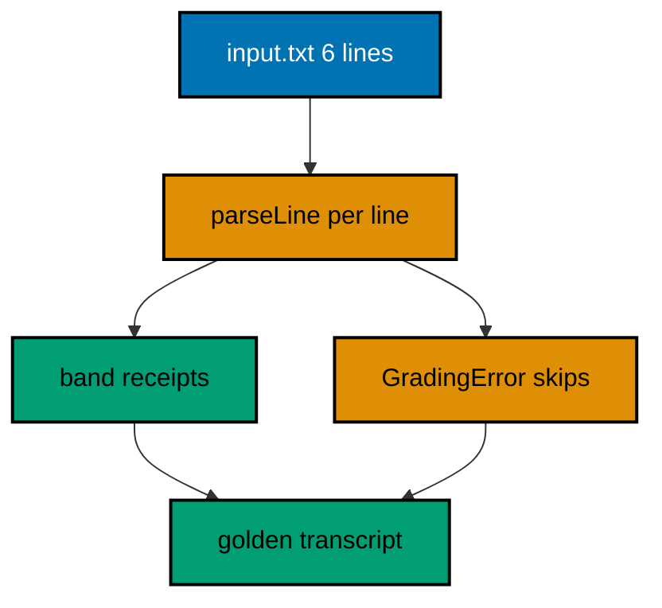

The gradebook CLI is the course in miniature: it reads a ledger of names and scores, grades every honest line, and refuses the dishonest ones with the line number attached. Four receipts and two addressed skips print in ledger order, and eight frozen-input checks pin the core those receipts rest on. Everything below runs on the standard library alone under the pinned Dart 3.13.5 toolchain, with no dependencies to install and no network to reach.

## The job

A market school keeps its contest scores in a plain ledger, one `name,score` pair per line, typed by hand and therefore occasionally wrong. The CLI turns that ledger into a report a teacher can post: `Sari: A (95)` for the honest lines, `skip line 3: empty name` for the lines no honest reading can grade. The ledger in this unit carries six lines: four honest scores across the A, B, C, and F bands, one empty name, and one unparsable count. The transcript below is golden: the harness replays it byte for byte on every run.

## The design -- shell around a pure core

The core rule of the testing cluster applies here at full size: IO lives in `main.dart`, rules live in `grading.dart`, and proofs live in `check.dart`. The main file reads the input, calls one pure function, and prints the returned lines; it decides nothing, which is why it needs no tests of its own. The grading library parses, bands, and renders with no file, clock, or global anywhere inside, which is why eight asserts prove it completely. The check file freezes every input the core could meet — boundaries, bad lines, and the whole ledger shape — and prints the passing count the transcript records.



**`learning/capstone/code/input.txt`**:

```text
Sari,95
Budi,72
,81
Dewi,many
Agus,58
Rina,88
```

The input above is the contract the transcript answers: Sari at 95 earns A, Budi at 72 earns C, the empty third line has no name to grade, `many` on line four is no count, Agus at 58 earns F, and Rina at 88 earns B. Note the ordering guarantee the design keeps: report lines print in ledger-line order, receipts and skips interleaved exactly where their lines stand, so a teacher can walk the report against the ledger without an index.

## The pure core

**`learning/capstone/code/grading.dart`**:

```dart
// grading.dart: the pure grading core the capstone CLI and checks share.
//
// Parsing, banding, and reporting live here with no IO inside: main.dart
// handles the file, check.dart handles the proofs, and this library owns
// the rules. Pure cores test like Example 41 teaches: tables of input
// and want, no fixtures, no clock, no files anywhere in sight.
library grading; // => the library importers name: main and check alike

// GradingError names a ledger-line failure with its line number.
// => implements Exception: handlers catch the class, read the fields
// => const: failures build as cheap values at the refusal site
class GradingError implements Exception {
  // => final address: the one-based ledger line that refused to parse
  final int line; // => one-based: humans count ledger lines from one
  // => final evidence: the reason this line failed, written at the site
  final String reason; // => 'empty name' or 'bad score', decided here
  // => const constructor: address plus reason, built where thrown
  const GradingError(this.line, this.reason);
  // => the sentence: line, reason, both fields, ready for the report
  @override
  String toString() => 'line $line: $reason'; // => skip lines quote this
}

// parseLine reads 'name,score' into a record: the pipeline's first stage.
// => (String, int): the shaped pair every later stage plugs into
// => throws GradingError: failures carry their line number from birth
(String, int) parseLine(String raw, int line) {
  // => split once: name left of the comma, score text right of it
  final parts = raw.split(','); // => exactly two parts per honest line
  // => the name must exist: empty names fail with their line number
  final name = parts[0].trim(); // => trimmed: ' Sari ' parses as Sari
  // => empty name throws addressed: the handler learns the line at once
  if (name.isEmpty) throw GradingError(line, 'empty name'); // => line 3 demo
  // => the score must parse: bad counts fail with the offending text
  final score = int.tryParse(parts.length > 1 ? parts[1].trim() : '');
  // => null parse throws addressed: 'many' names itself in the reason
  if (score == null)
    throw GradingError(
        line, "bad score '${parts.length > 1 ? parts[1].trim() : ''}'");
  // => the record builds: name beside score, shaped for grading
  return (name, score); // => ('Sari', 95): the pipeline's first product
}

// band grades one score: the four promises Example 43 pins by table.
// => ordered guards: the first true band wins, top band checked first
// => pure: scores in, letters out, nothing else consulted anywhere
String band(int score) {
  // => ninety and above: the top band, checked before all others
  if (score >= 90) return 'A'; // => excellence: the ceiling promise
  // => seventy-five and above: the good band below excellence
  if (score >= 75) return 'B'; // => solid: the middle promise
  // => sixty and above: the passing floor, the weakest promise kept
  if (score >= 60) return 'C'; // => passing: the floor promise
  // => below sixty: the failing band every low score honestly earns
  return 'F'; // => failing: the honesty promise for low scores
}

// gradeLines renders the whole ledger: receipts beside addressed skips.
// => GradingError caught per line: one bad line never sinks the ledger
// => skip lines quote the failure: operators walk straight to the address
List<String> gradeLines(List<String> raws) {
  // => the report grows per line: receipts and skips in ledger order
  final report = <String>[]; // => order kept: line order is the transcript
  // => indexed walk: i + 1 addresses every failure like a human counts
  for (var i = 0; i < raws.length; i++) {
    // => line numbers ride along
    // => each line parses inside try: addressed failures land below
    try {
      // => parse then band: the two pure stages composed per line
      final record = parseLine(raws[i], i + 1); // => shaped pair, or throw
      // => receipt renders: name, band, score, the sentence the sign shows
      report.add('${record.$1}: ${band(record.$2)} (${record.$2})');
    } on GradingError catch (e) {
      // => addressed: line number rides along
      // => skip quotes the failure: operators walk to the exact line
      report.add('skip $e'); // => 'skip line 3: empty name', and friends
    }
  }
  // => the whole report: receipts and skips, ledger order, printable
  return report; // => main prints it: the golden transcript below
}
```

Three functions carry the whole job. `parseLine` shapes one raw line into a name-count record and throws `GradingError` with the one-based line number the moment honesty fails — empty names and unparsable counts both refuse with their address attached, following the custom-exception shape from Examples 13 and 73. `band` grades one score through ordered guards, the same four promises Example 43 pins by table. `gradeLines` walks the ledger with the index riding along, catching each addressed failure into a `skip` line and rendering each honest record into a receipt, so one bad line never sinks its honest neighbors.

## The thin shell

**`learning/capstone/code/main.dart`**:

```dart
// main.dart: the capstone CLI. Reads input.txt, grades every line,
// and prints the report: receipts for honest lines, addressed skips for
// bad ones. IO lives only here: the rules live in grading.dart, pure
// and tested, exactly the shell-and-core split Example 41 teaches.
import 'dart:io'; // => File: the whole-file read of the ledger input
import 'grading.dart'; // => the pure core: parseLine, band, gradeLines

void main() {
  // => the ledger input lives beside the CLI: overwritten never, read always
  final raws = File('input.txt').readAsLinesSync(); // => six lines, two bad
  // => the pure core renders: receipts beside skips, ledger order kept
  final report = gradeLines(raws); // => six lines in, six lines out
  // => the golden transcript: printed in order, recorded by the harness
  for (final line in report) {
    // => for-in: every report line prints once
    // => one line per ledger line: receipts and skips share the transcript
    print(line); // => six lines: four receipts, two addressed skips
  }
}
```

The shell reads the file, calls the core, and prints the lines: three verbs, no branches, no decisions. Keeping it this thin is the point — every behavior worth proving lives in `grading.dart` where asserts can reach it, and the shell stays too simple to hide a bug in.

## The checks

**`learning/capstone/code/check.dart`**:

```dart
// check.dart: the capstone's own test run. Freezes inputs, asserts the
// pure core's answers, and prints the passing count: the stdlib-only test
// convention this course teaches, failing-first in spirit, green in fact.
// Production Dart would use package:test; the shape here mirrors it.
import 'grading.dart'; // => the pure core under test: no IO, no clock

void main() {
  // => band boundaries: the four promises, pinned exactly like kata tables
  assert(band(95) == 'A'); // => ceiling promise: ninety-five earns A
  // => boundary promise: ninety itself already earns the top band
  assert(band(90) == 'A'); // => edge of excellence: inclusive floor
  // => middle promise: seventy-five holds B without touching A or C
  assert(band(75) == 'B'); // => the solid middle, both edges implied
  // => floor promise: fifty-nine fails, proving C starts at sixty
  assert(band(59) == 'F'); // => honesty at the floor: F below sixty
  // => parse promise: honest lines shape into records with line numbers
  assert(parseLine('Sari,95', 1) == ('Sari', 95)); // => shaped pair, exact
  // => addressed failure: empty names throw with their line number riding
  assert(_throwsLine(() => parseLine(',81', 3), 3)); // => line 3, addressed
  // => bad scores name themselves: the offending text rides the reason
  assert(_throwsLine(() => parseLine('Dewi,many', 4), 4)); // => line 4 too
  // => the ledger promise: four receipts beside two addressed skips
  assert(gradeLines(['Sari,95', ',81']).length == 2); // => receipt plus skip
  // => eight checks green: the count line proves the convention ran
  print('checks: 8 passed'); // => Output: checks: 8 passed
}

// _throwsLine runs the attempt and reports whether GradingError names line.
// => true exactly when the addressed failure carries the expected number
// => helpers like this are the custom matchers of the stdlib convention
bool _throwsLine(void Function() attempt, int line) {
  // => the attempt runs inside try: addressed failures land below
  try {
    // => honest lines return: reaching here means no failure to check
    attempt(); // => throwing attempts never reach past this call
    // => no throw means the test fails: false reports the missing failure
    return false; // => expected a failure, got a value: red by return
  } on GradingError catch (e) {
    // => addressed: the line number rides along
    // => the line decides: true exactly when the address matches
    return e.line == line; // => line 3 for ',81', line 4 for 'Dewi,many'
  }
}
```

Eight frozen-input checks prove the core: four band boundaries, the honest parse shape, the two addressed failures with their exact line numbers, and the whole-ledger length promise. The `_throwsLine` helper is the custom matcher of the stdlib-only convention, asserting not just that a failure throws but that it carries the right address. Production Dart would run these through package:test with `dart test`; the shape here mirrors it — frozen inputs, named behaviors, one passing count — so the jump is vocabulary, not concept.

**Output** (`learning/capstone/code/expected/check/check.stdout.txt`):

```text
checks: 8 passed
```

## The pinning convention

**`learning/capstone/code/pubspec.yaml`**:

```yaml
name: gradebook_cli
description: Capstone CLI for dart-in-depth. Standard library only.
environment:
  sdk: ^3.0.0
```

The project pins its SDK floor with a caret range and declares zero dependencies: the standard library covers parsing, grading, files, and checks, so the supply chain for this CLI is exactly one pinned toolchain. That is the dependency decision from Example 32 applied at project scale — the cheapest dependency is the one never taken, and the pubspec above proves the refusal in writing.

## The golden transcript

**Output** (`learning/capstone/code/expected/main/main.stdout.txt`):

```text
Sari: A (95)
Budi: C (72)
skip line 3: empty name
skip line 4: bad score 'many'
Agus: F (58)
Rina: B (88)
```

Four receipts and two addressed skips, in ledger order, byte for byte on every run. The receipts prove the bands; the skips prove the addressing — `line 3` and `line 4` name the exact lines a teacher must fix, with the reason quoted beside each number. When the ledger grows, the transcript grows with it; when a line breaks, the skip says where.

## What this proves

The capstone exercises every course muscle at once: the error-handling idiom refuses bad lines as addressed data, the testing convention pins the pure core with frozen inputs, the value shapes carry records through the pipeline, and the pinning convention keeps the whole build on one toolchain with nothing to install. A CLI that reads input, transforms it, and writes output — tested, pinned, and golden — is the smallest honest program a working Dart developer ships, and it is now yours.
