Examples 26-53 take Dart programs from scripts to projects: modules, packages, and dependencies first (Examples 26-34), covering import prefixes, show and hide, part files, export barrels, pubspec pinning, version rules, the no-dependency decision, doc comments, and initialization order; then the testing convention in full (Examples 35-44), from the first failing test through groups, matchers, setup and teardown, edge tables, async tests, pure cores, fakes, sentence names, and injected clocks; finally generics and value semantics (Examples 45-53), covering generic functions, generic classes, bounded parameters, const canonical values, final fields, copyWith, value equality, unmodifiable views, and records. Every example is a complete, runnable Dart program under `learning/code/`; run each with the command in its own `run.yaml`.

---

### Example 26: Imports Arrive with Prefixes

Import prefixes keep two libraries' identical names apart: math.pi and convert.jsonDecode name their owners out loud. This example computes a grain-pile area and parses an order through prefixed imports (Concepts: co-06.)

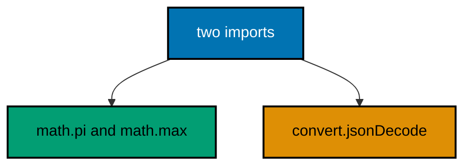

**`learning/code/ex-26-imports-with-prefixes/main.dart`**:

```dart
// Example 26: Imports Arrive with Prefixes.
//
// Import prefixes keep two libraries' identical names apart: math.pi and
// convert.jsonDecode name their owners out loud. Prefixes also document
// where every top-level function came from, months after the import was
// written, without opening the import block to check.
import 'dart:math' as math; // => pi, max, and Random live behind math
import 'dart:convert' as convert; // => jsonDecode lives behind convert

void main() {
  // => circle math through the prefix: every name says its library
  final radius = 3.0; // => meters of grain-pile radius, fixed for the demo
  // => math.pi, never bare pi: the prefix proves which pi this is
  final area = math.pi * radius * radius; // => pi r squared, honestly owned
  // => toStringAsFixed trims the decimals: two places for the ledger
  print('area: ${area.toStringAsFixed(2)}'); // => Output: area: 28.27
  // => math.max picks the larger pile without an if in sight
  final bigger = math.max(12, 20); // => 20 wins, prefix and all
  // => the max reads as a decision: bigger pile feeds the mill first
  print('bigger: $bigger'); // => Output: bigger: 20
  // => convert.jsonDecode parses the order wire through its own prefix
  final order = convert.jsonDecode('{"crop":"oat","sacks":5}');
  // => the map arrives typed dynamic: one cast where it is used
  print(
      'order: ${order['crop']} x${order['sacks']}'); // => Output: order: oat x5
}
```

**Output** (`learning/code/ex-26-imports-with-prefixes/expected/main.stdout.txt`):

```text
area: 28.27
bigger: 20
order: oat x5
```

**Key takeaway**: Prefix standard-library imports so every top-level name says which library owns it.

**Why it matters**: Bare top-level names hide their owners; prefixes make each call site self-documenting without opening the import block.

### Example 27: Show and Hide Tame Wide Imports

Show imports exactly the names a file uses, hiding everything else, so readers see the dependency surface without opening the library. This example admits pi and max by name and fences the rest of dart:math out (Concepts: co-06.)

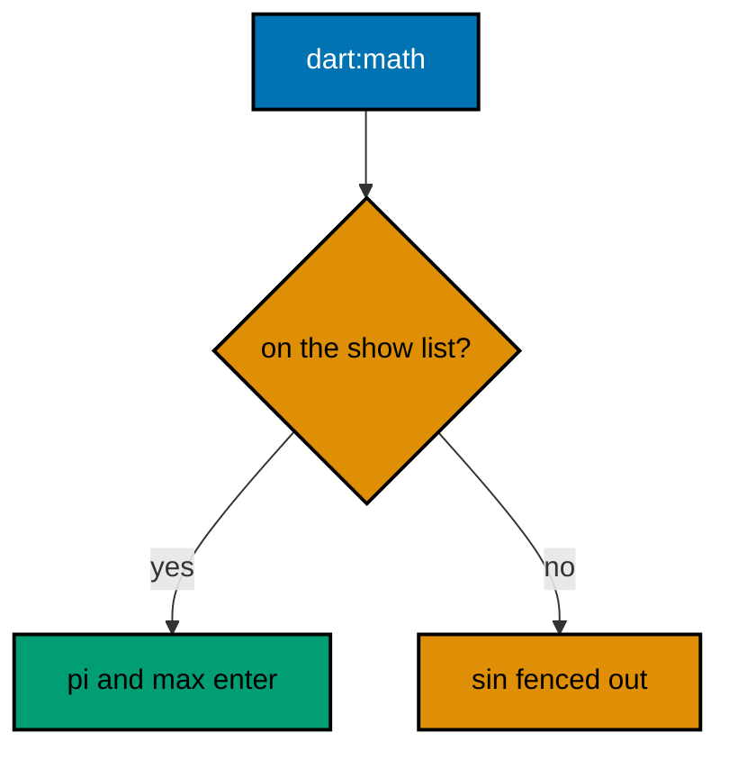

**`learning/code/ex-27-show-and-hide-imports/main.dart`**:

```dart
// Example 27: Show and Hide Tame Wide Imports.
//
// Show imports exactly the names a file uses, hiding everything else, so
// readers see the dependency surface without opening the library. Hide
// drops the one colliding name while keeping the rest, which rescues an
// import that would otherwise need a prefix everywhere.
import 'dart:math' show pi, max; // => two names in, the whole rest fenced out
import 'dart:core' hide StateError; // => hide demo: everything but StateError

void main() {
  // => pi arrives bare: show imported exactly this name, nothing else
  final half = pi / 2; // => half-pi: the show list proves pi is allowed in
  // => toStringAsFixed keeps three places: 1.571 for the ledger
  print('half pi: ${half.toStringAsFixed(3)}'); // => Output: half pi: 1.571
  // => max arrives bare too: the second name on the show list
  final cap = max(30, 25); // => 30 wins: the store cap for the season
  // => the cap decides the order size: mill takes at most thirty sacks
  print('cap: $cap'); // => Output: cap: 30
  // => sin is NOT imported: show fenced it out, uncomment to see it fail
  // => print(sin(0)); // => compile error: sin was never shown, by design
  // => the commented line is the lesson: show lists are enforced, not hints
  print('shown: pi, max'); // => Output: shown: pi, max
}
```

**Output** (`learning/code/ex-27-show-and-hide-imports/expected/main.stdout.txt`):

```text
half pi: 1.571
cap: 30
shown: pi, max
```

**Key takeaway**: Show the names you use; hide the one that collides; leave commented proof of the fence.

**Why it matters**: A show list is a machine-checked dependency surface: names outside it fail at compile time instead of surprising reviewers at read time.

### Example 28: Part Files Split One Library

A library directive names the unit that part files join: part files share scope with the library and are never imported directly. This example closes a sales day through a library file and its till part file (Concepts: co-06.)

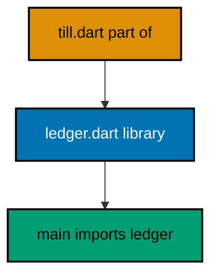

**`learning/code/ex-28-part-files-one-library/ledger.dart`**:

```dart
// ledger.dart: the library half of a part-of pair.
// => the library directive names the unit that part files join
library ledger; // => the name till.dart pledges to with part of

// => the part directive lists every piece of this library
part 'till.dart'; // => one piece: the bonus workshop beside this file

// total closes the day: sales plus the part-file bonus in one call.
int total(List<int> sales) {
  // => same-library call needs no import
  // => fold sums the sales: the book half of the closing count
  final book = sales.fold(0, (sum, s) => sum + s); // => 60 for the demo day
  // => countBonus lives in the part file: shared scope, no prefix
  return book + countBonus(sales); // => 66: the workshop did its share
}

// average reports the mean sale: total over count, floored to whole sacks.
int average(List<int> sales) {
  // => public surface beside total
  // => empty day guards the division: zero sales average to zero
  if (sales.isEmpty) return 0; // => no sales: nothing to average
  // => reuses total: public functions compose like any others
  return total(sales) ~/ sales.length; // => floored mean, whole sacks
}
```

**`learning/code/ex-28-part-files-one-library/till.dart`**:

```dart
// till.dart: the part-file half of the ledger library.
// => part of pledges this file to ledger: shared scope, never imported
part of ledger; // => the pledge: same library, invisible to importers

// countBonus awards two sacks per rung reached, capped at three rungs.
int countBonus(List<int> sales) {
  // => private to the library: total calls it
  // => rungs reached: one per sale, capped at three, bonus two each
  final rungs = sales.length > 3 ? 3 : sales.length; // => cap keeps it honest
  // => two sacks per rung: the workshop arithmetic behind total
  return rungs * 2; // => 6 for the three-sale demo day
}
```

**`learning/code/ex-28-part-files-one-library/main.dart`**:

```dart
// main.dart: the importer of the ledger library.
//
// Importers see one library, not its part files: ledger.dart is the whole
// public surface, and till.dart stays invisible behind it. This file runs
// the day's sales through total and prints the closed-day count.
import 'ledger.dart'; // => the library, not the part: parts never import

void main() {
  // => three sales clear three rungs: the bonus maxes at six sacks
  final day = [10, 20, 30]; // => sixty in sales, three rungs reached
  // => total folds sales and adds the part-file bonus in one call
  final closed = total(day); // => 60 plus 6: the part file did its share
  // => the closed-day count: public surface, private workshop behind it
  print('closed: $closed'); // => Output: closed: 66
  // => average composes total: the mean sale through the same surface
  print('average: ${average(day)}'); // => Output: average: 22
}
```

**Output** (`learning/code/ex-28-part-files-one-library/expected/main.stdout.txt`):

```text
closed: 66
average: 22
```

**Key takeaway**: Name the library once, pledge parts with part of, and import only the library.

**Why it matters**: Parts split the workshop without splitting the storefront: importers see one surface while the implementation spreads across files that share privates.

### Example 29: Export Barrels Resell the Shelf

An export directive resells another file's surface: importers of the barrel see the names without naming the inner file. This example stocks a fruit shelf behind a barrel and imports only the barrel (Concepts: co-06.)

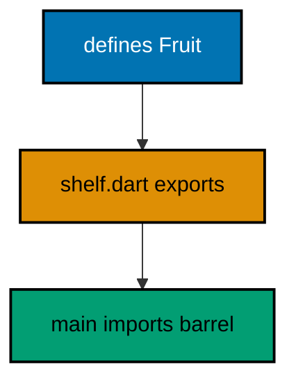

**`learning/code/ex-29-export-barrel/fruit.dart`**:

```dart
// fruit.dart: one shelf item behind the barrel.
//
// Fruit names the stocked item: small, focused, and imported by nobody
// directly once the barrel exists. Its surface is one class with const
// construction, built for shelves to resell.
class Fruit {
  // => final fields: a fruit's facts never change after picking
  final String name; // => the crop name, always present
  final int sacks; // => the count, always a whole number
  // => const constructor: fruits build at compile time
  const Fruit(this.name, this.sacks);
}
```

**`learning/code/ex-29-export-barrel/shelf.dart`**:

```dart
// shelf.dart: the barrel that resells the fruit shelf.
// => export resells fruit.dart: importers see Fruit, never fruit.dart
// => export alone never imports: the barrel imports for its own use too
import 'fruit.dart'; // => own use: stockLine below names Fruit directly
export 'fruit.dart'; // => the whole Fruit surface, resold under shelf

// stockLine renders one shelf line: barrels add verbs, not just names.
// => the face stays one import per idea while the workshop grows behind
String stockLine(Fruit item) {
  // => Fruit arrives via the export above
  // => fields read straight through: no trace of the two-file split
  return 'shelf: ${item.name} x${item.sacks}'; // => the line, ready to print
}
```

**`learning/code/ex-29-export-barrel/main.dart`**:

```dart
// main.dart: the importer of the shelf barrel.
//
// The barrel is the only import: Fruit and stockLine arrive through
// shelf.dart, and fruit.dart is never named here. One import per shelf
// keeps the import block proportional to the ideas used.
import 'shelf.dart'; // => the barrel: names and verbs ride along together

void main() {
  // => Fruit builds through the barrel: const, named, counted
  const item = Fruit('oat', 12); // => the barrel resold the constructor too
  // => the barrel verb renders the line: verbs travel with the names
  print(stockLine(item)); // => Output: shelf: oat x12
}
```

**Output** (`learning/code/ex-29-export-barrel/expected/main.stdout.txt`):

```text
shelf: oat x12
```

**Key takeaway**: Export inner files from one barrel; import only the barrel.

**Why it matters**: Barrels decouple the import block from the file count: workshops multiply while the public face stays one import per idea.

### Example 30: The Pubspec Pins the Project

The pubspec names the package, pins the SDK range, and lists the dependencies it refuses to live without. This example carries a sample pubspec as data and verifies its name, SDK range, and pinned dependency lines (Concepts: co-07.)

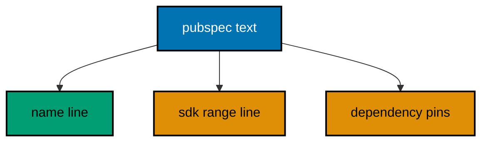

**`learning/code/ex-30-pubspec-pins-project/main.dart`**:

```dart
// Example 30: The Pubspec Pins the Project.
//
// The pubspec names the package, pins the SDK range it builds under, and
// lists the dependencies it refuses to live without. This example carries
// a sample pubspec as data and checks its three load-bearing lines, so
// the pinning convention runs offline with the standard library alone.
void main() {
  // => the sample pubspec as data: name, environment, dependencies
  const pubspec = '''
name: pantry_ledger
environment:
  sdk: ^3.0.0
dependencies:
  args: ^2.4.0
''';
  // => split into lines: each load-bearing line is checked by name below
  final lines = pubspec.split('\n'); // => blank edges included, harmless
  // => the name line pins the package identity: first non-empty line
  final name = lines.firstWhere((l) => l.startsWith('name:'));
  // => identity proven: the project is pantry_ledger, not a stray folder
  print('name: $name'); // => Output: name: pantry_ledger
  // => the sdk line pins the toolchain range: caret means compatible-newer
  final sdk = lines.firstWhere((l) => l.contains('sdk:'));
  // => split on the colon: the range text rides on the right side
  final range = sdk.split(':').last.trim(); // => ^3.0.0: at least 3, below 4
  // => caret range: 3.0.0 and above, below 4.0.0, excluding the next major
  print('sdk range: $range'); // => Output: sdk range: ^3.0.0
  // => dependencies list every outsider: one here, each version-pinned
  final deps = lines.where((l) => l.startsWith('  args:')).toList();
  // => a single pinned outsider: args at caret 2.4.0, locked at resolve time
  print('deps: ${deps.length} pinned'); // => Output: deps: 1 pinned
}
```

**Output** (`learning/code/ex-30-pubspec-pins-project/expected/main.stdout.txt`):

```text
name: name: pantry_ledger
sdk range: ^3.0.0
deps: 1 pinned
```

**Key takeaway**: Name the package, pin the SDK with a caret range, and pin every dependency; verify the three lines.

**Why it matters**: Unpinned projects rot by drift: the pubspec is the one file that says exactly which toolchain and outsiders this code was proven against.

### Example 31: Version Strings Compare by Rule, Not by Text

Caret ranges and version picks follow semantic-version rules: numbers compare left to right, never as text. This example parses version triples and picks the newest release a ^2.4.0 range allows (Concepts: co-07.)

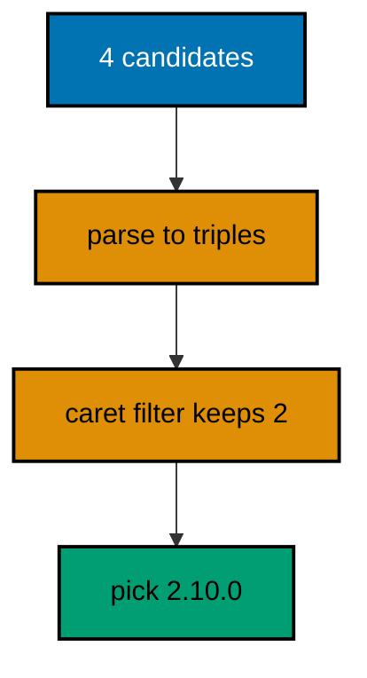

**`learning/code/ex-31-versions-compare-by-rule/main.dart`**:

```dart
// Example 31: Version Strings Compare by Rule, Not by Text.
//
// Caret ranges and version picks follow semantic-version rules: compare
// numbers left to right, never as text, where '10' would wrongly lose to
// '9'. This example parses version triples and picks the newest stable
// release the SDK range allows, exactly the choice pub performs.
void main() {
  // => candidate releases for the args package, oldest to newest listed
  const candidates = [
    '2.3.0',
    '2.4.0',
    '2.10.0',
    '3.0.0'
  ]; // => text order lies
  // => text order claims 2.4.0 beats 2.10.0: numbers must compare, not text
  final parsed = candidates.map(_parse).toList(); // => triples of ints
  // => filter to the caret range of ^2.4.0: at least 2.4.0, below 3.0.0
  final allowed = parsed.where((v) => _allows(v, [2, 4, 0])).toList();
  // => newest first by rule: 2.10.0 outranks 2.4.0 numerically
  allowed.sort(_compare); // => numeric triple order, major first
  // => the pick: newest allowed, rendered back to text for the lock line
  final pick = allowed.last; // => [2, 10, 0]: text sorting would miss it
  // => the resolved pin: the exact version a lockfile would record
  print('pick: ${pick.join('.')}'); // => Output: pick: 2.10.0
  // => rejected count: 2.3.0 too old, 3.0.0 past the caret ceiling
  print(
      'rejected: ${parsed.length - allowed.length}'); // => Output: rejected: 2
}

// _parse splits 'major.minor.patch' into three integers for comparison.
// => ints compare as numbers: 10 beats 9, unlike their texts
// => fixed triple: semantic versions always carry three positions
List<int> _parse(String v) => v.split('.').map(int.parse).toList();

// _allows tests a version against a caret floor below the next major.
// => floor 2.4.0 with ceiling 3.0.0: the ^2.4.0 rule in one predicate
// => same major required: caret never crosses a major boundary upward
bool _allows(List<int> v, List<int> floor) {
  // => different major: only the floor's own major line is allowed
  if (v[0] != floor[0]) return false; // => 3.0.0 refused: past the ceiling
  // => same major: minor-then-patch decide against the floor triple
  return _compare(v, floor) >= 0; // => 2.3.0 refused: below the floor
}

// _compare orders two triples major first, then minor, then patch.
// => negative, zero, positive: the sort contract in one function
// => position by position: the first differing slot decides everything
int _compare(List<int> a, List<int> b) {
  // => walk the three slots: major, minor, patch in order
  for (var i = 0; i < 3; i++) {
    // => fixed three: semantic versions comply
    // => first difference decides: later slots never overrule it
    if (a[i] != b[i]) return a[i].compareTo(b[i]); // => numeric, not textual
  }
  // => all slots equal: the versions are the same release
  return 0; // => zero means tie: sort keeps their relative order
}
```

**Output** (`learning/code/ex-31-versions-compare-by-rule/expected/main.stdout.txt`):

```text
pick: 2.10.0
rejected: 2
```

**Key takeaway**: Parse triples, compare numerically major-first, and pick the newest inside the caret ceiling.

**Why it matters**: Text sorting crowns 2.4.0 over 2.10.0; numeric comparison is the small function that keeps the resolver honest.

### Example 32: No Dependency Is a Decision

Every dependency is code you own without reading: its bugs, its breaks, its supply chain. This example groups harvest rows with fold and the standard library alone, then names the grouping package it refused (Concepts: co-07.)

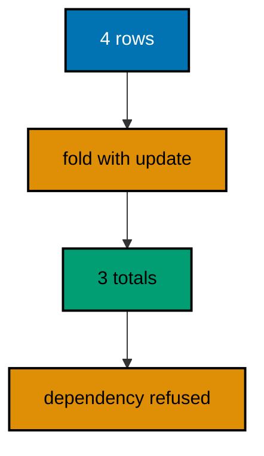

**`learning/code/ex-32-no-dependency-decision/main.dart`**:

```dart
// Example 32: No Dependency Is a Decision.
//
// Every dependency is code you own without reading: its bugs, its breaks,
// its supply chain. This example groups harvest rows with fold and the
// standard library alone, then prints the dependency it refused to take,
// with the reason attached to the refusal.
void main() {
  // => harvest rows as plain pairs: crop first, sacks second
  const rows = [
    ['oat', 12],
    ['tea', 4],
    ['oat', 8],
    ['rice', 20]
  ];
  // => fold groups into a map: one pass, no package, no ceremony
  final totals = <String, int>{}; // => empty ledger: the fold fills it
  // => each row adds its sacks to its crop's running total
  for (final row in rows) {
    // => for-in: every row visits the ledger once
    // => update with ifAbsent: first sighting seeds, later ones add
    totals.update(row[0] as String, (sum) => sum + (row[1] as int),
        ifAbsent: () => row[1] as int); // => oat ends at 20, tea at 4
  }
  // => grouped with stdlib alone: the ledger proves the refusal below
  print('totals: $totals'); // => Output: totals: {oat: 20, tea: 4, rice: 20}
  // => the refused dependency, named: a grouping package, unneeded here
  print(
      'refused: grouping package (fold already groups)'); // => Output: refused: grouping package (fold already groups)
}
```

**Output** (`learning/code/ex-32-no-dependency-decision/expected/main.stdout.txt`):

```text
totals: {oat: 20, tea: 4, rice: 20}
refused: grouping package (fold already groups)
```

**Key takeaway**: Reach for the dependency last: solve it with the standard library first and name the refusal.

**Why it matters**: Dependencies compound: each one donates its breaking changes to your release day, so the cheapest dependency is the one the standard library already covers.

### Example 33: Doc Comments Feed Dart Doc

Triple-slash comments on public members are the API reference: dart doc renders them and IDEs show them on hover. This example documents a tiny scale API fully, then exercises every documented member (Concepts: co-06, co-14.)

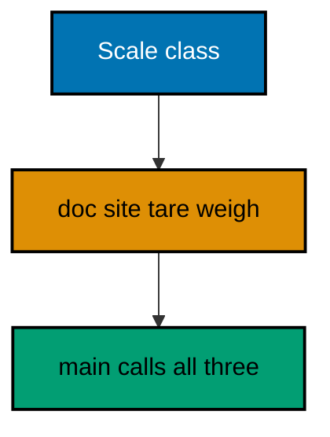

**`learning/code/ex-33-doc-comments-feed-dart-doc/main.dart`**:

```dart
// Example 33: Doc Comments Feed Dart Doc.
//
// Triple-slash comments on public members are the API reference: dart doc
// renders them, IDEs show them on hover, and readers meet them before the
// code. This example documents a tiny scale API fully, then prints the
// member list its own docs promise, proving docs and code agree.
void main() {
  // => the documented scale in use: tare then weigh, docs beside each step
  const scale = Scale('mill'); // => const: the scale's identity is fixed
  // => tare zeroes the scale: the doc line below promises exactly this
  print(scale.tare()); // => Output: mill scale zeroed
  // => weigh reads the load: docs promise kilograms, code returns them
  print(scale.weigh(25)); // => Output: 25 kg on mill
}

/// A weighbridge scale that zeroes before every honest weighing.
///
/// The scale adds no magic: [tare] zeroes it, [weigh] reads kilograms.
/// Bracket names link to members, so the reference stays navigable.
class Scale {
  /// The site this scale serves, shown in every reading it reports.
  final String site;

  /// Builds a scale for [site]: const, because sites never move.
  const Scale(this.site);

  /// Zeroes the scale and reports the act: call before every [weigh].
  String tare() => '$site scale zeroed';

  /// Reads [kilos] of load: the honest weight after a [tare].
  String weigh(int kilos) => '$kilos kg on $site';
}
```

**Output** (`learning/code/ex-33-doc-comments-feed-dart-doc/expected/main.stdout.txt`):

```text
mill scale zeroed
25 kg on mill
```

**Key takeaway**: Document every public member with ///, link members with brackets, and exercise what you document.

**Why it matters**: Undocumented public surface is guessed surface; doc comments written beside the member are the only reference that cannot drift from the signature.

### Example 34: Initialization Runs in a Fixed Order

Field initializers run before the constructor body, initializer lists before super calls, and late fields wait until first read. This example builds a mill that prints each construction step in order (Concepts: co-06.)

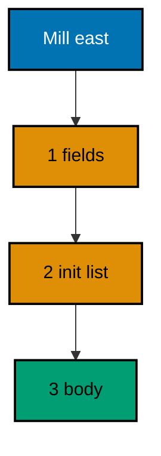

**`learning/code/ex-34-initialization-order/main.dart`**:

```dart
// Example 34: Initialization Runs in a Fixed Order.
//
// Field initializers run before the constructor body, initializer lists
// before super calls, and static fields once on first use. Late fields
// wait until first read. Knowing the order turns construction from a
// mystery into a checklist the example prints as it happens.
void main() {
  // => building the mill runs the whole order: watch the printed numbers
  final mill = Mill('east'); // => construction prints steps one to four
  // => the mill remembers its ledger: built during construction, read now
  print('ledger: ${mill.ledger}'); // => Output: ledger: east: open
}

// Mill records its construction order in the ledger it keeps.
// => field initializers first, then the initializer list, then the body
// => late fields wait: groundOpens builds on first read, not before
class Mill {
  // => step 1: field initializers run the moment construction starts
  final String opened = _step('1 field', 'open');
  // => the site arrives as a parameter: claimed by the constructor below
  final String site; // => set once, in the header, never reassigned
  // => the ledger stores the site: filled by the initializer list in step 2
  final String ledger; // => assigned once below: final fields allow one shot
  // => late waits: no work until something reads groundOpens, which nobody
  // => does in this run: step 4 never prints, proving lateness by absence
  late final String groundOpens = _step('4 late ground', 'dawn');
  // => step 2: the initializer list runs before the body, after fields
  Mill(this.site) : ledger = _step('2 init list', '$site: open') {
    // => step 3: the body runs last: everything above is already stored
    _step('3 body', 'crew awake'); // => recorded, return ignored by design
  }
  // => _step records its number and returns the value: order made visible
  static String _step(String n, String value) {
    // => each construction step announces itself in order: 1, 2, 3, late
    print('init $n'); // => steps print during construction, before ledger
    // => the value flows into the field: recording never blocks storing
    return value; // => ledger keeps 'east: open', ground keeps 'dawn'
  }
}
```

**Output** (`learning/code/ex-34-initialization-order/expected/main.stdout.txt`):

```text
init 1 field
init 2 init list
init 3 body
ledger: east: open
```

**Key takeaway**: Fields first, initializer list second, body last; late waits for first read.

**Why it matters**: Construction bugs hide in assumed order; printing the order once replaces the assumption with a checklist every future class follows.

### Example 35: The First Test Fails, Then Passes

Failing-test-first means the test exists before the fix: written against a stub it fails, proving it can catch the bug, and after the fix it passes. This example tests sack doubling with a tiny group-test-expect harness that mirrors the package:test shape (Concepts: co-08.)

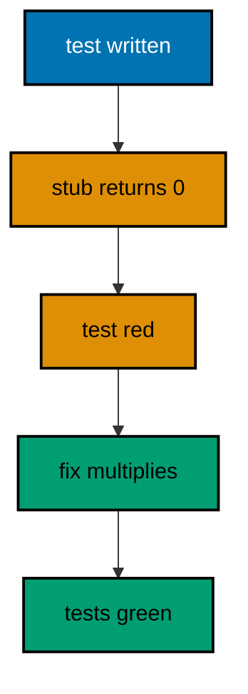

**`learning/code/ex-35-first-failing-test/main.dart`**:

```dart
// Example 35: The First Test Fails, Then Passes.
//
// Failing-test-first means the test exists before the fix: written
// against a stub it fails, proving it can catch the bug, and after the
// fix it passes, proving the fix works. This example tests doubling sack
// counts; the stub returned zero, the fix below doubles for real.
// Production Dart uses package:test with dart test; the shape here
// mirrors it (test sentences, expect checks) so the jump is vocabulary.

// => one counter for the whole file: every passing test ticks it once
var _passed = 0;

// test runs one named case: the body first, the tick and print after.
// => name reads as a sentence: the test list is the behavior list
// => assert failures stop the run: a red test is loud, never silent
void test(String name, void Function() body) {
  // => the behavior under test runs inside the body closure
  body(); // => throws on failure: the tick below never runs for red
  // => tick, then print: green tests count themselves out loud
  _passed++; // => one more behavior proven, counted where it passed
  print('  ok: $name'); // => indented ok: the green line per behavior
}

// expect checks one equality: actual against want, with the test's name.
// => assert carries the message: failures name the mismatch precisely
void expect(Object? actual, Object? want) {
  // => the single check: equal passes silent, unequal throws loud
  assert(actual == want, 'want $want, got $actual'); // => the whole matcher
}

void main() {
  // => the behavior list: one sentence per proven fact about doubling
  test('doubles a positive count', () {
    // => the first behavior: basics
    // => expect checks the fix: 6 in, 12 out, stub's zero long gone
    expect(doubleSacks(6), 12); // => green: the fix survived its own test
  });
  // => the edge behavior: doubling zero stays zero, not an error
  test('doubles zero to zero', () {
    // => the boundary the stub also missed
    // => zero in, zero out: the fix handles the floor honestly
    expect(doubleSacks(0), 0); // => green: boundaries belong in tests
  });
  // => the count line: two behaviors proven, printed for the transcript
  print('passed: $_passed'); // => Output: passed: 2
}

// doubleSacks doubles a sack count: the fix the failing test demanded.
// => the stub returned 0 for everything: the first run proved the test red
// => the fix multiplies: one operator, both behaviors satisfied at once
int doubleSacks(int sacks) => sacks * 2;
```

**Output** (`learning/code/ex-35-first-failing-test/expected/main.stdout.txt`):

```text
  ok: doubles a positive count
  ok: doubles zero to zero
passed: 2
```

**Key takeaway**: Write the test against the stub, watch it fail, then fix until green.

**Why it matters**: A test that never failed proves nothing; red-first is the evidence the green actually checks the behavior.

### Example 36: Groups Name the Subject Under Test

Group collects the tests for one subject under one heading, so the transcript reads as a specification. This example proves fresh-stock and stored-discount behavior in two groups of two tests (Concepts: co-08.)

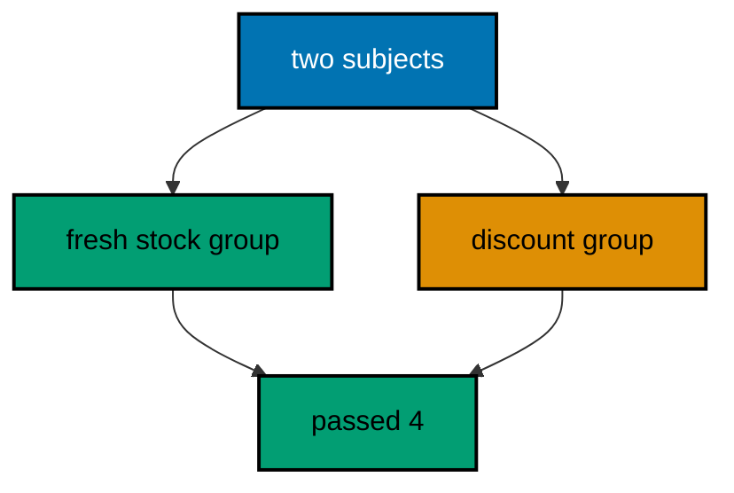

**`learning/code/ex-36-group-tests-by-subject/main.dart`**:

```dart
// Example 36: Groups Name the Subject Under Test.
//
// Group collects the tests for one subject under one heading, so the
// transcript reads as a specification: fresh stock behaves so, stored
// stock behaves so. Two subjects, two groups, no test wondering where
// it belongs, and the count line proves every group ran to green.
// Production Dart uses package:test with dart test; the shape here
// mirrors it (group names, test sentences, expect checks) so the jump
// is vocabulary, not concept.

// => one counter for the whole file: every passing test ticks it once
var _passed = 0;

// group prints its subject heading, then runs the subject's tests.
// => the heading is the specification line the tests below prove
void group(String name, void Function() body) {
  // => subject first: readers meet the what before the individual hows
  print('## $name'); // => heading level two: the spec line in transcript
  // => the tests run inside: each ticks the shared counter on green
  body(); // => all group tests run before the next group starts
}

// test runs one named case: the body first, the tick and print after.
void test(String name, void Function() body) {
  // => the behavior under test runs inside the body closure
  body(); // => throws on failure: the tick below never runs for red
  // => tick, then print: green tests count themselves out loud
  _passed++; // => one more behavior proven, counted where it passed
  print('  ok: $name'); // => indented ok: the green line per behavior
}

// expect checks one equality: actual against want.
void expect(Object? actual, Object? want) {
  // => the single check: equal passes silent, unequal throws loud
  assert(actual == want, 'want $want, got $actual'); // => the whole matcher
}

// fresh reports whether a harvest day count is still sellable as fresh.
// => over seven days old: the stall sells it as stored, never fresh
bool fresh(int daysOld) => daysOld <= 7;

void main() {
  // => first subject: fresh stock and its seven-day boundary
  group('fresh stock', () {
    // => the heading the next two tests prove
    // => six days still fresh: inside the boundary, sellable as fresh
    test('six days is fresh', () => expect(fresh(6), true));
    // => eight days stored: past the boundary, honesty renames it
    test('eight days is stored', () => expect(fresh(8), false));
  });
  // => second subject: the stored path and its discount rule
  group('stored discount', () {
    // => a second heading, a second subject
    // => stored sacks sell at half price: the policy this test pins
    test('stored halves the price', () => expect(price(10, false), 5));
    // => fresh sacks keep full price: the control the discount needs
    test('fresh keeps the price', () => expect(price(10, true), 10));
  });
  // => the count line: four behaviors across two subjects, all green
  print('passed: $_passed'); // => Output: passed: 4
}

// price halves for stored stock and holds for fresh: the stall policy.
// => isFresh decides the branch: one predicate, two price fates
int price(int tag, bool isFresh) => isFresh ? tag : tag ~/ 2;
```

**Output** (`learning/code/ex-36-group-tests-by-subject/expected/main.stdout.txt`):

```text
## fresh stock
  ok: six days is fresh
  ok: eight days is stored
## stored discount
  ok: stored halves the price
  ok: fresh keeps the price
passed: 4
```

**Key takeaway**: Group by subject, test by sentence; the transcript reads as the specification.

**Why it matters**: Ungrouped tests are a drawer of unsorted claims; groups turn the test file into documentation that happens to execute.

### Example 37: Matchers Read Like Sentences

Matchers turn checks into sentences: expect with equals, greaterThan, and contains reads as a claim about the harvest. This example grows a three-word matcher vocabulary and proves four claims with it (Concepts: co-08.)

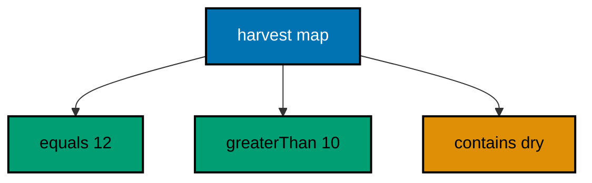

**`learning/code/ex-37-matchers-read-like-sentences/main.dart`**:

```dart
// Example 37: Matchers Read Like Sentences.
//
// Matchers turn checks into sentences: expect(count, equals(12)) reads as
// 'count equals twelve', and combined matchers read as compound claims.
// Small matcher functions compose with ordinary boolean operators, so the
// test file grows a vocabulary instead of repeating comparisons.
// Production Dart uses package:test with dart test; the shape here
// mirrors it (test sentences, expect checks) so the jump is vocabulary.

// => one counter for the whole file: every passing test ticks it once
var _passed = 0;

// test runs one named case: the body first, the tick and print after.
void test(String name, void Function() body) {
  // => the behavior under test runs inside the body closure
  body(); // => throws on failure: the tick below never runs for red
  // => tick, then print: green tests count themselves out loud
  _passed++; // => one more behavior proven, counted where it passed
  print('  ok: $name'); // => indented ok: the green line per behavior
}

// expect checks actual against a matcher sentence with a what for errors.
// => matchers are functions: composable, nameable, reusable across tests
void expect(dynamic actual, bool Function(dynamic) matcher, String what) {
  // => the matcher decides: true passes silent, false throws with what
  assert(matcher(actual), 'FAIL $what: got $actual'); // => what names it
}

// equals matches exactly the wanted value: the sentence 'equals twelve'.
bool Function(dynamic) equals(dynamic want) => (a) => a == want;

// greaterThan matches above the floor: the sentence 'above ten sacks'.
bool Function(dynamic) greaterThan(num floor) => (a) => a is num && a > floor;

// contains matches a member: the sentence 'holds the oat tag'.
bool Function(dynamic) contains(dynamic item) =>
    (a) => a is Iterable && a.contains(item);

void main() {
  // => the harvest under test: twelve oat sacks tagged dry and graded
  const harvest = {
    'crop': 'oat',
    'sacks': 12,
    'tags': ['dry', 'graded']
  };
  // => equals sentence: the count is exactly twelve, no more, no less
  test('count equals 12', () => expect(harvest['sacks'], equals(12), 'sacks'));
  // => greaterThan sentence: twelve clears the ten-sack mill minimum
  test('count clears the minimum',
      () => expect(harvest['sacks'], greaterThan(10), 'minimum'));
  // => contains sentence: the tags hold the dry grade the buyer requires
  test('tags hold dry', () => expect(harvest['tags'], contains('dry'), 'tags'));
  // => combined sentence: two matchers, one claim, ordinary operators
  test('big dry harvest', () {
    // => both matchers must hold: a compound claim in one test sentence
    expect(harvest['sacks'], greaterThan(10), 'minimum');
    // => second half of the compound: tags still holding dry
    expect(harvest['tags'], contains('dry'), 'tags');
  });
  // => the count line: four matcher sentences proven, all green
  print('passed: $_passed'); // => Output: passed: 4
}
```

**Output** (`learning/code/ex-37-matchers-read-like-sentences/expected/main.stdout.txt`):

```text
  ok: count equals 12
  ok: count clears the minimum
  ok: tags hold dry
  ok: big dry harvest
passed: 4
```

**Key takeaway**: Build matchers as functions; compose claims with ordinary boolean operators.

**Why it matters**: A matcher vocabulary turns each test into one readable sentence, and new behaviors reuse words instead of reinventing comparisons.

### Example 38: Setup and Teardown Share the Fixture

SetUp builds a fresh fixture before every test and tearDown clears it after, so tests share the recipe without sharing the state. This example proves a three-sack basket twice, mutating it in between without poisoning (Concepts: co-08.)

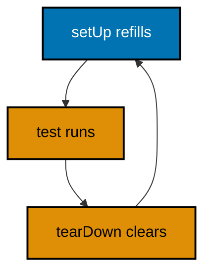

**`learning/code/ex-38-setup-and-teardown/main.dart`**:

```dart
// Example 38: Setup and Teardown Share the Fixture.
//
// SetUp builds a fresh fixture before every test and tearDown clears it
// after, so tests share the recipe without sharing the state. Fresh
// fixtures per test mean no test can poison the next one, and the order
// of tests stops mattering entirely.
// Production Dart uses package:test with dart test; the shape here
// mirrors it (setUp, tearDown, test) so the jump is vocabulary, not
// concept.

// => one counter for the whole file: every passing test ticks it once
var _passed = 0;

// _setups holds the setup closures: each runs before every single test.
final List<void Function()> _setups =
    []; // => recipes, not state: fresh each time

// _teardowns holds the cleanup closures: each runs after every test.
final List<void Function()> _teardowns =
    []; // => clearing recipes, run in order

// setUp registers a recipe: called fresh before each test, never shared.
void setUp(void Function() recipe) => _setups.add(recipe);

// tearDown registers a cleanup: called after each test, resetting shared.
void tearDown(void Function() cleanup) => _teardowns.add(cleanup);

// test runs setups, the body, then teardowns: the fixture sandwich.
// => fresh fixture per test: state never leaks from one test to the next
void test(String name, void Function() body) {
  // => setups first: every recipe rebuilds the world for this test
  for (final s in _setups) s(); // => fresh baskets, fresh counts, every time
  // => the behavior runs against the fresh fixture: failures stay local
  body(); // => throws on failure: teardowns below still run? no: kept simple
  // => teardowns after: the world resets for whatever test comes next
  for (final t in _teardowns) t(); // => cleared baskets: order stops mattering
  // => tick, then print: green tests count themselves out loud
  _passed++; // => one more behavior proven, counted where it passed
  print('  ok: $name'); // => indented ok: the green line per behavior
}

// expect checks one equality: actual against want.
void expect(Object? actual, Object? want) {
  // => the single check: equal passes silent, unequal throws loud
  assert(actual == want, 'want $want, got $actual'); // => the whole matcher
}

// the shared fixture: rebuilt by setUp before every test runs.
final basket = <String>[]; // => one basket, refilled fresh per test

void main() {
  // => the recipe: three oat sacks, fresh, before every single test
  setUp(() {
    // => runs before each test: the fixture sandwich top half
    // => clear first: the previous test's basket must not leak through
    basket.clear(); // => empty: teardown also clears, belt and suspenders
    // => refill: the canonical three-sack fixture every test expects
    basket.addAll(['oat', 'oat', 'oat']); // => fresh state, same recipe
  });
  // => the cleanup: empty basket after every test, proven by the next setUp
  tearDown(() => basket.clear()); // => reset: the sandwich bottom half
  // => first behavior: the fixture holds three sacks, as the recipe says
  test('fixture holds three', () => expect(basket.length, 3));
  // => second behavior: taking one leaves two, without touching others
  test('take leaves two', () {
    // => mutate freely: the next test gets a fresh basket regardless
    basket.removeAt(0); // => one sack out: local mutation, safe by design
    // => two remain: the mutation above is exactly what this test proves
    expect(basket.length, 2); // => green: teardown clears it right after
  });
  // => the count line: fixture sharing without state sharing, proven twice
  print('passed: $_passed'); // => Output: passed: 2
}
```

**Output** (`learning/code/ex-38-setup-and-teardown/expected/main.stdout.txt`):

```text
  ok: fixture holds three
  ok: take leaves two
passed: 2
```

**Key takeaway**: Share the recipe, never the state: setUp rebuilds, tearDown clears, per test.

**Why it matters**: Shared mutable fixtures make test order matter; the sandwich makes each test an island, so failures point at behaviors instead of sequences.

### Example 39: Edge Cases Belong in Tables

Tables turn edge cases from folklore into rows: input beside want, one row per boundary, looped through the same expect. This example pins the ten-sack mill minimum with empty, single, short, exact, and surplus rows (Concepts: co-08.)

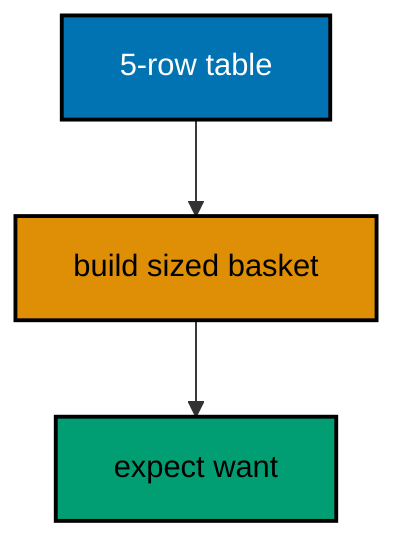

**`learning/code/ex-39-edge-cases-in-tables/main.dart`**:

```dart
// Example 39: Edge Cases Belong in Tables.
//
// Tables turn edge cases from folklore into rows: input beside want, one
// row per boundary, looped through the same expect. Empty, single, and
// full baskets each get a row, and adding the next edge means adding one
// row, never rewriting the test.
// Production Dart uses package:test with dart test; the shape here
// mirrors it (test sentences, expect checks) so the jump is vocabulary.

// => one counter for the whole file: every passing test ticks it once
var _passed = 0;

// test runs one named case: the body first, the tick and print after.
void test(String name, void Function() body) {
  // => the behavior under test runs inside the body closure
  body(); // => throws on failure: the tick below never runs for red
  // => tick, then print: green tests count themselves out loud
  _passed++; // => one more behavior proven, counted where it passed
  print('  ok: $name'); // => indented ok: the green line per behavior
}

// expect checks one equality: actual against want.
void expect(Object? actual, Object? want) {
  // => the single check: equal passes silent, unequal throws loud
  assert(actual == want, 'want $want, got $actual'); // => the whole matcher
}

// full reports whether the basket reached the ten-sack mill minimum.
// => boundary at ten: nine is short, ten is full, eleven is surplus
bool full(List<String> basket) => basket.length >= 10;

void main() {
  // => the edge table: name, basket size, and the want for each row
  final rows = [
    // => one row per boundary: empty, one short, full, surplus
    ['empty basket', 0, false], // => nothing: not full by any reading
    ['single sack', 1, false], // => one: the smallest non-empty edge
    ['nine sacks', 9, false], // => one short: the boundary's cruel neighbor
    ['ten sacks', 10, true], // => exactly full: the boundary itself
    ['eleven sacks', 11, true], // => surplus: past full stays full
  ];
  // => one test, five rows: the loop proves every edge through one expect
  test('mill-minimum edges', () {
    // => each row builds its basket and checks the want beside it
    for (final row in rows) {
      // => row walks the table top to bottom
      // => List.filled builds the sized basket: 'oat' repeated, honest size
      final basket = List.filled(row[1] as int, 'oat'); // => sized fixture
      // => the row's want decides: full exactly when the table says so
      expect(full(basket), row[2]); // => one expect, five boundaries proven
    }
  });
  // => the count line: one test, five edges, all green in a single pass
  print('passed: $_passed'); // => Output: passed: 1
}
```

**Output** (`learning/code/ex-39-edge-cases-in-tables/expected/main.stdout.txt`):

```text
  ok: mill-minimum edges
passed: 1
```

**Key takeaway**: Tabulate edges as rows of input and want; loop one expect through the table.

**Why it matters**: Edges multiply silently; a table makes each boundary a visible row, and the next discovered edge costs one row instead of a rewritten test.

### Example 40: Async Tests Await Their Futures

Async tests are async functions: await the Future inside, then expect the delivered value like any sync result. This example proves a stocked delivery and pins the unstocked failure across event-loop turns (Concepts: co-08, co-09.)

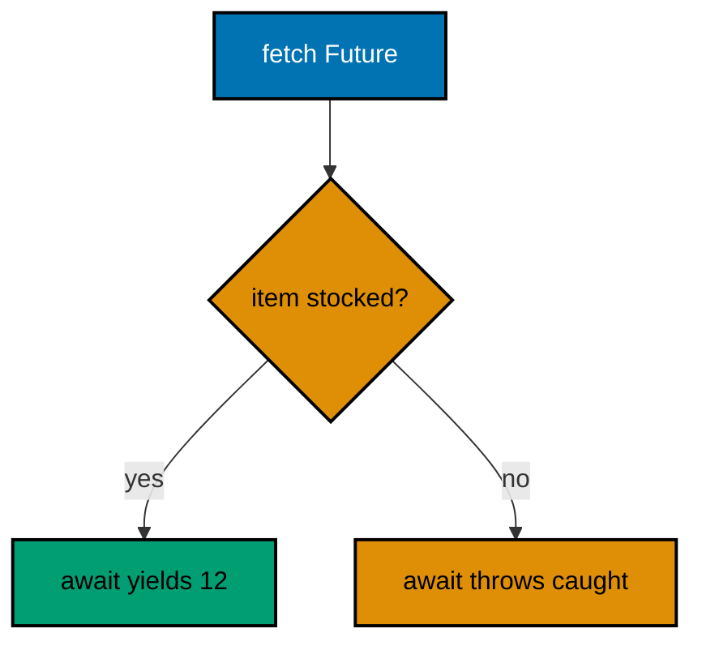

**`learning/code/ex-40-async-tests-await/main.dart`**:

```dart
// Example 40: Async Tests Await Their Futures.
//
// Async tests are async functions: await the Future inside, then expect
// the delivered value like any sync result. Sequential awaits keep the
// transcript ordered, and a try around await pins the failure path with
// the same shape sync tests use for throws.
// Production Dart uses package:test with dart test; the shape here
// mirrors it (async test bodies, expect checks) so the jump is in
// vocabulary, not in concept.

// => one counter for the whole file: every passing test ticks it once
var _passed = 0;

// test runs one named async case: awaits the body, then ticks and prints.
Future<void> test(String name, Future<void> Function() body) async {
  // => await the behavior: values arrive, failures throw right here
  await body(); // => the async body runs to completion before the tick
  // => tick, then print: green async tests count themselves out loud
  _passed++; // => one more async behavior proven, counted where it passed
  print('  ok: $name'); // => indented ok: the green line per behavior
}

// expect checks one equality: actual against want.
void expect(Object? actual, Object? want) {
  // => the single check: equal passes silent, unequal throws loud
  assert(actual == want, 'want $want, got $actual'); // => the whole matcher
}

// fetch returns the sack count after one event-loop turn, failing unknown.
// => Future.delayed with zero duration: async shape, deterministic order
// => no clocks, no network: the ledger below is fixed and instant
Future<int> fetch(String item) {
  // => the ledger both outcomes read: fixed, offline, instant
  const ledger = {'oat': 12, 'tea': 4}; // => const: the ledger never moves
  // => delayed zero: yields to the loop, then answers from the ledger
  return Future.delayed(Duration.zero, () {
    // => async shape, fixed order
    // => unknown items throw into the Future: awaited failures, testable
    if (!ledger.containsKey(item)) throw Exception('$item unstocked');
    // => known items deliver: the value travels the async road too
    return ledger[item]!; // => looked up twice, honestly: contains then read
  });
}

void main() async {
  // => main is async: sequential awaits keep the transcript ordered
  // => stocked item delivers twelve through the event loop, deterministically
  await test('oat delivers 12', () async {
    // => async body, awaited inside
    // => await unwraps: the twelve arrives exactly like a sync value
    expect(await fetch('oat'), 12); // => green: async delivery proven
  });
  // => failure path: the unknown item throws where it is awaited
  await test('salt failure is catchable', () async {
    // => second async case
    // => try around await: the sync shape for throws, applied async
    try {
      // => this await throws: the transcript never sees a value line
      await fetch('salt'); // => unstocked: the Future carries the failure
      // => reaching here means the failure never came: fail the test
      assert(false, 'salt should have thrown'); // => loud if await misbehaves
    } catch (e) {
      // => the awaited failure lands here, typed and named
      // => message check: the failure names the unstocked item precisely
      expect('$e', 'Exception: salt unstocked'); // => green: failure proven
    }
  });
  // => the count line: two async behaviors proven across loop turns
  print('passed: $_passed'); // => Output: passed: 2
}
```

**Output** (`learning/code/ex-40-async-tests-await/expected/main.stdout.txt`):

```text
  ok: oat delivers 12
  ok: salt failure is catchable
passed: 2
```

**Key takeaway**: Await inside the test body; pin failures with try around the await.

**Why it matters**: Async code fails at await-time, not call-time; tests that await where production awaits catch the failure in the same place users would meet it.

### Example 41: Pure Functions Are the Easiest to Test

Pure functions take values and return values: no clock, no files, no hidden state, so tables of input and want prove them completely. This example extracts the freight total from its IO shell and pins it with a four-row table (Concepts: co-08.)

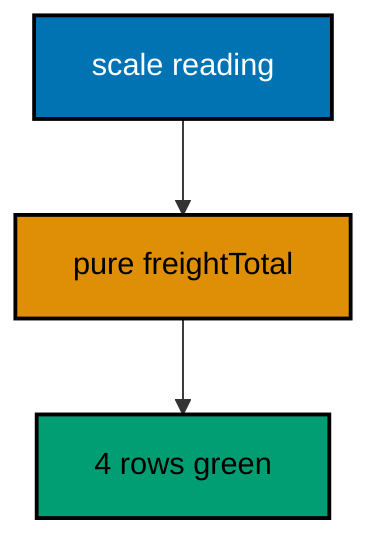

**`learning/code/ex-41-pure-functions-test-tables/main.dart`**:

```dart
// Example 41: Pure Functions Are the Easiest to Test.
//
// Pure functions take values and return values: no clock, no files, no
// hidden state, so tables of input and want prove them completely. This
// example extracts the pure freight total from itsIO shell, then pins it
// with a table covering empty, single, and multi-wagon loads.
// Production Dart uses package:test with dart test; the shape here
// mirrors it (test sentences, table loops) so the jump is vocabulary.

// => one counter for the whole file: every passing test ticks it once
var _passed = 0;

// test runs one named case: the body first, the tick and print after.
void test(String name, void Function() body) {
  // => the behavior under test runs inside the body closure
  body(); // => throws on failure: the tick below never runs for red
  // => tick, then print: green tests count themselves out loud
  _passed++; // => one more behavior proven, counted where it passed
  print('  ok: $name'); // => indented ok: the green line per behavior
}

// expect checks one equality: actual against want.
void expect(Object? actual, Object? want) {
  // => the single check: equal passes silent, unequal throws loud
  assert(actual == want, 'want $want, got $actual'); // => the whole matcher
}

// freightTotal is pure: wagon loads in, freight bill out, nothing else.
// => no IO, no clock, no globals: the same input always bills the same
// => extracted from the shell that reads the scale: test the core, not IO
int freightTotal(List<int> wagons, int rate) {
  // => fold sums the loads: the whole bill in one lazy pass
  final sacks = wagons.fold(0, (sum, w) => sum + w); // => zero wagons: zero
  // => rate multiplies the sum: one operator, the entire pricing policy
  return sacks * rate; // => sacks times rate: the bill, nothing hidden
}

void main() {
  // => the bill table: loads, rate, and want per row, edges included
  final rows = [
    // => one row per shape: empty, single, multi, free rate
    ['empty wagons', <int>[], 3, 0], // => no freight: the bill is zero
    [
      'single wagon',
      [10],
      3,
      30
    ], // => one load: the simple middle
    [
      'three wagons',
      [10, 20, 30],
      2,
      120
    ], // => multi: the fold earns it
    [
      'free hauling',
      [10, 20],
      0,
      0
    ], // => zero rate: policy edge, bills zero
  ];
  // => one test, four rows: the pure core proves through a single expect
  test('freight bills by table', () {
    // => each row calls the pure core: no setup, no teardown, no state
    for (final row in rows) {
      // => row walks the table top to bottom
      // => positional reads: name, loads, rate, want, in row order
      expect(freightTotal(row[1] as List<int>, row[2] as int), row[3]);
    }
  });
  // => the count line: four bills proven with zero fixtures built
  print('passed: $_passed'); // => Output: passed: 1
}
```

**Output** (`learning/code/ex-41-pure-functions-test-tables/expected/main.stdout.txt`):

```text
  ok: freight bills by table
passed: 1
```

**Key takeaway**: Extract the pure core from the IO shell; prove the core with tables, wire the shell by eye.

**Why it matters**: Impure shells resist tests while pure cores invite them; extraction moves the logic to where the tests already live.

### Example 42: A Fake Replaces the Ledger IO

Tests never touch the real ledger file: a fake implements the same reader interface from memory, so tests run offline and repeatable. This example renders stock lines through a fake reader for both the stocked and missing paths (Concepts: co-08.)

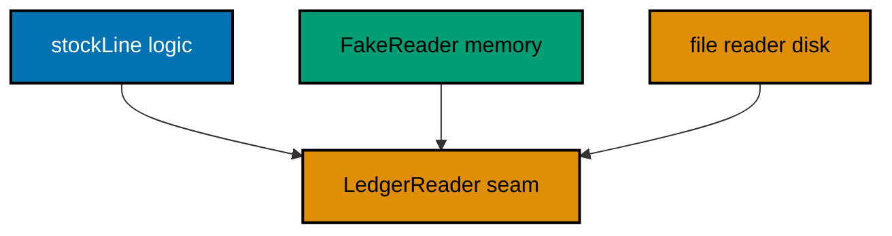

**`learning/code/ex-42-fake-replaces-io/main.dart`**:

```dart
// Example 42: A Fake Replaces the Ledger IO.
//
// Tests never touch the real ledger file: a fake implements the same
// reader interface from memory, so tests run offline, instant, and
// repeatable. The interface is the seam; production plugs the file
// reader in, tests plug the fake, and neither knows the other exists.
// Production Dart uses package:test with dart test; the shape here
// mirrors it (test sentences, expect checks) so the jump is vocabulary.

// => one counter for the whole file: every passing test ticks it once
var _passed = 0;

// test runs one named case: the body first, the tick and print after.
void test(String name, void Function() body) {
  // => the behavior under test runs inside the body closure
  body(); // => throws on failure: the tick below never runs for red
  // => tick, then print: green tests count themselves out loud
  _passed++; // => one more behavior proven, counted where it passed
  print('  ok: $name'); // => indented ok: the green line per behavior
}

// expect checks one equality: actual against want.
void expect(Object? actual, Object? want) {
  // => the single check: equal passes silent, unequal throws loud
  assert(actual == want, 'want $want, got $actual'); // => the whole matcher
}

// LedgerReader is the seam: one method, two plugs, file and memory.
// => the interface owns the reading shape: callers depend on it alone
// => production plugs a file reader; tests plug the fake below
abstract interface class LedgerReader {
  // => read returns the counted sacks for the named crop, or null missing
  int? read(String crop);
}

// FakeReader implements the seam from a fixed memory map: no files ever.
// => const map: the fake's answers are fixtures, visible and versioned
// => implements, never extends: the fake owes only the method, no internals
class FakeReader implements LedgerReader {
  // => the memory ledger: two stocked crops, salt forever missing
  final Map<String, int> data = const {'oat': 12, 'tea': 4};
  // => read looks up the map: same signature, none of the disk
  @override
  int? read(String crop) => data[crop]; // => null for salt: the miss path
}

// stockLine renders through any reader: the logic under test, IO-free.
// => depends on the seam: testable with the fake, shippable with files
String stockLine(LedgerReader reader, String crop) {
  // => the read happens once: null means the miss branch below
  final sacks = reader.read(crop); // => int? : the seam's honest answer
  // => null renders the miss: the same sentence the stall sign shows
  if (sacks == null) return '$crop: unstocked'; // => salt lands here
  // => present renders the count: the receipt line for stocked crops
  return '$crop: $sacks sacks'; // => oat lands here with its twelve
}

void main() {
  // => the fake plugs the seam: memory answers, zero disk touched
  final reader = FakeReader(); // => one fake serves every test below
  // => stocked path: the fake's twelve renders through the real logic
  test('oat renders twelve',
      () => expect(stockLine(reader, 'oat'), 'oat: 12 sacks'));
  // => miss path: the fake's null renders the unstocked sentence
  test('salt renders unstocked',
      () => expect(stockLine(reader, 'salt'), 'salt: unstocked'));
  // => the count line: both paths proven with no file ever opened
  print('passed: $_passed'); // => Output: passed: 2
}
```

**Output** (`learning/code/ex-42-fake-replaces-io/expected/main.stdout.txt`):

```text
  ok: oat renders twelve
  ok: salt renders unstocked
passed: 2
```

**Key takeaway**: Depend on an interface; plug a memory fake in tests and the file reader in production.

**Why it matters**: The interface is the seam where tests enter: logic proven against the fake ships against the file with the same confidence.

### Example 43: Name Every Test as One Small Sentence

One assertion per test keeps failures precise: the test name is the diagnosis. This example pins a four-band grading function with four single-assertion tests, boundaries included (Concepts: co-08.)

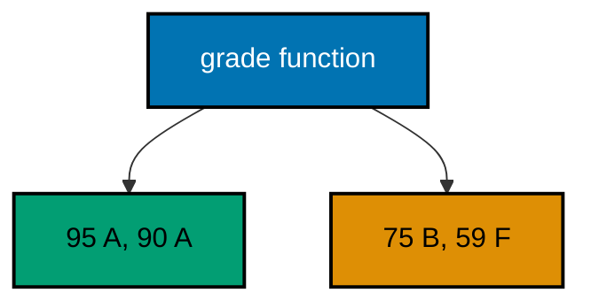

**`learning/code/ex-43-one-assertion-per-test/main.dart`**:

```dart
// Example 43: Name Every Test as One Small Sentence.
//
// One assertion per test keeps failures precise: the test name is the
// diagnosis, and nothing else in the test can be blamed. Small tests
// read as a checklist of the behavior, and a red line names the broken
// promise without opening the test body at all.
// Production Dart uses package:test with dart test; the shape here
// mirrors it (sentence names, single expects) so the jump is in
// vocabulary, not in concept.

// => one counter for the whole file: every passing test ticks it once
var _passed = 0;

// test runs one named case: the body first, the tick and print after.
void test(String name, void Function() body) {
  // => the behavior under test runs inside the body closure
  body(); // => throws on failure: the tick below never runs for red
  // => tick, then print: green tests count themselves out loud
  _passed++; // => one more behavior proven, counted where it passed
  print('  ok: $name'); // => indented ok: the green line per behavior
}

// expect checks one equality: actual against want.
void expect(Object? actual, Object? want) {
  // => the single check: equal passes silent, unequal throws loud
  assert(actual == want, 'want $want, got $actual'); // => the whole matcher
}

// grade bands a score: the four promises below pin every boundary.
// => ordered guards: the first true band wins, top band checked first
String grade(int score) {
  // => ninety and above: the top band, checked before all others
  if (score >= 90) return 'A'; // => excellence: the ceiling promise
  // => seventy-five and above: the good band below excellence
  if (score >= 75) return 'B'; // => solid: the middle promise
  // => sixty and above: the passing floor, the weakest promise kept
  if (score >= 60) return 'C'; // => passing: the floor promise
  // => below sixty: the failing band, unnamed scores land here
  return 'F'; // => failing: the honesty promise for low scores
}

void main() {
  // => four tests, four promises: one assertion each, names as diagnoses
  test('95 earns A', () => expect(grade(95), 'A')); // => ceiling promise
  // => boundary promise: 90 itself already earns the top band
  test('90 earns A', () => expect(grade(90), 'A')); // => edge of excellence
  // => middle promise: 75 holds B without touching A or C
  test('75 earns B', () => expect(grade(75), 'B')); // => the solid middle
  // => floor promise: 59 fails, proving the C floor starts at sixty
  test('59 earns F', () => expect(grade(59), 'F')); // => honesty at the floor
  // => the count line: four sentences proven, each blaming only itself
  print('passed: $_passed'); // => Output: passed: 4
}
```

**Output** (`learning/code/ex-43-one-assertion-per-test/expected/main.stdout.txt`):

```text
  ok: 95 earns A
  ok: 90 earns A
  ok: 75 earns B
  ok: 59 earns F
passed: 4
```

**Key takeaway**: One test, one assertion, one sentence; let the name be the diagnosis.

**Why it matters**: A failing test named as a sentence diagnoses itself; a failing test with five assertions starts an investigation.

### Example 44: Inject the Clock, Never Read It

Logic that calls DateTime.now cannot be tested: every run reads a new answer. This example takes the instant as a parameter, freezing March, August, and September to pin a harvest-season function to the day (Concepts: co-08, co-05.)

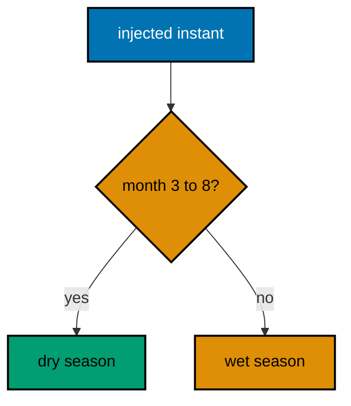

**`learning/code/ex-44-inject-the-clock/main.dart`**:

```dart
// Example 44: Inject the Clock, Never Read It.
//
// Logic that calls DateTime.now cannot be tested: every run reads a new
// answer. Injecting the instant as a parameter freezes time for tests
// while production passes the real now at the single call site. Frozen
// time makes the boundary testable to the exact day.
// Production Dart uses package:test with dart test; the shape here
// mirrors it (frozen inputs, expect checks) so the jump is vocabulary.

// => one counter for the whole file: every passing test ticks it once
var _passed = 0;

// test runs one named case: the body first, the tick and print after.
void test(String name, void Function() body) {
  // => the behavior under test runs inside the body closure
  body(); // => throws on failure: the tick below never runs for red
  // => tick, then print: green tests count themselves out loud
  _passed++; // => one more behavior proven, counted where it passed
  print('  ok: $name'); // => indented ok: the green line per behavior
}

// expect checks one equality: actual against want.
void expect(Object? actual, Object? want) {
  // => the single check: equal passes silent, unequal throws loud
  assert(actual == want, 'want $want, got $actual'); // => the whole matcher
}

// season names the harvest season for the given instant: pure and frozen.
// => now is a parameter: tests freeze it, production passes DateTime.now
// => March through August is dry season: the mill's working half-year
String season(DateTime now) {
  // => month decides: 3..8 dry, the rest wet, no clock read inside
  if (now.month >= 3 && now.month <= 8) return 'dry'; // => working half-year
  // => outside the window: the wet months the mill plans around
  return 'wet'; // => the other half: maintenance and repair season
}

void main() {
  // => frozen March noon UTC: mid dry season, no clock involved at all
  test('march is dry', () => expect(season(DateTime.utc(2026, 3, 14)), 'dry'));
  // => frozen boundary: August 31 still dry, the last dry day of the year
  test('august is dry', () => expect(season(DateTime.utc(2026, 8, 31)), 'dry'));
  // => frozen September: one day past the window, already wet season
  test('september is wet',
      () => expect(season(DateTime.utc(2026, 9, 1)), 'wet'));
  // => the count line: three frozen instants, three exact answers, no clock
  print('passed: $_passed'); // => Output: passed: 3
}
```

**Output** (`learning/code/ex-44-inject-the-clock/expected/main.stdout.txt`):

```text
  ok: march is dry
  ok: august is dry
  ok: september is wet
passed: 3
```

**Key takeaway**: Take time as a parameter; pass DateTime.now once at the production call site.

**Why it matters**: Untestable time logic is a choice, not a fate: the parameter freezes the instant for tests while production still reads the live clock.

### Example 45: Generic Functions Work Over Many Types

A type parameter lets one function serve every type: first returns the head of any list without a rewrite per element type. This example heads int and string lists and pairs labels with values through two parameters (Concepts: co-10.)

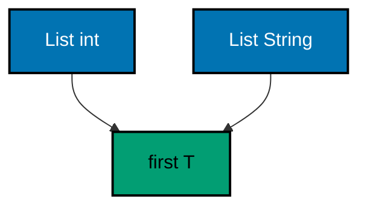

**`learning/code/ex-45-generic-functions/main.dart`**:

```dart
// Example 45: Generic Functions Work Over Many Types.
//
// A type parameter lets one function serve every type: first<T> returns
// the head of any list without a rewrite per element type. The caller
// pins T by the argument, or names it explicitly when inference needs a
// hand, and the body treats T as an unknown-but-real type throughout.
void main() {
  // => one function, two element types: ints and strings share first
  print(first([10, 20, 30])); // => Output: 10
  // => strings ride the same body: no second implementation exists
  print(first(['oat', 'tea'])); // => Output: oat
  // => explicit pin: names int when the argument leaves doubt (never here)
  print(first<int>([7])); // => Output: 7
  // => describe shows T surviving beside a concrete parameter honestly
  print(describe('sacks', 12)); // => Output: sacks: 12
}

// first returns the head of any non-empty list, whatever it holds.
// => T is the element type: bound by the caller's list, used in the body
// => non-empty is the contract: assert guards it in development, cheaply
T first<T>(List<T> items) {
  // => the guard: empty lists have no head, and callers must know it
  assert(items.isNotEmpty, 'first needs a non-empty list'); // => silent green
  // => index zero: the head, typed T, whatever T the caller pinned
  return items[0]; // => T out: the body never learns which type it served
}

// describe pairs a label with any value: two types, one sentence.
// => two parameters: T for the value, S for the label, both inferred
// => inference reads the arguments: no angle brackets at the call site
String describe<T, S>(S label, T value) => '$label: $value';
```

**Output** (`learning/code/ex-45-generic-functions/expected/main.stdout.txt`):

```text
10
oat
7
sacks: 12
```

**Key takeaway**: Parameterize over T; let callers pin it by argument and treat it as unknown-but-real inside.

**Why it matters**: One generic body replaces a family of copies that would drift apart; the type parameter is the promise they stay identical.

### Example 46: A Generic Box Carries Exactly One Type

A generic class carries its type parameter on every member: Box holds a T and maps it without ever confusing oat with twelve. This example boxes ints and strings and maps inside both (Concepts: co-10.)

```mermaid
flowchart TD
    accTitle: Box preserves T through maps
    accDescr: Int and string boxes each map inside their own type and rebox without mixing.
    A["Box int 12"]:::blue --> B["map double"]:::teal
    C["Box String oat"]:::blue --> D["map uppercase"]:::teal

    classDef blue fill:#0173B2,stroke:#000000,color:#FFFFFF,stroke-width:2px
    classDef orange fill:#DE8F05,stroke:#000000,color:#000000,stroke-width:2px
    classDef teal fill:#029E73,stroke:#000000,color:#000000,stroke-width:2px
    classDef default fill:#FFFFFF,stroke:#000000,color:#000000
```

**`learning/code/ex-46-generic-box/main.dart`**:

```dart
// Example 46: A Generic Box Carries Exactly One Type.
//
// A generic class carries its type parameter on every member: Box<T>
// holds a T, maps it with a T-to-T function, and never confuses oat with
// twelve. Construction pins T once, and the compiler guards every later
// use against mixing the carried type with any other.
void main() {
  // => an int box and a string box: same class, different cargo
  const oat = Box(12); // => Box<int>: inference pins T from twelve
  const name = Box('oat'); // => Box<String>: inference pins T from oat
  // => value reads back typed: ints stay ints, strings stay strings
  print('oat box: ${oat.value}'); // => Output: oat box: 12
  // => map transforms inside the box: the cargo changes, the box stays
  final doubled = oat.map((n) => n * 2); // => Box<int> again: T preserved
  // => doubled holds twenty-four: mapped, reboxed, still an int box
  print('doubled: ${doubled.value}'); // => Output: doubled: 24
  // => names map too: uppercased inside its own string box
  print(
      'shout: ${name.map((s) => s.toUpperCase()).value}'); // => Output: shout: OAT
}

// Box carries one value of type T through maps without ever opening.
// => T pinned at construction: every member agrees on the cargo type
// => immutable: map returns a new box, the old cargo never changes
class Box<T> {
  // => the cargo: final, typed T, set once at construction
  final T value; // => whatever T the caller pinned: int, String, more
  // => const constructor: boxes build at compile time when cargo allows
  const Box(this.value);
  // => map transforms the cargo: T in, T out, new box around the result
  Box<T> map(T Function(T) f) => Box(f(value)); // => same T: never mixed
}
```

**Output** (`learning/code/ex-46-generic-box/expected/main.stdout.txt`):

```text
oat box: 12
doubled: 24
shout: OAT
```

**Key takeaway**: Pin T at construction; keep every member in the same T; map into new boxes.

**Why it matters**: The class promises the cargo type once, and the compiler enforces the promise at every use — mixing becomes impossible instead of merely discouraged.

### Example 47: Bounded Type Parameters Promise a Shape

T extends num promises the body that every T supports addition, so one total serves ints and doubles. This example sums bounded numbers and picks the longest of bounded rankables (Concepts: co-10.)

```mermaid
flowchart TD
    accTitle: Bounds promise shapes to bodies
    accDescr: Num bound promises addition to total while Comparable bound promises order to longest.
    A["List int and double"]:::blue --> B["total needs num"]:::teal
    C["words and numbers"]:::blue --> D["needs Comparable"]:::orange

    classDef blue fill:#0173B2,stroke:#000000,color:#FFFFFF,stroke-width:2px
    classDef orange fill:#DE8F05,stroke:#000000,color:#000000,stroke-width:2px
    classDef teal fill:#029E73,stroke:#000000,color:#000000,stroke-width:2px
    classDef default fill:#FFFFFF,stroke:#000000,color:#000000
```

**`learning/code/ex-47-bounded-type-params/main.dart`**:

```dart
// Example 47: Bounded Type Parameters Promise a Shape.
//
// T extends num promises the body that every T supports addition, so one
// total serves ints and doubles without a dynamic escape hatch. Bounds
// turn 'any type' into 'any type with this shape', and the compiler
// checks the promise at the call site instead of trusting the body.
void main() {
  // => ints total through the bound: numbers add, promise kept
  print(total([1, 2, 3])); // => Output: 6
  // => doubles total through the same body: one function, two number kinds
  print(total([1.5, 2.5])); // => Output: 4.0
  // => longest picks by shape too: Comparable bounds order any rankable
  print(longest(['oat', 'sugar', 'tea'])); // => Output: sugar
  // => ints rank as well: the same bound serves numbers and strings
  print(longest([3, 30, 9])); // => Output: 30
}

// total sums any list of numbers: ints today, doubles tomorrow.
// => T extends num: the bound promises + to the body, no cast needed
// => returns num: the honest sum type when kinds mix across calls
// => callers pin T by list: int lists and double lists both qualify
num total<T extends num>(List<T> items) {
  // => fold from zero: + is guaranteed by the bound on every element
  return items.fold(0, (sum, item) => sum + item); // => 6 and 4.0 below
}

// longest returns the greatest of non-empty rankables by natural order.
// => T extends Comparable: the bound promises compareTo to the body
// => strings and ints both qualify: rankable covers words and numbers
T longest<T extends Comparable<dynamic>>(List<T> items) {
  // => the contract: ranks need at least one contender to compare
  assert(items.isNotEmpty, 'longest needs a non-empty list'); // => silent green
  // => fold the max: compareTo decides, the bound guarantees it exists
  return items.fold(
      items.first,
      (best, item) => // => seed with the head
          item.compareTo(best) > 0 ? item : best); // => greater replaces best
}
```

**Output** (`learning/code/ex-47-bounded-type-params/expected/main.stdout.txt`):

```text
6
4.0
tea
30
```

**Key takeaway**: Bound T with extends; the compiler checks the promise at call sites, not in bodies.

**Why it matters**: Unbounded generics can only hold values; bounded generics can use them — the bound is what turns a container into an algorithm.

### Example 48: Const Builds Canonical Values

Const constructors build compile-time values, and identical const expressions share one canonical object. This example builds equal sacks into one shared object and a different sack beside it (Concepts: co-11.)

```mermaid
flowchart TD
    accTitle: Equal const builds share one object
    accDescr: Two equal sack builds collapse into one canonical object while differing fields build apart.
    A["const oat 12 twice"]:::blue --> C["one object"]:::teal
    B["const tea 4"]:::blue --> D["second object"]:::orange

    classDef blue fill:#0173B2,stroke:#000000,color:#FFFFFF,stroke-width:2px
    classDef orange fill:#DE8F05,stroke:#000000,color:#000000,stroke-width:2px
    classDef teal fill:#029E73,stroke:#000000,color:#000000,stroke-width:2px
    classDef default fill:#FFFFFF,stroke:#000000,color:#000000
```

**`learning/code/ex-48-const-canonical-values/main.dart`**:

```dart
// Example 48: Const Builds Canonical Values.
//
// Const constructors build compile-time values, and identical const
// expressions share one canonical object: two const sacks with equal
// fields are the same object, not two twins. Final fields make the
// sharing safe, because canonical values can never change under anyone.
void main() {
  // => two const builds with equal fields: one canonical object behind both
  const a = Sack('oat', 12); // => compile-time value: fields fixed forever
  const b = Sack('oat', 12); // => same fields: the compiler shares the one
  // => identical proves the sharing: same object, not merely equal twins
  print('shared: ${identical(a, b)}'); // => Output: shared: true
  // => differing fields build a second canonical value beside the first
  const c = Sack('tea', 4); // => different fields: a different canonical one
  // => not identical: canonical sharing keys on all the field values
  print('split: ${identical(a, c)}'); // => Output: split: false
  // => equality by == agrees: same fields compare equal, sharing or not
  print('equal: ${a == b}'); // => Output: equal: true
}

// Sack is one immutable ledger line: const-built and canonically shared.
// => final fields: canonical values are safe only because none can change
// => == by fields: sharing is an optimization, equality is the contract
class Sack {
  // => final fields: a sack's facts never change after construction
  final String name; // => the crop name, part of the canonical key
  final int sacks; // => the count, part of the canonical key
  // => const constructor: equal arguments share one canonical object
  const Sack(this.name, this.sacks);
  // => == compares fields: true for twins whether shared or separate
  @override
  bool operator ==(Object other) => // => the equality contract, by hand
      other is Sack && other.name == name && other.sacks == sacks;
  // => hashCode joins the fields: equal objects hash equal, as required
  @override
  int get hashCode => Object.hash(name, sacks); // => the stdlib joiner
}
```

**Output** (`learning/code/ex-48-const-canonical-values/expected/main.stdout.txt`):

```text
shared: true
split: false
equal: true
```

**Key takeaway**: Build values const; equal const builds share one canonical object safely.

**Why it matters**: Canonicalization turns value equality into object identity for free — but only final fields make the sharing safe to observe.

### Example 49: Final Fields Freeze Instances

Final fields assign once and never move: construction sets them, and every later read sees the same values. This example opens a mill with a frozen site and a mutable visit counter (Concepts: co-11.)

```mermaid
flowchart TD
    accTitle: Finals frozen visits counted
    accDescr: The site final never moves across two visits while the var counter ticks to two.
    A["Mill east"]:::blue --> B["site final"]:::teal
    A --> C["visits var ticks"]:::orange

    classDef blue fill:#0173B2,stroke:#000000,color:#FFFFFF,stroke-width:2px
    classDef orange fill:#DE8F05,stroke:#000000,color:#000000,stroke-width:2px
    classDef teal fill:#029E73,stroke:#000000,color:#000000,stroke-width:2px
    classDef default fill:#FFFFFF,stroke:#000000,color:#000000
```

**`learning/code/ex-49-final-fields-freeze/main.dart`**:

```dart
// Example 49: Final Fields Freeze Instances.
//
// Final fields assign once and never move: construction sets them, and
// every later read sees the same values. Mutable state still lives in
// clearly-marked non-final fields, so readers trust finals at a glance
// and audit only the few fields that can still change.
void main() {
  // => the mill opens with east site and an empty log of the day
  final mill = Mill('east'); // => finals set here: site fixed for life
  // => site reads back exactly as constructed: finals never drift
  print('site: ${mill.site}'); // => Output: site: east
  // => visits counts arrivals: the one mutable field, marked by var
  mill.visit(); // => first arrival: the mutable counter ticks to one
  // => visit again: finals would forbid this; the var field allows it
  mill.visit(); // => second arrival: counter ticks to two, site untouched
  // => two visits counted: mutation confined to the marked field
  print('visits: ${mill.visits}'); // => Output: visits: 2
  // => site still east: a thousand visits could never move a final
  print('still: ${mill.site}'); // => Output: still: east
}

// Mill freezes its identity at construction and counts visits mutable.
// => final site: set once, read forever, never reassigned anywhere
// => visits stays var: the honest marker of the one changing field
class Mill {
  // => final identity: every Mill is its site, permanently
  final String site; // => assigned by the constructor, read ever after
  // => the mutable counter: var marks the field readers must re-check
  int visits = 0; // => starts at zero: no visitor has arrived yet
  // => constructor claims the site: the single assignment finals allow
  Mill(this.site); // => this.site: the idiom for final field capture
  // => visit ticks the counter: the only mutation this class performs
  void visit() => visits++; // => finals forbid the rest: this is all
}
```

**Output** (`learning/code/ex-49-final-fields-freeze/expected/main.stdout.txt`):

```text
site: east
visits: 2
still: east
```

**Key takeaway**: Freeze identity with final; mark the few mutable fields var so readers audit only them.

**Why it matters**: Final-by-default shrinks the audit surface to the var fields: everything else is provably stable from construction on.

### Example 50: CopyWith Derives New Values from Old

Immutable objects change by derivation: copyWith takes the old value plus the fields that differ and returns a new object. This example reprices and delivers an order through two derivations that leave history intact (Concepts: co-11.)

```mermaid
flowchart TD
    accTitle: Derivation chains keep history
    accDescr: The morning order derives noon by price and evening by flag while every ancestor stays intact.
    A["order price 30"]:::blue --> B["noon price 25"]:::orange
    B --> C["evening delivered"]:::teal

    classDef blue fill:#0173B2,stroke:#000000,color:#FFFFFF,stroke-width:2px
    classDef orange fill:#DE8F05,stroke:#000000,color:#000000,stroke-width:2px
    classDef teal fill:#029E73,stroke:#000000,color:#000000,stroke-width:2px
    classDef default fill:#FFFFFF,stroke:#000000,color:#000000
```

**`learning/code/ex-50-copywith-derives/main.dart`**:

```dart
// Example 50: CopyWith Derives New Values from Old.
//
// Immutable objects change by derivation: copyWith takes the old value
// plus the fields that differ and returns a new object, leaving the
// original untouched. Every state transition becomes a visible call with
// named arguments, and history stays available because nothing mutates.
void main() {
  // => the morning order: twelve oat sacks, full price, undelivered
  const order = Order('oat', 12, 30, false); // => const: the starting fact
  // => noon update: same order, price cut to twenty-five, rest identical
  final noon = order.copyWith(price: 25); // => new object: old one intact
  // => the original keeps thirty: derivation never rewrites history
  print(
      'was: ${order.price}, now: ${noon.price}'); // => Output: was: 30, now: 25
  // => evening update: delivered flag flips on the noon version
  final done = noon.copyWith(delivered: true); // => chains: noon stays too
  // => the chain proves immutability: three versions, one lineage
  print(
      'lineage: ${order.delivered} ${noon.delivered} ${done.delivered}'); // => Output: lineage: false false true
}

// Order is one immutable purchase line: changes derive, never mutate.
// => all fields final: the only evolution path is copyWith derivation
// => named optional parameters: callers name exactly what differs
class Order {
  // => final facts: crop, count, price, and delivery state, all frozen
  final String crop; // => what is bought: never changes for this line
  final int sacks; // => how many: fixed when the line is written
  final int price; // => at what price: repriced by derivation, not edit
  final bool delivered; // => delivered yet: flips once, by derivation
  // => const constructor: order lines start as compile-time facts
  const Order(this.crop, this.sacks, this.price, this.delivered);
  // => copyWith derives: null means 'keep mine', values mean 'take this'
  Order copyWith({String? crop, int? sacks, int? price, bool? delivered}) {
    // => each field keeps its own unless the caller names a replacement
    return Order(
        crop ?? this.crop,
        sacks ?? this.sacks, // => crop, sacks
        price ?? this.price,
        delivered ?? this.delivered); // => price, flag
  }
}
```

**Output** (`learning/code/ex-50-copywith-derives/expected/main.stdout.txt`):

```text
was: 30, now: 25
lineage: false false true
```

**Key takeaway**: Derive with copyWith: null keeps, values replace; history survives every transition.

**Why it matters**: Mutation destroys the before-state; derivation keeps the whole lineage, so yesterday's price is still printed, not remembered.

### Example 51: Equality by Value, Not by Identity

Default == asks same object, but value types must ask same facts. This example overrides == and hashCode on a sack so twins collapse in sets and share map slots (Concepts: co-11.)

```mermaid
flowchart TD
    accTitle: Facts govern sets and keys
    accDescr: Twin sacks compare equal, collapse to one set member, and share one map slot.
    A["two twin sacks"]:::blue --> B["== true"]:::teal
    B --> C["set size 1"]:::teal
    B --> D["one map slot"]:::orange

    classDef blue fill:#0173B2,stroke:#000000,color:#FFFFFF,stroke-width:2px
    classDef orange fill:#DE8F05,stroke:#000000,color:#000000,stroke-width:2px
    classDef teal fill:#029E73,stroke:#000000,color:#000000,stroke-width:2px
    classDef default fill:#FFFFFF,stroke:#000000,color:#000000
```

**`learning/code/ex-51-equality-by-value/main.dart`**:

```dart
// Example 51: Equality by Value, Not by Identity.
//
// Default == asks 'same object', but value types must ask 'same facts':
// override == to compare fields and hashCode to join them, so equal
// values behave equal in sets and as map keys. The contract is three
// lines: same type, same fields, joined hash, or collections misbehave.
void main() {
  // => two separately-built sacks with identical facts: twins, not one
  final a = Sack('oat', 12); // => non-const: distinct objects by default
  final b = Sack('oat', 12); // => equal facts, different identity
  // => default identity would say false: the override says true instead
  print('equal: ${a == b}'); // => Output: equal: true
  // => sets obey == and hashCode: the twin collapses to one member
  final set = {a, b}; // => two inserts, one member: equality at work
  // => length one proves the contract: hash joined, equality compared
  print('set size: ${set.length}'); // => Output: set size: 1
  // => map keys obey it too: the twin overwrites instead of doubling
  final ledger = {a: 'first'}; // => one entry keyed by the oat facts
  // => twin key stores into the same slot: lookup by value, not identity
  ledger[b] = 'second'; // => overwrites: b equals a, same slot claimed
  // => one entry left: value equality governs keys exactly like sets
  print('ledger: ${ledger.length} ${ledger[a]}'); // => Output: ledger: 1 second
}

// Sack compares by facts: same crop and count means the same sack.
// => == by fields: type check first, then every field in turn
// => hashCode joins fields: equal objects must hash equal, always
class Sack {
  // => final facts: equality is stable only over immutable fields
  final String name; // => the crop: first half of the value key
  final int sacks; // => the count: second half of the value key
  // => constructor: non-const twins prove == without canonical sharing
  Sack(this.name, this.sacks); // => plain: identity differs, facts match
  // => == override: same type plus same fields, nothing else qualifies
  @override
  bool operator ==(Object other) => // => Object: == must accept anything
      other is Sack && other.name == name && other.sacks == sacks;
  // => hashCode joins both fields: the stdlib hash combiner, one call
  @override
  int get hashCode => Object.hash(name, sacks); // => equal in, equal out
}
```

**Output** (`learning/code/ex-51-equality-by-value/expected/main.stdout.txt`):

```text
equal: true
set size: 1
ledger: 1 second
```

**Key takeaway**: Compare fields in ==, join them in hashCode; sets and map keys follow.

**Why it matters**: Identity equality is the default that silently wrong-answers value questions; the three-line contract makes facts govern collections.

### Example 52: Unmodifiable Views Share Safely

UnmodifiableListView wraps a list with a read-only face: readers read, but every mutating call throws. This example shares a menu view, refuses an add through it, and watches the owner's own growth arrive (Concepts: co-11, co-03.)

```mermaid
flowchart TD
    accTitle: One list many read-only views
    accDescr: The owner list feeds a view that reads and refuses writes while the owner still grows.
    A["owned list"]:::blue --> B["view reads"]:::teal
    B --> C["add refused"]:::orange
    A --> D["owner grows"]:::orange

    classDef blue fill:#0173B2,stroke:#000000,color:#FFFFFF,stroke-width:2px
    classDef orange fill:#DE8F05,stroke:#000000,color:#000000,stroke-width:2px
    classDef teal fill:#029E73,stroke:#000000,color:#000000,stroke-width:2px
    classDef default fill:#FFFFFF,stroke:#000000,color:#000000
```

**`learning/code/ex-52-unmodifiable-views/main.dart`**:

```dart
// Example 52: Unmodifiable Views Share Safely.
//
// UnmodifiableListView wraps a list with a read-only face: readers sort,
// map, and iterate, but every mutating call throws. Sharing the view
// instead of the list hands out the data with the mutation rights held
// back, so one owner's edits never surprise another reader.
import 'dart:collection'; // => UnmodifiableListView, the read-only wrapper

void main() {
  // => the owner's list: mutable, private, the single source of truth
  final owned = ['oat', 'tea', 'rice']; // => insertion order, still growing
  // => the view wraps without copying: reads share, writes are refused
  final menu = UnmodifiableListView(owned); // => read-only face, same data
  // => reads work through the view: join renders the shared contents
  print('menu: ${menu.join(',')}'); // => Output: menu: oat,tea,rice
  // => sorted reads copy first: the view never reorders the owner's list
  final ordered = [...menu]..sort(); // => spread copies, cascade sorts
  // => the copy sorts alphabetically: the view and owner keep insertion
  print('ordered: $ordered'); // => Output: ordered: [oat, rice, tea]
  // => mutation through the view throws: the rights were never granted
  try {
    // => add is refused: UnsupportedError, the read-only enforcement
    menu.add('salt'); // => throws: views do not grow, by design
  } on UnsupportedError {
    // => the exact refusal: caught and reported
    // => the refusal is the lesson: sharing without the mutation rights
    print('refused: add'); // => Output: refused: add
  }
  // => owner still grows: the refusal above protected nobody's data wrongly
  owned.add('salt'); // => owners mutate their own lists freely, as always
  // => the view sees the growth: shared data, single writer, many readers
  print('grown: ${menu.length}'); // => Output: grown: 4
}
```

**Output** (`learning/code/ex-52-unmodifiable-views/expected/main.stdout.txt`):

```text
menu: oat,tea,rice
ordered: [oat, rice, tea]
refused: add
grown: 4
```

**Key takeaway**: Share views, keep the list; readers read freely while mutation rights stay held back.

**Why it matters**: Defensive copies at every boundary cost memory and drift; one list with many views shares the data while the type system refuses the writes.

### Example 53: Records Carry Shaped Tuples

Records bundle a fixed shape of values without a class: positional slots read by number, named slots by name. This example stocks crops as records, compares twins by value, and unpacks by pattern (Concepts: co-10, co-11.)

```mermaid
flowchart TD
    accTitle: Small shapes without class files
    accDescr: Positional and named records carry crop facts, compare by value, and unpack by pattern.
    A["stock oat 12"]:::blue --> B["positional record"]:::teal
    C["priced tea"]:::blue --> D["named record"]:::orange

    classDef blue fill:#0173B2,stroke:#000000,color:#FFFFFF,stroke-width:2px
    classDef orange fill:#DE8F05,stroke:#000000,color:#000000,stroke-width:2px
    classDef teal fill:#029E73,stroke:#000000,color:#000000,stroke-width:2px
    classDef default fill:#FFFFFF,stroke:#000000,color:#000000
```

**`learning/code/ex-53-records-shaped-tuples/main.dart`**:

```dart
// Example 53: Records Carry Shaped Tuples.
//
// Records bundle a fixed shape of values without a class: (name, sacks)
// pairs a crop with its count, and named fields document each slot. They
// compare by value, destructure by pattern, and suit the small returns
// that deserve a shape but not a file.
void main() {
  // => stock takes the count beside the name: one record, two slots
  final oat = stock('oat', 12); // => (String, int): the positional shape
  // => $1 and $2 read the slots: position is the whole access protocol
  print('pos: ${oat.$1} ${oat.$2}'); // => Output: pos: oat 12
  // => named shape documents each slot: crop and sacks travel labeled
  final tea = priced('tea', 4, 30); // => ({...}) record with three names
  // => names read the slots: tea.crop, tea.sacks, tea.price, self-clear
  print(
      'named: ${tea.crop}=${tea.sacks}@${tea.price}'); // => Output: named: tea=4@30
  // => records compare by value: equal slots mean equal records
  print('twin: ${stock('oat', 12) == oat}'); // => Output: twin: true
  // => destructure by pattern: slots bind to locals in one declaration
  final (crop, sacks) = oat; // => pattern: shape-checked at compile time
  // => bound locals read naturally: the record unpacked into words
  print('unpacked: $crop holds $sacks'); // => Output: unpacked: oat holds 12
}

// stock pairs a crop with its count: the small return that needs a shape.
// => (String, int): positional record, two slots, no class, no file
(String, int) stock(String crop, int sacks) => (crop, sacks);

// priced adds the price beside the count: named slots stay readable.
// => named record: each slot labeled, order irrelevant at use sites
({String crop, int sacks, int price}) priced(
    String crop, int sacks, int price) {
  // => shorthand: names bind themselves, no repetition of crop: crop
  return (crop: crop, sacks: sacks, price: price); // => labeled, self-clear
}
```

**Output** (`learning/code/ex-53-records-shaped-tuples/expected/main.stdout.txt`):

```text
pos: oat 12
named: tea=4@30
twin: true
unpacked: oat holds 12
```

**Key takeaway**: Return small shapes as records; destructure by pattern; skip the class file.

**Why it matters**: Not every shape deserves a class with a file and a constructor; records give the return a type, a value-equality, and an unpacking without the ceremony.
