Examples 54–78 take migrations into team and production reality: parallel branches that collide, locks that block writers, and deploys that fail halfway. Three clusters carry the level: conflict resolution across branches (Examples 54–61), locking migrations and their blast radius (Examples 62–70), and diagnosing a failed or partial migration (Examples 71–78). Every example ends with the database and the history agreeing, because a migration is done only when both say so.

### Example 54: Linear History Stays Mergeable

Merges work when history is already linear, so this example builds three sequential migrations with a real foreign key. The program migrates and proves all three landed in order. (Concepts: co-04.)

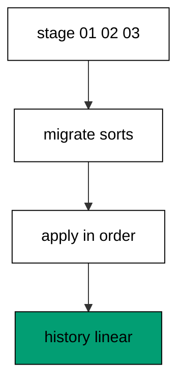

Sequential ids from one line of work apply without decisions: each file extends the previous shape and the foreign key proves the order matters. This is the shape every branch aims to rebase onto, because linear history has no merge to perform. Three files, three rows, zero conflicts is the baseline that makes every later conflict example legible. Mergeability is a property of discipline, not of tooling.

**`learning/code/ex-54-linear-history-stays-mergeable/main.clj`**:

```clojure
;; => Example 54: Linear History Stays Mergeable.
;; => One branch, sequential ids, no surprises: the mergeable shape every branch aims for.
(require '[migratus.core :as migratus]) ;; => migrate, rollback, up, and down move history
(require '[next.jdbc :as jdbc]) ;; => verification reads prove each migration landed
(require '[next.jdbc.result-set :as rs]) ;; => unqualified rows print without table prefixes
(require '[clojure.java.io :as io]) ;; => migration files are staged, then removed
;; => The database address comes from the harness, with local-run defaults.
(defn db-spec [] ;; => one builder owns every address default
  {:dbtype "postgresql" ;; => pgjdbc speaks the PostgreSQL wire protocol
   :host (or (System/getenv "PGHOST") "localhost") ;; => harness sets the service host
   :port (Integer/parseInt (or (System/getenv "PGPORT") "5432")) ;; => service port default
   :dbname (or (System/getenv "PGDATABASE") "postgres") ;; => fresh database per unit run
   :user (or (System/getenv "PGUSER") "postgres")}) ;; => trust auth needs no password
;; => One config carries the store, the relative migration dir, and the history table.
(defn config [dir table] ;; => every example owns its dir and history table
  {:store :database ;; => the SQL store journals history in a table
   :migration-dir dir ;; => relative to the unit folder, staged at runtime
   :migration-table-name table ;; => per-example history isolates every rerun
   :db (db-spec)}) ;; => next.jdbc connects from this spec
;; => Staging writes one up/down pair per call into the relative dir.
(defn write-migration [dir id name up down] ;; => one helper stages every migration
  (spit (str dir "/" id "-" name ".up.sql") up) ;; => forward change runs on migrate
  (when down ;; => up-only examples skip the down file on purpose
    (spit (str dir "/" id "-" name ".down.sql") down))) ;; => reverse runs on rollback
;; => Reset clears leftovers of a killed run so reruns print alike.
(defn reset-unit! [ds dir table tables views] ;; => one reset owns every leftover
  (doseq [v views] ;; => views drop before the tables they read
    (jdbc/execute! ds [(str "DROP VIEW IF EXISTS " v)])) ;; => stale views vanish first
  (let [d (io/file dir)] ;; => the relative staging dir of this unit
    (when (.exists d) ;; => a killed run may leave files behind
      (doseq [f (.listFiles d)] ;; => every staged file goes first
        (.delete ^java.io.File f)) ;; => delete each staged migration
      (.delete d)) ;; => the empty staging dir goes too
    (.mkdirs d)) ;; => a fresh dir for this run
  (doseq [t tables] ;; => every table this example owns
    (jdbc/execute! ds [(str "DROP TABLE IF EXISTS " t " CASCADE")])) ;; => killed runs vanish
  (jdbc/execute! ds [(str "DROP TABLE IF EXISTS " table)])) ;; => stale history vanishes too
;; => Reads print their own proof; ids sort so output never depends on disk order.
(defn applied-names [ds table] ;; => applied migration names in id order
  (mapv :description ;; => description stores the migration name
    (jdbc/execute! ds [(str "SELECT description FROM " table " WHERE id > 0 ORDER BY id")] ;; => id order, reserve row excluded
                     {:builder-fn rs/as-unqualified-lower-maps}))) ;; => short keys print cleanly
;; => Column lists read the catalog, so the schema proves itself.
(defn table-columns [ds table] ;; => column names in position order
  (mapv :column_name ;; => one name per row, nothing else
    (jdbc/execute! ds [(str "SELECT column_name FROM information_schema.columns WHERE table_name = '" table "' ORDER BY ordinal_position")] ;; => catalog order is stable
                     {:builder-fn rs/as-unqualified-lower-maps}))) ;; => short keys print cleanly
(def ds (jdbc/get-datasource (db-spec))) ;; => one shared datasource per unit run
(def cfg (config "mig" "m54_migrations")) ;; => store plus history table for this example
(reset-unit! ds "mig" "m54_migrations" ["m54_alpha" "m54_beta" "m54_gamma"] []) ;; => leftovers of a killed run vanish first
(write-migration "mig" "20260101005401" "make-alpha" ;; => first of three sequential steps
  "CREATE TABLE m54_alpha (id SERIAL PRIMARY KEY);\n" ;; => alpha opens the line
  "DROP TABLE m54_alpha;\n") ;; => reverse drops alpha
(write-migration "mig" "20260101005402" "make-beta" ;; => second step builds on the first
  "CREATE TABLE m54_beta (id SERIAL PRIMARY KEY, alpha_id INTEGER NOT NULL REFERENCES m54_alpha (id));\n" ;; => foreign key chains the order
  "DROP TABLE m54_beta;\n") ;; => reverse drops beta
(write-migration "mig" "20260101005403" "make-gamma" ;; => third step closes the set
  "CREATE TABLE m54_gamma (id SERIAL PRIMARY KEY);\n" ;; => gamma is tiny
  "DROP TABLE m54_gamma;\n") ;; => reverse drops gamma
(println "migrate:" (pr-str (migratus/migrate cfg))) ;; => nil means every pending migration applied
(println "completed:" (pr-str (applied-names ds "m54_migrations"))) ;; => id order straight from history
;; => Cleanup drops every object this example made, leaving no residue.
(defn cleanup-unit! [ds dir table tables views] ;; => one cleanup owns every created object
  (doseq [v views] ;; => views drop before the tables they read
    (jdbc/execute! ds [(str "DROP VIEW IF EXISTS " v)])) ;; => view residue vanishes
  (doseq [t tables] ;; => every table this example owns
    (jdbc/execute! ds [(str "DROP TABLE IF EXISTS " t " CASCADE")])) ;; => tables vanish with dependents
  (jdbc/execute! ds [(str "DROP TABLE IF EXISTS " table)]) ;; => history table vanishes too
  (let [d (io/file dir)] ;; => the staging dir from this run
    (when (.exists d) ;; => files were staged above
      (doseq [f (.listFiles d)] ;; => every staged file goes first
        (.delete ^java.io.File f)) ;; => delete each staged migration
      (.delete d)))) ;; => the empty staging dir goes too
(cleanup-unit! ds "mig" "m54_migrations" ["m54_alpha" "m54_beta" "m54_gamma"] []) ;; => drop every object this example created
```

**Output** (`learning/code/ex-54-linear-history-stays-mergeable/expected/main.stdout.txt`):

```text
migrate: nil
completed: ["make-alpha" "make-beta" "make-gamma"]
```

**Key takeaway**: Sequential ids on one branch apply cleanly: linear history is the mergeable shape.

**Why it matters**: Most migrations never conflict, and the linear case deserves its own proof before the exceptions. A branch that stays sequential merges by fast-forward, which is no merge at all. Teams that keep branches short and ids ordered spend their review energy on schema design, because the history mechanics stay boring.

### Example 55: Same Id on Two Branches Collides

Branches collide on ids when they grow apart, so this example stages two files sharing one number. The program catches the refusal and prints the colliding names. (Concepts: co-04, co-14, co-16.)

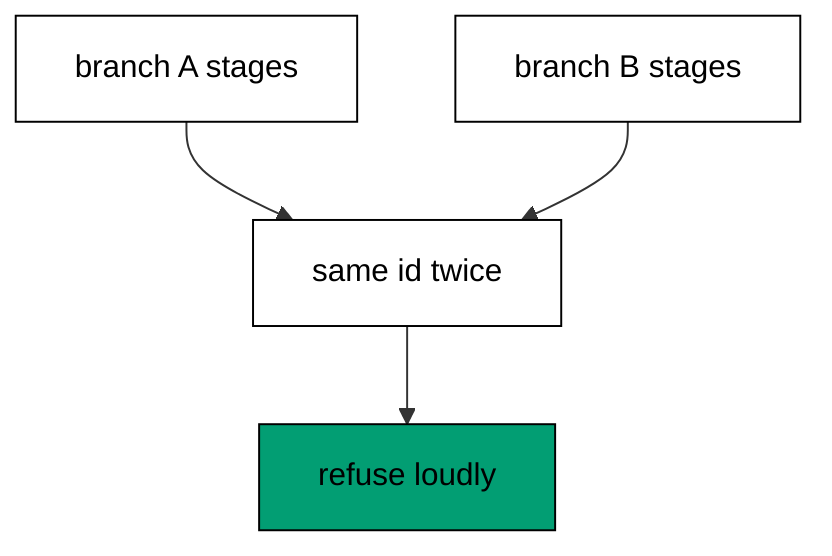

Two developers who pick the same next id stage files the runner cannot order, and Migratus refuses the ambiguity at discovery time instead of applying one at random. The error names the shared id and both migration names, which is everything the merger needs to renumber one side. Nothing applies and nothing records: the database waits while the humans sort the numbers. Loud refusal at discovery beats silent misordering at deploy, which is why the check runs before any statement.

**`learning/code/ex-55-same-id-on-two-branches-collides/main.clj`**:

```clojure
;; => Example 55: Same Id on Two Branches Collides.
;; => Two files, one id: discovery refuses the ambiguity instead of guessing.
(require '[migratus.core :as migratus]) ;; => migrate, rollback, up, and down move history
(require '[next.jdbc :as jdbc]) ;; => verification reads prove each migration landed
(require '[next.jdbc.result-set :as rs]) ;; => unqualified rows print without table prefixes
(require '[clojure.java.io :as io]) ;; => migration files are staged, then removed
;; => The database address comes from the harness, with local-run defaults.
(defn db-spec [] ;; => one builder owns every address default
  {:dbtype "postgresql" ;; => pgjdbc speaks the PostgreSQL wire protocol
   :host (or (System/getenv "PGHOST") "localhost") ;; => harness sets the service host
   :port (Integer/parseInt (or (System/getenv "PGPORT") "5432")) ;; => service port default
   :dbname (or (System/getenv "PGDATABASE") "postgres") ;; => fresh database per unit run
   :user (or (System/getenv "PGUSER") "postgres")}) ;; => trust auth needs no password
;; => One config carries the store, the relative migration dir, and the history table.
(defn config [dir table] ;; => every example owns its dir and history table
  {:store :database ;; => the SQL store journals history in a table
   :migration-dir dir ;; => relative to the unit folder, staged at runtime
   :migration-table-name table ;; => per-example history isolates every rerun
   :db (db-spec)}) ;; => next.jdbc connects from this spec
;; => Staging writes one up/down pair per call into the relative dir.
(defn write-migration [dir id name up down] ;; => one helper stages every migration
  (spit (str dir "/" id "-" name ".up.sql") up) ;; => forward change runs on migrate
  (when down ;; => up-only examples skip the down file on purpose
    (spit (str dir "/" id "-" name ".down.sql") down))) ;; => reverse runs on rollback
;; => Reset clears leftovers of a killed run so reruns print alike.
(defn reset-unit! [ds dir table tables views] ;; => one reset owns every leftover
  (doseq [v views] ;; => views drop before the tables they read
    (jdbc/execute! ds [(str "DROP VIEW IF EXISTS " v)])) ;; => stale views vanish first
  (let [d (io/file dir)] ;; => the relative staging dir of this unit
    (when (.exists d) ;; => a killed run may leave files behind
      (doseq [f (.listFiles d)] ;; => every staged file goes first
        (.delete ^java.io.File f)) ;; => delete each staged migration
      (.delete d)) ;; => the empty staging dir goes too
    (.mkdirs d)) ;; => a fresh dir for this run
  (doseq [t tables] ;; => every table this example owns
    (jdbc/execute! ds [(str "DROP TABLE IF EXISTS " t " CASCADE")])) ;; => killed runs vanish
  (jdbc/execute! ds [(str "DROP TABLE IF EXISTS " table)])) ;; => stale history vanishes too
;; => Reads print their own proof; ids sort so output never depends on disk order.
(defn applied-names [ds table] ;; => applied migration names in id order
  (mapv :description ;; => description stores the migration name
    (jdbc/execute! ds [(str "SELECT description FROM " table " WHERE id > 0 ORDER BY id")] ;; => id order, reserve row excluded
                     {:builder-fn rs/as-unqualified-lower-maps}))) ;; => short keys print cleanly
;; => Column lists read the catalog, so the schema proves itself.
(defn table-columns [ds table] ;; => column names in position order
  (mapv :column_name ;; => one name per row, nothing else
    (jdbc/execute! ds [(str "SELECT column_name FROM information_schema.columns WHERE table_name = '" table "' ORDER BY ordinal_position")] ;; => catalog order is stable
                     {:builder-fn rs/as-unqualified-lower-maps}))) ;; => short keys print cleanly
(def ds (jdbc/get-datasource (db-spec))) ;; => one shared datasource per unit run
(def cfg (config "mig" "m55_migrations")) ;; => store plus history table for this example
(reset-unit! ds "mig" "m55_migrations" ["m55_one" "m55_other"] []) ;; => leftovers of a killed run vanish first
(write-migration "mig" "20260101005501" "make-one" ;; => first branch claims the shared id
  "CREATE TABLE m55_one (id SERIAL PRIMARY KEY);\n" ;; => one table, shared number
  "DROP TABLE m55_one;\n") ;; => reverse drops one
(write-migration "mig" "20260101005501" "make-other" ;; => second branch claims the same id
  "CREATE TABLE m55_other (id SERIAL PRIMARY KEY);\n" ;; => other table, same number
  "DROP TABLE m55_other;\n") ;; => reverse drops other
(println "migrate:" (pr-str (try (migratus/migrate cfg) ;; => run fails, class printed
  (catch Exception e (str "threw: " (.getSimpleName (class e))))))) ;; => stable class, unstable name order
;; => Cleanup drops every object this example made, leaving no residue.
(defn cleanup-unit! [ds dir table tables views] ;; => one cleanup owns every created object
  (doseq [v views] ;; => views drop before the tables they read
    (jdbc/execute! ds [(str "DROP VIEW IF EXISTS " v)])) ;; => view residue vanishes
  (doseq [t tables] ;; => every table this example owns
    (jdbc/execute! ds [(str "DROP TABLE IF EXISTS " t " CASCADE")])) ;; => tables vanish with dependents
  (jdbc/execute! ds [(str "DROP TABLE IF EXISTS " table)]) ;; => history table vanishes too
  (let [d (io/file dir)] ;; => the staging dir from this run
    (when (.exists d) ;; => files were staged above
      (doseq [f (.listFiles d)] ;; => every staged file goes first
        (.delete ^java.io.File f)) ;; => delete each staged migration
      (.delete d)))) ;; => the empty staging dir goes too
(cleanup-unit! ds "mig" "m55_migrations" ["m55_one" "m55_other"] []) ;; => drop every object this example created
```

**Output** (`learning/code/ex-55-same-id-on-two-branches-collides/expected/main.stdout.txt`):

```text
migrate: "threw: Exception"
```

**Key takeaway**: One id, two files: discovery refuses and names both, so humans renumber instead of the runner guessing.

**Why it matters**: Parallel branches will pick the same number eventually, and the failure mode matters more than the frequency. A runner that guessed would apply one branch's schema under the other's name, corrupting both histories at once. Refusal turns a potential corruption into a five-minute renumber, which is the cheapest conflict outcome available.

### Example 56: Rename the Newcomer to Merge

Distinct ids merge without drama, so this example shows the resolved state both branches aim for. The program stages two uniquely numbered migrations and proves both applied in order. (Concepts: co-04, co-14.)

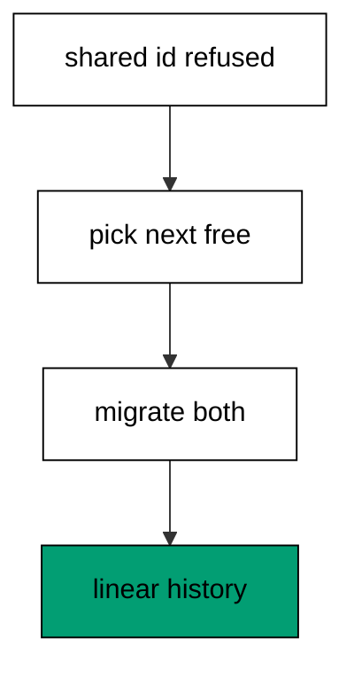

Renumbering means giving the losing file the next free id, after which discovery orders both files without ambiguity. This example shows the converged aftermath: two tables, two history rows, one linear story. The collision example before it showed the refusal; this one shows the resolution, and real merges move from the first shape to the second by renaming files. Converged history reads as if the branches never diverged, which is exactly what a merge should achieve.

**`learning/code/ex-56-rename-the-newcomer-to-merge/main.clj`**:

```clojure
;; => Example 56: Rename the Newcomer to Merge.
;; => The merge is a renumber: the losing file takes the next free id and history converges.
(require '[migratus.core :as migratus]) ;; => migrate, rollback, up, and down move history
(require '[next.jdbc :as jdbc]) ;; => verification reads prove each migration landed
(require '[next.jdbc.result-set :as rs]) ;; => unqualified rows print without table prefixes
(require '[clojure.java.io :as io]) ;; => migration files are staged, then removed
;; => The database address comes from the harness, with local-run defaults.
(defn db-spec [] ;; => one builder owns every address default
  {:dbtype "postgresql" ;; => pgjdbc speaks the PostgreSQL wire protocol
   :host (or (System/getenv "PGHOST") "localhost") ;; => harness sets the service host
   :port (Integer/parseInt (or (System/getenv "PGPORT") "5432")) ;; => service port default
   :dbname (or (System/getenv "PGDATABASE") "postgres") ;; => fresh database per unit run
   :user (or (System/getenv "PGUSER") "postgres")}) ;; => trust auth needs no password
;; => One config carries the store, the relative migration dir, and the history table.
(defn config [dir table] ;; => every example owns its dir and history table
  {:store :database ;; => the SQL store journals history in a table
   :migration-dir dir ;; => relative to the unit folder, staged at runtime
   :migration-table-name table ;; => per-example history isolates every rerun
   :db (db-spec)}) ;; => next.jdbc connects from this spec
;; => Staging writes one up/down pair per call into the relative dir.
(defn write-migration [dir id name up down] ;; => one helper stages every migration
  (spit (str dir "/" id "-" name ".up.sql") up) ;; => forward change runs on migrate
  (when down ;; => up-only examples skip the down file on purpose
    (spit (str dir "/" id "-" name ".down.sql") down))) ;; => reverse runs on rollback
;; => Reset clears leftovers of a killed run so reruns print alike.
(defn reset-unit! [ds dir table tables views] ;; => one reset owns every leftover
  (doseq [v views] ;; => views drop before the tables they read
    (jdbc/execute! ds [(str "DROP VIEW IF EXISTS " v)])) ;; => stale views vanish first
  (let [d (io/file dir)] ;; => the relative staging dir of this unit
    (when (.exists d) ;; => a killed run may leave files behind
      (doseq [f (.listFiles d)] ;; => every staged file goes first
        (.delete ^java.io.File f)) ;; => delete each staged migration
      (.delete d)) ;; => the empty staging dir goes too
    (.mkdirs d)) ;; => a fresh dir for this run
  (doseq [t tables] ;; => every table this example owns
    (jdbc/execute! ds [(str "DROP TABLE IF EXISTS " t " CASCADE")])) ;; => killed runs vanish
  (jdbc/execute! ds [(str "DROP TABLE IF EXISTS " table)])) ;; => stale history vanishes too
;; => Reads print their own proof; ids sort so output never depends on disk order.
(defn applied-names [ds table] ;; => applied migration names in id order
  (mapv :description ;; => description stores the migration name
    (jdbc/execute! ds [(str "SELECT description FROM " table " WHERE id > 0 ORDER BY id")] ;; => id order, reserve row excluded
                     {:builder-fn rs/as-unqualified-lower-maps}))) ;; => short keys print cleanly
;; => Column lists read the catalog, so the schema proves itself.
(defn table-columns [ds table] ;; => column names in position order
  (mapv :column_name ;; => one name per row, nothing else
    (jdbc/execute! ds [(str "SELECT column_name FROM information_schema.columns WHERE table_name = '" table "' ORDER BY ordinal_position")] ;; => catalog order is stable
                     {:builder-fn rs/as-unqualified-lower-maps}))) ;; => short keys print cleanly
(def ds (jdbc/get-datasource (db-spec))) ;; => one shared datasource per unit run
(def cfg (config "mig" "m56_migrations")) ;; => store plus history table for this example
(reset-unit! ds "mig" "m56_migrations" ["m56_keep" "m56_new"] []) ;; => leftovers of a killed run vanish first
(write-migration "mig" "20260101005601" "keep-first" ;; => first branch lands its table
  "CREATE TABLE m56_keep (id SERIAL PRIMARY KEY);\n" ;; => kept table is tiny
  "DROP TABLE m56_keep;\n") ;; => reverse drops keep
(write-migration "mig" "20260101005602" "new-collides" ;; => second branch stages its change
  "CREATE TABLE m56_new (id SERIAL PRIMARY KEY);\n" ;; => new table is tiny too
  "DROP TABLE m56_new;\n") ;; => reverse drops new
(println "migrate:" (pr-str (migratus/migrate cfg))) ;; => both apply with distinct ids
(println "completed:" (pr-str (applied-names ds "m56_migrations"))) ;; => two entries in id order
;; => Cleanup drops every object this example made, leaving no residue.
(defn cleanup-unit! [ds dir table tables views] ;; => one cleanup owns every created object
  (doseq [v views] ;; => views drop before the tables they read
    (jdbc/execute! ds [(str "DROP VIEW IF EXISTS " v)])) ;; => view residue vanishes
  (doseq [t tables] ;; => every table this example owns
    (jdbc/execute! ds [(str "DROP TABLE IF EXISTS " t " CASCADE")])) ;; => tables vanish with dependents
  (jdbc/execute! ds [(str "DROP TABLE IF EXISTS " table)]) ;; => history table vanishes too
  (let [d (io/file dir)] ;; => the staging dir from this run
    (when (.exists d) ;; => files were staged above
      (doseq [f (.listFiles d)] ;; => every staged file goes first
        (.delete ^java.io.File f)) ;; => delete each staged migration
      (.delete d)))) ;; => the empty staging dir goes too
(cleanup-unit! ds "mig" "m56_migrations" ["m56_keep" "m56_new"] []) ;; => drop every object this example created
```

**Output** (`learning/code/ex-56-rename-the-newcomer-to-merge/expected/main.stdout.txt`):

```text
migrate: nil
completed: ["keep-first" "new-collides"]
```

**Key takeaway**: Renumber the newcomer onto the next free id: distinct numbers merge, shared numbers refuse.

**Why it matters**: Merges resolve in the file names, not in the database, which keeps the fix reviewable as a rename. The developer who yields picks the next free number and the history converges on the next run. Teams that renumber instead of forcing keep merges boring, because the database never sees the conflict at all.

### Example 57: Create Writes Timestamped Names

Hand-rolling timestamped names invites collisions, so this example mints a pair with the built-in helper. The program creates, lists, destroys, and proves the directory empty. (Concepts: co-01, co-04.)

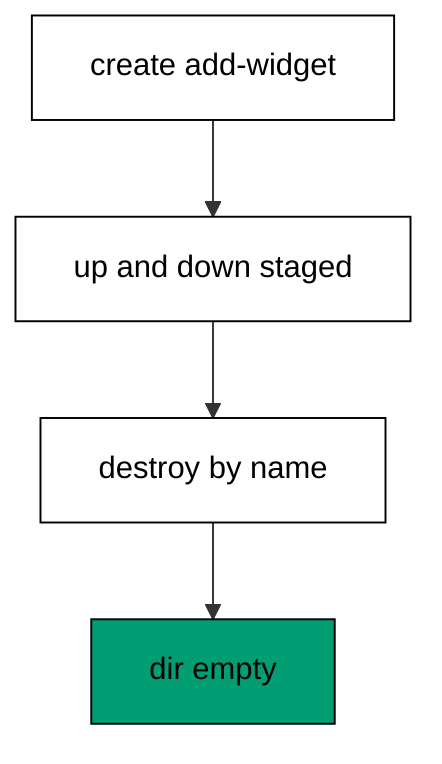

`create` stamps both files with the current fourteen-digit time, which makes ids unique across developers without coordination. The transcript strips the stamps to stay byte-stable, listing the minted up and down names without the clock digits. `destroy` removes the pair by migration name when the idea does not survive review, and the empty directory proves it. Clock ids sort in creation order by construction, which is why parallel branches rarely collide when everyone mints instead of hand-picking. Helpers that own the numbering keep the numbering honest.

**`learning/code/ex-57-create-writes-timestamped-names/main.clj`**:

```clojure
;; => Example 57: Create Writes Timestamped Names.
;; => `create` mints the next id from the clock: two files, one stamp, zero collisions by default.
(require '[migratus.core :as migratus]) ;; => migrate, rollback, up, and down move history
(require '[next.jdbc :as jdbc]) ;; => verification reads prove each migration landed
(require '[next.jdbc.result-set :as rs]) ;; => unqualified rows print without table prefixes
(require '[clojure.java.io :as io]) ;; => migration files are staged, then removed
;; => The database address comes from the harness, with local-run defaults.
(defn db-spec [] ;; => one builder owns every address default
  {:dbtype "postgresql" ;; => pgjdbc speaks the PostgreSQL wire protocol
   :host (or (System/getenv "PGHOST") "localhost") ;; => harness sets the service host
   :port (Integer/parseInt (or (System/getenv "PGPORT") "5432")) ;; => service port default
   :dbname (or (System/getenv "PGDATABASE") "postgres") ;; => fresh database per unit run
   :user (or (System/getenv "PGUSER") "postgres")}) ;; => trust auth needs no password
;; => One config carries the store, the relative migration dir, and the history table.
(defn config [dir table] ;; => every example owns its dir and history table
  {:store :database ;; => the SQL store journals history in a table
   :migration-dir dir ;; => relative to the unit folder, staged at runtime
   :migration-table-name table ;; => per-example history isolates every rerun
   :db (db-spec)}) ;; => next.jdbc connects from this spec
;; => Staging writes one up/down pair per call into the relative dir.
(defn write-migration [dir id name up down] ;; => one helper stages every migration
  (spit (str dir "/" id "-" name ".up.sql") up) ;; => forward change runs on migrate
  (when down ;; => up-only examples skip the down file on purpose
    (spit (str dir "/" id "-" name ".down.sql") down))) ;; => reverse runs on rollback
;; => Reset clears leftovers of a killed run so reruns print alike.
(defn reset-unit! [ds dir table tables views] ;; => one reset owns every leftover
  (doseq [v views] ;; => views drop before the tables they read
    (jdbc/execute! ds [(str "DROP VIEW IF EXISTS " v)])) ;; => stale views vanish first
  (let [d (io/file dir)] ;; => the relative staging dir of this unit
    (when (.exists d) ;; => a killed run may leave files behind
      (doseq [f (.listFiles d)] ;; => every staged file goes first
        (.delete ^java.io.File f)) ;; => delete each staged migration
      (.delete d)) ;; => the empty staging dir goes too
    (.mkdirs d)) ;; => a fresh dir for this run
  (doseq [t tables] ;; => every table this example owns
    (jdbc/execute! ds [(str "DROP TABLE IF EXISTS " t " CASCADE")])) ;; => killed runs vanish
  (jdbc/execute! ds [(str "DROP TABLE IF EXISTS " table)])) ;; => stale history vanishes too
;; => Reads print their own proof; ids sort so output never depends on disk order.
(defn applied-names [ds table] ;; => applied migration names in id order
  (mapv :description ;; => description stores the migration name
    (jdbc/execute! ds [(str "SELECT description FROM " table " WHERE id > 0 ORDER BY id")] ;; => id order, reserve row excluded
                     {:builder-fn rs/as-unqualified-lower-maps}))) ;; => short keys print cleanly
;; => Column lists read the catalog, so the schema proves itself.
(defn table-columns [ds table] ;; => column names in position order
  (mapv :column_name ;; => one name per row, nothing else
    (jdbc/execute! ds [(str "SELECT column_name FROM information_schema.columns WHERE table_name = '" table "' ORDER BY ordinal_position")] ;; => catalog order is stable
                     {:builder-fn rs/as-unqualified-lower-maps}))) ;; => short keys print cleanly
(def ds (jdbc/get-datasource (db-spec))) ;; => one shared datasource per unit run
(def cfg (config "mig" "m57_migrations")) ;; => store plus history table for this example
(reset-unit! ds "mig" "m57_migrations" [] []) ;; => leftovers of a killed run vanish first
(require '[clojure.string :as string]) ;; => string helpers strip the clock stamp
(def created (migratus/create cfg "add-widget")) ;; => mint the up/down pair from the clock
(println "created:" (pr-str (mapv #(string/replace % #"^\d+-" "") created))) ;; => stamps stripped, names stable
(println "staged:" (pr-str (sort (mapv #(string/replace (.getName ^java.io.File %) #"^\d+-" "") (.listFiles (io/file "mig")))))) ;; => stamps stripped, still in byte order
(println "destroyed:" (pr-str (migratus/destroy cfg "add-widget"))) ;; => remove the pair by name
(println "empty:" (pr-str (empty? (.listFiles (io/file "mig"))))) ;; => nothing remains staged
;; => Cleanup drops every object this example made, leaving no residue.
(defn cleanup-unit! [ds dir table tables views] ;; => one cleanup owns every created object
  (doseq [v views] ;; => views drop before the tables they read
    (jdbc/execute! ds [(str "DROP VIEW IF EXISTS " v)])) ;; => view residue vanishes
  (doseq [t tables] ;; => every table this example owns
    (jdbc/execute! ds [(str "DROP TABLE IF EXISTS " t " CASCADE")])) ;; => tables vanish with dependents
  (jdbc/execute! ds [(str "DROP TABLE IF EXISTS " table)]) ;; => history table vanishes too
  (let [d (io/file dir)] ;; => the staging dir from this run
    (when (.exists d) ;; => files were staged above
      (doseq [f (.listFiles d)] ;; => every staged file goes first
        (.delete ^java.io.File f)) ;; => delete each staged migration
      (.delete d)))) ;; => the empty staging dir goes too
(cleanup-unit! ds "mig" "m57_migrations" [] []) ;; => drop every object this example created
```

**Output** (`learning/code/ex-57-create-writes-timestamped-names/expected/main.stdout.txt`):

```text
created: ["add-widget.up.sql" "add-widget.down.sql"]
staged: ("add-widget.down.sql" "add-widget.up.sql")
destroyed: nil
empty: true
```

**Key takeaway**: `create` mints clock-stamped pairs; `destroy` removes them by name when ideas die young.

**Why it matters**: Naming discipline fails exactly when developers are busiest, which is when collisions hurt most. A helper that mints unique ids removes the decision at the moment attention is scarcest, so parallel work stays parallel. Teams that mint instead of hand-numbering never debug a collision that a clock would have prevented.

### Example 58: Pending List Guides the Merge

Merges start by listing what each branch still owes, so this example applies the base and reads pending. The program proves both branch changes wait, then finishes the merge. (Concepts: co-04, co-13, co-14.)


Targeted `up` of the base id separates the shared past from the divergent present, and pending names exactly the two branch changes still owed. The checklist shape matters: reviewers see both names before either runs, which turns merge review into reading instead of guessing. Full migrate then applies both in id order regardless of which branch staged first, converging the histories. Pending is the merge preview, and this example reads it like one.

**`learning/code/ex-58-pending-list-guides-the-merge/main.clj`**:

```clojure
;; => Example 58: Pending List Guides the Merge.
;; => Branches announce themselves through pending: unapplied names are the merge checklist.
(require '[migratus.core :as migratus]) ;; => migrate, rollback, up, and down move history
(require '[next.jdbc :as jdbc]) ;; => verification reads prove each migration landed
(require '[next.jdbc.result-set :as rs]) ;; => unqualified rows print without table prefixes
(require '[clojure.java.io :as io]) ;; => migration files are staged, then removed
;; => The database address comes from the harness, with local-run defaults.
(defn db-spec [] ;; => one builder owns every address default
  {:dbtype "postgresql" ;; => pgjdbc speaks the PostgreSQL wire protocol
   :host (or (System/getenv "PGHOST") "localhost") ;; => harness sets the service host
   :port (Integer/parseInt (or (System/getenv "PGPORT") "5432")) ;; => service port default
   :dbname (or (System/getenv "PGDATABASE") "postgres") ;; => fresh database per unit run
   :user (or (System/getenv "PGUSER") "postgres")}) ;; => trust auth needs no password
;; => One config carries the store, the relative migration dir, and the history table.
(defn config [dir table] ;; => every example owns its dir and history table
  {:store :database ;; => the SQL store journals history in a table
   :migration-dir dir ;; => relative to the unit folder, staged at runtime
   :migration-table-name table ;; => per-example history isolates every rerun
   :db (db-spec)}) ;; => next.jdbc connects from this spec
;; => Staging writes one up/down pair per call into the relative dir.
(defn write-migration [dir id name up down] ;; => one helper stages every migration
  (spit (str dir "/" id "-" name ".up.sql") up) ;; => forward change runs on migrate
  (when down ;; => up-only examples skip the down file on purpose
    (spit (str dir "/" id "-" name ".down.sql") down))) ;; => reverse runs on rollback
;; => Reset clears leftovers of a killed run so reruns print alike.
(defn reset-unit! [ds dir table tables views] ;; => one reset owns every leftover
  (doseq [v views] ;; => views drop before the tables they read
    (jdbc/execute! ds [(str "DROP VIEW IF EXISTS " v)])) ;; => stale views vanish first
  (let [d (io/file dir)] ;; => the relative staging dir of this unit
    (when (.exists d) ;; => a killed run may leave files behind
      (doseq [f (.listFiles d)] ;; => every staged file goes first
        (.delete ^java.io.File f)) ;; => delete each staged migration
      (.delete d)) ;; => the empty staging dir goes too
    (.mkdirs d)) ;; => a fresh dir for this run
  (doseq [t tables] ;; => every table this example owns
    (jdbc/execute! ds [(str "DROP TABLE IF EXISTS " t " CASCADE")])) ;; => killed runs vanish
  (jdbc/execute! ds [(str "DROP TABLE IF EXISTS " table)])) ;; => stale history vanishes too
;; => Reads print their own proof; ids sort so output never depends on disk order.
(defn applied-names [ds table] ;; => applied migration names in id order
  (mapv :description ;; => description stores the migration name
    (jdbc/execute! ds [(str "SELECT description FROM " table " WHERE id > 0 ORDER BY id")] ;; => id order, reserve row excluded
                     {:builder-fn rs/as-unqualified-lower-maps}))) ;; => short keys print cleanly
;; => Column lists read the catalog, so the schema proves itself.
(defn table-columns [ds table] ;; => column names in position order
  (mapv :column_name ;; => one name per row, nothing else
    (jdbc/execute! ds [(str "SELECT column_name FROM information_schema.columns WHERE table_name = '" table "' ORDER BY ordinal_position")] ;; => catalog order is stable
                     {:builder-fn rs/as-unqualified-lower-maps}))) ;; => short keys print cleanly
(def ds (jdbc/get-datasource (db-spec))) ;; => one shared datasource per unit run
(def cfg (config "mig" "m58_migrations")) ;; => store plus history table for this example
(reset-unit! ds "mig" "m58_migrations" ["m58_base" "m58_left" "m58_right"] []) ;; => leftovers of a killed run vanish first
(write-migration "mig" "20260101005801" "make-base" ;; => shared base lands on the trunk
  "CREATE TABLE m58_base (id SERIAL PRIMARY KEY);\n" ;; => base table is tiny
  "DROP TABLE m58_base;\n") ;; => reverse drops base
(write-migration "mig" "20260101005802" "left-change" ;; => left branch stages its change
  "CREATE TABLE m58_left (id SERIAL PRIMARY KEY);\n" ;; => left table is tiny
  "DROP TABLE m58_left;\n") ;; => reverse drops left
(write-migration "mig" "20260101005803" "right-change" ;; => right branch stages its change
  "CREATE TABLE m58_right (id SERIAL PRIMARY KEY);\n" ;; => right table is tiny
  "DROP TABLE m58_right;\n") ;; => reverse drops right
(println "bring-up:" (pr-str (migratus/up cfg 20260101005801))) ;; => trunk base applies first
(println "pending:" (pr-str (sort (migratus/pending-list cfg)))) ;; => both branches wait their turn
(println "migrate:" (pr-str (migratus/migrate cfg))) ;; => nil means every pending migration applied
(println "completed:" (pr-str (applied-names ds "m58_migrations"))) ;; => id order straight from history
;; => Cleanup drops every object this example made, leaving no residue.
(defn cleanup-unit! [ds dir table tables views] ;; => one cleanup owns every created object
  (doseq [v views] ;; => views drop before the tables they read
    (jdbc/execute! ds [(str "DROP VIEW IF EXISTS " v)])) ;; => view residue vanishes
  (doseq [t tables] ;; => every table this example owns
    (jdbc/execute! ds [(str "DROP TABLE IF EXISTS " t " CASCADE")])) ;; => tables vanish with dependents
  (jdbc/execute! ds [(str "DROP TABLE IF EXISTS " table)]) ;; => history table vanishes too
  (let [d (io/file dir)] ;; => the staging dir from this run
    (when (.exists d) ;; => files were staged above
      (doseq [f (.listFiles d)] ;; => every staged file goes first
        (.delete ^java.io.File f)) ;; => delete each staged migration
      (.delete d)))) ;; => the empty staging dir goes too
(cleanup-unit! ds "mig" "m58_migrations" ["m58_base" "m58_left" "m58_right"] []) ;; => drop every object this example created
```

**Output** (`learning/code/ex-58-pending-list-guides-the-merge/expected/main.stdout.txt`):

```text
bring-up: nil
pending: ("left-change" "right-change")
migrate: nil
completed: ["make-base" "left-change" "right-change"]
```

**Key takeaway**: Pending names the unmerged work: apply the base, read the checklist, then converge.

**Why it matters**: Merges go wrong when branches apply blindly in whatever order the files arrived. Reading pending first shows the full merge before it runs, so reviewers approve a known set instead of discovering it. Teams that preview merges through pending never get surprised by a branch they forgot, because the checklist cannot forget.

### Example 59: Apply Order Follows Ids Not Branches

Branches stage in whatever order developers save, so this example writes the third file first. The program migrates and proves the apply order is still one, two, three. (Concepts: co-04, co-14.)

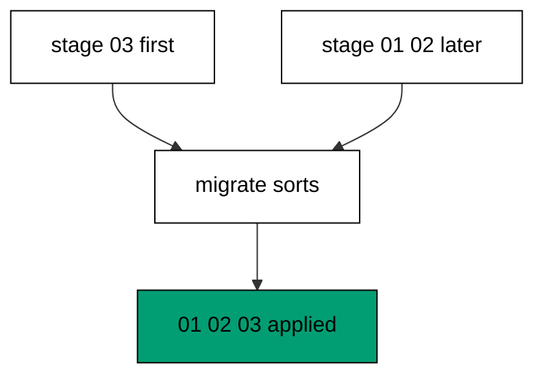

Staging order is an accident of editing sequence, while the numeric id is the declared intent, and Migratus sorts by intent before running anything. Branch B's file lands on disk first here, yet applies last, because its id is the largest. The completed list reads one, two, three regardless of how the files arrived, which proves provenance never influences position. Teams that trust the sort stop coordinating save order, because the runner replays intent rather than accidents.

**`learning/code/ex-59-apply-order-follows-ids-not-branches/main.clj`**:

```clojure
;; => Example 59: Apply Order Follows Ids Not Branches.
;; => Interleaved branch files still apply in numeric order: ids beat provenance.
(require '[migratus.core :as migratus]) ;; => migrate, rollback, up, and down move history
(require '[next.jdbc :as jdbc]) ;; => verification reads prove each migration landed
(require '[next.jdbc.result-set :as rs]) ;; => unqualified rows print without table prefixes
(require '[clojure.java.io :as io]) ;; => migration files are staged, then removed
;; => The database address comes from the harness, with local-run defaults.
(defn db-spec [] ;; => one builder owns every address default
  {:dbtype "postgresql" ;; => pgjdbc speaks the PostgreSQL wire protocol
   :host (or (System/getenv "PGHOST") "localhost") ;; => harness sets the service host
   :port (Integer/parseInt (or (System/getenv "PGPORT") "5432")) ;; => service port default
   :dbname (or (System/getenv "PGDATABASE") "postgres") ;; => fresh database per unit run
   :user (or (System/getenv "PGUSER") "postgres")}) ;; => trust auth needs no password
;; => One config carries the store, the relative migration dir, and the history table.
(defn config [dir table] ;; => every example owns its dir and history table
  {:store :database ;; => the SQL store journals history in a table
   :migration-dir dir ;; => relative to the unit folder, staged at runtime
   :migration-table-name table ;; => per-example history isolates every rerun
   :db (db-spec)}) ;; => next.jdbc connects from this spec
;; => Staging writes one up/down pair per call into the relative dir.
(defn write-migration [dir id name up down] ;; => one helper stages every migration
  (spit (str dir "/" id "-" name ".up.sql") up) ;; => forward change runs on migrate
  (when down ;; => up-only examples skip the down file on purpose
    (spit (str dir "/" id "-" name ".down.sql") down))) ;; => reverse runs on rollback
;; => Reset clears leftovers of a killed run so reruns print alike.
(defn reset-unit! [ds dir table tables views] ;; => one reset owns every leftover
  (doseq [v views] ;; => views drop before the tables they read
    (jdbc/execute! ds [(str "DROP VIEW IF EXISTS " v)])) ;; => stale views vanish first
  (let [d (io/file dir)] ;; => the relative staging dir of this unit
    (when (.exists d) ;; => a killed run may leave files behind
      (doseq [f (.listFiles d)] ;; => every staged file goes first
        (.delete ^java.io.File f)) ;; => delete each staged migration
      (.delete d)) ;; => the empty staging dir goes too
    (.mkdirs d)) ;; => a fresh dir for this run
  (doseq [t tables] ;; => every table this example owns
    (jdbc/execute! ds [(str "DROP TABLE IF EXISTS " t " CASCADE")])) ;; => killed runs vanish
  (jdbc/execute! ds [(str "DROP TABLE IF EXISTS " table)])) ;; => stale history vanishes too
;; => Reads print their own proof; ids sort so output never depends on disk order.
(defn applied-names [ds table] ;; => applied migration names in id order
  (mapv :description ;; => description stores the migration name
    (jdbc/execute! ds [(str "SELECT description FROM " table " WHERE id > 0 ORDER BY id")] ;; => id order, reserve row excluded
                     {:builder-fn rs/as-unqualified-lower-maps}))) ;; => short keys print cleanly
;; => Column lists read the catalog, so the schema proves itself.
(defn table-columns [ds table] ;; => column names in position order
  (mapv :column_name ;; => one name per row, nothing else
    (jdbc/execute! ds [(str "SELECT column_name FROM information_schema.columns WHERE table_name = '" table "' ORDER BY ordinal_position")] ;; => catalog order is stable
                     {:builder-fn rs/as-unqualified-lower-maps}))) ;; => short keys print cleanly
(def ds (jdbc/get-datasource (db-spec))) ;; => one shared datasource per unit run
(def cfg (config "mig" "m59_migrations")) ;; => store plus history table for this example
(reset-unit! ds "mig" "m59_migrations" ["m59_one" "m59_two" "m59_three"] []) ;; => leftovers of a killed run vanish first
(write-migration "mig" "20260101005903" "branch-b-last" ;; => branch B stages its file first
  "CREATE TABLE m59_three (id SERIAL PRIMARY KEY);\n" ;; => third table staged first
  "DROP TABLE m59_three;\n") ;; => reverse drops three
(write-migration "mig" "20260101005901" "branch-a-first" ;; => branch A stages its file second
  "CREATE TABLE m59_one (id SERIAL PRIMARY KEY);\n" ;; => first table staged second
  "DROP TABLE m59_one;\n") ;; => reverse drops one
(write-migration "mig" "20260101005902" "branch-a-second" ;; => branch A stages its file third
  "CREATE TABLE m59_two (id SERIAL PRIMARY KEY);\n" ;; => second table staged third
  "DROP TABLE m59_two;\n") ;; => reverse drops two
(println "migrate:" (pr-str (migratus/migrate cfg))) ;; => nil means every pending migration applied
(println "completed:" (pr-str (applied-names ds "m59_migrations"))) ;; => id order straight from history
;; => Cleanup drops every object this example made, leaving no residue.
(defn cleanup-unit! [ds dir table tables views] ;; => one cleanup owns every created object
  (doseq [v views] ;; => views drop before the tables they read
    (jdbc/execute! ds [(str "DROP VIEW IF EXISTS " v)])) ;; => view residue vanishes
  (doseq [t tables] ;; => every table this example owns
    (jdbc/execute! ds [(str "DROP TABLE IF EXISTS " t " CASCADE")])) ;; => tables vanish with dependents
  (jdbc/execute! ds [(str "DROP TABLE IF EXISTS " table)]) ;; => history table vanishes too
  (let [d (io/file dir)] ;; => the staging dir from this run
    (when (.exists d) ;; => files were staged above
      (doseq [f (.listFiles d)] ;; => every staged file goes first
        (.delete ^java.io.File f)) ;; => delete each staged migration
      (.delete d)))) ;; => the empty staging dir goes too
(cleanup-unit! ds "mig" "m59_migrations" ["m59_one" "m59_two" "m59_three"] []) ;; => drop every object this example created
```

**Output** (`learning/code/ex-59-apply-order-follows-ids-not-branches/expected/main.stdout.txt`):

```text
migrate: nil
completed: ["branch-a-first" "branch-a-second" "branch-b-last"]
```

**Key takeaway**: Staging order is an accident; the runner replays declared ids, not accidents.

**Why it matters**: Developers save files in random order across time zones and editors, and a tool that honored arrival would produce different databases from the same branch. Sorting by declared id makes the database a function of the files alone, so every checkout converges identically. Teams that rely on the sort review numbers instead of timestamps, because only numbers decide.

### Example 60: Destroy Removes Dead Files

Dead ideas should not linger in the directory, so this example destroys an unapplied migration. The program removes it by name and proves only the keeper still pends and applies. (Concepts: co-04.)

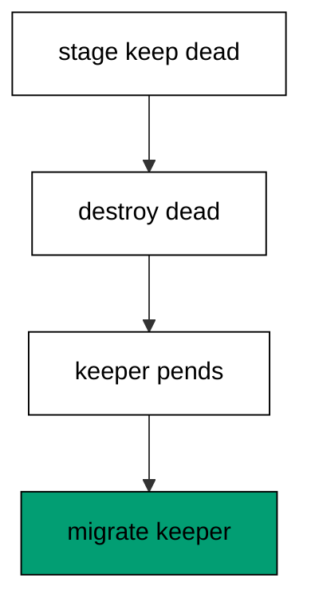

`destroy` deletes every staged file whose name matches the given migration, which un-stages an idea without touching the database. The listing proves the dead pair is gone while the keeper pair stays, and pending names only the keeper afterwards. Destroyed files never ran, so no journal entry references them and no recovery is needed. Pruning dead ideas keeps the directory honest about what might still run, which is what pending promises.

**`learning/code/ex-60-destroy-removes-dead-files/main.clj`**:

```clojure
;; => Example 60: Destroy Removes Dead Files.
;; => Abandoned ideas leave the directory: `destroy` deletes a migration by name.
(require '[migratus.core :as migratus]) ;; => migrate, rollback, up, and down move history
(require '[next.jdbc :as jdbc]) ;; => verification reads prove each migration landed
(require '[next.jdbc.result-set :as rs]) ;; => unqualified rows print without table prefixes
(require '[clojure.java.io :as io]) ;; => migration files are staged, then removed
;; => The database address comes from the harness, with local-run defaults.
(defn db-spec [] ;; => one builder owns every address default
  {:dbtype "postgresql" ;; => pgjdbc speaks the PostgreSQL wire protocol
   :host (or (System/getenv "PGHOST") "localhost") ;; => harness sets the service host
   :port (Integer/parseInt (or (System/getenv "PGPORT") "5432")) ;; => service port default
   :dbname (or (System/getenv "PGDATABASE") "postgres") ;; => fresh database per unit run
   :user (or (System/getenv "PGUSER") "postgres")}) ;; => trust auth needs no password
;; => One config carries the store, the relative migration dir, and the history table.
(defn config [dir table] ;; => every example owns its dir and history table
  {:store :database ;; => the SQL store journals history in a table
   :migration-dir dir ;; => relative to the unit folder, staged at runtime
   :migration-table-name table ;; => per-example history isolates every rerun
   :db (db-spec)}) ;; => next.jdbc connects from this spec
;; => Staging writes one up/down pair per call into the relative dir.
(defn write-migration [dir id name up down] ;; => one helper stages every migration
  (spit (str dir "/" id "-" name ".up.sql") up) ;; => forward change runs on migrate
  (when down ;; => up-only examples skip the down file on purpose
    (spit (str dir "/" id "-" name ".down.sql") down))) ;; => reverse runs on rollback
;; => Reset clears leftovers of a killed run so reruns print alike.
(defn reset-unit! [ds dir table tables views] ;; => one reset owns every leftover
  (doseq [v views] ;; => views drop before the tables they read
    (jdbc/execute! ds [(str "DROP VIEW IF EXISTS " v)])) ;; => stale views vanish first
  (let [d (io/file dir)] ;; => the relative staging dir of this unit
    (when (.exists d) ;; => a killed run may leave files behind
      (doseq [f (.listFiles d)] ;; => every staged file goes first
        (.delete ^java.io.File f)) ;; => delete each staged migration
      (.delete d)) ;; => the empty staging dir goes too
    (.mkdirs d)) ;; => a fresh dir for this run
  (doseq [t tables] ;; => every table this example owns
    (jdbc/execute! ds [(str "DROP TABLE IF EXISTS " t " CASCADE")])) ;; => killed runs vanish
  (jdbc/execute! ds [(str "DROP TABLE IF EXISTS " table)])) ;; => stale history vanishes too
;; => Reads print their own proof; ids sort so output never depends on disk order.
(defn applied-names [ds table] ;; => applied migration names in id order
  (mapv :description ;; => description stores the migration name
    (jdbc/execute! ds [(str "SELECT description FROM " table " WHERE id > 0 ORDER BY id")] ;; => id order, reserve row excluded
                     {:builder-fn rs/as-unqualified-lower-maps}))) ;; => short keys print cleanly
;; => Column lists read the catalog, so the schema proves itself.
(defn table-columns [ds table] ;; => column names in position order
  (mapv :column_name ;; => one name per row, nothing else
    (jdbc/execute! ds [(str "SELECT column_name FROM information_schema.columns WHERE table_name = '" table "' ORDER BY ordinal_position")] ;; => catalog order is stable
                     {:builder-fn rs/as-unqualified-lower-maps}))) ;; => short keys print cleanly
(def ds (jdbc/get-datasource (db-spec))) ;; => one shared datasource per unit run
(def cfg (config "mig" "m60_migrations")) ;; => store plus history table for this example
(reset-unit! ds "mig" "m60_migrations" ["m60_keep"] []) ;; => leftovers of a killed run vanish first
(write-migration "mig" "20260101006001" "keep-this" ;; => one keeper to survive the cleanup
  "CREATE TABLE m60_keep (id SERIAL PRIMARY KEY);\n" ;; => keeper table is tiny
  "DROP TABLE m60_keep;\n") ;; => reverse drops keep
(write-migration "mig" "20260101006002" "drop-that" ;; => one dead idea to remove
  "CREATE TABLE m60_dead (id SERIAL PRIMARY KEY);\n" ;; => dead table never lands
  "DROP TABLE m60_dead;\n") ;; => reverse drops dead
(println "destroyed:" (pr-str (migratus/destroy cfg "drop-that"))) ;; => remove the dead idea by name
(println "staged:" (pr-str (sort (mapv #(.getName ^java.io.File %) ;; => one pair remains staged
  (.listFiles (io/file "mig")))))) ;; => keeper files only
(println "pending:" (pr-str (sort (migratus/pending-list cfg)))) ;; => only the keeper still pends
(println "migrate:" (pr-str (migratus/migrate cfg))) ;; => nil means every pending migration applied
(println "completed:" (pr-str (applied-names ds "m60_migrations"))) ;; => id order straight from history
;; => Cleanup drops every object this example made, leaving no residue.
(defn cleanup-unit! [ds dir table tables views] ;; => one cleanup owns every created object
  (doseq [v views] ;; => views drop before the tables they read
    (jdbc/execute! ds [(str "DROP VIEW IF EXISTS " v)])) ;; => view residue vanishes
  (doseq [t tables] ;; => every table this example owns
    (jdbc/execute! ds [(str "DROP TABLE IF EXISTS " t " CASCADE")])) ;; => tables vanish with dependents
  (jdbc/execute! ds [(str "DROP TABLE IF EXISTS " table)]) ;; => history table vanishes too
  (let [d (io/file dir)] ;; => the staging dir from this run
    (when (.exists d) ;; => files were staged above
      (doseq [f (.listFiles d)] ;; => every staged file goes first
        (.delete ^java.io.File f)) ;; => delete each staged migration
      (.delete d)))) ;; => the empty staging dir goes too
(cleanup-unit! ds "mig" "m60_migrations" ["m60_keep" "m60_dead"] []) ;; => drop every object this example created
```

**Output** (`learning/code/ex-60-destroy-removes-dead-files/expected/main.stdout.txt`):

```text
destroyed: nil
staged: ("20260101006001-keep-this.down.sql" "20260101006001-keep-this.up.sql")
pending: ("keep-this")
migrate: nil
completed: ["keep-this"]
```

**Key takeaway**: Destroy unapplied ideas by name: the directory stops promising what nobody will run.

**Why it matters**: Abandoned migrations linger because deleting feels riskier than leaving, until someone applies a dead idea by accident. Destroy makes removal a named operation with visible proof, so the directory only stages live possibilities. Teams that prune dead files keep pending trustworthy, because every listed file is still wanted.

### Example 61: Conflict Review

The cluster closes by living the whole conflict, so this example collides, refuses, renumbers, and converges. The program proves the refusal, removes the loser, renumbers, and migrates clean. (Concepts: co-04, co-08, co-14.)

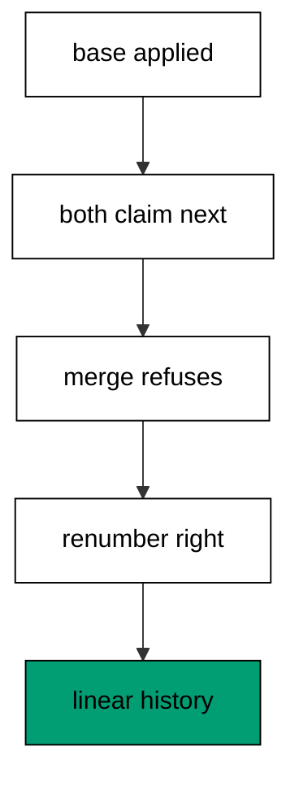

The base applies first to model the shared trunk, then both branches claim the same next id and the merge attempt fails with the discovery refusal. Deleting the losing pair models the yielding branch, and restaging its change under the next free id is the renumber that resolves real merges. The final migrate applies left then renumbered-right in id order, and the history reads as one linear story. Collide, refuse, renumber, converge is the whole conflict lifecycle in one run.

**`learning/code/ex-61-conflict-review-collide-renumber-merge/main.clj`**:

```clojure
;; => Example 61: Conflict Review.
;; => The cluster closes on the full conflict: collide, refuse, renumber, converge.
(require '[migratus.core :as migratus]) ;; => migrate, rollback, up, and down move history
(require '[next.jdbc :as jdbc]) ;; => verification reads prove each migration landed
(require '[next.jdbc.result-set :as rs]) ;; => unqualified rows print without table prefixes
(require '[clojure.java.io :as io]) ;; => migration files are staged, then removed
;; => The database address comes from the harness, with local-run defaults.
(defn db-spec [] ;; => one builder owns every address default
  {:dbtype "postgresql" ;; => pgjdbc speaks the PostgreSQL wire protocol
   :host (or (System/getenv "PGHOST") "localhost") ;; => harness sets the service host
   :port (Integer/parseInt (or (System/getenv "PGPORT") "5432")) ;; => service port default
   :dbname (or (System/getenv "PGDATABASE") "postgres") ;; => fresh database per unit run
   :user (or (System/getenv "PGUSER") "postgres")}) ;; => trust auth needs no password
;; => One config carries the store, the relative migration dir, and the history table.
(defn config [dir table] ;; => every example owns its dir and history table
  {:store :database ;; => the SQL store journals history in a table
   :migration-dir dir ;; => relative to the unit folder, staged at runtime
   :migration-table-name table ;; => per-example history isolates every rerun
   :db (db-spec)}) ;; => next.jdbc connects from this spec
;; => Staging writes one up/down pair per call into the relative dir.
(defn write-migration [dir id name up down] ;; => one helper stages every migration
  (spit (str dir "/" id "-" name ".up.sql") up) ;; => forward change runs on migrate
  (when down ;; => up-only examples skip the down file on purpose
    (spit (str dir "/" id "-" name ".down.sql") down))) ;; => reverse runs on rollback
;; => Reset clears leftovers of a killed run so reruns print alike.
(defn reset-unit! [ds dir table tables views] ;; => one reset owns every leftover
  (doseq [v views] ;; => views drop before the tables they read
    (jdbc/execute! ds [(str "DROP VIEW IF EXISTS " v)])) ;; => stale views vanish first
  (let [d (io/file dir)] ;; => the relative staging dir of this unit
    (when (.exists d) ;; => a killed run may leave files behind
      (doseq [f (.listFiles d)] ;; => every staged file goes first
        (.delete ^java.io.File f)) ;; => delete each staged migration
      (.delete d)) ;; => the empty staging dir goes too
    (.mkdirs d)) ;; => a fresh dir for this run
  (doseq [t tables] ;; => every table this example owns
    (jdbc/execute! ds [(str "DROP TABLE IF EXISTS " t " CASCADE")])) ;; => killed runs vanish
  (jdbc/execute! ds [(str "DROP TABLE IF EXISTS " table)])) ;; => stale history vanishes too
;; => Reads print their own proof; ids sort so output never depends on disk order.
(defn applied-names [ds table] ;; => applied migration names in id order
  (mapv :description ;; => description stores the migration name
    (jdbc/execute! ds [(str "SELECT description FROM " table " WHERE id > 0 ORDER BY id")] ;; => id order, reserve row excluded
                     {:builder-fn rs/as-unqualified-lower-maps}))) ;; => short keys print cleanly
;; => Column lists read the catalog, so the schema proves itself.
(defn table-columns [ds table] ;; => column names in position order
  (mapv :column_name ;; => one name per row, nothing else
    (jdbc/execute! ds [(str "SELECT column_name FROM information_schema.columns WHERE table_name = '" table "' ORDER BY ordinal_position")] ;; => catalog order is stable
                     {:builder-fn rs/as-unqualified-lower-maps}))) ;; => short keys print cleanly
(def ds (jdbc/get-datasource (db-spec))) ;; => one shared datasource per unit run
(def cfg (config "mig" "m61_migrations")) ;; => store plus history table for this example
(reset-unit! ds "mig" "m61_migrations" ["m61_base" "m61_merged"] []) ;; => leftovers of a killed run vanish first
(write-migration "mig" "20260101006101" "make-base" ;; => shared base both sides agree on
  "CREATE TABLE m61_base (id SERIAL PRIMARY KEY);\n" ;; => base table is tiny
  "DROP TABLE m61_base;\n") ;; => reverse drops base
(println "bring-up:" (pr-str (migratus/up cfg 20260101006101))) ;; => base applies while branches diverge
(write-migration "mig" "20260101006102" "branch-left" ;; => left branch claims the next id
  "CREATE TABLE m61_left (id SERIAL PRIMARY KEY);\n" ;; => left table never lands
  "DROP TABLE m61_left;\n") ;; => reverse drops left
(write-migration "mig" "20260101006102" "branch-right" ;; => right branch claims the same id
  "CREATE TABLE m61_right (id SERIAL PRIMARY KEY);\n" ;; => right table never lands
  "DROP TABLE m61_right;\n") ;; => reverse drops right
(println "merge-attempt:" (pr-str (try (migratus/migrate cfg) ;; => merge refuses the collision
  (catch Exception e (str "threw: " (.getSimpleName (class e))))))) ;; => stable class, unstable name order
(.delete (io/file (str "mig/20260101006102-branch-right.up.sql"))) ;; => right branch yields its file
(.delete (io/file (str "mig/20260101006102-branch-right.down.sql"))) ;; => down file yields too
(write-migration "mig" "20260101006103" "branch-right" ;; => right branch renumbers onto the free id
  "CREATE TABLE m61_merged (id SERIAL PRIMARY KEY);\n" ;; => renumbered table lands
  "DROP TABLE m61_merged;\n") ;; => reverse drops merged
(println "migrate:" (pr-str (migratus/migrate cfg))) ;; => nil means every pending migration applied
(println "completed:" (pr-str (applied-names ds "m61_migrations"))) ;; => id order straight from history
;; => Cleanup drops every object this example made, leaving no residue.
(defn cleanup-unit! [ds dir table tables views] ;; => one cleanup owns every created object
  (doseq [v views] ;; => views drop before the tables they read
    (jdbc/execute! ds [(str "DROP VIEW IF EXISTS " v)])) ;; => view residue vanishes
  (doseq [t tables] ;; => every table this example owns
    (jdbc/execute! ds [(str "DROP TABLE IF EXISTS " t " CASCADE")])) ;; => tables vanish with dependents
  (jdbc/execute! ds [(str "DROP TABLE IF EXISTS " table)]) ;; => history table vanishes too
  (let [d (io/file dir)] ;; => the staging dir from this run
    (when (.exists d) ;; => files were staged above
      (doseq [f (.listFiles d)] ;; => every staged file goes first
        (.delete ^java.io.File f)) ;; => delete each staged migration
      (.delete d)))) ;; => the empty staging dir goes too
(cleanup-unit! ds "mig" "m61_migrations" ["m61_base" "m61_merged" "m61_left" "m61_right"] []) ;; => drop every object this example created
```

**Output** (`learning/code/ex-61-conflict-review-collide-renumber-merge/expected/main.stdout.txt`):

```text
bring-up: nil
merge-attempt: "threw: Exception"
migrate: nil
completed: ["make-base" "branch-left" "branch-right"]
```

**Key takeaway**: Conflicts resolve by renumbering the yielding branch: refuse loudly, rename, converge.

**Why it matters**: Merge conflicts feel dangerous because they mix human disagreement with database state, but the database never sees this one. Everything happens in file names before anything applies, so resolution is a rename plus a rerun. Teams that practice the full cycle stop fearing parallel work, because the worst case is a deleted file and a new number.

### Example 62: Reads See the Write Lock

Every migration holds locks, so this example makes one visible before discussing blast radius. The program locks a table, reads the lock catalog mid-transaction, and counts zero after commit. (Concepts: co-15.)


PostgreSQL records every held lock in `pg_locks`, so querying it inside the transaction shows exactly what the session holds. The explicit lock here stands in for any DDL statement, which takes the same access-exclusive mode automatically. After commit the count reads zero, because transaction-scoped locks release with their transaction. Seeing locks as queryable rows turns the blast radius from folklore into measurement, which the rest of the cluster builds on.

**`learning/code/ex-62-reads-see-the-write-lock/main.clj`**:

```clojure
;; => Example 62: Reads See the Write Lock.
;; => DDL takes an access-exclusive lock: the lock catalog proves it inside the transaction.
(require '[migratus.core :as migratus]) ;; => migrate, rollback, up, and down move history
(require '[next.jdbc :as jdbc]) ;; => verification reads prove each migration landed
(require '[next.jdbc.result-set :as rs]) ;; => unqualified rows print without table prefixes
(require '[clojure.java.io :as io]) ;; => migration files are staged, then removed
;; => The database address comes from the harness, with local-run defaults.
(defn db-spec [] ;; => one builder owns every address default
  {:dbtype "postgresql" ;; => pgjdbc speaks the PostgreSQL wire protocol
   :host (or (System/getenv "PGHOST") "localhost") ;; => harness sets the service host
   :port (Integer/parseInt (or (System/getenv "PGPORT") "5432")) ;; => service port default
   :dbname (or (System/getenv "PGDATABASE") "postgres") ;; => fresh database per unit run
   :user (or (System/getenv "PGUSER") "postgres")}) ;; => trust auth needs no password
;; => One config carries the store, the relative migration dir, and the history table.
(defn config [dir table] ;; => every example owns its dir and history table
  {:store :database ;; => the SQL store journals history in a table
   :migration-dir dir ;; => relative to the unit folder, staged at runtime
   :migration-table-name table ;; => per-example history isolates every rerun
   :db (db-spec)}) ;; => next.jdbc connects from this spec
;; => Staging writes one up/down pair per call into the relative dir.
(defn write-migration [dir id name up down] ;; => one helper stages every migration
  (spit (str dir "/" id "-" name ".up.sql") up) ;; => forward change runs on migrate
  (when down ;; => up-only examples skip the down file on purpose
    (spit (str dir "/" id "-" name ".down.sql") down))) ;; => reverse runs on rollback
;; => Reset clears leftovers of a killed run so reruns print alike.
(defn reset-unit! [ds dir table tables views] ;; => one reset owns every leftover
  (doseq [v views] ;; => views drop before the tables they read
    (jdbc/execute! ds [(str "DROP VIEW IF EXISTS " v)])) ;; => stale views vanish first
  (let [d (io/file dir)] ;; => the relative staging dir of this unit
    (when (.exists d) ;; => a killed run may leave files behind
      (doseq [f (.listFiles d)] ;; => every staged file goes first
        (.delete ^java.io.File f)) ;; => delete each staged migration
      (.delete d)) ;; => the empty staging dir goes too
    (.mkdirs d)) ;; => a fresh dir for this run
  (doseq [t tables] ;; => every table this example owns
    (jdbc/execute! ds [(str "DROP TABLE IF EXISTS " t " CASCADE")])) ;; => killed runs vanish
  (jdbc/execute! ds [(str "DROP TABLE IF EXISTS " table)])) ;; => stale history vanishes too
;; => Reads print their own proof; ids sort so output never depends on disk order.
(defn applied-names [ds table] ;; => applied migration names in id order
  (mapv :description ;; => description stores the migration name
    (jdbc/execute! ds [(str "SELECT description FROM " table " WHERE id > 0 ORDER BY id")] ;; => id order, reserve row excluded
                     {:builder-fn rs/as-unqualified-lower-maps}))) ;; => short keys print cleanly
;; => Column lists read the catalog, so the schema proves itself.
(defn table-columns [ds table] ;; => column names in position order
  (mapv :column_name ;; => one name per row, nothing else
    (jdbc/execute! ds [(str "SELECT column_name FROM information_schema.columns WHERE table_name = '" table "' ORDER BY ordinal_position")] ;; => catalog order is stable
                     {:builder-fn rs/as-unqualified-lower-maps}))) ;; => short keys print cleanly
(def ds (jdbc/get-datasource (db-spec))) ;; => one shared datasource per unit run
(def cfg (config "mig" "m62_migrations")) ;; => store plus history table for this example
(reset-unit! ds "mig" "m62_migrations" ["m62_hot"] []) ;; => leftovers of a killed run vanish first
(jdbc/execute! ds ["CREATE TABLE m62_hot (id SERIAL PRIMARY KEY, v TEXT)"]) ;; => hot table stands in for production
(jdbc/execute! ds ["INSERT INTO m62_hot (v) VALUES ('a')"]) ;; => one live row keeps it honest
(jdbc/with-transaction [tx ds] ;; => one transaction holds the proof
  (jdbc/execute! tx ["LOCK TABLE m62_hot IN ACCESS EXCLUSIVE MODE"]) ;; => the lock DDL would take
  (println "locks:" (pr-str (jdbc/execute! tx ["SELECT locktype AS l, mode AS m FROM pg_locks WHERE pid = pg_backend_pid() AND relation = 'm62_hot'::regclass ORDER BY 1, 2"] ;; => catalog names the held lock
    {:builder-fn rs/as-unqualified-lower-maps})))) ;; => relation plus access exclusive
(println "held:" (pr-str (:n (first (jdbc/execute! ds ["SELECT count(*) AS n FROM pg_locks WHERE pid = pg_backend_pid() AND relation = 'm62_hot'::regclass"] ;; => zero after commit
  {:builder-fn rs/as-unqualified-lower-maps}))))) ;; => lock released with the transaction
;; => Cleanup drops every object this example made, leaving no residue.
(defn cleanup-unit! [ds dir table tables views] ;; => one cleanup owns every created object
  (doseq [v views] ;; => views drop before the tables they read
    (jdbc/execute! ds [(str "DROP VIEW IF EXISTS " v)])) ;; => view residue vanishes
  (doseq [t tables] ;; => every table this example owns
    (jdbc/execute! ds [(str "DROP TABLE IF EXISTS " t " CASCADE")])) ;; => tables vanish with dependents
  (jdbc/execute! ds [(str "DROP TABLE IF EXISTS " table)]) ;; => history table vanishes too
  (let [d (io/file dir)] ;; => the staging dir from this run
    (when (.exists d) ;; => files were staged above
      (doseq [f (.listFiles d)] ;; => every staged file goes first
        (.delete ^java.io.File f)) ;; => delete each staged migration
      (.delete d)))) ;; => the empty staging dir goes too
(cleanup-unit! ds "mig" "m62_migrations" ["m62_hot"] []) ;; => drop every object this example created
```

**Output** (`learning/code/ex-62-reads-see-the-write-lock/expected/main.stdout.txt`):

```text
locks: [{:l "relation", :m "AccessExclusiveLock"}]
held: 0
```

**Key takeaway**: DDL holds an access-exclusive lock for its transaction: queryable in pg_locks, gone at commit.

**Why it matters**: Lock talk stays vague until someone shows the lock, and vague talk produces both panic and complacency. Reading `pg_locks` mid-transaction makes the blast radius concrete: this mode, this table, this long. Teams that measure locks size their maintenance windows from evidence, because the catalog reports what each statement actually held.

### Example 63: Locks Release at Commit

Held locks must release, so this example counts the same lock inside and after one transaction. The program prints one inside and zero after. (Concepts: co-15.)

The inside count observes the held lock from the holding session itself, which proves the lock API reports truthfully. The after count runs on a new implicit transaction after the first committed, and zero proves transaction-scoped locks never leak past commit. Together the pair brackets the hold precisely: acquired here, released there, never lingering. Migrations inherit this discipline automatically, because each runs in its own transaction that commits or rolls back exactly once.

**`learning/code/ex-63-locks-release-at-commit/main.clj`**:

```clojure
;; => Example 63: Locks Release at Commit.
;; => The release is as observable as the hold: count zero after the transaction ends.
(require '[migratus.core :as migratus]) ;; => migrate, rollback, up, and down move history
(require '[next.jdbc :as jdbc]) ;; => verification reads prove each migration landed
(require '[next.jdbc.result-set :as rs]) ;; => unqualified rows print without table prefixes
(require '[clojure.java.io :as io]) ;; => migration files are staged, then removed
;; => The database address comes from the harness, with local-run defaults.
(defn db-spec [] ;; => one builder owns every address default
  {:dbtype "postgresql" ;; => pgjdbc speaks the PostgreSQL wire protocol
   :host (or (System/getenv "PGHOST") "localhost") ;; => harness sets the service host
   :port (Integer/parseInt (or (System/getenv "PGPORT") "5432")) ;; => service port default
   :dbname (or (System/getenv "PGDATABASE") "postgres") ;; => fresh database per unit run
   :user (or (System/getenv "PGUSER") "postgres")}) ;; => trust auth needs no password
;; => One config carries the store, the relative migration dir, and the history table.
(defn config [dir table] ;; => every example owns its dir and history table
  {:store :database ;; => the SQL store journals history in a table
   :migration-dir dir ;; => relative to the unit folder, staged at runtime
   :migration-table-name table ;; => per-example history isolates every rerun
   :db (db-spec)}) ;; => next.jdbc connects from this spec
;; => Staging writes one up/down pair per call into the relative dir.
(defn write-migration [dir id name up down] ;; => one helper stages every migration
  (spit (str dir "/" id "-" name ".up.sql") up) ;; => forward change runs on migrate
  (when down ;; => up-only examples skip the down file on purpose
    (spit (str dir "/" id "-" name ".down.sql") down))) ;; => reverse runs on rollback
;; => Reset clears leftovers of a killed run so reruns print alike.
(defn reset-unit! [ds dir table tables views] ;; => one reset owns every leftover
  (doseq [v views] ;; => views drop before the tables they read
    (jdbc/execute! ds [(str "DROP VIEW IF EXISTS " v)])) ;; => stale views vanish first
  (let [d (io/file dir)] ;; => the relative staging dir of this unit
    (when (.exists d) ;; => a killed run may leave files behind
      (doseq [f (.listFiles d)] ;; => every staged file goes first
        (.delete ^java.io.File f)) ;; => delete each staged migration
      (.delete d)) ;; => the empty staging dir goes too
    (.mkdirs d)) ;; => a fresh dir for this run
  (doseq [t tables] ;; => every table this example owns
    (jdbc/execute! ds [(str "DROP TABLE IF EXISTS " t " CASCADE")])) ;; => killed runs vanish
  (jdbc/execute! ds [(str "DROP TABLE IF EXISTS " table)])) ;; => stale history vanishes too
;; => Reads print their own proof; ids sort so output never depends on disk order.
(defn applied-names [ds table] ;; => applied migration names in id order
  (mapv :description ;; => description stores the migration name
    (jdbc/execute! ds [(str "SELECT description FROM " table " WHERE id > 0 ORDER BY id")] ;; => id order, reserve row excluded
                     {:builder-fn rs/as-unqualified-lower-maps}))) ;; => short keys print cleanly
;; => Column lists read the catalog, so the schema proves itself.
(defn table-columns [ds table] ;; => column names in position order
  (mapv :column_name ;; => one name per row, nothing else
    (jdbc/execute! ds [(str "SELECT column_name FROM information_schema.columns WHERE table_name = '" table "' ORDER BY ordinal_position")] ;; => catalog order is stable
                     {:builder-fn rs/as-unqualified-lower-maps}))) ;; => short keys print cleanly
(def ds (jdbc/get-datasource (db-spec))) ;; => one shared datasource per unit run
(def cfg (config "mig" "m63_migrations")) ;; => store plus history table for this example
(reset-unit! ds "mig" "m63_migrations" ["m63_hot"] []) ;; => leftovers of a killed run vanish first
(jdbc/execute! ds ["CREATE TABLE m63_hot (id SERIAL PRIMARY KEY)"]) ;; => hot table stands in for production
(jdbc/with-transaction [tx ds] ;; => one transaction takes and releases
  (jdbc/execute! tx ["LOCK TABLE m63_hot IN ACCESS EXCLUSIVE MODE"]) ;; => hold the strongest lock briefly
  (println "inside:" (pr-str (:n (first (jdbc/execute! tx ["SELECT count(*) AS n FROM pg_locks WHERE pid = pg_backend_pid() AND relation = 'm63_hot'::regclass"] ;; => one lock held inside
    {:builder-fn rs/as-unqualified-lower-maps})))))) ;; => count proves the hold
(println "after:" (pr-str (:n (first (jdbc/execute! ds ["SELECT count(*) AS n FROM pg_locks WHERE pid = pg_backend_pid() AND relation = 'm63_hot'::regclass"] ;; => zero outside
  {:builder-fn rs/as-unqualified-lower-maps}))))) ;; => commit released the hold
;; => Cleanup drops every object this example made, leaving no residue.
(defn cleanup-unit! [ds dir table tables views] ;; => one cleanup owns every created object
  (doseq [v views] ;; => views drop before the tables they read
    (jdbc/execute! ds [(str "DROP VIEW IF EXISTS " v)])) ;; => view residue vanishes
  (doseq [t tables] ;; => every table this example owns
    (jdbc/execute! ds [(str "DROP TABLE IF EXISTS " t " CASCADE")])) ;; => tables vanish with dependents
  (jdbc/execute! ds [(str "DROP TABLE IF EXISTS " table)]) ;; => history table vanishes too
  (let [d (io/file dir)] ;; => the staging dir from this run
    (when (.exists d) ;; => files were staged above
      (doseq [f (.listFiles d)] ;; => every staged file goes first
        (.delete ^java.io.File f)) ;; => delete each staged migration
      (.delete d)))) ;; => the empty staging dir goes too
(cleanup-unit! ds "mig" "m63_migrations" ["m63_hot"] []) ;; => drop every object this example created
```

**Output** (`learning/code/ex-63-locks-release-at-commit/expected/main.stdout.txt`):

```text
inside: 1
after: 0
```

**Key takeaway**: Count locks inside and after: one held, zero leaked, every time.

**Why it matters**: Leaked locks would serialize a database to a standstill, so the release guarantee deserves its own proof. Observing zero after commit turns the guarantee from documentation into measurement on every run. Teams that verify release never chase phantom contention, because the catalog confirms each lock died with its transaction.

### Example 64: Reservation Serializes Deploys

Overlapping pipeline runs must not double-apply, so this example holds the reserve row across two runs. The program applies, locks, refuses, releases, and finishes. (Concepts: co-12, co-15.)

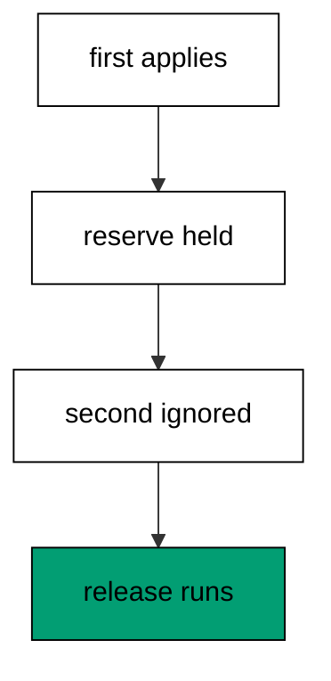

The reserve row with id -1 marks a migration run in flight, and a second run that finds it returns `:ignore` instead of applying anything. The pending second file waits safely because the refusal happens before any statement runs, so no partial work exists to reconcile. Deleting the reserve models the stuck deploy finishing or timing out, after which the freed run applies the queued file normally. The `:ignore` return is the backpressure signal: pipelines retry later instead of piling on.

**`learning/code/ex-64-reservation-serializes-deploys/main.clj`**:

```clojure
;; => Example 64: Reservation Serializes Deploys.
;; => A stuck deploy holds the reserve row: the second run reports :ignore instead of doubling.
(require '[migratus.core :as migratus]) ;; => migrate, rollback, up, and down move history
(require '[next.jdbc :as jdbc]) ;; => verification reads prove each migration landed
(require '[next.jdbc.result-set :as rs]) ;; => unqualified rows print without table prefixes
(require '[clojure.java.io :as io]) ;; => migration files are staged, then removed
;; => The database address comes from the harness, with local-run defaults.
(defn db-spec [] ;; => one builder owns every address default
  {:dbtype "postgresql" ;; => pgjdbc speaks the PostgreSQL wire protocol
   :host (or (System/getenv "PGHOST") "localhost") ;; => harness sets the service host
   :port (Integer/parseInt (or (System/getenv "PGPORT") "5432")) ;; => service port default
   :dbname (or (System/getenv "PGDATABASE") "postgres") ;; => fresh database per unit run
   :user (or (System/getenv "PGUSER") "postgres")}) ;; => trust auth needs no password
;; => One config carries the store, the relative migration dir, and the history table.
(defn config [dir table] ;; => every example owns its dir and history table
  {:store :database ;; => the SQL store journals history in a table
   :migration-dir dir ;; => relative to the unit folder, staged at runtime
   :migration-table-name table ;; => per-example history isolates every rerun
   :db (db-spec)}) ;; => next.jdbc connects from this spec
;; => Staging writes one up/down pair per call into the relative dir.
(defn write-migration [dir id name up down] ;; => one helper stages every migration
  (spit (str dir "/" id "-" name ".up.sql") up) ;; => forward change runs on migrate
  (when down ;; => up-only examples skip the down file on purpose
    (spit (str dir "/" id "-" name ".down.sql") down))) ;; => reverse runs on rollback
;; => Reset clears leftovers of a killed run so reruns print alike.
(defn reset-unit! [ds dir table tables views] ;; => one reset owns every leftover
  (doseq [v views] ;; => views drop before the tables they read
    (jdbc/execute! ds [(str "DROP VIEW IF EXISTS " v)])) ;; => stale views vanish first
  (let [d (io/file dir)] ;; => the relative staging dir of this unit
    (when (.exists d) ;; => a killed run may leave files behind
      (doseq [f (.listFiles d)] ;; => every staged file goes first
        (.delete ^java.io.File f)) ;; => delete each staged migration
      (.delete d)) ;; => the empty staging dir goes too
    (.mkdirs d)) ;; => a fresh dir for this run
  (doseq [t tables] ;; => every table this example owns
    (jdbc/execute! ds [(str "DROP TABLE IF EXISTS " t " CASCADE")])) ;; => killed runs vanish
  (jdbc/execute! ds [(str "DROP TABLE IF EXISTS " table)])) ;; => stale history vanishes too
;; => Reads print their own proof; ids sort so output never depends on disk order.
(defn applied-names [ds table] ;; => applied migration names in id order
  (mapv :description ;; => description stores the migration name
    (jdbc/execute! ds [(str "SELECT description FROM " table " WHERE id > 0 ORDER BY id")] ;; => id order, reserve row excluded
                     {:builder-fn rs/as-unqualified-lower-maps}))) ;; => short keys print cleanly
;; => Column lists read the catalog, so the schema proves itself.
(defn table-columns [ds table] ;; => column names in position order
  (mapv :column_name ;; => one name per row, nothing else
    (jdbc/execute! ds [(str "SELECT column_name FROM information_schema.columns WHERE table_name = '" table "' ORDER BY ordinal_position")] ;; => catalog order is stable
                     {:builder-fn rs/as-unqualified-lower-maps}))) ;; => short keys print cleanly
(def ds (jdbc/get-datasource (db-spec))) ;; => one shared datasource per unit run
(def cfg (config "mig" "m64_migrations")) ;; => store plus history table for this example
(reset-unit! ds "mig" "m64_migrations" ["m64_thing"] []) ;; => leftovers of a killed run vanish first
(write-migration "mig" "20260101006401" "make-thing" ;; => one migration both runs want
  "CREATE TABLE m64_thing (id SERIAL PRIMARY KEY);\n" ;; => tiny table, big lesson
  "DROP TABLE m64_thing;\n") ;; => reverse drops it
(println "first:" (pr-str (migratus/migrate cfg))) ;; => first run applies the file
(jdbc/execute! ds ["INSERT INTO m64_migrations (id) VALUES (-1)"]) ;; => stuck deploy holds the reserve
(write-migration "mig" "20260101006402" "make-second" ;; => second file waits behind the reserve
  "CREATE TABLE m64_second (id SERIAL PRIMARY KEY);\n" ;; => second table waits
  "DROP TABLE m64_second;\n") ;; => reverse drops second
(println "locked:" (pr-str (migratus/migrate cfg))) ;; => reserve refuses the second run
(jdbc/execute! ds ["DELETE FROM m64_migrations WHERE id = -1"]) ;; => stuck deploy finally releases
(println "released:" (pr-str (migratus/migrate cfg))) ;; => freed run finishes the queue
(println "completed:" (pr-str (applied-names ds "m64_migrations"))) ;; => both entries in id order
;; => Cleanup drops every object this example made, leaving no residue.
(defn cleanup-unit! [ds dir table tables views] ;; => one cleanup owns every created object
  (doseq [v views] ;; => views drop before the tables they read
    (jdbc/execute! ds [(str "DROP VIEW IF EXISTS " v)])) ;; => view residue vanishes
  (doseq [t tables] ;; => every table this example owns
    (jdbc/execute! ds [(str "DROP TABLE IF EXISTS " t " CASCADE")])) ;; => tables vanish with dependents
  (jdbc/execute! ds [(str "DROP TABLE IF EXISTS " table)]) ;; => history table vanishes too
  (let [d (io/file dir)] ;; => the staging dir from this run
    (when (.exists d) ;; => files were staged above
      (doseq [f (.listFiles d)] ;; => every staged file goes first
        (.delete ^java.io.File f)) ;; => delete each staged migration
      (.delete d)))) ;; => the empty staging dir goes too
(cleanup-unit! ds "mig" "m64_migrations" ["m64_thing" "m64_second"] []) ;; => drop every object this example created
```

**Output** (`learning/code/ex-64-reservation-serializes-deploys/expected/main.stdout.txt`):

```text
first: nil
locked: :ignore
released: nil
completed: ["make-thing" "make-second"]
```

**Key takeaway**: The reserve row serializes runs: a held reserve turns the second run into :ignore, never a double.

**Why it matters**: Deploy pipelines overlap on retries and schedules, and two runners applying one history would double seeds and collide on objects. The reserve turns overlap into order: one runs, the other waits politely with a clear signal. Teams that respect `:ignore` retry with backoff instead of forcing, because the database already said someone is working.

### Example 65: Diagnose the Stuck Reservation

Crashed deploys leave reserves behind, so this example diagnoses and clears a stuck one. The program refuses, finds the -1 row, clears it, and drains the queue. (Concepts: co-12, co-16.)

The reserve row survives the crash that created it, because nothing deletes a reservation except the run that made it or an operator. Querying the journal for id -1 distinguishes a stuck deploy from an empty queue: the row is the evidence, not the logs. Clearing it by hand is safe once the crashed process is confirmed dead, and the next run applies everything the crash delayed. Diagnosis reads the journal first, because the database remembers the crash the process forgot.

**`learning/code/ex-65-diagnose-the-stuck-reservation/main.clj`**:

```clojure
;; => Example 65: Diagnose the Stuck Reservation.
;; => A deploy that never finishes leaves id -1 behind: read the journal to find the squatter.
(require '[migratus.core :as migratus]) ;; => migrate, rollback, up, and down move history
(require '[next.jdbc :as jdbc]) ;; => verification reads prove each migration landed
(require '[next.jdbc.result-set :as rs]) ;; => unqualified rows print without table prefixes
(require '[clojure.java.io :as io]) ;; => migration files are staged, then removed
;; => The database address comes from the harness, with local-run defaults.
(defn db-spec [] ;; => one builder owns every address default
  {:dbtype "postgresql" ;; => pgjdbc speaks the PostgreSQL wire protocol
   :host (or (System/getenv "PGHOST") "localhost") ;; => harness sets the service host
   :port (Integer/parseInt (or (System/getenv "PGPORT") "5432")) ;; => service port default
   :dbname (or (System/getenv "PGDATABASE") "postgres") ;; => fresh database per unit run
   :user (or (System/getenv "PGUSER") "postgres")}) ;; => trust auth needs no password
;; => One config carries the store, the relative migration dir, and the history table.
(defn config [dir table] ;; => every example owns its dir and history table
  {:store :database ;; => the SQL store journals history in a table
   :migration-dir dir ;; => relative to the unit folder, staged at runtime
   :migration-table-name table ;; => per-example history isolates every rerun
   :db (db-spec)}) ;; => next.jdbc connects from this spec
;; => Staging writes one up/down pair per call into the relative dir.
(defn write-migration [dir id name up down] ;; => one helper stages every migration
  (spit (str dir "/" id "-" name ".up.sql") up) ;; => forward change runs on migrate
  (when down ;; => up-only examples skip the down file on purpose
    (spit (str dir "/" id "-" name ".down.sql") down))) ;; => reverse runs on rollback
;; => Reset clears leftovers of a killed run so reruns print alike.
(defn reset-unit! [ds dir table tables views] ;; => one reset owns every leftover
  (doseq [v views] ;; => views drop before the tables they read
    (jdbc/execute! ds [(str "DROP VIEW IF EXISTS " v)])) ;; => stale views vanish first
  (let [d (io/file dir)] ;; => the relative staging dir of this unit
    (when (.exists d) ;; => a killed run may leave files behind
      (doseq [f (.listFiles d)] ;; => every staged file goes first
        (.delete ^java.io.File f)) ;; => delete each staged migration
      (.delete d)) ;; => the empty staging dir goes too
    (.mkdirs d)) ;; => a fresh dir for this run
  (doseq [t tables] ;; => every table this example owns
    (jdbc/execute! ds [(str "DROP TABLE IF EXISTS " t " CASCADE")])) ;; => killed runs vanish
  (jdbc/execute! ds [(str "DROP TABLE IF EXISTS " table)])) ;; => stale history vanishes too
;; => Reads print their own proof; ids sort so output never depends on disk order.
(defn applied-names [ds table] ;; => applied migration names in id order
  (mapv :description ;; => description stores the migration name
    (jdbc/execute! ds [(str "SELECT description FROM " table " WHERE id > 0 ORDER BY id")] ;; => id order, reserve row excluded
                     {:builder-fn rs/as-unqualified-lower-maps}))) ;; => short keys print cleanly
;; => Column lists read the catalog, so the schema proves itself.
(defn table-columns [ds table] ;; => column names in position order
  (mapv :column_name ;; => one name per row, nothing else
    (jdbc/execute! ds [(str "SELECT column_name FROM information_schema.columns WHERE table_name = '" table "' ORDER BY ordinal_position")] ;; => catalog order is stable
                     {:builder-fn rs/as-unqualified-lower-maps}))) ;; => short keys print cleanly
(def ds (jdbc/get-datasource (db-spec))) ;; => one shared datasource per unit run
(def cfg (config "mig" "m65_migrations")) ;; => store plus history table for this example
(reset-unit! ds "mig" "m65_migrations" ["m65_task"] []) ;; => leftovers of a killed run vanish first
(write-migration "mig" "20260101006501" "make-task" ;; => one file queued behind the squatter
  "CREATE TABLE m65_task (id SERIAL PRIMARY KEY);\n" ;; => tiny table waits
  "DROP TABLE m65_task;\n") ;; => reverse drops it
(println "migrate:" (pr-str (migratus/migrate cfg))) ;; => first run applies the file
(jdbc/execute! ds ["INSERT INTO m65_migrations (id) VALUES (-1)"]) ;; => crashed deploy leaves its reserve
(write-migration "mig" "20260101006502" "make-next" ;; => next file cannot proceed
  "CREATE TABLE m65_next (id SERIAL PRIMARY KEY);\n" ;; => next table waits
  "DROP TABLE m65_next;\n") ;; => reverse drops next
(println "stuck:" (pr-str (migratus/migrate cfg))) ;; => squatter refuses the run
(println "squatter:" (pr-str (mapv :id ;; => reserve row beta rays the stuck run
  (jdbc/execute! ds ["SELECT id FROM m65_migrations WHERE id = -1"] ;; => journal names the squatter
                   {:builder-fn rs/as-unqualified-lower-maps})))) ;; => minus one marks in-flight
(jdbc/execute! ds ["DELETE FROM m65_migrations WHERE id = -1"]) ;; => operator clears the dead reserve
(println "recovered:" (pr-str (migratus/migrate cfg))) ;; => queue drains after clearing
;; => Cleanup drops every object this example made, leaving no residue.
(defn cleanup-unit! [ds dir table tables views] ;; => one cleanup owns every created object
  (doseq [v views] ;; => views drop before the tables they read
    (jdbc/execute! ds [(str "DROP VIEW IF EXISTS " v)])) ;; => view residue vanishes
  (doseq [t tables] ;; => every table this example owns
    (jdbc/execute! ds [(str "DROP TABLE IF EXISTS " t " CASCADE")])) ;; => tables vanish with dependents
  (jdbc/execute! ds [(str "DROP TABLE IF EXISTS " table)]) ;; => history table vanishes too
  (let [d (io/file dir)] ;; => the staging dir from this run
    (when (.exists d) ;; => files were staged above
      (doseq [f (.listFiles d)] ;; => every staged file goes first
        (.delete ^java.io.File f)) ;; => delete each staged migration
      (.delete d)))) ;; => the empty staging dir goes too
(cleanup-unit! ds "mig" "m65_migrations" ["m65_task" "m65_next"] []) ;; => drop every object this example created
```

**Output** (`learning/code/ex-65-diagnose-the-stuck-reservation/expected/main.stdout.txt`):

```text
migrate: nil
stuck: :ignore
squatter: [-1]
recovered: nil
```

**Key takeaway**: Find id -1 in the journal to diagnose a stuck deploy; clear it once the process is dead.

**Why it matters**: Crashed deploys page people who were not on shift when the deploy started, and they need evidence, not archaeology. The reserve row is that evidence: one query shows a run died mid-flight and names exactly what it blocked. Teams that diagnose from the journal clear stuck deploys in minutes, because the database kept the receipt the crashed process could not.

### Example 66: Short Statements Shrink the Window

Lock windows scale with statement count, so this example splits work into two single-statement files. The program migrates both and proves each landed with its own history row. (Concepts: co-15.)

Each migration here holds exactly one lock for exactly one fast statement, because single-purpose files never bundle unrelated work. The history records two rows for two jobs, which also reads better in review than one file doing two things. Short statements shrink the window where concurrent writes queue, turning lock contention from a design problem into a non-event. Small files are a performance strategy wearing a style habit.

**`learning/code/ex-66-short-statements-shrink-the-window/main.clj`**:

```clojure
;; => Example 66: Short Statements Shrink the Window.
;; => One fast statement holds its lock briefly: single-purpose migrations minimize exposure.
(require '[migratus.core :as migratus]) ;; => migrate, rollback, up, and down move history
(require '[next.jdbc :as jdbc]) ;; => verification reads prove each migration landed
(require '[next.jdbc.result-set :as rs]) ;; => unqualified rows print without table prefixes
(require '[clojure.java.io :as io]) ;; => migration files are staged, then removed
;; => The database address comes from the harness, with local-run defaults.
(defn db-spec [] ;; => one builder owns every address default
  {:dbtype "postgresql" ;; => pgjdbc speaks the PostgreSQL wire protocol
   :host (or (System/getenv "PGHOST") "localhost") ;; => harness sets the service host
   :port (Integer/parseInt (or (System/getenv "PGPORT") "5432")) ;; => service port default
   :dbname (or (System/getenv "PGDATABASE") "postgres") ;; => fresh database per unit run
   :user (or (System/getenv "PGUSER") "postgres")}) ;; => trust auth needs no password
;; => One config carries the store, the relative migration dir, and the history table.
(defn config [dir table] ;; => every example owns its dir and history table
  {:store :database ;; => the SQL store journals history in a table
   :migration-dir dir ;; => relative to the unit folder, staged at runtime
   :migration-table-name table ;; => per-example history isolates every rerun
   :db (db-spec)}) ;; => next.jdbc connects from this spec
;; => Staging writes one up/down pair per call into the relative dir.
(defn write-migration [dir id name up down] ;; => one helper stages every migration
  (spit (str dir "/" id "-" name ".up.sql") up) ;; => forward change runs on migrate
  (when down ;; => up-only examples skip the down file on purpose
    (spit (str dir "/" id "-" name ".down.sql") down))) ;; => reverse runs on rollback
;; => Reset clears leftovers of a killed run so reruns print alike.
(defn reset-unit! [ds dir table tables views] ;; => one reset owns every leftover
  (doseq [v views] ;; => views drop before the tables they read
    (jdbc/execute! ds [(str "DROP VIEW IF EXISTS " v)])) ;; => stale views vanish first
  (let [d (io/file dir)] ;; => the relative staging dir of this unit
    (when (.exists d) ;; => a killed run may leave files behind
      (doseq [f (.listFiles d)] ;; => every staged file goes first
        (.delete ^java.io.File f)) ;; => delete each staged migration
      (.delete d)) ;; => the empty staging dir goes too
    (.mkdirs d)) ;; => a fresh dir for this run
  (doseq [t tables] ;; => every table this example owns
    (jdbc/execute! ds [(str "DROP TABLE IF EXISTS " t " CASCADE")])) ;; => killed runs vanish
  (jdbc/execute! ds [(str "DROP TABLE IF EXISTS " table)])) ;; => stale history vanishes too
;; => Reads print their own proof; ids sort so output never depends on disk order.
(defn applied-names [ds table] ;; => applied migration names in id order
  (mapv :description ;; => description stores the migration name
    (jdbc/execute! ds [(str "SELECT description FROM " table " WHERE id > 0 ORDER BY id")] ;; => id order, reserve row excluded
                     {:builder-fn rs/as-unqualified-lower-maps}))) ;; => short keys print cleanly
;; => Column lists read the catalog, so the schema proves itself.
(defn table-columns [ds table] ;; => column names in position order
  (mapv :column_name ;; => one name per row, nothing else
    (jdbc/execute! ds [(str "SELECT column_name FROM information_schema.columns WHERE table_name = '" table "' ORDER BY ordinal_position")] ;; => catalog order is stable
                     {:builder-fn rs/as-unqualified-lower-maps}))) ;; => short keys print cleanly
(def ds (jdbc/get-datasource (db-spec))) ;; => one shared datasource per unit run
(def cfg (config "mig" "m66_migrations")) ;; => store plus history table for this example
(reset-unit! ds "mig" "m66_migrations" ["m66_note"] []) ;; => leftovers of a killed run vanish first
(write-migration "mig" "20260101006601" "make-note" ;; => one table, one job
  "CREATE TABLE m66_note (id SERIAL PRIMARY KEY, body TEXT);\n" ;; => note table is tiny
  "DROP TABLE m66_note;\n") ;; => reverse drops it
(write-migration "mig" "20260101006602" "index-note" ;; => one index, one job
  "CREATE INDEX m66_note_body_idx ON m66_note (body);\n" ;; => small index builds fast
  "DROP INDEX m66_note_body_idx;\n") ;; => reverse drops the index
(println "migrate:" (pr-str (migratus/migrate cfg))) ;; => nil means every pending migration applied
(println "completed:" (pr-str (applied-names ds "m66_migrations"))) ;; => id order straight from history
(println "indexes:" (pr-str (mapv :indexname ;; => index built and serving
  (jdbc/execute! ds ["SELECT indexname AS indexname FROM pg_indexes WHERE tablename = 'm66_note' AND indexname = 'm66_note_body_idx'"] ;; => short build, short lock (part 1)
                   {:builder-fn rs/as-unqualified-lower-maps})))) ;; => short build, short lock (part 2)
;; => Cleanup drops every object this example made, leaving no residue.
(defn cleanup-unit! [ds dir table tables views] ;; => one cleanup owns every created object
  (doseq [v views] ;; => views drop before the tables they read
    (jdbc/execute! ds [(str "DROP VIEW IF EXISTS " v)])) ;; => view residue vanishes
  (doseq [t tables] ;; => every table this example owns
    (jdbc/execute! ds [(str "DROP TABLE IF EXISTS " t " CASCADE")])) ;; => tables vanish with dependents
  (jdbc/execute! ds [(str "DROP TABLE IF EXISTS " table)]) ;; => history table vanishes too
  (let [d (io/file dir)] ;; => the staging dir from this run
    (when (.exists d) ;; => files were staged above
      (doseq [f (.listFiles d)] ;; => every staged file goes first
        (.delete ^java.io.File f)) ;; => delete each staged migration
      (.delete d)))) ;; => the empty staging dir goes too
(cleanup-unit! ds "mig" "m66_migrations" ["m66_note"] []) ;; => drop every object this example created
```

**Output** (`learning/code/ex-66-short-statements-shrink-the-window/expected/main.stdout.txt`):

```text
migrate: nil
completed: ["make-note" "index-note"]
indexes: ["m66_note_body_idx"]
```

**Key takeaway**: One statement per migration minimizes each lock window: small files are a performance strategy.

**Why it matters**: Lock windows add up across statements, and a bundled migration holds every lock until its slowest step finishes. Splitting work into single-statement files releases each lock the moment its job completes, so concurrent writes wait minimally. Teams that keep files small rarely meet lock contention at all, because no window stays open long enough to matter.

### Example 67: Concurrent Index Stays Valid

Concurrent builds trade atomicity for manners, so this example verifies the build finished whole. The program builds concurrently and reads the validity flag back. (Concepts: co-15, co-16.)

A concurrent index build that fails partway leaves an INVALID index the planner ignores, which silently degrades every query it should serve. Reading `indisvalid` proves this build completed all its phases, because only a whole build flips the flag to true. The check belongs in verification precisely because concurrent builds can fail where transactional ones roll back. Validity is the receipt for politeness: the build was gentle and it finished.

**`learning/code/ex-67-concurrent-index-stays-valid/main.clj`**:

```clojure
;; => Example 67: Concurrent Index Stays Valid.
;; => Background builds can fail partway: the validity flag proves this one finished whole.
(require '[migratus.core :as migratus]) ;; => migrate, rollback, up, and down move history
(require '[next.jdbc :as jdbc]) ;; => verification reads prove each migration landed
(require '[next.jdbc.result-set :as rs]) ;; => unqualified rows print without table prefixes
(require '[clojure.java.io :as io]) ;; => migration files are staged, then removed
;; => The database address comes from the harness, with local-run defaults.
(defn db-spec [] ;; => one builder owns every address default
  {:dbtype "postgresql" ;; => pgjdbc speaks the PostgreSQL wire protocol
   :host (or (System/getenv "PGHOST") "localhost") ;; => harness sets the service host
   :port (Integer/parseInt (or (System/getenv "PGPORT") "5432")) ;; => service port default
   :dbname (or (System/getenv "PGDATABASE") "postgres") ;; => fresh database per unit run
   :user (or (System/getenv "PGUSER") "postgres")}) ;; => trust auth needs no password
;; => One config carries the store, the relative migration dir, and the history table.
(defn config [dir table] ;; => every example owns its dir and history table
  {:store :database ;; => the SQL store journals history in a table
   :migration-dir dir ;; => relative to the unit folder, staged at runtime
   :migration-table-name table ;; => per-example history isolates every rerun
   :db (db-spec)}) ;; => next.jdbc connects from this spec
;; => Staging writes one up/down pair per call into the relative dir.
(defn write-migration [dir id name up down] ;; => one helper stages every migration
  (spit (str dir "/" id "-" name ".up.sql") up) ;; => forward change runs on migrate
  (when down ;; => up-only examples skip the down file on purpose
    (spit (str dir "/" id "-" name ".down.sql") down))) ;; => reverse runs on rollback
;; => Reset clears leftovers of a killed run so reruns print alike.
(defn reset-unit! [ds dir table tables views] ;; => one reset owns every leftover
  (doseq [v views] ;; => views drop before the tables they read
    (jdbc/execute! ds [(str "DROP VIEW IF EXISTS " v)])) ;; => stale views vanish first
  (let [d (io/file dir)] ;; => the relative staging dir of this unit
    (when (.exists d) ;; => a killed run may leave files behind
      (doseq [f (.listFiles d)] ;; => every staged file goes first
        (.delete ^java.io.File f)) ;; => delete each staged migration
      (.delete d)) ;; => the empty staging dir goes too
    (.mkdirs d)) ;; => a fresh dir for this run
  (doseq [t tables] ;; => every table this example owns
    (jdbc/execute! ds [(str "DROP TABLE IF EXISTS " t " CASCADE")])) ;; => killed runs vanish
  (jdbc/execute! ds [(str "DROP TABLE IF EXISTS " table)])) ;; => stale history vanishes too
;; => Reads print their own proof; ids sort so output never depends on disk order.
(defn applied-names [ds table] ;; => applied migration names in id order
  (mapv :description ;; => description stores the migration name
    (jdbc/execute! ds [(str "SELECT description FROM " table " WHERE id > 0 ORDER BY id")] ;; => id order, reserve row excluded
                     {:builder-fn rs/as-unqualified-lower-maps}))) ;; => short keys print cleanly
;; => Column lists read the catalog, so the schema proves itself.
(defn table-columns [ds table] ;; => column names in position order
  (mapv :column_name ;; => one name per row, nothing else
    (jdbc/execute! ds [(str "SELECT column_name FROM information_schema.columns WHERE table_name = '" table "' ORDER BY ordinal_position")] ;; => catalog order is stable
                     {:builder-fn rs/as-unqualified-lower-maps}))) ;; => short keys print cleanly
(def ds (jdbc/get-datasource (db-spec))) ;; => one shared datasource per unit run
(def cfg (config "mig" "m67_migrations")) ;; => store plus history table for this example
(reset-unit! ds "mig" "m67_migrations" ["m67_doc"] []) ;; => leftovers of a killed run vanish first
(write-migration "mig" "20260101006701" "make-doc" ;; => first the documents with a seed
  (str "CREATE TABLE m67_doc (id SERIAL PRIMARY KEY, title TEXT NOT NULL);\n" ;; => title column needs lookup
       "--;;\n" ;; => separator splits schema from seed
       "INSERT INTO m67_doc (title) VALUES ('a'), ('b');\n") ;; => two documents await indexing
  "DROP TABLE m67_doc;\n") ;; => reverse drops everything
(write-migration "mig" "20260101006702" "index-title" ;; => then the concurrent build
  (str "-- :disable-transaction\n" ;; => concurrent builds refuse transactions
       "CREATE INDEX CONCURRENTLY m67_doc_title_idx ON m67_doc (title);\n") ;; => build scans without the write lock
  (str "-- :disable-transaction\n" ;; => down runs outside a transaction too
       "DROP INDEX CONCURRENTLY IF EXISTS m67_doc_title_idx;\n")) ;; => reverse drops the index
(println "migrate:" (pr-str (migratus/migrate cfg))) ;; => nil means every pending migration applied
(println "completed:" (pr-str (applied-names ds "m67_migrations"))) ;; => id order straight from history
(println "valid:" (pr-str (mapv :indisvalid ;; => true proves a whole build
  (jdbc/execute! ds ["SELECT indisvalid AS indisvalid FROM pg_index WHERE indexrelid = 'm67_doc_title_idx'::regclass"] ;; => invalid would demand a rebuild (part 1)
                   {:builder-fn rs/as-unqualified-lower-maps})))) ;; => invalid would demand a rebuild (part 2)
;; => Cleanup drops every object this example made, leaving no residue.
(defn cleanup-unit! [ds dir table tables views] ;; => one cleanup owns every created object
  (doseq [v views] ;; => views drop before the tables they read
    (jdbc/execute! ds [(str "DROP VIEW IF EXISTS " v)])) ;; => view residue vanishes
  (doseq [t tables] ;; => every table this example owns
    (jdbc/execute! ds [(str "DROP TABLE IF EXISTS " t " CASCADE")])) ;; => tables vanish with dependents
  (jdbc/execute! ds [(str "DROP TABLE IF EXISTS " table)]) ;; => history table vanishes too
  (let [d (io/file dir)] ;; => the staging dir from this run
    (when (.exists d) ;; => files were staged above
      (doseq [f (.listFiles d)] ;; => every staged file goes first
        (.delete ^java.io.File f)) ;; => delete each staged migration
      (.delete d)))) ;; => the empty staging dir goes too
(cleanup-unit! ds "mig" "m67_migrations" ["m67_doc"] []) ;; => drop every object this example created
```

**Output** (`learning/code/ex-67-concurrent-index-stays-valid/expected/main.stdout.txt`):

```text
migrate: nil
completed: ["make-doc" "index-title"]
valid: [true]
```

**Key takeaway**: Verify concurrent builds through indisvalid: true means whole, invalid means rebuild.

**Why it matters**: Polite builds fail in ways rude ones cannot: partial completion instead of clean rollback. An invalid index looks built while serving nothing, which degrades queries without alerting anyone. Teams that check validity catch half-built indexes in the deploy, because the flag distinguishes finished from abandoned.

### Example 68: Lock Timeout Fails Fast

Blocked migrations must fail instead of queueing behind a stuck writer, so this example races an alter against a held lock. The program holds the table elsewhere, attempts the guarded alter, and prints the timeout. (Concepts: co-15, co-16.)

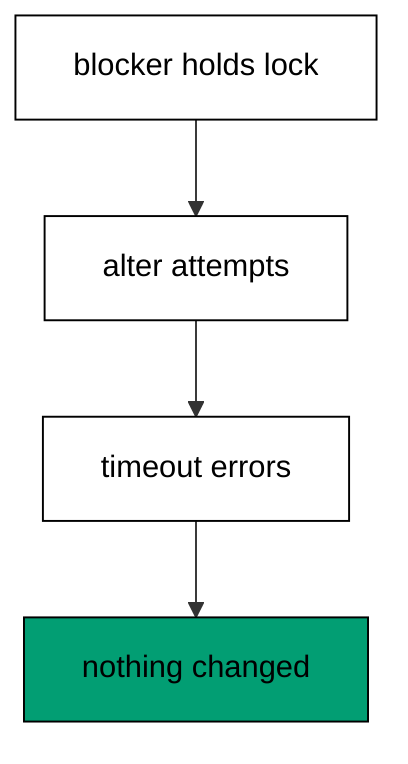

The blocker connection takes an access-exclusive lock in an open transaction, exactly like a long writer would. The alter runs in its own transaction with a one-second local lock timeout, so instead of queueing forever it fails fast with the lock-timeout error. Rolling the blocker back releases the table, and the column listing proves the failed alter changed nothing. Timeouts turn indefinite waits into immediate errors, which is the only safe behavior for unattended deploys.

**`learning/code/ex-68-lock-timeout-fails-fast/main.clj`**:

```clojure
;; => Example 68: Lock Timeout Fails Fast.
;; => A blocked migration should error, not queue: lock timeout turns waiting into failing.
(require '[migratus.core :as migratus]) ;; => migrate, rollback, up, and down move history
(require '[next.jdbc :as jdbc]) ;; => verification reads prove each migration landed
(require '[next.jdbc.result-set :as rs]) ;; => unqualified rows print without table prefixes
(require '[clojure.java.io :as io]) ;; => migration files are staged, then removed
;; => The database address comes from the harness, with local-run defaults.
(defn db-spec [] ;; => one builder owns every address default
  {:dbtype "postgresql" ;; => pgjdbc speaks the PostgreSQL wire protocol
   :host (or (System/getenv "PGHOST") "localhost") ;; => harness sets the service host
   :port (Integer/parseInt (or (System/getenv "PGPORT") "5432")) ;; => service port default
   :dbname (or (System/getenv "PGDATABASE") "postgres") ;; => fresh database per unit run
   :user (or (System/getenv "PGUSER") "postgres")}) ;; => trust auth needs no password
;; => One config carries the store, the relative migration dir, and the history table.
(defn config [dir table] ;; => every example owns its dir and history table
  {:store :database ;; => the SQL store journals history in a table
   :migration-dir dir ;; => relative to the unit folder, staged at runtime
   :migration-table-name table ;; => per-example history isolates every rerun
   :db (db-spec)}) ;; => next.jdbc connects from this spec
;; => Staging writes one up/down pair per call into the relative dir.
(defn write-migration [dir id name up down] ;; => one helper stages every migration
  (spit (str dir "/" id "-" name ".up.sql") up) ;; => forward change runs on migrate
  (when down ;; => up-only examples skip the down file on purpose
    (spit (str dir "/" id "-" name ".down.sql") down))) ;; => reverse runs on rollback
;; => Reset clears leftovers of a killed run so reruns print alike.
(defn reset-unit! [ds dir table tables views] ;; => one reset owns every leftover
  (doseq [v views] ;; => views drop before the tables they read
    (jdbc/execute! ds [(str "DROP VIEW IF EXISTS " v)])) ;; => stale views vanish first
  (let [d (io/file dir)] ;; => the relative staging dir of this unit
    (when (.exists d) ;; => a killed run may leave files behind
      (doseq [f (.listFiles d)] ;; => every staged file goes first
        (.delete ^java.io.File f)) ;; => delete each staged migration
      (.delete d)) ;; => the empty staging dir goes too
    (.mkdirs d)) ;; => a fresh dir for this run
  (doseq [t tables] ;; => every table this example owns
    (jdbc/execute! ds [(str "DROP TABLE IF EXISTS " t " CASCADE")])) ;; => killed runs vanish
  (jdbc/execute! ds [(str "DROP TABLE IF EXISTS " table)])) ;; => stale history vanishes too
;; => Reads print their own proof; ids sort so output never depends on disk order.
(defn applied-names [ds table] ;; => applied migration names in id order
  (mapv :description ;; => description stores the migration name
    (jdbc/execute! ds [(str "SELECT description FROM " table " WHERE id > 0 ORDER BY id")] ;; => id order, reserve row excluded
                     {:builder-fn rs/as-unqualified-lower-maps}))) ;; => short keys print cleanly
;; => Column lists read the catalog, so the schema proves itself.
(defn table-columns [ds table] ;; => column names in position order
  (mapv :column_name ;; => one name per row, nothing else
    (jdbc/execute! ds [(str "SELECT column_name FROM information_schema.columns WHERE table_name = '" table "' ORDER BY ordinal_position")] ;; => catalog order is stable
                     {:builder-fn rs/as-unqualified-lower-maps}))) ;; => short keys print cleanly
(def ds (jdbc/get-datasource (db-spec))) ;; => one shared datasource per unit run
(def cfg (config "mig" "m68_migrations")) ;; => store plus history table for this example
(reset-unit! ds "mig" "m68_migrations" ["m68_hot"] []) ;; => leftovers of a killed run vanish first
(jdbc/execute! ds ["CREATE TABLE m68_hot (id SERIAL PRIMARY KEY, v TEXT)"]) ;; => hot table stands in for production
(jdbc/execute! ds ["INSERT INTO m68_hot (v) VALUES ('live')"]) ;; => one live row keeps it honest
(def blocker (jdbc/get-connection ds)) ;; => second connection plays the long writer
(.setAutoCommit blocker false) ;; => manual commit holds the lock
(jdbc/execute! blocker ["LOCK TABLE m68_hot IN ACCESS EXCLUSIVE MODE"]) ;; => blocker sits on the table
(println "add-note:" (pr-str (try (jdbc/with-transaction [tx ds] ;; => guarded alter runs second
  (jdbc/execute! tx ["SET LOCAL lock_timeout = 1000"]) ;; => one second of patience, no more
  (jdbc/execute! tx ["ALTER TABLE m68_hot ADD COLUMN w TEXT"]) ;; => alter queues behind the blocker
  :applied) ;; => reached only when unblocked
  (catch Exception e (str "threw: " (.getMessage e)))))) ;; => timeout names the blockage
(.rollback blocker) ;; => blocker rolls its lock back
(.close blocker) ;; => connections close what they open
(println "cols:" (pr-str (mapv :column_name ;; => alter never landed
  (jdbc/execute! ds ["SELECT column_name AS column_name FROM information_schema.columns WHERE table_name = 'm68_hot' ORDER BY ordinal_position"] ;; => failed migration changed nothing (part 1)
                   {:builder-fn rs/as-unqualified-lower-maps})))) ;; => failed migration changed nothing (part 2)
;; => Cleanup drops every object this example made, leaving no residue.
(defn cleanup-unit! [ds dir table tables views] ;; => one cleanup owns every created object
  (doseq [v views] ;; => views drop before the tables they read
    (jdbc/execute! ds [(str "DROP VIEW IF EXISTS " v)])) ;; => view residue vanishes
  (doseq [t tables] ;; => every table this example owns
    (jdbc/execute! ds [(str "DROP TABLE IF EXISTS " t " CASCADE")])) ;; => tables vanish with dependents
  (jdbc/execute! ds [(str "DROP TABLE IF EXISTS " table)]) ;; => history table vanishes too
  (let [d (io/file dir)] ;; => the staging dir from this run
    (when (.exists d) ;; => files were staged above
      (doseq [f (.listFiles d)] ;; => every staged file goes first
        (.delete ^java.io.File f)) ;; => delete each staged migration
      (.delete d)))) ;; => the empty staging dir goes too
(cleanup-unit! ds "mig" "m68_migrations" ["m68_hot"] []) ;; => drop every object this example created
```

**Output** (`learning/code/ex-68-lock-timeout-fails-fast/expected/main.stdout.txt`):

```text
add-note: "threw: ERROR: canceling statement due to lock timeout"
cols: ["id" "v"]
```

**Key takeaway**: Bound every migration with a lock timeout: blocked work fails fast instead of queueing forever.

**Why it matters**: Unattended deploys cannot wait politely behind stuck writers, because every queued migration holds the pipeline hostage. A lock timeout converts the wait into an error the retry policy understands, which keeps one stuck table from freezing the release. Teams that bound their waits get paged for real blockages instead of discovering them at the next deploy.

### Example 69: Statement Timeout Bounds the Runaway

Runaway statements must die on schedule, so this example sleeps past a one-second timeout. The program catches the failure and proves the first migration survived. (Concepts: co-15.)

The `SET LOCAL` guard caps the migration's own transaction at one second, so the three-second sleep dies instead of holding locks indefinitely; the server log names the statement timeout while the transcript reports the aborted batch. Migratus records nothing for the failed file, which keeps the history honest about what finished. The down file holds a harmless query because the failed migration changed nothing and there is nothing to unwind. Timeouts bound the worst case, which is what lets teams deploy fills they have not timed.

**`learning/code/ex-69-statement-timeout-bounds-the-runaway/main.clj`**:

```clojure
;; => Example 69: Statement Timeout Bounds the Runaway.
;; => Long statements should die on schedule: statement timeout caps the worst case.
(require '[migratus.core :as migratus]) ;; => migrate, rollback, up, and down move history
(require '[next.jdbc :as jdbc]) ;; => verification reads prove each migration landed
(require '[next.jdbc.result-set :as rs]) ;; => unqualified rows print without table prefixes
(require '[clojure.java.io :as io]) ;; => migration files are staged, then removed
;; => The database address comes from the harness, with local-run defaults.
(defn db-spec [] ;; => one builder owns every address default
  {:dbtype "postgresql" ;; => pgjdbc speaks the PostgreSQL wire protocol
   :host (or (System/getenv "PGHOST") "localhost") ;; => harness sets the service host
   :port (Integer/parseInt (or (System/getenv "PGPORT") "5432")) ;; => service port default
   :dbname (or (System/getenv "PGDATABASE") "postgres") ;; => fresh database per unit run
   :user (or (System/getenv "PGUSER") "postgres")}) ;; => trust auth needs no password
;; => One config carries the store, the relative migration dir, and the history table.
(defn config [dir table] ;; => every example owns its dir and history table
  {:store :database ;; => the SQL store journals history in a table
   :migration-dir dir ;; => relative to the unit folder, staged at runtime
   :migration-table-name table ;; => per-example history isolates every rerun
   :db (db-spec)}) ;; => next.jdbc connects from this spec
;; => Staging writes one up/down pair per call into the relative dir.
(defn write-migration [dir id name up down] ;; => one helper stages every migration
  (spit (str dir "/" id "-" name ".up.sql") up) ;; => forward change runs on migrate
  (when down ;; => up-only examples skip the down file on purpose
    (spit (str dir "/" id "-" name ".down.sql") down))) ;; => reverse runs on rollback
;; => Reset clears leftovers of a killed run so reruns print alike.
(defn reset-unit! [ds dir table tables views] ;; => one reset owns every leftover
  (doseq [v views] ;; => views drop before the tables they read
    (jdbc/execute! ds [(str "DROP VIEW IF EXISTS " v)])) ;; => stale views vanish first
  (let [d (io/file dir)] ;; => the relative staging dir of this unit
    (when (.exists d) ;; => a killed run may leave files behind
      (doseq [f (.listFiles d)] ;; => every staged file goes first
        (.delete ^java.io.File f)) ;; => delete each staged migration
      (.delete d)) ;; => the empty staging dir goes too
    (.mkdirs d)) ;; => a fresh dir for this run
  (doseq [t tables] ;; => every table this example owns
    (jdbc/execute! ds [(str "DROP TABLE IF EXISTS " t " CASCADE")])) ;; => killed runs vanish
  (jdbc/execute! ds [(str "DROP TABLE IF EXISTS " table)])) ;; => stale history vanishes too
;; => Reads print their own proof; ids sort so output never depends on disk order.
(defn applied-names [ds table] ;; => applied migration names in id order
  (mapv :description ;; => description stores the migration name
    (jdbc/execute! ds [(str "SELECT description FROM " table " WHERE id > 0 ORDER BY id")] ;; => id order, reserve row excluded
                     {:builder-fn rs/as-unqualified-lower-maps}))) ;; => short keys print cleanly
;; => Column lists read the catalog, so the schema proves itself.
(defn table-columns [ds table] ;; => column names in position order
  (mapv :column_name ;; => one name per row, nothing else
    (jdbc/execute! ds [(str "SELECT column_name FROM information_schema.columns WHERE table_name = '" table "' ORDER BY ordinal_position")] ;; => catalog order is stable
                     {:builder-fn rs/as-unqualified-lower-maps}))) ;; => short keys print cleanly
(def ds (jdbc/get-datasource (db-spec))) ;; => one shared datasource per unit run
(def cfg (config "mig" "m69_migrations")) ;; => store plus history table for this example
(reset-unit! ds "mig" "m69_migrations" ["m69_slow"] []) ;; => leftovers of a killed run vanish first
(write-migration "mig" "20260101006901" "make-slow" ;; => first a table to sleep against
  "CREATE TABLE m69_slow (id SERIAL PRIMARY KEY);\n" ;; => tiny table, slow query
  "DROP TABLE m69_slow;\n") ;; => reverse drops it
(write-migration "mig" "20260101006902" "sleepy-fill" ;; => then the runaway statement
  (str "SET LOCAL statement_timeout = 1000;\n" ;; => one second of runtime, no more
       "--;;\n" ;; => separator splits the guard from the sleeper
       "SELECT pg_sleep(3);\n") ;; => three-second sleep must die
  "SELECT 1;\n") ;; => down runs a harmless query
(println "migrate:" (pr-str (try (migratus/migrate cfg) ;; => run fails, message printed
  (catch Exception e (str "threw: " (.getMessage e)))))) ;; => timeout names the runaway
(println "completed:" (pr-str (applied-names ds "m69_migrations"))) ;; => first migration still stands
;; => Cleanup drops every object this example made, leaving no residue.
(defn cleanup-unit! [ds dir table tables views] ;; => one cleanup owns every created object
  (doseq [v views] ;; => views drop before the tables they read
    (jdbc/execute! ds [(str "DROP VIEW IF EXISTS " v)])) ;; => view residue vanishes
  (doseq [t tables] ;; => every table this example owns
    (jdbc/execute! ds [(str "DROP TABLE IF EXISTS " t " CASCADE")])) ;; => tables vanish with dependents
  (jdbc/execute! ds [(str "DROP TABLE IF EXISTS " table)]) ;; => history table vanishes too
  (let [d (io/file dir)] ;; => the staging dir from this run
    (when (.exists d) ;; => files were staged above
      (doseq [f (.listFiles d)] ;; => every staged file goes first
        (.delete ^java.io.File f)) ;; => delete each staged migration
      (.delete d)))) ;; => the empty staging dir goes too
(cleanup-unit! ds "mig" "m69_migrations" ["m69_slow"] []) ;; => drop every object this example created
```

**Output** (`learning/code/ex-69-statement-timeout-bounds-the-runaway/expected/main.stdout.txt`):

```text
migrate: "threw: ERROR: current transaction is aborted, commands ignored until end of transaction block"
completed: ["make-slow"]
```

**Key takeaway**: Cap statements with a timeout: runaways die on schedule instead of holding locks indefinitely.

**Why it matters**: Fill durations depend on data volume, which staging never reproduces exactly, so every long statement risks outstaying its welcome. A statement timeout converts the surprise into a planned error with a known message, which the retry policy handles like any failure. Teams that cap their statements deploy untested volumes without fear, because the worst case is bounded by configuration.

### Example 70: Locking Review

The cluster closes by indexing a live table politely, so this example builds concurrently and proves everything. The program migrates, reads the rows, checks validity, and reads history. (Concepts: co-12, co-15.)

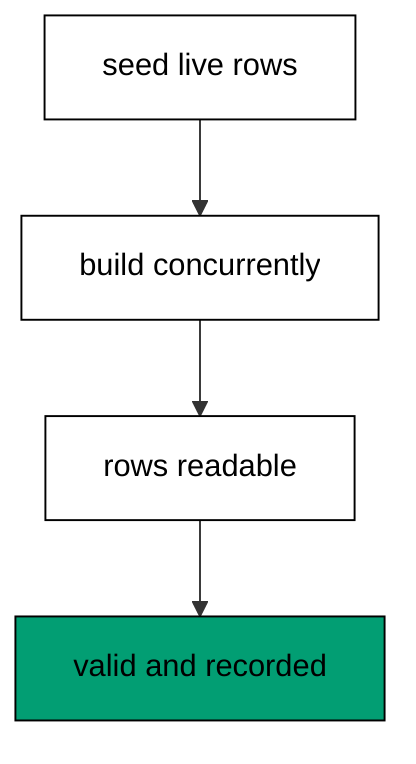

The seed rows model live traffic that never pauses, and the concurrent build indexes around them without taking the write lock. Row reads prove traffic flowed throughout, and the validity flag proves the background build finished whole. History holds both entries in order, which closes the loop from blast radius to proof. Polite, verified, and recorded: the three properties every hot-table migration needs.

**`learning/code/ex-70-locking-review-hot-table-index/main.clj`**:

```clojure
;; => Example 70: Locking Review.
;; => The cluster closes on a hot table: concurrent index, validity proof, history proof.
(require '[migratus.core :as migratus]) ;; => migrate, rollback, up, and down move history
(require '[next.jdbc :as jdbc]) ;; => verification reads prove each migration landed
(require '[next.jdbc.result-set :as rs]) ;; => unqualified rows print without table prefixes
(require '[clojure.java.io :as io]) ;; => migration files are staged, then removed
;; => The database address comes from the harness, with local-run defaults.
(defn db-spec [] ;; => one builder owns every address default
  {:dbtype "postgresql" ;; => pgjdbc speaks the PostgreSQL wire protocol
   :host (or (System/getenv "PGHOST") "localhost") ;; => harness sets the service host
   :port (Integer/parseInt (or (System/getenv "PGPORT") "5432")) ;; => service port default
   :dbname (or (System/getenv "PGDATABASE") "postgres") ;; => fresh database per unit run
   :user (or (System/getenv "PGUSER") "postgres")}) ;; => trust auth needs no password
;; => One config carries the store, the relative migration dir, and the history table.
(defn config [dir table] ;; => every example owns its dir and history table
  {:store :database ;; => the SQL store journals history in a table
   :migration-dir dir ;; => relative to the unit folder, staged at runtime
   :migration-table-name table ;; => per-example history isolates every rerun
   :db (db-spec)}) ;; => next.jdbc connects from this spec
;; => Staging writes one up/down pair per call into the relative dir.
(defn write-migration [dir id name up down] ;; => one helper stages every migration
  (spit (str dir "/" id "-" name ".up.sql") up) ;; => forward change runs on migrate
  (when down ;; => up-only examples skip the down file on purpose
    (spit (str dir "/" id "-" name ".down.sql") down))) ;; => reverse runs on rollback
;; => Reset clears leftovers of a killed run so reruns print alike.
(defn reset-unit! [ds dir table tables views] ;; => one reset owns every leftover
  (doseq [v views] ;; => views drop before the tables they read
    (jdbc/execute! ds [(str "DROP VIEW IF EXISTS " v)])) ;; => stale views vanish first
  (let [d (io/file dir)] ;; => the relative staging dir of this unit
    (when (.exists d) ;; => a killed run may leave files behind
      (doseq [f (.listFiles d)] ;; => every staged file goes first
        (.delete ^java.io.File f)) ;; => delete each staged migration
      (.delete d)) ;; => the empty staging dir goes too
    (.mkdirs d)) ;; => a fresh dir for this run
  (doseq [t tables] ;; => every table this example owns
    (jdbc/execute! ds [(str "DROP TABLE IF EXISTS " t " CASCADE")])) ;; => killed runs vanish
  (jdbc/execute! ds [(str "DROP TABLE IF EXISTS " table)])) ;; => stale history vanishes too
;; => Reads print their own proof; ids sort so output never depends on disk order.
(defn applied-names [ds table] ;; => applied migration names in id order
  (mapv :description ;; => description stores the migration name
    (jdbc/execute! ds [(str "SELECT description FROM " table " WHERE id > 0 ORDER BY id")] ;; => id order, reserve row excluded
                     {:builder-fn rs/as-unqualified-lower-maps}))) ;; => short keys print cleanly
;; => Column lists read the catalog, so the schema proves itself.
(defn table-columns [ds table] ;; => column names in position order
  (mapv :column_name ;; => one name per row, nothing else
    (jdbc/execute! ds [(str "SELECT column_name FROM information_schema.columns WHERE table_name = '" table "' ORDER BY ordinal_position")] ;; => catalog order is stable
                     {:builder-fn rs/as-unqualified-lower-maps}))) ;; => short keys print cleanly
(def ds (jdbc/get-datasource (db-spec))) ;; => one shared datasource per unit run
(def cfg (config "mig" "m70_migrations")) ;; => store plus history table for this example
(reset-unit! ds "mig" "m70_migrations" ["m70_hot"] []) ;; => leftovers of a killed run vanish first
(write-migration "mig" "20260101007001" "make-hot" ;; => first the hot table with live rows
  (str "CREATE TABLE m70_hot (id SERIAL PRIMARY KEY, email TEXT NOT NULL);\n" ;; => email needs lookup without downtime
       "--;;\n" ;; => separator splits schema from seed
       "INSERT INTO m70_hot (email) VALUES ('a@x.io'), ('b@x.io');\n") ;; => two live rows keep it honest
  "DROP TABLE m70_hot;\n") ;; => reverse drops everything
(write-migration "mig" "20260101007002" "index-hot" ;; => then the concurrent build
  (str "-- :disable-transaction\n" ;; => concurrent builds refuse transactions
       "CREATE INDEX CONCURRENTLY m70_hot_email_idx ON m70_hot (email);\n") ;; => build scans without the write lock
  (str "-- :disable-transaction\n" ;; => down runs outside a transaction too
       "DROP INDEX CONCURRENTLY IF EXISTS m70_hot_email_idx;\n")) ;; => reverse drops the index
(println "migrate:" (pr-str (migratus/migrate cfg))) ;; => nil means every pending migration applied
(println "completed:" (pr-str (applied-names ds "m70_migrations"))) ;; => id order straight from history
(println "rows:" (pr-str (mapv :email ;; => live rows readable throughout
  (jdbc/execute! ds ["SELECT email AS email FROM m70_hot ORDER BY id"] ;; => no lock ever blocked them (part 1)
                   {:builder-fn rs/as-unqualified-lower-maps})))) ;; => no lock ever blocked them (part 2)
(println "valid:" (pr-str (mapv :indisvalid ;; => true proves a whole build
  (jdbc/execute! ds ["SELECT indisvalid AS indisvalid FROM pg_index WHERE indexrelid = 'm70_hot_email_idx'::regclass"] ;; => polite and complete (part 1)
                   {:builder-fn rs/as-unqualified-lower-maps})))) ;; => polite and complete (part 2)
;; => Cleanup drops every object this example made, leaving no residue.
(defn cleanup-unit! [ds dir table tables views] ;; => one cleanup owns every created object
  (doseq [v views] ;; => views drop before the tables they read
    (jdbc/execute! ds [(str "DROP VIEW IF EXISTS " v)])) ;; => view residue vanishes
  (doseq [t tables] ;; => every table this example owns
    (jdbc/execute! ds [(str "DROP TABLE IF EXISTS " t " CASCADE")])) ;; => tables vanish with dependents
  (jdbc/execute! ds [(str "DROP TABLE IF EXISTS " table)]) ;; => history table vanishes too
  (let [d (io/file dir)] ;; => the staging dir from this run
    (when (.exists d) ;; => files were staged above
      (doseq [f (.listFiles d)] ;; => every staged file goes first
        (.delete ^java.io.File f)) ;; => delete each staged migration
      (.delete d)))) ;; => the empty staging dir goes too
(cleanup-unit! ds "mig" "m70_migrations" ["m70_hot"] []) ;; => drop every object this example created
```

**Output** (`learning/code/ex-70-locking-review-hot-table-index/expected/main.stdout.txt`):

```text
migrate: nil
completed: ["make-hot" "index-hot"]
rows: ["a@x.io" "b@x.io"]
valid: [true]
```

**Key takeaway**: Index hot tables concurrently, verify validity, record history: polite, proven, and tracked.

**Why it matters**: Hot tables pay the salaries, so their migrations must be boring in the specific sense of changing nothing but the plan. The concurrent build plus validity check plus history read is the complete ritual: gentle execution, proof of completion, and a record. Teams that run this ritual on every hot table stop scheduling downtime for indexes, because politeness became procedure.

### Example 71: History Query Shows Position

Diagnosis starts with position, so this example reads both lists mid-history. The program brings up two of three and prints applied, pending, and the counts. (Concepts: co-03, co-09.)

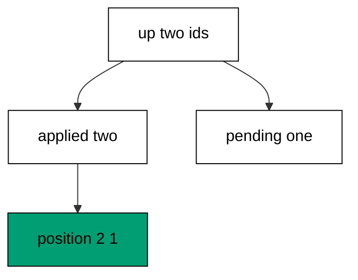

Targeted `up` with two ids lands exactly the named pair, which puts the history in the classic half-deployed state on purpose. The completed and pending readers split the three staged files into two and one, and the count pair summarizes the same split as numbers. Every later diagnosis in this cluster opens with these three readings, because position determines the next action. Read first, then act: the order never reverses.

**`learning/code/ex-71-history-query-shows-position/main.clj`**:

```clojure
;; => Example 71: History Query Shows Position.
;; => Position is a query: applied names, pending names, and counts tell the whole story.
(require '[migratus.core :as migratus]) ;; => migrate, rollback, up, and down move history
(require '[next.jdbc :as jdbc]) ;; => verification reads prove each migration landed
(require '[next.jdbc.result-set :as rs]) ;; => unqualified rows print without table prefixes
(require '[clojure.java.io :as io]) ;; => migration files are staged, then removed
;; => The database address comes from the harness, with local-run defaults.
(defn db-spec [] ;; => one builder owns every address default
  {:dbtype "postgresql" ;; => pgjdbc speaks the PostgreSQL wire protocol
   :host (or (System/getenv "PGHOST") "localhost") ;; => harness sets the service host
   :port (Integer/parseInt (or (System/getenv "PGPORT") "5432")) ;; => service port default
   :dbname (or (System/getenv "PGDATABASE") "postgres") ;; => fresh database per unit run
   :user (or (System/getenv "PGUSER") "postgres")}) ;; => trust auth needs no password
;; => One config carries the store, the relative migration dir, and the history table.
(defn config [dir table] ;; => every example owns its dir and history table
  {:store :database ;; => the SQL store journals history in a table
   :migration-dir dir ;; => relative to the unit folder, staged at runtime
   :migration-table-name table ;; => per-example history isolates every rerun
   :db (db-spec)}) ;; => next.jdbc connects from this spec
;; => Staging writes one up/down pair per call into the relative dir.
(defn write-migration [dir id name up down] ;; => one helper stages every migration
  (spit (str dir "/" id "-" name ".up.sql") up) ;; => forward change runs on migrate
  (when down ;; => up-only examples skip the down file on purpose
    (spit (str dir "/" id "-" name ".down.sql") down))) ;; => reverse runs on rollback
;; => Reset clears leftovers of a killed run so reruns print alike.
(defn reset-unit! [ds dir table tables views] ;; => one reset owns every leftover
  (doseq [v views] ;; => views drop before the tables they read
    (jdbc/execute! ds [(str "DROP VIEW IF EXISTS " v)])) ;; => stale views vanish first
  (let [d (io/file dir)] ;; => the relative staging dir of this unit
    (when (.exists d) ;; => a killed run may leave files behind
      (doseq [f (.listFiles d)] ;; => every staged file goes first
        (.delete ^java.io.File f)) ;; => delete each staged migration
      (.delete d)) ;; => the empty staging dir goes too
    (.mkdirs d)) ;; => a fresh dir for this run
  (doseq [t tables] ;; => every table this example owns
    (jdbc/execute! ds [(str "DROP TABLE IF EXISTS " t " CASCADE")])) ;; => killed runs vanish
  (jdbc/execute! ds [(str "DROP TABLE IF EXISTS " table)])) ;; => stale history vanishes too
;; => Reads print their own proof; ids sort so output never depends on disk order.
(defn applied-names [ds table] ;; => applied migration names in id order
  (mapv :description ;; => description stores the migration name
    (jdbc/execute! ds [(str "SELECT description FROM " table " WHERE id > 0 ORDER BY id")] ;; => id order, reserve row excluded
                     {:builder-fn rs/as-unqualified-lower-maps}))) ;; => short keys print cleanly
;; => Column lists read the catalog, so the schema proves itself.
(defn table-columns [ds table] ;; => column names in position order
  (mapv :column_name ;; => one name per row, nothing else
    (jdbc/execute! ds [(str "SELECT column_name FROM information_schema.columns WHERE table_name = '" table "' ORDER BY ordinal_position")] ;; => catalog order is stable
                     {:builder-fn rs/as-unqualified-lower-maps}))) ;; => short keys print cleanly
(def ds (jdbc/get-datasource (db-spec))) ;; => one shared datasource per unit run
(def cfg (config "mig" "m71_migrations")) ;; => store plus history table for this example
(reset-unit! ds "mig" "m71_migrations" ["m71_a" "m71_b" "m71_c"] []) ;; => leftovers of a killed run vanish first
(write-migration "mig" "20260101007101" "make-a" ;; => three migrations stage the position
  "CREATE TABLE m71_a (id SERIAL PRIMARY KEY);\n" ;; => table a is first
  "DROP TABLE m71_a;\n") ;; => reverse drops a
(write-migration "mig" "20260101007102" "make-b" ;; => middle migration waits its turn
  "CREATE TABLE m71_b (id SERIAL PRIMARY KEY);\n" ;; => table b is second
  "DROP TABLE m71_b;\n") ;; => reverse drops b
(write-migration "mig" "20260101007103" "make-c" ;; => last migration closes the set
  "CREATE TABLE m71_c (id SERIAL PRIMARY KEY);\n" ;; => table c is third
  "DROP TABLE m71_c;\n") ;; => reverse drops c
(println "bring-up:" (pr-str (migratus/up cfg 20260101007101 20260101007102))) ;; => first two apply by explicit ids
(println "completed:" (pr-str (sort (migratus/completed-list cfg)))) ;; => applied names the landed pair
(println "pending:" (pr-str (sort (migratus/pending-list cfg)))) ;; => pending names what remains
(println "position:" (pr-str [(count (migratus/completed-list cfg)) (count (migratus/pending-list cfg))])) ;; => two applied, one pending
;; => Cleanup drops every object this example made, leaving no residue.
(defn cleanup-unit! [ds dir table tables views] ;; => one cleanup owns every created object
  (doseq [v views] ;; => views drop before the tables they read
    (jdbc/execute! ds [(str "DROP VIEW IF EXISTS " v)])) ;; => view residue vanishes
  (doseq [t tables] ;; => every table this example owns
    (jdbc/execute! ds [(str "DROP TABLE IF EXISTS " t " CASCADE")])) ;; => tables vanish with dependents
  (jdbc/execute! ds [(str "DROP TABLE IF EXISTS " table)]) ;; => history table vanishes too
  (let [d (io/file dir)] ;; => the staging dir from this run
    (when (.exists d) ;; => files were staged above
      (doseq [f (.listFiles d)] ;; => every staged file goes first
        (.delete ^java.io.File f)) ;; => delete each staged migration
      (.delete d)))) ;; => the empty staging dir goes too
(cleanup-unit! ds "mig" "m71_migrations" ["m71_a" "m71_b" "m71_c"] []) ;; => drop every object this example created
```

**Output** (`learning/code/ex-71-history-query-shows-position/expected/main.stdout.txt`):

```text
bring-up: nil
completed: ("make-a" "make-b")
pending: ("make-c")
position: [2 1]
```

**Key takeaway**: Position is two lists and two numbers: applied, pending, and their counts.

**Why it matters**: Incident responders inherit half-deployed histories they did not create, and guessing the position wastes the calm minutes. Three readings name exactly what ran and what remains, so the recovery starts from facts. Teams that read position first fix forward instead of flailing, because the database tells them where they stand.

### Example 72: Partial Statements Roll Back Together

Transactional failures need no backout script, so this example fails a two-statement file inside its transaction. The program catches the failure and proves the table and history are empty. (Concepts: co-08, co-16.)

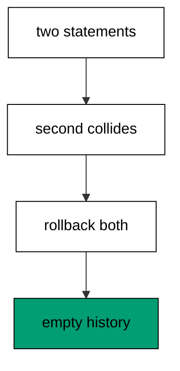

The per-migration transaction rolls both statements back when the second collides, so the first statement's table vanishes with the failure. The transcript reports the aborted batch rather than the root collision, because the driver surfaces the poisoned transaction; the server log carries the original complaint. Nothing records and nothing remains, which is the same outcome as the non-transactional backout with none of its machinery. Transactions make the common failure self-cleaning.

**`learning/code/ex-72-partial-statements-roll-back-together/main.clj`**:

```clojure
;; => Example 72: Partial Statements Roll Back Together.
;; => Inside a transaction the database unwinds the partial file itself: nothing to back out.
(require '[migratus.core :as migratus]) ;; => migrate, rollback, up, and down move history
(require '[next.jdbc :as jdbc]) ;; => verification reads prove each migration landed
(require '[next.jdbc.result-set :as rs]) ;; => unqualified rows print without table prefixes
(require '[clojure.java.io :as io]) ;; => migration files are staged, then removed
;; => The database address comes from the harness, with local-run defaults.
(defn db-spec [] ;; => one builder owns every address default
  {:dbtype "postgresql" ;; => pgjdbc speaks the PostgreSQL wire protocol
   :host (or (System/getenv "PGHOST") "localhost") ;; => harness sets the service host
   :port (Integer/parseInt (or (System/getenv "PGPORT") "5432")) ;; => service port default
   :dbname (or (System/getenv "PGDATABASE") "postgres") ;; => fresh database per unit run
   :user (or (System/getenv "PGUSER") "postgres")}) ;; => trust auth needs no password
;; => One config carries the store, the relative migration dir, and the history table.
(defn config [dir table] ;; => every example owns its dir and history table
  {:store :database ;; => the SQL store journals history in a table
   :migration-dir dir ;; => relative to the unit folder, staged at runtime
   :migration-table-name table ;; => per-example history isolates every rerun
   :db (db-spec)}) ;; => next.jdbc connects from this spec
;; => Staging writes one up/down pair per call into the relative dir.
(defn write-migration [dir id name up down] ;; => one helper stages every migration
  (spit (str dir "/" id "-" name ".up.sql") up) ;; => forward change runs on migrate
  (when down ;; => up-only examples skip the down file on purpose
    (spit (str dir "/" id "-" name ".down.sql") down))) ;; => reverse runs on rollback
;; => Reset clears leftovers of a killed run so reruns print alike.
(defn reset-unit! [ds dir table tables views] ;; => one reset owns every leftover
  (doseq [v views] ;; => views drop before the tables they read
    (jdbc/execute! ds [(str "DROP VIEW IF EXISTS " v)])) ;; => stale views vanish first
  (let [d (io/file dir)] ;; => the relative staging dir of this unit
    (when (.exists d) ;; => a killed run may leave files behind
      (doseq [f (.listFiles d)] ;; => every staged file goes first
        (.delete ^java.io.File f)) ;; => delete each staged migration
      (.delete d)) ;; => the empty staging dir goes too
    (.mkdirs d)) ;; => a fresh dir for this run
  (doseq [t tables] ;; => every table this example owns
    (jdbc/execute! ds [(str "DROP TABLE IF EXISTS " t " CASCADE")])) ;; => killed runs vanish
  (jdbc/execute! ds [(str "DROP TABLE IF EXISTS " table)])) ;; => stale history vanishes too
;; => Reads print their own proof; ids sort so output never depends on disk order.
(defn applied-names [ds table] ;; => applied migration names in id order
  (mapv :description ;; => description stores the migration name
    (jdbc/execute! ds [(str "SELECT description FROM " table " WHERE id > 0 ORDER BY id")] ;; => id order, reserve row excluded
                     {:builder-fn rs/as-unqualified-lower-maps}))) ;; => short keys print cleanly
;; => Column lists read the catalog, so the schema proves itself.
(defn table-columns [ds table] ;; => column names in position order
  (mapv :column_name ;; => one name per row, nothing else
    (jdbc/execute! ds [(str "SELECT column_name FROM information_schema.columns WHERE table_name = '" table "' ORDER BY ordinal_position")] ;; => catalog order is stable
                     {:builder-fn rs/as-unqualified-lower-maps}))) ;; => short keys print cleanly
(def ds (jdbc/get-datasource (db-spec))) ;; => one shared datasource per unit run
(def cfg (config "mig" "m72_migrations")) ;; => store plus history table for this example
(reset-unit! ds "mig" "m72_migrations" ["m72_half"] []) ;; => leftovers of a killed run vanish first
(write-migration "mig" "20260101007201" "half-built" ;; => one file whose second statement fails
  (str "CREATE TABLE m72_half (id SERIAL PRIMARY KEY);\n" ;; => first statement would succeed
       "--;;\n" ;; => separator splits the good step from the bad
       "CREATE TABLE m72_half (id SERIAL PRIMARY KEY);\n") ;; => second statement collides
  "DROP TABLE IF EXISTS m72_half;\n") ;; => down would remove the partial table
(println "migrate:" (pr-str (try (migratus/migrate cfg) ;; => run fails, message printed
  (catch Exception e (str "threw: " (.getMessage e)))))) ;; => batch reports the aborted transaction
(println "completed:" (pr-str (applied-names ds "m72_migrations"))) ;; => nothing was recorded
(println "tables:" (pr-str (mapv :table_name ;; => partial table is gone
  (jdbc/execute! ds ["SELECT table_name FROM information_schema.tables WHERE table_name LIKE 'm72%' AND table_name <> 'm72_migrations' ORDER BY 1"] ;; => user tables only, history excluded
                   {:builder-fn rs/as-unqualified-lower-maps})))) ;; => rollback unwound the file
;; => Cleanup drops every object this example made, leaving no residue.
(defn cleanup-unit! [ds dir table tables views] ;; => one cleanup owns every created object
  (doseq [v views] ;; => views drop before the tables they read
    (jdbc/execute! ds [(str "DROP VIEW IF EXISTS " v)])) ;; => view residue vanishes
  (doseq [t tables] ;; => every table this example owns
    (jdbc/execute! ds [(str "DROP TABLE IF EXISTS " t " CASCADE")])) ;; => tables vanish with dependents
  (jdbc/execute! ds [(str "DROP TABLE IF EXISTS " table)]) ;; => history table vanishes too
  (let [d (io/file dir)] ;; => the staging dir from this run
    (when (.exists d) ;; => files were staged above
      (doseq [f (.listFiles d)] ;; => every staged file goes first
        (.delete ^java.io.File f)) ;; => delete each staged migration
      (.delete d)))) ;; => the empty staging dir goes too
(cleanup-unit! ds "mig" "m72_migrations" ["m72_half"] []) ;; => drop every object this example created
```

**Output** (`learning/code/ex-72-partial-statements-roll-back-together/expected/main.stdout.txt`):

```text
migrate: "threw: ERROR: current transaction is aborted, commands ignored until end of transaction block"
completed: []
tables: []
```

**Key takeaway**: Inside a transaction the database rolls the partial file back itself: empty table, empty history.

**Why it matters**: The common failure deserves the quietest recovery, and transactional rollback is exactly that: no down file runs, no residue lingers, no operator intervenes. Understanding that the transcript shows the batch error while the log shows the cause keeps responders from chasing the wrong message. Teams that trust transactional rollback retry instead of repairing, because there is nothing to repair.

### Example 73: Backing Out Runs the Down File

Non-transactional failures need a real undo, so this example fails a file that opted out. The program catches the collision and proves the down file dropped the partial table. (Concepts: co-08.)

Each statement commits the moment it runs without a transaction, so the first table is really there when the second collides. With no transaction to roll back, Migratus runs the down file as the backout: the partial table drops and the history records nothing. The transcript names the collision directly here, because no batch poisoning hides the root error. Backing out is the honest fallback exactly where transactions cannot reach.

**`learning/code/ex-73-backing-out-runs-the-down-file/main.clj`**:

```clojure
;; => Example 73: Backing Out Runs the Down File.
;; => Without a transaction there is no rollback, so the down file unwinds the partial work.
(require '[migratus.core :as migratus]) ;; => migrate, rollback, up, and down move history
(require '[next.jdbc :as jdbc]) ;; => verification reads prove each migration landed
(require '[next.jdbc.result-set :as rs]) ;; => unqualified rows print without table prefixes
(require '[clojure.java.io :as io]) ;; => migration files are staged, then removed
;; => The database address comes from the harness, with local-run defaults.
(defn db-spec [] ;; => one builder owns every address default
  {:dbtype "postgresql" ;; => pgjdbc speaks the PostgreSQL wire protocol
   :host (or (System/getenv "PGHOST") "localhost") ;; => harness sets the service host
   :port (Integer/parseInt (or (System/getenv "PGPORT") "5432")) ;; => service port default
   :dbname (or (System/getenv "PGDATABASE") "postgres") ;; => fresh database per unit run
   :user (or (System/getenv "PGUSER") "postgres")}) ;; => trust auth needs no password
;; => One config carries the store, the relative migration dir, and the history table.
(defn config [dir table] ;; => every example owns its dir and history table
  {:store :database ;; => the SQL store journals history in a table
   :migration-dir dir ;; => relative to the unit folder, staged at runtime
   :migration-table-name table ;; => per-example history isolates every rerun
   :db (db-spec)}) ;; => next.jdbc connects from this spec
;; => Staging writes one up/down pair per call into the relative dir.
(defn write-migration [dir id name up down] ;; => one helper stages every migration
  (spit (str dir "/" id "-" name ".up.sql") up) ;; => forward change runs on migrate
  (when down ;; => up-only examples skip the down file on purpose
    (spit (str dir "/" id "-" name ".down.sql") down))) ;; => reverse runs on rollback
;; => Reset clears leftovers of a killed run so reruns print alike.
(defn reset-unit! [ds dir table tables views] ;; => one reset owns every leftover
  (doseq [v views] ;; => views drop before the tables they read
    (jdbc/execute! ds [(str "DROP VIEW IF EXISTS " v)])) ;; => stale views vanish first
  (let [d (io/file dir)] ;; => the relative staging dir of this unit
    (when (.exists d) ;; => a killed run may leave files behind
      (doseq [f (.listFiles d)] ;; => every staged file goes first
        (.delete ^java.io.File f)) ;; => delete each staged migration
      (.delete d)) ;; => the empty staging dir goes too
    (.mkdirs d)) ;; => a fresh dir for this run
  (doseq [t tables] ;; => every table this example owns
    (jdbc/execute! ds [(str "DROP TABLE IF EXISTS " t " CASCADE")])) ;; => killed runs vanish
  (jdbc/execute! ds [(str "DROP TABLE IF EXISTS " table)])) ;; => stale history vanishes too
;; => Reads print their own proof; ids sort so output never depends on disk order.
(defn applied-names [ds table] ;; => applied migration names in id order
  (mapv :description ;; => description stores the migration name
    (jdbc/execute! ds [(str "SELECT description FROM " table " WHERE id > 0 ORDER BY id")] ;; => id order, reserve row excluded
                     {:builder-fn rs/as-unqualified-lower-maps}))) ;; => short keys print cleanly
;; => Column lists read the catalog, so the schema proves itself.
(defn table-columns [ds table] ;; => column names in position order
  (mapv :column_name ;; => one name per row, nothing else
    (jdbc/execute! ds [(str "SELECT column_name FROM information_schema.columns WHERE table_name = '" table "' ORDER BY ordinal_position")] ;; => catalog order is stable
                     {:builder-fn rs/as-unqualified-lower-maps}))) ;; => short keys print cleanly
(def ds (jdbc/get-datasource (db-spec))) ;; => one shared datasource per unit run
(def cfg (config "mig" "m73_migrations")) ;; => store plus history table for this example
(reset-unit! ds "mig" "m73_migrations" ["m73_half"] []) ;; => leftovers of a killed run vanish first
(write-migration "mig" "20260101007301" "half-built" ;; => one file whose second statement fails
  (str "-- :disable-transaction\n" ;; => opts out of the per-migration transaction
       "CREATE TABLE m73_half (id SERIAL PRIMARY KEY);\n" ;; => first statement commits at once
       "--;;\n" ;; => separator splits the good step from the bad
       "CREATE TABLE m73_half (id SERIAL PRIMARY KEY);\n") ;; => second statement collides
  (str "-- :disable-transaction\n" ;; => down runs outside a transaction too
       "DROP TABLE IF EXISTS m73_half;\n")) ;; => down removes the partial table
(println "migrate:" (pr-str (try (migratus/migrate cfg) ;; => run fails, message printed
  (catch Exception e (str "threw: " (.getMessage e)))))) ;; => driver names the collision
(println "completed:" (pr-str (applied-names ds "m73_migrations"))) ;; => nothing was recorded
(println "tables:" (pr-str (mapv :table_name ;; => partial table is gone
  (jdbc/execute! ds ["SELECT table_name FROM information_schema.tables WHERE table_name LIKE 'm73%' AND table_name <> 'm73_migrations' ORDER BY 1"] ;; => user tables only, history excluded
                   {:builder-fn rs/as-unqualified-lower-maps})))) ;; => down file did the unwinding
;; => Cleanup drops every object this example made, leaving no residue.
(defn cleanup-unit! [ds dir table tables views] ;; => one cleanup owns every created object
  (doseq [v views] ;; => views drop before the tables they read
    (jdbc/execute! ds [(str "DROP VIEW IF EXISTS " v)])) ;; => view residue vanishes
  (doseq [t tables] ;; => every table this example owns
    (jdbc/execute! ds [(str "DROP TABLE IF EXISTS " t " CASCADE")])) ;; => tables vanish with dependents
  (jdbc/execute! ds [(str "DROP TABLE IF EXISTS " table)]) ;; => history table vanishes too
  (let [d (io/file dir)] ;; => the staging dir from this run
    (when (.exists d) ;; => files were staged above
      (doseq [f (.listFiles d)] ;; => every staged file goes first
        (.delete ^java.io.File f)) ;; => delete each staged migration
      (.delete d)))) ;; => the empty staging dir goes too
(cleanup-unit! ds "mig" "m73_migrations" ["m73_half"] []) ;; => drop every object this example created
```

**Output** (`learning/code/ex-73-backing-out-runs-the-down-file/expected/main.stdout.txt`):

```text
migrate: "threw: ERROR: relation \"m73_half\" already exists"
completed: []
tables: []
```

**Key takeaway**: Outside a transaction the down file unwinds the failure: partial work drops, history stays empty.

**Why it matters**: Concurrent builds and other un-transactionable statements fail without a safety net, so their down files must serve as the net. Writing the down file to truly undo the up file is what makes opting out safe, because the failure path is tested alongside the success path. Teams that back out explicitly sleep through concurrent failures, knowing the undo already ran once in testing.

### Example 74: Journal Survives a Failed First Run

Fresh databases fail too, so this example runs a broken first migration on an empty journal. The program catches the failure and proves the journal exists but records nothing. (Concepts: co-08, co-10.)

Connecting ensures the journal table before comparing anything, so even the failed first run leaves the home behind with zero rows. The missing parent fails the only statement, the transaction rolls it back, and the history stays honestly empty. An empty journal after a failure is the correct state: the database is ready, current, and owed exactly the fixed file. Retrying after the fix converges without cleanup, because the failure left no trace to reconcile.

**`learning/code/ex-74-journal-survives-a-failed-first-run/main.clj`**:

```clojure
;; => Example 74: Journal Survives a Failed First Run.
;; => The home appears before history: a failed first migration still leaves the journal behind.
(require '[migratus.core :as migratus]) ;; => migrate, rollback, up, and down move history
(require '[next.jdbc :as jdbc]) ;; => verification reads prove each migration landed
(require '[next.jdbc.result-set :as rs]) ;; => unqualified rows print without table prefixes
(require '[clojure.java.io :as io]) ;; => migration files are staged, then removed
;; => The database address comes from the harness, with local-run defaults.
(defn db-spec [] ;; => one builder owns every address default
  {:dbtype "postgresql" ;; => pgjdbc speaks the PostgreSQL wire protocol
   :host (or (System/getenv "PGHOST") "localhost") ;; => harness sets the service host
   :port (Integer/parseInt (or (System/getenv "PGPORT") "5432")) ;; => service port default
   :dbname (or (System/getenv "PGDATABASE") "postgres") ;; => fresh database per unit run
   :user (or (System/getenv "PGUSER") "postgres")}) ;; => trust auth needs no password
;; => One config carries the store, the relative migration dir, and the history table.
(defn config [dir table] ;; => every example owns its dir and history table
  {:store :database ;; => the SQL store journals history in a table
   :migration-dir dir ;; => relative to the unit folder, staged at runtime
   :migration-table-name table ;; => per-example history isolates every rerun
   :db (db-spec)}) ;; => next.jdbc connects from this spec
;; => Staging writes one up/down pair per call into the relative dir.
(defn write-migration [dir id name up down] ;; => one helper stages every migration
  (spit (str dir "/" id "-" name ".up.sql") up) ;; => forward change runs on migrate
  (when down ;; => up-only examples skip the down file on purpose
    (spit (str dir "/" id "-" name ".down.sql") down))) ;; => reverse runs on rollback
;; => Reset clears leftovers of a killed run so reruns print alike.
(defn reset-unit! [ds dir table tables views] ;; => one reset owns every leftover
  (doseq [v views] ;; => views drop before the tables they read
    (jdbc/execute! ds [(str "DROP VIEW IF EXISTS " v)])) ;; => stale views vanish first
  (let [d (io/file dir)] ;; => the relative staging dir of this unit
    (when (.exists d) ;; => a killed run may leave files behind
      (doseq [f (.listFiles d)] ;; => every staged file goes first
        (.delete ^java.io.File f)) ;; => delete each staged migration
      (.delete d)) ;; => the empty staging dir goes too
    (.mkdirs d)) ;; => a fresh dir for this run
  (doseq [t tables] ;; => every table this example owns
    (jdbc/execute! ds [(str "DROP TABLE IF EXISTS " t " CASCADE")])) ;; => killed runs vanish
  (jdbc/execute! ds [(str "DROP TABLE IF EXISTS " table)])) ;; => stale history vanishes too
;; => Reads print their own proof; ids sort so output never depends on disk order.
(defn applied-names [ds table] ;; => applied migration names in id order
  (mapv :description ;; => description stores the migration name
    (jdbc/execute! ds [(str "SELECT description FROM " table " WHERE id > 0 ORDER BY id")] ;; => id order, reserve row excluded
                     {:builder-fn rs/as-unqualified-lower-maps}))) ;; => short keys print cleanly
;; => Column lists read the catalog, so the schema proves itself.
(defn table-columns [ds table] ;; => column names in position order
  (mapv :column_name ;; => one name per row, nothing else
    (jdbc/execute! ds [(str "SELECT column_name FROM information_schema.columns WHERE table_name = '" table "' ORDER BY ordinal_position")] ;; => catalog order is stable
                     {:builder-fn rs/as-unqualified-lower-maps}))) ;; => short keys print cleanly
(def ds (jdbc/get-datasource (db-spec))) ;; => one shared datasource per unit run
(def cfg (config "mig" "m74_migrations")) ;; => store plus history table for this example
(reset-unit! ds "mig" "m74_migrations" [] []) ;; => leftovers of a killed run vanish first
(write-migration "mig" "20260101007401" "bad-first" ;; => first migration references nothing real
  "CREATE TABLE m74_new (id INTEGER NOT NULL REFERENCES m74_missing (id));\n" ;; => missing parent fails the statement
  "DROP TABLE IF EXISTS m74_new;\n") ;; => down would drop the child
(println "migrate:" (pr-str (try (migratus/migrate cfg) ;; => run fails, message printed
  (catch Exception e (str "threw: " (.getMessage e)))))) ;; => driver names the missing parent
(println "completed:" (pr-str (applied-names ds "m74_migrations"))) ;; => no migration recorded
(println "journal:" (pr-str (mapv :table_name ;; => journal table exists with no rows
  (jdbc/execute! ds ["SELECT table_name FROM information_schema.tables WHERE table_name = 'm74_migrations'"] ;; => connect created the home first
                   {:builder-fn rs/as-unqualified-lower-maps})))) ;; => home without history is ready
;; => Cleanup drops every object this example made, leaving no residue.
(defn cleanup-unit! [ds dir table tables views] ;; => one cleanup owns every created object
  (doseq [v views] ;; => views drop before the tables they read
    (jdbc/execute! ds [(str "DROP VIEW IF EXISTS " v)])) ;; => view residue vanishes
  (doseq [t tables] ;; => every table this example owns
    (jdbc/execute! ds [(str "DROP TABLE IF EXISTS " t " CASCADE")])) ;; => tables vanish with dependents
  (jdbc/execute! ds [(str "DROP TABLE IF EXISTS " table)]) ;; => history table vanishes too
  (let [d (io/file dir)] ;; => the staging dir from this run
    (when (.exists d) ;; => files were staged above
      (doseq [f (.listFiles d)] ;; => every staged file goes first
        (.delete ^java.io.File f)) ;; => delete each staged migration
      (.delete d)))) ;; => the empty staging dir goes too
(cleanup-unit! ds "mig" "m74_migrations" ["m74_new"] []) ;; => drop every object this example created
```

**Output** (`learning/code/ex-74-journal-survives-a-failed-first-run/expected/main.stdout.txt`):

```text
migrate: "threw: ERROR: current transaction is aborted, commands ignored until end of transaction block"
completed: []
journal: ["m74_migrations"]
```

**Key takeaway**: A failed first run leaves the journal home with zero rows: ready, current, owed one fix.

**Why it matters**: First deploys onto fresh databases fail in the open, and the recovery must not need archaeology. A journal that exists but records nothing tells the next run everything: the tooling works, nothing applied, retry the fixed file. Teams that trust the empty home rerun first deploys without ceremony, because failure left the starting line intact.

### Example 75: Missing Down File Fails Loudly

Up-only migrations are a choice with consequences, so this example rolls one back. The program migrates fine, catches the loud refusal, and proves the migration stays applied. (Concepts: co-02, co-08.)

A lone up file is a complete migration for discovery and apply, so the run succeeds and the history records it like any other. Rollback has no down commands to run and refuses rather than inventing an undo, because dropping the table unasked would destroy data the author chose to keep. The failure names the direction and the id, which tells the operator exactly what is missing. Up-only means forward-only, and the loud refusal keeps that contract honest.

**`learning/code/ex-75-missing-down-file-fails-loudly/main.clj`**:

```clojure
;; => Example 75: Missing Down File Fails Loudly.
;; => Up-only migrations apply but never roll back: the missing down errors instead of guessing.
(require '[migratus.core :as migratus]) ;; => migrate, rollback, up, and down move history
(require '[next.jdbc :as jdbc]) ;; => verification reads prove each migration landed
(require '[next.jdbc.result-set :as rs]) ;; => unqualified rows print without table prefixes
(require '[clojure.java.io :as io]) ;; => migration files are staged, then removed
;; => The database address comes from the harness, with local-run defaults.
(defn db-spec [] ;; => one builder owns every address default
  {:dbtype "postgresql" ;; => pgjdbc speaks the PostgreSQL wire protocol
   :host (or (System/getenv "PGHOST") "localhost") ;; => harness sets the service host
   :port (Integer/parseInt (or (System/getenv "PGPORT") "5432")) ;; => service port default
   :dbname (or (System/getenv "PGDATABASE") "postgres") ;; => fresh database per unit run
   :user (or (System/getenv "PGUSER") "postgres")}) ;; => trust auth needs no password
;; => One config carries the store, the relative migration dir, and the history table.
(defn config [dir table] ;; => every example owns its dir and history table
  {:store :database ;; => the SQL store journals history in a table
   :migration-dir dir ;; => relative to the unit folder, staged at runtime
   :migration-table-name table ;; => per-example history isolates every rerun
   :db (db-spec)}) ;; => next.jdbc connects from this spec
;; => Staging writes one up/down pair per call into the relative dir.
(defn write-migration [dir id name up down] ;; => one helper stages every migration
  (spit (str dir "/" id "-" name ".up.sql") up) ;; => forward change runs on migrate
  (when down ;; => up-only examples skip the down file on purpose
    (spit (str dir "/" id "-" name ".down.sql") down))) ;; => reverse runs on rollback
;; => Reset clears leftovers of a killed run so reruns print alike.
(defn reset-unit! [ds dir table tables views] ;; => one reset owns every leftover
  (doseq [v views] ;; => views drop before the tables they read
    (jdbc/execute! ds [(str "DROP VIEW IF EXISTS " v)])) ;; => stale views vanish first
  (let [d (io/file dir)] ;; => the relative staging dir of this unit
    (when (.exists d) ;; => a killed run may leave files behind
      (doseq [f (.listFiles d)] ;; => every staged file goes first
        (.delete ^java.io.File f)) ;; => delete each staged migration
      (.delete d)) ;; => the empty staging dir goes too
    (.mkdirs d)) ;; => a fresh dir for this run
  (doseq [t tables] ;; => every table this example owns
    (jdbc/execute! ds [(str "DROP TABLE IF EXISTS " t " CASCADE")])) ;; => killed runs vanish
  (jdbc/execute! ds [(str "DROP TABLE IF EXISTS " table)])) ;; => stale history vanishes too
;; => Reads print their own proof; ids sort so output never depends on disk order.
(defn applied-names [ds table] ;; => applied migration names in id order
  (mapv :description ;; => description stores the migration name
    (jdbc/execute! ds [(str "SELECT description FROM " table " WHERE id > 0 ORDER BY id")] ;; => id order, reserve row excluded
                     {:builder-fn rs/as-unqualified-lower-maps}))) ;; => short keys print cleanly
;; => Column lists read the catalog, so the schema proves itself.
(defn table-columns [ds table] ;; => column names in position order
  (mapv :column_name ;; => one name per row, nothing else
    (jdbc/execute! ds [(str "SELECT column_name FROM information_schema.columns WHERE table_name = '" table "' ORDER BY ordinal_position")] ;; => catalog order is stable
                     {:builder-fn rs/as-unqualified-lower-maps}))) ;; => short keys print cleanly
(def ds (jdbc/get-datasource (db-spec))) ;; => one shared datasource per unit run
(def cfg (config "mig" "m75_migrations")) ;; => store plus history table for this example
(reset-unit! ds "mig" "m75_migrations" ["m75_solo"] []) ;; => leftovers of a killed run vanish first
(write-migration "mig" "20260101007501" "solo-up" ;; => up-only file stages alone
  "CREATE TABLE m75_solo (id SERIAL PRIMARY KEY);\n" ;; => solo table lands normally
  nil) ;; => no down file on purpose
(println "migrate:" (pr-str (migratus/migrate cfg))) ;; => nil means every pending migration applied
(println "completed:" (pr-str (applied-names ds "m75_migrations"))) ;; => id order straight from history
(println "rollback:" (pr-str (try (migratus/rollback cfg) ;; => undo fails, message printed
  (catch Exception e (str "threw: " (.getMessage e)))))) ;; => missing down errors loudly
(println "completed:" (pr-str (applied-names ds "m75_migrations"))) ;; => solo migration still applied
;; => Cleanup drops every object this example made, leaving no residue.
(defn cleanup-unit! [ds dir table tables views] ;; => one cleanup owns every created object
  (doseq [v views] ;; => views drop before the tables they read
    (jdbc/execute! ds [(str "DROP VIEW IF EXISTS " v)])) ;; => view residue vanishes
  (doseq [t tables] ;; => every table this example owns
    (jdbc/execute! ds [(str "DROP TABLE IF EXISTS " t " CASCADE")])) ;; => tables vanish with dependents
  (jdbc/execute! ds [(str "DROP TABLE IF EXISTS " table)]) ;; => history table vanishes too
  (let [d (io/file dir)] ;; => the staging dir from this run
    (when (.exists d) ;; => files were staged above
      (doseq [f (.listFiles d)] ;; => every staged file goes first
        (.delete ^java.io.File f)) ;; => delete each staged migration
      (.delete d)))) ;; => the empty staging dir goes too
(cleanup-unit! ds "mig" "m75_migrations" ["m75_solo"] []) ;; => drop every object this example created
```

**Output** (`learning/code/ex-75-missing-down-file-fails-loudly/expected/main.stdout.txt`):

```text
migrate: nil
completed: ["solo-up"]
rollback: "threw: SQL :down commands not found for 20260101007501"
completed: ["solo-up"]
```

**Key takeaway**: Up-only migrations apply normally and refuse rollback loudly: forward-only is a contract, not an accident.

**Why it matters**: One-way changes like destructive cleanups should never roll back, and the missing down file enforces that intent. A silent skip would hide the gap between history and database, while a loud error forces the operator to choose deliberately. Teams that go forward-only on purpose keep the refusal as documentation, because the error message states the policy.

### Example 76: Regular Rows Carry No Checksum

Silence needs a mechanism, so this example reads the checksum column of a regular row. The program migrates and proves the tracking flag is false. (Concepts: co-11.)

The history table carries a checksum column, but regular migrations never write it: only repeatable files store hashes there. Querying the flag beside the migration name shows false, which is the physical reason edited regular files rerun silently. The runner cannot compare what it never stored, so identity stays the only criterion. This row is the proof behind the earlier behavior: no hash, no detection, no warning.

**`learning/code/ex-76-regular-rows-carry-no-checksum/main.clj`**:

```clojure
;; => Example 76: Regular Rows Carry No Checksum.
;; => The checksum column stays empty for regular rows: the mechanism behind the silence.
(require '[migratus.core :as migratus]) ;; => migrate, rollback, up, and down move history
(require '[next.jdbc :as jdbc]) ;; => verification reads prove each migration landed
(require '[next.jdbc.result-set :as rs]) ;; => unqualified rows print without table prefixes
(require '[clojure.java.io :as io]) ;; => migration files are staged, then removed
;; => The database address comes from the harness, with local-run defaults.
(defn db-spec [] ;; => one builder owns every address default
  {:dbtype "postgresql" ;; => pgjdbc speaks the PostgreSQL wire protocol
   :host (or (System/getenv "PGHOST") "localhost") ;; => harness sets the service host
   :port (Integer/parseInt (or (System/getenv "PGPORT") "5432")) ;; => service port default
   :dbname (or (System/getenv "PGDATABASE") "postgres") ;; => fresh database per unit run
   :user (or (System/getenv "PGUSER") "postgres")}) ;; => trust auth needs no password
;; => One config carries the store, the relative migration dir, and the history table.
(defn config [dir table] ;; => every example owns its dir and history table
  {:store :database ;; => the SQL store journals history in a table
   :migration-dir dir ;; => relative to the unit folder, staged at runtime
   :migration-table-name table ;; => per-example history isolates every rerun
   :db (db-spec)}) ;; => next.jdbc connects from this spec
;; => Staging writes one up/down pair per call into the relative dir.
(defn write-migration [dir id name up down] ;; => one helper stages every migration
  (spit (str dir "/" id "-" name ".up.sql") up) ;; => forward change runs on migrate
  (when down ;; => up-only examples skip the down file on purpose
    (spit (str dir "/" id "-" name ".down.sql") down))) ;; => reverse runs on rollback
;; => Reset clears leftovers of a killed run so reruns print alike.
(defn reset-unit! [ds dir table tables views] ;; => one reset owns every leftover
  (doseq [v views] ;; => views drop before the tables they read
    (jdbc/execute! ds [(str "DROP VIEW IF EXISTS " v)])) ;; => stale views vanish first
  (let [d (io/file dir)] ;; => the relative staging dir of this unit
    (when (.exists d) ;; => a killed run may leave files behind
      (doseq [f (.listFiles d)] ;; => every staged file goes first
        (.delete ^java.io.File f)) ;; => delete each staged migration
      (.delete d)) ;; => the empty staging dir goes too
    (.mkdirs d)) ;; => a fresh dir for this run
  (doseq [t tables] ;; => every table this example owns
    (jdbc/execute! ds [(str "DROP TABLE IF EXISTS " t " CASCADE")])) ;; => killed runs vanish
  (jdbc/execute! ds [(str "DROP TABLE IF EXISTS " table)])) ;; => stale history vanishes too
;; => Reads print their own proof; ids sort so output never depends on disk order.
(defn applied-names [ds table] ;; => applied migration names in id order
  (mapv :description ;; => description stores the migration name
    (jdbc/execute! ds [(str "SELECT description FROM " table " WHERE id > 0 ORDER BY id")] ;; => id order, reserve row excluded
                     {:builder-fn rs/as-unqualified-lower-maps}))) ;; => short keys print cleanly
;; => Column lists read the catalog, so the schema proves itself.
(defn table-columns [ds table] ;; => column names in position order
  (mapv :column_name ;; => one name per row, nothing else
    (jdbc/execute! ds [(str "SELECT column_name FROM information_schema.columns WHERE table_name = '" table "' ORDER BY ordinal_position")] ;; => catalog order is stable
                     {:builder-fn rs/as-unqualified-lower-maps}))) ;; => short keys print cleanly
(def ds (jdbc/get-datasource (db-spec))) ;; => one shared datasource per unit run
(def cfg (config "mig" "m76_migrations")) ;; => store plus history table for this example
(reset-unit! ds "mig" "m76_migrations" ["m76_plain"] []) ;; => leftovers of a killed run vanish first
(write-migration "mig" "20260101007601" "plain-change" ;; => one ordinary migration
  "CREATE TABLE m76_plain (id SERIAL PRIMARY KEY);\n" ;; => plain table is tiny
  "DROP TABLE m76_plain;\n") ;; => reverse drops it
(println "migrate:" (pr-str (migratus/migrate cfg))) ;; => nil means every pending migration applied
(println "completed:" (pr-str (applied-names ds "m76_migrations"))) ;; => id order straight from history
(println "checksums:" (pr-str (mapv (juxt :description :tracked) ;; => false beside the name
  (jdbc/execute! ds ["SELECT description, (checksum IS NOT NULL) AS tracked FROM m76_migrations WHERE id > 0 ORDER BY id"] ;; => no hash stored, no edit detected (part 1)
                   {:builder-fn rs/as-unqualified-lower-maps})))) ;; => no hash stored, no edit detected (part 2)
;; => Cleanup drops every object this example made, leaving no residue.
(defn cleanup-unit! [ds dir table tables views] ;; => one cleanup owns every created object
  (doseq [v views] ;; => views drop before the tables they read
    (jdbc/execute! ds [(str "DROP VIEW IF EXISTS " v)])) ;; => view residue vanishes
  (doseq [t tables] ;; => every table this example owns
    (jdbc/execute! ds [(str "DROP TABLE IF EXISTS " t " CASCADE")])) ;; => tables vanish with dependents
  (jdbc/execute! ds [(str "DROP TABLE IF EXISTS " table)]) ;; => history table vanishes too
  (let [d (io/file dir)] ;; => the staging dir from this run
    (when (.exists d) ;; => files were staged above
      (doseq [f (.listFiles d)] ;; => every staged file goes first
        (.delete ^java.io.File f)) ;; => delete each staged migration
      (.delete d)))) ;; => the empty staging dir goes too
(cleanup-unit! ds "mig" "m76_migrations" ["m76_plain"] []) ;; => drop every object this example created
```

**Output** (`learning/code/ex-76-regular-rows-carry-no-checksum/expected/main.stdout.txt`):

```text
migrate: nil
completed: ["plain-change"]
checksums: [["plain-change" false]]
```

**Key takeaway**: Regular rows store no checksum: without a hash the runner cannot detect edits.

**Why it matters**: Mechanisms beat warnings, because a documented silence still surprises while an explained one teaches. Showing the empty checksum column turns the edit-skip from a gotcha into a design fact: the tool tracks identity, and content checks are opt-in per file. Teams that see the empty column route post-apply fixes through new migrations without debate, because the mechanism leaves no room for hope.

### Example 77: Stray Files Stay Invisible

Directories collect stray files, so this example stages a note beside a real migration. The program migrates and proves the note neither applies nor pends. (Concepts: co-01, co-16.)

Discovery parses only files matching the migration pattern, warning about the rest on the error channel while the run continues. The notes file never becomes a migration, never pends, and never blocks: the transcript proves it by omission. Strictness would turn every editor backup into a deploy failure, so leniency here is load-bearing. Notes, readmes, and drafts coexist with migrations because discovery reads patterns, not directories.

**`learning/code/ex-77-stray-files-stay-invisible/main.clj`**:

```clojure
;; => Example 77: Stray Files Stay Invisible.
;; => Discovery ignores what it cannot parse: a stray readme never blocks the run.
(require '[migratus.core :as migratus]) ;; => migrate, rollback, up, and down move history
(require '[next.jdbc :as jdbc]) ;; => verification reads prove each migration landed
(require '[next.jdbc.result-set :as rs]) ;; => unqualified rows print without table prefixes
(require '[clojure.java.io :as io]) ;; => migration files are staged, then removed
;; => The database address comes from the harness, with local-run defaults.
(defn db-spec [] ;; => one builder owns every address default
  {:dbtype "postgresql" ;; => pgjdbc speaks the PostgreSQL wire protocol
   :host (or (System/getenv "PGHOST") "localhost") ;; => harness sets the service host
   :port (Integer/parseInt (or (System/getenv "PGPORT") "5432")) ;; => service port default
   :dbname (or (System/getenv "PGDATABASE") "postgres") ;; => fresh database per unit run
   :user (or (System/getenv "PGUSER") "postgres")}) ;; => trust auth needs no password
;; => One config carries the store, the relative migration dir, and the history table.
(defn config [dir table] ;; => every example owns its dir and history table
  {:store :database ;; => the SQL store journals history in a table
   :migration-dir dir ;; => relative to the unit folder, staged at runtime
   :migration-table-name table ;; => per-example history isolates every rerun
   :db (db-spec)}) ;; => next.jdbc connects from this spec
;; => Staging writes one up/down pair per call into the relative dir.
(defn write-migration [dir id name up down] ;; => one helper stages every migration
  (spit (str dir "/" id "-" name ".up.sql") up) ;; => forward change runs on migrate
  (when down ;; => up-only examples skip the down file on purpose
    (spit (str dir "/" id "-" name ".down.sql") down))) ;; => reverse runs on rollback
;; => Reset clears leftovers of a killed run so reruns print alike.
(defn reset-unit! [ds dir table tables views] ;; => one reset owns every leftover
  (doseq [v views] ;; => views drop before the tables they read
    (jdbc/execute! ds [(str "DROP VIEW IF EXISTS " v)])) ;; => stale views vanish first
  (let [d (io/file dir)] ;; => the relative staging dir of this unit
    (when (.exists d) ;; => a killed run may leave files behind
      (doseq [f (.listFiles d)] ;; => every staged file goes first
        (.delete ^java.io.File f)) ;; => delete each staged migration
      (.delete d)) ;; => the empty staging dir goes too
    (.mkdirs d)) ;; => a fresh dir for this run
  (doseq [t tables] ;; => every table this example owns
    (jdbc/execute! ds [(str "DROP TABLE IF EXISTS " t " CASCADE")])) ;; => killed runs vanish
  (jdbc/execute! ds [(str "DROP TABLE IF EXISTS " table)])) ;; => stale history vanishes too
;; => Reads print their own proof; ids sort so output never depends on disk order.
(defn applied-names [ds table] ;; => applied migration names in id order
  (mapv :description ;; => description stores the migration name
    (jdbc/execute! ds [(str "SELECT description FROM " table " WHERE id > 0 ORDER BY id")] ;; => id order, reserve row excluded
                     {:builder-fn rs/as-unqualified-lower-maps}))) ;; => short keys print cleanly
;; => Column lists read the catalog, so the schema proves itself.
(defn table-columns [ds table] ;; => column names in position order
  (mapv :column_name ;; => one name per row, nothing else
    (jdbc/execute! ds [(str "SELECT column_name FROM information_schema.columns WHERE table_name = '" table "' ORDER BY ordinal_position")] ;; => catalog order is stable
                     {:builder-fn rs/as-unqualified-lower-maps}))) ;; => short keys print cleanly
(def ds (jdbc/get-datasource (db-spec))) ;; => one shared datasource per unit run
(def cfg (config "mig" "m77_migrations")) ;; => store plus history table for this example
(reset-unit! ds "mig" "m77_migrations" ["m77_real"] []) ;; => leftovers of a killed run vanish first
(write-migration "mig" "20260101007701" "real-change" ;; => one real migration
  "CREATE TABLE m77_real (id SERIAL PRIMARY KEY);\n" ;; => real table is tiny
  "DROP TABLE m77_real;\n") ;; => reverse drops it
(spit "mig/notes.txt" "Remember to index the email column.\n") ;; => stray note lands beside the migration
(println "migrate:" (pr-str (migratus/migrate cfg))) ;; => nil means every pending migration applied
(println "completed:" (pr-str (applied-names ds "m77_migrations"))) ;; => id order straight from history
(println "pending:" (pr-str (sort (migratus/pending-list cfg)))) ;; => stray file never pends
;; => Cleanup drops every object this example made, leaving no residue.
(defn cleanup-unit! [ds dir table tables views] ;; => one cleanup owns every created object
  (doseq [v views] ;; => views drop before the tables they read
    (jdbc/execute! ds [(str "DROP VIEW IF EXISTS " v)])) ;; => view residue vanishes
  (doseq [t tables] ;; => every table this example owns
    (jdbc/execute! ds [(str "DROP TABLE IF EXISTS " t " CASCADE")])) ;; => tables vanish with dependents
  (jdbc/execute! ds [(str "DROP TABLE IF EXISTS " table)]) ;; => history table vanishes too
  (let [d (io/file dir)] ;; => the staging dir from this run
    (when (.exists d) ;; => files were staged above
      (doseq [f (.listFiles d)] ;; => every staged file goes first
        (.delete ^java.io.File f)) ;; => delete each staged migration
      (.delete d)))) ;; => the empty staging dir goes too
(cleanup-unit! ds "mig" "m77_migrations" ["m77_real"] []) ;; => drop every object this example created
```

**Output** (`learning/code/ex-77-stray-files-stay-invisible/expected/main.stdout.txt`):

```text
migrate: nil
completed: ["real-change"]
pending: ()
```

**Key takeaway**: Stray files warn and wait: discovery parses patterns, not directories.

**Why it matters**: Shared directories accumulate human artifacts, and a tool that choked on each one would train developers to fear the folder. Warning instead of failing keeps the directory welcoming while keeping history pure, because attention goes to the message rather than the blockage. Teams that tolerate strays keep their migration folders documented, since notes can live where the work happens.

### Example 78: Advanced Review

The course closes where deploys go wrong, so this example ships a broken third migration. The program fails, diagnoses the good prefix, fixes the file, and converges. (Concepts: co-09, co-16.)

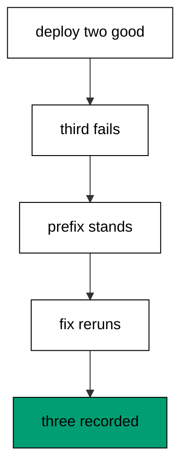

The failed deploy records its two good migrations and nothing else, which the history read proves before any fixing starts. Editing the broken file in place is safe here because it never applied: the fix runs as a first application, not a silent edit. Recovery migrates only the fixed file, and the final read shows three entries in id order with the prefix untouched. Diagnose from history, fix the file, rerun the suffix: the whole course in one run.

**`learning/code/ex-78-advanced-review-diagnose-recover-converge/main.clj`**:

```clojure
;; => Example 78: Advanced Review.
;; => The course closes on a bad deploy: diagnose from history, fix forward, converge.
(require '[migratus.core :as migratus]) ;; => migrate, rollback, up, and down move history
(require '[next.jdbc :as jdbc]) ;; => verification reads prove each migration landed
(require '[next.jdbc.result-set :as rs]) ;; => unqualified rows print without table prefixes
(require '[clojure.java.io :as io]) ;; => migration files are staged, then removed
;; => The database address comes from the harness, with local-run defaults.
(defn db-spec [] ;; => one builder owns every address default
  {:dbtype "postgresql" ;; => pgjdbc speaks the PostgreSQL wire protocol
   :host (or (System/getenv "PGHOST") "localhost") ;; => harness sets the service host
   :port (Integer/parseInt (or (System/getenv "PGPORT") "5432")) ;; => service port default
   :dbname (or (System/getenv "PGDATABASE") "postgres") ;; => fresh database per unit run
   :user (or (System/getenv "PGUSER") "postgres")}) ;; => trust auth needs no password
;; => One config carries the store, the relative migration dir, and the history table.
(defn config [dir table] ;; => every example owns its dir and history table
  {:store :database ;; => the SQL store journals history in a table
   :migration-dir dir ;; => relative to the unit folder, staged at runtime
   :migration-table-name table ;; => per-example history isolates every rerun
   :db (db-spec)}) ;; => next.jdbc connects from this spec
;; => Staging writes one up/down pair per call into the relative dir.
(defn write-migration [dir id name up down] ;; => one helper stages every migration
  (spit (str dir "/" id "-" name ".up.sql") up) ;; => forward change runs on migrate
  (when down ;; => up-only examples skip the down file on purpose
    (spit (str dir "/" id "-" name ".down.sql") down))) ;; => reverse runs on rollback
;; => Reset clears leftovers of a killed run so reruns print alike.
(defn reset-unit! [ds dir table tables views] ;; => one reset owns every leftover
  (doseq [v views] ;; => views drop before the tables they read
    (jdbc/execute! ds [(str "DROP VIEW IF EXISTS " v)])) ;; => stale views vanish first
  (let [d (io/file dir)] ;; => the relative staging dir of this unit
    (when (.exists d) ;; => a killed run may leave files behind
      (doseq [f (.listFiles d)] ;; => every staged file goes first
        (.delete ^java.io.File f)) ;; => delete each staged migration
      (.delete d)) ;; => the empty staging dir goes too
    (.mkdirs d)) ;; => a fresh dir for this run
  (doseq [t tables] ;; => every table this example owns
    (jdbc/execute! ds [(str "DROP TABLE IF EXISTS " t " CASCADE")])) ;; => killed runs vanish
  (jdbc/execute! ds [(str "DROP TABLE IF EXISTS " table)])) ;; => stale history vanishes too
;; => Reads print their own proof; ids sort so output never depends on disk order.
(defn applied-names [ds table] ;; => applied migration names in id order
  (mapv :description ;; => description stores the migration name
    (jdbc/execute! ds [(str "SELECT description FROM " table " WHERE id > 0 ORDER BY id")] ;; => id order, reserve row excluded
                     {:builder-fn rs/as-unqualified-lower-maps}))) ;; => short keys print cleanly
;; => Column lists read the catalog, so the schema proves itself.
(defn table-columns [ds table] ;; => column names in position order
  (mapv :column_name ;; => one name per row, nothing else
    (jdbc/execute! ds [(str "SELECT column_name FROM information_schema.columns WHERE table_name = '" table "' ORDER BY ordinal_position")] ;; => catalog order is stable
                     {:builder-fn rs/as-unqualified-lower-maps}))) ;; => short keys print cleanly
(def ds (jdbc/get-datasource (db-spec))) ;; => one shared datasource per unit run
(def cfg (config "mig" "m78_migrations")) ;; => store plus history table for this example
(reset-unit! ds "mig" "m78_migrations" ["m78_order" "m78_item" "m78_broken"] []) ;; => leftovers of a killed run vanish first
(write-migration "mig" "20260101007801" "make-order" ;; => two good migrations open the deploy
  "CREATE TABLE m78_order (id SERIAL PRIMARY KEY, code TEXT NOT NULL);\n" ;; => orders land first
  "DROP TABLE m78_order;\n") ;; => reverse drops orders
(write-migration "mig" "20260101007802" "make-item" ;; => second good migration follows
  "CREATE TABLE m78_item (id SERIAL PRIMARY KEY, order_id INTEGER NOT NULL);\n" ;; => items land second
  "DROP TABLE m78_item;\n") ;; => reverse drops items
(write-migration "mig" "20260101007803" "make-broken" ;; => third migration ships broken
  "CREATE TABLE m78_broken (id INTEGER NOT NULL REFERENCES m78_missing (id));\n" ;; => missing parent fails the file
  "DROP TABLE IF EXISTS m78_broken;\n") ;; => down would drop the child
(println "deploy:" (pr-str (try (migratus/migrate cfg) ;; => deploy stops at the broken file
  (catch Exception e (str "threw: " (.getMessage e)))))) ;; => driver names the missing parent
(println "completed:" (pr-str (applied-names ds "m78_migrations"))) ;; => good prefix stays recorded
(spit "mig/20260101007803-make-broken.up.sql" ;; => fix the broken file forward
  "CREATE TABLE m78_broken (id SERIAL PRIMARY KEY, order_id INTEGER NOT NULL);\n") ;; => fixed file stands alone
(println "recover:" (pr-str (migratus/migrate cfg))) ;; => only the fix runs now
(println "completed:" (pr-str (applied-names ds "m78_migrations"))) ;; => all three in id order
;; => Cleanup drops every object this example made, leaving no residue.
(defn cleanup-unit! [ds dir table tables views] ;; => one cleanup owns every created object
  (doseq [v views] ;; => views drop before the tables they read
    (jdbc/execute! ds [(str "DROP VIEW IF EXISTS " v)])) ;; => view residue vanishes
  (doseq [t tables] ;; => every table this example owns
    (jdbc/execute! ds [(str "DROP TABLE IF EXISTS " t " CASCADE")])) ;; => tables vanish with dependents
  (jdbc/execute! ds [(str "DROP TABLE IF EXISTS " table)]) ;; => history table vanishes too
  (let [d (io/file dir)] ;; => the staging dir from this run
    (when (.exists d) ;; => files were staged above
      (doseq [f (.listFiles d)] ;; => every staged file goes first
        (.delete ^java.io.File f)) ;; => delete each staged migration
      (.delete d)))) ;; => the empty staging dir goes too
(cleanup-unit! ds "mig" "m78_migrations" ["m78_order" "m78_item" "m78_broken"] []) ;; => drop every object this example created
```

**Output** (`learning/code/ex-78-advanced-review-diagnose-recover-converge/expected/main.stdout.txt`):

```text
deploy: "threw: ERROR: current transaction is aborted, commands ignored until end of transaction block"
completed: ["make-order" "make-item"]
recover: nil
completed: ["make-order" "make-item" "make-broken"]
```

**Key takeaway**: Diagnose the good prefix, fix the broken file, rerun the suffix: recovery converges.

**Why it matters**: Bad deploys are the exam for every migration habit, and this one passes because each habit held. History named the position, the prefix survived, the fix ran once, and the journal closed honestly. Teams that drill this sequence recover on muscle memory, because the worst deploy they have seen was already rehearsed.
