Examples 1–25 build the habits every later example assumes: writing Migratus migrations with forward steps, ordering them into one linear history, and rolling them back with down files. Three clusters carry the level: first migrations that create and alter (Examples 1–8), migration history and ordering (Examples 9–17), and rollback basics (Examples 18–25). Every program runs against the real pinned PostgreSQL 18 container; every output is a fixed transcript.

### Example 1: First Migration Creates a Table

A migration is a versioned script pair with a forward step, and this example runs the smallest real one: a single Migratus migration that creates a table. The program stages the files, upgrades, reads the history back, and verifies the columns. (Concepts: co-01.)

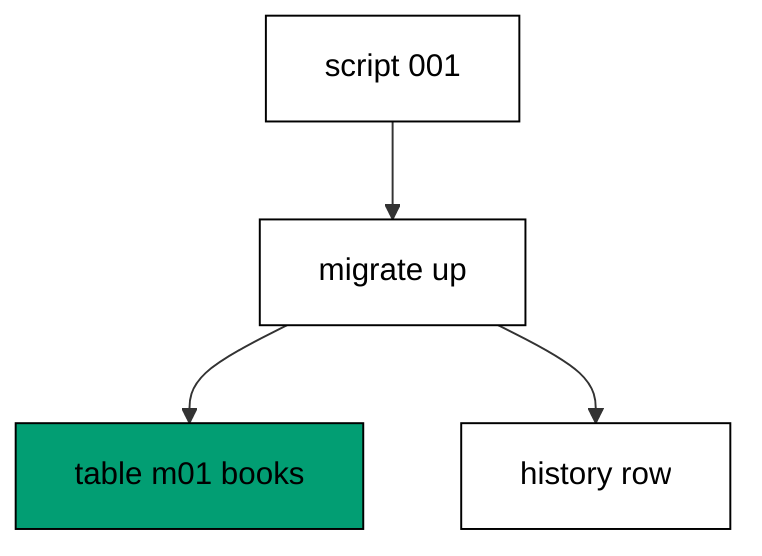

Migratus discovers migration files by name in the migration directory: `<id>-<name>.up.sql` runs on the way up and `<id>-<name>.down.sql` runs on the way down. The numeric id fixes the position in history while the name tells reviewers what the change does, and the two files together make the change reviewable as one unit. After `migrate` returns, the example history table (`m01_migrations`) holds one row with the id and the name, so a second run finds nothing pending and changes nothing. The catalog query reads the columns back independently of Migratus, which is the habit every later example keeps: never trust the runner alone, always read the database back.

**`learning/code/ex-01-first-migration-creates-a-table/main.clj`**:

```clojure
;; => Example 1: First Migration Creates a Table.
;; => A versioned file pair turns one CREATE TABLE into a repeatable, ordered step.
(require '[migratus.core :as migratus]) ;; => migrate, rollback, up, and down move history
(require '[next.jdbc :as jdbc]) ;; => verification reads prove each migration landed
(require '[next.jdbc.result-set :as rs]) ;; => unqualified rows print without table prefixes
(require '[clojure.java.io :as io]) ;; => migration files are staged, then removed
;; => The database address comes from the harness, with local-run defaults.
(defn db-spec [] ;; => one builder owns every address default
  {:dbtype "postgresql" ;; => pgjdbc speaks the PostgreSQL wire protocol
   :host (or (System/getenv "PGHOST") "localhost") ;; => harness sets the service host
   :port (Integer/parseInt (or (System/getenv "PGPORT") "5432")) ;; => service port default
   :dbname (or (System/getenv "PGDATABASE") "postgres") ;; => fresh database per unit run
   :user (or (System/getenv "PGUSER") "postgres")}) ;; => trust auth needs no password
;; => One config carries the store, the relative migration dir, and the history table.
(defn config [dir table] ;; => every example owns its dir and history table
  {:store :database ;; => the SQL store journals history in a table
   :migration-dir dir ;; => relative to the unit folder, staged at runtime
   :migration-table-name table ;; => per-example history isolates every rerun
   :db (db-spec)}) ;; => next.jdbc connects from this spec
;; => Staging writes one up/down pair per call into the relative dir.
(defn write-migration [dir id name up down] ;; => one helper stages every migration
  (spit (str dir "/" id "-" name ".up.sql") up) ;; => forward change runs on migrate
  (when down ;; => up-only examples skip the down file on purpose
    (spit (str dir "/" id "-" name ".down.sql") down))) ;; => reverse runs on rollback
;; => Reset clears leftovers of a killed run so reruns print alike.
(defn reset-unit! [ds dir table tables views] ;; => one reset owns every leftover
  (doseq [v views] ;; => views drop before the tables they read
    (jdbc/execute! ds [(str "DROP VIEW IF EXISTS " v)])) ;; => stale views vanish first
  (let [d (io/file dir)] ;; => the relative staging dir of this unit
    (when (.exists d) ;; => a killed run may leave files behind
      (doseq [f (.listFiles d)] ;; => every staged file goes first
        (.delete ^java.io.File f)) ;; => delete each staged migration
      (.delete d)) ;; => the empty staging dir goes too
    (.mkdirs d)) ;; => a fresh dir for this run
  (doseq [t tables] ;; => every table this example owns
    (jdbc/execute! ds [(str "DROP TABLE IF EXISTS " t " CASCADE")])) ;; => killed runs vanish
  (jdbc/execute! ds [(str "DROP TABLE IF EXISTS " table)])) ;; => stale history vanishes too
;; => Reads print their own proof; ids sort so output never depends on disk order.
(defn applied-names [ds table] ;; => applied migration names in id order
  (mapv :description ;; => description stores the migration name
    (jdbc/execute! ds [(str "SELECT description FROM " table " WHERE id > 0 ORDER BY id")] ;; => id order, reserve row excluded
                     {:builder-fn rs/as-unqualified-lower-maps}))) ;; => short keys print cleanly
;; => Column lists read the catalog, so the schema proves itself.
(defn table-columns [ds table] ;; => column names in position order
  (mapv :column_name ;; => one name per row, nothing else
    (jdbc/execute! ds [(str "SELECT column_name FROM information_schema.columns WHERE table_name = '" table "' ORDER BY ordinal_position")] ;; => catalog order is stable
                     {:builder-fn rs/as-unqualified-lower-maps}))) ;; => short keys print cleanly
(def ds (jdbc/get-datasource (db-spec))) ;; => one shared datasource per unit run
(def cfg (config "mig" "m01_migrations")) ;; => store plus history table for this example
(reset-unit! ds "mig" "m01_migrations" ["m01_books"] []) ;; => leftovers of a killed run vanish first
(write-migration "mig" "20260101000101" "create-books" ;; => stage the up/down pair for this change
  "CREATE TABLE m01_books (id SERIAL PRIMARY KEY, title TEXT NOT NULL);\n" ;; => forward change creates the table
  "DROP TABLE m01_books;\n") ;; => reverse change drops it again
(println "migrate:" (pr-str (migratus/migrate cfg))) ;; => nil means every pending migration applied
(println "completed:" (pr-str (applied-names ds "m01_migrations"))) ;; => id order straight from history
(println "columns:" (pr-str (table-columns ds "m01_books"))) ;; => catalog proves the table shape
;; => Cleanup drops every object this example made, leaving no residue.
(defn cleanup-unit! [ds dir table tables views] ;; => one cleanup owns every created object
  (doseq [v views] ;; => views drop before the tables they read
    (jdbc/execute! ds [(str "DROP VIEW IF EXISTS " v)])) ;; => view residue vanishes
  (doseq [t tables] ;; => every table this example owns
    (jdbc/execute! ds [(str "DROP TABLE IF EXISTS " t " CASCADE")])) ;; => tables vanish with dependents
  (jdbc/execute! ds [(str "DROP TABLE IF EXISTS " table)]) ;; => history table vanishes too
  (let [d (io/file dir)] ;; => the staging dir from this run
    (when (.exists d) ;; => files were staged above
      (doseq [f (.listFiles d)] ;; => every staged file goes first
        (.delete ^java.io.File f)) ;; => delete each staged migration
      (.delete d)))) ;; => the empty staging dir goes too
(cleanup-unit! ds "mig" "m01_migrations" ["m01_books"] []) ;; => drop every object this example created
```

**Output** (`learning/code/ex-01-first-migration-creates-a-table/expected/main.stdout.txt`):

```text
migrate: nil
completed: ["create-books"]
columns: ["id" "title"]
```

**Key takeaway**: One named file pair creates one table, and the history row it leaves behind proves the migration ran.

**Why it matters**: Versioned file pairs turn a scary production change into a reviewable artifact: the files state exactly what runs, the id fixes the position in history, and the history row proves it ran. Teams that version every change stop asking which database has which schema, because the database answers for itself. That answerability is the whole habit this course builds, and it starts with this single table.

### Example 2: Alter Adds a Column

Tables rarely arrive complete, so this example grows one: the first migration creates a books table and the second adds a year column. The program migrates both, rolls the second back, and reads the columns after each step. (Concepts: co-01, co-02.)

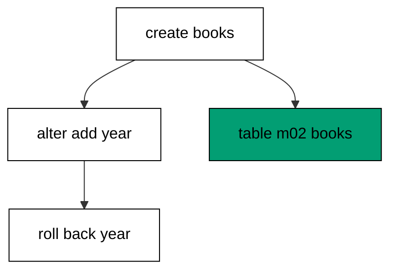

The up file of the second migration holds the forward change and the down file holds its exact reverse, and Migratus runs them as a pair in opposite directions. Rollback always targets the most recently applied migration, which is why the alter unwinds while the creation stays: history is a stack, and down pops one entry at a time. Reading the columns after the rollback proves the reversal left the original table intact, and the history list proves only the first migration remains applied. This pairing of every forward step with its reverse is what makes schema change boring instead of frightening.

**`learning/code/ex-02-alter-adds-a-column/main.clj`**:

```clojure
;; => Example 2: Alter Adds a Column.
;; => A second migration alters the table the first one created, forward and back.
(require '[migratus.core :as migratus]) ;; => migrate, rollback, up, and down move history
(require '[next.jdbc :as jdbc]) ;; => verification reads prove each migration landed
(require '[next.jdbc.result-set :as rs]) ;; => unqualified rows print without table prefixes
(require '[clojure.java.io :as io]) ;; => migration files are staged, then removed
;; => The database address comes from the harness, with local-run defaults.
(defn db-spec [] ;; => one builder owns every address default
  {:dbtype "postgresql" ;; => pgjdbc speaks the PostgreSQL wire protocol
   :host (or (System/getenv "PGHOST") "localhost") ;; => harness sets the service host
   :port (Integer/parseInt (or (System/getenv "PGPORT") "5432")) ;; => service port default
   :dbname (or (System/getenv "PGDATABASE") "postgres") ;; => fresh database per unit run
   :user (or (System/getenv "PGUSER") "postgres")}) ;; => trust auth needs no password
;; => One config carries the store, the relative migration dir, and the history table.
(defn config [dir table] ;; => every example owns its dir and history table
  {:store :database ;; => the SQL store journals history in a table
   :migration-dir dir ;; => relative to the unit folder, staged at runtime
   :migration-table-name table ;; => per-example history isolates every rerun
   :db (db-spec)}) ;; => next.jdbc connects from this spec
;; => Staging writes one up/down pair per call into the relative dir.
(defn write-migration [dir id name up down] ;; => one helper stages every migration
  (spit (str dir "/" id "-" name ".up.sql") up) ;; => forward change runs on migrate
  (when down ;; => up-only examples skip the down file on purpose
    (spit (str dir "/" id "-" name ".down.sql") down))) ;; => reverse runs on rollback
;; => Reset clears leftovers of a killed run so reruns print alike.
(defn reset-unit! [ds dir table tables views] ;; => one reset owns every leftover
  (doseq [v views] ;; => views drop before the tables they read
    (jdbc/execute! ds [(str "DROP VIEW IF EXISTS " v)])) ;; => stale views vanish first
  (let [d (io/file dir)] ;; => the relative staging dir of this unit
    (when (.exists d) ;; => a killed run may leave files behind
      (doseq [f (.listFiles d)] ;; => every staged file goes first
        (.delete ^java.io.File f)) ;; => delete each staged migration
      (.delete d)) ;; => the empty staging dir goes too
    (.mkdirs d)) ;; => a fresh dir for this run
  (doseq [t tables] ;; => every table this example owns
    (jdbc/execute! ds [(str "DROP TABLE IF EXISTS " t " CASCADE")])) ;; => killed runs vanish
  (jdbc/execute! ds [(str "DROP TABLE IF EXISTS " table)])) ;; => stale history vanishes too
;; => Reads print their own proof; ids sort so output never depends on disk order.
(defn applied-names [ds table] ;; => applied migration names in id order
  (mapv :description ;; => description stores the migration name
    (jdbc/execute! ds [(str "SELECT description FROM " table " WHERE id > 0 ORDER BY id")] ;; => id order, reserve row excluded
                     {:builder-fn rs/as-unqualified-lower-maps}))) ;; => short keys print cleanly
;; => Column lists read the catalog, so the schema proves itself.
(defn table-columns [ds table] ;; => column names in position order
  (mapv :column_name ;; => one name per row, nothing else
    (jdbc/execute! ds [(str "SELECT column_name FROM information_schema.columns WHERE table_name = '" table "' ORDER BY ordinal_position")] ;; => catalog order is stable
                     {:builder-fn rs/as-unqualified-lower-maps}))) ;; => short keys print cleanly
(def ds (jdbc/get-datasource (db-spec))) ;; => one shared datasource per unit run
(def cfg (config "mig" "m02_migrations")) ;; => store plus history table for this example
(reset-unit! ds "mig" "m02_migrations" ["m02_books"] []) ;; => leftovers of a killed run vanish first
(write-migration "mig" "20260101000201" "create-books" ;; => first migration creates the table
  "CREATE TABLE m02_books (id SERIAL PRIMARY KEY, title TEXT NOT NULL);\n" ;; => surrogate key plus title
  "DROP TABLE m02_books;\n") ;; => dropping undoes the creation
(write-migration "mig" "20260101000202" "add-year" ;; => second migration alters the same table
  "ALTER TABLE m02_books ADD COLUMN year INTEGER;\n" ;; => nullable column lands without rewriting
  "ALTER TABLE m02_books DROP COLUMN year;\n") ;; => dropping the column undoes the alter
(println "migrate:" (pr-str (migratus/migrate cfg))) ;; => nil means every pending migration applied
(println "completed:" (pr-str (applied-names ds "m02_migrations"))) ;; => id order straight from history
(println "columns:" (pr-str (table-columns ds "m02_books"))) ;; => both migrations visible in shape
(println "rollback:" (pr-str (migratus/rollback cfg))) ;; => last migration rolls back first
(println "columns:" (pr-str (table-columns ds "m02_books"))) ;; => year is gone, title stays
(println "completed:" (pr-str (applied-names ds "m02_migrations"))) ;; => only the first stays applied
;; => Cleanup drops every object this example made, leaving no residue.
(defn cleanup-unit! [ds dir table tables views] ;; => one cleanup owns every created object
  (doseq [v views] ;; => views drop before the tables they read
    (jdbc/execute! ds [(str "DROP VIEW IF EXISTS " v)])) ;; => view residue vanishes
  (doseq [t tables] ;; => every table this example owns
    (jdbc/execute! ds [(str "DROP TABLE IF EXISTS " t " CASCADE")])) ;; => tables vanish with dependents
  (jdbc/execute! ds [(str "DROP TABLE IF EXISTS " table)]) ;; => history table vanishes too
  (let [d (io/file dir)] ;; => the staging dir from this run
    (when (.exists d) ;; => files were staged above
      (doseq [f (.listFiles d)] ;; => every staged file goes first
        (.delete ^java.io.File f)) ;; => delete each staged migration
      (.delete d)))) ;; => the empty staging dir goes too
(cleanup-unit! ds "mig" "m02_migrations" ["m02_books"] []) ;; => drop every object this example created
```

**Output** (`learning/code/ex-02-alter-adds-a-column/expected/main.stdout.txt`):

```text
migrate: nil
completed: ["create-books" "add-year"]
columns: ["id" "title" "year"]
rollback: nil
columns: ["id" "title"]
completed: ["create-books"]
```

**Key takeaway**: Every forward change ships with its reverse, and rollback unwinds the most recent migration first.

**Why it matters**: Production schemas grow one column at a time while traffic keeps flowing, so each growth step must be reversible on its own. Pairing every alter with its exact undo means a bad deploy rolls back with one command instead of a hand-written apology script. Teams that keep this pairing never fear the alter, because the way back is already tested before the way forward ships.

### Example 3: Down File Reverses the Change

A down file earns its place by running, so this example writes a two-statement migration and rolls it all the way back. The program migrates, rolls back, and proves no table and no history row survives. (Concepts: co-02.)

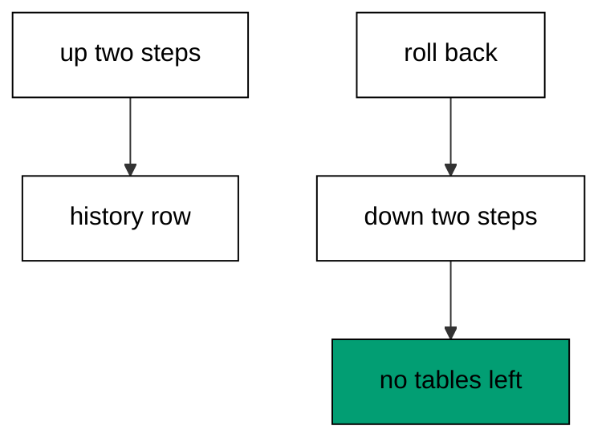

Multi-statement scripts separate statements with a `--;;` line, because Migratus sends each statement to the driver separately and the driver refuses batched multi-statements. The down file mirrors the up file in reverse order: indexes drop before the tables they belong to, so each step undoes exactly one forward step. Rollback runs the down file inside the same per-migration transaction the up file enjoyed, which keeps the reversal atomic. The empty catalog query at the end is the whole point: after a rollback, the database looks as if the migration never ran.

**`learning/code/ex-03-down-file-reverses-the-change/main.clj`**:

```clojure
;; => Example 3: Down File Reverses the Change.
;; => The down file is a tested script, not a comment: rollback executes it.
(require '[migratus.core :as migratus]) ;; => migrate, rollback, up, and down move history
(require '[next.jdbc :as jdbc]) ;; => verification reads prove each migration landed
(require '[next.jdbc.result-set :as rs]) ;; => unqualified rows print without table prefixes
(require '[clojure.java.io :as io]) ;; => migration files are staged, then removed
;; => The database address comes from the harness, with local-run defaults.
(defn db-spec [] ;; => one builder owns every address default
  {:dbtype "postgresql" ;; => pgjdbc speaks the PostgreSQL wire protocol
   :host (or (System/getenv "PGHOST") "localhost") ;; => harness sets the service host
   :port (Integer/parseInt (or (System/getenv "PGPORT") "5432")) ;; => service port default
   :dbname (or (System/getenv "PGDATABASE") "postgres") ;; => fresh database per unit run
   :user (or (System/getenv "PGUSER") "postgres")}) ;; => trust auth needs no password
;; => One config carries the store, the relative migration dir, and the history table.
(defn config [dir table] ;; => every example owns its dir and history table
  {:store :database ;; => the SQL store journals history in a table
   :migration-dir dir ;; => relative to the unit folder, staged at runtime
   :migration-table-name table ;; => per-example history isolates every rerun
   :db (db-spec)}) ;; => next.jdbc connects from this spec
;; => Staging writes one up/down pair per call into the relative dir.
(defn write-migration [dir id name up down] ;; => one helper stages every migration
  (spit (str dir "/" id "-" name ".up.sql") up) ;; => forward change runs on migrate
  (when down ;; => up-only examples skip the down file on purpose
    (spit (str dir "/" id "-" name ".down.sql") down))) ;; => reverse runs on rollback
;; => Reset clears leftovers of a killed run so reruns print alike.
(defn reset-unit! [ds dir table tables views] ;; => one reset owns every leftover
  (doseq [v views] ;; => views drop before the tables they read
    (jdbc/execute! ds [(str "DROP VIEW IF EXISTS " v)])) ;; => stale views vanish first
  (let [d (io/file dir)] ;; => the relative staging dir of this unit
    (when (.exists d) ;; => a killed run may leave files behind
      (doseq [f (.listFiles d)] ;; => every staged file goes first
        (.delete ^java.io.File f)) ;; => delete each staged migration
      (.delete d)) ;; => the empty staging dir goes too
    (.mkdirs d)) ;; => a fresh dir for this run
  (doseq [t tables] ;; => every table this example owns
    (jdbc/execute! ds [(str "DROP TABLE IF EXISTS " t " CASCADE")])) ;; => killed runs vanish
  (jdbc/execute! ds [(str "DROP TABLE IF EXISTS " table)])) ;; => stale history vanishes too
;; => Reads print their own proof; ids sort so output never depends on disk order.
(defn applied-names [ds table] ;; => applied migration names in id order
  (mapv :description ;; => description stores the migration name
    (jdbc/execute! ds [(str "SELECT description FROM " table " WHERE id > 0 ORDER BY id")] ;; => id order, reserve row excluded
                     {:builder-fn rs/as-unqualified-lower-maps}))) ;; => short keys print cleanly
;; => Column lists read the catalog, so the schema proves itself.
(defn table-columns [ds table] ;; => column names in position order
  (mapv :column_name ;; => one name per row, nothing else
    (jdbc/execute! ds [(str "SELECT column_name FROM information_schema.columns WHERE table_name = '" table "' ORDER BY ordinal_position")] ;; => catalog order is stable
                     {:builder-fn rs/as-unqualified-lower-maps}))) ;; => short keys print cleanly
(def ds (jdbc/get-datasource (db-spec))) ;; => one shared datasource per unit run
(def cfg (config "mig" "m03_migrations")) ;; => store plus history table for this example
(reset-unit! ds "mig" "m03_migrations" ["m03_shelf"] []) ;; => leftovers of a killed run vanish first
(write-migration "mig" "20260101000301" "create-shelf" ;; => one table with one companion index
  (str "CREATE TABLE m03_shelf (id SERIAL PRIMARY KEY, label TEXT NOT NULL);\n" ;; => forward change creates the shelf
       "--;;\n" ;; => separator splits the two statements
       "CREATE INDEX m03_shelf_label_idx ON m03_shelf (label);\n") ;; => second statement indexes the label
  (str "DROP INDEX m03_shelf_label_idx;\n" ;; => reverse drops the index first
       "--;;\n" ;; => same separator on the way down
       "DROP TABLE m03_shelf;\n")) ;; => then the table goes too
(println "migrate:" (pr-str (migratus/migrate cfg))) ;; => nil means every pending migration applied
(println "completed:" (pr-str (applied-names ds "m03_migrations"))) ;; => id order straight from history
(println "rollback:" (pr-str (migratus/rollback cfg))) ;; => down file executes now
(println "tables:" (pr-str (mapv :table_name ;; => leftover tables would show here
  (jdbc/execute! ds ["SELECT table_name FROM information_schema.tables WHERE table_name LIKE 'm03%' AND table_name <> 'm03_migrations' ORDER BY 1"] ;; => user tables only, history excluded
                   {:builder-fn rs/as-unqualified-lower-maps})))) ;; => empty list proves full reversal
(println "completed:" (pr-str (applied-names ds "m03_migrations"))) ;; => history is empty again
;; => Cleanup drops every object this example made, leaving no residue.
(defn cleanup-unit! [ds dir table tables views] ;; => one cleanup owns every created object
  (doseq [v views] ;; => views drop before the tables they read
    (jdbc/execute! ds [(str "DROP VIEW IF EXISTS " v)])) ;; => view residue vanishes
  (doseq [t tables] ;; => every table this example owns
    (jdbc/execute! ds [(str "DROP TABLE IF EXISTS " t " CASCADE")])) ;; => tables vanish with dependents
  (jdbc/execute! ds [(str "DROP TABLE IF EXISTS " table)]) ;; => history table vanishes too
  (let [d (io/file dir)] ;; => the staging dir from this run
    (when (.exists d) ;; => files were staged above
      (doseq [f (.listFiles d)] ;; => every staged file goes first
        (.delete ^java.io.File f)) ;; => delete each staged migration
      (.delete d)))) ;; => the empty staging dir goes too
(cleanup-unit! ds "mig" "m03_migrations" ["m03_shelf"] []) ;; => drop every object this example created
```

**Output** (`learning/code/ex-03-down-file-reverses-the-change/expected/main.stdout.txt`):

```text
migrate: nil
completed: ["create-shelf"]
rollback: nil
tables: []
completed: []
```

**Key takeaway**: The down file mirrors the up file in reverse, and rollback proves the reversal by leaving nothing behind.

**Why it matters**: Deploys fail at the worst moment, and the recovery script must already exist when they do. A down file written beside the up file gets reviewed, tested, and shipped with the change instead of improvised under pressure. Teams that test every down file discover broken reversals on calm afternoons instead of during outages, which is exactly when broken reversals hurt most.

### Example 4: Separators Split Statements

Related tables often ship together, so this example stages one migration with two CREATE TABLE statements split by a separator. The program migrates once and proves both tables exist under a single history row. (Concepts: co-01.)

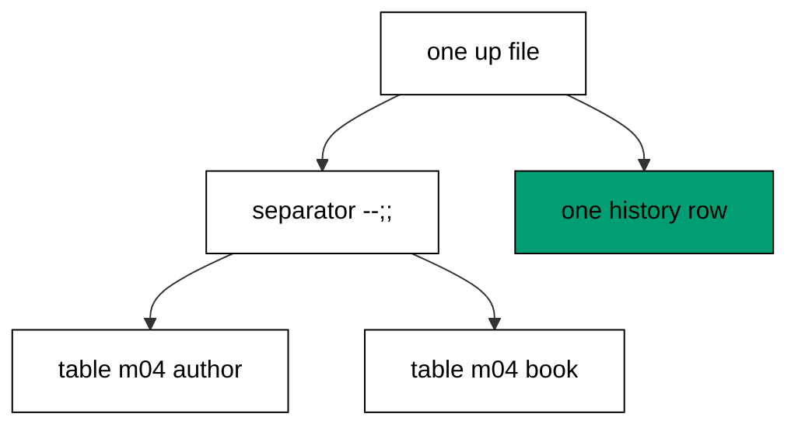

A `--;;` line on its own splits one migration file into separate statements, because Migratus hands each statement to the JDBC driver on its own and the driver rejects multi-statement batches. Without the separator, two statements in one file fail with a batch error instead of running, which is the mistake this example exists to prevent. The down file uses the same separator in reverse dependency order, so rollback drops the books before the authors they might reference. One file with two statements still records exactly one history row: the migration is the unit of history, not the statement.

**`learning/code/ex-04-separators-split-statements/main.clj`**:

```clojure
;; => Example 4: Separators Split Statements.
;; => One file can hold several statements when a separator line splits them.
(require '[migratus.core :as migratus]) ;; => migrate, rollback, up, and down move history
(require '[next.jdbc :as jdbc]) ;; => verification reads prove each migration landed
(require '[next.jdbc.result-set :as rs]) ;; => unqualified rows print without table prefixes
(require '[clojure.java.io :as io]) ;; => migration files are staged, then removed
;; => The database address comes from the harness, with local-run defaults.
(defn db-spec [] ;; => one builder owns every address default
  {:dbtype "postgresql" ;; => pgjdbc speaks the PostgreSQL wire protocol
   :host (or (System/getenv "PGHOST") "localhost") ;; => harness sets the service host
   :port (Integer/parseInt (or (System/getenv "PGPORT") "5432")) ;; => service port default
   :dbname (or (System/getenv "PGDATABASE") "postgres") ;; => fresh database per unit run
   :user (or (System/getenv "PGUSER") "postgres")}) ;; => trust auth needs no password
;; => One config carries the store, the relative migration dir, and the history table.
(defn config [dir table] ;; => every example owns its dir and history table
  {:store :database ;; => the SQL store journals history in a table
   :migration-dir dir ;; => relative to the unit folder, staged at runtime
   :migration-table-name table ;; => per-example history isolates every rerun
   :db (db-spec)}) ;; => next.jdbc connects from this spec
;; => Staging writes one up/down pair per call into the relative dir.
(defn write-migration [dir id name up down] ;; => one helper stages every migration
  (spit (str dir "/" id "-" name ".up.sql") up) ;; => forward change runs on migrate
  (when down ;; => up-only examples skip the down file on purpose
    (spit (str dir "/" id "-" name ".down.sql") down))) ;; => reverse runs on rollback
;; => Reset clears leftovers of a killed run so reruns print alike.
(defn reset-unit! [ds dir table tables views] ;; => one reset owns every leftover
  (doseq [v views] ;; => views drop before the tables they read
    (jdbc/execute! ds [(str "DROP VIEW IF EXISTS " v)])) ;; => stale views vanish first
  (let [d (io/file dir)] ;; => the relative staging dir of this unit
    (when (.exists d) ;; => a killed run may leave files behind
      (doseq [f (.listFiles d)] ;; => every staged file goes first
        (.delete ^java.io.File f)) ;; => delete each staged migration
      (.delete d)) ;; => the empty staging dir goes too
    (.mkdirs d)) ;; => a fresh dir for this run
  (doseq [t tables] ;; => every table this example owns
    (jdbc/execute! ds [(str "DROP TABLE IF EXISTS " t " CASCADE")])) ;; => killed runs vanish
  (jdbc/execute! ds [(str "DROP TABLE IF EXISTS " table)])) ;; => stale history vanishes too
;; => Reads print their own proof; ids sort so output never depends on disk order.
(defn applied-names [ds table] ;; => applied migration names in id order
  (mapv :description ;; => description stores the migration name
    (jdbc/execute! ds [(str "SELECT description FROM " table " WHERE id > 0 ORDER BY id")] ;; => id order, reserve row excluded
                     {:builder-fn rs/as-unqualified-lower-maps}))) ;; => short keys print cleanly
;; => Column lists read the catalog, so the schema proves itself.
(defn table-columns [ds table] ;; => column names in position order
  (mapv :column_name ;; => one name per row, nothing else
    (jdbc/execute! ds [(str "SELECT column_name FROM information_schema.columns WHERE table_name = '" table "' ORDER BY ordinal_position")] ;; => catalog order is stable
                     {:builder-fn rs/as-unqualified-lower-maps}))) ;; => short keys print cleanly
(def ds (jdbc/get-datasource (db-spec))) ;; => one shared datasource per unit run
(def cfg (config "mig" "m04_migrations")) ;; => store plus history table for this example
(reset-unit! ds "mig" "m04_migrations" ["m04_author" "m04_book"] []) ;; => leftovers of a killed run vanish first
(write-migration "mig" "20260101000401" "create-catalogue" ;; => one file carries two CREATE TABLE statements
  (str "CREATE TABLE m04_author (id SERIAL PRIMARY KEY, name TEXT NOT NULL);\n" ;; => first statement creates authors
       "--;;\n" ;; => separator splits statements for the batch runner
       "CREATE TABLE m04_book (id SERIAL PRIMARY KEY, title TEXT NOT NULL);\n") ;; => second statement creates books
  (str "DROP TABLE m04_book;\n" ;; => reverse drops books first
       "--;;\n" ;; => same separator on the way down
       "DROP TABLE m04_author;\n")) ;; => then authors go too
(println "migrate:" (pr-str (migratus/migrate cfg))) ;; => nil means every pending migration applied
(println "completed:" (pr-str (applied-names ds "m04_migrations"))) ;; => id order straight from history
(println "tables:" (pr-str (mapv :table_name ;; => both tables land from one file
  (jdbc/execute! ds ["SELECT table_name FROM information_schema.tables WHERE table_name LIKE 'm04%' AND table_name <> 'm04_migrations' ORDER BY 1"] ;; => user tables only, history excluded
                   {:builder-fn rs/as-unqualified-lower-maps})))) ;; => two tables, one history row
;; => Cleanup drops every object this example made, leaving no residue.
(defn cleanup-unit! [ds dir table tables views] ;; => one cleanup owns every created object
  (doseq [v views] ;; => views drop before the tables they read
    (jdbc/execute! ds [(str "DROP VIEW IF EXISTS " v)])) ;; => view residue vanishes
  (doseq [t tables] ;; => every table this example owns
    (jdbc/execute! ds [(str "DROP TABLE IF EXISTS " t " CASCADE")])) ;; => tables vanish with dependents
  (jdbc/execute! ds [(str "DROP TABLE IF EXISTS " table)]) ;; => history table vanishes too
  (let [d (io/file dir)] ;; => the staging dir from this run
    (when (.exists d) ;; => files were staged above
      (doseq [f (.listFiles d)] ;; => every staged file goes first
        (.delete ^java.io.File f)) ;; => delete each staged migration
      (.delete d)))) ;; => the empty staging dir goes too
(cleanup-unit! ds "mig" "m04_migrations" ["m04_author" "m04_book"] []) ;; => drop every object this example created
```

**Output** (`learning/code/ex-04-separators-split-statements/expected/main.stdout.txt`):

```text
migrate: nil
completed: ["create-catalogue"]
tables: ["m04_author" "m04_book"]
```

**Key takeaway**: Separate statements with a `--;;` line; the migration stays one history row however many statements it holds.

**Why it matters**: Small schemas ship as a unit, and splitting every table into its own migration would drown reviewers in files. Separator lines keep related statements together while honoring the driver's one-statement rule, so the migration reads as one story and runs as separate steps. Teams that learn the separator early never meet the batch error in production, because every multi-statement file they write already carries it.

### Example 5: File Names Carry Id and Intent

Migratus discovers migrations by scanning file names, so this example inspects the staged names before running them. The program lists the files, migrates, and shows the history names matching the file names. (Concepts: co-01.)

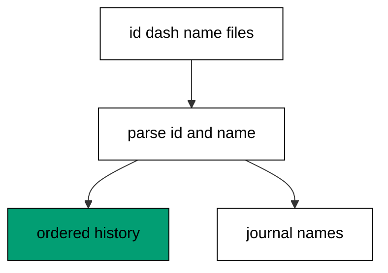

Every migration file follows the `<id>-<name>.up.sql` pattern: the numeric id orders the run and the kebab-case name tells reviewers what changes. Migratus parses the id with a plain number read, so ids must be digits and names must avoid dots that would confuse the extension split. Files that break the pattern are skipped with a warning instead of failing the run, which keeps one stray file from blocking a deploy. The printed listing proves the discovery contract: what the directory holds is exactly what the history will record.

**`learning/code/ex-05-file-names-carry-id-and-intent/main.clj`**:

```clojure
;; => Example 5: File Names Carry Id and Intent.
;; => Discovery reads names, so the name must carry both the order and the meaning.
(require '[migratus.core :as migratus]) ;; => migrate, rollback, up, and down move history
(require '[next.jdbc :as jdbc]) ;; => verification reads prove each migration landed
(require '[next.jdbc.result-set :as rs]) ;; => unqualified rows print without table prefixes
(require '[clojure.java.io :as io]) ;; => migration files are staged, then removed
;; => The database address comes from the harness, with local-run defaults.
(defn db-spec [] ;; => one builder owns every address default
  {:dbtype "postgresql" ;; => pgjdbc speaks the PostgreSQL wire protocol
   :host (or (System/getenv "PGHOST") "localhost") ;; => harness sets the service host
   :port (Integer/parseInt (or (System/getenv "PGPORT") "5432")) ;; => service port default
   :dbname (or (System/getenv "PGDATABASE") "postgres") ;; => fresh database per unit run
   :user (or (System/getenv "PGUSER") "postgres")}) ;; => trust auth needs no password
;; => One config carries the store, the relative migration dir, and the history table.
(defn config [dir table] ;; => every example owns its dir and history table
  {:store :database ;; => the SQL store journals history in a table
   :migration-dir dir ;; => relative to the unit folder, staged at runtime
   :migration-table-name table ;; => per-example history isolates every rerun
   :db (db-spec)}) ;; => next.jdbc connects from this spec
;; => Staging writes one up/down pair per call into the relative dir.
(defn write-migration [dir id name up down] ;; => one helper stages every migration
  (spit (str dir "/" id "-" name ".up.sql") up) ;; => forward change runs on migrate
  (when down ;; => up-only examples skip the down file on purpose
    (spit (str dir "/" id "-" name ".down.sql") down))) ;; => reverse runs on rollback
;; => Reset clears leftovers of a killed run so reruns print alike.
(defn reset-unit! [ds dir table tables views] ;; => one reset owns every leftover
  (doseq [v views] ;; => views drop before the tables they read
    (jdbc/execute! ds [(str "DROP VIEW IF EXISTS " v)])) ;; => stale views vanish first
  (let [d (io/file dir)] ;; => the relative staging dir of this unit
    (when (.exists d) ;; => a killed run may leave files behind
      (doseq [f (.listFiles d)] ;; => every staged file goes first
        (.delete ^java.io.File f)) ;; => delete each staged migration
      (.delete d)) ;; => the empty staging dir goes too
    (.mkdirs d)) ;; => a fresh dir for this run
  (doseq [t tables] ;; => every table this example owns
    (jdbc/execute! ds [(str "DROP TABLE IF EXISTS " t " CASCADE")])) ;; => killed runs vanish
  (jdbc/execute! ds [(str "DROP TABLE IF EXISTS " table)])) ;; => stale history vanishes too
;; => Reads print their own proof; ids sort so output never depends on disk order.
(defn applied-names [ds table] ;; => applied migration names in id order
  (mapv :description ;; => description stores the migration name
    (jdbc/execute! ds [(str "SELECT description FROM " table " WHERE id > 0 ORDER BY id")] ;; => id order, reserve row excluded
                     {:builder-fn rs/as-unqualified-lower-maps}))) ;; => short keys print cleanly
;; => Column lists read the catalog, so the schema proves itself.
(defn table-columns [ds table] ;; => column names in position order
  (mapv :column_name ;; => one name per row, nothing else
    (jdbc/execute! ds [(str "SELECT column_name FROM information_schema.columns WHERE table_name = '" table "' ORDER BY ordinal_position")] ;; => catalog order is stable
                     {:builder-fn rs/as-unqualified-lower-maps}))) ;; => short keys print cleanly
(def ds (jdbc/get-datasource (db-spec))) ;; => one shared datasource per unit run
(def cfg (config "mig" "m05_migrations")) ;; => store plus history table for this example
(reset-unit! ds "mig" "m05_migrations" ["m05_customer"] []) ;; => leftovers of a killed run vanish first
(write-migration "mig" "20260101000501" "create-customer" ;; => first file states its change in its name
  "CREATE TABLE m05_customer (id SERIAL PRIMARY KEY, name TEXT NOT NULL);\n" ;; => forward change creates customers
  "DROP TABLE m05_customer;\n") ;; => reverse change drops them
(write-migration "mig" "20260101000502" "add-email" ;; => second file states a different change
  "ALTER TABLE m05_customer ADD COLUMN email TEXT;\n" ;; => new column starts nullable
  "ALTER TABLE m05_customer DROP COLUMN email;\n") ;; => dropping the column undoes it
(println "files:" (pr-str (sort (mapv #(.getName ^java.io.File %) ;; => staged files in byte order
  (.listFiles (io/file "mig")))))) ;; => fixed ids keep the listing stable
(println "migrate:" (pr-str (migratus/migrate cfg))) ;; => nil means every pending migration applied
(println "completed:" (pr-str (applied-names ds "m05_migrations"))) ;; => id order straight from history
;; => Cleanup drops every object this example made, leaving no residue.
(defn cleanup-unit! [ds dir table tables views] ;; => one cleanup owns every created object
  (doseq [v views] ;; => views drop before the tables they read
    (jdbc/execute! ds [(str "DROP VIEW IF EXISTS " v)])) ;; => view residue vanishes
  (doseq [t tables] ;; => every table this example owns
    (jdbc/execute! ds [(str "DROP TABLE IF EXISTS " t " CASCADE")])) ;; => tables vanish with dependents
  (jdbc/execute! ds [(str "DROP TABLE IF EXISTS " table)]) ;; => history table vanishes too
  (let [d (io/file dir)] ;; => the staging dir from this run
    (when (.exists d) ;; => files were staged above
      (doseq [f (.listFiles d)] ;; => every staged file goes first
        (.delete ^java.io.File f)) ;; => delete each staged migration
      (.delete d)))) ;; => the empty staging dir goes too
(cleanup-unit! ds "mig" "m05_migrations" ["m05_customer"] []) ;; => drop every object this example created
```

**Output** (`learning/code/ex-05-file-names-carry-id-and-intent/expected/main.stdout.txt`):

```text
files: ("20260101000501-create-customer.down.sql" "20260101000501-create-customer.up.sql" "20260101000502-add-email.down.sql" "20260101000502-add-email.up.sql")
migrate: nil
completed: ["create-customer" "add-email"]
```

**Key takeaway**: Name every migration `<id>-<name>.up.sql`: the id orders history, the name explains the change.

**Why it matters**: Code review starts with file names, and a migration named after its intent gets a real review while a timestamped blob gets a rubber stamp. Fixed, meaningful names also merge cleanly across branches, because two developers can see whether their ids collide before either runs. Teams that name migrations well debug history by reading it, instead of opening every file to learn what ran.

### Example 6: Ids Order the Run

Files arrive in whatever order developers save them, so this example stages the higher id before the lower one. The program migrates and proves the lower id still applied first. (Concepts: co-01, co-04.)

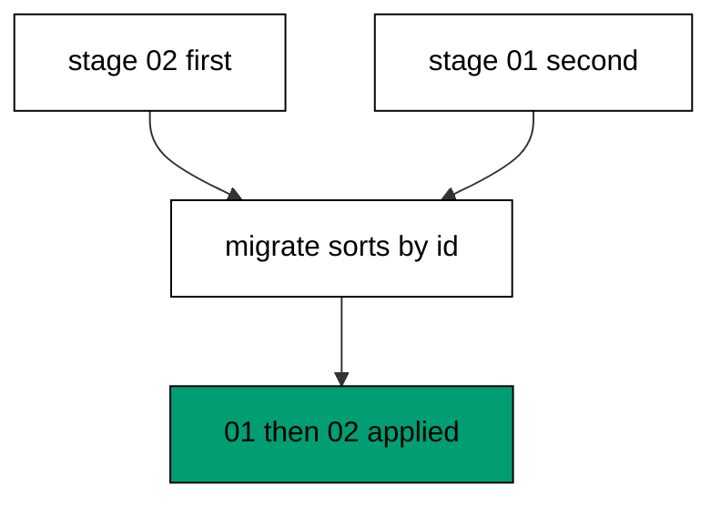

Migratus sorts pending migrations by numeric id before running anything, so staging order, file creation time, and directory listing order all lose to the id. This is what keeps parallel teams safe: two developers can stage files in any order and the database still converges on the same sequence. The history query reads the applied rows back in id order, which doubles as the merge contract every branch in the repository must honor. Order lives in the names, never in the clock.

**`learning/code/ex-06-ids-order-the-run/main.clj`**:

```clojure
;; => Example 6: Ids Order the Run.
;; => Creation order never matters: the numeric id fixes the apply order.
(require '[migratus.core :as migratus]) ;; => migrate, rollback, up, and down move history
(require '[next.jdbc :as jdbc]) ;; => verification reads prove each migration landed
(require '[next.jdbc.result-set :as rs]) ;; => unqualified rows print without table prefixes
(require '[clojure.java.io :as io]) ;; => migration files are staged, then removed
;; => The database address comes from the harness, with local-run defaults.
(defn db-spec [] ;; => one builder owns every address default
  {:dbtype "postgresql" ;; => pgjdbc speaks the PostgreSQL wire protocol
   :host (or (System/getenv "PGHOST") "localhost") ;; => harness sets the service host
   :port (Integer/parseInt (or (System/getenv "PGPORT") "5432")) ;; => service port default
   :dbname (or (System/getenv "PGDATABASE") "postgres") ;; => fresh database per unit run
   :user (or (System/getenv "PGUSER") "postgres")}) ;; => trust auth needs no password
;; => One config carries the store, the relative migration dir, and the history table.
(defn config [dir table] ;; => every example owns its dir and history table
  {:store :database ;; => the SQL store journals history in a table
   :migration-dir dir ;; => relative to the unit folder, staged at runtime
   :migration-table-name table ;; => per-example history isolates every rerun
   :db (db-spec)}) ;; => next.jdbc connects from this spec
;; => Staging writes one up/down pair per call into the relative dir.
(defn write-migration [dir id name up down] ;; => one helper stages every migration
  (spit (str dir "/" id "-" name ".up.sql") up) ;; => forward change runs on migrate
  (when down ;; => up-only examples skip the down file on purpose
    (spit (str dir "/" id "-" name ".down.sql") down))) ;; => reverse runs on rollback
;; => Reset clears leftovers of a killed run so reruns print alike.
(defn reset-unit! [ds dir table tables views] ;; => one reset owns every leftover
  (doseq [v views] ;; => views drop before the tables they read
    (jdbc/execute! ds [(str "DROP VIEW IF EXISTS " v)])) ;; => stale views vanish first
  (let [d (io/file dir)] ;; => the relative staging dir of this unit
    (when (.exists d) ;; => a killed run may leave files behind
      (doseq [f (.listFiles d)] ;; => every staged file goes first
        (.delete ^java.io.File f)) ;; => delete each staged migration
      (.delete d)) ;; => the empty staging dir goes too
    (.mkdirs d)) ;; => a fresh dir for this run
  (doseq [t tables] ;; => every table this example owns
    (jdbc/execute! ds [(str "DROP TABLE IF EXISTS " t " CASCADE")])) ;; => killed runs vanish
  (jdbc/execute! ds [(str "DROP TABLE IF EXISTS " table)])) ;; => stale history vanishes too
;; => Reads print their own proof; ids sort so output never depends on disk order.
(defn applied-names [ds table] ;; => applied migration names in id order
  (mapv :description ;; => description stores the migration name
    (jdbc/execute! ds [(str "SELECT description FROM " table " WHERE id > 0 ORDER BY id")] ;; => id order, reserve row excluded
                     {:builder-fn rs/as-unqualified-lower-maps}))) ;; => short keys print cleanly
;; => Column lists read the catalog, so the schema proves itself.
(defn table-columns [ds table] ;; => column names in position order
  (mapv :column_name ;; => one name per row, nothing else
    (jdbc/execute! ds [(str "SELECT column_name FROM information_schema.columns WHERE table_name = '" table "' ORDER BY ordinal_position")] ;; => catalog order is stable
                     {:builder-fn rs/as-unqualified-lower-maps}))) ;; => short keys print cleanly
(def ds (jdbc/get-datasource (db-spec))) ;; => one shared datasource per unit run
(def cfg (config "mig" "m06_migrations")) ;; => store plus history table for this example
(reset-unit! ds "mig" "m06_migrations" ["m06_alpha" "m06_beta"] []) ;; => leftovers of a killed run vanish first
(write-migration "mig" "20260101000602" "create-beta" ;; => higher id staged first on purpose
  "CREATE TABLE m06_beta (id SERIAL PRIMARY KEY);\n" ;; => beta table waits for its turn
  "DROP TABLE m06_beta;\n") ;; => reverse drops beta
(write-migration "mig" "20260101000601" "create-alpha" ;; => lower id staged second
  "CREATE TABLE m06_alpha (id SERIAL PRIMARY KEY);\n" ;; => alpha table runs first anyway
  "DROP TABLE m06_alpha;\n") ;; => reverse drops alpha
(println "migrate:" (pr-str (migratus/migrate cfg))) ;; => nil means every pending migration applied
(println "completed:" (pr-str (applied-names ds "m06_migrations"))) ;; => id order straight from history
(println "first:" (pr-str (first (applied-names ds "m06_migrations")))) ;; => lowest id applied first, not first staged
;; => Cleanup drops every object this example made, leaving no residue.
(defn cleanup-unit! [ds dir table tables views] ;; => one cleanup owns every created object
  (doseq [v views] ;; => views drop before the tables they read
    (jdbc/execute! ds [(str "DROP VIEW IF EXISTS " v)])) ;; => view residue vanishes
  (doseq [t tables] ;; => every table this example owns
    (jdbc/execute! ds [(str "DROP TABLE IF EXISTS " t " CASCADE")])) ;; => tables vanish with dependents
  (jdbc/execute! ds [(str "DROP TABLE IF EXISTS " table)]) ;; => history table vanishes too
  (let [d (io/file dir)] ;; => the staging dir from this run
    (when (.exists d) ;; => files were staged above
      (doseq [f (.listFiles d)] ;; => every staged file goes first
        (.delete ^java.io.File f)) ;; => delete each staged migration
      (.delete d)))) ;; => the empty staging dir goes too
(cleanup-unit! ds "mig" "m06_migrations" ["m06_alpha" "m06_beta"] []) ;; => drop every object this example created
```

**Output** (`learning/code/ex-06-ids-order-the-run/expected/main.stdout.txt`):

```text
migrate: nil
completed: ["create-alpha" "create-beta"]
first: "create-alpha"
```

**Key takeaway**: The numeric id fixes the apply order; nothing about files or timing overrides it.

**Why it matters**: Parallel work only converges when the order rule ignores everything but the artifact itself. Id-ordered migrations let developers work in any sequence and still land one linear history, because the database sorts by what the files declare. Teams that trust the id stop coordinating file creation and start coordinating numbers, which is a smaller, reviewable conversation.

### Example 7: Rerun Applies Nothing New

Deploys retry, containers restart, and pipelines re-run, so this example migrates twice and proves the second run is a no-op. The program prints both return values, the seed count, and the history size. (Concepts: co-05.)

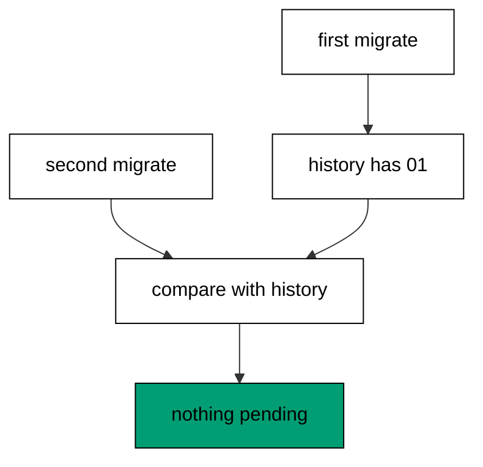

Before running anything, Migratus compares the staged files against the history table and removes every id it already finds: applied migrations never run again. The second `migrate` therefore returns the same success with zero work, and the seed row appears exactly once because its INSERT ran exactly once. This skip is the idempotence the whole course relies on, and it works because the history table is the single record of what ran. Rerunning a deploy is safe precisely when every step behaves this way.

**`learning/code/ex-07-rerun-applies-nothing-new/main.clj`**:

```clojure
;; => Example 7: Rerun Applies Nothing New.
;; => Applied migrations are skipped, so running twice changes the database once.
(require '[migratus.core :as migratus]) ;; => migrate, rollback, up, and down move history
(require '[next.jdbc :as jdbc]) ;; => verification reads prove each migration landed
(require '[next.jdbc.result-set :as rs]) ;; => unqualified rows print without table prefixes
(require '[clojure.java.io :as io]) ;; => migration files are staged, then removed
;; => The database address comes from the harness, with local-run defaults.
(defn db-spec [] ;; => one builder owns every address default
  {:dbtype "postgresql" ;; => pgjdbc speaks the PostgreSQL wire protocol
   :host (or (System/getenv "PGHOST") "localhost") ;; => harness sets the service host
   :port (Integer/parseInt (or (System/getenv "PGPORT") "5432")) ;; => service port default
   :dbname (or (System/getenv "PGDATABASE") "postgres") ;; => fresh database per unit run
   :user (or (System/getenv "PGUSER") "postgres")}) ;; => trust auth needs no password
;; => One config carries the store, the relative migration dir, and the history table.
(defn config [dir table] ;; => every example owns its dir and history table
  {:store :database ;; => the SQL store journals history in a table
   :migration-dir dir ;; => relative to the unit folder, staged at runtime
   :migration-table-name table ;; => per-example history isolates every rerun
   :db (db-spec)}) ;; => next.jdbc connects from this spec
;; => Staging writes one up/down pair per call into the relative dir.
(defn write-migration [dir id name up down] ;; => one helper stages every migration
  (spit (str dir "/" id "-" name ".up.sql") up) ;; => forward change runs on migrate
  (when down ;; => up-only examples skip the down file on purpose
    (spit (str dir "/" id "-" name ".down.sql") down))) ;; => reverse runs on rollback
;; => Reset clears leftovers of a killed run so reruns print alike.
(defn reset-unit! [ds dir table tables views] ;; => one reset owns every leftover
  (doseq [v views] ;; => views drop before the tables they read
    (jdbc/execute! ds [(str "DROP VIEW IF EXISTS " v)])) ;; => stale views vanish first
  (let [d (io/file dir)] ;; => the relative staging dir of this unit
    (when (.exists d) ;; => a killed run may leave files behind
      (doseq [f (.listFiles d)] ;; => every staged file goes first
        (.delete ^java.io.File f)) ;; => delete each staged migration
      (.delete d)) ;; => the empty staging dir goes too
    (.mkdirs d)) ;; => a fresh dir for this run
  (doseq [t tables] ;; => every table this example owns
    (jdbc/execute! ds [(str "DROP TABLE IF EXISTS " t " CASCADE")])) ;; => killed runs vanish
  (jdbc/execute! ds [(str "DROP TABLE IF EXISTS " table)])) ;; => stale history vanishes too
;; => Reads print their own proof; ids sort so output never depends on disk order.
(defn applied-names [ds table] ;; => applied migration names in id order
  (mapv :description ;; => description stores the migration name
    (jdbc/execute! ds [(str "SELECT description FROM " table " WHERE id > 0 ORDER BY id")] ;; => id order, reserve row excluded
                     {:builder-fn rs/as-unqualified-lower-maps}))) ;; => short keys print cleanly
;; => Column lists read the catalog, so the schema proves itself.
(defn table-columns [ds table] ;; => column names in position order
  (mapv :column_name ;; => one name per row, nothing else
    (jdbc/execute! ds [(str "SELECT column_name FROM information_schema.columns WHERE table_name = '" table "' ORDER BY ordinal_position")] ;; => catalog order is stable
                     {:builder-fn rs/as-unqualified-lower-maps}))) ;; => short keys print cleanly
(def ds (jdbc/get-datasource (db-spec))) ;; => one shared datasource per unit run
(def cfg (config "mig" "m07_migrations")) ;; => store plus history table for this example
(reset-unit! ds "mig" "m07_migrations" ["m07_counter"] []) ;; => leftovers of a killed run vanish first
(write-migration "mig" "20260101000701" "create-counter" ;; => one migration with a seed row
  (str "CREATE TABLE m07_counter (id SERIAL PRIMARY KEY, n INTEGER NOT NULL);\n" ;; => forward change creates the counter
       "--;;\n" ;; => separator splits schema from seed
       "INSERT INTO m07_counter (n) VALUES (41);\n") ;; => seed row lands with the schema
  "DROP TABLE m07_counter;\n") ;; => rollback removes table and seed together
(println "first:" (pr-str (migratus/migrate cfg))) ;; => first run applies the migration
(println "second:" (pr-str (migratus/migrate cfg))) ;; => second run finds nothing pending
(println "rows:" (pr-str (mapv :n ;; => seed counted back, not doubled
  (jdbc/execute! ds ["SELECT n FROM m07_counter ORDER BY id"] ;; => one row proves one application
                   {:builder-fn rs/as-unqualified-lower-maps})))) ;; => 41 appears exactly once
(println "runs:" (pr-str (:n (first (jdbc/execute! ds ["SELECT count(*) AS n FROM m07_migrations WHERE id > 0"] ;; => history holds one row after two runs
  {:builder-fn rs/as-unqualified-lower-maps}))))) ;; => skip keeps history at one
;; => Cleanup drops every object this example made, leaving no residue.
(defn cleanup-unit! [ds dir table tables views] ;; => one cleanup owns every created object
  (doseq [v views] ;; => views drop before the tables they read
    (jdbc/execute! ds [(str "DROP VIEW IF EXISTS " v)])) ;; => view residue vanishes
  (doseq [t tables] ;; => every table this example owns
    (jdbc/execute! ds [(str "DROP TABLE IF EXISTS " t " CASCADE")])) ;; => tables vanish with dependents
  (jdbc/execute! ds [(str "DROP TABLE IF EXISTS " table)]) ;; => history table vanishes too
  (let [d (io/file dir)] ;; => the staging dir from this run
    (when (.exists d) ;; => files were staged above
      (doseq [f (.listFiles d)] ;; => every staged file goes first
        (.delete ^java.io.File f)) ;; => delete each staged migration
      (.delete d)))) ;; => the empty staging dir goes too
(cleanup-unit! ds "mig" "m07_migrations" ["m07_counter"] []) ;; => drop every object this example created
```

**Output** (`learning/code/ex-07-rerun-applies-nothing-new/expected/main.stdout.txt`):

```text
first: nil
second: nil
rows: [41]
runs: 1
```

**Key takeaway**: Migratus skips applied migrations, so the second run changes nothing and the seed appears once.

**Why it matters**: Real deploys run twice: retries, restarts, and overlapping pipelines all re-apply the same history. A migration tool that cannot tell applied from pending would double every seed and duplicate every row on the first retry. The history comparison makes re-running the safe default instead of the dangerous accident, which is what lets teams rerun deploys without holding their breath.

### Example 8: Defaults Guard the New Column

Adding a required column to a table that already holds rows needs a default, so this example adds a strict age column with a server default. The program migrates and reads the default back from the catalog. (Concepts: co-01, co-06.)

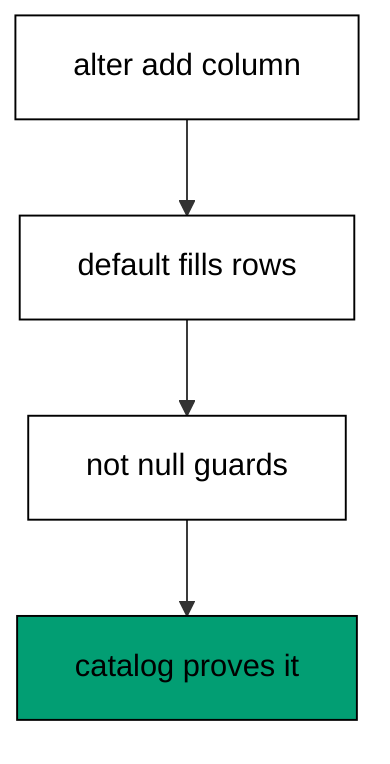

PostgreSQL fills the new column for every existing row from the DEFAULT expression in the same statement that adds it, so no row ever violates the NOT NULL guard. Without the default, the same statement fails on the first existing row and the whole migration rolls back. Reading `column_default` back from the catalog proves the database recorded the fill rule, not just the current values. Defaults are the bridge between a nullable present and a strict future, and this one-statement pattern is the safest crossing.

**`learning/code/ex-08-defaults-guard-the-new-column/main.clj`**:

```clojure
;; => Example 8: Defaults Guard the New Column.
;; => A server default fills existing rows the moment a strict column lands.
(require '[migratus.core :as migratus]) ;; => migrate, rollback, up, and down move history
(require '[next.jdbc :as jdbc]) ;; => verification reads prove each migration landed
(require '[next.jdbc.result-set :as rs]) ;; => unqualified rows print without table prefixes
(require '[clojure.java.io :as io]) ;; => migration files are staged, then removed
;; => The database address comes from the harness, with local-run defaults.
(defn db-spec [] ;; => one builder owns every address default
  {:dbtype "postgresql" ;; => pgjdbc speaks the PostgreSQL wire protocol
   :host (or (System/getenv "PGHOST") "localhost") ;; => harness sets the service host
   :port (Integer/parseInt (or (System/getenv "PGPORT") "5432")) ;; => service port default
   :dbname (or (System/getenv "PGDATABASE") "postgres") ;; => fresh database per unit run
   :user (or (System/getenv "PGUSER") "postgres")}) ;; => trust auth needs no password
;; => One config carries the store, the relative migration dir, and the history table.
(defn config [dir table] ;; => every example owns its dir and history table
  {:store :database ;; => the SQL store journals history in a table
   :migration-dir dir ;; => relative to the unit folder, staged at runtime
   :migration-table-name table ;; => per-example history isolates every rerun
   :db (db-spec)}) ;; => next.jdbc connects from this spec
;; => Staging writes one up/down pair per call into the relative dir.
(defn write-migration [dir id name up down] ;; => one helper stages every migration
  (spit (str dir "/" id "-" name ".up.sql") up) ;; => forward change runs on migrate
  (when down ;; => up-only examples skip the down file on purpose
    (spit (str dir "/" id "-" name ".down.sql") down))) ;; => reverse runs on rollback
;; => Reset clears leftovers of a killed run so reruns print alike.
(defn reset-unit! [ds dir table tables views] ;; => one reset owns every leftover
  (doseq [v views] ;; => views drop before the tables they read
    (jdbc/execute! ds [(str "DROP VIEW IF EXISTS " v)])) ;; => stale views vanish first
  (let [d (io/file dir)] ;; => the relative staging dir of this unit
    (when (.exists d) ;; => a killed run may leave files behind
      (doseq [f (.listFiles d)] ;; => every staged file goes first
        (.delete ^java.io.File f)) ;; => delete each staged migration
      (.delete d)) ;; => the empty staging dir goes too
    (.mkdirs d)) ;; => a fresh dir for this run
  (doseq [t tables] ;; => every table this example owns
    (jdbc/execute! ds [(str "DROP TABLE IF EXISTS " t " CASCADE")])) ;; => killed runs vanish
  (jdbc/execute! ds [(str "DROP TABLE IF EXISTS " table)])) ;; => stale history vanishes too
;; => Reads print their own proof; ids sort so output never depends on disk order.
(defn applied-names [ds table] ;; => applied migration names in id order
  (mapv :description ;; => description stores the migration name
    (jdbc/execute! ds [(str "SELECT description FROM " table " WHERE id > 0 ORDER BY id")] ;; => id order, reserve row excluded
                     {:builder-fn rs/as-unqualified-lower-maps}))) ;; => short keys print cleanly
;; => Column lists read the catalog, so the schema proves itself.
(defn table-columns [ds table] ;; => column names in position order
  (mapv :column_name ;; => one name per row, nothing else
    (jdbc/execute! ds [(str "SELECT column_name FROM information_schema.columns WHERE table_name = '" table "' ORDER BY ordinal_position")] ;; => catalog order is stable
                     {:builder-fn rs/as-unqualified-lower-maps}))) ;; => short keys print cleanly
(def ds (jdbc/get-datasource (db-spec))) ;; => one shared datasource per unit run
(def cfg (config "mig" "m08_migrations")) ;; => store plus history table for this example
(reset-unit! ds "mig" "m08_migrations" ["m08_member"] []) ;; => leftovers of a killed run vanish first
(write-migration "mig" "20260101000801" "create-member" ;; => one table with two required columns
  "CREATE TABLE m08_member (id SERIAL PRIMARY KEY, handle TEXT NOT NULL);\n" ;; => handle is required from the start
  "DROP TABLE m08_member;\n") ;; => reverse drops the table
(write-migration "mig" "20260101000802" "add-age" ;; => new column arrives with a default
  "ALTER TABLE m08_member ADD COLUMN age INTEGER DEFAULT 0 NOT NULL;\n" ;; => default fills old rows, strict guards new ones
  "ALTER TABLE m08_member DROP COLUMN age;\n") ;; => dropping the column undoes it
(println "migrate:" (pr-str (migratus/migrate cfg))) ;; => nil means every pending migration applied
(println "completed:" (pr-str (applied-names ds "m08_migrations"))) ;; => id order straight from history
(println "default:" (pr-str (mapv (juxt :column_name :column_default) ;; => only the new column printed
  (jdbc/execute! ds ["SELECT column_name, column_default FROM information_schema.columns WHERE table_name = 'm08_member' AND column_name = 'age'"] ;; => catalog names the server default
                   {:builder-fn rs/as-unqualified-lower-maps})))) ;; => 0 fills every existing row
;; => Cleanup drops every object this example made, leaving no residue.
(defn cleanup-unit! [ds dir table tables views] ;; => one cleanup owns every created object
  (doseq [v views] ;; => views drop before the tables they read
    (jdbc/execute! ds [(str "DROP VIEW IF EXISTS " v)])) ;; => view residue vanishes
  (doseq [t tables] ;; => every table this example owns
    (jdbc/execute! ds [(str "DROP TABLE IF EXISTS " t " CASCADE")])) ;; => tables vanish with dependents
  (jdbc/execute! ds [(str "DROP TABLE IF EXISTS " table)]) ;; => history table vanishes too
  (let [d (io/file dir)] ;; => the staging dir from this run
    (when (.exists d) ;; => files were staged above
      (doseq [f (.listFiles d)] ;; => every staged file goes first
        (.delete ^java.io.File f)) ;; => delete each staged migration
      (.delete d)))) ;; => the empty staging dir goes too
(cleanup-unit! ds "mig" "m08_migrations" ["m08_member"] []) ;; => drop every object this example created
```

**Output** (`learning/code/ex-08-defaults-guard-the-new-column/expected/main.stdout.txt`):

```text
migrate: nil
completed: ["create-member" "add-age"]
default: [["age" "0"]]
```

**Key takeaway**: Give a new strict column a server default: old rows fill at once, new rows stay guarded.

**Why it matters**: Production tables always have rows, so every strict column is really two changes: fill the past and guard the future. A server default does both atomically, which a separate backfill cannot promise without a locking dance. Teams that default first and constrain second never lock users out of writes, because the database never holds a row the new rule rejects.

### Example 9: History Table Is the Source of Truth

Every migration decision starts by reading the journal, so this example inspects the history table itself. The program migrates once, then prints the journal columns and its single row without timestamps. (Concepts: co-03.)

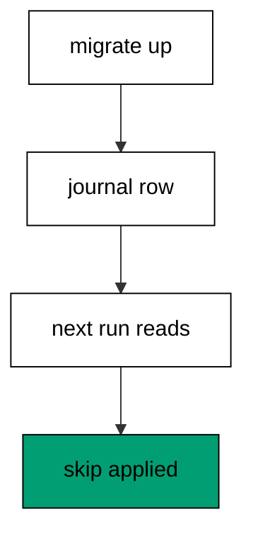

Migratus creates the history table on first connect with four columns: the numeric id, the applied timestamp, the migration name as description, and a checksum reserved for repeatable migrations. The id column carries a uniqueness guard while a separate reserve row marks in-flight runs, so the table is both the record and the lock. Reading the columns back shows the contract every later example relies on: ids order history, names explain it, and timestamps are metadata to display, never data to assert. Programs print ids and names only, because timestamps would break byte-stable transcripts.

**`learning/code/ex-09-history-table-is-the-source-of-truth/main.clj`**:

```clojure
;; => Example 9: History Table Is the Source of Truth.
;; => The database journals itself: four columns record every applied migration.
(require '[migratus.core :as migratus]) ;; => migrate, rollback, up, and down move history
(require '[next.jdbc :as jdbc]) ;; => verification reads prove each migration landed
(require '[next.jdbc.result-set :as rs]) ;; => unqualified rows print without table prefixes
(require '[clojure.java.io :as io]) ;; => migration files are staged, then removed
;; => The database address comes from the harness, with local-run defaults.
(defn db-spec [] ;; => one builder owns every address default
  {:dbtype "postgresql" ;; => pgjdbc speaks the PostgreSQL wire protocol
   :host (or (System/getenv "PGHOST") "localhost") ;; => harness sets the service host
   :port (Integer/parseInt (or (System/getenv "PGPORT") "5432")) ;; => service port default
   :dbname (or (System/getenv "PGDATABASE") "postgres") ;; => fresh database per unit run
   :user (or (System/getenv "PGUSER") "postgres")}) ;; => trust auth needs no password
;; => One config carries the store, the relative migration dir, and the history table.
(defn config [dir table] ;; => every example owns its dir and history table
  {:store :database ;; => the SQL store journals history in a table
   :migration-dir dir ;; => relative to the unit folder, staged at runtime
   :migration-table-name table ;; => per-example history isolates every rerun
   :db (db-spec)}) ;; => next.jdbc connects from this spec
;; => Staging writes one up/down pair per call into the relative dir.
(defn write-migration [dir id name up down] ;; => one helper stages every migration
  (spit (str dir "/" id "-" name ".up.sql") up) ;; => forward change runs on migrate
  (when down ;; => up-only examples skip the down file on purpose
    (spit (str dir "/" id "-" name ".down.sql") down))) ;; => reverse runs on rollback
;; => Reset clears leftovers of a killed run so reruns print alike.
(defn reset-unit! [ds dir table tables views] ;; => one reset owns every leftover
  (doseq [v views] ;; => views drop before the tables they read
    (jdbc/execute! ds [(str "DROP VIEW IF EXISTS " v)])) ;; => stale views vanish first
  (let [d (io/file dir)] ;; => the relative staging dir of this unit
    (when (.exists d) ;; => a killed run may leave files behind
      (doseq [f (.listFiles d)] ;; => every staged file goes first
        (.delete ^java.io.File f)) ;; => delete each staged migration
      (.delete d)) ;; => the empty staging dir goes too
    (.mkdirs d)) ;; => a fresh dir for this run
  (doseq [t tables] ;; => every table this example owns
    (jdbc/execute! ds [(str "DROP TABLE IF EXISTS " t " CASCADE")])) ;; => killed runs vanish
  (jdbc/execute! ds [(str "DROP TABLE IF EXISTS " table)])) ;; => stale history vanishes too
;; => Reads print their own proof; ids sort so output never depends on disk order.
(defn applied-names [ds table] ;; => applied migration names in id order
  (mapv :description ;; => description stores the migration name
    (jdbc/execute! ds [(str "SELECT description FROM " table " WHERE id > 0 ORDER BY id")] ;; => id order, reserve row excluded
                     {:builder-fn rs/as-unqualified-lower-maps}))) ;; => short keys print cleanly
;; => Column lists read the catalog, so the schema proves itself.
(defn table-columns [ds table] ;; => column names in position order
  (mapv :column_name ;; => one name per row, nothing else
    (jdbc/execute! ds [(str "SELECT column_name FROM information_schema.columns WHERE table_name = '" table "' ORDER BY ordinal_position")] ;; => catalog order is stable
                     {:builder-fn rs/as-unqualified-lower-maps}))) ;; => short keys print cleanly
(def ds (jdbc/get-datasource (db-spec))) ;; => one shared datasource per unit run
(def cfg (config "mig" "m09_migrations")) ;; => store plus history table for this example
(reset-unit! ds "mig" "m09_migrations" ["m09_ledger"] []) ;; => leftovers of a killed run vanish first
(write-migration "mig" "20260101000901" "create-ledger" ;; => one migration to leave a journal trace
  "CREATE TABLE m09_ledger (id SERIAL PRIMARY KEY, entry TEXT NOT NULL);\n" ;; => ledger table is the example payload
  "DROP TABLE m09_ledger;\n") ;; => reverse drops the ledger
(println "migrate:" (pr-str (migratus/migrate cfg))) ;; => nil means every pending migration applied
(println "completed:" (pr-str (applied-names ds "m09_migrations"))) ;; => id order straight from history
(println "journal-cols:" (pr-str (table-columns ds "m09_migrations"))) ;; => four fixed columns journal every run
(println "journal-row:" (pr-str (mapv (juxt :id :description) ;; => id plus name, never timestamps
  (jdbc/execute! ds ["SELECT id, description FROM m09_migrations WHERE id > 0 ORDER BY id"] ;; => timestamps stay out of the transcript
                   {:builder-fn rs/as-unqualified-lower-maps})))) ;; => one row proves one migration
;; => Cleanup drops every object this example made, leaving no residue.
(defn cleanup-unit! [ds dir table tables views] ;; => one cleanup owns every created object
  (doseq [v views] ;; => views drop before the tables they read
    (jdbc/execute! ds [(str "DROP VIEW IF EXISTS " v)])) ;; => view residue vanishes
  (doseq [t tables] ;; => every table this example owns
    (jdbc/execute! ds [(str "DROP TABLE IF EXISTS " t " CASCADE")])) ;; => tables vanish with dependents
  (jdbc/execute! ds [(str "DROP TABLE IF EXISTS " table)]) ;; => history table vanishes too
  (let [d (io/file dir)] ;; => the staging dir from this run
    (when (.exists d) ;; => files were staged above
      (doseq [f (.listFiles d)] ;; => every staged file goes first
        (.delete ^java.io.File f)) ;; => delete each staged migration
      (.delete d)))) ;; => the empty staging dir goes too
(cleanup-unit! ds "mig" "m09_migrations" ["m09_ledger"] []) ;; => drop every object this example created
```

**Output** (`learning/code/ex-09-history-table-is-the-source-of-truth/expected/main.stdout.txt`):

```text
migrate: nil
completed: ["create-ledger"]
journal-cols: ["id" "applied" "description" "checksum"]
journal-row: [[20260101000901 "create-ledger"]]
```

**Key takeaway**: The history table journals every run with id, timestamp, name, and checksum columns.

**Why it matters**: Debugging a deploy starts with one question: what does the database think already ran. A journal inside the database answers without build logs, chat history, or memory, and it answers the same way for every teammate. Teams that read the journal first diagnose in minutes, because the database cannot misremember what it recorded itself.

### Example 10: Applied and Pending Differ

A deploy that stops halfway leaves a split history, so this example brings up one of two migrations and reads both sides. The program prints applied and pending, finishes the run, and prints both sides again. (Concepts: co-03.)

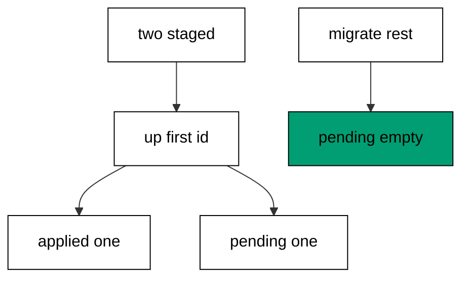

`completed-list` names the migrations the journal records, while `pending-list` names the staged files the journal lacks, and together they describe every position a deploy can be in. Bringing up one migration by id with `up` moves a single entry from pending to applied without touching the rest. The completed names print alphabetically here because the reader returns names only; the id-ordered history query in other examples shows the apply sequence. Reading both lists is the status check every deploy gate in this course is built on.

**`learning/code/ex-10-applied-and-pending-differ/main.clj`**:

```clojure
;; => Example 10: Applied and Pending Differ.
;; => Two readers split history: applied names what ran, pending names what remains.
(require '[migratus.core :as migratus]) ;; => migrate, rollback, up, and down move history
(require '[next.jdbc :as jdbc]) ;; => verification reads prove each migration landed
(require '[next.jdbc.result-set :as rs]) ;; => unqualified rows print without table prefixes
(require '[clojure.java.io :as io]) ;; => migration files are staged, then removed
;; => The database address comes from the harness, with local-run defaults.
(defn db-spec [] ;; => one builder owns every address default
  {:dbtype "postgresql" ;; => pgjdbc speaks the PostgreSQL wire protocol
   :host (or (System/getenv "PGHOST") "localhost") ;; => harness sets the service host
   :port (Integer/parseInt (or (System/getenv "PGPORT") "5432")) ;; => service port default
   :dbname (or (System/getenv "PGDATABASE") "postgres") ;; => fresh database per unit run
   :user (or (System/getenv "PGUSER") "postgres")}) ;; => trust auth needs no password
;; => One config carries the store, the relative migration dir, and the history table.
(defn config [dir table] ;; => every example owns its dir and history table
  {:store :database ;; => the SQL store journals history in a table
   :migration-dir dir ;; => relative to the unit folder, staged at runtime
   :migration-table-name table ;; => per-example history isolates every rerun
   :db (db-spec)}) ;; => next.jdbc connects from this spec
;; => Staging writes one up/down pair per call into the relative dir.
(defn write-migration [dir id name up down] ;; => one helper stages every migration
  (spit (str dir "/" id "-" name ".up.sql") up) ;; => forward change runs on migrate
  (when down ;; => up-only examples skip the down file on purpose
    (spit (str dir "/" id "-" name ".down.sql") down))) ;; => reverse runs on rollback
;; => Reset clears leftovers of a killed run so reruns print alike.
(defn reset-unit! [ds dir table tables views] ;; => one reset owns every leftover
  (doseq [v views] ;; => views drop before the tables they read
    (jdbc/execute! ds [(str "DROP VIEW IF EXISTS " v)])) ;; => stale views vanish first
  (let [d (io/file dir)] ;; => the relative staging dir of this unit
    (when (.exists d) ;; => a killed run may leave files behind
      (doseq [f (.listFiles d)] ;; => every staged file goes first
        (.delete ^java.io.File f)) ;; => delete each staged migration
      (.delete d)) ;; => the empty staging dir goes too
    (.mkdirs d)) ;; => a fresh dir for this run
  (doseq [t tables] ;; => every table this example owns
    (jdbc/execute! ds [(str "DROP TABLE IF EXISTS " t " CASCADE")])) ;; => killed runs vanish
  (jdbc/execute! ds [(str "DROP TABLE IF EXISTS " table)])) ;; => stale history vanishes too
;; => Reads print their own proof; ids sort so output never depends on disk order.
(defn applied-names [ds table] ;; => applied migration names in id order
  (mapv :description ;; => description stores the migration name
    (jdbc/execute! ds [(str "SELECT description FROM " table " WHERE id > 0 ORDER BY id")] ;; => id order, reserve row excluded
                     {:builder-fn rs/as-unqualified-lower-maps}))) ;; => short keys print cleanly
;; => Column lists read the catalog, so the schema proves itself.
(defn table-columns [ds table] ;; => column names in position order
  (mapv :column_name ;; => one name per row, nothing else
    (jdbc/execute! ds [(str "SELECT column_name FROM information_schema.columns WHERE table_name = '" table "' ORDER BY ordinal_position")] ;; => catalog order is stable
                     {:builder-fn rs/as-unqualified-lower-maps}))) ;; => short keys print cleanly
(def ds (jdbc/get-datasource (db-spec))) ;; => one shared datasource per unit run
(def cfg (config "mig" "m10_migrations")) ;; => store plus history table for this example
(reset-unit! ds "mig" "m10_migrations" ["m10_first" "m10_second"] []) ;; => leftovers of a killed run vanish first
(write-migration "mig" "20260101001001" "make-first" ;; => first of two staged migrations
  "CREATE TABLE m10_first (id SERIAL PRIMARY KEY);\n" ;; => first table is tiny
  "DROP TABLE m10_first;\n") ;; => reverse drops it
(write-migration "mig" "20260101001002" "make-second" ;; => second migration waits its turn
  "CREATE TABLE m10_second (id SERIAL PRIMARY KEY);\n" ;; => second table is tiny too
  "DROP TABLE m10_second;\n") ;; => reverse drops it
(println "bring-up:" (pr-str (migratus/up cfg 20260101001001))) ;; => bring up only the first migration by id
(println "completed:" (pr-str (sort (migratus/completed-list cfg)))) ;; => applied names the first only
(println "pending:" (pr-str (sort (migratus/pending-list cfg)))) ;; => pending names the second only
(println "migrate:" (pr-str (migratus/migrate cfg))) ;; => second run finishes the rest
(println "completed:" (pr-str (applied-names ds "m10_migrations"))) ;; => id order straight from history
(println "pending:" (pr-str (sort (migratus/pending-list cfg)))) ;; => nothing remains now
;; => Cleanup drops every object this example made, leaving no residue.
(defn cleanup-unit! [ds dir table tables views] ;; => one cleanup owns every created object
  (doseq [v views] ;; => views drop before the tables they read
    (jdbc/execute! ds [(str "DROP VIEW IF EXISTS " v)])) ;; => view residue vanishes
  (doseq [t tables] ;; => every table this example owns
    (jdbc/execute! ds [(str "DROP TABLE IF EXISTS " t " CASCADE")])) ;; => tables vanish with dependents
  (jdbc/execute! ds [(str "DROP TABLE IF EXISTS " table)]) ;; => history table vanishes too
  (let [d (io/file dir)] ;; => the staging dir from this run
    (when (.exists d) ;; => files were staged above
      (doseq [f (.listFiles d)] ;; => every staged file goes first
        (.delete ^java.io.File f)) ;; => delete each staged migration
      (.delete d)))) ;; => the empty staging dir goes too
(cleanup-unit! ds "mig" "m10_migrations" ["m10_first" "m10_second"] []) ;; => drop every object this example created
```

**Output** (`learning/code/ex-10-applied-and-pending-differ/expected/main.stdout.txt`):

```text
bring-up: nil
completed: ("make-first")
pending: ("make-second")
migrate: nil
completed: ["make-first" "make-second"]
pending: ()
```

**Key takeaway**: Applied names what ran, pending names what remains; the two lists always partition the staged files.

**Why it matters**: Half-applied deploys are normal, and guessing the position from logs is how teams double-apply or skip. Two readers that always agree turn position into a query instead of a reconstruction, so the next step is computed, never guessed. Teams that gate deploys on pending count never ship half a history, because the gate sees what humans cannot.

### Example 11: Up Runs One Migration by Id

Testing one migration against fixture data needs a targeted run, so this example brings up only the middle of three. The program applies the middle id alone, verifies the split, then finishes the set. (Concepts: co-03, co-13.)

`up` takes explicit ids and applies exactly those, skipping everything already complete and everything unlisted. Already-complete ids in the list are skipped silently, so repeating a targeted run is safe. The middle-first order here is deliberate: migrations must not depend on unlisted neighbors running first, and this shape proves each file stands alone. Full `migrate` afterwards converges the database to the same state as running everything at once, which is why targeted runs stay safe inside larger deploy sequences.

**`learning/code/ex-11-up-runs-one-migration-by-id/main.clj`**:

```clojure
;; => Example 11: Up Runs One Migration by Id.
;; => Targeted runs move one step: `up` applies a single id and skips the rest.
(require '[migratus.core :as migratus]) ;; => migrate, rollback, up, and down move history
(require '[next.jdbc :as jdbc]) ;; => verification reads prove each migration landed
(require '[next.jdbc.result-set :as rs]) ;; => unqualified rows print without table prefixes
(require '[clojure.java.io :as io]) ;; => migration files are staged, then removed
;; => The database address comes from the harness, with local-run defaults.
(defn db-spec [] ;; => one builder owns every address default
  {:dbtype "postgresql" ;; => pgjdbc speaks the PostgreSQL wire protocol
   :host (or (System/getenv "PGHOST") "localhost") ;; => harness sets the service host
   :port (Integer/parseInt (or (System/getenv "PGPORT") "5432")) ;; => service port default
   :dbname (or (System/getenv "PGDATABASE") "postgres") ;; => fresh database per unit run
   :user (or (System/getenv "PGUSER") "postgres")}) ;; => trust auth needs no password
;; => One config carries the store, the relative migration dir, and the history table.
(defn config [dir table] ;; => every example owns its dir and history table
  {:store :database ;; => the SQL store journals history in a table
   :migration-dir dir ;; => relative to the unit folder, staged at runtime
   :migration-table-name table ;; => per-example history isolates every rerun
   :db (db-spec)}) ;; => next.jdbc connects from this spec
;; => Staging writes one up/down pair per call into the relative dir.
(defn write-migration [dir id name up down] ;; => one helper stages every migration
  (spit (str dir "/" id "-" name ".up.sql") up) ;; => forward change runs on migrate
  (when down ;; => up-only examples skip the down file on purpose
    (spit (str dir "/" id "-" name ".down.sql") down))) ;; => reverse runs on rollback
;; => Reset clears leftovers of a killed run so reruns print alike.
(defn reset-unit! [ds dir table tables views] ;; => one reset owns every leftover
  (doseq [v views] ;; => views drop before the tables they read
    (jdbc/execute! ds [(str "DROP VIEW IF EXISTS " v)])) ;; => stale views vanish first
  (let [d (io/file dir)] ;; => the relative staging dir of this unit
    (when (.exists d) ;; => a killed run may leave files behind
      (doseq [f (.listFiles d)] ;; => every staged file goes first
        (.delete ^java.io.File f)) ;; => delete each staged migration
      (.delete d)) ;; => the empty staging dir goes too
    (.mkdirs d)) ;; => a fresh dir for this run
  (doseq [t tables] ;; => every table this example owns
    (jdbc/execute! ds [(str "DROP TABLE IF EXISTS " t " CASCADE")])) ;; => killed runs vanish
  (jdbc/execute! ds [(str "DROP TABLE IF EXISTS " table)])) ;; => stale history vanishes too
;; => Reads print their own proof; ids sort so output never depends on disk order.
(defn applied-names [ds table] ;; => applied migration names in id order
  (mapv :description ;; => description stores the migration name
    (jdbc/execute! ds [(str "SELECT description FROM " table " WHERE id > 0 ORDER BY id")] ;; => id order, reserve row excluded
                     {:builder-fn rs/as-unqualified-lower-maps}))) ;; => short keys print cleanly
;; => Column lists read the catalog, so the schema proves itself.
(defn table-columns [ds table] ;; => column names in position order
  (mapv :column_name ;; => one name per row, nothing else
    (jdbc/execute! ds [(str "SELECT column_name FROM information_schema.columns WHERE table_name = '" table "' ORDER BY ordinal_position")] ;; => catalog order is stable
                     {:builder-fn rs/as-unqualified-lower-maps}))) ;; => short keys print cleanly
(def ds (jdbc/get-datasource (db-spec))) ;; => one shared datasource per unit run
(def cfg (config "mig" "m11_migrations")) ;; => store plus history table for this example
(reset-unit! ds "mig" "m11_migrations" ["m11_a" "m11_b" "m11_c"] []) ;; => leftovers of a killed run vanish first
(write-migration "mig" "20260101001101" "make-a" ;; => three migrations staged at once
  "CREATE TABLE m11_a (id SERIAL PRIMARY KEY);\n" ;; => table a is first
  "DROP TABLE m11_a;\n") ;; => reverse drops a
(write-migration "mig" "20260101001102" "make-b" ;; => middle migration carries the change
  "CREATE TABLE m11_b (id SERIAL PRIMARY KEY);\n" ;; => table b is second
  "DROP TABLE m11_b;\n") ;; => reverse drops b
(write-migration "mig" "20260101001103" "make-c" ;; => last migration closes the set
  "CREATE TABLE m11_c (id SERIAL PRIMARY KEY);\n" ;; => table c is third
  "DROP TABLE m11_c;\n") ;; => reverse drops c
(println "up-b:" (pr-str (migratus/up cfg 20260101001102))) ;; => only the middle id runs now
(println "completed:" (pr-str (applied-names ds "m11_migrations"))) ;; => history holds the middle only
(println "migrate:" (pr-str (migratus/migrate cfg))) ;; => plain migrate finishes the set
(println "completed:" (pr-str (applied-names ds "m11_migrations"))) ;; => all three in id order now
;; => Cleanup drops every object this example made, leaving no residue.
(defn cleanup-unit! [ds dir table tables views] ;; => one cleanup owns every created object
  (doseq [v views] ;; => views drop before the tables they read
    (jdbc/execute! ds [(str "DROP VIEW IF EXISTS " v)])) ;; => view residue vanishes
  (doseq [t tables] ;; => every table this example owns
    (jdbc/execute! ds [(str "DROP TABLE IF EXISTS " t " CASCADE")])) ;; => tables vanish with dependents
  (jdbc/execute! ds [(str "DROP TABLE IF EXISTS " table)]) ;; => history table vanishes too
  (let [d (io/file dir)] ;; => the staging dir from this run
    (when (.exists d) ;; => files were staged above
      (doseq [f (.listFiles d)] ;; => every staged file goes first
        (.delete ^java.io.File f)) ;; => delete each staged migration
      (.delete d)))) ;; => the empty staging dir goes too
(cleanup-unit! ds "mig" "m11_migrations" ["m11_a" "m11_b" "m11_c"] []) ;; => drop every object this example created
```

**Output** (`learning/code/ex-11-up-runs-one-migration-by-id/expected/main.stdout.txt`):

```text
up-b: nil
completed: ["make-b"]
migrate: nil
completed: ["make-a" "make-b" "make-c"]
```

**Key takeaway**: `up` with explicit ids moves one step; a later full migrate converges the rest.

**Why it matters**: Testing migrations on fixture data beats testing them on production data, and targeted runs make that cheap. Bringing up one id against a known fixture proves the step in isolation before the whole history runs. Teams that test this way find ordering bugs in seconds, because each migration must declare its real dependencies instead of leaning on neighbors.

### Example 12: Gaps in Numbers Still Apply

Ids need not be consecutive, so this example stages the first and third numbers with the middle missing. The program migrates both and proves the gap blocks nothing. (Concepts: co-03, co-04.)

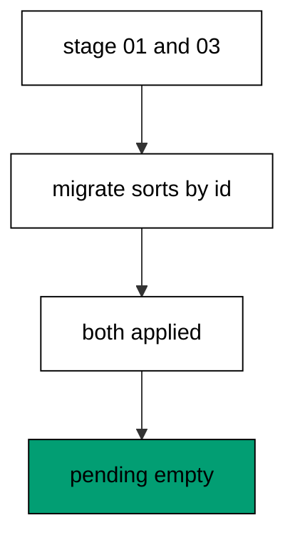

Migratus orders by numeric value and never assumes consecutive ids, because destroyed, renumbered, and reserved migrations leave holes in every long-lived history. The missing middle here stands in for any id a team removed or skipped: nothing references it, nothing waits for it, and pending stays empty with it absent. Histories that demanded consecutive numbers would break on every renumber; this one treats ids as positions on a line, not slots in an array. Gaps are normal wear, not damage.

**`learning/code/ex-12-gaps-in-numbers-still-apply/main.clj`**:

```clojure
;; => Example 12: Gaps in Numbers Still Apply.
;; => Deleted or reserved numbers leave gaps, and history crosses them without noticing.
(require '[migratus.core :as migratus]) ;; => migrate, rollback, up, and down move history
(require '[next.jdbc :as jdbc]) ;; => verification reads prove each migration landed
(require '[next.jdbc.result-set :as rs]) ;; => unqualified rows print without table prefixes
(require '[clojure.java.io :as io]) ;; => migration files are staged, then removed
;; => The database address comes from the harness, with local-run defaults.
(defn db-spec [] ;; => one builder owns every address default
  {:dbtype "postgresql" ;; => pgjdbc speaks the PostgreSQL wire protocol
   :host (or (System/getenv "PGHOST") "localhost") ;; => harness sets the service host
   :port (Integer/parseInt (or (System/getenv "PGPORT") "5432")) ;; => service port default
   :dbname (or (System/getenv "PGDATABASE") "postgres") ;; => fresh database per unit run
   :user (or (System/getenv "PGUSER") "postgres")}) ;; => trust auth needs no password
;; => One config carries the store, the relative migration dir, and the history table.
(defn config [dir table] ;; => every example owns its dir and history table
  {:store :database ;; => the SQL store journals history in a table
   :migration-dir dir ;; => relative to the unit folder, staged at runtime
   :migration-table-name table ;; => per-example history isolates every rerun
   :db (db-spec)}) ;; => next.jdbc connects from this spec
;; => Staging writes one up/down pair per call into the relative dir.
(defn write-migration [dir id name up down] ;; => one helper stages every migration
  (spit (str dir "/" id "-" name ".up.sql") up) ;; => forward change runs on migrate
  (when down ;; => up-only examples skip the down file on purpose
    (spit (str dir "/" id "-" name ".down.sql") down))) ;; => reverse runs on rollback
;; => Reset clears leftovers of a killed run so reruns print alike.
(defn reset-unit! [ds dir table tables views] ;; => one reset owns every leftover
  (doseq [v views] ;; => views drop before the tables they read
    (jdbc/execute! ds [(str "DROP VIEW IF EXISTS " v)])) ;; => stale views vanish first
  (let [d (io/file dir)] ;; => the relative staging dir of this unit
    (when (.exists d) ;; => a killed run may leave files behind
      (doseq [f (.listFiles d)] ;; => every staged file goes first
        (.delete ^java.io.File f)) ;; => delete each staged migration
      (.delete d)) ;; => the empty staging dir goes too
    (.mkdirs d)) ;; => a fresh dir for this run
  (doseq [t tables] ;; => every table this example owns
    (jdbc/execute! ds [(str "DROP TABLE IF EXISTS " t " CASCADE")])) ;; => killed runs vanish
  (jdbc/execute! ds [(str "DROP TABLE IF EXISTS " table)])) ;; => stale history vanishes too
;; => Reads print their own proof; ids sort so output never depends on disk order.
(defn applied-names [ds table] ;; => applied migration names in id order
  (mapv :description ;; => description stores the migration name
    (jdbc/execute! ds [(str "SELECT description FROM " table " WHERE id > 0 ORDER BY id")] ;; => id order, reserve row excluded
                     {:builder-fn rs/as-unqualified-lower-maps}))) ;; => short keys print cleanly
;; => Column lists read the catalog, so the schema proves itself.
(defn table-columns [ds table] ;; => column names in position order
  (mapv :column_name ;; => one name per row, nothing else
    (jdbc/execute! ds [(str "SELECT column_name FROM information_schema.columns WHERE table_name = '" table "' ORDER BY ordinal_position")] ;; => catalog order is stable
                     {:builder-fn rs/as-unqualified-lower-maps}))) ;; => short keys print cleanly
(def ds (jdbc/get-datasource (db-spec))) ;; => one shared datasource per unit run
(def cfg (config "mig" "m12_migrations")) ;; => store plus history table for this example
(reset-unit! ds "mig" "m12_migrations" ["m12_keep" "m12_skip_gap" "m12_last"] []) ;; => leftovers of a killed run vanish first
(write-migration "mig" "20260101001201" "keep-first" ;; => first id in the gapped series
  "CREATE TABLE m12_keep (id SERIAL PRIMARY KEY);\n" ;; => kept table runs first
  "DROP TABLE m12_keep;\n") ;; => reverse drops it
(write-migration "mig" "20260101001203" "after-gap" ;; => third id skips the missing middle
  "CREATE TABLE m12_last (id SERIAL PRIMARY KEY);\n" ;; => last table still applies
  "DROP TABLE m12_last;\n") ;; => reverse drops it
(println "migrate:" (pr-str (migratus/migrate cfg))) ;; => nil means every pending migration applied
(println "completed:" (pr-str (applied-names ds "m12_migrations"))) ;; => id order straight from history
(println "pending:" (pr-str (sort (migratus/pending-list cfg)))) ;; => the gap is not a pending migration
;; => Cleanup drops every object this example made, leaving no residue.
(defn cleanup-unit! [ds dir table tables views] ;; => one cleanup owns every created object
  (doseq [v views] ;; => views drop before the tables they read
    (jdbc/execute! ds [(str "DROP VIEW IF EXISTS " v)])) ;; => view residue vanishes
  (doseq [t tables] ;; => every table this example owns
    (jdbc/execute! ds [(str "DROP TABLE IF EXISTS " t " CASCADE")])) ;; => tables vanish with dependents
  (jdbc/execute! ds [(str "DROP TABLE IF EXISTS " table)]) ;; => history table vanishes too
  (let [d (io/file dir)] ;; => the staging dir from this run
    (when (.exists d) ;; => files were staged above
      (doseq [f (.listFiles d)] ;; => every staged file goes first
        (.delete ^java.io.File f)) ;; => delete each staged migration
      (.delete d)))) ;; => the empty staging dir goes too
(cleanup-unit! ds "mig" "m12_migrations" ["m12_keep" "m12_last"] []) ;; => drop every object this example created
```

**Output** (`learning/code/ex-12-gaps-in-numbers-still-apply/expected/main.stdout.txt`):

```text
migrate: nil
completed: ["keep-first" "after-gap"]
pending: ()
```

**Key takeaway**: Ids order history by value; missing numbers are skipped, never waited for.

**Why it matters**: Long histories always have holes: destroyed experiments, renumbered branches, and reserved blocks all leave gaps. A tool that demanded consecutive ids would turn every cleanup into a crisis, forcing teams to keep dead migrations forever. Gaps-as-normal keeps history honest about what ran without chaining it to what did not, which is what makes renumbering a safe, boring operation.

### Example 13: Fresh Database Builds Full History

Every new environment starts empty, so this example replays three migrations onto a fresh database. The program migrates once and proves all three tables landed in order. (Concepts: co-03, co-13.)

A fresh database has no history table, so the first connect creates it and the first migrate replays every staged file from the beginning. The foreign key in the middle proves ordering matters: the plan table cannot exist before its tenant target, and id order guarantees it never tries. This replay is also what new teammates, review apps, and rebuilt staging environments all do, which makes the full history the portable definition of the schema. If the replay works here, it works everywhere the same files run.

**`learning/code/ex-13-fresh-database-builds-full-history/main.clj`**:

```clojure
;; => Example 13: Fresh Database Builds Full History.
;; => A new environment replays the whole line: three files, one migrate, three rows.
(require '[migratus.core :as migratus]) ;; => migrate, rollback, up, and down move history
(require '[next.jdbc :as jdbc]) ;; => verification reads prove each migration landed
(require '[next.jdbc.result-set :as rs]) ;; => unqualified rows print without table prefixes
(require '[clojure.java.io :as io]) ;; => migration files are staged, then removed
;; => The database address comes from the harness, with local-run defaults.
(defn db-spec [] ;; => one builder owns every address default
  {:dbtype "postgresql" ;; => pgjdbc speaks the PostgreSQL wire protocol
   :host (or (System/getenv "PGHOST") "localhost") ;; => harness sets the service host
   :port (Integer/parseInt (or (System/getenv "PGPORT") "5432")) ;; => service port default
   :dbname (or (System/getenv "PGDATABASE") "postgres") ;; => fresh database per unit run
   :user (or (System/getenv "PGUSER") "postgres")}) ;; => trust auth needs no password
;; => One config carries the store, the relative migration dir, and the history table.
(defn config [dir table] ;; => every example owns its dir and history table
  {:store :database ;; => the SQL store journals history in a table
   :migration-dir dir ;; => relative to the unit folder, staged at runtime
   :migration-table-name table ;; => per-example history isolates every rerun
   :db (db-spec)}) ;; => next.jdbc connects from this spec
;; => Staging writes one up/down pair per call into the relative dir.
(defn write-migration [dir id name up down] ;; => one helper stages every migration
  (spit (str dir "/" id "-" name ".up.sql") up) ;; => forward change runs on migrate
  (when down ;; => up-only examples skip the down file on purpose
    (spit (str dir "/" id "-" name ".down.sql") down))) ;; => reverse runs on rollback
;; => Reset clears leftovers of a killed run so reruns print alike.
(defn reset-unit! [ds dir table tables views] ;; => one reset owns every leftover
  (doseq [v views] ;; => views drop before the tables they read
    (jdbc/execute! ds [(str "DROP VIEW IF EXISTS " v)])) ;; => stale views vanish first
  (let [d (io/file dir)] ;; => the relative staging dir of this unit
    (when (.exists d) ;; => a killed run may leave files behind
      (doseq [f (.listFiles d)] ;; => every staged file goes first
        (.delete ^java.io.File f)) ;; => delete each staged migration
      (.delete d)) ;; => the empty staging dir goes too
    (.mkdirs d)) ;; => a fresh dir for this run
  (doseq [t tables] ;; => every table this example owns
    (jdbc/execute! ds [(str "DROP TABLE IF EXISTS " t " CASCADE")])) ;; => killed runs vanish
  (jdbc/execute! ds [(str "DROP TABLE IF EXISTS " table)])) ;; => stale history vanishes too
;; => Reads print their own proof; ids sort so output never depends on disk order.
(defn applied-names [ds table] ;; => applied migration names in id order
  (mapv :description ;; => description stores the migration name
    (jdbc/execute! ds [(str "SELECT description FROM " table " WHERE id > 0 ORDER BY id")] ;; => id order, reserve row excluded
                     {:builder-fn rs/as-unqualified-lower-maps}))) ;; => short keys print cleanly
;; => Column lists read the catalog, so the schema proves itself.
(defn table-columns [ds table] ;; => column names in position order
  (mapv :column_name ;; => one name per row, nothing else
    (jdbc/execute! ds [(str "SELECT column_name FROM information_schema.columns WHERE table_name = '" table "' ORDER BY ordinal_position")] ;; => catalog order is stable
                     {:builder-fn rs/as-unqualified-lower-maps}))) ;; => short keys print cleanly
(def ds (jdbc/get-datasource (db-spec))) ;; => one shared datasource per unit run
(def cfg (config "mig" "m13_migrations")) ;; => store plus history table for this example
(reset-unit! ds "mig" "m13_migrations" ["m13_tenant" "m13_plan" "m13_link"] []) ;; => leftovers of a killed run vanish first
(write-migration "mig" "20260101001301" "make-tenant" ;; => first table of the fresh build
  "CREATE TABLE m13_tenant (id SERIAL PRIMARY KEY, name TEXT NOT NULL);\n" ;; => tenants come first
  "DROP TABLE m13_tenant;\n") ;; => reverse drops tenants
(write-migration "mig" "20260101001302" "make-plan" ;; => second table references the first
  (str "CREATE TABLE m13_plan (id SERIAL PRIMARY KEY, tenant_id INTEGER NOT NULL REFERENCES m13_tenant (id));\n" ;; => foreign key points at tenants
       "--;;\n" ;; => separator keeps statements separate
       "CREATE INDEX m13_plan_tenant_idx ON m13_plan (tenant_id);\n") ;; => index supports the join
  (str "DROP INDEX m13_plan_tenant_idx;\n" ;; => reverse drops the index first
       "--;;\n" ;; => same separator on the way down
       "DROP TABLE m13_plan;\n")) ;; => then the plan table goes
(write-migration "mig" "20260101001303" "make-link" ;; => third table closes the build
  "CREATE TABLE m13_link (id SERIAL PRIMARY KEY);\n" ;; => link table is tiny
  "DROP TABLE m13_link;\n") ;; => reverse drops it
(println "migrate:" (pr-str (migratus/migrate cfg))) ;; => nil means every pending migration applied
(println "completed:" (pr-str (applied-names ds "m13_migrations"))) ;; => id order straight from history
;; => Cleanup drops every object this example made, leaving no residue.
(defn cleanup-unit! [ds dir table tables views] ;; => one cleanup owns every created object
  (doseq [v views] ;; => views drop before the tables they read
    (jdbc/execute! ds [(str "DROP VIEW IF EXISTS " v)])) ;; => view residue vanishes
  (doseq [t tables] ;; => every table this example owns
    (jdbc/execute! ds [(str "DROP TABLE IF EXISTS " t " CASCADE")])) ;; => tables vanish with dependents
  (jdbc/execute! ds [(str "DROP TABLE IF EXISTS " table)]) ;; => history table vanishes too
  (let [d (io/file dir)] ;; => the staging dir from this run
    (when (.exists d) ;; => files were staged above
      (doseq [f (.listFiles d)] ;; => every staged file goes first
        (.delete ^java.io.File f)) ;; => delete each staged migration
      (.delete d)))) ;; => the empty staging dir goes too
(cleanup-unit! ds "mig" "m13_migrations" ["m13_tenant" "m13_plan" "m13_link"] []) ;; => drop every object this example created
```

**Output** (`learning/code/ex-13-fresh-database-builds-full-history/expected/main.stdout.txt`):

```text
migrate: nil
completed: ["make-tenant" "make-plan" "make-link"]
```

**Key takeaway**: A fresh database replays the whole history in id order; the same files build every environment.

**Why it matters**: Environments multiply: laptops, review apps, staging, production, and the next hire's first day. A migration history that replays cleanly makes every one of them the same database by construction, instead of by careful manual setup. Teams that trust the replay onboard in minutes, because the schema arrives with the code instead of in a wiki page.

### Example 14: Journal Name Is Configurable

Separate concerns need separate journals, so this example migrates into a custom history table. The program records one migration under a team name and proves the default journal stayed untouched. (Concepts: co-03.)

The `:migration-table-name` key renames the journal per config, so one database can track several independent histories without them seeing each other. Custom journals isolate tenants, services sharing a cluster, and per-example histories like the ones this course uses for every unit. The default table never appears here because no config in this program names it, which proves the isolation runs both ways. Naming the journal is a deployment decision, not a code change: the same files migrate under any name.

**`learning/code/ex-14-journal-name-is-configurable/main.clj`**:

```clojure
;; => Example 14: Journal Name Is Configurable.
;; => One database can journal several histories apart through different table names.
(require '[migratus.core :as migratus]) ;; => migrate, rollback, up, and down move history
(require '[next.jdbc :as jdbc]) ;; => verification reads prove each migration landed
(require '[next.jdbc.result-set :as rs]) ;; => unqualified rows print without table prefixes
(require '[clojure.java.io :as io]) ;; => migration files are staged, then removed
;; => The database address comes from the harness, with local-run defaults.
(defn db-spec [] ;; => one builder owns every address default
  {:dbtype "postgresql" ;; => pgjdbc speaks the PostgreSQL wire protocol
   :host (or (System/getenv "PGHOST") "localhost") ;; => harness sets the service host
   :port (Integer/parseInt (or (System/getenv "PGPORT") "5432")) ;; => service port default
   :dbname (or (System/getenv "PGDATABASE") "postgres") ;; => fresh database per unit run
   :user (or (System/getenv "PGUSER") "postgres")}) ;; => trust auth needs no password
;; => One config carries the store, the relative migration dir, and the history table.
(defn config [dir table] ;; => every example owns its dir and history table
  {:store :database ;; => the SQL store journals history in a table
   :migration-dir dir ;; => relative to the unit folder, staged at runtime
   :migration-table-name table ;; => per-example history isolates every rerun
   :db (db-spec)}) ;; => next.jdbc connects from this spec
;; => Staging writes one up/down pair per call into the relative dir.
(defn write-migration [dir id name up down] ;; => one helper stages every migration
  (spit (str dir "/" id "-" name ".up.sql") up) ;; => forward change runs on migrate
  (when down ;; => up-only examples skip the down file on purpose
    (spit (str dir "/" id "-" name ".down.sql") down))) ;; => reverse runs on rollback
;; => Reset clears leftovers of a killed run so reruns print alike.
(defn reset-unit! [ds dir table tables views] ;; => one reset owns every leftover
  (doseq [v views] ;; => views drop before the tables they read
    (jdbc/execute! ds [(str "DROP VIEW IF EXISTS " v)])) ;; => stale views vanish first
  (let [d (io/file dir)] ;; => the relative staging dir of this unit
    (when (.exists d) ;; => a killed run may leave files behind
      (doseq [f (.listFiles d)] ;; => every staged file goes first
        (.delete ^java.io.File f)) ;; => delete each staged migration
      (.delete d)) ;; => the empty staging dir goes too
    (.mkdirs d)) ;; => a fresh dir for this run
  (doseq [t tables] ;; => every table this example owns
    (jdbc/execute! ds [(str "DROP TABLE IF EXISTS " t " CASCADE")])) ;; => killed runs vanish
  (jdbc/execute! ds [(str "DROP TABLE IF EXISTS " table)])) ;; => stale history vanishes too
;; => Reads print their own proof; ids sort so output never depends on disk order.
(defn applied-names [ds table] ;; => applied migration names in id order
  (mapv :description ;; => description stores the migration name
    (jdbc/execute! ds [(str "SELECT description FROM " table " WHERE id > 0 ORDER BY id")] ;; => id order, reserve row excluded
                     {:builder-fn rs/as-unqualified-lower-maps}))) ;; => short keys print cleanly
;; => Column lists read the catalog, so the schema proves itself.
(defn table-columns [ds table] ;; => column names in position order
  (mapv :column_name ;; => one name per row, nothing else
    (jdbc/execute! ds [(str "SELECT column_name FROM information_schema.columns WHERE table_name = '" table "' ORDER BY ordinal_position")] ;; => catalog order is stable
                     {:builder-fn rs/as-unqualified-lower-maps}))) ;; => short keys print cleanly
(def ds (jdbc/get-datasource (db-spec))) ;; => one shared datasource per unit run
(def cfg (config "mig" "m14_migrations")) ;; => store plus history table for this example
(reset-unit! ds "mig" "m14_migrations" ["m14_widget" "team_journal"] []) ;; => leftovers of a killed run vanish first
(def cfg-team (assoc cfg :migration-table-name "team_journal")) ;; => second history lives beside the default
(write-migration "mig" "20260101001401" "make-widget" ;; => one migration shared by both journals
  "CREATE TABLE m14_widget (id SERIAL PRIMARY KEY);\n" ;; => widget table is tiny
  "DROP TABLE m14_widget;\n") ;; => reverse drops it
(println "migrate:" (pr-str (migratus/migrate cfg-team))) ;; => migrate records into the team journal
(println "team:" (pr-str (applied-names ds "team_journal"))) ;; => team journal holds the migration
(println "default:" (pr-str (jdbc/execute! ds ["SELECT table_name FROM information_schema.tables WHERE table_name = 'm14_migrations'"] ;; => default journal table was never created
  {:builder-fn rs/as-unqualified-lower-maps}))) ;; => empty list proves isolation
(jdbc/execute! ds ["DROP TABLE IF EXISTS team_journal"]) ;; => team journal drops with the rest
;; => Cleanup drops every object this example made, leaving no residue.
(defn cleanup-unit! [ds dir table tables views] ;; => one cleanup owns every created object
  (doseq [v views] ;; => views drop before the tables they read
    (jdbc/execute! ds [(str "DROP VIEW IF EXISTS " v)])) ;; => view residue vanishes
  (doseq [t tables] ;; => every table this example owns
    (jdbc/execute! ds [(str "DROP TABLE IF EXISTS " t " CASCADE")])) ;; => tables vanish with dependents
  (jdbc/execute! ds [(str "DROP TABLE IF EXISTS " table)]) ;; => history table vanishes too
  (let [d (io/file dir)] ;; => the staging dir from this run
    (when (.exists d) ;; => files were staged above
      (doseq [f (.listFiles d)] ;; => every staged file goes first
        (.delete ^java.io.File f)) ;; => delete each staged migration
      (.delete d)))) ;; => the empty staging dir goes too
(cleanup-unit! ds "mig" "m14_migrations" ["m14_widget" "team_journal"] []) ;; => drop every object this example created
```

**Output** (`learning/code/ex-14-journal-name-is-configurable/expected/main.stdout.txt`):

```text
migrate: nil
team: ["make-widget"]
default: []
```

**Key takeaway**: Rename the journal per config to isolate histories sharing one database.

**Why it matters**: Shared clusters host many services, and one journal for all of them would tangle deploys together. Named journals let each history move at its own pace while sharing the same server, which keeps small services independent of big ones. Teams that name journals per concern debug one history at a time, because no other service's rows pollute the view.

### Example 15: Empty Run Still Builds the Home

An empty migration directory is a valid state, so this example migrates with no files staged. The program proves the journal exists, the run succeeds, and nothing is recorded. (Concepts: co-03, co-10.)

Connecting always ensures the history table exists before comparing anything, so even a fileless run builds the journal home. The empty result is meaningful: it tells a deploy gate the database is ready and current, not broken or unreachable. This state appears in fresh services before their first migration lands and in tenants that share a schema with no changes of their own. Empty means ready, and the journal table is the receipt.

**`learning/code/ex-15-empty-run-still-builds-the-home/main.clj`**:

```clojure
;; => Example 15: Empty Run Still Builds the Home.
;; => Migrating with no files creates the journal and applies nothing: the home before history.
(require '[migratus.core :as migratus]) ;; => migrate, rollback, up, and down move history
(require '[next.jdbc :as jdbc]) ;; => verification reads prove each migration landed
(require '[next.jdbc.result-set :as rs]) ;; => unqualified rows print without table prefixes
(require '[clojure.java.io :as io]) ;; => migration files are staged, then removed
;; => The database address comes from the harness, with local-run defaults.
(defn db-spec [] ;; => one builder owns every address default
  {:dbtype "postgresql" ;; => pgjdbc speaks the PostgreSQL wire protocol
   :host (or (System/getenv "PGHOST") "localhost") ;; => harness sets the service host
   :port (Integer/parseInt (or (System/getenv "PGPORT") "5432")) ;; => service port default
   :dbname (or (System/getenv "PGDATABASE") "postgres") ;; => fresh database per unit run
   :user (or (System/getenv "PGUSER") "postgres")}) ;; => trust auth needs no password
;; => One config carries the store, the relative migration dir, and the history table.
(defn config [dir table] ;; => every example owns its dir and history table
  {:store :database ;; => the SQL store journals history in a table
   :migration-dir dir ;; => relative to the unit folder, staged at runtime
   :migration-table-name table ;; => per-example history isolates every rerun
   :db (db-spec)}) ;; => next.jdbc connects from this spec
;; => Staging writes one up/down pair per call into the relative dir.
(defn write-migration [dir id name up down] ;; => one helper stages every migration
  (spit (str dir "/" id "-" name ".up.sql") up) ;; => forward change runs on migrate
  (when down ;; => up-only examples skip the down file on purpose
    (spit (str dir "/" id "-" name ".down.sql") down))) ;; => reverse runs on rollback
;; => Reset clears leftovers of a killed run so reruns print alike.
(defn reset-unit! [ds dir table tables views] ;; => one reset owns every leftover
  (doseq [v views] ;; => views drop before the tables they read
    (jdbc/execute! ds [(str "DROP VIEW IF EXISTS " v)])) ;; => stale views vanish first
  (let [d (io/file dir)] ;; => the relative staging dir of this unit
    (when (.exists d) ;; => a killed run may leave files behind
      (doseq [f (.listFiles d)] ;; => every staged file goes first
        (.delete ^java.io.File f)) ;; => delete each staged migration
      (.delete d)) ;; => the empty staging dir goes too
    (.mkdirs d)) ;; => a fresh dir for this run
  (doseq [t tables] ;; => every table this example owns
    (jdbc/execute! ds [(str "DROP TABLE IF EXISTS " t " CASCADE")])) ;; => killed runs vanish
  (jdbc/execute! ds [(str "DROP TABLE IF EXISTS " table)])) ;; => stale history vanishes too
;; => Reads print their own proof; ids sort so output never depends on disk order.
(defn applied-names [ds table] ;; => applied migration names in id order
  (mapv :description ;; => description stores the migration name
    (jdbc/execute! ds [(str "SELECT description FROM " table " WHERE id > 0 ORDER BY id")] ;; => id order, reserve row excluded
                     {:builder-fn rs/as-unqualified-lower-maps}))) ;; => short keys print cleanly
;; => Column lists read the catalog, so the schema proves itself.
(defn table-columns [ds table] ;; => column names in position order
  (mapv :column_name ;; => one name per row, nothing else
    (jdbc/execute! ds [(str "SELECT column_name FROM information_schema.columns WHERE table_name = '" table "' ORDER BY ordinal_position")] ;; => catalog order is stable
                     {:builder-fn rs/as-unqualified-lower-maps}))) ;; => short keys print cleanly
(def ds (jdbc/get-datasource (db-spec))) ;; => one shared datasource per unit run
(def cfg (config "mig" "m15_migrations")) ;; => store plus history table for this example
(reset-unit! ds "mig" "m15_migrations" [] []) ;; => leftovers of a killed run vanish first
(println "migrate:" (pr-str (migratus/migrate cfg))) ;; => nil means every pending migration applied
(println "completed:" (pr-str (applied-names ds "m15_migrations"))) ;; => id order straight from history
(println "journal:" (pr-str (mapv :table_name ;; => journal table exists with no rows
  (jdbc/execute! ds ["SELECT table_name FROM information_schema.tables WHERE table_name = 'm15_migrations'"] ;; => connect created the home
                   {:builder-fn rs/as-unqualified-lower-maps})))) ;; => present but empty is the point
;; => Cleanup drops every object this example made, leaving no residue.
(defn cleanup-unit! [ds dir table tables views] ;; => one cleanup owns every created object
  (doseq [v views] ;; => views drop before the tables they read
    (jdbc/execute! ds [(str "DROP VIEW IF EXISTS " v)])) ;; => view residue vanishes
  (doseq [t tables] ;; => every table this example owns
    (jdbc/execute! ds [(str "DROP TABLE IF EXISTS " t " CASCADE")])) ;; => tables vanish with dependents
  (jdbc/execute! ds [(str "DROP TABLE IF EXISTS " table)]) ;; => history table vanishes too
  (let [d (io/file dir)] ;; => the staging dir from this run
    (when (.exists d) ;; => files were staged above
      (doseq [f (.listFiles d)] ;; => every staged file goes first
        (.delete ^java.io.File f)) ;; => delete each staged migration
      (.delete d)))) ;; => the empty staging dir goes too
(cleanup-unit! ds "mig" "m15_migrations" [] []) ;; => drop every object this example created
```

**Output** (`learning/code/ex-15-empty-run-still-builds-the-home/expected/main.stdout.txt`):

```text
migrate: nil
completed: []
journal: ["m15_migrations"]
```

**Key takeaway**: A fileless run succeeds with an empty journal: ready and current, not broken.

**Why it matters**: Services start before their first schema change, and the deploy pipeline must tell ready apart from broken. An empty-but-successful run is that signal: the tooling works, the journal waits, and nothing is owed. Teams that treat empty as healthy stop paging over new services, because readiness and currency share one check.

### Example 16: Rollback Then Rebuild

Migrations must survive the down-then-up cycle, so this example builds, rolls back, and rebuilds the same file. The program prints both completions and proves the seed appears exactly once. (Concepts: co-08, co-16.)

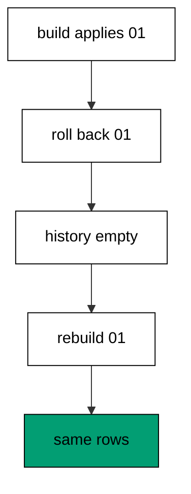

Rollback removes the history row and runs the down file, returning the database to its pre-migration shape with no trace left behind. Rebuilding then replays the up file from scratch, which only works when the down file truly undid everything: leftover objects would collide with the replay. The single seed row at the end proves the round trip is exact, because a sloppy down file would leave either a missing table or a doubled seed. This cycle is the migration test in miniature, and every example that rolls back runs a version of it.

**`learning/code/ex-16-rollback-then-rebuild/main.clj`**:

```clojure
;; => Example 16: Rollback Then Rebuild.
;; => Tear the history down and replay it: the rebuild must equal the first build.
(require '[migratus.core :as migratus]) ;; => migrate, rollback, up, and down move history
(require '[next.jdbc :as jdbc]) ;; => verification reads prove each migration landed
(require '[next.jdbc.result-set :as rs]) ;; => unqualified rows print without table prefixes
(require '[clojure.java.io :as io]) ;; => migration files are staged, then removed
;; => The database address comes from the harness, with local-run defaults.
(defn db-spec [] ;; => one builder owns every address default
  {:dbtype "postgresql" ;; => pgjdbc speaks the PostgreSQL wire protocol
   :host (or (System/getenv "PGHOST") "localhost") ;; => harness sets the service host
   :port (Integer/parseInt (or (System/getenv "PGPORT") "5432")) ;; => service port default
   :dbname (or (System/getenv "PGDATABASE") "postgres") ;; => fresh database per unit run
   :user (or (System/getenv "PGUSER") "postgres")}) ;; => trust auth needs no password
;; => One config carries the store, the relative migration dir, and the history table.
(defn config [dir table] ;; => every example owns its dir and history table
  {:store :database ;; => the SQL store journals history in a table
   :migration-dir dir ;; => relative to the unit folder, staged at runtime
   :migration-table-name table ;; => per-example history isolates every rerun
   :db (db-spec)}) ;; => next.jdbc connects from this spec
;; => Staging writes one up/down pair per call into the relative dir.
(defn write-migration [dir id name up down] ;; => one helper stages every migration
  (spit (str dir "/" id "-" name ".up.sql") up) ;; => forward change runs on migrate
  (when down ;; => up-only examples skip the down file on purpose
    (spit (str dir "/" id "-" name ".down.sql") down))) ;; => reverse runs on rollback
;; => Reset clears leftovers of a killed run so reruns print alike.
(defn reset-unit! [ds dir table tables views] ;; => one reset owns every leftover
  (doseq [v views] ;; => views drop before the tables they read
    (jdbc/execute! ds [(str "DROP VIEW IF EXISTS " v)])) ;; => stale views vanish first
  (let [d (io/file dir)] ;; => the relative staging dir of this unit
    (when (.exists d) ;; => a killed run may leave files behind
      (doseq [f (.listFiles d)] ;; => every staged file goes first
        (.delete ^java.io.File f)) ;; => delete each staged migration
      (.delete d)) ;; => the empty staging dir goes too
    (.mkdirs d)) ;; => a fresh dir for this run
  (doseq [t tables] ;; => every table this example owns
    (jdbc/execute! ds [(str "DROP TABLE IF EXISTS " t " CASCADE")])) ;; => killed runs vanish
  (jdbc/execute! ds [(str "DROP TABLE IF EXISTS " table)])) ;; => stale history vanishes too
;; => Reads print their own proof; ids sort so output never depends on disk order.
(defn applied-names [ds table] ;; => applied migration names in id order
  (mapv :description ;; => description stores the migration name
    (jdbc/execute! ds [(str "SELECT description FROM " table " WHERE id > 0 ORDER BY id")] ;; => id order, reserve row excluded
                     {:builder-fn rs/as-unqualified-lower-maps}))) ;; => short keys print cleanly
;; => Column lists read the catalog, so the schema proves itself.
(defn table-columns [ds table] ;; => column names in position order
  (mapv :column_name ;; => one name per row, nothing else
    (jdbc/execute! ds [(str "SELECT column_name FROM information_schema.columns WHERE table_name = '" table "' ORDER BY ordinal_position")] ;; => catalog order is stable
                     {:builder-fn rs/as-unqualified-lower-maps}))) ;; => short keys print cleanly
(def ds (jdbc/get-datasource (db-spec))) ;; => one shared datasource per unit run
(def cfg (config "mig" "m16_migrations")) ;; => store plus history table for this example
(reset-unit! ds "mig" "m16_migrations" ["m16_node"] []) ;; => leftovers of a killed run vanish first
(write-migration "mig" "20260101001601" "make-node" ;; => one migration exercised twice over
  (str "CREATE TABLE m16_node (id SERIAL PRIMARY KEY, label TEXT NOT NULL);\n" ;; => forward change creates the node
       "--;;\n" ;; => separator splits schema from seed
       "INSERT INTO m16_node (label) VALUES ('alpha');\n") ;; => seed lands with the schema
  "DROP TABLE m16_node;\n") ;; => rollback removes table and seed together
(println "build:" (pr-str (migratus/migrate cfg))) ;; => first build applies the migration
(println "rollback:" (pr-str (migratus/rollback cfg))) ;; => tear the history back down
(println "completed:" (pr-str (applied-names ds "m16_migrations"))) ;; => history is empty between builds
(println "rebuild:" (pr-str (migratus/migrate cfg))) ;; => second build replays the file
(println "completed:" (pr-str (applied-names ds "m16_migrations"))) ;; => history matches the first build
(println "rows:" (pr-str (mapv :label ;; => seed is back exactly once
  (jdbc/execute! ds ["SELECT label FROM m16_node ORDER BY id"] ;; => one row proves one application
                   {:builder-fn rs/as-unqualified-lower-maps})))) ;; => alpha appears exactly once
;; => Cleanup drops every object this example made, leaving no residue.
(defn cleanup-unit! [ds dir table tables views] ;; => one cleanup owns every created object
  (doseq [v views] ;; => views drop before the tables they read
    (jdbc/execute! ds [(str "DROP VIEW IF EXISTS " v)])) ;; => view residue vanishes
  (doseq [t tables] ;; => every table this example owns
    (jdbc/execute! ds [(str "DROP TABLE IF EXISTS " t " CASCADE")])) ;; => tables vanish with dependents
  (jdbc/execute! ds [(str "DROP TABLE IF EXISTS " table)]) ;; => history table vanishes too
  (let [d (io/file dir)] ;; => the staging dir from this run
    (when (.exists d) ;; => files were staged above
      (doseq [f (.listFiles d)] ;; => every staged file goes first
        (.delete ^java.io.File f)) ;; => delete each staged migration
      (.delete d)))) ;; => the empty staging dir goes too
(cleanup-unit! ds "mig" "m16_migrations" ["m16_node"] []) ;; => drop every object this example created
```

**Output** (`learning/code/ex-16-rollback-then-rebuild/expected/main.stdout.txt`):

```text
build: nil
rollback: nil
completed: []
rebuild: nil
completed: ["make-node"]
rows: ["alpha"]
```

**Key takeaway**: Down then up must equal the first build exactly: same history, same rows, no leftovers.

**Why it matters**: Recovery drills, blue-green cutovers, and failed deploys all tear down and rebuild, so the cycle has to be exact before it is urgent. A down file that leaves residue turns every rollback into a future collision, discovered at the worst moment. Teams that drill the round trip on calm days trust it on bad days, because the rebuild already proved itself twice.

### Example 17: Pending Count Guides the Deploy

Releases wait for history to drain, so this example counts pending before and after the full run. The program brings up one step, prints the nonzero count, finishes, and prints zero. (Concepts: co-03, co-13.)

Pending count is the deploy gate in its simplest form: anything above zero means the database lags the code, and zero means they match. Counting the pending list turns position into a number a pipeline can branch on, which is sturdier than parsing names in shell. The two readings here show both gate states in one run, so the behavior is demonstrated rather than described. Gates built on this count never argue about readiness, because both sides read the same journal.

**`learning/code/ex-17-pending-count-guides-the-deploy/main.clj`**:

```clojure
;; => Example 17: Pending Count Guides the Deploy.
;; => The deploy gate is a number: pending count above zero blocks the release.
(require '[migratus.core :as migratus]) ;; => migrate, rollback, up, and down move history
(require '[next.jdbc :as jdbc]) ;; => verification reads prove each migration landed
(require '[next.jdbc.result-set :as rs]) ;; => unqualified rows print without table prefixes
(require '[clojure.java.io :as io]) ;; => migration files are staged, then removed
;; => The database address comes from the harness, with local-run defaults.
(defn db-spec [] ;; => one builder owns every address default
  {:dbtype "postgresql" ;; => pgjdbc speaks the PostgreSQL wire protocol
   :host (or (System/getenv "PGHOST") "localhost") ;; => harness sets the service host
   :port (Integer/parseInt (or (System/getenv "PGPORT") "5432")) ;; => service port default
   :dbname (or (System/getenv "PGDATABASE") "postgres") ;; => fresh database per unit run
   :user (or (System/getenv "PGUSER") "postgres")}) ;; => trust auth needs no password
;; => One config carries the store, the relative migration dir, and the history table.
(defn config [dir table] ;; => every example owns its dir and history table
  {:store :database ;; => the SQL store journals history in a table
   :migration-dir dir ;; => relative to the unit folder, staged at runtime
   :migration-table-name table ;; => per-example history isolates every rerun
   :db (db-spec)}) ;; => next.jdbc connects from this spec
;; => Staging writes one up/down pair per call into the relative dir.
(defn write-migration [dir id name up down] ;; => one helper stages every migration
  (spit (str dir "/" id "-" name ".up.sql") up) ;; => forward change runs on migrate
  (when down ;; => up-only examples skip the down file on purpose
    (spit (str dir "/" id "-" name ".down.sql") down))) ;; => reverse runs on rollback
;; => Reset clears leftovers of a killed run so reruns print alike.
(defn reset-unit! [ds dir table tables views] ;; => one reset owns every leftover
  (doseq [v views] ;; => views drop before the tables they read
    (jdbc/execute! ds [(str "DROP VIEW IF EXISTS " v)])) ;; => stale views vanish first
  (let [d (io/file dir)] ;; => the relative staging dir of this unit
    (when (.exists d) ;; => a killed run may leave files behind
      (doseq [f (.listFiles d)] ;; => every staged file goes first
        (.delete ^java.io.File f)) ;; => delete each staged migration
      (.delete d)) ;; => the empty staging dir goes too
    (.mkdirs d)) ;; => a fresh dir for this run
  (doseq [t tables] ;; => every table this example owns
    (jdbc/execute! ds [(str "DROP TABLE IF EXISTS " t " CASCADE")])) ;; => killed runs vanish
  (jdbc/execute! ds [(str "DROP TABLE IF EXISTS " table)])) ;; => stale history vanishes too
;; => Reads print their own proof; ids sort so output never depends on disk order.
(defn applied-names [ds table] ;; => applied migration names in id order
  (mapv :description ;; => description stores the migration name
    (jdbc/execute! ds [(str "SELECT description FROM " table " WHERE id > 0 ORDER BY id")] ;; => id order, reserve row excluded
                     {:builder-fn rs/as-unqualified-lower-maps}))) ;; => short keys print cleanly
;; => Column lists read the catalog, so the schema proves itself.
(defn table-columns [ds table] ;; => column names in position order
  (mapv :column_name ;; => one name per row, nothing else
    (jdbc/execute! ds [(str "SELECT column_name FROM information_schema.columns WHERE table_name = '" table "' ORDER BY ordinal_position")] ;; => catalog order is stable
                     {:builder-fn rs/as-unqualified-lower-maps}))) ;; => short keys print cleanly
(def ds (jdbc/get-datasource (db-spec))) ;; => one shared datasource per unit run
(def cfg (config "mig" "m17_migrations")) ;; => store plus history table for this example
(reset-unit! ds "mig" "m17_migrations" ["m17_a" "m17_b" "m17_c"] []) ;; => leftovers of a killed run vanish first
(write-migration "mig" "20260101001701" "make-a" ;; => three migrations staged for the gate
  "CREATE TABLE m17_a (id SERIAL PRIMARY KEY);\n" ;; => table a is first
  "DROP TABLE m17_a;\n") ;; => reverse drops a
(write-migration "mig" "20260101001702" "make-b" ;; => middle migration waits behind the gate
  "CREATE TABLE m17_b (id SERIAL PRIMARY KEY);\n" ;; => table b is second
  "DROP TABLE m17_b;\n") ;; => reverse drops b
(write-migration "mig" "20260101001703" "make-c" ;; => last migration closes the set
  "CREATE TABLE m17_c (id SERIAL PRIMARY KEY);\n" ;; => table c is third
  "DROP TABLE m17_c;\n") ;; => reverse drops c
(println "up-a:" (pr-str (migratus/up cfg 20260101001701))) ;; => bring up only the first step
(println "pending:" (pr-str (count (migratus/pending-list cfg)))) ;; => two remain, the gate stays shut
(println "migrate:" (pr-str (migratus/migrate cfg))) ;; => finish the history
(println "pending:" (pr-str (count (migratus/pending-list cfg)))) ;; => zero opens the gate
;; => Cleanup drops every object this example made, leaving no residue.
(defn cleanup-unit! [ds dir table tables views] ;; => one cleanup owns every created object
  (doseq [v views] ;; => views drop before the tables they read
    (jdbc/execute! ds [(str "DROP VIEW IF EXISTS " v)])) ;; => view residue vanishes
  (doseq [t tables] ;; => every table this example owns
    (jdbc/execute! ds [(str "DROP TABLE IF EXISTS " t " CASCADE")])) ;; => tables vanish with dependents
  (jdbc/execute! ds [(str "DROP TABLE IF EXISTS " table)]) ;; => history table vanishes too
  (let [d (io/file dir)] ;; => the staging dir from this run
    (when (.exists d) ;; => files were staged above
      (doseq [f (.listFiles d)] ;; => every staged file goes first
        (.delete ^java.io.File f)) ;; => delete each staged migration
      (.delete d)))) ;; => the empty staging dir goes too
(cleanup-unit! ds "mig" "m17_migrations" ["m17_a" "m17_b" "m17_c"] []) ;; => drop every object this example created
```

**Output** (`learning/code/ex-17-pending-count-guides-the-deploy/expected/main.stdout.txt`):

```text
up-a: nil
pending: 2
migrate: nil
pending: 0
```

**Key takeaway**: Pending count is the release gate: nonzero blocks, zero ships.

**Why it matters**: Shipping code against a lagging database is how columns go missing in production, and the failure looks like application bugs instead of deploy drift. A numeric gate between migrate and release makes the ordering structural instead of habitual. Teams that count pending before releasing never chase phantom bugs, because the schema the code needs is always the schema that runs.

### Example 18: Rollback Reverses the Last Migration

Deploys fail at the top of the stack, so this example stacks two tables and rolls back the newest. The program migrates both, rolls back once, and proves the base survived. (Concepts: co-08.)

Rollback always targets the most recently applied migration, which the journal finds by sorting applied timestamps newest first. The down file of that migration runs inside its own transaction, and only on success does the journal row go away. The older entry never moves: its table, its data, and its journal row all stay exactly as they were. This stack discipline is what makes rollback predictable under pressure, because the undo order is never a judgment call.

**`learning/code/ex-18-rollback-reverses-the-last-migration/main.clj`**:

```clojure
;; => Example 18: Rollback Reverses the Last Migration.
;; => History is a stack: rollback pops the newest entry and leaves the rest standing.
(require '[migratus.core :as migratus]) ;; => migrate, rollback, up, and down move history
(require '[next.jdbc :as jdbc]) ;; => verification reads prove each migration landed
(require '[next.jdbc.result-set :as rs]) ;; => unqualified rows print without table prefixes
(require '[clojure.java.io :as io]) ;; => migration files are staged, then removed
;; => The database address comes from the harness, with local-run defaults.
(defn db-spec [] ;; => one builder owns every address default
  {:dbtype "postgresql" ;; => pgjdbc speaks the PostgreSQL wire protocol
   :host (or (System/getenv "PGHOST") "localhost") ;; => harness sets the service host
   :port (Integer/parseInt (or (System/getenv "PGPORT") "5432")) ;; => service port default
   :dbname (or (System/getenv "PGDATABASE") "postgres") ;; => fresh database per unit run
   :user (or (System/getenv "PGUSER") "postgres")}) ;; => trust auth needs no password
;; => One config carries the store, the relative migration dir, and the history table.
(defn config [dir table] ;; => every example owns its dir and history table
  {:store :database ;; => the SQL store journals history in a table
   :migration-dir dir ;; => relative to the unit folder, staged at runtime
   :migration-table-name table ;; => per-example history isolates every rerun
   :db (db-spec)}) ;; => next.jdbc connects from this spec
;; => Staging writes one up/down pair per call into the relative dir.
(defn write-migration [dir id name up down] ;; => one helper stages every migration
  (spit (str dir "/" id "-" name ".up.sql") up) ;; => forward change runs on migrate
  (when down ;; => up-only examples skip the down file on purpose
    (spit (str dir "/" id "-" name ".down.sql") down))) ;; => reverse runs on rollback
;; => Reset clears leftovers of a killed run so reruns print alike.
(defn reset-unit! [ds dir table tables views] ;; => one reset owns every leftover
  (doseq [v views] ;; => views drop before the tables they read
    (jdbc/execute! ds [(str "DROP VIEW IF EXISTS " v)])) ;; => stale views vanish first
  (let [d (io/file dir)] ;; => the relative staging dir of this unit
    (when (.exists d) ;; => a killed run may leave files behind
      (doseq [f (.listFiles d)] ;; => every staged file goes first
        (.delete ^java.io.File f)) ;; => delete each staged migration
      (.delete d)) ;; => the empty staging dir goes too
    (.mkdirs d)) ;; => a fresh dir for this run
  (doseq [t tables] ;; => every table this example owns
    (jdbc/execute! ds [(str "DROP TABLE IF EXISTS " t " CASCADE")])) ;; => killed runs vanish
  (jdbc/execute! ds [(str "DROP TABLE IF EXISTS " table)])) ;; => stale history vanishes too
;; => Reads print their own proof; ids sort so output never depends on disk order.
(defn applied-names [ds table] ;; => applied migration names in id order
  (mapv :description ;; => description stores the migration name
    (jdbc/execute! ds [(str "SELECT description FROM " table " WHERE id > 0 ORDER BY id")] ;; => id order, reserve row excluded
                     {:builder-fn rs/as-unqualified-lower-maps}))) ;; => short keys print cleanly
;; => Column lists read the catalog, so the schema proves itself.
(defn table-columns [ds table] ;; => column names in position order
  (mapv :column_name ;; => one name per row, nothing else
    (jdbc/execute! ds [(str "SELECT column_name FROM information_schema.columns WHERE table_name = '" table "' ORDER BY ordinal_position")] ;; => catalog order is stable
                     {:builder-fn rs/as-unqualified-lower-maps}))) ;; => short keys print cleanly
(def ds (jdbc/get-datasource (db-spec))) ;; => one shared datasource per unit run
(def cfg (config "mig" "m18_migrations")) ;; => store plus history table for this example
(reset-unit! ds "mig" "m18_migrations" ["m18_order" "m18_item"] []) ;; => leftovers of a killed run vanish first
(write-migration "mig" "20260101001801" "make-order" ;; => first migration lays the base table
  "CREATE TABLE m18_order (id SERIAL PRIMARY KEY, code TEXT NOT NULL);\n" ;; => orders table is the base
  "DROP TABLE m18_order;\n") ;; => reverse drops orders
(write-migration "mig" "20260101001802" "make-item" ;; => second migration builds on top
  "CREATE TABLE m18_item (id SERIAL PRIMARY KEY, order_id INTEGER NOT NULL);\n" ;; => items table is the top
  "DROP TABLE m18_item;\n") ;; => reverse drops items
(println "migrate:" (pr-str (migratus/migrate cfg))) ;; => nil means every pending migration applied
(println "completed:" (pr-str (applied-names ds "m18_migrations"))) ;; => id order straight from history
(println "rollback:" (pr-str (migratus/rollback cfg))) ;; => newest entry pops first
(println "completed:" (pr-str (applied-names ds "m18_migrations"))) ;; => base migration still stands
(println "tables:" (pr-str (mapv :table_name ;; => only the base table remains
  (jdbc/execute! ds ["SELECT table_name FROM information_schema.tables WHERE table_name LIKE 'm18%' AND table_name <> 'm18_migrations' ORDER BY 1"] ;; => user tables only, history excluded
                   {:builder-fn rs/as-unqualified-lower-maps})))) ;; => items are gone, orders stay
;; => Cleanup drops every object this example made, leaving no residue.
(defn cleanup-unit! [ds dir table tables views] ;; => one cleanup owns every created object
  (doseq [v views] ;; => views drop before the tables they read
    (jdbc/execute! ds [(str "DROP VIEW IF EXISTS " v)])) ;; => view residue vanishes
  (doseq [t tables] ;; => every table this example owns
    (jdbc/execute! ds [(str "DROP TABLE IF EXISTS " t " CASCADE")])) ;; => tables vanish with dependents
  (jdbc/execute! ds [(str "DROP TABLE IF EXISTS " table)]) ;; => history table vanishes too
  (let [d (io/file dir)] ;; => the staging dir from this run
    (when (.exists d) ;; => files were staged above
      (doseq [f (.listFiles d)] ;; => every staged file goes first
        (.delete ^java.io.File f)) ;; => delete each staged migration
      (.delete d)))) ;; => the empty staging dir goes too
(cleanup-unit! ds "mig" "m18_migrations" ["m18_order" "m18_item"] []) ;; => drop every object this example created
```

**Output** (`learning/code/ex-18-rollback-reverses-the-last-migration/expected/main.stdout.txt`):

```text
migrate: nil
completed: ["make-order" "make-item"]
rollback: nil
completed: ["make-order"]
tables: ["m18_order"]
```

**Key takeaway**: Rollback pops the newest migration first; older entries never move.

**Why it matters**: Outages demand one-button recovery, and one button only works when the undo order is fixed. Stack-ordered rollback means the runbook fits in a sentence: roll back until the symptom stops, then fix forward. Teams that trust the stack recover in minutes, because nobody debates which migration to undo while the site is down.

### Example 19: Rollback Keeps Unrelated Data

Recovery must not eat its neighbors, so this example rolls back one migration beside a seeded sibling. The program migrates both, undoes the newest, and proves the sibling row survived. (Concepts: co-08.)

The down file names exactly the objects its own up file created, so sibling tables never appear in it and their rows never move. The keeper table here stands in for every unrelated feature sharing the database: orders beside sessions, users beside audit logs. Rollback scope is a property of what the down file says, which is why down files get reviewed as carefully as up files. Narrow undo keeps recovery boring for everyone except the broken feature.

**`learning/code/ex-19-rollback-keeps-unrelated-data/main.clj`**:

```clojure
;; => Example 19: Rollback Keeps Unrelated Data.
;; => Undo touches its own migration only: sibling tables keep every row.
(require '[migratus.core :as migratus]) ;; => migrate, rollback, up, and down move history
(require '[next.jdbc :as jdbc]) ;; => verification reads prove each migration landed
(require '[next.jdbc.result-set :as rs]) ;; => unqualified rows print without table prefixes
(require '[clojure.java.io :as io]) ;; => migration files are staged, then removed
;; => The database address comes from the harness, with local-run defaults.
(defn db-spec [] ;; => one builder owns every address default
  {:dbtype "postgresql" ;; => pgjdbc speaks the PostgreSQL wire protocol
   :host (or (System/getenv "PGHOST") "localhost") ;; => harness sets the service host
   :port (Integer/parseInt (or (System/getenv "PGPORT") "5432")) ;; => service port default
   :dbname (or (System/getenv "PGDATABASE") "postgres") ;; => fresh database per unit run
   :user (or (System/getenv "PGUSER") "postgres")}) ;; => trust auth needs no password
;; => One config carries the store, the relative migration dir, and the history table.
(defn config [dir table] ;; => every example owns its dir and history table
  {:store :database ;; => the SQL store journals history in a table
   :migration-dir dir ;; => relative to the unit folder, staged at runtime
   :migration-table-name table ;; => per-example history isolates every rerun
   :db (db-spec)}) ;; => next.jdbc connects from this spec
;; => Staging writes one up/down pair per call into the relative dir.
(defn write-migration [dir id name up down] ;; => one helper stages every migration
  (spit (str dir "/" id "-" name ".up.sql") up) ;; => forward change runs on migrate
  (when down ;; => up-only examples skip the down file on purpose
    (spit (str dir "/" id "-" name ".down.sql") down))) ;; => reverse runs on rollback
;; => Reset clears leftovers of a killed run so reruns print alike.
(defn reset-unit! [ds dir table tables views] ;; => one reset owns every leftover
  (doseq [v views] ;; => views drop before the tables they read
    (jdbc/execute! ds [(str "DROP VIEW IF EXISTS " v)])) ;; => stale views vanish first
  (let [d (io/file dir)] ;; => the relative staging dir of this unit
    (when (.exists d) ;; => a killed run may leave files behind
      (doseq [f (.listFiles d)] ;; => every staged file goes first
        (.delete ^java.io.File f)) ;; => delete each staged migration
      (.delete d)) ;; => the empty staging dir goes too
    (.mkdirs d)) ;; => a fresh dir for this run
  (doseq [t tables] ;; => every table this example owns
    (jdbc/execute! ds [(str "DROP TABLE IF EXISTS " t " CASCADE")])) ;; => killed runs vanish
  (jdbc/execute! ds [(str "DROP TABLE IF EXISTS " table)])) ;; => stale history vanishes too
;; => Reads print their own proof; ids sort so output never depends on disk order.
(defn applied-names [ds table] ;; => applied migration names in id order
  (mapv :description ;; => description stores the migration name
    (jdbc/execute! ds [(str "SELECT description FROM " table " WHERE id > 0 ORDER BY id")] ;; => id order, reserve row excluded
                     {:builder-fn rs/as-unqualified-lower-maps}))) ;; => short keys print cleanly
;; => Column lists read the catalog, so the schema proves itself.
(defn table-columns [ds table] ;; => column names in position order
  (mapv :column_name ;; => one name per row, nothing else
    (jdbc/execute! ds [(str "SELECT column_name FROM information_schema.columns WHERE table_name = '" table "' ORDER BY ordinal_position")] ;; => catalog order is stable
                     {:builder-fn rs/as-unqualified-lower-maps}))) ;; => short keys print cleanly
(def ds (jdbc/get-datasource (db-spec))) ;; => one shared datasource per unit run
(def cfg (config "mig" "m19_migrations")) ;; => store plus history table for this example
(reset-unit! ds "mig" "m19_migrations" ["m19_keep" "m19_drop"] []) ;; => leftovers of a killed run vanish first
(write-migration "mig" "20260101001901" "make-keep" ;; => first migration holds precious data
  (str "CREATE TABLE m19_keep (id SERIAL PRIMARY KEY, v TEXT NOT NULL);\n" ;; => keep table is the safe sibling
       "--;;\n" ;; => separator splits schema from seed
       "INSERT INTO m19_keep (v) VALUES ('precious');\n") ;; => one row must survive
  "DROP TABLE m19_keep;\n") ;; => reverse would drop the keeper
(write-migration "mig" "20260101001902" "make-drop" ;; => second migration is the one to undo
  "CREATE TABLE m19_drop (id SERIAL PRIMARY KEY);\n" ;; => drop table is expendable
  "DROP TABLE m19_drop;\n") ;; => reverse drops it
(println "migrate:" (pr-str (migratus/migrate cfg))) ;; => both migrations land
(println "rollback:" (pr-str (migratus/rollback cfg))) ;; => only the newest unwinds
(println "rows:" (pr-str (mapv :v ;; => precious row survives the undo
  (jdbc/execute! ds ["SELECT v FROM m19_keep ORDER BY id"] ;; => keeper table reads back whole
                   {:builder-fn rs/as-unqualified-lower-maps})))) ;; => data outlives the rollback
(println "completed:" (pr-str (applied-names ds "m19_migrations"))) ;; => keeper migration still applied
;; => Cleanup drops every object this example made, leaving no residue.
(defn cleanup-unit! [ds dir table tables views] ;; => one cleanup owns every created object
  (doseq [v views] ;; => views drop before the tables they read
    (jdbc/execute! ds [(str "DROP VIEW IF EXISTS " v)])) ;; => view residue vanishes
  (doseq [t tables] ;; => every table this example owns
    (jdbc/execute! ds [(str "DROP TABLE IF EXISTS " t " CASCADE")])) ;; => tables vanish with dependents
  (jdbc/execute! ds [(str "DROP TABLE IF EXISTS " table)]) ;; => history table vanishes too
  (let [d (io/file dir)] ;; => the staging dir from this run
    (when (.exists d) ;; => files were staged above
      (doseq [f (.listFiles d)] ;; => every staged file goes first
        (.delete ^java.io.File f)) ;; => delete each staged migration
      (.delete d)))) ;; => the empty staging dir goes too
(cleanup-unit! ds "mig" "m19_migrations" ["m19_keep" "m19_drop"] []) ;; => drop every object this example created
```

**Output** (`learning/code/ex-19-rollback-keeps-unrelated-data/expected/main.stdout.txt`):

```text
migrate: nil
rollback: nil
rows: ["precious"]
completed: ["make-keep"]
```

**Key takeaway**: A down file touches its own objects only; sibling data always survives the undo.

**Why it matters**: Shared databases mean every rollback happens beside live data owned by other teams. An undo that leaked across tables would turn one feature's recovery into everyone's incident, which makes teams afraid to roll back at all. Scoped down files keep the blast radius at one migration, so recovery stays a local decision with local effects.

### Example 20: Down Targets One Migration

Sometimes the broken step is not the newest one, so this example downs the lower of two applied migrations. The program migrates both, undoes the lower by id, and proves the higher survived. (Concepts: co-02, co-08.)

`down` accepts explicit ids and undoes exactly those entries, skipping ids that never applied. Unlike rollback it does not sort by recency: the named migration runs its down file wherever it sits. The higher entry stays applied with its table intact, which shows undo is positional rather than strictly stacked. Targeted down is the scalpel beside rollback's cleaver, and reaching for it means the diagnosis already named the broken step.

**`learning/code/ex-20-down-targets-one-migration/main.clj`**:

```clojure
;; => Example 20: Down Targets One Migration.
;; => `down` with an explicit id undoes that entry wherever it sits in history.
(require '[migratus.core :as migratus]) ;; => migrate, rollback, up, and down move history
(require '[next.jdbc :as jdbc]) ;; => verification reads prove each migration landed
(require '[next.jdbc.result-set :as rs]) ;; => unqualified rows print without table prefixes
(require '[clojure.java.io :as io]) ;; => migration files are staged, then removed
;; => The database address comes from the harness, with local-run defaults.
(defn db-spec [] ;; => one builder owns every address default
  {:dbtype "postgresql" ;; => pgjdbc speaks the PostgreSQL wire protocol
   :host (or (System/getenv "PGHOST") "localhost") ;; => harness sets the service host
   :port (Integer/parseInt (or (System/getenv "PGPORT") "5432")) ;; => service port default
   :dbname (or (System/getenv "PGDATABASE") "postgres") ;; => fresh database per unit run
   :user (or (System/getenv "PGUSER") "postgres")}) ;; => trust auth needs no password
;; => One config carries the store, the relative migration dir, and the history table.
(defn config [dir table] ;; => every example owns its dir and history table
  {:store :database ;; => the SQL store journals history in a table
   :migration-dir dir ;; => relative to the unit folder, staged at runtime
   :migration-table-name table ;; => per-example history isolates every rerun
   :db (db-spec)}) ;; => next.jdbc connects from this spec
;; => Staging writes one up/down pair per call into the relative dir.
(defn write-migration [dir id name up down] ;; => one helper stages every migration
  (spit (str dir "/" id "-" name ".up.sql") up) ;; => forward change runs on migrate
  (when down ;; => up-only examples skip the down file on purpose
    (spit (str dir "/" id "-" name ".down.sql") down))) ;; => reverse runs on rollback
;; => Reset clears leftovers of a killed run so reruns print alike.
(defn reset-unit! [ds dir table tables views] ;; => one reset owns every leftover
  (doseq [v views] ;; => views drop before the tables they read
    (jdbc/execute! ds [(str "DROP VIEW IF EXISTS " v)])) ;; => stale views vanish first
  (let [d (io/file dir)] ;; => the relative staging dir of this unit
    (when (.exists d) ;; => a killed run may leave files behind
      (doseq [f (.listFiles d)] ;; => every staged file goes first
        (.delete ^java.io.File f)) ;; => delete each staged migration
      (.delete d)) ;; => the empty staging dir goes too
    (.mkdirs d)) ;; => a fresh dir for this run
  (doseq [t tables] ;; => every table this example owns
    (jdbc/execute! ds [(str "DROP TABLE IF EXISTS " t " CASCADE")])) ;; => killed runs vanish
  (jdbc/execute! ds [(str "DROP TABLE IF EXISTS " table)])) ;; => stale history vanishes too
;; => Reads print their own proof; ids sort so output never depends on disk order.
(defn applied-names [ds table] ;; => applied migration names in id order
  (mapv :description ;; => description stores the migration name
    (jdbc/execute! ds [(str "SELECT description FROM " table " WHERE id > 0 ORDER BY id")] ;; => id order, reserve row excluded
                     {:builder-fn rs/as-unqualified-lower-maps}))) ;; => short keys print cleanly
;; => Column lists read the catalog, so the schema proves itself.
(defn table-columns [ds table] ;; => column names in position order
  (mapv :column_name ;; => one name per row, nothing else
    (jdbc/execute! ds [(str "SELECT column_name FROM information_schema.columns WHERE table_name = '" table "' ORDER BY ordinal_position")] ;; => catalog order is stable
                     {:builder-fn rs/as-unqualified-lower-maps}))) ;; => short keys print cleanly
(def ds (jdbc/get-datasource (db-spec))) ;; => one shared datasource per unit run
(def cfg (config "mig" "m20_migrations")) ;; => store plus history table for this example
(reset-unit! ds "mig" "m20_migrations" ["m20_low" "m20_high"] []) ;; => leftovers of a killed run vanish first
(write-migration "mig" "20260101002001" "make-low" ;; => lower migration lands first
  "CREATE TABLE m20_low (id SERIAL PRIMARY KEY);\n" ;; => low table is tiny
  "DROP TABLE m20_low;\n") ;; => reverse drops low
(write-migration "mig" "20260101002002" "make-high" ;; => higher migration lands second
  "CREATE TABLE m20_high (id SERIAL PRIMARY KEY);\n" ;; => high table is tiny
  "DROP TABLE m20_high;\n") ;; => reverse drops high
(println "migrate:" (pr-str (migratus/migrate cfg))) ;; => both migrations land
(println "down-low:" (pr-str (migratus/down cfg 20260101002001))) ;; => undo the lower id directly
(println "completed:" (pr-str (applied-names ds "m20_migrations"))) ;; => higher entry still applied
(println "tables:" (pr-str (mapv :table_name ;; => only the higher table remains
  (jdbc/execute! ds ["SELECT table_name FROM information_schema.tables WHERE table_name LIKE 'm20%' AND table_name <> 'm20_migrations' ORDER BY 1"] ;; => user tables only, history excluded
                   {:builder-fn rs/as-unqualified-lower-maps})))) ;; => low is gone, high stays
;; => Cleanup drops every object this example made, leaving no residue.
(defn cleanup-unit! [ds dir table tables views] ;; => one cleanup owns every created object
  (doseq [v views] ;; => views drop before the tables they read
    (jdbc/execute! ds [(str "DROP VIEW IF EXISTS " v)])) ;; => view residue vanishes
  (doseq [t tables] ;; => every table this example owns
    (jdbc/execute! ds [(str "DROP TABLE IF EXISTS " t " CASCADE")])) ;; => tables vanish with dependents
  (jdbc/execute! ds [(str "DROP TABLE IF EXISTS " table)]) ;; => history table vanishes too
  (let [d (io/file dir)] ;; => the staging dir from this run
    (when (.exists d) ;; => files were staged above
      (doseq [f (.listFiles d)] ;; => every staged file goes first
        (.delete ^java.io.File f)) ;; => delete each staged migration
      (.delete d)))) ;; => the empty staging dir goes too
(cleanup-unit! ds "mig" "m20_migrations" ["m20_low" "m20_high"] []) ;; => drop every object this example created
```

**Output** (`learning/code/ex-20-down-targets-one-migration/expected/main.stdout.txt`):

```text
migrate: nil
down-low: nil
completed: ["make-high"]
tables: ["m20_high"]
```

**Key takeaway**: `down` with an id undoes that entry only; neighbors stay applied.

**Why it matters**: Broken steps hide below healthy ones, and unwinding the whole stack to reach them destroys good work. Targeted down removes exactly the named migration while the rest of history stands, which turns a deep fix into a shallow one. Teams that diagnose before they undo keep their recoveries small, because the tool can reach any entry without disturbing the rest.

### Example 21: Reset Rebuilds From Scratch

Staging rebuilds and test fixtures both need a clean replay, so this example resets a two-migration history. The program migrates, resets, and proves history and seed match the first build. (Concepts: co-08.)

`reset` runs the down files of every applied migration in reverse id order, then runs the full migrate forward again. The round trip only lands when every down file truly undoes its up file: residue collides with the replay and fails loudly. The seed row at the end is the exactness proof, because a doubled seed or a missing table would show here first. Reset is the heaviest hammer in the kit, which is why this course reaches for it in tests and fixtures, never in production.

**`learning/code/ex-21-reset-rebuilds-from-scratch/main.clj`**:

```clojure
;; => Example 21: Reset Rebuilds From Scratch.
;; => `reset` downs everything applied and migrates up again: the round trip in one call.
(require '[migratus.core :as migratus]) ;; => migrate, rollback, up, and down move history
(require '[next.jdbc :as jdbc]) ;; => verification reads prove each migration landed
(require '[next.jdbc.result-set :as rs]) ;; => unqualified rows print without table prefixes
(require '[clojure.java.io :as io]) ;; => migration files are staged, then removed
;; => The database address comes from the harness, with local-run defaults.
(defn db-spec [] ;; => one builder owns every address default
  {:dbtype "postgresql" ;; => pgjdbc speaks the PostgreSQL wire protocol
   :host (or (System/getenv "PGHOST") "localhost") ;; => harness sets the service host
   :port (Integer/parseInt (or (System/getenv "PGPORT") "5432")) ;; => service port default
   :dbname (or (System/getenv "PGDATABASE") "postgres") ;; => fresh database per unit run
   :user (or (System/getenv "PGUSER") "postgres")}) ;; => trust auth needs no password
;; => One config carries the store, the relative migration dir, and the history table.
(defn config [dir table] ;; => every example owns its dir and history table
  {:store :database ;; => the SQL store journals history in a table
   :migration-dir dir ;; => relative to the unit folder, staged at runtime
   :migration-table-name table ;; => per-example history isolates every rerun
   :db (db-spec)}) ;; => next.jdbc connects from this spec
;; => Staging writes one up/down pair per call into the relative dir.
(defn write-migration [dir id name up down] ;; => one helper stages every migration
  (spit (str dir "/" id "-" name ".up.sql") up) ;; => forward change runs on migrate
  (when down ;; => up-only examples skip the down file on purpose
    (spit (str dir "/" id "-" name ".down.sql") down))) ;; => reverse runs on rollback
;; => Reset clears leftovers of a killed run so reruns print alike.
(defn reset-unit! [ds dir table tables views] ;; => one reset owns every leftover
  (doseq [v views] ;; => views drop before the tables they read
    (jdbc/execute! ds [(str "DROP VIEW IF EXISTS " v)])) ;; => stale views vanish first
  (let [d (io/file dir)] ;; => the relative staging dir of this unit
    (when (.exists d) ;; => a killed run may leave files behind
      (doseq [f (.listFiles d)] ;; => every staged file goes first
        (.delete ^java.io.File f)) ;; => delete each staged migration
      (.delete d)) ;; => the empty staging dir goes too
    (.mkdirs d)) ;; => a fresh dir for this run
  (doseq [t tables] ;; => every table this example owns
    (jdbc/execute! ds [(str "DROP TABLE IF EXISTS " t " CASCADE")])) ;; => killed runs vanish
  (jdbc/execute! ds [(str "DROP TABLE IF EXISTS " table)])) ;; => stale history vanishes too
;; => Reads print their own proof; ids sort so output never depends on disk order.
(defn applied-names [ds table] ;; => applied migration names in id order
  (mapv :description ;; => description stores the migration name
    (jdbc/execute! ds [(str "SELECT description FROM " table " WHERE id > 0 ORDER BY id")] ;; => id order, reserve row excluded
                     {:builder-fn rs/as-unqualified-lower-maps}))) ;; => short keys print cleanly
;; => Column lists read the catalog, so the schema proves itself.
(defn table-columns [ds table] ;; => column names in position order
  (mapv :column_name ;; => one name per row, nothing else
    (jdbc/execute! ds [(str "SELECT column_name FROM information_schema.columns WHERE table_name = '" table "' ORDER BY ordinal_position")] ;; => catalog order is stable
                     {:builder-fn rs/as-unqualified-lower-maps}))) ;; => short keys print cleanly
(def ds (jdbc/get-datasource (db-spec))) ;; => one shared datasource per unit run
(def cfg (config "mig" "m21_migrations")) ;; => store plus history table for this example
(reset-unit! ds "mig" "m21_migrations" ["m21_a" "m21_b"] []) ;; => leftovers of a killed run vanish first
(write-migration "mig" "20260101002101" "make-a" ;; => two migrations to round-trip
  (str "CREATE TABLE m21_a (id SERIAL PRIMARY KEY, v TEXT NOT NULL);\n" ;; => table a carries a seed
       "--;;\n" ;; => separator splits schema from seed
       "INSERT INTO m21_a (v) VALUES ('one');\n") ;; => seed lands with the schema
  "DROP TABLE m21_a;\n") ;; => reverse drops a
(write-migration "mig" "20260101002102" "make-b" ;; => second table joins the trip
  "CREATE TABLE m21_b (id SERIAL PRIMARY KEY);\n" ;; => table b is tiny
  "DROP TABLE m21_b;\n") ;; => reverse drops b
(println "migrate:" (pr-str (migratus/migrate cfg))) ;; => both migrations land
(println "reset:" (pr-str (migratus/reset cfg))) ;; => down everything, then up again
(println "completed:" (pr-str (applied-names ds "m21_migrations"))) ;; => history matches the first build
(println "rows:" (pr-str (mapv :v ;; => seed survives the round trip
  (jdbc/execute! ds ["SELECT v FROM m21_a ORDER BY id"] ;; => one row proves exact replay
                   {:builder-fn rs/as-unqualified-lower-maps})))) ;; => one appears exactly once
;; => Cleanup drops every object this example made, leaving no residue.
(defn cleanup-unit! [ds dir table tables views] ;; => one cleanup owns every created object
  (doseq [v views] ;; => views drop before the tables they read
    (jdbc/execute! ds [(str "DROP VIEW IF EXISTS " v)])) ;; => view residue vanishes
  (doseq [t tables] ;; => every table this example owns
    (jdbc/execute! ds [(str "DROP TABLE IF EXISTS " t " CASCADE")])) ;; => tables vanish with dependents
  (jdbc/execute! ds [(str "DROP TABLE IF EXISTS " table)]) ;; => history table vanishes too
  (let [d (io/file dir)] ;; => the staging dir from this run
    (when (.exists d) ;; => files were staged above
      (doseq [f (.listFiles d)] ;; => every staged file goes first
        (.delete ^java.io.File f)) ;; => delete each staged migration
      (.delete d)))) ;; => the empty staging dir goes too
(cleanup-unit! ds "mig" "m21_migrations" ["m21_a" "m21_b"] []) ;; => drop every object this example created
```

**Output** (`learning/code/ex-21-reset-rebuilds-from-scratch/expected/main.stdout.txt`):

```text
migrate: nil
reset: nil
completed: ["make-a" "make-b"]
rows: ["one"]
```

**Key takeaway**: `reset` downs everything then replays it: history and rows must match the first build.

**Why it matters**: Test fixtures and review environments need yesterday's database rebuilt from today's files, and reset is that operation in one call. A reset that drifts from the first build would poison every test that depends on it, so the round trip must be exact. Teams that reset in tests catch broken down files within minutes of writing them, instead of during the outage that first needs them.

### Example 22: Failed Migration Backs Out

Half-applied migrations are the nightmare, so this example stages a non-transactional file whose second statement collides. The program catches the failure and proves the down file removed the partial table and the history stayed empty. (Concepts: co-08, co-16.)

The disable-transaction marker opts the migration out of its per-migration transaction, so the first statement commits the moment it runs. When the second statement collides, no transaction can roll anything back, and Migratus falls back to running the down file: the partial table drops and the history records nothing. The empty table listing proves the backout worked, because a database that kept the first statement would lie to every later migration. Transactional migrations on PostgreSQL roll back instead, as a later example shows; both paths agree on the outcome that matters.

**`learning/code/ex-22-failed-migration-backs-out/main.clj`**:

```clojure
;; => Example 22: Failed Migration Backs Out.
;; => Outside a transaction there is no rollback, so the down file unwinds the partial work.
(require '[migratus.core :as migratus]) ;; => migrate, rollback, up, and down move history
(require '[next.jdbc :as jdbc]) ;; => verification reads prove each migration landed
(require '[next.jdbc.result-set :as rs]) ;; => unqualified rows print without table prefixes
(require '[clojure.java.io :as io]) ;; => migration files are staged, then removed
;; => The database address comes from the harness, with local-run defaults.
(defn db-spec [] ;; => one builder owns every address default
  {:dbtype "postgresql" ;; => pgjdbc speaks the PostgreSQL wire protocol
   :host (or (System/getenv "PGHOST") "localhost") ;; => harness sets the service host
   :port (Integer/parseInt (or (System/getenv "PGPORT") "5432")) ;; => service port default
   :dbname (or (System/getenv "PGDATABASE") "postgres") ;; => fresh database per unit run
   :user (or (System/getenv "PGUSER") "postgres")}) ;; => trust auth needs no password
;; => One config carries the store, the relative migration dir, and the history table.
(defn config [dir table] ;; => every example owns its dir and history table
  {:store :database ;; => the SQL store journals history in a table
   :migration-dir dir ;; => relative to the unit folder, staged at runtime
   :migration-table-name table ;; => per-example history isolates every rerun
   :db (db-spec)}) ;; => next.jdbc connects from this spec
;; => Staging writes one up/down pair per call into the relative dir.
(defn write-migration [dir id name up down] ;; => one helper stages every migration
  (spit (str dir "/" id "-" name ".up.sql") up) ;; => forward change runs on migrate
  (when down ;; => up-only examples skip the down file on purpose
    (spit (str dir "/" id "-" name ".down.sql") down))) ;; => reverse runs on rollback
;; => Reset clears leftovers of a killed run so reruns print alike.
(defn reset-unit! [ds dir table tables views] ;; => one reset owns every leftover
  (doseq [v views] ;; => views drop before the tables they read
    (jdbc/execute! ds [(str "DROP VIEW IF EXISTS " v)])) ;; => stale views vanish first
  (let [d (io/file dir)] ;; => the relative staging dir of this unit
    (when (.exists d) ;; => a killed run may leave files behind
      (doseq [f (.listFiles d)] ;; => every staged file goes first
        (.delete ^java.io.File f)) ;; => delete each staged migration
      (.delete d)) ;; => the empty staging dir goes too
    (.mkdirs d)) ;; => a fresh dir for this run
  (doseq [t tables] ;; => every table this example owns
    (jdbc/execute! ds [(str "DROP TABLE IF EXISTS " t " CASCADE")])) ;; => killed runs vanish
  (jdbc/execute! ds [(str "DROP TABLE IF EXISTS " table)])) ;; => stale history vanishes too
;; => Reads print their own proof; ids sort so output never depends on disk order.
(defn applied-names [ds table] ;; => applied migration names in id order
  (mapv :description ;; => description stores the migration name
    (jdbc/execute! ds [(str "SELECT description FROM " table " WHERE id > 0 ORDER BY id")] ;; => id order, reserve row excluded
                     {:builder-fn rs/as-unqualified-lower-maps}))) ;; => short keys print cleanly
;; => Column lists read the catalog, so the schema proves itself.
(defn table-columns [ds table] ;; => column names in position order
  (mapv :column_name ;; => one name per row, nothing else
    (jdbc/execute! ds [(str "SELECT column_name FROM information_schema.columns WHERE table_name = '" table "' ORDER BY ordinal_position")] ;; => catalog order is stable
                     {:builder-fn rs/as-unqualified-lower-maps}))) ;; => short keys print cleanly
(def ds (jdbc/get-datasource (db-spec))) ;; => one shared datasource per unit run
(def cfg (config "mig" "m22_migrations")) ;; => store plus history table for this example
(reset-unit! ds "mig" "m22_migrations" ["m22_half"] []) ;; => leftovers of a killed run vanish first
(write-migration "mig" "20260101002201" "half-built" ;; => one file whose second statement fails
  (str "-- :disable-transaction\n" ;; => opts out of the per-migration transaction
       "CREATE TABLE m22_half (id SERIAL PRIMARY KEY);\n" ;; => first statement commits at once
       "--;;\n" ;; => separator splits the good step from the bad
       "CREATE TABLE m22_half (id SERIAL PRIMARY KEY);\n") ;; => second statement collides
  (str "-- :disable-transaction\n" ;; => down runs outside a transaction too
       "DROP TABLE IF EXISTS m22_half;\n")) ;; => down removes the partial table
(println "migrate:" (pr-str (try (migratus/migrate cfg) ;; => run fails, message printed
  (catch Exception e (str "threw: " (.getMessage e)))))) ;; => driver names the collision
(println "completed:" (pr-str (applied-names ds "m22_migrations"))) ;; => nothing was recorded
(println "tables:" (pr-str (mapv :table_name ;; => partial table is gone
  (jdbc/execute! ds ["SELECT table_name FROM information_schema.tables WHERE table_name LIKE 'm22%' AND table_name <> 'm22_migrations' ORDER BY 1"] ;; => user tables only, history excluded
                   {:builder-fn rs/as-unqualified-lower-maps})))) ;; => empty proves the backout
;; => Cleanup drops every object this example made, leaving no residue.
(defn cleanup-unit! [ds dir table tables views] ;; => one cleanup owns every created object
  (doseq [v views] ;; => views drop before the tables they read
    (jdbc/execute! ds [(str "DROP VIEW IF EXISTS " v)])) ;; => view residue vanishes
  (doseq [t tables] ;; => every table this example owns
    (jdbc/execute! ds [(str "DROP TABLE IF EXISTS " t " CASCADE")])) ;; => tables vanish with dependents
  (jdbc/execute! ds [(str "DROP TABLE IF EXISTS " table)]) ;; => history table vanishes too
  (let [d (io/file dir)] ;; => the staging dir from this run
    (when (.exists d) ;; => files were staged above
      (doseq [f (.listFiles d)] ;; => every staged file goes first
        (.delete ^java.io.File f)) ;; => delete each staged migration
      (.delete d)))) ;; => the empty staging dir goes too
(cleanup-unit! ds "mig" "m22_migrations" ["m22_half"] []) ;; => drop every object this example created
```

**Output** (`learning/code/ex-22-failed-migration-backs-out/expected/main.stdout.txt`):

```text
migrate: "threw: ERROR: relation \"m22_half\" already exists"
completed: []
tables: []
```

**Key takeaway**: A failing migration records nothing and leaves nothing behind: outside a transaction the down file does the unwinding.

**Why it matters**: Partial application is the failure mode that corrupts everything downstream: later migrations build on objects that half-exist, and the history claims work that never finished. An explicit backout path turns that nightmare into a plain error even where transactions cannot reach, because the database and the journal still agree. Teams that trust the backout retry deploys instead of repairing them, which is faster and far less inventive.

### Example 23: Failure Spares Earlier Work

A failure must not unwind its neighbors, so this example stages a good migration ahead of a broken one. The program catches the failure and proves the good table and its history row survived. (Concepts: co-08.)

Migratus stops at the first failing migration and leaves every earlier entry applied, because their transactions already committed and their journal rows already landed. The bad file records nothing and creates nothing, so the database holds exactly the good prefix plus an honest error. Recovery continues from the failure point: fix the file and migrate again, and only the remaining suffix runs. This prefix-preservation is what makes large histories deployable, since one broken file never invalidates hours of good work.

**`learning/code/ex-23-failure-spares-earlier-work/main.clj`**:

```clojure
;; => Example 23: Failure Spares Earlier Work.
;; => One bad file stops the run: earlier migrations stay applied and intact.
(require '[migratus.core :as migratus]) ;; => migrate, rollback, up, and down move history
(require '[next.jdbc :as jdbc]) ;; => verification reads prove each migration landed
(require '[next.jdbc.result-set :as rs]) ;; => unqualified rows print without table prefixes
(require '[clojure.java.io :as io]) ;; => migration files are staged, then removed
;; => The database address comes from the harness, with local-run defaults.
(defn db-spec [] ;; => one builder owns every address default
  {:dbtype "postgresql" ;; => pgjdbc speaks the PostgreSQL wire protocol
   :host (or (System/getenv "PGHOST") "localhost") ;; => harness sets the service host
   :port (Integer/parseInt (or (System/getenv "PGPORT") "5432")) ;; => service port default
   :dbname (or (System/getenv "PGDATABASE") "postgres") ;; => fresh database per unit run
   :user (or (System/getenv "PGUSER") "postgres")}) ;; => trust auth needs no password
;; => One config carries the store, the relative migration dir, and the history table.
(defn config [dir table] ;; => every example owns its dir and history table
  {:store :database ;; => the SQL store journals history in a table
   :migration-dir dir ;; => relative to the unit folder, staged at runtime
   :migration-table-name table ;; => per-example history isolates every rerun
   :db (db-spec)}) ;; => next.jdbc connects from this spec
;; => Staging writes one up/down pair per call into the relative dir.
(defn write-migration [dir id name up down] ;; => one helper stages every migration
  (spit (str dir "/" id "-" name ".up.sql") up) ;; => forward change runs on migrate
  (when down ;; => up-only examples skip the down file on purpose
    (spit (str dir "/" id "-" name ".down.sql") down))) ;; => reverse runs on rollback
;; => Reset clears leftovers of a killed run so reruns print alike.
(defn reset-unit! [ds dir table tables views] ;; => one reset owns every leftover
  (doseq [v views] ;; => views drop before the tables they read
    (jdbc/execute! ds [(str "DROP VIEW IF EXISTS " v)])) ;; => stale views vanish first
  (let [d (io/file dir)] ;; => the relative staging dir of this unit
    (when (.exists d) ;; => a killed run may leave files behind
      (doseq [f (.listFiles d)] ;; => every staged file goes first
        (.delete ^java.io.File f)) ;; => delete each staged migration
      (.delete d)) ;; => the empty staging dir goes too
    (.mkdirs d)) ;; => a fresh dir for this run
  (doseq [t tables] ;; => every table this example owns
    (jdbc/execute! ds [(str "DROP TABLE IF EXISTS " t " CASCADE")])) ;; => killed runs vanish
  (jdbc/execute! ds [(str "DROP TABLE IF EXISTS " table)])) ;; => stale history vanishes too
;; => Reads print their own proof; ids sort so output never depends on disk order.
(defn applied-names [ds table] ;; => applied migration names in id order
  (mapv :description ;; => description stores the migration name
    (jdbc/execute! ds [(str "SELECT description FROM " table " WHERE id > 0 ORDER BY id")] ;; => id order, reserve row excluded
                     {:builder-fn rs/as-unqualified-lower-maps}))) ;; => short keys print cleanly
;; => Column lists read the catalog, so the schema proves itself.
(defn table-columns [ds table] ;; => column names in position order
  (mapv :column_name ;; => one name per row, nothing else
    (jdbc/execute! ds [(str "SELECT column_name FROM information_schema.columns WHERE table_name = '" table "' ORDER BY ordinal_position")] ;; => catalog order is stable
                     {:builder-fn rs/as-unqualified-lower-maps}))) ;; => short keys print cleanly
(def ds (jdbc/get-datasource (db-spec))) ;; => one shared datasource per unit run
(def cfg (config "mig" "m23_migrations")) ;; => store plus history table for this example
(reset-unit! ds "mig" "m23_migrations" ["m23_good" "m23_bad"] []) ;; => leftovers of a killed run vanish first
(write-migration "mig" "20260101002301" "good-first" ;; => good migration lands before the bad one
  "CREATE TABLE m23_good (id SERIAL PRIMARY KEY);\n" ;; => good table is tiny
  "DROP TABLE m23_good;\n") ;; => reverse drops it
(write-migration "mig" "20260101002302" "bad-second" ;; => bad migration references nothing real
  "CREATE TABLE m23_missing_parent (id INTEGER NOT NULL REFERENCES m23_nope (id));\n" ;; => missing parent fails the statement
  "DROP TABLE IF EXISTS m23_missing_parent;\n") ;; => down would drop the child
(println "migrate:" (pr-str (try (migratus/migrate cfg) ;; => run stops at the bad file
  (catch Exception e (str "threw: " (.getMessage e)))))) ;; => driver names the missing parent
(println "completed:" (pr-str (applied-names ds "m23_migrations"))) ;; => good work stays recorded
(println "tables:" (pr-str (mapv :table_name ;; => good table stands alone
  (jdbc/execute! ds ["SELECT table_name FROM information_schema.tables WHERE table_name LIKE 'm23%' AND table_name <> 'm23_migrations' ORDER BY 1"] ;; => user tables only, history excluded
                   {:builder-fn rs/as-unqualified-lower-maps})))) ;; => only the good table exists
;; => Cleanup drops every object this example made, leaving no residue.
(defn cleanup-unit! [ds dir table tables views] ;; => one cleanup owns every created object
  (doseq [v views] ;; => views drop before the tables they read
    (jdbc/execute! ds [(str "DROP VIEW IF EXISTS " v)])) ;; => view residue vanishes
  (doseq [t tables] ;; => every table this example owns
    (jdbc/execute! ds [(str "DROP TABLE IF EXISTS " t " CASCADE")])) ;; => tables vanish with dependents
  (jdbc/execute! ds [(str "DROP TABLE IF EXISTS " table)]) ;; => history table vanishes too
  (let [d (io/file dir)] ;; => the staging dir from this run
    (when (.exists d) ;; => files were staged above
      (doseq [f (.listFiles d)] ;; => every staged file goes first
        (.delete ^java.io.File f)) ;; => delete each staged migration
      (.delete d)))) ;; => the empty staging dir goes too
(cleanup-unit! ds "mig" "m23_migrations" ["m23_good" "m23_missing_parent"] []) ;; => drop every object this example created
```

**Output** (`learning/code/ex-23-failure-spares-earlier-work/expected/main.stdout.txt`):

```text
migrate: "threw: ERROR: current transaction is aborted, commands ignored until end of transaction block"
completed: ["good-first"]
tables: ["m23_good"]
```

**Key takeaway**: Failure stops the run but spares the prefix: good migrations stay applied and intact.

**Why it matters**: Large deploys carry dozens of migrations, and one broken file cannot be allowed to void the rest. Prefix preservation means the fix is local: repair the bad file and rerun, and only the suffix moves. Teams that trust this property deploy big histories without fear, because the blast radius of a failure is one file, never the whole release.

### Example 24: Empty Rollback Stays Quiet

Recovery scripts run more than once, so this example rolls back an empty history on purpose. The program unwinds one migration, rolls back again, and proves the second call succeeds quietly. (Concepts: co-08.)

Rollback on an empty completed list finds no ids to undo and returns success without running anything. There is no special case for callers to handle and no error to swallow: the operation is naturally idempotent. The quiet second call matters because recovery automation reruns steps blindly, and a step that errors when there is nothing to do turns every drill into a false alarm. Idempotent undo keeps runbooks simple enough to trust.

**`learning/code/ex-24-empty-rollback-stays-quiet/main.clj`**:

```clojure
;; => Example 24: Empty Rollback Stays Quiet.
;; => Rolling back an empty history succeeds silently: idempotent recovery has no edge.
(require '[migratus.core :as migratus]) ;; => migrate, rollback, up, and down move history
(require '[next.jdbc :as jdbc]) ;; => verification reads prove each migration landed
(require '[next.jdbc.result-set :as rs]) ;; => unqualified rows print without table prefixes
(require '[clojure.java.io :as io]) ;; => migration files are staged, then removed
;; => The database address comes from the harness, with local-run defaults.
(defn db-spec [] ;; => one builder owns every address default
  {:dbtype "postgresql" ;; => pgjdbc speaks the PostgreSQL wire protocol
   :host (or (System/getenv "PGHOST") "localhost") ;; => harness sets the service host
   :port (Integer/parseInt (or (System/getenv "PGPORT") "5432")) ;; => service port default
   :dbname (or (System/getenv "PGDATABASE") "postgres") ;; => fresh database per unit run
   :user (or (System/getenv "PGUSER") "postgres")}) ;; => trust auth needs no password
;; => One config carries the store, the relative migration dir, and the history table.
(defn config [dir table] ;; => every example owns its dir and history table
  {:store :database ;; => the SQL store journals history in a table
   :migration-dir dir ;; => relative to the unit folder, staged at runtime
   :migration-table-name table ;; => per-example history isolates every rerun
   :db (db-spec)}) ;; => next.jdbc connects from this spec
;; => Staging writes one up/down pair per call into the relative dir.
(defn write-migration [dir id name up down] ;; => one helper stages every migration
  (spit (str dir "/" id "-" name ".up.sql") up) ;; => forward change runs on migrate
  (when down ;; => up-only examples skip the down file on purpose
    (spit (str dir "/" id "-" name ".down.sql") down))) ;; => reverse runs on rollback
;; => Reset clears leftovers of a killed run so reruns print alike.
(defn reset-unit! [ds dir table tables views] ;; => one reset owns every leftover
  (doseq [v views] ;; => views drop before the tables they read
    (jdbc/execute! ds [(str "DROP VIEW IF EXISTS " v)])) ;; => stale views vanish first
  (let [d (io/file dir)] ;; => the relative staging dir of this unit
    (when (.exists d) ;; => a killed run may leave files behind
      (doseq [f (.listFiles d)] ;; => every staged file goes first
        (.delete ^java.io.File f)) ;; => delete each staged migration
      (.delete d)) ;; => the empty staging dir goes too
    (.mkdirs d)) ;; => a fresh dir for this run
  (doseq [t tables] ;; => every table this example owns
    (jdbc/execute! ds [(str "DROP TABLE IF EXISTS " t " CASCADE")])) ;; => killed runs vanish
  (jdbc/execute! ds [(str "DROP TABLE IF EXISTS " table)])) ;; => stale history vanishes too
;; => Reads print their own proof; ids sort so output never depends on disk order.
(defn applied-names [ds table] ;; => applied migration names in id order
  (mapv :description ;; => description stores the migration name
    (jdbc/execute! ds [(str "SELECT description FROM " table " WHERE id > 0 ORDER BY id")] ;; => id order, reserve row excluded
                     {:builder-fn rs/as-unqualified-lower-maps}))) ;; => short keys print cleanly
;; => Column lists read the catalog, so the schema proves itself.
(defn table-columns [ds table] ;; => column names in position order
  (mapv :column_name ;; => one name per row, nothing else
    (jdbc/execute! ds [(str "SELECT column_name FROM information_schema.columns WHERE table_name = '" table "' ORDER BY ordinal_position")] ;; => catalog order is stable
                     {:builder-fn rs/as-unqualified-lower-maps}))) ;; => short keys print cleanly
(def ds (jdbc/get-datasource (db-spec))) ;; => one shared datasource per unit run
(def cfg (config "mig" "m24_migrations")) ;; => store plus history table for this example
(reset-unit! ds "mig" "m24_migrations" ["m24_once"] []) ;; => leftovers of a killed run vanish first
(write-migration "mig" "20260101002401" "make-once" ;; => one migration to unwind twice
  "CREATE TABLE m24_once (id SERIAL PRIMARY KEY);\n" ;; => tiny table, big lesson
  "DROP TABLE m24_once;\n") ;; => reverse drops it
(println "migrate:" (pr-str (migratus/migrate cfg))) ;; => migration lands
(println "rollback:" (pr-str (migratus/rollback cfg))) ;; => first rollback unwinds it
(println "rollback:" (pr-str (migratus/rollback cfg))) ;; => second rollback finds nothing
(println "completed:" (pr-str (applied-names ds "m24_migrations"))) ;; => history stays empty, no error raised
;; => Cleanup drops every object this example made, leaving no residue.
(defn cleanup-unit! [ds dir table tables views] ;; => one cleanup owns every created object
  (doseq [v views] ;; => views drop before the tables they read
    (jdbc/execute! ds [(str "DROP VIEW IF EXISTS " v)])) ;; => view residue vanishes
  (doseq [t tables] ;; => every table this example owns
    (jdbc/execute! ds [(str "DROP TABLE IF EXISTS " t " CASCADE")])) ;; => tables vanish with dependents
  (jdbc/execute! ds [(str "DROP TABLE IF EXISTS " table)]) ;; => history table vanishes too
  (let [d (io/file dir)] ;; => the staging dir from this run
    (when (.exists d) ;; => files were staged above
      (doseq [f (.listFiles d)] ;; => every staged file goes first
        (.delete ^java.io.File f)) ;; => delete each staged migration
      (.delete d)))) ;; => the empty staging dir goes too
(cleanup-unit! ds "mig" "m24_migrations" ["m24_once"] []) ;; => drop every object this example created
```

**Output** (`learning/code/ex-24-empty-rollback-stays-quiet/expected/main.stdout.txt`):

```text
migrate: nil
rollback: nil
rollback: nil
completed: []
```

**Key takeaway**: Rollback on empty history succeeds quietly: recovery steps rerun safely.

**Why it matters**: Runbooks execute under stress by people who did not write them, so every step must be safe to repeat. A rollback that errors on empty history would punish the careful operator who checks twice, which trains everyone to check once. Quiet idempotence removes that tax, and recovery gets calmer because repetition is free.

### Example 25: Beginner Review

The level closes by combining its habits, so this example chains three tables with foreign keys. The program counts pending, migrates, rolls back the top, and reads the rest. (Concepts: co-01, co-03, co-08.)

Foreign keys turn apply order into a correctness property: the book table cannot exist before its author target, so id order carries real meaning here. The pending count opens the run exactly as a deploy gate would read it, and the history read closes it the same way. Rolling back the top proves the stack discipline on a realistic shape, because the review table goes while its parents stand. Everything the beginner level taught appears once: named files, ordered ids, a readable journal, and a tested reverse.

**`learning/code/ex-25-beginner-review-order-history-rollback/main.clj`**:

```clojure
;; => Example 25: Beginner Review.
;; => Three migrations combine the level: order them, read them, roll one back.
(require '[migratus.core :as migratus]) ;; => migrate, rollback, up, and down move history
(require '[next.jdbc :as jdbc]) ;; => verification reads prove each migration landed
(require '[next.jdbc.result-set :as rs]) ;; => unqualified rows print without table prefixes
(require '[clojure.java.io :as io]) ;; => migration files are staged, then removed
;; => The database address comes from the harness, with local-run defaults.
(defn db-spec [] ;; => one builder owns every address default
  {:dbtype "postgresql" ;; => pgjdbc speaks the PostgreSQL wire protocol
   :host (or (System/getenv "PGHOST") "localhost") ;; => harness sets the service host
   :port (Integer/parseInt (or (System/getenv "PGPORT") "5432")) ;; => service port default
   :dbname (or (System/getenv "PGDATABASE") "postgres") ;; => fresh database per unit run
   :user (or (System/getenv "PGUSER") "postgres")}) ;; => trust auth needs no password
;; => One config carries the store, the relative migration dir, and the history table.
(defn config [dir table] ;; => every example owns its dir and history table
  {:store :database ;; => the SQL store journals history in a table
   :migration-dir dir ;; => relative to the unit folder, staged at runtime
   :migration-table-name table ;; => per-example history isolates every rerun
   :db (db-spec)}) ;; => next.jdbc connects from this spec
;; => Staging writes one up/down pair per call into the relative dir.
(defn write-migration [dir id name up down] ;; => one helper stages every migration
  (spit (str dir "/" id "-" name ".up.sql") up) ;; => forward change runs on migrate
  (when down ;; => up-only examples skip the down file on purpose
    (spit (str dir "/" id "-" name ".down.sql") down))) ;; => reverse runs on rollback
;; => Reset clears leftovers of a killed run so reruns print alike.
(defn reset-unit! [ds dir table tables views] ;; => one reset owns every leftover
  (doseq [v views] ;; => views drop before the tables they read
    (jdbc/execute! ds [(str "DROP VIEW IF EXISTS " v)])) ;; => stale views vanish first
  (let [d (io/file dir)] ;; => the relative staging dir of this unit
    (when (.exists d) ;; => a killed run may leave files behind
      (doseq [f (.listFiles d)] ;; => every staged file goes first
        (.delete ^java.io.File f)) ;; => delete each staged migration
      (.delete d)) ;; => the empty staging dir goes too
    (.mkdirs d)) ;; => a fresh dir for this run
  (doseq [t tables] ;; => every table this example owns
    (jdbc/execute! ds [(str "DROP TABLE IF EXISTS " t " CASCADE")])) ;; => killed runs vanish
  (jdbc/execute! ds [(str "DROP TABLE IF EXISTS " table)])) ;; => stale history vanishes too
;; => Reads print their own proof; ids sort so output never depends on disk order.
(defn applied-names [ds table] ;; => applied migration names in id order
  (mapv :description ;; => description stores the migration name
    (jdbc/execute! ds [(str "SELECT description FROM " table " WHERE id > 0 ORDER BY id")] ;; => id order, reserve row excluded
                     {:builder-fn rs/as-unqualified-lower-maps}))) ;; => short keys print cleanly
;; => Column lists read the catalog, so the schema proves itself.
(defn table-columns [ds table] ;; => column names in position order
  (mapv :column_name ;; => one name per row, nothing else
    (jdbc/execute! ds [(str "SELECT column_name FROM information_schema.columns WHERE table_name = '" table "' ORDER BY ordinal_position")] ;; => catalog order is stable
                     {:builder-fn rs/as-unqualified-lower-maps}))) ;; => short keys print cleanly
(def ds (jdbc/get-datasource (db-spec))) ;; => one shared datasource per unit run
(def cfg (config "mig" "m25_migrations")) ;; => store plus history table for this example
(reset-unit! ds "mig" "m25_migrations" ["m25_author" "m25_book" "m25_review"] []) ;; => leftovers of a killed run vanish first
(write-migration "mig" "20260101002501" "make-author" ;; => authors anchor the review set
  "CREATE TABLE m25_author (id SERIAL PRIMARY KEY, name TEXT NOT NULL);\n" ;; => author table is the root
  "DROP TABLE m25_author;\n") ;; => reverse drops authors
(write-migration "mig" "20260101002502" "make-book" ;; => books reference their authors
  "CREATE TABLE m25_book (id SERIAL PRIMARY KEY, author_id INTEGER NOT NULL REFERENCES m25_author (id));\n" ;; => foreign key orders the pair
  "DROP TABLE m25_book;\n") ;; => reverse drops books
(write-migration "mig" "20260101002503" "make-review" ;; => reviews sit at the top
  "CREATE TABLE m25_review (id SERIAL PRIMARY KEY, book_id INTEGER NOT NULL REFERENCES m25_book (id));\n" ;; => chain of keys proves the order
  "DROP TABLE m25_review;\n") ;; => reverse drops reviews
(println "pending:" (pr-str (count (migratus/pending-list cfg)))) ;; => three wait before the run
(println "migrate:" (pr-str (migratus/migrate cfg))) ;; => nil means every pending migration applied
(println "completed:" (pr-str (applied-names ds "m25_migrations"))) ;; => id order straight from history
(println "rollback:" (pr-str (migratus/rollback cfg))) ;; => top of the stack unwinds
(println "completed:" (pr-str (applied-names ds "m25_migrations"))) ;; => two remain in id order
;; => Cleanup drops every object this example made, leaving no residue.
(defn cleanup-unit! [ds dir table tables views] ;; => one cleanup owns every created object
  (doseq [v views] ;; => views drop before the tables they read
    (jdbc/execute! ds [(str "DROP VIEW IF EXISTS " v)])) ;; => view residue vanishes
  (doseq [t tables] ;; => every table this example owns
    (jdbc/execute! ds [(str "DROP TABLE IF EXISTS " t " CASCADE")])) ;; => tables vanish with dependents
  (jdbc/execute! ds [(str "DROP TABLE IF EXISTS " table)]) ;; => history table vanishes too
  (let [d (io/file dir)] ;; => the staging dir from this run
    (when (.exists d) ;; => files were staged above
      (doseq [f (.listFiles d)] ;; => every staged file goes first
        (.delete ^java.io.File f)) ;; => delete each staged migration
      (.delete d)))) ;; => the empty staging dir goes too
(cleanup-unit! ds "mig" "m25_migrations" ["m25_author" "m25_book" "m25_review"] []) ;; => drop every object this example created
```

**Output** (`learning/code/ex-25-beginner-review-order-history-rollback/expected/main.stdout.txt`):

```text
pending: 3
migrate: nil
completed: ["make-author" "make-book" "make-review"]
rollback: nil
completed: ["make-author" "make-book"]
```

**Key takeaway**: Order, history, and rollback combine: pending counts down, history reads back, the top unwinds cleanly.

**Why it matters**: Levels end where deploys begin: a small realistic schema exercised end to end. The habits compound from here, because every later cluster assumes files are named, ids order the run, the journal answers, and every step reverses. Teams that drill these four until they are boring earn the right to be ambitious later, when the migrations stop being small.
