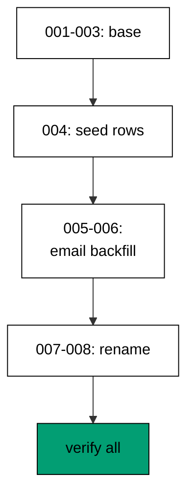

The capstone evolves a small order-management schema through eight realistic Migratus migrations: two customers, two orders, three order lines, an email backfill, and a zero-downtime rename of the order total column, all verified by golden queries. Every technique from the course appears exactly where a production deploy would need it.

## Why this exists -- the big idea

**The problem before the solution**: course examples prove each migration technique in isolation — one file, one idea, one clean database. Real evolutions stack the techniques: the rename lands while traffic reads the old column, the backfill lands while orders keep arriving, and the history must stay linear through all of it. The capstone wires the layers together so the seams are load-bearing: schema steps, data steps, and verification steps in one chain, with the transcript proving the whole chain ran.

**Keep this if you forget everything else**: evolve the schema and the data on separate schedules, keep every step reversible or explicitly one-way, and verify the ending with a query — not with confidence.

## What you will build

A single `main.clj` runs eight Migratus migrations in order. `create-customers` makes `cap_customers`; `create-orders` makes `cap_orders` with a foreign key, a status, and an empty total; `create-order-items` makes `cap_order_items` with its own foreign key, sku, quantity, and price. Then the data: `seed-demo-data` inserts two demo customers, two orders, and three lines as a forward-only step, and `backfill-email` fills every customer email from the customer name. Then the rename: `expand-add-grand-total` adds a nullable `grand_total_cents` column beside `total_cents`, `contract-drop-total` drops `total_cents` once the copy lands. Seeds arrive after the schema base so the data steps have real rows to work on; the email data step is one-way by policy because fills cannot unfill.

## How the pieces compose

Schema base (Examples 1–8) creates the tables with foreign keys; the history read (Examples 9–17) names the position after every run; the nullable add (Examples 26–34) keeps the email deployable; the backfill (Examples 26–34) fills addresses after the fact; the expand-migrate-contract rename (Examples 35–44) moves `total_cents` to `grand_total_cents` without a flag day; the receipt checks (Examples 12, 17, 78) verify the ending. No new technique appears here — composition is the test. Read the program top to bottom and name the example each section comes from; if a section has no ancestor, it does not belong.



## Reading the transcript

The five output lines each prove one stage: the customers line proves the seed plus the email backfill — every customer carries its name and its derived address; the orders line proves the seed plus the rename — every order carries its status and its copied total under the new name; the items count proves the lines table survived the rename untouched; the columns line proves the contract dropped the old column; the completed line proves all eight migrations ran with linear history. Any missing line names its broken stage exactly. Rerun the unit and diff: identical bytes, because fixed migration ids, per-run tables, ordered queries, and label-only output leave no room for variance.

## The pinning note

This capstone restores its locked jars offline: Migratus 1.6.8 with `next.jdbc` 1.3.1118, the PostgreSQL JDBC driver, and `slf4j-simple`, pinned in `learning/code/jars.lock` and staged by the clojure toolchain install recipe. The toolchain pins the Clojure image and PostgreSQL 18 image by digest, and the journal pins the schema. The capstone migrates with exactly the bytes the examples trained on — the same file shapes, the same per-migration transactions with explicit opt-out directives, the same id-journaled history. Declare the floor, pin everything, and review pin diffs like code.

**`learning/capstone/code/main.clj`**:

```clojure
;; => Capstone: Order Management Through Eight Migrations.
;; => Eight migrations evolve an order schema with a rename and a backfill; queries prove the end state.
(require '[migratus.core :as migratus]) ;; => migrate, rollback, up, and down move history
(require '[next.jdbc :as jdbc]) ;; => verification reads prove each migration landed
(require '[next.jdbc.result-set :as rs]) ;; => unqualified rows print without table prefixes
(require '[clojure.java.io :as io]) ;; => migration files are staged, then removed
;; => The database address comes from the harness, with local-run defaults.
(defn db-spec [] ;; => one builder owns every address default
  {:dbtype "postgresql" ;; => pgjdbc speaks the PostgreSQL wire protocol
   :host (or (System/getenv "PGHOST") "localhost") ;; => harness sets the service host
   :port (Integer/parseInt (or (System/getenv "PGPORT") "5432")) ;; => service port default
   :dbname (or (System/getenv "PGDATABASE") "postgres") ;; => fresh database per unit run
   :user (or (System/getenv "PGUSER") "postgres")}) ;; => trust auth needs no password
;; => One config carries the store, the relative migration dir, and the history table.
(defn config [dir table] ;; => every example owns its dir and history table
  {:store :database ;; => the SQL store journals history in a table
   :migration-dir dir ;; => relative to the unit folder, staged at runtime
   :migration-table-name table ;; => per-example history isolates every rerun
   :db (db-spec)}) ;; => next.jdbc connects from this spec
;; => Staging writes one up/down pair per call into the relative dir.
(defn write-migration [dir id name up down] ;; => one helper stages every migration
  (spit (str dir "/" id "-" name ".up.sql") up) ;; => forward change runs on migrate
  (when down ;; => up-only examples skip the down file on purpose
    (spit (str dir "/" id "-" name ".down.sql") down))) ;; => reverse runs on rollback
;; => Reset clears leftovers of a killed run so reruns print alike.
(defn reset-unit! [ds dir table tables views] ;; => one reset owns every leftover
  (doseq [v views] ;; => views drop before the tables they read
    (jdbc/execute! ds [(str "DROP VIEW IF EXISTS " v)])) ;; => stale views vanish first
  (let [d (io/file dir)] ;; => the relative staging dir of this unit
    (when (.exists d) ;; => a killed run may leave files behind
      (doseq [f (.listFiles d)] ;; => every staged file goes first
        (.delete ^java.io.File f)) ;; => delete each staged migration
      (.delete d)) ;; => the empty staging dir goes too
    (.mkdirs d)) ;; => a fresh dir for this run
  (doseq [t tables] ;; => every table this example owns
    (jdbc/execute! ds [(str "DROP TABLE IF EXISTS " t " CASCADE")])) ;; => killed runs vanish
  (jdbc/execute! ds [(str "DROP TABLE IF EXISTS " table)])) ;; => stale history vanishes too
;; => Reads print their own proof; ids sort so output never depends on disk order.
(defn applied-names [ds table] ;; => applied migration names in id order
  (mapv :description ;; => description stores the migration name
    (jdbc/execute! ds [(str "SELECT description FROM " table " WHERE id > 0 ORDER BY id")] ;; => id order, reserve row excluded
                     {:builder-fn rs/as-unqualified-lower-maps}))) ;; => short keys print cleanly
;; => Column lists read the catalog, so the schema proves itself.
(defn table-columns [ds table] ;; => column names in position order
  (mapv :column_name ;; => one name per row, nothing else
    (jdbc/execute! ds [(str "SELECT column_name FROM information_schema.columns WHERE table_name = '" table "' ORDER BY ordinal_position")] ;; => catalog order is stable
                     {:builder-fn rs/as-unqualified-lower-maps}))) ;; => short keys print cleanly
(def ds (jdbc/get-datasource (db-spec))) ;; => one shared datasource per unit run
(def cfg (config "mig" "cap_migrations")) ;; => store plus history table for the capstone
(reset-unit! ds "mig" "cap_migrations" ["cap_customers" "cap_orders" "cap_order_items"] []) ;; => leftovers of a killed run vanish first
(write-migration "mig" "20260303000101" "create-customers" ;; => customers open the schema
  "CREATE TABLE cap_customers (id SERIAL PRIMARY KEY, name TEXT NOT NULL);\n" ;; => forward change creates customers
  "DROP TABLE cap_customers;\n") ;; => reverse drops customers
(write-migration "mig" "20260303000102" "create-orders" ;; => orders reference their customer
  "CREATE TABLE cap_orders (id SERIAL PRIMARY KEY, customer_id INTEGER NOT NULL REFERENCES cap_customers (id), status TEXT NOT NULL DEFAULT 'open', total_cents INTEGER NOT NULL DEFAULT 0);\n" ;; => forward change creates orders
  "DROP TABLE cap_orders;\n") ;; => reverse drops orders
(write-migration "mig" "20260303000103" "create-order-items" ;; => items reference their order
  "CREATE TABLE cap_order_items (id SERIAL PRIMARY KEY, order_id INTEGER NOT NULL REFERENCES cap_orders (id), sku TEXT NOT NULL, qty INTEGER NOT NULL, price_cents INTEGER NOT NULL);\n" ;; => forward change creates items
  "DROP TABLE cap_order_items;\n") ;; => reverse drops items
(write-migration "mig" "20260303000104" "seed-demo-data" ;; => demo rows fill the three tables
  (str "INSERT INTO cap_customers (name) VALUES ('Sari'), ('Tono');\n" ;; => two customers open shop
       "--;;\n" ;; => separator splits the three statements
       "INSERT INTO cap_orders (customer_id, status, total_cents) VALUES (1, 'open', 1500), (2, 'paid', 2999);\n" ;; => two orders carry totals
       "--;;\n" ;; => same separator between orders and items
       "INSERT INTO cap_order_items (order_id, sku, qty, price_cents) VALUES (1, 'SKU-1', 2, 500), (1, 'SKU-2', 1, 500), (2, 'SKU-9', 1, 2999);\n") ;; => three items fill the orders
  (str "DELETE FROM cap_order_items;\n" ;; => reverse clears items first
       "--;;\n" ;; => dependents go before parents
       "DELETE FROM cap_orders;\n" ;; => then the orders go
       "--;;\n" ;; => same order on the way down
       "DELETE FROM cap_customers;\n")) ;; => customers go last
(write-migration "mig" "20260303000105" "expand-add-email" ;; => expand keeps the old reads working
  "ALTER TABLE cap_customers ADD COLUMN email TEXT;\n" ;; => new column arrives nullable
  "ALTER TABLE cap_customers DROP COLUMN email;\n") ;; => reverse drops the new column
(write-migration "mig" "20260303000106" "backfill-email" ;; => existing customers gain addresses
  "UPDATE cap_customers SET email = lower(name) || '@example.com' WHERE email IS NULL;\n" ;; => names become addresses
  "UPDATE cap_customers SET email = NULL;\n") ;; => reverse clears every address
(write-migration "mig" "20260303000107" "expand-add-grand-total" ;; => the rename starts beside the old column
  (str "ALTER TABLE cap_orders ADD COLUMN grand_total_cents INTEGER;\n" ;; => new column arrives nullable
       "--;;\n" ;; => separator splits add from backfill
       "UPDATE cap_orders SET grand_total_cents = total_cents;\n") ;; => old totals copy across
  "ALTER TABLE cap_orders DROP COLUMN grand_total_cents;\n") ;; => reverse drops the new column
(write-migration "mig" "20260303000108" "contract-drop-total" ;; => contract retires the old column
  "ALTER TABLE cap_orders DROP COLUMN total_cents;\n" ;; => forward change drops the old column
  "ALTER TABLE cap_orders ADD COLUMN total_cents INTEGER NOT NULL DEFAULT 0;\n") ;; => reverse re-adds an empty column
(println "migrate:" (pr-str (migratus/migrate cfg))) ;; => nil means all eight migrations applied
(println "completed:" (pr-str (applied-names ds "cap_migrations"))) ;; => eight names in id order
(println "customers:" (pr-str (mapv (juxt :name :email) ;; => names became addresses
  (jdbc/execute! ds ["SELECT name, email FROM cap_customers ORDER BY id"] ;; => ordered ids keep the customers stable (part 1)
                   {:builder-fn rs/as-unqualified-lower-maps})))) ;; => ordered ids keep the customers stable (part 2)
(println "orders:" (pr-str (mapv (juxt :id :status :grand_total_cents) ;; => totals survived the rename
  (jdbc/execute! ds ["SELECT id, status, grand_total_cents FROM cap_orders ORDER BY id"] ;; => ordered ids keep the orders stable (part 1)
                   {:builder-fn rs/as-unqualified-lower-maps})))) ;; => ordered ids keep the orders stable (part 2)
(println "items:" (pr-str (:n (first (jdbc/execute! ds ["SELECT COUNT(*) AS n FROM cap_order_items"] ;; => three items prove the seed
  {:builder-fn rs/as-unqualified-lower-maps}))))) ;; => the count names the seed
(println "columns:" (pr-str (table-columns ds "cap_orders"))) ;; => catalog proves the contract landed
;; => Cleanup drops every object this example made, leaving no residue.
(defn cleanup-unit! [ds dir table tables views] ;; => one cleanup owns every created object
  (doseq [v views] ;; => views drop before the tables they read
    (jdbc/execute! ds [(str "DROP VIEW IF EXISTS " v)])) ;; => view residue vanishes
  (doseq [t tables] ;; => every table this example owns
    (jdbc/execute! ds [(str "DROP TABLE IF EXISTS " t " CASCADE")])) ;; => tables vanish with dependents
  (jdbc/execute! ds [(str "DROP TABLE IF EXISTS " table)]) ;; => history table vanishes too
  (let [d (io/file dir)] ;; => the staging dir from this run
    (when (.exists d) ;; => files were staged above
      (doseq [f (.listFiles d)] ;; => every staged file goes first
        (.delete ^java.io.File f)) ;; => delete each staged migration
      (.delete d)))) ;; => the empty staging dir goes too
(cleanup-unit! ds "mig" "cap_migrations" ["cap_customers" "cap_orders" "cap_order_items"] []) ;; => drop every object the capstone created
```

**Output** (`learning/capstone/code/expected/main/main.stdout.txt`):

```text
migrate: nil
completed: ["create-customers" "create-orders" "create-order-items" "seed-demo-data" "expand-add-email" "backfill-email" "expand-add-grand-total" "contract-drop-total"]
customers: [["Sari" "sari@example.com"] ["Tono" "tono@example.com"]]
orders: [[1 "open" 1500] [2 "paid" 2999]]
items: 3
columns: ["id" "customer_id" "status" "grand_total_cents"]
```
