Examples 26–53 move from schema shapes to data and deployments: filling existing rows, splitting breaking changes into zero-downtime steps, and adopting databases that predate Migratus. Three clusters carry the level: backfills and data migrations (Examples 26–34), zero-downtime migration splitting (Examples 35–44), and baselining an existing database (Examples 45–53). The journal stays the arbiter throughout: history rows, not confidence, decide what runs next.

### Example 26: Backfill Is a Separate Step

New columns on live tables fill in two migrations, so this example separates the schema change from the data fill. The program migrates both and prints every subtotal beside its computed tax. (Concepts: co-01, co-06.)

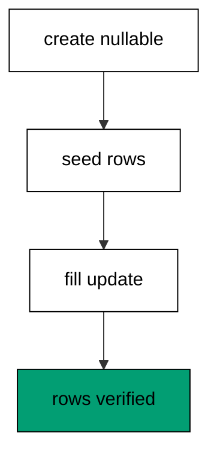

The first migration creates the table and seeds rows while the new column stays nullable, because a strict column would reject the seed. The second migration holds only an UPDATE: no schema change, just derived data written from existing values. Keeping the fill separate means the schema deploys even when the data is not ready, and the fill reruns independently if the formula changes. The down file of the fill restores NULLs rather than dropping anything, which keeps undo scoped to data.

**`learning/code/ex-26-backfill-is-a-separate-step/main.clj`**:

```clojure
;; => Example 26: Backfill Is a Separate Step.
;; => Schema first, data second: the nullable column lands before the fill writes it.
(require '[migratus.core :as migratus]) ;; => migrate, rollback, up, and down move history
(require '[next.jdbc :as jdbc]) ;; => verification reads prove each migration landed
(require '[next.jdbc.result-set :as rs]) ;; => unqualified rows print without table prefixes
(require '[clojure.java.io :as io]) ;; => migration files are staged, then removed
;; => The database address comes from the harness, with local-run defaults.
(defn db-spec [] ;; => one builder owns every address default
  {:dbtype "postgresql" ;; => pgjdbc speaks the PostgreSQL wire protocol
   :host (or (System/getenv "PGHOST") "localhost") ;; => harness sets the service host
   :port (Integer/parseInt (or (System/getenv "PGPORT") "5432")) ;; => service port default
   :dbname (or (System/getenv "PGDATABASE") "postgres") ;; => fresh database per unit run
   :user (or (System/getenv "PGUSER") "postgres")}) ;; => trust auth needs no password
;; => One config carries the store, the relative migration dir, and the history table.
(defn config [dir table] ;; => every example owns its dir and history table
  {:store :database ;; => the SQL store journals history in a table
   :migration-dir dir ;; => relative to the unit folder, staged at runtime
   :migration-table-name table ;; => per-example history isolates every rerun
   :db (db-spec)}) ;; => next.jdbc connects from this spec
;; => Staging writes one up/down pair per call into the relative dir.
(defn write-migration [dir id name up down] ;; => one helper stages every migration
  (spit (str dir "/" id "-" name ".up.sql") up) ;; => forward change runs on migrate
  (when down ;; => up-only examples skip the down file on purpose
    (spit (str dir "/" id "-" name ".down.sql") down))) ;; => reverse runs on rollback
;; => Reset clears leftovers of a killed run so reruns print alike.
(defn reset-unit! [ds dir table tables views] ;; => one reset owns every leftover
  (doseq [v views] ;; => views drop before the tables they read
    (jdbc/execute! ds [(str "DROP VIEW IF EXISTS " v)])) ;; => stale views vanish first
  (let [d (io/file dir)] ;; => the relative staging dir of this unit
    (when (.exists d) ;; => a killed run may leave files behind
      (doseq [f (.listFiles d)] ;; => every staged file goes first
        (.delete ^java.io.File f)) ;; => delete each staged migration
      (.delete d)) ;; => the empty staging dir goes too
    (.mkdirs d)) ;; => a fresh dir for this run
  (doseq [t tables] ;; => every table this example owns
    (jdbc/execute! ds [(str "DROP TABLE IF EXISTS " t " CASCADE")])) ;; => killed runs vanish
  (jdbc/execute! ds [(str "DROP TABLE IF EXISTS " table)])) ;; => stale history vanishes too
;; => Reads print their own proof; ids sort so output never depends on disk order.
(defn applied-names [ds table] ;; => applied migration names in id order
  (mapv :description ;; => description stores the migration name
    (jdbc/execute! ds [(str "SELECT description FROM " table " WHERE id > 0 ORDER BY id")] ;; => id order, reserve row excluded
                     {:builder-fn rs/as-unqualified-lower-maps}))) ;; => short keys print cleanly
;; => Column lists read the catalog, so the schema proves itself.
(defn table-columns [ds table] ;; => column names in position order
  (mapv :column_name ;; => one name per row, nothing else
    (jdbc/execute! ds [(str "SELECT column_name FROM information_schema.columns WHERE table_name = '" table "' ORDER BY ordinal_position")] ;; => catalog order is stable
                     {:builder-fn rs/as-unqualified-lower-maps}))) ;; => short keys print cleanly
(def ds (jdbc/get-datasource (db-spec))) ;; => one shared datasource per unit run
(def cfg (config "mig" "m26_migrations")) ;; => store plus history table for this example
(reset-unit! ds "mig" "m26_migrations" ["m26_invoice"] []) ;; => leftovers of a killed run vanish first
(write-migration "mig" "20260101002601" "make-invoice" ;; => first the schema with a nullable column
  (str "CREATE TABLE m26_invoice (id SERIAL PRIMARY KEY, subtotal INTEGER NOT NULL, tax INTEGER);\n" ;; => tax starts nullable on purpose
       "--;;\n" ;; => separator splits schema from seed
       "INSERT INTO m26_invoice (subtotal) VALUES (100), (250), (80);\n") ;; => three seed rows await the fill
  "DROP TABLE m26_invoice;\n") ;; => reverse drops everything
(write-migration "mig" "20260101002602" "fill-tax" ;; => then the data-only fill
  "UPDATE m26_invoice SET tax = subtotal / 10 WHERE tax IS NULL;\n" ;; => fill derives tax from subtotal
  "UPDATE m26_invoice SET tax = NULL;\n") ;; => reverse restores the nulls
(println "migrate:" (pr-str (migratus/migrate cfg))) ;; => nil means every pending migration applied
(println "completed:" (pr-str (applied-names ds "m26_migrations"))) ;; => id order straight from history
(println "rows:" (pr-str (mapv (juxt :subtotal :tax) ;; => pairs prove the fill
  (jdbc/execute! ds ["SELECT subtotal, tax FROM m26_invoice ORDER BY id"] ;; => computed tax beside its subtotal (part 1)
                   {:builder-fn rs/as-unqualified-lower-maps})))) ;; => computed tax beside its subtotal (part 2)
;; => Cleanup drops every object this example made, leaving no residue.
(defn cleanup-unit! [ds dir table tables views] ;; => one cleanup owns every created object
  (doseq [v views] ;; => views drop before the tables they read
    (jdbc/execute! ds [(str "DROP VIEW IF EXISTS " v)])) ;; => view residue vanishes
  (doseq [t tables] ;; => every table this example owns
    (jdbc/execute! ds [(str "DROP TABLE IF EXISTS " t " CASCADE")])) ;; => tables vanish with dependents
  (jdbc/execute! ds [(str "DROP TABLE IF EXISTS " table)]) ;; => history table vanishes too
  (let [d (io/file dir)] ;; => the staging dir from this run
    (when (.exists d) ;; => files were staged above
      (doseq [f (.listFiles d)] ;; => every staged file goes first
        (.delete ^java.io.File f)) ;; => delete each staged migration
      (.delete d)))) ;; => the empty staging dir goes too
(cleanup-unit! ds "mig" "m26_migrations" ["m26_invoice"] []) ;; => drop every object this example created
```

**Output** (`learning/code/ex-26-backfill-is-a-separate-step/expected/main.stdout.txt`):

```text
migrate: nil
completed: ["make-invoice" "fill-tax"]
rows: [[100 10] [250 25] [80 8]]
```

**Key takeaway**: Land the nullable schema first, then fill it with a data-only migration.

**Why it matters**: Live tables cannot stop for restructuring, so schema and data must ship as separate steps. A combined migration couples the deploy to the data volume, which turns a quick schema change into a long locked write. Separate steps let the schema land instantly while the fill runs at its own pace, and each step rolls back without touching the other.

### Example 27: Backfill Computes from Existing Rows

Totals and flags derive from rows the table already holds, so this example backfills a computed total. The program migrates, prints every row, and checks the grand sum. (Concepts: co-06.)

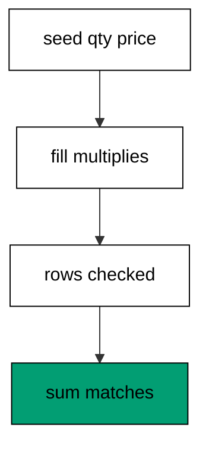

The fill multiplies two existing columns into the new one, which keeps the formula beside the data it reads instead of in application code that might disagree. Seeding fixed quantities and prices makes the expected totals known before the run: 200, 150, and 999, summing to 1349. The grand-sum query is the acceptance check a reviewer runs without reading every row, and it fails loudly if any row missed the fill. Computed fills like this one are the common case, because most new columns summarize what the table already knows.

**`learning/code/ex-27-backfill-computes-from-existing-rows/main.clj`**:

```clojure
;; => Example 27: Backfill Computes from Existing Rows.
;; => Derived columns come from row math: quantity times price becomes the total.
(require '[migratus.core :as migratus]) ;; => migrate, rollback, up, and down move history
(require '[next.jdbc :as jdbc]) ;; => verification reads prove each migration landed
(require '[next.jdbc.result-set :as rs]) ;; => unqualified rows print without table prefixes
(require '[clojure.java.io :as io]) ;; => migration files are staged, then removed
;; => The database address comes from the harness, with local-run defaults.
(defn db-spec [] ;; => one builder owns every address default
  {:dbtype "postgresql" ;; => pgjdbc speaks the PostgreSQL wire protocol
   :host (or (System/getenv "PGHOST") "localhost") ;; => harness sets the service host
   :port (Integer/parseInt (or (System/getenv "PGPORT") "5432")) ;; => service port default
   :dbname (or (System/getenv "PGDATABASE") "postgres") ;; => fresh database per unit run
   :user (or (System/getenv "PGUSER") "postgres")}) ;; => trust auth needs no password
;; => One config carries the store, the relative migration dir, and the history table.
(defn config [dir table] ;; => every example owns its dir and history table
  {:store :database ;; => the SQL store journals history in a table
   :migration-dir dir ;; => relative to the unit folder, staged at runtime
   :migration-table-name table ;; => per-example history isolates every rerun
   :db (db-spec)}) ;; => next.jdbc connects from this spec
;; => Staging writes one up/down pair per call into the relative dir.
(defn write-migration [dir id name up down] ;; => one helper stages every migration
  (spit (str dir "/" id "-" name ".up.sql") up) ;; => forward change runs on migrate
  (when down ;; => up-only examples skip the down file on purpose
    (spit (str dir "/" id "-" name ".down.sql") down))) ;; => reverse runs on rollback
;; => Reset clears leftovers of a killed run so reruns print alike.
(defn reset-unit! [ds dir table tables views] ;; => one reset owns every leftover
  (doseq [v views] ;; => views drop before the tables they read
    (jdbc/execute! ds [(str "DROP VIEW IF EXISTS " v)])) ;; => stale views vanish first
  (let [d (io/file dir)] ;; => the relative staging dir of this unit
    (when (.exists d) ;; => a killed run may leave files behind
      (doseq [f (.listFiles d)] ;; => every staged file goes first
        (.delete ^java.io.File f)) ;; => delete each staged migration
      (.delete d)) ;; => the empty staging dir goes too
    (.mkdirs d)) ;; => a fresh dir for this run
  (doseq [t tables] ;; => every table this example owns
    (jdbc/execute! ds [(str "DROP TABLE IF EXISTS " t " CASCADE")])) ;; => killed runs vanish
  (jdbc/execute! ds [(str "DROP TABLE IF EXISTS " table)])) ;; => stale history vanishes too
;; => Reads print their own proof; ids sort so output never depends on disk order.
(defn applied-names [ds table] ;; => applied migration names in id order
  (mapv :description ;; => description stores the migration name
    (jdbc/execute! ds [(str "SELECT description FROM " table " WHERE id > 0 ORDER BY id")] ;; => id order, reserve row excluded
                     {:builder-fn rs/as-unqualified-lower-maps}))) ;; => short keys print cleanly
;; => Column lists read the catalog, so the schema proves itself.
(defn table-columns [ds table] ;; => column names in position order
  (mapv :column_name ;; => one name per row, nothing else
    (jdbc/execute! ds [(str "SELECT column_name FROM information_schema.columns WHERE table_name = '" table "' ORDER BY ordinal_position")] ;; => catalog order is stable
                     {:builder-fn rs/as-unqualified-lower-maps}))) ;; => short keys print cleanly
(def ds (jdbc/get-datasource (db-spec))) ;; => one shared datasource per unit run
(def cfg (config "mig" "m27_migrations")) ;; => store plus history table for this example
(reset-unit! ds "mig" "m27_migrations" ["m27_line"] []) ;; => leftovers of a killed run vanish first
(write-migration "mig" "20260101002701" "make-line" ;; => first the lines with a nullable total
  (str "CREATE TABLE m27_line (id SERIAL PRIMARY KEY, qty INTEGER NOT NULL, price INTEGER NOT NULL, total INTEGER);\n" ;; => total waits for the fill
       "--;;\n" ;; => separator splits schema from seed
       "INSERT INTO m27_line (qty, price) VALUES (2, 100), (3, 50), (1, 999);\n") ;; => three lines with known math
  "DROP TABLE m27_line;\n") ;; => reverse drops everything
(write-migration "mig" "20260101002702" "fill-total" ;; => then the computing fill
  "UPDATE m27_line SET total = qty * price WHERE total IS NULL;\n" ;; => row math fills every total
  "UPDATE m27_line SET total = NULL;\n") ;; => reverse restores the nulls
(println "migrate:" (pr-str (migratus/migrate cfg))) ;; => nil means every pending migration applied
(println "completed:" (pr-str (applied-names ds "m27_migrations"))) ;; => id order straight from history
(println "rows:" (pr-str (mapv (juxt :qty :price :total) ;; => math proves itself per row
  (jdbc/execute! ds ["SELECT qty, price, total FROM m27_line ORDER BY id"] ;; => each total equals qty times price (part 1)
                   {:builder-fn rs/as-unqualified-lower-maps})))) ;; => each total equals qty times price (part 2)
(println "sum:" (pr-str (mapv :total ;; => one number checks the fill
  (jdbc/execute! ds ["SELECT sum(total) AS total FROM m27_line"] ;; => 200 plus 150 plus 999 (part 1)
                   {:builder-fn rs/as-unqualified-lower-maps})))) ;; => 200 plus 150 plus 999 (part 2)
;; => Cleanup drops every object this example made, leaving no residue.
(defn cleanup-unit! [ds dir table tables views] ;; => one cleanup owns every created object
  (doseq [v views] ;; => views drop before the tables they read
    (jdbc/execute! ds [(str "DROP VIEW IF EXISTS " v)])) ;; => view residue vanishes
  (doseq [t tables] ;; => every table this example owns
    (jdbc/execute! ds [(str "DROP TABLE IF EXISTS " t " CASCADE")])) ;; => tables vanish with dependents
  (jdbc/execute! ds [(str "DROP TABLE IF EXISTS " table)]) ;; => history table vanishes too
  (let [d (io/file dir)] ;; => the staging dir from this run
    (when (.exists d) ;; => files were staged above
      (doseq [f (.listFiles d)] ;; => every staged file goes first
        (.delete ^java.io.File f)) ;; => delete each staged migration
      (.delete d)))) ;; => the empty staging dir goes too
(cleanup-unit! ds "mig" "m27_migrations" ["m27_line"] []) ;; => drop every object this example created
```

**Output** (`learning/code/ex-27-backfill-computes-from-existing-rows/expected/main.stdout.txt`):

```text
migrate: nil
completed: ["make-line" "fill-total"]
rows: [[2 100 200] [3 50 150] [1 999 999]]
sum: [1349]
```

**Key takeaway**: Backfills derive new columns from existing rows with plain row math.

**Why it matters**: Derived data must agree with its sources forever, and computing it inside the database keeps the formula next to the facts. Application-side backfills race with live writes and disagree on rounding, while a single UPDATE sees one consistent snapshot. Teams that fill in the database get one answer everywhere, because the math runs where the data lives.

### Example 28: Backfill Preserves Every Row

A fill must change values, never rows, so this example counts the table on both sides of the backfill. The program brings up the schema, counts five, fills, and counts five again. (Concepts: co-06, co-16.)

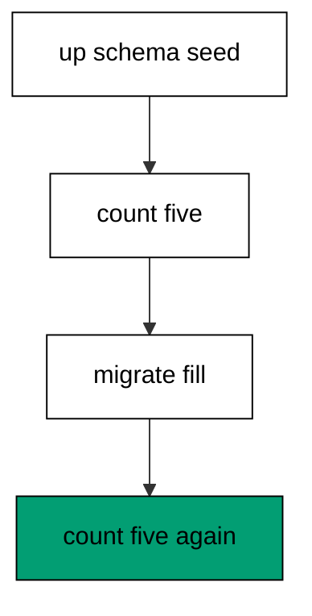

Targeted `up` stages the test: schema plus seed run while the fill waits, so the before count is a real measurement rather than an assumption. The fill then updates every row in place, which cannot add or remove rows by construction, and the after count proves it. The distinct-tier query closes the loop: five rows share one tier, so none missed the fill and none doubled. Count-before-count-after is the cheapest migration test there is, and it catches the join-gone-wrong fills that multiply rows.

**`learning/code/ex-28-backfill-preserves-every-row/main.clj`**:

```clojure
;; => Example 28: Backfill Preserves Every Row.
;; => Count before and after: a fill that changes row counts is a bug, not a fill.
(require '[migratus.core :as migratus]) ;; => migrate, rollback, up, and down move history
(require '[next.jdbc :as jdbc]) ;; => verification reads prove each migration landed
(require '[next.jdbc.result-set :as rs]) ;; => unqualified rows print without table prefixes
(require '[clojure.java.io :as io]) ;; => migration files are staged, then removed
;; => The database address comes from the harness, with local-run defaults.
(defn db-spec [] ;; => one builder owns every address default
  {:dbtype "postgresql" ;; => pgjdbc speaks the PostgreSQL wire protocol
   :host (or (System/getenv "PGHOST") "localhost") ;; => harness sets the service host
   :port (Integer/parseInt (or (System/getenv "PGPORT") "5432")) ;; => service port default
   :dbname (or (System/getenv "PGDATABASE") "postgres") ;; => fresh database per unit run
   :user (or (System/getenv "PGUSER") "postgres")}) ;; => trust auth needs no password
;; => One config carries the store, the relative migration dir, and the history table.
(defn config [dir table] ;; => every example owns its dir and history table
  {:store :database ;; => the SQL store journals history in a table
   :migration-dir dir ;; => relative to the unit folder, staged at runtime
   :migration-table-name table ;; => per-example history isolates every rerun
   :db (db-spec)}) ;; => next.jdbc connects from this spec
;; => Staging writes one up/down pair per call into the relative dir.
(defn write-migration [dir id name up down] ;; => one helper stages every migration
  (spit (str dir "/" id "-" name ".up.sql") up) ;; => forward change runs on migrate
  (when down ;; => up-only examples skip the down file on purpose
    (spit (str dir "/" id "-" name ".down.sql") down))) ;; => reverse runs on rollback
;; => Reset clears leftovers of a killed run so reruns print alike.
(defn reset-unit! [ds dir table tables views] ;; => one reset owns every leftover
  (doseq [v views] ;; => views drop before the tables they read
    (jdbc/execute! ds [(str "DROP VIEW IF EXISTS " v)])) ;; => stale views vanish first
  (let [d (io/file dir)] ;; => the relative staging dir of this unit
    (when (.exists d) ;; => a killed run may leave files behind
      (doseq [f (.listFiles d)] ;; => every staged file goes first
        (.delete ^java.io.File f)) ;; => delete each staged migration
      (.delete d)) ;; => the empty staging dir goes too
    (.mkdirs d)) ;; => a fresh dir for this run
  (doseq [t tables] ;; => every table this example owns
    (jdbc/execute! ds [(str "DROP TABLE IF EXISTS " t " CASCADE")])) ;; => killed runs vanish
  (jdbc/execute! ds [(str "DROP TABLE IF EXISTS " table)])) ;; => stale history vanishes too
;; => Reads print their own proof; ids sort so output never depends on disk order.
(defn applied-names [ds table] ;; => applied migration names in id order
  (mapv :description ;; => description stores the migration name
    (jdbc/execute! ds [(str "SELECT description FROM " table " WHERE id > 0 ORDER BY id")] ;; => id order, reserve row excluded
                     {:builder-fn rs/as-unqualified-lower-maps}))) ;; => short keys print cleanly
;; => Column lists read the catalog, so the schema proves itself.
(defn table-columns [ds table] ;; => column names in position order
  (mapv :column_name ;; => one name per row, nothing else
    (jdbc/execute! ds [(str "SELECT column_name FROM information_schema.columns WHERE table_name = '" table "' ORDER BY ordinal_position")] ;; => catalog order is stable
                     {:builder-fn rs/as-unqualified-lower-maps}))) ;; => short keys print cleanly
(def ds (jdbc/get-datasource (db-spec))) ;; => one shared datasource per unit run
(def cfg (config "mig" "m28_migrations")) ;; => store plus history table for this example
(reset-unit! ds "mig" "m28_migrations" ["m28_member"] []) ;; => leftovers of a killed run vanish first
(write-migration "mig" "20260101002801" "make-member" ;; => first the members with a nullable tier
  (str "CREATE TABLE m28_member (id SERIAL PRIMARY KEY, handle TEXT NOT NULL, tier TEXT);\n" ;; => tier waits for the fill
       "--;;\n" ;; => separator splits schema from seed
       "INSERT INTO m28_member (handle) VALUES ('a'), ('b'), ('c'), ('d'), ('e');\n") ;; => five members with fixed handles
  "DROP TABLE m28_member;\n") ;; => reverse drops everything
(write-migration "mig" "20260101002802" "fill-tier" ;; => then the tier fill
  "UPDATE m28_member SET tier = 'standard' WHERE tier IS NULL;\n" ;; => every member becomes standard
  "UPDATE m28_member SET tier = NULL;\n") ;; => reverse restores the nulls
(println "bring-up:" (pr-str (migratus/up cfg 20260101002801))) ;; => schema and seed land first
(println "before:" (pr-str (:n (first (jdbc/execute! ds ["SELECT count(*) AS n FROM m28_member"] ;; => five rows before the fill
  {:builder-fn rs/as-unqualified-lower-maps}))))) ;; => count anchors the test
(println "migrate:" (pr-str (migratus/migrate cfg))) ;; => fill runs second
(println "after:" (pr-str (:n (first (jdbc/execute! ds ["SELECT count(*) AS n FROM m28_member"] ;; => five rows after the fill
  {:builder-fn rs/as-unqualified-lower-maps}))))) ;; => equal counts prove preservation
(println "tiers:" (pr-str (mapv :tier ;; => one tier across all rows
  (jdbc/execute! ds ["SELECT DISTINCT tier AS tier FROM m28_member"] ;; => every row filled exactly once (part 1)
                   {:builder-fn rs/as-unqualified-lower-maps})))) ;; => every row filled exactly once (part 2)
;; => Cleanup drops every object this example made, leaving no residue.
(defn cleanup-unit! [ds dir table tables views] ;; => one cleanup owns every created object
  (doseq [v views] ;; => views drop before the tables they read
    (jdbc/execute! ds [(str "DROP VIEW IF EXISTS " v)])) ;; => view residue vanishes
  (doseq [t tables] ;; => every table this example owns
    (jdbc/execute! ds [(str "DROP TABLE IF EXISTS " t " CASCADE")])) ;; => tables vanish with dependents
  (jdbc/execute! ds [(str "DROP TABLE IF EXISTS " table)]) ;; => history table vanishes too
  (let [d (io/file dir)] ;; => the staging dir from this run
    (when (.exists d) ;; => files were staged above
      (doseq [f (.listFiles d)] ;; => every staged file goes first
        (.delete ^java.io.File f)) ;; => delete each staged migration
      (.delete d)))) ;; => the empty staging dir goes too
(cleanup-unit! ds "mig" "m28_migrations" ["m28_member"] []) ;; => drop every object this example created
```

**Output** (`learning/code/ex-28-backfill-preserves-every-row/expected/main.stdout.txt`):

```text
bring-up: nil
before: 5
migrate: nil
after: 5
tiers: ["standard"]
```

**Key takeaway**: Count the table before and after the fill: equal counts prove the fill preserved rows.

**Why it matters**: Backfills run against production data nobody can fully inspect, so the test must be structural instead of exhaustive. Row counts catch the catastrophic bugs: joins that multiply, predicates that exclude, and statements that hit the wrong table. Teams that count before and after trust fills they never read row by row, because preservation is a property, not a sample.

### Example 29: Data-Only Down Restores Nulls

Fills need undo too, so this example rolls back a data-only migration. The program fills three flags, counts zero nulls, undoes the fill, and counts three nulls. (Concepts: co-02, co-06.)

The fill's down file holds the inverse UPDATE rather than any DDL, which returns the column to its pre-fill shape without touching the schema. Rolling back removes the fill's history row and runs that inverse, so the table keeps its rows while losing the derived values. Counting NULLs on both sides proves the round trip: zero after the fill, three after the undo. Data undo is value surgery, and this symmetric pair keeps the scalpel sharp.

**`learning/code/ex-29-data-only-down-restores-nulls/main.clj`**:

```clojure
;; => Example 29: Data-Only Down Restores Nulls.
;; => Undoing a fill means unwriting values: the down file sets the column back to NULL.
(require '[migratus.core :as migratus]) ;; => migrate, rollback, up, and down move history
(require '[next.jdbc :as jdbc]) ;; => verification reads prove each migration landed
(require '[next.jdbc.result-set :as rs]) ;; => unqualified rows print without table prefixes
(require '[clojure.java.io :as io]) ;; => migration files are staged, then removed
;; => The database address comes from the harness, with local-run defaults.
(defn db-spec [] ;; => one builder owns every address default
  {:dbtype "postgresql" ;; => pgjdbc speaks the PostgreSQL wire protocol
   :host (or (System/getenv "PGHOST") "localhost") ;; => harness sets the service host
   :port (Integer/parseInt (or (System/getenv "PGPORT") "5432")) ;; => service port default
   :dbname (or (System/getenv "PGDATABASE") "postgres") ;; => fresh database per unit run
   :user (or (System/getenv "PGUSER") "postgres")}) ;; => trust auth needs no password
;; => One config carries the store, the relative migration dir, and the history table.
(defn config [dir table] ;; => every example owns its dir and history table
  {:store :database ;; => the SQL store journals history in a table
   :migration-dir dir ;; => relative to the unit folder, staged at runtime
   :migration-table-name table ;; => per-example history isolates every rerun
   :db (db-spec)}) ;; => next.jdbc connects from this spec
;; => Staging writes one up/down pair per call into the relative dir.
(defn write-migration [dir id name up down] ;; => one helper stages every migration
  (spit (str dir "/" id "-" name ".up.sql") up) ;; => forward change runs on migrate
  (when down ;; => up-only examples skip the down file on purpose
    (spit (str dir "/" id "-" name ".down.sql") down))) ;; => reverse runs on rollback
;; => Reset clears leftovers of a killed run so reruns print alike.
(defn reset-unit! [ds dir table tables views] ;; => one reset owns every leftover
  (doseq [v views] ;; => views drop before the tables they read
    (jdbc/execute! ds [(str "DROP VIEW IF EXISTS " v)])) ;; => stale views vanish first
  (let [d (io/file dir)] ;; => the relative staging dir of this unit
    (when (.exists d) ;; => a killed run may leave files behind
      (doseq [f (.listFiles d)] ;; => every staged file goes first
        (.delete ^java.io.File f)) ;; => delete each staged migration
      (.delete d)) ;; => the empty staging dir goes too
    (.mkdirs d)) ;; => a fresh dir for this run
  (doseq [t tables] ;; => every table this example owns
    (jdbc/execute! ds [(str "DROP TABLE IF EXISTS " t " CASCADE")])) ;; => killed runs vanish
  (jdbc/execute! ds [(str "DROP TABLE IF EXISTS " table)])) ;; => stale history vanishes too
;; => Reads print their own proof; ids sort so output never depends on disk order.
(defn applied-names [ds table] ;; => applied migration names in id order
  (mapv :description ;; => description stores the migration name
    (jdbc/execute! ds [(str "SELECT description FROM " table " WHERE id > 0 ORDER BY id")] ;; => id order, reserve row excluded
                     {:builder-fn rs/as-unqualified-lower-maps}))) ;; => short keys print cleanly
;; => Column lists read the catalog, so the schema proves itself.
(defn table-columns [ds table] ;; => column names in position order
  (mapv :column_name ;; => one name per row, nothing else
    (jdbc/execute! ds [(str "SELECT column_name FROM information_schema.columns WHERE table_name = '" table "' ORDER BY ordinal_position")] ;; => catalog order is stable
                     {:builder-fn rs/as-unqualified-lower-maps}))) ;; => short keys print cleanly
(def ds (jdbc/get-datasource (db-spec))) ;; => one shared datasource per unit run
(def cfg (config "mig" "m29_migrations")) ;; => store plus history table for this example
(reset-unit! ds "mig" "m29_migrations" ["m29_flag"] []) ;; => leftovers of a killed run vanish first
(write-migration "mig" "20260101002901" "make-flag" ;; => first the flags with a nullable state
  (str "CREATE TABLE m29_flag (id SERIAL PRIMARY KEY, state TEXT);\n" ;; => state waits for the fill
       "--;;\n" ;; => separator splits schema from seed
       "INSERT INTO m29_flag (id) VALUES (1), (2), (3);\n") ;; => ids alone, states null
  "DROP TABLE m29_flag;\n") ;; => reverse drops everything
(write-migration "mig" "20260101002902" "fill-state" ;; => then the state fill
  "UPDATE m29_flag SET state = 'on' WHERE state IS NULL;\n" ;; => every flag turns on
  "UPDATE m29_flag SET state = NULL;\n") ;; => down unwrites the fill
(println "migrate:" (pr-str (migratus/migrate cfg))) ;; => nil means every pending migration applied
(println "completed:" (pr-str (applied-names ds "m29_migrations"))) ;; => id order straight from history
(println "filled:" (pr-str (:n (first (jdbc/execute! ds ["SELECT count(*) AS n FROM m29_flag WHERE state IS NULL"] ;; => zero nulls after the fill
  {:builder-fn rs/as-unqualified-lower-maps}))))) ;; => fill reached every row
(println "rollback:" (pr-str (migratus/rollback cfg))) ;; => undo the fill only
(println "unfilled:" (pr-str (:n (first (jdbc/execute! ds ["SELECT count(*) AS n FROM m29_flag WHERE state IS NULL"] ;; => three nulls after undo
  {:builder-fn rs/as-unqualified-lower-maps}))))) ;; => down restored the nulls
;; => Cleanup drops every object this example made, leaving no residue.
(defn cleanup-unit! [ds dir table tables views] ;; => one cleanup owns every created object
  (doseq [v views] ;; => views drop before the tables they read
    (jdbc/execute! ds [(str "DROP VIEW IF EXISTS " v)])) ;; => view residue vanishes
  (doseq [t tables] ;; => every table this example owns
    (jdbc/execute! ds [(str "DROP TABLE IF EXISTS " t " CASCADE")])) ;; => tables vanish with dependents
  (jdbc/execute! ds [(str "DROP TABLE IF EXISTS " table)]) ;; => history table vanishes too
  (let [d (io/file dir)] ;; => the staging dir from this run
    (when (.exists d) ;; => files were staged above
      (doseq [f (.listFiles d)] ;; => every staged file goes first
        (.delete ^java.io.File f)) ;; => delete each staged migration
      (.delete d)))) ;; => the empty staging dir goes too
(cleanup-unit! ds "mig" "m29_migrations" ["m29_flag"] []) ;; => drop every object this example created
```

**Output** (`learning/code/ex-29-data-only-down-restores-nulls/expected/main.stdout.txt`):

```text
migrate: nil
completed: ["make-flag" "fill-state"]
filled: 0
rollback: nil
unfilled: 3
```

**Key takeaway**: A fill's down file unwrites values with the inverse UPDATE; rows and schema stay put.

**Why it matters**: Deploys that fill-then-fail need data recovery without schema surgery, and a value-restoring down file is exactly that. Dropping the column instead would destroy the schema the next retry needs, while NULLing preserves it. Teams that write data-only down files recover from bad fills in seconds, because undo never rebuilds what the fill never changed.

### Example 30: Rerun Skips the Backfill

Retried deploys must not double fills, so this example migrates a backfill twice. The program prints both return values and proves each row filled exactly once. (Concepts: co-05, co-06.)

The fill is an ordinary migration to the runner: staged, applied, journaled, and then skipped forever. The second run compares the same two files against the same two history rows and finds nothing to do, which is why the grades still read pass instead of pass-pass. Fills feel special because they touch data, but the history treats them exactly like schema changes. That uniformity is the point: every step in history runs once, whatever it writes.

**`learning/code/ex-30-rerun-skips-the-backfill/main.clj`**:

```clojure
;; => Example 30: Rerun Skips the Backfill.
;; => Fills run once like any migration: the second run finds them applied and moves on.
(require '[migratus.core :as migratus]) ;; => migrate, rollback, up, and down move history
(require '[next.jdbc :as jdbc]) ;; => verification reads prove each migration landed
(require '[next.jdbc.result-set :as rs]) ;; => unqualified rows print without table prefixes
(require '[clojure.java.io :as io]) ;; => migration files are staged, then removed
;; => The database address comes from the harness, with local-run defaults.
(defn db-spec [] ;; => one builder owns every address default
  {:dbtype "postgresql" ;; => pgjdbc speaks the PostgreSQL wire protocol
   :host (or (System/getenv "PGHOST") "localhost") ;; => harness sets the service host
   :port (Integer/parseInt (or (System/getenv "PGPORT") "5432")) ;; => service port default
   :dbname (or (System/getenv "PGDATABASE") "postgres") ;; => fresh database per unit run
   :user (or (System/getenv "PGUSER") "postgres")}) ;; => trust auth needs no password
;; => One config carries the store, the relative migration dir, and the history table.
(defn config [dir table] ;; => every example owns its dir and history table
  {:store :database ;; => the SQL store journals history in a table
   :migration-dir dir ;; => relative to the unit folder, staged at runtime
   :migration-table-name table ;; => per-example history isolates every rerun
   :db (db-spec)}) ;; => next.jdbc connects from this spec
;; => Staging writes one up/down pair per call into the relative dir.
(defn write-migration [dir id name up down] ;; => one helper stages every migration
  (spit (str dir "/" id "-" name ".up.sql") up) ;; => forward change runs on migrate
  (when down ;; => up-only examples skip the down file on purpose
    (spit (str dir "/" id "-" name ".down.sql") down))) ;; => reverse runs on rollback
;; => Reset clears leftovers of a killed run so reruns print alike.
(defn reset-unit! [ds dir table tables views] ;; => one reset owns every leftover
  (doseq [v views] ;; => views drop before the tables they read
    (jdbc/execute! ds [(str "DROP VIEW IF EXISTS " v)])) ;; => stale views vanish first
  (let [d (io/file dir)] ;; => the relative staging dir of this unit
    (when (.exists d) ;; => a killed run may leave files behind
      (doseq [f (.listFiles d)] ;; => every staged file goes first
        (.delete ^java.io.File f)) ;; => delete each staged migration
      (.delete d)) ;; => the empty staging dir goes too
    (.mkdirs d)) ;; => a fresh dir for this run
  (doseq [t tables] ;; => every table this example owns
    (jdbc/execute! ds [(str "DROP TABLE IF EXISTS " t " CASCADE")])) ;; => killed runs vanish
  (jdbc/execute! ds [(str "DROP TABLE IF EXISTS " table)])) ;; => stale history vanishes too
;; => Reads print their own proof; ids sort so output never depends on disk order.
(defn applied-names [ds table] ;; => applied migration names in id order
  (mapv :description ;; => description stores the migration name
    (jdbc/execute! ds [(str "SELECT description FROM " table " WHERE id > 0 ORDER BY id")] ;; => id order, reserve row excluded
                     {:builder-fn rs/as-unqualified-lower-maps}))) ;; => short keys print cleanly
;; => Column lists read the catalog, so the schema proves itself.
(defn table-columns [ds table] ;; => column names in position order
  (mapv :column_name ;; => one name per row, nothing else
    (jdbc/execute! ds [(str "SELECT column_name FROM information_schema.columns WHERE table_name = '" table "' ORDER BY ordinal_position")] ;; => catalog order is stable
                     {:builder-fn rs/as-unqualified-lower-maps}))) ;; => short keys print cleanly
(def ds (jdbc/get-datasource (db-spec))) ;; => one shared datasource per unit run
(def cfg (config "mig" "m30_migrations")) ;; => store plus history table for this example
(reset-unit! ds "mig" "m30_migrations" ["m30_score"] []) ;; => leftovers of a killed run vanish first
(write-migration "mig" "20260101003001" "make-score" ;; => first the scores with a nullable grade
  (str "CREATE TABLE m30_score (id SERIAL PRIMARY KEY, points INTEGER NOT NULL, grade TEXT);\n" ;; => grade waits for the fill
       "--;;\n" ;; => separator splits schema from seed
       "INSERT INTO m30_score (points) VALUES (10), (20);\n") ;; => two scores seeded
  "DROP TABLE m30_score;\n") ;; => reverse drops everything
(write-migration "mig" "20260101003002" "fill-grade" ;; => then the grade fill
  "UPDATE m30_score SET grade = 'pass' WHERE points >= 10;\n" ;; => both rows pass
  "UPDATE m30_score SET grade = NULL;\n") ;; => reverse restores the nulls
(println "first:" (pr-str (migratus/migrate cfg))) ;; => schema plus fill apply
(println "second:" (pr-str (migratus/migrate cfg))) ;; => rerun finds nothing pending
(println "grades:" (pr-str (mapv :grade ;; => two passes, never four
  (jdbc/execute! ds ["SELECT grade AS grade FROM m30_score ORDER BY id"] ;; => no doubled fills on rerun (part 1)
                   {:builder-fn rs/as-unqualified-lower-maps})))) ;; => no doubled fills on rerun (part 2)
;; => Cleanup drops every object this example made, leaving no residue.
(defn cleanup-unit! [ds dir table tables views] ;; => one cleanup owns every created object
  (doseq [v views] ;; => views drop before the tables they read
    (jdbc/execute! ds [(str "DROP VIEW IF EXISTS " v)])) ;; => view residue vanishes
  (doseq [t tables] ;; => every table this example owns
    (jdbc/execute! ds [(str "DROP TABLE IF EXISTS " t " CASCADE")])) ;; => tables vanish with dependents
  (jdbc/execute! ds [(str "DROP TABLE IF EXISTS " table)]) ;; => history table vanishes too
  (let [d (io/file dir)] ;; => the staging dir from this run
    (when (.exists d) ;; => files were staged above
      (doseq [f (.listFiles d)] ;; => every staged file goes first
        (.delete ^java.io.File f)) ;; => delete each staged migration
      (.delete d)))) ;; => the empty staging dir goes too
(cleanup-unit! ds "mig" "m30_migrations" ["m30_score"] []) ;; => drop every object this example created
```

**Output** (`learning/code/ex-30-rerun-skips-the-backfill/expected/main.stdout.txt`):

```text
first: nil
second: nil
grades: ["pass" "pass"]
```

**Key takeaway**: Backfills run once: the journal skips them on rerun like any other migration.

**Why it matters**: Retries are the normal case in real pipelines, and a fill that doubled on retry would corrupt every derived column it owns. Journal-equality makes once-only the default for data steps too, so operators rerun failed deploys without auditing which fills already ran. Teams that trust the skip recover by rerunning, which is the fastest recovery there is.

### Example 31: Backfill in Batches

Large tables fill in slices to bound each write, so this example backfills 120 rows in three ranged statements. The program migrates once and counts every filled row. (Concepts: co-06.)


Each UPDATE carries its own id range plus the `w IS NULL` guard, so slices never overlap and reruns never double. The ranges assume dense ids from the single seed insert, which the seed guarantees by inserting all rows at once. Batching bounds each statement's lock time and write volume, which is what keeps big fills from blocking live traffic. The single count at the end proves all three slices landed: 120 rows, one doubled value, zero misses.

**`learning/code/ex-31-backfill-in-batches/main.clj`**:

```clojure
;; => Example 31: Backfill in Batches.
;; => Big fills move in ranges: three statements each own a slice of the ids.
(require '[migratus.core :as migratus]) ;; => migrate, rollback, up, and down move history
(require '[next.jdbc :as jdbc]) ;; => verification reads prove each migration landed
(require '[next.jdbc.result-set :as rs]) ;; => unqualified rows print without table prefixes
(require '[clojure.java.io :as io]) ;; => migration files are staged, then removed
;; => The database address comes from the harness, with local-run defaults.
(defn db-spec [] ;; => one builder owns every address default
  {:dbtype "postgresql" ;; => pgjdbc speaks the PostgreSQL wire protocol
   :host (or (System/getenv "PGHOST") "localhost") ;; => harness sets the service host
   :port (Integer/parseInt (or (System/getenv "PGPORT") "5432")) ;; => service port default
   :dbname (or (System/getenv "PGDATABASE") "postgres") ;; => fresh database per unit run
   :user (or (System/getenv "PGUSER") "postgres")}) ;; => trust auth needs no password
;; => One config carries the store, the relative migration dir, and the history table.
(defn config [dir table] ;; => every example owns its dir and history table
  {:store :database ;; => the SQL store journals history in a table
   :migration-dir dir ;; => relative to the unit folder, staged at runtime
   :migration-table-name table ;; => per-example history isolates every rerun
   :db (db-spec)}) ;; => next.jdbc connects from this spec
;; => Staging writes one up/down pair per call into the relative dir.
(defn write-migration [dir id name up down] ;; => one helper stages every migration
  (spit (str dir "/" id "-" name ".up.sql") up) ;; => forward change runs on migrate
  (when down ;; => up-only examples skip the down file on purpose
    (spit (str dir "/" id "-" name ".down.sql") down))) ;; => reverse runs on rollback
;; => Reset clears leftovers of a killed run so reruns print alike.
(defn reset-unit! [ds dir table tables views] ;; => one reset owns every leftover
  (doseq [v views] ;; => views drop before the tables they read
    (jdbc/execute! ds [(str "DROP VIEW IF EXISTS " v)])) ;; => stale views vanish first
  (let [d (io/file dir)] ;; => the relative staging dir of this unit
    (when (.exists d) ;; => a killed run may leave files behind
      (doseq [f (.listFiles d)] ;; => every staged file goes first
        (.delete ^java.io.File f)) ;; => delete each staged migration
      (.delete d)) ;; => the empty staging dir goes too
    (.mkdirs d)) ;; => a fresh dir for this run
  (doseq [t tables] ;; => every table this example owns
    (jdbc/execute! ds [(str "DROP TABLE IF EXISTS " t " CASCADE")])) ;; => killed runs vanish
  (jdbc/execute! ds [(str "DROP TABLE IF EXISTS " table)])) ;; => stale history vanishes too
;; => Reads print their own proof; ids sort so output never depends on disk order.
(defn applied-names [ds table] ;; => applied migration names in id order
  (mapv :description ;; => description stores the migration name
    (jdbc/execute! ds [(str "SELECT description FROM " table " WHERE id > 0 ORDER BY id")] ;; => id order, reserve row excluded
                     {:builder-fn rs/as-unqualified-lower-maps}))) ;; => short keys print cleanly
;; => Column lists read the catalog, so the schema proves itself.
(defn table-columns [ds table] ;; => column names in position order
  (mapv :column_name ;; => one name per row, nothing else
    (jdbc/execute! ds [(str "SELECT column_name FROM information_schema.columns WHERE table_name = '" table "' ORDER BY ordinal_position")] ;; => catalog order is stable
                     {:builder-fn rs/as-unqualified-lower-maps}))) ;; => short keys print cleanly
(def ds (jdbc/get-datasource (db-spec))) ;; => one shared datasource per unit run
(def cfg (config "mig" "m31_migrations")) ;; => store plus history table for this example
(reset-unit! ds "mig" "m31_migrations" ["m31_log"] []) ;; => leftovers of a killed run vanish first
(write-migration "mig" "20260101003101" "make-log" ;; => first the log with a nullable flag
  (str "CREATE TABLE m31_log (id SERIAL PRIMARY KEY, v INTEGER NOT NULL, w INTEGER);\n" ;; => w waits for the batched fill
       "--;;\n" ;; => separator splits schema from seed
       "INSERT INTO m31_log (v) SELECT 7 FROM generate_series(1, 120);\n") ;; => one statement seeds 120 rows
  "DROP TABLE m31_log;\n") ;; => reverse drops everything
(write-migration "mig" "20260101003102" "fill-batches" ;; => then the fill in three ranges
  (str "UPDATE m31_log SET w = v * 2 WHERE id BETWEEN 1 AND 40 AND w IS NULL;\n" ;; => first slice fills ids 1 to 40
       "--;;\n" ;; => separator splits the slices
       "UPDATE m31_log SET w = v * 2 WHERE id BETWEEN 41 AND 80 AND w IS NULL;\n" ;; => second slice fills ids 41 to 80
       "--;;\n" ;; => separator splits the slices again
       "UPDATE m31_log SET w = v * 2 WHERE id BETWEEN 81 AND 120 AND w IS NULL;\n") ;; => third slice fills ids 81 to 120
  "UPDATE m31_log SET w = NULL;\n") ;; => reverse restores the nulls
(println "migrate:" (pr-str (migratus/migrate cfg))) ;; => nil means every pending migration applied
(println "completed:" (pr-str (applied-names ds "m31_migrations"))) ;; => id order straight from history
(println "filled:" (pr-str (:n (first (jdbc/execute! ds ["SELECT count(*) AS n FROM m31_log WHERE w = 14"] ;; => 120 rows carry the doubled value
  {:builder-fn rs/as-unqualified-lower-maps}))))) ;; => three slices, one result
;; => Cleanup drops every object this example made, leaving no residue.
(defn cleanup-unit! [ds dir table tables views] ;; => one cleanup owns every created object
  (doseq [v views] ;; => views drop before the tables they read
    (jdbc/execute! ds [(str "DROP VIEW IF EXISTS " v)])) ;; => view residue vanishes
  (doseq [t tables] ;; => every table this example owns
    (jdbc/execute! ds [(str "DROP TABLE IF EXISTS " t " CASCADE")])) ;; => tables vanish with dependents
  (jdbc/execute! ds [(str "DROP TABLE IF EXISTS " table)]) ;; => history table vanishes too
  (let [d (io/file dir)] ;; => the staging dir from this run
    (when (.exists d) ;; => files were staged above
      (doseq [f (.listFiles d)] ;; => every staged file goes first
        (.delete ^java.io.File f)) ;; => delete each staged migration
      (.delete d)))) ;; => the empty staging dir goes too
(cleanup-unit! ds "mig" "m31_migrations" ["m31_log"] []) ;; => drop every object this example created
```

**Output** (`learning/code/ex-31-backfill-in-batches/expected/main.stdout.txt`):

```text
migrate: nil
completed: ["make-log" "fill-batches"]
filled: 120
```

**Key takeaway**: Slice big fills by id range with a NULL guard: bounded writes, no overlaps, no doubles.

**Why it matters**: Production tables hold millions of rows, and one UPDATE over all of them locks the table until it finishes. Ranged slices turn that single long write into many short ones, each releasing its locks before the next begins. Teams that batch fills deploy them during business hours, because no single statement runs long enough to matter.

### Example 32: Backfill Verifies with a Query

Every fill deserves an acceptance number, so this example checks the grand sum after copying a column. The program migrates and prints the single sum the seed predicts. (Concepts: co-06, co-16.)

The seed amounts are fixed and public: 100, 200, 300, and 400, summing to exactly 1000. The fill copies each amount into the new column without transforming it, so the sum after must equal the sum before. Any other number means a row missed the fill or doubled it, and the single aggregate catches both failures at once. Reviewers check one number instead of reading rows, which is why acceptance aggregates beat eyeballing for fills of any size.

**`learning/code/ex-32-backfill-verifies-with-a-query/main.clj`**:

```clojure
;; => Example 32: Backfill Verifies with a Query.
;; => The acceptance check is arithmetic: the sum after the fill must equal the known total.
(require '[migratus.core :as migratus]) ;; => migrate, rollback, up, and down move history
(require '[next.jdbc :as jdbc]) ;; => verification reads prove each migration landed
(require '[next.jdbc.result-set :as rs]) ;; => unqualified rows print without table prefixes
(require '[clojure.java.io :as io]) ;; => migration files are staged, then removed
;; => The database address comes from the harness, with local-run defaults.
(defn db-spec [] ;; => one builder owns every address default
  {:dbtype "postgresql" ;; => pgjdbc speaks the PostgreSQL wire protocol
   :host (or (System/getenv "PGHOST") "localhost") ;; => harness sets the service host
   :port (Integer/parseInt (or (System/getenv "PGPORT") "5432")) ;; => service port default
   :dbname (or (System/getenv "PGDATABASE") "postgres") ;; => fresh database per unit run
   :user (or (System/getenv "PGUSER") "postgres")}) ;; => trust auth needs no password
;; => One config carries the store, the relative migration dir, and the history table.
(defn config [dir table] ;; => every example owns its dir and history table
  {:store :database ;; => the SQL store journals history in a table
   :migration-dir dir ;; => relative to the unit folder, staged at runtime
   :migration-table-name table ;; => per-example history isolates every rerun
   :db (db-spec)}) ;; => next.jdbc connects from this spec
;; => Staging writes one up/down pair per call into the relative dir.
(defn write-migration [dir id name up down] ;; => one helper stages every migration
  (spit (str dir "/" id "-" name ".up.sql") up) ;; => forward change runs on migrate
  (when down ;; => up-only examples skip the down file on purpose
    (spit (str dir "/" id "-" name ".down.sql") down))) ;; => reverse runs on rollback
;; => Reset clears leftovers of a killed run so reruns print alike.
(defn reset-unit! [ds dir table tables views] ;; => one reset owns every leftover
  (doseq [v views] ;; => views drop before the tables they read
    (jdbc/execute! ds [(str "DROP VIEW IF EXISTS " v)])) ;; => stale views vanish first
  (let [d (io/file dir)] ;; => the relative staging dir of this unit
    (when (.exists d) ;; => a killed run may leave files behind
      (doseq [f (.listFiles d)] ;; => every staged file goes first
        (.delete ^java.io.File f)) ;; => delete each staged migration
      (.delete d)) ;; => the empty staging dir goes too
    (.mkdirs d)) ;; => a fresh dir for this run
  (doseq [t tables] ;; => every table this example owns
    (jdbc/execute! ds [(str "DROP TABLE IF EXISTS " t " CASCADE")])) ;; => killed runs vanish
  (jdbc/execute! ds [(str "DROP TABLE IF EXISTS " table)])) ;; => stale history vanishes too
;; => Reads print their own proof; ids sort so output never depends on disk order.
(defn applied-names [ds table] ;; => applied migration names in id order
  (mapv :description ;; => description stores the migration name
    (jdbc/execute! ds [(str "SELECT description FROM " table " WHERE id > 0 ORDER BY id")] ;; => id order, reserve row excluded
                     {:builder-fn rs/as-unqualified-lower-maps}))) ;; => short keys print cleanly
;; => Column lists read the catalog, so the schema proves itself.
(defn table-columns [ds table] ;; => column names in position order
  (mapv :column_name ;; => one name per row, nothing else
    (jdbc/execute! ds [(str "SELECT column_name FROM information_schema.columns WHERE table_name = '" table "' ORDER BY ordinal_position")] ;; => catalog order is stable
                     {:builder-fn rs/as-unqualified-lower-maps}))) ;; => short keys print cleanly
(def ds (jdbc/get-datasource (db-spec))) ;; => one shared datasource per unit run
(def cfg (config "mig" "m32_migrations")) ;; => store plus history table for this example
(reset-unit! ds "mig" "m32_migrations" ["m32_purse"] []) ;; => leftovers of a killed run vanish first
(write-migration "mig" "20260101003201" "make-purse" ;; => first the purse with a nullable balance
  (str "CREATE TABLE m32_purse (id SERIAL PRIMARY KEY, cents INTEGER NOT NULL, balance INTEGER);\n" ;; => balance waits for the fill
       "--;;\n" ;; => separator splits schema from seed
       "INSERT INTO m32_purse (cents) VALUES (100), (200), (300), (400);\n") ;; => four amounts sum to 1000
  "DROP TABLE m32_purse;\n") ;; => reverse drops everything
(write-migration "mig" "20260101003202" "fill-balance" ;; => then the copying fill
  "UPDATE m32_purse SET balance = cents WHERE balance IS NULL;\n" ;; => balance copies cents per row
  "UPDATE m32_purse SET balance = NULL;\n") ;; => reverse restores the nulls
(println "migrate:" (pr-str (migratus/migrate cfg))) ;; => nil means every pending migration applied
(println "completed:" (pr-str (applied-names ds "m32_migrations"))) ;; => id order straight from history
(println "total:" (pr-str (mapv :total ;; => 1000 proves the copy
  (jdbc/execute! ds ["SELECT sum(balance) AS total FROM m32_purse"] ;; => four rows, one known sum (part 1)
                   {:builder-fn rs/as-unqualified-lower-maps})))) ;; => four rows, one known sum (part 2)
;; => Cleanup drops every object this example made, leaving no residue.
(defn cleanup-unit! [ds dir table tables views] ;; => one cleanup owns every created object
  (doseq [v views] ;; => views drop before the tables they read
    (jdbc/execute! ds [(str "DROP VIEW IF EXISTS " v)])) ;; => view residue vanishes
  (doseq [t tables] ;; => every table this example owns
    (jdbc/execute! ds [(str "DROP TABLE IF EXISTS " t " CASCADE")])) ;; => tables vanish with dependents
  (jdbc/execute! ds [(str "DROP TABLE IF EXISTS " table)]) ;; => history table vanishes too
  (let [d (io/file dir)] ;; => the staging dir from this run
    (when (.exists d) ;; => files were staged above
      (doseq [f (.listFiles d)] ;; => every staged file goes first
        (.delete ^java.io.File f)) ;; => delete each staged migration
      (.delete d)))) ;; => the empty staging dir goes too
(cleanup-unit! ds "mig" "m32_migrations" ["m32_purse"] []) ;; => drop every object this example created
```

**Output** (`learning/code/ex-32-backfill-verifies-with-a-query/expected/main.stdout.txt`):

```text
migrate: nil
completed: ["make-purse" "fill-balance"]
total: [1000]
```

**Key takeaway**: Check fills with arithmetic: a known seed sum makes the assertion exact.

**Why it matters**: Fills run where nobody watches, so their tests must be self-checking numbers rather than visual inspections. A seed with a known total turns verification into one comparison a pipeline can run, which catches partial fills that row sampling would miss. Teams that assert sums ship fills with the same confidence as schema, because the database grades its own homework.

### Example 33: Idempotent Fill Uses a Guard

Incident reruns must be safe by construction, so this example runs a guarded fill twice by hand. The program migrates, reruns the UPDATE manually, and prints the zero update count. (Concepts: co-05, co-06.)

The `WHERE done IS NULL` predicate is what makes the statement idempotent: after the first run no row matches, so the second run updates zero rows and changes nothing. The driver reports its update count under the namespaced `:next.jdbc/update-count` key, which the helper reads into a plain number for the transcript. Incidents often force operators to rerun fills by hand before the history is consulted, and a guarded statement makes that safe. Idempotence here is a property of the SQL, not of the runner, which is why it holds wherever the statement runs.

**`learning/code/ex-33-idempotent-fill-uses-a-guard/main.clj`**:

```clojure
;; => Example 33: Idempotent Fill Uses a Guard.
;; => The WHERE clause is the rerun contract: guarded updates change nothing the second time.
(require '[migratus.core :as migratus]) ;; => migrate, rollback, up, and down move history
(require '[next.jdbc :as jdbc]) ;; => verification reads prove each migration landed
(require '[next.jdbc.result-set :as rs]) ;; => unqualified rows print without table prefixes
(require '[clojure.java.io :as io]) ;; => migration files are staged, then removed
;; => The database address comes from the harness, with local-run defaults.
(defn db-spec [] ;; => one builder owns every address default
  {:dbtype "postgresql" ;; => pgjdbc speaks the PostgreSQL wire protocol
   :host (or (System/getenv "PGHOST") "localhost") ;; => harness sets the service host
   :port (Integer/parseInt (or (System/getenv "PGPORT") "5432")) ;; => service port default
   :dbname (or (System/getenv "PGDATABASE") "postgres") ;; => fresh database per unit run
   :user (or (System/getenv "PGUSER") "postgres")}) ;; => trust auth needs no password
;; => One config carries the store, the relative migration dir, and the history table.
(defn config [dir table] ;; => every example owns its dir and history table
  {:store :database ;; => the SQL store journals history in a table
   :migration-dir dir ;; => relative to the unit folder, staged at runtime
   :migration-table-name table ;; => per-example history isolates every rerun
   :db (db-spec)}) ;; => next.jdbc connects from this spec
;; => Staging writes one up/down pair per call into the relative dir.
(defn write-migration [dir id name up down] ;; => one helper stages every migration
  (spit (str dir "/" id "-" name ".up.sql") up) ;; => forward change runs on migrate
  (when down ;; => up-only examples skip the down file on purpose
    (spit (str dir "/" id "-" name ".down.sql") down))) ;; => reverse runs on rollback
;; => Reset clears leftovers of a killed run so reruns print alike.
(defn reset-unit! [ds dir table tables views] ;; => one reset owns every leftover
  (doseq [v views] ;; => views drop before the tables they read
    (jdbc/execute! ds [(str "DROP VIEW IF EXISTS " v)])) ;; => stale views vanish first
  (let [d (io/file dir)] ;; => the relative staging dir of this unit
    (when (.exists d) ;; => a killed run may leave files behind
      (doseq [f (.listFiles d)] ;; => every staged file goes first
        (.delete ^java.io.File f)) ;; => delete each staged migration
      (.delete d)) ;; => the empty staging dir goes too
    (.mkdirs d)) ;; => a fresh dir for this run
  (doseq [t tables] ;; => every table this example owns
    (jdbc/execute! ds [(str "DROP TABLE IF EXISTS " t " CASCADE")])) ;; => killed runs vanish
  (jdbc/execute! ds [(str "DROP TABLE IF EXISTS " table)])) ;; => stale history vanishes too
;; => Reads print their own proof; ids sort so output never depends on disk order.
(defn applied-names [ds table] ;; => applied migration names in id order
  (mapv :description ;; => description stores the migration name
    (jdbc/execute! ds [(str "SELECT description FROM " table " WHERE id > 0 ORDER BY id")] ;; => id order, reserve row excluded
                     {:builder-fn rs/as-unqualified-lower-maps}))) ;; => short keys print cleanly
;; => Column lists read the catalog, so the schema proves itself.
(defn table-columns [ds table] ;; => column names in position order
  (mapv :column_name ;; => one name per row, nothing else
    (jdbc/execute! ds [(str "SELECT column_name FROM information_schema.columns WHERE table_name = '" table "' ORDER BY ordinal_position")] ;; => catalog order is stable
                     {:builder-fn rs/as-unqualified-lower-maps}))) ;; => short keys print cleanly
(def ds (jdbc/get-datasource (db-spec))) ;; => one shared datasource per unit run
(def cfg (config "mig" "m33_migrations")) ;; => store plus history table for this example
(reset-unit! ds "mig" "m33_migrations" ["m33_task"] []) ;; => leftovers of a killed run vanish first
(write-migration "mig" "20260101003301" "make-task" ;; => first the tasks with a nullable flag
  (str "CREATE TABLE m33_task (id SERIAL PRIMARY KEY, done BOOLEAN);\n" ;; => done waits for the fill
       "--;;\n" ;; => separator splits schema from seed
       "INSERT INTO m33_task (id) VALUES (1), (2), (3);\n") ;; => three tasks start null
  "DROP TABLE m33_task;\n") ;; => reverse drops everything
(write-migration "mig" "20260101003302" "fill-done" ;; => then the guarded fill
  "UPDATE m33_task SET done = true WHERE done IS NULL;\n" ;; => guard skips finished rows
  "UPDATE m33_task SET done = NULL;\n") ;; => reverse restores the nulls
(println "migrate:" (pr-str (migratus/migrate cfg))) ;; => fill applies once
(defn updated [ds sql] ;; => one helper reads the driver update count
  (:next.jdbc/update-count (first (jdbc/execute! ds [sql])))) ;; => namespaced key carries the count
(println "rerun-manual:" (pr-str (updated ds "UPDATE m33_task SET done = true WHERE done IS NULL"))) ;; => guard matches zero rows now
(println "flags:" (pr-str (mapv :done ;; => all three stayed true
  (jdbc/execute! ds ["SELECT done FROM m33_task ORDER BY id"] ;; => rerun changed nothing
                   {:builder-fn rs/as-unqualified-lower-maps})))) ;; => true three times, never toggled
;; => Cleanup drops every object this example made, leaving no residue.
(defn cleanup-unit! [ds dir table tables views] ;; => one cleanup owns every created object
  (doseq [v views] ;; => views drop before the tables they read
    (jdbc/execute! ds [(str "DROP VIEW IF EXISTS " v)])) ;; => view residue vanishes
  (doseq [t tables] ;; => every table this example owns
    (jdbc/execute! ds [(str "DROP TABLE IF EXISTS " t " CASCADE")])) ;; => tables vanish with dependents
  (jdbc/execute! ds [(str "DROP TABLE IF EXISTS " table)]) ;; => history table vanishes too
  (let [d (io/file dir)] ;; => the staging dir from this run
    (when (.exists d) ;; => files were staged above
      (doseq [f (.listFiles d)] ;; => every staged file goes first
        (.delete ^java.io.File f)) ;; => delete each staged migration
      (.delete d)))) ;; => the empty staging dir goes too
(cleanup-unit! ds "mig" "m33_migrations" ["m33_task"] []) ;; => drop every object this example created
```

**Output** (`learning/code/ex-33-idempotent-fill-uses-a-guard/expected/main.stdout.txt`):

```text
migrate: nil
rerun-manual: 0
flags: [true true true]
```

**Key takeaway**: Guard fills with a NULL predicate: reruns match zero rows and change nothing.

**Why it matters**: Outages force hand-reruns of statements whose history state is unclear, and an unguarded UPDATE would corrupt on the second pass. A predicate that excludes finished rows makes every rerun a no-op by construction, so operators act first and verify later. Teams that guard their fills sleep through incidents that would otherwise need a rollback plan for the recovery itself.

### Example 34: Backfill Then Constrain

Required columns on live tables arrive in three steps, so this example chains nullable, fill, and guard. The program migrates all three and reads the strict flag back from the catalog. (Concepts: co-06, co-07.)

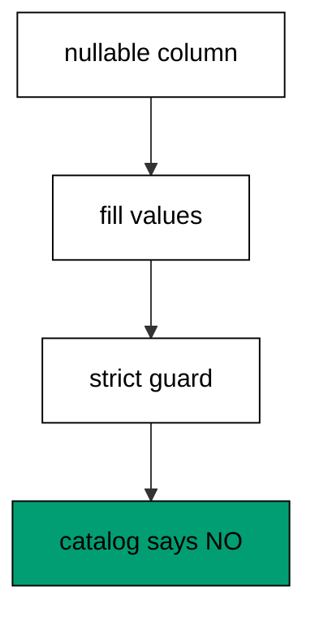

The first migration lands the column nullable with seeded rows, the second fills every value from the row ids, and only the third declares NOT NULL. Each step is safe alone: the nullable column changes nothing, the fill touches data only, and the guard validates against already-complete values. Reversing the guard drops back to nullable without losing data, which keeps even the last step undoable. This nullable-fill-strict chain is the expand pattern in miniature, and the zero-downtime cluster builds on it next.

**`learning/code/ex-34-backfill-then-constrain/main.clj`**:

```clojure
;; => Example 34: Backfill Then Constrain.
;; => Nullable, fill, strict: the three-step shape lands a required column on live data.
(require '[migratus.core :as migratus]) ;; => migrate, rollback, up, and down move history
(require '[next.jdbc :as jdbc]) ;; => verification reads prove each migration landed
(require '[next.jdbc.result-set :as rs]) ;; => unqualified rows print without table prefixes
(require '[clojure.java.io :as io]) ;; => migration files are staged, then removed
;; => The database address comes from the harness, with local-run defaults.
(defn db-spec [] ;; => one builder owns every address default
  {:dbtype "postgresql" ;; => pgjdbc speaks the PostgreSQL wire protocol
   :host (or (System/getenv "PGHOST") "localhost") ;; => harness sets the service host
   :port (Integer/parseInt (or (System/getenv "PGPORT") "5432")) ;; => service port default
   :dbname (or (System/getenv "PGDATABASE") "postgres") ;; => fresh database per unit run
   :user (or (System/getenv "PGUSER") "postgres")}) ;; => trust auth needs no password
;; => One config carries the store, the relative migration dir, and the history table.
(defn config [dir table] ;; => every example owns its dir and history table
  {:store :database ;; => the SQL store journals history in a table
   :migration-dir dir ;; => relative to the unit folder, staged at runtime
   :migration-table-name table ;; => per-example history isolates every rerun
   :db (db-spec)}) ;; => next.jdbc connects from this spec
;; => Staging writes one up/down pair per call into the relative dir.
(defn write-migration [dir id name up down] ;; => one helper stages every migration
  (spit (str dir "/" id "-" name ".up.sql") up) ;; => forward change runs on migrate
  (when down ;; => up-only examples skip the down file on purpose
    (spit (str dir "/" id "-" name ".down.sql") down))) ;; => reverse runs on rollback
;; => Reset clears leftovers of a killed run so reruns print alike.
(defn reset-unit! [ds dir table tables views] ;; => one reset owns every leftover
  (doseq [v views] ;; => views drop before the tables they read
    (jdbc/execute! ds [(str "DROP VIEW IF EXISTS " v)])) ;; => stale views vanish first
  (let [d (io/file dir)] ;; => the relative staging dir of this unit
    (when (.exists d) ;; => a killed run may leave files behind
      (doseq [f (.listFiles d)] ;; => every staged file goes first
        (.delete ^java.io.File f)) ;; => delete each staged migration
      (.delete d)) ;; => the empty staging dir goes too
    (.mkdirs d)) ;; => a fresh dir for this run
  (doseq [t tables] ;; => every table this example owns
    (jdbc/execute! ds [(str "DROP TABLE IF EXISTS " t " CASCADE")])) ;; => killed runs vanish
  (jdbc/execute! ds [(str "DROP TABLE IF EXISTS " table)])) ;; => stale history vanishes too
;; => Reads print their own proof; ids sort so output never depends on disk order.
(defn applied-names [ds table] ;; => applied migration names in id order
  (mapv :description ;; => description stores the migration name
    (jdbc/execute! ds [(str "SELECT description FROM " table " WHERE id > 0 ORDER BY id")] ;; => id order, reserve row excluded
                     {:builder-fn rs/as-unqualified-lower-maps}))) ;; => short keys print cleanly
;; => Column lists read the catalog, so the schema proves itself.
(defn table-columns [ds table] ;; => column names in position order
  (mapv :column_name ;; => one name per row, nothing else
    (jdbc/execute! ds [(str "SELECT column_name FROM information_schema.columns WHERE table_name = '" table "' ORDER BY ordinal_position")] ;; => catalog order is stable
                     {:builder-fn rs/as-unqualified-lower-maps}))) ;; => short keys print cleanly
(def ds (jdbc/get-datasource (db-spec))) ;; => one shared datasource per unit run
(def cfg (config "mig" "m34_migrations")) ;; => store plus history table for this example
(reset-unit! ds "mig" "m34_migrations" ["m34_acct"] []) ;; => leftovers of a killed run vanish first
(write-migration "mig" "20260101003401" "make-acct" ;; => first the accounts with a nullable code
  (str "CREATE TABLE m34_acct (id SERIAL PRIMARY KEY, code TEXT);\n" ;; => code starts nullable
       "--;;\n" ;; => separator splits schema from seed
       "INSERT INTO m34_acct (id) VALUES (1), (2);\n") ;; => two accounts await codes
  "DROP TABLE m34_acct;\n") ;; => reverse drops everything
(write-migration "mig" "20260101003402" "fill-code" ;; => then the code fill
  "UPDATE m34_acct SET code = 'acc-' || id WHERE code IS NULL;\n" ;; => codes derive from the ids
  "UPDATE m34_acct SET code = NULL;\n") ;; => reverse restores the nulls
(write-migration "mig" "20260101003403" "guard-code" ;; => then the strict guard
  "ALTER TABLE m34_acct ALTER COLUMN code SET NOT NULL;\n" ;; => no nulls remain to reject
  "ALTER TABLE m34_acct ALTER COLUMN code DROP NOT NULL;\n") ;; => reverse relaxes the guard
(println "migrate:" (pr-str (migratus/migrate cfg))) ;; => nil means every pending migration applied
(println "completed:" (pr-str (applied-names ds "m34_migrations"))) ;; => id order straight from history
(println "nullable:" (pr-str (mapv :is_nullable ;; => NO proves the guard
  (jdbc/execute! ds ["SELECT is_nullable AS is_nullable FROM information_schema.columns WHERE table_name = 'm34_acct' AND column_name = 'code'"] ;; => catalog records the strict rule (part 1)
                   {:builder-fn rs/as-unqualified-lower-maps})))) ;; => catalog records the strict rule (part 2)
;; => Cleanup drops every object this example made, leaving no residue.
(defn cleanup-unit! [ds dir table tables views] ;; => one cleanup owns every created object
  (doseq [v views] ;; => views drop before the tables they read
    (jdbc/execute! ds [(str "DROP VIEW IF EXISTS " v)])) ;; => view residue vanishes
  (doseq [t tables] ;; => every table this example owns
    (jdbc/execute! ds [(str "DROP TABLE IF EXISTS " t " CASCADE")])) ;; => tables vanish with dependents
  (jdbc/execute! ds [(str "DROP TABLE IF EXISTS " table)]) ;; => history table vanishes too
  (let [d (io/file dir)] ;; => the staging dir from this run
    (when (.exists d) ;; => files were staged above
      (doseq [f (.listFiles d)] ;; => every staged file goes first
        (.delete ^java.io.File f)) ;; => delete each staged migration
      (.delete d)))) ;; => the empty staging dir goes too
(cleanup-unit! ds "mig" "m34_migrations" ["m34_acct"] []) ;; => drop every object this example created
```

**Output** (`learning/code/ex-34-backfill-then-constrain/expected/main.stdout.txt`):

```text
migrate: nil
completed: ["make-acct" "fill-code" "guard-code"]
nullable: ["NO"]
```

**Key takeaway**: Land strict columns in three steps: nullable schema, value fill, then the guard.

**Why it matters**: A strict column on a table with rows is two changes wearing one name, and shipping them together fails on the existing data. The three-step chain separates landing from filling from guarding, so each deploy does one safe thing. Teams that chain this way never choose between strictness and uptime, because the steps compose into both.

### Example 35: Expand Adds the New Column

Renames start by adding, never by replacing, so this example expands a users table with a spare column. The program migrates both steps and prints the doubled shape. (Concepts: co-07.)

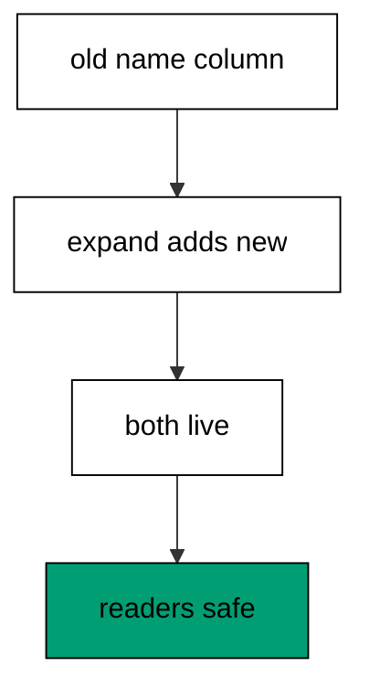

The expand migration adds a nullable column and nothing else: no data moves, no constraint lands, and old readers keep working because their column is untouched. Nullability is what makes the step safe: PostgreSQL adds nullable columns as metadata without rewriting the table. The old and new columns coexist from here until the contract step, which gives every writer time to move over. Expand first is the rule the whole cluster follows, because it never breaks a running reader.

**`learning/code/ex-35-expand-adds-the-new-column/main.clj`**:

```clojure
;; => Example 35: Expand Adds the New Column.
;; => The expand step lands beside the old column: nullable, unused, and safe.
(require '[migratus.core :as migratus]) ;; => migrate, rollback, up, and down move history
(require '[next.jdbc :as jdbc]) ;; => verification reads prove each migration landed
(require '[next.jdbc.result-set :as rs]) ;; => unqualified rows print without table prefixes
(require '[clojure.java.io :as io]) ;; => migration files are staged, then removed
;; => The database address comes from the harness, with local-run defaults.
(defn db-spec [] ;; => one builder owns every address default
  {:dbtype "postgresql" ;; => pgjdbc speaks the PostgreSQL wire protocol
   :host (or (System/getenv "PGHOST") "localhost") ;; => harness sets the service host
   :port (Integer/parseInt (or (System/getenv "PGPORT") "5432")) ;; => service port default
   :dbname (or (System/getenv "PGDATABASE") "postgres") ;; => fresh database per unit run
   :user (or (System/getenv "PGUSER") "postgres")}) ;; => trust auth needs no password
;; => One config carries the store, the relative migration dir, and the history table.
(defn config [dir table] ;; => every example owns its dir and history table
  {:store :database ;; => the SQL store journals history in a table
   :migration-dir dir ;; => relative to the unit folder, staged at runtime
   :migration-table-name table ;; => per-example history isolates every rerun
   :db (db-spec)}) ;; => next.jdbc connects from this spec
;; => Staging writes one up/down pair per call into the relative dir.
(defn write-migration [dir id name up down] ;; => one helper stages every migration
  (spit (str dir "/" id "-" name ".up.sql") up) ;; => forward change runs on migrate
  (when down ;; => up-only examples skip the down file on purpose
    (spit (str dir "/" id "-" name ".down.sql") down))) ;; => reverse runs on rollback
;; => Reset clears leftovers of a killed run so reruns print alike.
(defn reset-unit! [ds dir table tables views] ;; => one reset owns every leftover
  (doseq [v views] ;; => views drop before the tables they read
    (jdbc/execute! ds [(str "DROP VIEW IF EXISTS " v)])) ;; => stale views vanish first
  (let [d (io/file dir)] ;; => the relative staging dir of this unit
    (when (.exists d) ;; => a killed run may leave files behind
      (doseq [f (.listFiles d)] ;; => every staged file goes first
        (.delete ^java.io.File f)) ;; => delete each staged migration
      (.delete d)) ;; => the empty staging dir goes too
    (.mkdirs d)) ;; => a fresh dir for this run
  (doseq [t tables] ;; => every table this example owns
    (jdbc/execute! ds [(str "DROP TABLE IF EXISTS " t " CASCADE")])) ;; => killed runs vanish
  (jdbc/execute! ds [(str "DROP TABLE IF EXISTS " table)])) ;; => stale history vanishes too
;; => Reads print their own proof; ids sort so output never depends on disk order.
(defn applied-names [ds table] ;; => applied migration names in id order
  (mapv :description ;; => description stores the migration name
    (jdbc/execute! ds [(str "SELECT description FROM " table " WHERE id > 0 ORDER BY id")] ;; => id order, reserve row excluded
                     {:builder-fn rs/as-unqualified-lower-maps}))) ;; => short keys print cleanly
;; => Column lists read the catalog, so the schema proves itself.
(defn table-columns [ds table] ;; => column names in position order
  (mapv :column_name ;; => one name per row, nothing else
    (jdbc/execute! ds [(str "SELECT column_name FROM information_schema.columns WHERE table_name = '" table "' ORDER BY ordinal_position")] ;; => catalog order is stable
                     {:builder-fn rs/as-unqualified-lower-maps}))) ;; => short keys print cleanly
(def ds (jdbc/get-datasource (db-spec))) ;; => one shared datasource per unit run
(def cfg (config "mig" "m35_migrations")) ;; => store plus history table for this example
(reset-unit! ds "mig" "m35_migrations" ["m35_user"] []) ;; => leftovers of a killed run vanish first
(write-migration "mig" "20260101003501" "make-user" ;; => first the users with the old name column
  (str "CREATE TABLE m35_user (id SERIAL PRIMARY KEY, name TEXT NOT NULL);\n" ;; => name serves readers today
       "--;;\n" ;; => separator splits schema from seed
       "INSERT INTO m35_user (name) VALUES ('ada'), ('grace');\n") ;; => two users await the rename
  "DROP TABLE m35_user;\n") ;; => reverse drops everything
(write-migration "mig" "20260101003502" "expand-display-name" ;; => then the expand step
  "ALTER TABLE m35_user ADD COLUMN display_name TEXT;\n" ;; => new column starts nullable
  "ALTER TABLE m35_user DROP COLUMN display_name;\n") ;; => reverse drops the expansion
(println "migrate:" (pr-str (migratus/migrate cfg))) ;; => nil means every pending migration applied
(println "completed:" (pr-str (applied-names ds "m35_migrations"))) ;; => id order straight from history
(println "columns:" (pr-str (table-columns ds "m35_user"))) ;; => old and new side by side
;; => Cleanup drops every object this example made, leaving no residue.
(defn cleanup-unit! [ds dir table tables views] ;; => one cleanup owns every created object
  (doseq [v views] ;; => views drop before the tables they read
    (jdbc/execute! ds [(str "DROP VIEW IF EXISTS " v)])) ;; => view residue vanishes
  (doseq [t tables] ;; => every table this example owns
    (jdbc/execute! ds [(str "DROP TABLE IF EXISTS " t " CASCADE")])) ;; => tables vanish with dependents
  (jdbc/execute! ds [(str "DROP TABLE IF EXISTS " table)]) ;; => history table vanishes too
  (let [d (io/file dir)] ;; => the staging dir from this run
    (when (.exists d) ;; => files were staged above
      (doseq [f (.listFiles d)] ;; => every staged file goes first
        (.delete ^java.io.File f)) ;; => delete each staged migration
      (.delete d)))) ;; => the empty staging dir goes too
(cleanup-unit! ds "mig" "m35_migrations" ["m35_user"] []) ;; => drop every object this example created
```

**Output** (`learning/code/ex-35-expand-adds-the-new-column/expected/main.stdout.txt`):

```text
migrate: nil
completed: ["make-user" "expand-display-name"]
columns: ["id" "name" "display_name"]
```

**Key takeaway**: Expand lands the new column nullable beside the old one; readers keep working.

**Why it matters**: Renames break running code when the old name vanishes before readers move, and the outage looks like missing data rather than a deploy. Expanding first keeps both names live, so old and new code run against the same rows during the transition. Teams that expand before they migrate decouple the deploy from every reader, which turns renames from flag days into background moves.

### Example 36: Migrate Copies Old to New

Copies move values without touching readers, so this example migrates every name into the spare column. The program chains three migrations and counts the rows still missing the copy. (Concepts: co-07.)

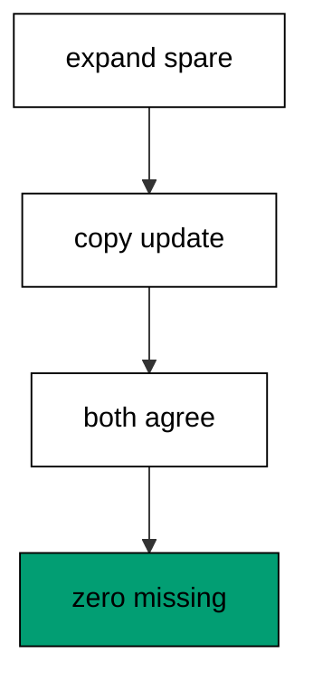

The copy is a plain UPDATE from the old column to the new one with a NULL guard, which makes it rerunnable like every fill in the previous cluster. Old readers keep reading the old column and new readers start on the new one, because both hold the same values from here on. The zero-missing count proves the copy reached every row, including rows seeded before the expand landed. Migrate steps never change shape, only values, which is why they deploy without coordination.

**`learning/code/ex-36-migrate-copies-old-to-new/main.clj`**:

```clojure
;; => Example 36: Migrate Copies Old to New.
;; => The migrate step copies every old value into the new column with one UPDATE.
(require '[migratus.core :as migratus]) ;; => migrate, rollback, up, and down move history
(require '[next.jdbc :as jdbc]) ;; => verification reads prove each migration landed
(require '[next.jdbc.result-set :as rs]) ;; => unqualified rows print without table prefixes
(require '[clojure.java.io :as io]) ;; => migration files are staged, then removed
;; => The database address comes from the harness, with local-run defaults.
(defn db-spec [] ;; => one builder owns every address default
  {:dbtype "postgresql" ;; => pgjdbc speaks the PostgreSQL wire protocol
   :host (or (System/getenv "PGHOST") "localhost") ;; => harness sets the service host
   :port (Integer/parseInt (or (System/getenv "PGPORT") "5432")) ;; => service port default
   :dbname (or (System/getenv "PGDATABASE") "postgres") ;; => fresh database per unit run
   :user (or (System/getenv "PGUSER") "postgres")}) ;; => trust auth needs no password
;; => One config carries the store, the relative migration dir, and the history table.
(defn config [dir table] ;; => every example owns its dir and history table
  {:store :database ;; => the SQL store journals history in a table
   :migration-dir dir ;; => relative to the unit folder, staged at runtime
   :migration-table-name table ;; => per-example history isolates every rerun
   :db (db-spec)}) ;; => next.jdbc connects from this spec
;; => Staging writes one up/down pair per call into the relative dir.
(defn write-migration [dir id name up down] ;; => one helper stages every migration
  (spit (str dir "/" id "-" name ".up.sql") up) ;; => forward change runs on migrate
  (when down ;; => up-only examples skip the down file on purpose
    (spit (str dir "/" id "-" name ".down.sql") down))) ;; => reverse runs on rollback
;; => Reset clears leftovers of a killed run so reruns print alike.
(defn reset-unit! [ds dir table tables views] ;; => one reset owns every leftover
  (doseq [v views] ;; => views drop before the tables they read
    (jdbc/execute! ds [(str "DROP VIEW IF EXISTS " v)])) ;; => stale views vanish first
  (let [d (io/file dir)] ;; => the relative staging dir of this unit
    (when (.exists d) ;; => a killed run may leave files behind
      (doseq [f (.listFiles d)] ;; => every staged file goes first
        (.delete ^java.io.File f)) ;; => delete each staged migration
      (.delete d)) ;; => the empty staging dir goes too
    (.mkdirs d)) ;; => a fresh dir for this run
  (doseq [t tables] ;; => every table this example owns
    (jdbc/execute! ds [(str "DROP TABLE IF EXISTS " t " CASCADE")])) ;; => killed runs vanish
  (jdbc/execute! ds [(str "DROP TABLE IF EXISTS " table)])) ;; => stale history vanishes too
;; => Reads print their own proof; ids sort so output never depends on disk order.
(defn applied-names [ds table] ;; => applied migration names in id order
  (mapv :description ;; => description stores the migration name
    (jdbc/execute! ds [(str "SELECT description FROM " table " WHERE id > 0 ORDER BY id")] ;; => id order, reserve row excluded
                     {:builder-fn rs/as-unqualified-lower-maps}))) ;; => short keys print cleanly
;; => Column lists read the catalog, so the schema proves itself.
(defn table-columns [ds table] ;; => column names in position order
  (mapv :column_name ;; => one name per row, nothing else
    (jdbc/execute! ds [(str "SELECT column_name FROM information_schema.columns WHERE table_name = '" table "' ORDER BY ordinal_position")] ;; => catalog order is stable
                     {:builder-fn rs/as-unqualified-lower-maps}))) ;; => short keys print cleanly
(def ds (jdbc/get-datasource (db-spec))) ;; => one shared datasource per unit run
(def cfg (config "mig" "m36_migrations")) ;; => store plus history table for this example
(reset-unit! ds "mig" "m36_migrations" ["m36_user"] []) ;; => leftovers of a killed run vanish first
(write-migration "mig" "20260101003601" "make-user" ;; => users with the old name column
  (str "CREATE TABLE m36_user (id SERIAL PRIMARY KEY, name TEXT NOT NULL);\n" ;; => name serves readers today
       "--;;\n" ;; => separator splits schema from seed
       "INSERT INTO m36_user (name) VALUES ('ada'), ('grace');\n") ;; => two users await the rename
  "DROP TABLE m36_user;\n") ;; => reverse drops everything
(write-migration "mig" "20260101003602" "expand-display-name" ;; => expand lands the spare column
  "ALTER TABLE m36_user ADD COLUMN display_name TEXT;\n" ;; => new column starts nullable
  "ALTER TABLE m36_user DROP COLUMN display_name;\n") ;; => reverse drops the expansion
(write-migration "mig" "20260101003603" "copy-names" ;; => migrate copies old values across
  "UPDATE m36_user SET display_name = name WHERE display_name IS NULL;\n" ;; => one statement copies every row
  "UPDATE m36_user SET display_name = NULL;\n") ;; => reverse restores the nulls
(println "migrate:" (pr-str (migratus/migrate cfg))) ;; => nil means every pending migration applied
(println "completed:" (pr-str (applied-names ds "m36_migrations"))) ;; => id order straight from history
(println "missing:" (pr-str (:n (first (jdbc/execute! ds ["SELECT count(*) AS n FROM m36_user WHERE display_name IS NULL"] ;; => zero rows lack the copy
  {:builder-fn rs/as-unqualified-lower-maps}))))) ;; => every old value moved over
;; => Cleanup drops every object this example made, leaving no residue.
(defn cleanup-unit! [ds dir table tables views] ;; => one cleanup owns every created object
  (doseq [v views] ;; => views drop before the tables they read
    (jdbc/execute! ds [(str "DROP VIEW IF EXISTS " v)])) ;; => view residue vanishes
  (doseq [t tables] ;; => every table this example owns
    (jdbc/execute! ds [(str "DROP TABLE IF EXISTS " t " CASCADE")])) ;; => tables vanish with dependents
  (jdbc/execute! ds [(str "DROP TABLE IF EXISTS " table)]) ;; => history table vanishes too
  (let [d (io/file dir)] ;; => the staging dir from this run
    (when (.exists d) ;; => files were staged above
      (doseq [f (.listFiles d)] ;; => every staged file goes first
        (.delete ^java.io.File f)) ;; => delete each staged migration
      (.delete d)))) ;; => the empty staging dir goes too
(cleanup-unit! ds "mig" "m36_migrations" ["m36_user"] []) ;; => drop every object this example created
```

**Output** (`learning/code/ex-36-migrate-copies-old-to-new/expected/main.stdout.txt`):

```text
migrate: nil
completed: ["make-user" "expand-display-name" "copy-names"]
missing: 0
```

**Key takeaway**: Migrate copies old values into the new column; both names read the same from here on.

**Why it matters**: Value moves must not disturb readers, so the copy runs as background data work under unchanged schemas. Old code keeps working while new code adopts the new name at its own pace, because the values agree everywhere. Teams that copy before they contract never synchronize deploys with readers, which removes the riskiest coupling in schema change.

### Example 37: Verify Both Columns Match

Dropping the old column is the point of no return, so this example verifies the copy before any contract. The program expands, copies, and counts the rows where old and new disagree. (Concepts: co-07, co-16.)

`IS DISTINCT FROM` compares with NULLs treated as ordinary values, so the count catches every mismatch including rows where one side never filled. Zero means the copy is exact and the contract step may proceed; anything else stops the rename before data loss. This check belongs in the deploy pipeline between migrate and contract, not in a human eyeball, because renames run when reviewers are tired. Verification gates the point of no return, which is the only place a gate can still help.

**`learning/code/ex-37-verify-both-columns-match/main.clj`**:

```clojure
;; => Example 37: Verify Both Columns Match.
;; => Before contracting, prove the copy: zero rows may differ between old and new.
(require '[migratus.core :as migratus]) ;; => migrate, rollback, up, and down move history
(require '[next.jdbc :as jdbc]) ;; => verification reads prove each migration landed
(require '[next.jdbc.result-set :as rs]) ;; => unqualified rows print without table prefixes
(require '[clojure.java.io :as io]) ;; => migration files are staged, then removed
;; => The database address comes from the harness, with local-run defaults.
(defn db-spec [] ;; => one builder owns every address default
  {:dbtype "postgresql" ;; => pgjdbc speaks the PostgreSQL wire protocol
   :host (or (System/getenv "PGHOST") "localhost") ;; => harness sets the service host
   :port (Integer/parseInt (or (System/getenv "PGPORT") "5432")) ;; => service port default
   :dbname (or (System/getenv "PGDATABASE") "postgres") ;; => fresh database per unit run
   :user (or (System/getenv "PGUSER") "postgres")}) ;; => trust auth needs no password
;; => One config carries the store, the relative migration dir, and the history table.
(defn config [dir table] ;; => every example owns its dir and history table
  {:store :database ;; => the SQL store journals history in a table
   :migration-dir dir ;; => relative to the unit folder, staged at runtime
   :migration-table-name table ;; => per-example history isolates every rerun
   :db (db-spec)}) ;; => next.jdbc connects from this spec
;; => Staging writes one up/down pair per call into the relative dir.
(defn write-migration [dir id name up down] ;; => one helper stages every migration
  (spit (str dir "/" id "-" name ".up.sql") up) ;; => forward change runs on migrate
  (when down ;; => up-only examples skip the down file on purpose
    (spit (str dir "/" id "-" name ".down.sql") down))) ;; => reverse runs on rollback
;; => Reset clears leftovers of a killed run so reruns print alike.
(defn reset-unit! [ds dir table tables views] ;; => one reset owns every leftover
  (doseq [v views] ;; => views drop before the tables they read
    (jdbc/execute! ds [(str "DROP VIEW IF EXISTS " v)])) ;; => stale views vanish first
  (let [d (io/file dir)] ;; => the relative staging dir of this unit
    (when (.exists d) ;; => a killed run may leave files behind
      (doseq [f (.listFiles d)] ;; => every staged file goes first
        (.delete ^java.io.File f)) ;; => delete each staged migration
      (.delete d)) ;; => the empty staging dir goes too
    (.mkdirs d)) ;; => a fresh dir for this run
  (doseq [t tables] ;; => every table this example owns
    (jdbc/execute! ds [(str "DROP TABLE IF EXISTS " t " CASCADE")])) ;; => killed runs vanish
  (jdbc/execute! ds [(str "DROP TABLE IF EXISTS " table)])) ;; => stale history vanishes too
;; => Reads print their own proof; ids sort so output never depends on disk order.
(defn applied-names [ds table] ;; => applied migration names in id order
  (mapv :description ;; => description stores the migration name
    (jdbc/execute! ds [(str "SELECT description FROM " table " WHERE id > 0 ORDER BY id")] ;; => id order, reserve row excluded
                     {:builder-fn rs/as-unqualified-lower-maps}))) ;; => short keys print cleanly
;; => Column lists read the catalog, so the schema proves itself.
(defn table-columns [ds table] ;; => column names in position order
  (mapv :column_name ;; => one name per row, nothing else
    (jdbc/execute! ds [(str "SELECT column_name FROM information_schema.columns WHERE table_name = '" table "' ORDER BY ordinal_position")] ;; => catalog order is stable
                     {:builder-fn rs/as-unqualified-lower-maps}))) ;; => short keys print cleanly
(def ds (jdbc/get-datasource (db-spec))) ;; => one shared datasource per unit run
(def cfg (config "mig" "m37_migrations")) ;; => store plus history table for this example
(reset-unit! ds "mig" "m37_migrations" ["m37_user"] []) ;; => leftovers of a killed run vanish first
(write-migration "mig" "20260101003701" "make-user" ;; => users with the old name column
  (str "CREATE TABLE m37_user (id SERIAL PRIMARY KEY, name TEXT NOT NULL);\n" ;; => name serves readers today
       "--;;\n" ;; => separator splits schema from seed
       "INSERT INTO m37_user (name) VALUES ('ada'), ('grace');\n") ;; => two users await the rename
  "DROP TABLE m37_user;\n") ;; => reverse drops everything
(write-migration "mig" "20260101003702" "expand-and-copy" ;; => expand plus copy in one reviewable file
  (str "ALTER TABLE m37_user ADD COLUMN display_name TEXT;\n" ;; => spare column lands first
       "--;;\n" ;; => separator splits the steps
       "UPDATE m37_user SET display_name = name WHERE display_name IS NULL;\n") ;; => copy follows in the same file
  "ALTER TABLE m37_user DROP COLUMN display_name;\n") ;; => reverse drops the spare column
(println "migrate:" (pr-str (migratus/migrate cfg))) ;; => nil means every pending migration applied
(println "completed:" (pr-str (applied-names ds "m37_migrations"))) ;; => id order straight from history
(println "differ:" (pr-str (:n (first (jdbc/execute! ds ["SELECT count(*) AS n FROM m37_user WHERE name IS DISTINCT FROM display_name"] ;; => zero rows differ
  {:builder-fn rs/as-unqualified-lower-maps}))))) ;; => copy is exact, contract may proceed
;; => Cleanup drops every object this example made, leaving no residue.
(defn cleanup-unit! [ds dir table tables views] ;; => one cleanup owns every created object
  (doseq [v views] ;; => views drop before the tables they read
    (jdbc/execute! ds [(str "DROP VIEW IF EXISTS " v)])) ;; => view residue vanishes
  (doseq [t tables] ;; => every table this example owns
    (jdbc/execute! ds [(str "DROP TABLE IF EXISTS " t " CASCADE")])) ;; => tables vanish with dependents
  (jdbc/execute! ds [(str "DROP TABLE IF EXISTS " table)]) ;; => history table vanishes too
  (let [d (io/file dir)] ;; => the staging dir from this run
    (when (.exists d) ;; => files were staged above
      (doseq [f (.listFiles d)] ;; => every staged file goes first
        (.delete ^java.io.File f)) ;; => delete each staged migration
      (.delete d)))) ;; => the empty staging dir goes too
(cleanup-unit! ds "mig" "m37_migrations" ["m37_user"] []) ;; => drop every object this example created
```

**Output** (`learning/code/ex-37-verify-both-columns-match/expected/main.stdout.txt`):

```text
migrate: nil
completed: ["make-user" "expand-and-copy"]
differ: 0
```

**Key takeaway**: Prove zero differences between old and new before contracting; the count gates the rename.

**Why it matters**: Contract steps destroy the old column, and no check after that can recover a missed copy. Counting differences before the drop turns confidence into a number the pipeline enforces, so incomplete copies never reach the destructive step. Teams that gate the contract ship renames without holding their breath, because the proof runs before the point of no return.

### Example 38: Contract Drops the Old Column

Old names must eventually go, so this example contracts the rename after the copy verified. The program chains expand, copy, and contract, then prints the final shape. (Concepts: co-07.)

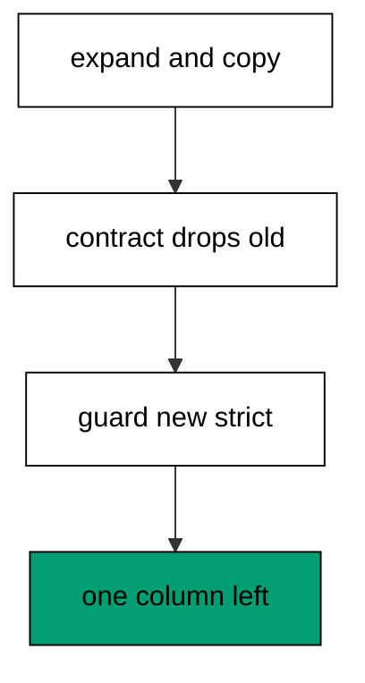

The contract migration drops the old column and declares the new one NOT NULL in two statements, which retires the transition after every reader moved. The guard is safe now because the copy filled every row, and the drop is safe because no reader still names the old column. Contract runs last and only last: earlier, and readers break; later, and the transition rots. The printed columns prove the rename completed, with one name where two stood.

**`learning/code/ex-38-contract-drops-the-old-column/main.clj`**:

```clojure
;; => Example 38: Contract Drops the Old Column.
;; => The contract step removes the old name and guards the new one: one column remains.
(require '[migratus.core :as migratus]) ;; => migrate, rollback, up, and down move history
(require '[next.jdbc :as jdbc]) ;; => verification reads prove each migration landed
(require '[next.jdbc.result-set :as rs]) ;; => unqualified rows print without table prefixes
(require '[clojure.java.io :as io]) ;; => migration files are staged, then removed
;; => The database address comes from the harness, with local-run defaults.
(defn db-spec [] ;; => one builder owns every address default
  {:dbtype "postgresql" ;; => pgjdbc speaks the PostgreSQL wire protocol
   :host (or (System/getenv "PGHOST") "localhost") ;; => harness sets the service host
   :port (Integer/parseInt (or (System/getenv "PGPORT") "5432")) ;; => service port default
   :dbname (or (System/getenv "PGDATABASE") "postgres") ;; => fresh database per unit run
   :user (or (System/getenv "PGUSER") "postgres")}) ;; => trust auth needs no password
;; => One config carries the store, the relative migration dir, and the history table.
(defn config [dir table] ;; => every example owns its dir and history table
  {:store :database ;; => the SQL store journals history in a table
   :migration-dir dir ;; => relative to the unit folder, staged at runtime
   :migration-table-name table ;; => per-example history isolates every rerun
   :db (db-spec)}) ;; => next.jdbc connects from this spec
;; => Staging writes one up/down pair per call into the relative dir.
(defn write-migration [dir id name up down] ;; => one helper stages every migration
  (spit (str dir "/" id "-" name ".up.sql") up) ;; => forward change runs on migrate
  (when down ;; => up-only examples skip the down file on purpose
    (spit (str dir "/" id "-" name ".down.sql") down))) ;; => reverse runs on rollback
;; => Reset clears leftovers of a killed run so reruns print alike.
(defn reset-unit! [ds dir table tables views] ;; => one reset owns every leftover
  (doseq [v views] ;; => views drop before the tables they read
    (jdbc/execute! ds [(str "DROP VIEW IF EXISTS " v)])) ;; => stale views vanish first
  (let [d (io/file dir)] ;; => the relative staging dir of this unit
    (when (.exists d) ;; => a killed run may leave files behind
      (doseq [f (.listFiles d)] ;; => every staged file goes first
        (.delete ^java.io.File f)) ;; => delete each staged migration
      (.delete d)) ;; => the empty staging dir goes too
    (.mkdirs d)) ;; => a fresh dir for this run
  (doseq [t tables] ;; => every table this example owns
    (jdbc/execute! ds [(str "DROP TABLE IF EXISTS " t " CASCADE")])) ;; => killed runs vanish
  (jdbc/execute! ds [(str "DROP TABLE IF EXISTS " table)])) ;; => stale history vanishes too
;; => Reads print their own proof; ids sort so output never depends on disk order.
(defn applied-names [ds table] ;; => applied migration names in id order
  (mapv :description ;; => description stores the migration name
    (jdbc/execute! ds [(str "SELECT description FROM " table " WHERE id > 0 ORDER BY id")] ;; => id order, reserve row excluded
                     {:builder-fn rs/as-unqualified-lower-maps}))) ;; => short keys print cleanly
;; => Column lists read the catalog, so the schema proves itself.
(defn table-columns [ds table] ;; => column names in position order
  (mapv :column_name ;; => one name per row, nothing else
    (jdbc/execute! ds [(str "SELECT column_name FROM information_schema.columns WHERE table_name = '" table "' ORDER BY ordinal_position")] ;; => catalog order is stable
                     {:builder-fn rs/as-unqualified-lower-maps}))) ;; => short keys print cleanly
(def ds (jdbc/get-datasource (db-spec))) ;; => one shared datasource per unit run
(def cfg (config "mig" "m38_migrations")) ;; => store plus history table for this example
(reset-unit! ds "mig" "m38_migrations" ["m38_user"] []) ;; => leftovers of a killed run vanish first
(write-migration "mig" "20260101003801" "make-user" ;; => users with the old name column
  (str "CREATE TABLE m38_user (id SERIAL PRIMARY KEY, name TEXT NOT NULL);\n" ;; => name serves readers today
       "--;;\n" ;; => separator splits schema from seed
       "INSERT INTO m38_user (name) VALUES ('ada'), ('grace');\n") ;; => two users await the rename
  "DROP TABLE m38_user;\n") ;; => reverse drops everything
(write-migration "mig" "20260101003802" "expand-and-copy" ;; => expand plus copy in one file
  (str "ALTER TABLE m38_user ADD COLUMN display_name TEXT;\n" ;; => spare column lands first
       "--;;\n" ;; => separator splits the steps
       "UPDATE m38_user SET display_name = name WHERE display_name IS NULL;\n") ;; => copy follows in the same file
  "ALTER TABLE m38_user DROP COLUMN display_name;\n") ;; => reverse drops the spare column
(write-migration "mig" "20260101003803" "contract-name" ;; => contract drops old and guards new
  (str "ALTER TABLE m38_user DROP COLUMN name;\n" ;; => old column goes away
       "--;;\n" ;; => separator splits the contract steps
       "ALTER TABLE m38_user ALTER COLUMN display_name SET NOT NULL;\n") ;; => new column turns strict
  (str "ALTER TABLE m38_user ALTER COLUMN display_name DROP NOT NULL;\n" ;; => reverse relaxes the guard first
       "--;;\n" ;; => same separator on the way down
       "ALTER TABLE m38_user ADD COLUMN name TEXT;\n")) ;; => then the old name returns nullable
(println "migrate:" (pr-str (migratus/migrate cfg))) ;; => nil means every pending migration applied
(println "completed:" (pr-str (applied-names ds "m38_migrations"))) ;; => id order straight from history
(println "columns:" (pr-str (table-columns ds "m38_user"))) ;; => one name column remains
(println "nullable:" (pr-str (mapv :is_nullable ;; => NO proves the guard
  (jdbc/execute! ds ["SELECT is_nullable AS is_nullable FROM information_schema.columns WHERE table_name = 'm38_user' AND column_name = 'display_name'"] ;; => catalog records the strict rule (part 1)
                   {:builder-fn rs/as-unqualified-lower-maps})))) ;; => catalog records the strict rule (part 2)
;; => Cleanup drops every object this example made, leaving no residue.
(defn cleanup-unit! [ds dir table tables views] ;; => one cleanup owns every created object
  (doseq [v views] ;; => views drop before the tables they read
    (jdbc/execute! ds [(str "DROP VIEW IF EXISTS " v)])) ;; => view residue vanishes
  (doseq [t tables] ;; => every table this example owns
    (jdbc/execute! ds [(str "DROP TABLE IF EXISTS " t " CASCADE")])) ;; => tables vanish with dependents
  (jdbc/execute! ds [(str "DROP TABLE IF EXISTS " table)]) ;; => history table vanishes too
  (let [d (io/file dir)] ;; => the staging dir from this run
    (when (.exists d) ;; => files were staged above
      (doseq [f (.listFiles d)] ;; => every staged file goes first
        (.delete ^java.io.File f)) ;; => delete each staged migration
      (.delete d)))) ;; => the empty staging dir goes too
(cleanup-unit! ds "mig" "m38_migrations" ["m38_user"] []) ;; => drop every object this example created
```

**Output** (`learning/code/ex-38-contract-drops-the-old-column/expected/main.stdout.txt`):

```text
migrate: nil
completed: ["make-user" "expand-and-copy" "contract-name"]
columns: ["id" "display_name"]
nullable: ["NO"]
```

**Key takeaway**: Contract drops the old column and guards the new one; one name remains where two stood.

**Why it matters**: Transitions rot when nobody closes them: spare columns linger, readers split across names, and the schema tells two stories. The contract step ends the rename decisively, removing the old name and enforcing the new rule in one deploy. Teams that contract on schedule keep schemas with one story, because every transition has a planned ending.

### Example 39: Add Column Without Locking Reads

Hot tables cannot pause for schema changes, so this example adds a column to a seeded table. The program migrates and proves both rows stayed readable. (Concepts: co-07, co-15.)

Adding a nullable column without a default only touches the catalog: PostgreSQL records the new column as metadata and fills it lazily on read. No table rewrite means no long lock, so concurrent readers never wait behind the migration. The row count after proves reads flowed normally, because a blocked table would have stalled the very query that counts. Nullable-first is the lock-friendly default, and strictness arrives later through the chain from the backfill cluster.

**`learning/code/ex-39-add-column-without-locking-reads/main.clj`**:

```clojure
;; => Example 39: Add Column Without Locking Reads.
;; => Nullable adds are metadata-only: rows stay readable while the schema grows.
(require '[migratus.core :as migratus]) ;; => migrate, rollback, up, and down move history
(require '[next.jdbc :as jdbc]) ;; => verification reads prove each migration landed
(require '[next.jdbc.result-set :as rs]) ;; => unqualified rows print without table prefixes
(require '[clojure.java.io :as io]) ;; => migration files are staged, then removed
;; => The database address comes from the harness, with local-run defaults.
(defn db-spec [] ;; => one builder owns every address default
  {:dbtype "postgresql" ;; => pgjdbc speaks the PostgreSQL wire protocol
   :host (or (System/getenv "PGHOST") "localhost") ;; => harness sets the service host
   :port (Integer/parseInt (or (System/getenv "PGPORT") "5432")) ;; => service port default
   :dbname (or (System/getenv "PGDATABASE") "postgres") ;; => fresh database per unit run
   :user (or (System/getenv "PGUSER") "postgres")}) ;; => trust auth needs no password
;; => One config carries the store, the relative migration dir, and the history table.
(defn config [dir table] ;; => every example owns its dir and history table
  {:store :database ;; => the SQL store journals history in a table
   :migration-dir dir ;; => relative to the unit folder, staged at runtime
   :migration-table-name table ;; => per-example history isolates every rerun
   :db (db-spec)}) ;; => next.jdbc connects from this spec
;; => Staging writes one up/down pair per call into the relative dir.
(defn write-migration [dir id name up down] ;; => one helper stages every migration
  (spit (str dir "/" id "-" name ".up.sql") up) ;; => forward change runs on migrate
  (when down ;; => up-only examples skip the down file on purpose
    (spit (str dir "/" id "-" name ".down.sql") down))) ;; => reverse runs on rollback
;; => Reset clears leftovers of a killed run so reruns print alike.
(defn reset-unit! [ds dir table tables views] ;; => one reset owns every leftover
  (doseq [v views] ;; => views drop before the tables they read
    (jdbc/execute! ds [(str "DROP VIEW IF EXISTS " v)])) ;; => stale views vanish first
  (let [d (io/file dir)] ;; => the relative staging dir of this unit
    (when (.exists d) ;; => a killed run may leave files behind
      (doseq [f (.listFiles d)] ;; => every staged file goes first
        (.delete ^java.io.File f)) ;; => delete each staged migration
      (.delete d)) ;; => the empty staging dir goes too
    (.mkdirs d)) ;; => a fresh dir for this run
  (doseq [t tables] ;; => every table this example owns
    (jdbc/execute! ds [(str "DROP TABLE IF EXISTS " t " CASCADE")])) ;; => killed runs vanish
  (jdbc/execute! ds [(str "DROP TABLE IF EXISTS " table)])) ;; => stale history vanishes too
;; => Reads print their own proof; ids sort so output never depends on disk order.
(defn applied-names [ds table] ;; => applied migration names in id order
  (mapv :description ;; => description stores the migration name
    (jdbc/execute! ds [(str "SELECT description FROM " table " WHERE id > 0 ORDER BY id")] ;; => id order, reserve row excluded
                     {:builder-fn rs/as-unqualified-lower-maps}))) ;; => short keys print cleanly
;; => Column lists read the catalog, so the schema proves itself.
(defn table-columns [ds table] ;; => column names in position order
  (mapv :column_name ;; => one name per row, nothing else
    (jdbc/execute! ds [(str "SELECT column_name FROM information_schema.columns WHERE table_name = '" table "' ORDER BY ordinal_position")] ;; => catalog order is stable
                     {:builder-fn rs/as-unqualified-lower-maps}))) ;; => short keys print cleanly
(def ds (jdbc/get-datasource (db-spec))) ;; => one shared datasource per unit run
(def cfg (config "mig" "m39_migrations")) ;; => store plus history table for this example
(reset-unit! ds "mig" "m39_migrations" ["m39_sale"] []) ;; => leftovers of a killed run vanish first
(write-migration "mig" "20260101003901" "make-sale" ;; => first the sales with a seed row
  (str "CREATE TABLE m39_sale (id SERIAL PRIMARY KEY, amount INTEGER NOT NULL);\n" ;; => amount column serves today
       "--;;\n" ;; => separator splits schema from seed
       "INSERT INTO m39_sale (amount) VALUES (500), (700);\n") ;; => two sales await the note
  "DROP TABLE m39_sale;\n") ;; => reverse drops everything
(write-migration "mig" "20260101003902" "add-note" ;; => then the nullable note column
  "ALTER TABLE m39_sale ADD COLUMN note TEXT;\n" ;; => nullable add rewrites nothing
  "ALTER TABLE m39_sale DROP COLUMN note;\n") ;; => reverse drops the note
(println "migrate:" (pr-str (migratus/migrate cfg))) ;; => nil means every pending migration applied
(println "completed:" (pr-str (applied-names ds "m39_migrations"))) ;; => id order straight from history
(println "rows:" (pr-str (:n (first (jdbc/execute! ds ["SELECT count(*) AS n FROM m39_sale"] ;; => two rows readable throughout
  {:builder-fn rs/as-unqualified-lower-maps}))))) ;; => the add never blocked reads
;; => Cleanup drops every object this example made, leaving no residue.
(defn cleanup-unit! [ds dir table tables views] ;; => one cleanup owns every created object
  (doseq [v views] ;; => views drop before the tables they read
    (jdbc/execute! ds [(str "DROP VIEW IF EXISTS " v)])) ;; => view residue vanishes
  (doseq [t tables] ;; => every table this example owns
    (jdbc/execute! ds [(str "DROP TABLE IF EXISTS " t " CASCADE")])) ;; => tables vanish with dependents
  (jdbc/execute! ds [(str "DROP TABLE IF EXISTS " table)]) ;; => history table vanishes too
  (let [d (io/file dir)] ;; => the staging dir from this run
    (when (.exists d) ;; => files were staged above
      (doseq [f (.listFiles d)] ;; => every staged file goes first
        (.delete ^java.io.File f)) ;; => delete each staged migration
      (.delete d)))) ;; => the empty staging dir goes too
(cleanup-unit! ds "mig" "m39_migrations" ["m39_sale"] []) ;; => drop every object this example created
```

**Output** (`learning/code/ex-39-add-column-without-locking-reads/expected/main.stdout.txt`):

```text
migrate: nil
completed: ["make-sale" "add-note"]
rows: 2
```

**Key takeaway**: Nullable columns land as metadata: no rewrite, no long lock, reads never stall.

**Why it matters**: Downtime budgets rarely cover schema changes, so the safe shape must also be the easy shape. Nullable adds are both: one statement, no rewrite, no blocking. Teams that default to nullable-first deploy schema changes like any other code, because the database never stops serving to accommodate them.

### Example 40: Create the Index Concurrently

Indexing a live table must not stop writes, so this example builds the index concurrently outside a transaction. The program migrates and proves the index exists and serves. (Concepts: co-07, co-15.)

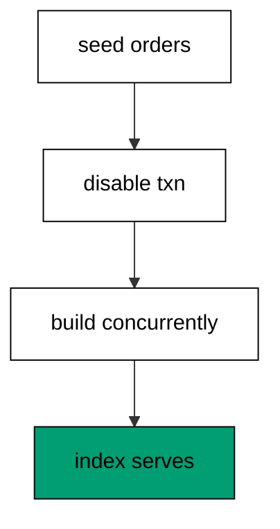

The disable-transaction marker is mandatory here because PostgreSQL forbids concurrent index builds inside a transaction block, and every migration otherwise runs in one. The concurrent build takes only a light lock that yields to writes, scanning the table in the background instead of freezing it. Reading `pg_indexes` back proves the build finished and the name is queryable. The down file drops concurrently too, so even the undo respects live traffic.

**`learning/code/ex-40-create-the-index-concurrently/main.clj`**:

```clojure
;; => Example 40: Create the Index Concurrently.
;; => Big indexes build without the write lock: opt out of the transaction and build concurrently.
(require '[migratus.core :as migratus]) ;; => migrate, rollback, up, and down move history
(require '[next.jdbc :as jdbc]) ;; => verification reads prove each migration landed
(require '[next.jdbc.result-set :as rs]) ;; => unqualified rows print without table prefixes
(require '[clojure.java.io :as io]) ;; => migration files are staged, then removed
;; => The database address comes from the harness, with local-run defaults.
(defn db-spec [] ;; => one builder owns every address default
  {:dbtype "postgresql" ;; => pgjdbc speaks the PostgreSQL wire protocol
   :host (or (System/getenv "PGHOST") "localhost") ;; => harness sets the service host
   :port (Integer/parseInt (or (System/getenv "PGPORT") "5432")) ;; => service port default
   :dbname (or (System/getenv "PGDATABASE") "postgres") ;; => fresh database per unit run
   :user (or (System/getenv "PGUSER") "postgres")}) ;; => trust auth needs no password
;; => One config carries the store, the relative migration dir, and the history table.
(defn config [dir table] ;; => every example owns its dir and history table
  {:store :database ;; => the SQL store journals history in a table
   :migration-dir dir ;; => relative to the unit folder, staged at runtime
   :migration-table-name table ;; => per-example history isolates every rerun
   :db (db-spec)}) ;; => next.jdbc connects from this spec
;; => Staging writes one up/down pair per call into the relative dir.
(defn write-migration [dir id name up down] ;; => one helper stages every migration
  (spit (str dir "/" id "-" name ".up.sql") up) ;; => forward change runs on migrate
  (when down ;; => up-only examples skip the down file on purpose
    (spit (str dir "/" id "-" name ".down.sql") down))) ;; => reverse runs on rollback
;; => Reset clears leftovers of a killed run so reruns print alike.
(defn reset-unit! [ds dir table tables views] ;; => one reset owns every leftover
  (doseq [v views] ;; => views drop before the tables they read
    (jdbc/execute! ds [(str "DROP VIEW IF EXISTS " v)])) ;; => stale views vanish first
  (let [d (io/file dir)] ;; => the relative staging dir of this unit
    (when (.exists d) ;; => a killed run may leave files behind
      (doseq [f (.listFiles d)] ;; => every staged file goes first
        (.delete ^java.io.File f)) ;; => delete each staged migration
      (.delete d)) ;; => the empty staging dir goes too
    (.mkdirs d)) ;; => a fresh dir for this run
  (doseq [t tables] ;; => every table this example owns
    (jdbc/execute! ds [(str "DROP TABLE IF EXISTS " t " CASCADE")])) ;; => killed runs vanish
  (jdbc/execute! ds [(str "DROP TABLE IF EXISTS " table)])) ;; => stale history vanishes too
;; => Reads print their own proof; ids sort so output never depends on disk order.
(defn applied-names [ds table] ;; => applied migration names in id order
  (mapv :description ;; => description stores the migration name
    (jdbc/execute! ds [(str "SELECT description FROM " table " WHERE id > 0 ORDER BY id")] ;; => id order, reserve row excluded
                     {:builder-fn rs/as-unqualified-lower-maps}))) ;; => short keys print cleanly
;; => Column lists read the catalog, so the schema proves itself.
(defn table-columns [ds table] ;; => column names in position order
  (mapv :column_name ;; => one name per row, nothing else
    (jdbc/execute! ds [(str "SELECT column_name FROM information_schema.columns WHERE table_name = '" table "' ORDER BY ordinal_position")] ;; => catalog order is stable
                     {:builder-fn rs/as-unqualified-lower-maps}))) ;; => short keys print cleanly
(def ds (jdbc/get-datasource (db-spec))) ;; => one shared datasource per unit run
(def cfg (config "mig" "m40_migrations")) ;; => store plus history table for this example
(reset-unit! ds "mig" "m40_migrations" ["m40_order"] []) ;; => leftovers of a killed run vanish first
(write-migration "mig" "20260101004001" "make-order" ;; => first the orders with a seed row
  (str "CREATE TABLE m40_order (id SERIAL PRIMARY KEY, status TEXT NOT NULL);\n" ;; => status column needs an index
       "--;;\n" ;; => separator splits schema from seed
       "INSERT INTO m40_order (status) VALUES ('open');\n") ;; => one order awaits lookup
  "DROP TABLE m40_order;\n") ;; => reverse drops everything
(write-migration "mig" "20260101004002" "index-status" ;; => then the concurrent index
  (str "-- :disable-transaction\n" ;; => concurrent builds refuse transactions
       "CREATE INDEX CONCURRENTLY m40_order_status_idx ON m40_order (status);\n") ;; => build takes a light lock
  (str "-- :disable-transaction\n" ;; => down runs outside a transaction too
       "DROP INDEX CONCURRENTLY IF EXISTS m40_order_status_idx;\n")) ;; => reverse drops the index
(println "migrate:" (pr-str (migratus/migrate cfg))) ;; => nil means every pending migration applied
(println "completed:" (pr-str (applied-names ds "m40_migrations"))) ;; => id order straight from history
(println "indexes:" (pr-str (mapv :indexname ;; => index present and queryable
  (jdbc/execute! ds ["SELECT indexname AS indexname FROM pg_indexes WHERE tablename = 'm40_order' AND indexname = 'm40_order_status_idx'"] ;; => concurrent build finished (part 1)
                   {:builder-fn rs/as-unqualified-lower-maps})))) ;; => concurrent build finished (part 2)
;; => Cleanup drops every object this example made, leaving no residue.
(defn cleanup-unit! [ds dir table tables views] ;; => one cleanup owns every created object
  (doseq [v views] ;; => views drop before the tables they read
    (jdbc/execute! ds [(str "DROP VIEW IF EXISTS " v)])) ;; => view residue vanishes
  (doseq [t tables] ;; => every table this example owns
    (jdbc/execute! ds [(str "DROP TABLE IF EXISTS " t " CASCADE")])) ;; => tables vanish with dependents
  (jdbc/execute! ds [(str "DROP TABLE IF EXISTS " table)]) ;; => history table vanishes too
  (let [d (io/file dir)] ;; => the staging dir from this run
    (when (.exists d) ;; => files were staged above
      (doseq [f (.listFiles d)] ;; => every staged file goes first
        (.delete ^java.io.File f)) ;; => delete each staged migration
      (.delete d)))) ;; => the empty staging dir goes too
(cleanup-unit! ds "mig" "m40_migrations" ["m40_order"] []) ;; => drop every object this example created
```

**Output** (`learning/code/ex-40-create-the-index-concurrently/expected/main.stdout.txt`):

```text
migrate: nil
completed: ["make-order" "index-status"]
indexes: ["m40_order_status_idx"]
```

**Key takeaway**: Build big indexes with CONCURRENTLY outside a transaction: lookups improve, writes never stop.

**Why it matters**: Hot tables take writes every millisecond, and a standard index build would queue them all behind one lock. Concurrent builds trade speed for manners, finishing slower but blocking nothing that matters. Teams that build concurrently index in daylight, because the operation politely waits its turn instead of demanding the table.

### Example 41: Concurrently Fails Inside Transactions

Markers must be understood, not memorized, so this example runs a concurrent build inside the default transaction. The program catches the refusal and proves the first migration survived. (Concepts: co-12, co-15.)

PostgreSQL refuses `CREATE INDEX CONCURRENTLY` inside any transaction block because the concurrent protocol commits in phases it cannot roll back, and the server log names that rule verbatim. The standard output surfaces a different face of the same failure, the aborted-transaction error from the poisoned batch, because Migratus reports the batch chain rather than the first statement. Every Migratus migration runs inside a transaction unless the disable-transaction marker opts out, so the marker is load-bearing for this statement. The failure records nothing and harms nothing: the first migration stays applied and the retry with the marker succeeds.

**`learning/code/ex-41-concurrently-fails-inside-transactions/main.clj`**:

```clojure
;; => Example 41: Concurrently Fails Inside Transactions.
;; => The database refuses the polite build inside a transaction: the marker is mandatory, not stylistic.
(require '[migratus.core :as migratus]) ;; => migrate, rollback, up, and down move history
(require '[next.jdbc :as jdbc]) ;; => verification reads prove each migration landed
(require '[next.jdbc.result-set :as rs]) ;; => unqualified rows print without table prefixes
(require '[clojure.java.io :as io]) ;; => migration files are staged, then removed
;; => The database address comes from the harness, with local-run defaults.
(defn db-spec [] ;; => one builder owns every address default
  {:dbtype "postgresql" ;; => pgjdbc speaks the PostgreSQL wire protocol
   :host (or (System/getenv "PGHOST") "localhost") ;; => harness sets the service host
   :port (Integer/parseInt (or (System/getenv "PGPORT") "5432")) ;; => service port default
   :dbname (or (System/getenv "PGDATABASE") "postgres") ;; => fresh database per unit run
   :user (or (System/getenv "PGUSER") "postgres")}) ;; => trust auth needs no password
;; => One config carries the store, the relative migration dir, and the history table.
(defn config [dir table] ;; => every example owns its dir and history table
  {:store :database ;; => the SQL store journals history in a table
   :migration-dir dir ;; => relative to the unit folder, staged at runtime
   :migration-table-name table ;; => per-example history isolates every rerun
   :db (db-spec)}) ;; => next.jdbc connects from this spec
;; => Staging writes one up/down pair per call into the relative dir.
(defn write-migration [dir id name up down] ;; => one helper stages every migration
  (spit (str dir "/" id "-" name ".up.sql") up) ;; => forward change runs on migrate
  (when down ;; => up-only examples skip the down file on purpose
    (spit (str dir "/" id "-" name ".down.sql") down))) ;; => reverse runs on rollback
;; => Reset clears leftovers of a killed run so reruns print alike.
(defn reset-unit! [ds dir table tables views] ;; => one reset owns every leftover
  (doseq [v views] ;; => views drop before the tables they read
    (jdbc/execute! ds [(str "DROP VIEW IF EXISTS " v)])) ;; => stale views vanish first
  (let [d (io/file dir)] ;; => the relative staging dir of this unit
    (when (.exists d) ;; => a killed run may leave files behind
      (doseq [f (.listFiles d)] ;; => every staged file goes first
        (.delete ^java.io.File f)) ;; => delete each staged migration
      (.delete d)) ;; => the empty staging dir goes too
    (.mkdirs d)) ;; => a fresh dir for this run
  (doseq [t tables] ;; => every table this example owns
    (jdbc/execute! ds [(str "DROP TABLE IF EXISTS " t " CASCADE")])) ;; => killed runs vanish
  (jdbc/execute! ds [(str "DROP TABLE IF EXISTS " table)])) ;; => stale history vanishes too
;; => Reads print their own proof; ids sort so output never depends on disk order.
(defn applied-names [ds table] ;; => applied migration names in id order
  (mapv :description ;; => description stores the migration name
    (jdbc/execute! ds [(str "SELECT description FROM " table " WHERE id > 0 ORDER BY id")] ;; => id order, reserve row excluded
                     {:builder-fn rs/as-unqualified-lower-maps}))) ;; => short keys print cleanly
;; => Column lists read the catalog, so the schema proves itself.
(defn table-columns [ds table] ;; => column names in position order
  (mapv :column_name ;; => one name per row, nothing else
    (jdbc/execute! ds [(str "SELECT column_name FROM information_schema.columns WHERE table_name = '" table "' ORDER BY ordinal_position")] ;; => catalog order is stable
                     {:builder-fn rs/as-unqualified-lower-maps}))) ;; => short keys print cleanly
(def ds (jdbc/get-datasource (db-spec))) ;; => one shared datasource per unit run
(def cfg (config "mig" "m41_migrations")) ;; => store plus history table for this example
(reset-unit! ds "mig" "m41_migrations" ["m41_order"] []) ;; => leftovers of a killed run vanish first
(write-migration "mig" "20260101004101" "make-order" ;; => first the orders to index
  "CREATE TABLE m41_order (id SERIAL PRIMARY KEY, status TEXT NOT NULL);\n" ;; => status column needs an index
  "DROP TABLE m41_order;\n") ;; => reverse drops everything
(write-migration "mig" "20260101004102" "index-status" ;; => then the concurrent build without the marker
  "CREATE INDEX CONCURRENTLY m41_order_status_idx ON m41_order (status);\n" ;; => polite build, wrong container
  "DROP INDEX CONCURRENTLY IF EXISTS m41_order_status_idx;\n") ;; => reverse would drop the index
(println "migrate:" (pr-str (try (migratus/migrate cfg) ;; => run fails, message printed
  (catch Exception e (str "threw: " (.getMessage e)))))) ;; => stdout reports the aborted batch
(println "completed:" (pr-str (applied-names ds "m41_migrations"))) ;; => first migration still stands
;; => Cleanup drops every object this example made, leaving no residue.
(defn cleanup-unit! [ds dir table tables views] ;; => one cleanup owns every created object
  (doseq [v views] ;; => views drop before the tables they read
    (jdbc/execute! ds [(str "DROP VIEW IF EXISTS " v)])) ;; => view residue vanishes
  (doseq [t tables] ;; => every table this example owns
    (jdbc/execute! ds [(str "DROP TABLE IF EXISTS " t " CASCADE")])) ;; => tables vanish with dependents
  (jdbc/execute! ds [(str "DROP TABLE IF EXISTS " table)]) ;; => history table vanishes too
  (let [d (io/file dir)] ;; => the staging dir from this run
    (when (.exists d) ;; => files were staged above
      (doseq [f (.listFiles d)] ;; => every staged file goes first
        (.delete ^java.io.File f)) ;; => delete each staged migration
      (.delete d)))) ;; => the empty staging dir goes too
(cleanup-unit! ds "mig" "m41_migrations" ["m41_order"] []) ;; => drop every object this example created
```

**Output** (`learning/code/ex-41-concurrently-fails-inside-transactions/expected/main.stdout.txt`):

```text
migrate: "threw: ERROR: current transaction is aborted, commands ignored until end of transaction block"
completed: ["make-order"]
```

**Key takeaway**: Concurrent builds refuse transactions; the marker is mandatory because the database says so.

**Why it matters**: Every workaround has a reason, and reasons that live only in comments rot into superstition. A loud refusal at the wrong shape teaches the rule better than any comment: the database itself explains why the marker exists. Teams that meet the refusal once never drop the marker again, because the error message outlives every code comment.

### Example 42: Rename Status Expand Migrate Contract

Real renames chain all three moves, so this example renames an order status across four migrations. The program migrates the chain and proves values and shape survived. (Concepts: co-07.)

The chain reads expand, migrate, contract: a spare column lands, both live statuses copy across, and the old name drops while the new one turns strict. Each migration deploys alone, so readers move at their own pace and no deploy coordinates with application code. The printed statuses prove the values crossed exactly, and the columns prove the shape settled. Four small deploys replace one flag day, which is the entire economics of zero-downtime work.

**`learning/code/ex-42-rename-status-expand-migrate-contract/main.clj`**:

```clojure
;; => Example 42: Rename Status Expand Migrate Contract.
;; => A full rename in four steps: expand the status, migrate values, contract the old name.
(require '[migratus.core :as migratus]) ;; => migrate, rollback, up, and down move history
(require '[next.jdbc :as jdbc]) ;; => verification reads prove each migration landed
(require '[next.jdbc.result-set :as rs]) ;; => unqualified rows print without table prefixes
(require '[clojure.java.io :as io]) ;; => migration files are staged, then removed
;; => The database address comes from the harness, with local-run defaults.
(defn db-spec [] ;; => one builder owns every address default
  {:dbtype "postgresql" ;; => pgjdbc speaks the PostgreSQL wire protocol
   :host (or (System/getenv "PGHOST") "localhost") ;; => harness sets the service host
   :port (Integer/parseInt (or (System/getenv "PGPORT") "5432")) ;; => service port default
   :dbname (or (System/getenv "PGDATABASE") "postgres") ;; => fresh database per unit run
   :user (or (System/getenv "PGUSER") "postgres")}) ;; => trust auth needs no password
;; => One config carries the store, the relative migration dir, and the history table.
(defn config [dir table] ;; => every example owns its dir and history table
  {:store :database ;; => the SQL store journals history in a table
   :migration-dir dir ;; => relative to the unit folder, staged at runtime
   :migration-table-name table ;; => per-example history isolates every rerun
   :db (db-spec)}) ;; => next.jdbc connects from this spec
;; => Staging writes one up/down pair per call into the relative dir.
(defn write-migration [dir id name up down] ;; => one helper stages every migration
  (spit (str dir "/" id "-" name ".up.sql") up) ;; => forward change runs on migrate
  (when down ;; => up-only examples skip the down file on purpose
    (spit (str dir "/" id "-" name ".down.sql") down))) ;; => reverse runs on rollback
;; => Reset clears leftovers of a killed run so reruns print alike.
(defn reset-unit! [ds dir table tables views] ;; => one reset owns every leftover
  (doseq [v views] ;; => views drop before the tables they read
    (jdbc/execute! ds [(str "DROP VIEW IF EXISTS " v)])) ;; => stale views vanish first
  (let [d (io/file dir)] ;; => the relative staging dir of this unit
    (when (.exists d) ;; => a killed run may leave files behind
      (doseq [f (.listFiles d)] ;; => every staged file goes first
        (.delete ^java.io.File f)) ;; => delete each staged migration
      (.delete d)) ;; => the empty staging dir goes too
    (.mkdirs d)) ;; => a fresh dir for this run
  (doseq [t tables] ;; => every table this example owns
    (jdbc/execute! ds [(str "DROP TABLE IF EXISTS " t " CASCADE")])) ;; => killed runs vanish
  (jdbc/execute! ds [(str "DROP TABLE IF EXISTS " table)])) ;; => stale history vanishes too
;; => Reads print their own proof; ids sort so output never depends on disk order.
(defn applied-names [ds table] ;; => applied migration names in id order
  (mapv :description ;; => description stores the migration name
    (jdbc/execute! ds [(str "SELECT description FROM " table " WHERE id > 0 ORDER BY id")] ;; => id order, reserve row excluded
                     {:builder-fn rs/as-unqualified-lower-maps}))) ;; => short keys print cleanly
;; => Column lists read the catalog, so the schema proves itself.
(defn table-columns [ds table] ;; => column names in position order
  (mapv :column_name ;; => one name per row, nothing else
    (jdbc/execute! ds [(str "SELECT column_name FROM information_schema.columns WHERE table_name = '" table "' ORDER BY ordinal_position")] ;; => catalog order is stable
                     {:builder-fn rs/as-unqualified-lower-maps}))) ;; => short keys print cleanly
(def ds (jdbc/get-datasource (db-spec))) ;; => one shared datasource per unit run
(def cfg (config "mig" "m42_migrations")) ;; => store plus history table for this example
(reset-unit! ds "mig" "m42_migrations" ["m42_order"] []) ;; => leftovers of a killed run vanish first
(write-migration "mig" "20260101004201" "make-order" ;; => orders with the old status column
  (str "CREATE TABLE m42_order (id SERIAL PRIMARY KEY, status TEXT NOT NULL);\n" ;; => status serves readers today
       "--;;\n" ;; => separator splits schema from seed
       "INSERT INTO m42_order (status) VALUES ('open'), ('shipped');\n") ;; => two orders carry live statuses
  "DROP TABLE m42_order;\n") ;; => reverse drops everything
(write-migration "mig" "20260101004202" "expand-display-status" ;; => expand lands the spare column
  "ALTER TABLE m42_order ADD COLUMN display_status TEXT;\n" ;; => spare starts nullable
  "ALTER TABLE m42_order DROP COLUMN display_status;\n") ;; => reverse drops the spare
(write-migration "mig" "20260101004203" "migrate-statuses" ;; => migrate copies both statuses
  "UPDATE m42_order SET display_status = status WHERE display_status IS NULL;\n" ;; => copy reaches every order
  "UPDATE m42_order SET display_status = NULL;\n") ;; => reverse restores the nulls
(write-migration "mig" "20260101004204" "contract-status" ;; => contract drops old and guards new
  (str "ALTER TABLE m42_order DROP COLUMN status;\n" ;; => old name goes away
       "--;;\n" ;; => separator splits the contract steps
       "ALTER TABLE m42_order ALTER COLUMN display_status SET NOT NULL;\n") ;; => new name turns strict
  (str "ALTER TABLE m42_order ALTER COLUMN display_status DROP NOT NULL;\n" ;; => reverse relaxes the guard first
       "--;;\n" ;; => same separator on the way down
       "ALTER TABLE m42_order ADD COLUMN status TEXT;\n")) ;; => then the old name returns nullable
(println "migrate:" (pr-str (migratus/migrate cfg))) ;; => nil means every pending migration applied
(println "completed:" (pr-str (applied-names ds "m42_migrations"))) ;; => id order straight from history
(println "statuses:" (pr-str (mapv :display_status ;; => open and shipped survive
  (jdbc/execute! ds ["SELECT display_status AS display_status FROM m42_order ORDER BY id"] ;; => values outlive the rename (part 1)
                   {:builder-fn rs/as-unqualified-lower-maps})))) ;; => values outlive the rename (part 2)
(println "columns:" (pr-str (table-columns ds "m42_order"))) ;; => one status column remains
;; => Cleanup drops every object this example made, leaving no residue.
(defn cleanup-unit! [ds dir table tables views] ;; => one cleanup owns every created object
  (doseq [v views] ;; => views drop before the tables they read
    (jdbc/execute! ds [(str "DROP VIEW IF EXISTS " v)])) ;; => view residue vanishes
  (doseq [t tables] ;; => every table this example owns
    (jdbc/execute! ds [(str "DROP TABLE IF EXISTS " t " CASCADE")])) ;; => tables vanish with dependents
  (jdbc/execute! ds [(str "DROP TABLE IF EXISTS " table)]) ;; => history table vanishes too
  (let [d (io/file dir)] ;; => the staging dir from this run
    (when (.exists d) ;; => files were staged above
      (doseq [f (.listFiles d)] ;; => every staged file goes first
        (.delete ^java.io.File f)) ;; => delete each staged migration
      (.delete d)))) ;; => the empty staging dir goes too
(cleanup-unit! ds "mig" "m42_migrations" ["m42_order"] []) ;; => drop every object this example created
```

**Output** (`learning/code/ex-42-rename-status-expand-migrate-contract/expected/main.stdout.txt`):

```text
migrate: nil
completed: ["make-order" "expand-display-status" "migrate-statuses" "contract-status"]
statuses: ["open" "shipped"]
columns: ["id" "display_status"]
```

**Key takeaway**: Expand, migrate, contract: four small deploys replace one flag day.

**Why it matters**: Renames of live columns fail as single steps because readers, writers, and data cannot move atomically. The three-move chain separates those concerns so each deploys when ready, and the database stays consistent at every stop. Teams that rename in chains stop scheduling downtime for vocabulary changes, because the vocabulary moves one safe step at a time.

### Example 43: Same Files Deploy Every Environment

Environments drift when they run different steps, so this example deploys one directory into two journals. The program migrates both and proves the histories match exactly. (Concepts: co-13.)

Both configs point at the same migration directory with different journal names, and they run in turn: development deploys first, tears its tables back down like a review app, and production follows with the same files. Each journal records the same two ids in the same order, because the files and the runner are identical on both sides. Matching journals mean matching schemas, which is the property every promotion pipeline assumes. Environment promotion is file promotion: the same directory moves, never an edited copy.

**`learning/code/ex-43-same-files-deploy-every-environment/main.clj`**:

```clojure
;; => Example 43: Same Files Deploy Every Environment.
;; => Dev and prod converge by running identical files: two journals, one history.
(require '[migratus.core :as migratus]) ;; => migrate, rollback, up, and down move history
(require '[next.jdbc :as jdbc]) ;; => verification reads prove each migration landed
(require '[next.jdbc.result-set :as rs]) ;; => unqualified rows print without table prefixes
(require '[clojure.java.io :as io]) ;; => migration files are staged, then removed
;; => The database address comes from the harness, with local-run defaults.
(defn db-spec [] ;; => one builder owns every address default
  {:dbtype "postgresql" ;; => pgjdbc speaks the PostgreSQL wire protocol
   :host (or (System/getenv "PGHOST") "localhost") ;; => harness sets the service host
   :port (Integer/parseInt (or (System/getenv "PGPORT") "5432")) ;; => service port default
   :dbname (or (System/getenv "PGDATABASE") "postgres") ;; => fresh database per unit run
   :user (or (System/getenv "PGUSER") "postgres")}) ;; => trust auth needs no password
;; => One config carries the store, the relative migration dir, and the history table.
(defn config [dir table] ;; => every example owns its dir and history table
  {:store :database ;; => the SQL store journals history in a table
   :migration-dir dir ;; => relative to the unit folder, staged at runtime
   :migration-table-name table ;; => per-example history isolates every rerun
   :db (db-spec)}) ;; => next.jdbc connects from this spec
;; => Staging writes one up/down pair per call into the relative dir.
(defn write-migration [dir id name up down] ;; => one helper stages every migration
  (spit (str dir "/" id "-" name ".up.sql") up) ;; => forward change runs on migrate
  (when down ;; => up-only examples skip the down file on purpose
    (spit (str dir "/" id "-" name ".down.sql") down))) ;; => reverse runs on rollback
;; => Reset clears leftovers of a killed run so reruns print alike.
(defn reset-unit! [ds dir table tables views] ;; => one reset owns every leftover
  (doseq [v views] ;; => views drop before the tables they read
    (jdbc/execute! ds [(str "DROP VIEW IF EXISTS " v)])) ;; => stale views vanish first
  (let [d (io/file dir)] ;; => the relative staging dir of this unit
    (when (.exists d) ;; => a killed run may leave files behind
      (doseq [f (.listFiles d)] ;; => every staged file goes first
        (.delete ^java.io.File f)) ;; => delete each staged migration
      (.delete d)) ;; => the empty staging dir goes too
    (.mkdirs d)) ;; => a fresh dir for this run
  (doseq [t tables] ;; => every table this example owns
    (jdbc/execute! ds [(str "DROP TABLE IF EXISTS " t " CASCADE")])) ;; => killed runs vanish
  (jdbc/execute! ds [(str "DROP TABLE IF EXISTS " table)])) ;; => stale history vanishes too
;; => Reads print their own proof; ids sort so output never depends on disk order.
(defn applied-names [ds table] ;; => applied migration names in id order
  (mapv :description ;; => description stores the migration name
    (jdbc/execute! ds [(str "SELECT description FROM " table " WHERE id > 0 ORDER BY id")] ;; => id order, reserve row excluded
                     {:builder-fn rs/as-unqualified-lower-maps}))) ;; => short keys print cleanly
;; => Column lists read the catalog, so the schema proves itself.
(defn table-columns [ds table] ;; => column names in position order
  (mapv :column_name ;; => one name per row, nothing else
    (jdbc/execute! ds [(str "SELECT column_name FROM information_schema.columns WHERE table_name = '" table "' ORDER BY ordinal_position")] ;; => catalog order is stable
                     {:builder-fn rs/as-unqualified-lower-maps}))) ;; => short keys print cleanly
(def ds (jdbc/get-datasource (db-spec))) ;; => one shared datasource per unit run
(def cfg (config "mig" "m43_migrations")) ;; => store plus history table for this example
(reset-unit! ds "mig" "m43_migrations" ["m43_feature" "dev_journal" "prod_journal"] []) ;; => leftovers of a killed run vanish first
(def cfg-dev (assoc cfg :migration-table-name "dev_journal")) ;; => development tracks its own journal
(def cfg-prod (assoc cfg :migration-table-name "prod_journal")) ;; => production tracks its own journal
(write-migration "mig" "20260101004301" "make-feature" ;; => one migration ships to both worlds
  "CREATE TABLE m43_feature (id SERIAL PRIMARY KEY, flag TEXT NOT NULL);\n" ;; => tiny table, big principle
  "DROP TABLE m43_feature;\n") ;; => reverse drops it
(write-migration "mig" "20260101004302" "tune-feature" ;; => second migration follows it out
  "ALTER TABLE m43_feature ADD COLUMN weight INTEGER DEFAULT 0;\n" ;; => weight lands with a default
  "ALTER TABLE m43_feature DROP COLUMN weight;\n") ;; => reverse drops the weight
(println "dev:" (pr-str (migratus/migrate cfg-dev))) ;; => development deploys first
(println "dev-history:" (pr-str (applied-names ds "dev_journal"))) ;; => development journal in id order
(println "teardown:" (pr-str (migratus/rollback cfg-dev))) ;; => review app tears down
(println "teardown:" (pr-str (migratus/rollback cfg-dev))) ;; => second rollback empties dev
(println "prod:" (pr-str (migratus/migrate cfg-prod))) ;; => production follows with the same files
(println "prod-history:" (pr-str (applied-names ds "prod_journal"))) ;; => production journal matches dev
(jdbc/execute! ds ["DROP TABLE IF EXISTS dev_journal"]) ;; => development journal drops with the rest
(jdbc/execute! ds ["DROP TABLE IF EXISTS prod_journal"]) ;; => production journal drops with the rest
;; => Cleanup drops every object this example made, leaving no residue.
(defn cleanup-unit! [ds dir table tables views] ;; => one cleanup owns every created object
  (doseq [v views] ;; => views drop before the tables they read
    (jdbc/execute! ds [(str "DROP VIEW IF EXISTS " v)])) ;; => view residue vanishes
  (doseq [t tables] ;; => every table this example owns
    (jdbc/execute! ds [(str "DROP TABLE IF EXISTS " t " CASCADE")])) ;; => tables vanish with dependents
  (jdbc/execute! ds [(str "DROP TABLE IF EXISTS " table)]) ;; => history table vanishes too
  (let [d (io/file dir)] ;; => the staging dir from this run
    (when (.exists d) ;; => files were staged above
      (doseq [f (.listFiles d)] ;; => every staged file goes first
        (.delete ^java.io.File f)) ;; => delete each staged migration
      (.delete d)))) ;; => the empty staging dir goes too
(cleanup-unit! ds "mig" "m43_migrations" ["m43_feature" "dev_journal" "prod_journal"] []) ;; => drop every object this example created
```

**Output** (`learning/code/ex-43-same-files-deploy-every-environment/expected/main.stdout.txt`):

```text
dev: nil
dev-history: ["make-feature" "tune-feature"]
teardown: nil
teardown: nil
prod: nil
prod-history: ["make-feature" "tune-feature"]
```

**Key takeaway**: Same files, same order, every environment: promotion moves the directory, never a copy.

**Why it matters**: Drift between environments is how untested combinations reach production: dev ran one history, prod ran another, and nobody compared them. Running identical files everywhere makes promotion a copy instead of a translation, so staging actually predicts production. Teams that promote files instead of descriptions stop discovering schema differences during releases.

### Example 44: Splitting Review

The cluster closes by combining the chain with the undo, so this example renames an email column and rolls the top back. The program migrates four steps, verifies values, unwinds two, and reads the rest. (Concepts: co-07, co-08.)

The forward chain runs all four migrations and the checks prove values crossed and the shape settled. Rolling back twice unwinds contract then copy, which returns the schema to expand-plus-base with both names live again. The remaining history holds exactly the first two entries, and the columns show the old name back beside the spare. Forward and back both work because every step in the chain reverses, which is the property that lets teams attempt renames without fear.

**`learning/code/ex-44-splitting-review-email-rename/main.clj`**:

```clojure
;; => Example 44: Splitting Review.
;; => The cluster closes on a full rename with a full undo: expand, copy, contract, roll back.
(require '[migratus.core :as migratus]) ;; => migrate, rollback, up, and down move history
(require '[next.jdbc :as jdbc]) ;; => verification reads prove each migration landed
(require '[next.jdbc.result-set :as rs]) ;; => unqualified rows print without table prefixes
(require '[clojure.java.io :as io]) ;; => migration files are staged, then removed
;; => The database address comes from the harness, with local-run defaults.
(defn db-spec [] ;; => one builder owns every address default
  {:dbtype "postgresql" ;; => pgjdbc speaks the PostgreSQL wire protocol
   :host (or (System/getenv "PGHOST") "localhost") ;; => harness sets the service host
   :port (Integer/parseInt (or (System/getenv "PGPORT") "5432")) ;; => service port default
   :dbname (or (System/getenv "PGDATABASE") "postgres") ;; => fresh database per unit run
   :user (or (System/getenv "PGUSER") "postgres")}) ;; => trust auth needs no password
;; => One config carries the store, the relative migration dir, and the history table.
(defn config [dir table] ;; => every example owns its dir and history table
  {:store :database ;; => the SQL store journals history in a table
   :migration-dir dir ;; => relative to the unit folder, staged at runtime
   :migration-table-name table ;; => per-example history isolates every rerun
   :db (db-spec)}) ;; => next.jdbc connects from this spec
;; => Staging writes one up/down pair per call into the relative dir.
(defn write-migration [dir id name up down] ;; => one helper stages every migration
  (spit (str dir "/" id "-" name ".up.sql") up) ;; => forward change runs on migrate
  (when down ;; => up-only examples skip the down file on purpose
    (spit (str dir "/" id "-" name ".down.sql") down))) ;; => reverse runs on rollback
;; => Reset clears leftovers of a killed run so reruns print alike.
(defn reset-unit! [ds dir table tables views] ;; => one reset owns every leftover
  (doseq [v views] ;; => views drop before the tables they read
    (jdbc/execute! ds [(str "DROP VIEW IF EXISTS " v)])) ;; => stale views vanish first
  (let [d (io/file dir)] ;; => the relative staging dir of this unit
    (when (.exists d) ;; => a killed run may leave files behind
      (doseq [f (.listFiles d)] ;; => every staged file goes first
        (.delete ^java.io.File f)) ;; => delete each staged migration
      (.delete d)) ;; => the empty staging dir goes too
    (.mkdirs d)) ;; => a fresh dir for this run
  (doseq [t tables] ;; => every table this example owns
    (jdbc/execute! ds [(str "DROP TABLE IF EXISTS " t " CASCADE")])) ;; => killed runs vanish
  (jdbc/execute! ds [(str "DROP TABLE IF EXISTS " table)])) ;; => stale history vanishes too
;; => Reads print their own proof; ids sort so output never depends on disk order.
(defn applied-names [ds table] ;; => applied migration names in id order
  (mapv :description ;; => description stores the migration name
    (jdbc/execute! ds [(str "SELECT description FROM " table " WHERE id > 0 ORDER BY id")] ;; => id order, reserve row excluded
                     {:builder-fn rs/as-unqualified-lower-maps}))) ;; => short keys print cleanly
;; => Column lists read the catalog, so the schema proves itself.
(defn table-columns [ds table] ;; => column names in position order
  (mapv :column_name ;; => one name per row, nothing else
    (jdbc/execute! ds [(str "SELECT column_name FROM information_schema.columns WHERE table_name = '" table "' ORDER BY ordinal_position")] ;; => catalog order is stable
                     {:builder-fn rs/as-unqualified-lower-maps}))) ;; => short keys print cleanly
(def ds (jdbc/get-datasource (db-spec))) ;; => one shared datasource per unit run
(def cfg (config "mig" "m44_migrations")) ;; => store plus history table for this example
(reset-unit! ds "mig" "m44_migrations" ["m44_contact"] []) ;; => leftovers of a killed run vanish first
(write-migration "mig" "20260101004401" "make-contact" ;; => contacts with the old email column
  (str "CREATE TABLE m44_contact (id SERIAL PRIMARY KEY, email TEXT NOT NULL);\n" ;; => email serves readers today
       "--;;\n" ;; => separator splits schema from seed
       "INSERT INTO m44_contact (email) VALUES ('a@x.io'), ('b@x.io');\n") ;; => two contacts carry live addresses
  "DROP TABLE m44_contact;\n") ;; => reverse drops everything
(write-migration "mig" "20260101004402" "expand-contact-email" ;; => expand lands the spare
  "ALTER TABLE m44_contact ADD COLUMN contact_email TEXT;\n" ;; => spare starts nullable
  "ALTER TABLE m44_contact DROP COLUMN contact_email;\n") ;; => reverse drops the spare
(write-migration "mig" "20260101004403" "copy-emails" ;; => copy moves both addresses
  "UPDATE m44_contact SET contact_email = email WHERE contact_email IS NULL;\n" ;; => copy reaches every contact
  "UPDATE m44_contact SET contact_email = NULL;\n") ;; => reverse restores the nulls
(write-migration "mig" "20260101004404" "contract-email" ;; => contract drops old and guards new
  (str "ALTER TABLE m44_contact DROP COLUMN email;\n" ;; => old name goes away
       "--;;\n" ;; => separator splits the contract steps
       "ALTER TABLE m44_contact ALTER COLUMN contact_email SET NOT NULL;\n") ;; => new name turns strict
  (str "ALTER TABLE m44_contact ALTER COLUMN contact_email DROP NOT NULL;\n" ;; => reverse relaxes the guard first
       "--;;\n" ;; => same separator on the way down
       "ALTER TABLE m44_contact ADD COLUMN email TEXT;\n")) ;; => then the old name returns nullable
(println "migrate:" (pr-str (migratus/migrate cfg))) ;; => nil means every pending migration applied
(println "completed:" (pr-str (applied-names ds "m44_migrations"))) ;; => id order straight from history
(println "emails:" (pr-str (mapv :contact_email ;; => both addresses survive
  (jdbc/execute! ds ["SELECT contact_email AS contact_email FROM m44_contact ORDER BY id"] ;; => values outlive the rename (part 1)
                   {:builder-fn rs/as-unqualified-lower-maps})))) ;; => values outlive the rename (part 2)
(println "rollback:" (pr-str (migratus/rollback cfg))) ;; => contract unwinds first
(println "rollback:" (pr-str (migratus/rollback cfg))) ;; => copy unwinds second
(println "completed:" (pr-str (applied-names ds "m44_migrations"))) ;; => expand and base remain
(println "columns:" (pr-str (table-columns ds "m44_contact"))) ;; => old and spare side by side again
;; => Cleanup drops every object this example made, leaving no residue.
(defn cleanup-unit! [ds dir table tables views] ;; => one cleanup owns every created object
  (doseq [v views] ;; => views drop before the tables they read
    (jdbc/execute! ds [(str "DROP VIEW IF EXISTS " v)])) ;; => view residue vanishes
  (doseq [t tables] ;; => every table this example owns
    (jdbc/execute! ds [(str "DROP TABLE IF EXISTS " t " CASCADE")])) ;; => tables vanish with dependents
  (jdbc/execute! ds [(str "DROP TABLE IF EXISTS " table)]) ;; => history table vanishes too
  (let [d (io/file dir)] ;; => the staging dir from this run
    (when (.exists d) ;; => files were staged above
      (doseq [f (.listFiles d)] ;; => every staged file goes first
        (.delete ^java.io.File f)) ;; => delete each staged migration
      (.delete d)))) ;; => the empty staging dir goes too
(cleanup-unit! ds "mig" "m44_migrations" ["m44_contact"] []) ;; => drop every object this example created
```

**Output** (`learning/code/ex-44-splitting-review-email-rename/expected/main.stdout.txt`):

```text
migrate: nil
completed: ["make-contact" "expand-contact-email" "copy-emails" "contract-email"]
emails: ["a@x.io" "b@x.io"]
rollback: nil
rollback: nil
completed: ["make-contact" "expand-contact-email"]
columns: ["id" "contact_email" "email"]
```

**Key takeaway**: A rename chain must reverse too: unwind returns both names live with values intact.

**Why it matters**: Ambitious changes ship when the way back is proven, not when the way forward looks easy. A rename that unwinds cleanly gets attempted on a Tuesday instead of debated for a quarter, because the worst case is a quiet rollback. Teams that prove both directions move faster, since reversibility turns big changes into ordinary ones.

### Example 45: Seed the Baseline with init

Adopted databases arrive with data older than history, so this example seeds through the init script. The program runs init, proves the seed row, then migrates the first real change. (Concepts: co-10.)

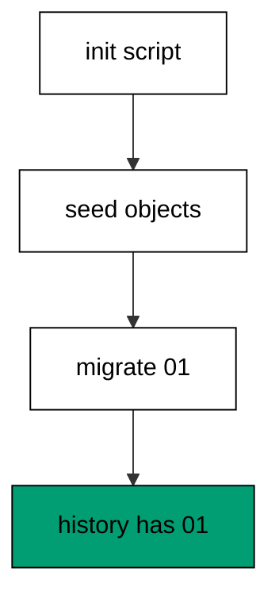

Calling `init` runs the configured init script before any migration exists, which plants the objects every later step assumes. The seed row predates the first history entry, exactly like production data predates its first migration. Migrating afterwards records only the new work, keeping the journal honest about what the tool ran versus what it found. Init scripts are the front door for adopted databases: everything found goes through them, everything built goes through migrations.

**`learning/code/ex-45-seed-the-baseline-with-init/main.clj`**:

```clojure
;; => Example 45: Seed the Baseline with init.
;; => Some databases start with seed data: init.sql runs once before any migration.
(require '[migratus.core :as migratus]) ;; => migrate, rollback, up, and down move history
(require '[next.jdbc :as jdbc]) ;; => verification reads prove each migration landed
(require '[next.jdbc.result-set :as rs]) ;; => unqualified rows print without table prefixes
(require '[clojure.java.io :as io]) ;; => migration files are staged, then removed
;; => The database address comes from the harness, with local-run defaults.
(defn db-spec [] ;; => one builder owns every address default
  {:dbtype "postgresql" ;; => pgjdbc speaks the PostgreSQL wire protocol
   :host (or (System/getenv "PGHOST") "localhost") ;; => harness sets the service host
   :port (Integer/parseInt (or (System/getenv "PGPORT") "5432")) ;; => service port default
   :dbname (or (System/getenv "PGDATABASE") "postgres") ;; => fresh database per unit run
   :user (or (System/getenv "PGUSER") "postgres")}) ;; => trust auth needs no password
;; => One config carries the store, the relative migration dir, and the history table.
(defn config [dir table] ;; => every example owns its dir and history table
  {:store :database ;; => the SQL store journals history in a table
   :migration-dir dir ;; => relative to the unit folder, staged at runtime
   :migration-table-name table ;; => per-example history isolates every rerun
   :db (db-spec)}) ;; => next.jdbc connects from this spec
;; => Staging writes one up/down pair per call into the relative dir.
(defn write-migration [dir id name up down] ;; => one helper stages every migration
  (spit (str dir "/" id "-" name ".up.sql") up) ;; => forward change runs on migrate
  (when down ;; => up-only examples skip the down file on purpose
    (spit (str dir "/" id "-" name ".down.sql") down))) ;; => reverse runs on rollback
;; => Reset clears leftovers of a killed run so reruns print alike.
(defn reset-unit! [ds dir table tables views] ;; => one reset owns every leftover
  (doseq [v views] ;; => views drop before the tables they read
    (jdbc/execute! ds [(str "DROP VIEW IF EXISTS " v)])) ;; => stale views vanish first
  (let [d (io/file dir)] ;; => the relative staging dir of this unit
    (when (.exists d) ;; => a killed run may leave files behind
      (doseq [f (.listFiles d)] ;; => every staged file goes first
        (.delete ^java.io.File f)) ;; => delete each staged migration
      (.delete d)) ;; => the empty staging dir goes too
    (.mkdirs d)) ;; => a fresh dir for this run
  (doseq [t tables] ;; => every table this example owns
    (jdbc/execute! ds [(str "DROP TABLE IF EXISTS " t " CASCADE")])) ;; => killed runs vanish
  (jdbc/execute! ds [(str "DROP TABLE IF EXISTS " table)])) ;; => stale history vanishes too
;; => Reads print their own proof; ids sort so output never depends on disk order.
(defn applied-names [ds table] ;; => applied migration names in id order
  (mapv :description ;; => description stores the migration name
    (jdbc/execute! ds [(str "SELECT description FROM " table " WHERE id > 0 ORDER BY id")] ;; => id order, reserve row excluded
                     {:builder-fn rs/as-unqualified-lower-maps}))) ;; => short keys print cleanly
;; => Column lists read the catalog, so the schema proves itself.
(defn table-columns [ds table] ;; => column names in position order
  (mapv :column_name ;; => one name per row, nothing else
    (jdbc/execute! ds [(str "SELECT column_name FROM information_schema.columns WHERE table_name = '" table "' ORDER BY ordinal_position")] ;; => catalog order is stable
                     {:builder-fn rs/as-unqualified-lower-maps}))) ;; => short keys print cleanly
(def ds (jdbc/get-datasource (db-spec))) ;; => one shared datasource per unit run
(def cfg (config "mig" "m45_migrations")) ;; => store plus history table for this example
(reset-unit! ds "mig" "m45_migrations" ["m45_seed" "m45_after"] []) ;; => leftovers of a killed run vanish first
(spit "mig/init.sql" (str "CREATE TABLE IF NOT EXISTS m45_seed (id SERIAL PRIMARY KEY, note TEXT NOT NULL);\n" ;; => seed objects live in the init script
       "--;;\n" ;; => init scripts split statements too
       "INSERT INTO m45_seed (note) VALUES ('day-zero');\n")) ;; => day-zero row seeds the baseline
(def cfg-init (assoc cfg :init-script "init.sql")) ;; => init script joins the config
(write-migration "mig" "20260101004501" "after-seed" ;; => first real migration follows the seed
  "CREATE TABLE m45_after (id SERIAL PRIMARY KEY);\n" ;; => later tables build on the seed
  "DROP TABLE m45_after;\n") ;; => reverse drops the later table
(println "init:" (pr-str (migratus/init cfg-init))) ;; => init script seeds the baseline
(println "seed:" (pr-str (mapv :note ;; => day-zero row is present
  (jdbc/execute! ds ["SELECT note FROM m45_seed ORDER BY id"] ;; => seed reads back whole
                   {:builder-fn rs/as-unqualified-lower-maps})))) ;; => seed predates history
(println "migrate:" (pr-str (migratus/migrate cfg))) ;; => nil means every pending migration applied
(println "completed:" (pr-str (applied-names ds "m45_migrations"))) ;; => id order straight from history
;; => Cleanup drops every object this example made, leaving no residue.
(defn cleanup-unit! [ds dir table tables views] ;; => one cleanup owns every created object
  (doseq [v views] ;; => views drop before the tables they read
    (jdbc/execute! ds [(str "DROP VIEW IF EXISTS " v)])) ;; => view residue vanishes
  (doseq [t tables] ;; => every table this example owns
    (jdbc/execute! ds [(str "DROP TABLE IF EXISTS " t " CASCADE")])) ;; => tables vanish with dependents
  (jdbc/execute! ds [(str "DROP TABLE IF EXISTS " table)]) ;; => history table vanishes too
  (let [d (io/file dir)] ;; => the staging dir from this run
    (when (.exists d) ;; => files were staged above
      (doseq [f (.listFiles d)] ;; => every staged file goes first
        (.delete ^java.io.File f)) ;; => delete each staged migration
      (.delete d)))) ;; => the empty staging dir goes too
(cleanup-unit! ds "mig" "m45_migrations" ["m45_seed" "m45_after"] []) ;; => drop every object this example created
```

**Output** (`learning/code/ex-45-seed-the-baseline-with-init/expected/main.stdout.txt`):

```text
init: nil
seed: ["day-zero"]
migrate: nil
completed: ["after-seed"]
```

**Key takeaway**: Init scripts seed what migrations find; history records only what migrations run.

**Why it matters**: Every adopted database has a past the journal never saw, and pretending otherwise corrupts the first migration. An explicit seed step names the found objects instead of smuggling them into a migration, which keeps history truthful about its own coverage. Teams that seed through init onboard legacy systems without rewriting their past, because the past gets a ceremony instead of a forgery.

### Example 46: Adopt Legacy Tables

Legacy tables exist before their first migration, so this example adopts one with a guarded baseline. The program builds the legacy table by hand, baselines it, and proves both rows survived. (Concepts: co-10.)

The baseline up file uses `IF NOT EXISTS` so it succeeds whether the object is already there or not, which makes adoption safe to run on any copy of the database. Its history row marks the moment the tool took responsibility, even though the tool built nothing. The comment-only down file undoes nothing on purpose: un-adopting would mean dropping objects the migration never created. Adoption records stewardship, not construction, and the rows prove nothing moved.

**`learning/code/ex-46-adopt-legacy-tables/main.clj`**:

```clojure
;; => Example 46: Adopt Legacy Tables.
;; => The baseline migration matches existing objects with IF NOT EXISTS and records the adoption.
(require '[migratus.core :as migratus]) ;; => migrate, rollback, up, and down move history
(require '[next.jdbc :as jdbc]) ;; => verification reads prove each migration landed
(require '[next.jdbc.result-set :as rs]) ;; => unqualified rows print without table prefixes
(require '[clojure.java.io :as io]) ;; => migration files are staged, then removed
;; => The database address comes from the harness, with local-run defaults.
(defn db-spec [] ;; => one builder owns every address default
  {:dbtype "postgresql" ;; => pgjdbc speaks the PostgreSQL wire protocol
   :host (or (System/getenv "PGHOST") "localhost") ;; => harness sets the service host
   :port (Integer/parseInt (or (System/getenv "PGPORT") "5432")) ;; => service port default
   :dbname (or (System/getenv "PGDATABASE") "postgres") ;; => fresh database per unit run
   :user (or (System/getenv "PGUSER") "postgres")}) ;; => trust auth needs no password
;; => One config carries the store, the relative migration dir, and the history table.
(defn config [dir table] ;; => every example owns its dir and history table
  {:store :database ;; => the SQL store journals history in a table
   :migration-dir dir ;; => relative to the unit folder, staged at runtime
   :migration-table-name table ;; => per-example history isolates every rerun
   :db (db-spec)}) ;; => next.jdbc connects from this spec
;; => Staging writes one up/down pair per call into the relative dir.
(defn write-migration [dir id name up down] ;; => one helper stages every migration
  (spit (str dir "/" id "-" name ".up.sql") up) ;; => forward change runs on migrate
  (when down ;; => up-only examples skip the down file on purpose
    (spit (str dir "/" id "-" name ".down.sql") down))) ;; => reverse runs on rollback
;; => Reset clears leftovers of a killed run so reruns print alike.
(defn reset-unit! [ds dir table tables views] ;; => one reset owns every leftover
  (doseq [v views] ;; => views drop before the tables they read
    (jdbc/execute! ds [(str "DROP VIEW IF EXISTS " v)])) ;; => stale views vanish first
  (let [d (io/file dir)] ;; => the relative staging dir of this unit
    (when (.exists d) ;; => a killed run may leave files behind
      (doseq [f (.listFiles d)] ;; => every staged file goes first
        (.delete ^java.io.File f)) ;; => delete each staged migration
      (.delete d)) ;; => the empty staging dir goes too
    (.mkdirs d)) ;; => a fresh dir for this run
  (doseq [t tables] ;; => every table this example owns
    (jdbc/execute! ds [(str "DROP TABLE IF EXISTS " t " CASCADE")])) ;; => killed runs vanish
  (jdbc/execute! ds [(str "DROP TABLE IF EXISTS " table)])) ;; => stale history vanishes too
;; => Reads print their own proof; ids sort so output never depends on disk order.
(defn applied-names [ds table] ;; => applied migration names in id order
  (mapv :description ;; => description stores the migration name
    (jdbc/execute! ds [(str "SELECT description FROM " table " WHERE id > 0 ORDER BY id")] ;; => id order, reserve row excluded
                     {:builder-fn rs/as-unqualified-lower-maps}))) ;; => short keys print cleanly
;; => Column lists read the catalog, so the schema proves itself.
(defn table-columns [ds table] ;; => column names in position order
  (mapv :column_name ;; => one name per row, nothing else
    (jdbc/execute! ds [(str "SELECT column_name FROM information_schema.columns WHERE table_name = '" table "' ORDER BY ordinal_position")] ;; => catalog order is stable
                     {:builder-fn rs/as-unqualified-lower-maps}))) ;; => short keys print cleanly
(def ds (jdbc/get-datasource (db-spec))) ;; => one shared datasource per unit run
(def cfg (config "mig" "m46_migrations")) ;; => store plus history table for this example
(reset-unit! ds "mig" "m46_migrations" ["m46_legacy"] []) ;; => leftovers of a killed run vanish first
(jdbc/execute! ds ["CREATE TABLE m46_legacy (id SERIAL PRIMARY KEY, v TEXT NOT NULL)"]) ;; => legacy table predates history
(jdbc/execute! ds ["INSERT INTO m46_legacy (v) VALUES ('kept'), ('safe')"]) ;; => two legacy rows must survive
(write-migration "mig" "20260101004601" "baseline-legacy" ;; => baseline matches instead of building
  "CREATE TABLE IF NOT EXISTS m46_legacy (id SERIAL PRIMARY KEY, v TEXT NOT NULL);\n" ;; => no-op against the legacy table
  "-- nothing to undo: baseline adopted existing objects\n") ;; => down keeps adopted objects
(println "migrate:" (pr-str (migratus/migrate cfg))) ;; => nil means every pending migration applied
(println "completed:" (pr-str (applied-names ds "m46_migrations"))) ;; => id order straight from history
(println "rows:" (pr-str (mapv :v ;; => kept and safe survive
  (jdbc/execute! ds ["SELECT v AS v FROM m46_legacy ORDER BY id"] ;; => adoption changed no data (part 1)
                   {:builder-fn rs/as-unqualified-lower-maps})))) ;; => adoption changed no data (part 2)
;; => Cleanup drops every object this example made, leaving no residue.
(defn cleanup-unit! [ds dir table tables views] ;; => one cleanup owns every created object
  (doseq [v views] ;; => views drop before the tables they read
    (jdbc/execute! ds [(str "DROP VIEW IF EXISTS " v)])) ;; => view residue vanishes
  (doseq [t tables] ;; => every table this example owns
    (jdbc/execute! ds [(str "DROP TABLE IF EXISTS " t " CASCADE")])) ;; => tables vanish with dependents
  (jdbc/execute! ds [(str "DROP TABLE IF EXISTS " table)]) ;; => history table vanishes too
  (let [d (io/file dir)] ;; => the staging dir from this run
    (when (.exists d) ;; => files were staged above
      (doseq [f (.listFiles d)] ;; => every staged file goes first
        (.delete ^java.io.File f)) ;; => delete each staged migration
      (.delete d)))) ;; => the empty staging dir goes too
(cleanup-unit! ds "mig" "m46_migrations" ["m46_legacy"] []) ;; => drop every object this example created
```

**Output** (`learning/code/ex-46-adopt-legacy-tables/expected/main.stdout.txt`):

```text
migrate: nil
completed: ["baseline-legacy"]
rows: ["kept" "safe"]
```

**Key takeaway**: Baseline with IF NOT EXISTS: adopt existing objects, record stewardship, change no data.

**Why it matters**: Rewriting history to pretend the tool built everything is how teams lose data they never meant to touch. A guarded baseline says the honest thing: these objects were here, they stay, and from now on every change is tracked. Teams that adopt this way inherit databases without inheriting fear, because the first migration proves it changes nothing.

### Example 47: Baseline Then Evolve

Baselines are the start of history, not the end of work, so this example evolves right after adopting. The program baselines a legacy table, adds a guarded column, and proves the legacy row gained the default. (Concepts: co-10, co-01.)

The second migration treats the adopted table exactly like any created one, because after the baseline row lands there is no difference. The legacy row picks up the new default through the ordinary alter path, which proves evolution needs no special casing for adopted objects. History reads as two honest entries: found this, then built that. Adoption that cannot evolve is just a plaque; adoption that evolves is a beginning.

**`learning/code/ex-47-baseline-then-evolve/main.clj`**:

```clojure
;; => Example 47: Baseline Then Evolve.
;; => Adoption is day one: the next migration already builds on the adopted schema.
(require '[migratus.core :as migratus]) ;; => migrate, rollback, up, and down move history
(require '[next.jdbc :as jdbc]) ;; => verification reads prove each migration landed
(require '[next.jdbc.result-set :as rs]) ;; => unqualified rows print without table prefixes
(require '[clojure.java.io :as io]) ;; => migration files are staged, then removed
;; => The database address comes from the harness, with local-run defaults.
(defn db-spec [] ;; => one builder owns every address default
  {:dbtype "postgresql" ;; => pgjdbc speaks the PostgreSQL wire protocol
   :host (or (System/getenv "PGHOST") "localhost") ;; => harness sets the service host
   :port (Integer/parseInt (or (System/getenv "PGPORT") "5432")) ;; => service port default
   :dbname (or (System/getenv "PGDATABASE") "postgres") ;; => fresh database per unit run
   :user (or (System/getenv "PGUSER") "postgres")}) ;; => trust auth needs no password
;; => One config carries the store, the relative migration dir, and the history table.
(defn config [dir table] ;; => every example owns its dir and history table
  {:store :database ;; => the SQL store journals history in a table
   :migration-dir dir ;; => relative to the unit folder, staged at runtime
   :migration-table-name table ;; => per-example history isolates every rerun
   :db (db-spec)}) ;; => next.jdbc connects from this spec
;; => Staging writes one up/down pair per call into the relative dir.
(defn write-migration [dir id name up down] ;; => one helper stages every migration
  (spit (str dir "/" id "-" name ".up.sql") up) ;; => forward change runs on migrate
  (when down ;; => up-only examples skip the down file on purpose
    (spit (str dir "/" id "-" name ".down.sql") down))) ;; => reverse runs on rollback
;; => Reset clears leftovers of a killed run so reruns print alike.
(defn reset-unit! [ds dir table tables views] ;; => one reset owns every leftover
  (doseq [v views] ;; => views drop before the tables they read
    (jdbc/execute! ds [(str "DROP VIEW IF EXISTS " v)])) ;; => stale views vanish first
  (let [d (io/file dir)] ;; => the relative staging dir of this unit
    (when (.exists d) ;; => a killed run may leave files behind
      (doseq [f (.listFiles d)] ;; => every staged file goes first
        (.delete ^java.io.File f)) ;; => delete each staged migration
      (.delete d)) ;; => the empty staging dir goes too
    (.mkdirs d)) ;; => a fresh dir for this run
  (doseq [t tables] ;; => every table this example owns
    (jdbc/execute! ds [(str "DROP TABLE IF EXISTS " t " CASCADE")])) ;; => killed runs vanish
  (jdbc/execute! ds [(str "DROP TABLE IF EXISTS " table)])) ;; => stale history vanishes too
;; => Reads print their own proof; ids sort so output never depends on disk order.
(defn applied-names [ds table] ;; => applied migration names in id order
  (mapv :description ;; => description stores the migration name
    (jdbc/execute! ds [(str "SELECT description FROM " table " WHERE id > 0 ORDER BY id")] ;; => id order, reserve row excluded
                     {:builder-fn rs/as-unqualified-lower-maps}))) ;; => short keys print cleanly
;; => Column lists read the catalog, so the schema proves itself.
(defn table-columns [ds table] ;; => column names in position order
  (mapv :column_name ;; => one name per row, nothing else
    (jdbc/execute! ds [(str "SELECT column_name FROM information_schema.columns WHERE table_name = '" table "' ORDER BY ordinal_position")] ;; => catalog order is stable
                     {:builder-fn rs/as-unqualified-lower-maps}))) ;; => short keys print cleanly
(def ds (jdbc/get-datasource (db-spec))) ;; => one shared datasource per unit run
(def cfg (config "mig" "m47_migrations")) ;; => store plus history table for this example
(reset-unit! ds "mig" "m47_migrations" ["m47_stock"] []) ;; => leftovers of a killed run vanish first
(jdbc/execute! ds ["CREATE TABLE m47_stock (id SERIAL PRIMARY KEY, sku TEXT NOT NULL)"]) ;; => legacy stock predates history
(jdbc/execute! ds ["INSERT INTO m47_stock (sku) VALUES ('w-1')"]) ;; => one legacy row must survive
(write-migration "mig" "20260101004701" "baseline-stock" ;; => baseline matches the legacy table
  "CREATE TABLE IF NOT EXISTS m47_stock (id SERIAL PRIMARY KEY, sku TEXT NOT NULL);\n" ;; => no-op against the legacy shape
  "-- nothing to undo: baseline adopted existing objects\n") ;; => down keeps adopted objects
(write-migration "mig" "20260101004702" "add-qty" ;; => evolution builds on the adoption
  "ALTER TABLE m47_stock ADD COLUMN qty INTEGER DEFAULT 0 NOT NULL;\n" ;; => new column with a default
  "ALTER TABLE m47_stock DROP COLUMN qty;\n") ;; => reverse drops the evolution
(println "migrate:" (pr-str (migratus/migrate cfg))) ;; => nil means every pending migration applied
(println "completed:" (pr-str (applied-names ds "m47_migrations"))) ;; => id order straight from history
(println "rows:" (pr-str (mapv (juxt :sku :qty) ;; => legacy row plus default
  (jdbc/execute! ds ["SELECT sku, qty FROM m47_stock ORDER BY id"] ;; => adoption then evolution, one table (part 1)
                   {:builder-fn rs/as-unqualified-lower-maps})))) ;; => adoption then evolution, one table (part 2)
;; => Cleanup drops every object this example made, leaving no residue.
(defn cleanup-unit! [ds dir table tables views] ;; => one cleanup owns every created object
  (doseq [v views] ;; => views drop before the tables they read
    (jdbc/execute! ds [(str "DROP VIEW IF EXISTS " v)])) ;; => view residue vanishes
  (doseq [t tables] ;; => every table this example owns
    (jdbc/execute! ds [(str "DROP TABLE IF EXISTS " t " CASCADE")])) ;; => tables vanish with dependents
  (jdbc/execute! ds [(str "DROP TABLE IF EXISTS " table)]) ;; => history table vanishes too
  (let [d (io/file dir)] ;; => the staging dir from this run
    (when (.exists d) ;; => files were staged above
      (doseq [f (.listFiles d)] ;; => every staged file goes first
        (.delete ^java.io.File f)) ;; => delete each staged migration
      (.delete d)))) ;; => the empty staging dir goes too
(cleanup-unit! ds "mig" "m47_migrations" ["m47_stock"] []) ;; => drop every object this example created
```

**Output** (`learning/code/ex-47-baseline-then-evolve/expected/main.stdout.txt`):

```text
migrate: nil
completed: ["baseline-stock" "add-qty"]
rows: [["w-1" 0]]
```

**Key takeaway**: After the baseline lands, adopted tables evolve like created ones.

**Why it matters**: Legacy systems earn their keep by changing, and a baseline that freezes them would trade honesty for stagnation. Evolving immediately proves the adoption worked: the old objects accept new rules through the ordinary path. Teams that evolve on day two keep momentum, because the baseline was a door, not a display case.

### Example 48: Detect the Missing Table

Hands touch databases outside history, so this example drops a migrated table by hand. The program migrates, drops behind history, and shows the journal and catalog disagreeing. (Concepts: co-09.)

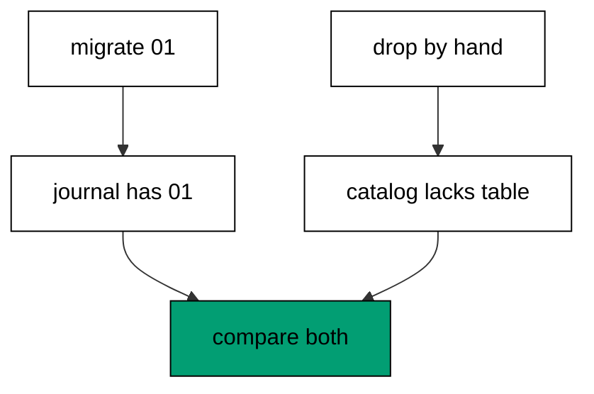

The journal still lists the migration as applied because dropping the table wrote no journal entry: the history only tracks migrations, not hands. The catalog lookup finds no such table, and the contradiction between the two readers is exactly what schema drift means. Neither side is wrong on its own; the pair is inconsistent, which is why drift checks always read both. Detection starts every recovery in this cluster, because you cannot fix a difference you have not measured.

**`learning/code/ex-48-detect-the-missing-table/main.clj`**:

```clojure
;; => Example 48: Detect the Missing Table.
;; => History claims a table the database lost: compare the journal against the catalog.
(require '[migratus.core :as migratus]) ;; => migrate, rollback, up, and down move history
(require '[next.jdbc :as jdbc]) ;; => verification reads prove each migration landed
(require '[next.jdbc.result-set :as rs]) ;; => unqualified rows print without table prefixes
(require '[clojure.java.io :as io]) ;; => migration files are staged, then removed
;; => The database address comes from the harness, with local-run defaults.
(defn db-spec [] ;; => one builder owns every address default
  {:dbtype "postgresql" ;; => pgjdbc speaks the PostgreSQL wire protocol
   :host (or (System/getenv "PGHOST") "localhost") ;; => harness sets the service host
   :port (Integer/parseInt (or (System/getenv "PGPORT") "5432")) ;; => service port default
   :dbname (or (System/getenv "PGDATABASE") "postgres") ;; => fresh database per unit run
   :user (or (System/getenv "PGUSER") "postgres")}) ;; => trust auth needs no password
;; => One config carries the store, the relative migration dir, and the history table.
(defn config [dir table] ;; => every example owns its dir and history table
  {:store :database ;; => the SQL store journals history in a table
   :migration-dir dir ;; => relative to the unit folder, staged at runtime
   :migration-table-name table ;; => per-example history isolates every rerun
   :db (db-spec)}) ;; => next.jdbc connects from this spec
;; => Staging writes one up/down pair per call into the relative dir.
(defn write-migration [dir id name up down] ;; => one helper stages every migration
  (spit (str dir "/" id "-" name ".up.sql") up) ;; => forward change runs on migrate
  (when down ;; => up-only examples skip the down file on purpose
    (spit (str dir "/" id "-" name ".down.sql") down))) ;; => reverse runs on rollback
;; => Reset clears leftovers of a killed run so reruns print alike.
(defn reset-unit! [ds dir table tables views] ;; => one reset owns every leftover
  (doseq [v views] ;; => views drop before the tables they read
    (jdbc/execute! ds [(str "DROP VIEW IF EXISTS " v)])) ;; => stale views vanish first
  (let [d (io/file dir)] ;; => the relative staging dir of this unit
    (when (.exists d) ;; => a killed run may leave files behind
      (doseq [f (.listFiles d)] ;; => every staged file goes first
        (.delete ^java.io.File f)) ;; => delete each staged migration
      (.delete d)) ;; => the empty staging dir goes too
    (.mkdirs d)) ;; => a fresh dir for this run
  (doseq [t tables] ;; => every table this example owns
    (jdbc/execute! ds [(str "DROP TABLE IF EXISTS " t " CASCADE")])) ;; => killed runs vanish
  (jdbc/execute! ds [(str "DROP TABLE IF EXISTS " table)])) ;; => stale history vanishes too
;; => Reads print their own proof; ids sort so output never depends on disk order.
(defn applied-names [ds table] ;; => applied migration names in id order
  (mapv :description ;; => description stores the migration name
    (jdbc/execute! ds [(str "SELECT description FROM " table " WHERE id > 0 ORDER BY id")] ;; => id order, reserve row excluded
                     {:builder-fn rs/as-unqualified-lower-maps}))) ;; => short keys print cleanly
;; => Column lists read the catalog, so the schema proves itself.
(defn table-columns [ds table] ;; => column names in position order
  (mapv :column_name ;; => one name per row, nothing else
    (jdbc/execute! ds [(str "SELECT column_name FROM information_schema.columns WHERE table_name = '" table "' ORDER BY ordinal_position")] ;; => catalog order is stable
                     {:builder-fn rs/as-unqualified-lower-maps}))) ;; => short keys print cleanly
(def ds (jdbc/get-datasource (db-spec))) ;; => one shared datasource per unit run
(def cfg (config "mig" "m48_migrations")) ;; => store plus history table for this example
(reset-unit! ds "mig" "m48_migrations" ["m48_crate"] []) ;; => leftovers of a killed run vanish first
(write-migration "mig" "20260101004801" "make-crate" ;; => one migration to lose later
  "CREATE TABLE m48_crate (id SERIAL PRIMARY KEY);\n" ;; => crate table lands normally
  "DROP TABLE m48_crate;\n") ;; => reverse drops it
(println "migrate:" (pr-str (migratus/migrate cfg))) ;; => history records the table
(jdbc/execute! ds ["DROP TABLE m48_crate"]) ;; => hands drop it behind history
(println "completed:" (pr-str (applied-names ds "m48_migrations"))) ;; => journal still claims the table
(println "catalog:" (pr-str (mapv :table_name ;; => catalog disagrees
  (jdbc/execute! ds ["SELECT table_name FROM information_schema.tables WHERE table_name = 'm48_crate'"] ;; => direct lookup finds nothing
                   {:builder-fn rs/as-unqualified-lower-maps})))) ;; => empty proves the drift
;; => Cleanup drops every object this example made, leaving no residue.
(defn cleanup-unit! [ds dir table tables views] ;; => one cleanup owns every created object
  (doseq [v views] ;; => views drop before the tables they read
    (jdbc/execute! ds [(str "DROP VIEW IF EXISTS " v)])) ;; => view residue vanishes
  (doseq [t tables] ;; => every table this example owns
    (jdbc/execute! ds [(str "DROP TABLE IF EXISTS " t " CASCADE")])) ;; => tables vanish with dependents
  (jdbc/execute! ds [(str "DROP TABLE IF EXISTS " table)]) ;; => history table vanishes too
  (let [d (io/file dir)] ;; => the staging dir from this run
    (when (.exists d) ;; => files were staged above
      (doseq [f (.listFiles d)] ;; => every staged file goes first
        (.delete ^java.io.File f)) ;; => delete each staged migration
      (.delete d)))) ;; => the empty staging dir goes too
(cleanup-unit! ds "mig" "m48_migrations" ["m48_crate"] []) ;; => drop every object this example created
```

**Output** (`learning/code/ex-48-detect-the-missing-table/expected/main.stdout.txt`):

```text
migrate: nil
completed: ["make-crate"]
catalog: []
```

**Key takeaway**: Drift is the gap between journal and catalog: applied in history, missing in the database.

**Why it matters**: Manual hotfixes and half-restored backups edit databases without telling history, and the next migrate trusts the journal and skips the repair. Comparing both readers exposes the gap before it compounds, while the fix is still one migration. Teams that check for drift on schedule find missing tables in monitoring instead of in incidents.

### Example 49: Detect the Untracked Table

Tables can exist without history rows, so this example builds one entirely by hand. The program migrates nothing, then shows the full catalog against the empty journal. (Concepts: co-09.)

Hand-built tables never pass through migrations, so the journal stays empty while the catalog grows: the mirror image of the missing-table drift. The next migration that assumes a clean slate collides with the ghost, failing on objects the plan never drew. Reading the catalog independently surfaces stowaways before they collide, which is why adoption reviews list untracked objects first. Both drift directions share one cure: compare the two readers, then reconcile.

**`learning/code/ex-49-detect-the-untracked-table/main.clj`**:

```clojure
;; => Example 49: Detect the Untracked Table.
;; => The catalog holds a table history never saw: the reverse gap is drift too.
(require '[migratus.core :as migratus]) ;; => migrate, rollback, up, and down move history
(require '[next.jdbc :as jdbc]) ;; => verification reads prove each migration landed
(require '[next.jdbc.result-set :as rs]) ;; => unqualified rows print without table prefixes
(require '[clojure.java.io :as io]) ;; => migration files are staged, then removed
;; => The database address comes from the harness, with local-run defaults.
(defn db-spec [] ;; => one builder owns every address default
  {:dbtype "postgresql" ;; => pgjdbc speaks the PostgreSQL wire protocol
   :host (or (System/getenv "PGHOST") "localhost") ;; => harness sets the service host
   :port (Integer/parseInt (or (System/getenv "PGPORT") "5432")) ;; => service port default
   :dbname (or (System/getenv "PGDATABASE") "postgres") ;; => fresh database per unit run
   :user (or (System/getenv "PGUSER") "postgres")}) ;; => trust auth needs no password
;; => One config carries the store, the relative migration dir, and the history table.
(defn config [dir table] ;; => every example owns its dir and history table
  {:store :database ;; => the SQL store journals history in a table
   :migration-dir dir ;; => relative to the unit folder, staged at runtime
   :migration-table-name table ;; => per-example history isolates every rerun
   :db (db-spec)}) ;; => next.jdbc connects from this spec
;; => Staging writes one up/down pair per call into the relative dir.
(defn write-migration [dir id name up down] ;; => one helper stages every migration
  (spit (str dir "/" id "-" name ".up.sql") up) ;; => forward change runs on migrate
  (when down ;; => up-only examples skip the down file on purpose
    (spit (str dir "/" id "-" name ".down.sql") down))) ;; => reverse runs on rollback
;; => Reset clears leftovers of a killed run so reruns print alike.
(defn reset-unit! [ds dir table tables views] ;; => one reset owns every leftover
  (doseq [v views] ;; => views drop before the tables they read
    (jdbc/execute! ds [(str "DROP VIEW IF EXISTS " v)])) ;; => stale views vanish first
  (let [d (io/file dir)] ;; => the relative staging dir of this unit
    (when (.exists d) ;; => a killed run may leave files behind
      (doseq [f (.listFiles d)] ;; => every staged file goes first
        (.delete ^java.io.File f)) ;; => delete each staged migration
      (.delete d)) ;; => the empty staging dir goes too
    (.mkdirs d)) ;; => a fresh dir for this run
  (doseq [t tables] ;; => every table this example owns
    (jdbc/execute! ds [(str "DROP TABLE IF EXISTS " t " CASCADE")])) ;; => killed runs vanish
  (jdbc/execute! ds [(str "DROP TABLE IF EXISTS " table)])) ;; => stale history vanishes too
;; => Reads print their own proof; ids sort so output never depends on disk order.
(defn applied-names [ds table] ;; => applied migration names in id order
  (mapv :description ;; => description stores the migration name
    (jdbc/execute! ds [(str "SELECT description FROM " table " WHERE id > 0 ORDER BY id")] ;; => id order, reserve row excluded
                     {:builder-fn rs/as-unqualified-lower-maps}))) ;; => short keys print cleanly
;; => Column lists read the catalog, so the schema proves itself.
(defn table-columns [ds table] ;; => column names in position order
  (mapv :column_name ;; => one name per row, nothing else
    (jdbc/execute! ds [(str "SELECT column_name FROM information_schema.columns WHERE table_name = '" table "' ORDER BY ordinal_position")] ;; => catalog order is stable
                     {:builder-fn rs/as-unqualified-lower-maps}))) ;; => short keys print cleanly
(def ds (jdbc/get-datasource (db-spec))) ;; => one shared datasource per unit run
(def cfg (config "mig" "m49_migrations")) ;; => store plus history table for this example
(reset-unit! ds "mig" "m49_migrations" ["m49_ghost"] []) ;; => leftovers of a killed run vanish first
(jdbc/execute! ds ["CREATE TABLE m49_ghost (id SERIAL PRIMARY KEY, v TEXT)"]) ;; => hands build without migrating
(jdbc/execute! ds ["INSERT INTO m49_ghost (v) VALUES ('stowaway')"]) ;; => one untracked row rides along
(println "migrate:" (pr-str (migratus/migrate cfg))) ;; => no files, nothing applies
(println "completed:" (pr-str (applied-names ds "m49_migrations"))) ;; => journal knows nothing
(println "catalog:" (pr-str (mapv :table_name ;; => catalog names the stowaway
  (jdbc/execute! ds ["SELECT table_name FROM information_schema.tables WHERE table_name LIKE 'm49%' AND table_name <> 'm49_migrations' ORDER BY 1"] ;; => user tables only, history excluded
                   {:builder-fn rs/as-unqualified-lower-maps})))) ;; => ghost present, journal empty
;; => Cleanup drops every object this example made, leaving no residue.
(defn cleanup-unit! [ds dir table tables views] ;; => one cleanup owns every created object
  (doseq [v views] ;; => views drop before the tables they read
    (jdbc/execute! ds [(str "DROP VIEW IF EXISTS " v)])) ;; => view residue vanishes
  (doseq [t tables] ;; => every table this example owns
    (jdbc/execute! ds [(str "DROP TABLE IF EXISTS " t " CASCADE")])) ;; => tables vanish with dependents
  (jdbc/execute! ds [(str "DROP TABLE IF EXISTS " table)]) ;; => history table vanishes too
  (let [d (io/file dir)] ;; => the staging dir from this run
    (when (.exists d) ;; => files were staged above
      (doseq [f (.listFiles d)] ;; => every staged file goes first
        (.delete ^java.io.File f)) ;; => delete each staged migration
      (.delete d)))) ;; => the empty staging dir goes too
(cleanup-unit! ds "mig" "m49_migrations" ["m49_ghost"] []) ;; => drop every object this example created
```

**Output** (`learning/code/ex-49-detect-the-untracked-table/expected/main.stdout.txt`):

```text
migrate: nil
completed: []
catalog: ["m49_ghost"]
```

**Key takeaway**: Drift also runs backward: present in the catalog, absent from history.

**Why it matters**: Shadow IT and urgent hotfixes create real tables through real sessions that history never sees. The next planned migration then fails against a world it did not expect, and the failure looks like a bad migration instead of an untracked past. Catalog-first reviews catch stowaways while they are still curiosities, before they become collisions.

### Example 50: Repair Drift with a Migration

Drift repairs move forward, never by editing history, so this example restores a dropped table with a new migration. The program drifts on purpose, stages the repair, and proves journal and catalog agree. (Concepts: co-09, co-08.)

The repair migration recreates exactly what the drift removed with a guarded create, which also succeeds harmlessly when the drift already healed. Migrating runs only the repair because the original entry stays applied, so recovery is one step instead of a rebuild. The journal grows honestly: the mistake is not erased, the fix is recorded beside it. Forward repair keeps history append-only, which is what makes post-incident review possible.

**`learning/code/ex-50-repair-drift-with-a-migration/main.clj`**:

```clojure
;; => Example 50: Repair Drift with a Migration.
;; => The fix for drift is forward: a compensating migration restores the missing table.
(require '[migratus.core :as migratus]) ;; => migrate, rollback, up, and down move history
(require '[next.jdbc :as jdbc]) ;; => verification reads prove each migration landed
(require '[next.jdbc.result-set :as rs]) ;; => unqualified rows print without table prefixes
(require '[clojure.java.io :as io]) ;; => migration files are staged, then removed
;; => The database address comes from the harness, with local-run defaults.
(defn db-spec [] ;; => one builder owns every address default
  {:dbtype "postgresql" ;; => pgjdbc speaks the PostgreSQL wire protocol
   :host (or (System/getenv "PGHOST") "localhost") ;; => harness sets the service host
   :port (Integer/parseInt (or (System/getenv "PGPORT") "5432")) ;; => service port default
   :dbname (or (System/getenv "PGDATABASE") "postgres") ;; => fresh database per unit run
   :user (or (System/getenv "PGUSER") "postgres")}) ;; => trust auth needs no password
;; => One config carries the store, the relative migration dir, and the history table.
(defn config [dir table] ;; => every example owns its dir and history table
  {:store :database ;; => the SQL store journals history in a table
   :migration-dir dir ;; => relative to the unit folder, staged at runtime
   :migration-table-name table ;; => per-example history isolates every rerun
   :db (db-spec)}) ;; => next.jdbc connects from this spec
;; => Staging writes one up/down pair per call into the relative dir.
(defn write-migration [dir id name up down] ;; => one helper stages every migration
  (spit (str dir "/" id "-" name ".up.sql") up) ;; => forward change runs on migrate
  (when down ;; => up-only examples skip the down file on purpose
    (spit (str dir "/" id "-" name ".down.sql") down))) ;; => reverse runs on rollback
;; => Reset clears leftovers of a killed run so reruns print alike.
(defn reset-unit! [ds dir table tables views] ;; => one reset owns every leftover
  (doseq [v views] ;; => views drop before the tables they read
    (jdbc/execute! ds [(str "DROP VIEW IF EXISTS " v)])) ;; => stale views vanish first
  (let [d (io/file dir)] ;; => the relative staging dir of this unit
    (when (.exists d) ;; => a killed run may leave files behind
      (doseq [f (.listFiles d)] ;; => every staged file goes first
        (.delete ^java.io.File f)) ;; => delete each staged migration
      (.delete d)) ;; => the empty staging dir goes too
    (.mkdirs d)) ;; => a fresh dir for this run
  (doseq [t tables] ;; => every table this example owns
    (jdbc/execute! ds [(str "DROP TABLE IF EXISTS " t " CASCADE")])) ;; => killed runs vanish
  (jdbc/execute! ds [(str "DROP TABLE IF EXISTS " table)])) ;; => stale history vanishes too
;; => Reads print their own proof; ids sort so output never depends on disk order.
(defn applied-names [ds table] ;; => applied migration names in id order
  (mapv :description ;; => description stores the migration name
    (jdbc/execute! ds [(str "SELECT description FROM " table " WHERE id > 0 ORDER BY id")] ;; => id order, reserve row excluded
                     {:builder-fn rs/as-unqualified-lower-maps}))) ;; => short keys print cleanly
;; => Column lists read the catalog, so the schema proves itself.
(defn table-columns [ds table] ;; => column names in position order
  (mapv :column_name ;; => one name per row, nothing else
    (jdbc/execute! ds [(str "SELECT column_name FROM information_schema.columns WHERE table_name = '" table "' ORDER BY ordinal_position")] ;; => catalog order is stable
                     {:builder-fn rs/as-unqualified-lower-maps}))) ;; => short keys print cleanly
(def ds (jdbc/get-datasource (db-spec))) ;; => one shared datasource per unit run
(def cfg (config "mig" "m50_migrations")) ;; => store plus history table for this example
(reset-unit! ds "mig" "m50_migrations" ["m50_crate"] []) ;; => leftovers of a killed run vanish first
(write-migration "mig" "20260101005001" "make-crate" ;; => first the crate as usual
  "CREATE TABLE m50_crate (id SERIAL PRIMARY KEY, v TEXT);\n" ;; => crate table lands normally
  "DROP TABLE m50_crate;\n") ;; => reverse drops it
(println "migrate:" (pr-str (migratus/migrate cfg))) ;; => history records the table
(jdbc/execute! ds ["DROP TABLE m50_crate"]) ;; => hands drop it behind history
(write-migration "mig" "20260101005002" "restore-crate" ;; => then the forward repair
  "CREATE TABLE IF NOT EXISTS m50_crate (id SERIAL PRIMARY KEY, v TEXT);\n" ;; => guarded create restores exactly
  "DROP TABLE m50_crate;\n") ;; => reverse drops the repair
(println "repair:" (pr-str (migratus/migrate cfg))) ;; => only the repair runs
(println "completed:" (pr-str (applied-names ds "m50_migrations"))) ;; => both entries stand in order
(println "catalog:" (pr-str (mapv :table_name ;; => crate is back
  (jdbc/execute! ds ["SELECT table_name FROM information_schema.tables WHERE table_name = 'm50_crate'"] ;; => direct lookup finds it again
                   {:builder-fn rs/as-unqualified-lower-maps})))) ;; => repair closed the gap
;; => Cleanup drops every object this example made, leaving no residue.
(defn cleanup-unit! [ds dir table tables views] ;; => one cleanup owns every created object
  (doseq [v views] ;; => views drop before the tables they read
    (jdbc/execute! ds [(str "DROP VIEW IF EXISTS " v)])) ;; => view residue vanishes
  (doseq [t tables] ;; => every table this example owns
    (jdbc/execute! ds [(str "DROP TABLE IF EXISTS " t " CASCADE")])) ;; => tables vanish with dependents
  (jdbc/execute! ds [(str "DROP TABLE IF EXISTS " table)]) ;; => history table vanishes too
  (let [d (io/file dir)] ;; => the staging dir from this run
    (when (.exists d) ;; => files were staged above
      (doseq [f (.listFiles d)] ;; => every staged file goes first
        (.delete ^java.io.File f)) ;; => delete each staged migration
      (.delete d)))) ;; => the empty staging dir goes too
(cleanup-unit! ds "mig" "m50_migrations" ["m50_crate"] []) ;; => drop every object this example created
```

**Output** (`learning/code/ex-50-repair-drift-with-a-migration/expected/main.stdout.txt`):

```text
migrate: nil
repair: nil
completed: ["make-crate" "restore-crate"]
catalog: ["m50_crate"]
```

**Key takeaway**: Repair drift forward with a new migration; never edit the journal to hide the gap.

**Why it matters**: Editing history to match a broken database destroys the only record of what went wrong, trading a missing table for a lying journal. Forward repair admits the drift and records the fix, so the next review sees both the gap and its closing. Teams that repair forward keep journals worth auditing, because every scar carries its stitch beside it.

### Example 51: Edited History Stays Silent

Edited files do not re-run, so this example changes an applied migration and migrates again. The program proves the journal skips the edit and the table never gains the new column. (Concepts: co-11.)

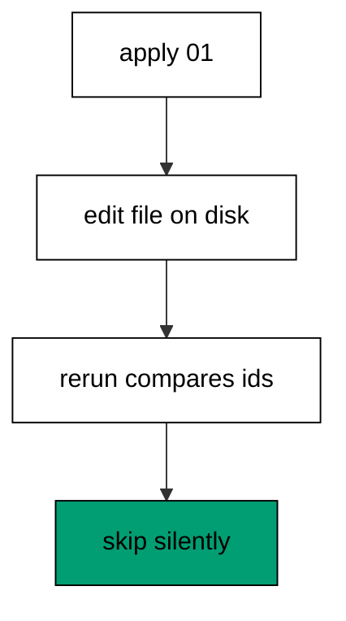

Regular SQL migrations store no content hash in the history row: the checksum column stays empty for every one of them. The rerun compares ids only, finds the edited id already recorded, and skips it without reading the file. The missing nick column proves the skip is by identity rather than by content, because a content-aware runner would have applied the change. This silence is the sharp edge of id-based history: edits after apply vanish without a warning.

**`learning/code/ex-51-edited-history-stays-silent/main.clj`**:

```clojure
;; => Example 51: Edited History Stays Silent.
;; => Regular migrations carry no checksum: editing an applied file changes nothing on rerun.
(require '[migratus.core :as migratus]) ;; => migrate, rollback, up, and down move history
(require '[next.jdbc :as jdbc]) ;; => verification reads prove each migration landed
(require '[next.jdbc.result-set :as rs]) ;; => unqualified rows print without table prefixes
(require '[clojure.java.io :as io]) ;; => migration files are staged, then removed
;; => The database address comes from the harness, with local-run defaults.
(defn db-spec [] ;; => one builder owns every address default
  {:dbtype "postgresql" ;; => pgjdbc speaks the PostgreSQL wire protocol
   :host (or (System/getenv "PGHOST") "localhost") ;; => harness sets the service host
   :port (Integer/parseInt (or (System/getenv "PGPORT") "5432")) ;; => service port default
   :dbname (or (System/getenv "PGDATABASE") "postgres") ;; => fresh database per unit run
   :user (or (System/getenv "PGUSER") "postgres")}) ;; => trust auth needs no password
;; => One config carries the store, the relative migration dir, and the history table.
(defn config [dir table] ;; => every example owns its dir and history table
  {:store :database ;; => the SQL store journals history in a table
   :migration-dir dir ;; => relative to the unit folder, staged at runtime
   :migration-table-name table ;; => per-example history isolates every rerun
   :db (db-spec)}) ;; => next.jdbc connects from this spec
;; => Staging writes one up/down pair per call into the relative dir.
(defn write-migration [dir id name up down] ;; => one helper stages every migration
  (spit (str dir "/" id "-" name ".up.sql") up) ;; => forward change runs on migrate
  (when down ;; => up-only examples skip the down file on purpose
    (spit (str dir "/" id "-" name ".down.sql") down))) ;; => reverse runs on rollback
;; => Reset clears leftovers of a killed run so reruns print alike.
(defn reset-unit! [ds dir table tables views] ;; => one reset owns every leftover
  (doseq [v views] ;; => views drop before the tables they read
    (jdbc/execute! ds [(str "DROP VIEW IF EXISTS " v)])) ;; => stale views vanish first
  (let [d (io/file dir)] ;; => the relative staging dir of this unit
    (when (.exists d) ;; => a killed run may leave files behind
      (doseq [f (.listFiles d)] ;; => every staged file goes first
        (.delete ^java.io.File f)) ;; => delete each staged migration
      (.delete d)) ;; => the empty staging dir goes too
    (.mkdirs d)) ;; => a fresh dir for this run
  (doseq [t tables] ;; => every table this example owns
    (jdbc/execute! ds [(str "DROP TABLE IF EXISTS " t " CASCADE")])) ;; => killed runs vanish
  (jdbc/execute! ds [(str "DROP TABLE IF EXISTS " table)])) ;; => stale history vanishes too
;; => Reads print their own proof; ids sort so output never depends on disk order.
(defn applied-names [ds table] ;; => applied migration names in id order
  (mapv :description ;; => description stores the migration name
    (jdbc/execute! ds [(str "SELECT description FROM " table " WHERE id > 0 ORDER BY id")] ;; => id order, reserve row excluded
                     {:builder-fn rs/as-unqualified-lower-maps}))) ;; => short keys print cleanly
;; => Column lists read the catalog, so the schema proves itself.
(defn table-columns [ds table] ;; => column names in position order
  (mapv :column_name ;; => one name per row, nothing else
    (jdbc/execute! ds [(str "SELECT column_name FROM information_schema.columns WHERE table_name = '" table "' ORDER BY ordinal_position")] ;; => catalog order is stable
                     {:builder-fn rs/as-unqualified-lower-maps}))) ;; => short keys print cleanly
(def ds (jdbc/get-datasource (db-spec))) ;; => one shared datasource per unit run
(def cfg (config "mig" "m51_migrations")) ;; => store plus history table for this example
(reset-unit! ds "mig" "m51_migrations" ["m51_widget"] []) ;; => leftovers of a killed run vanish first
(write-migration "mig" "20260101005101" "make-widget" ;; => first the plain widget table
  "CREATE TABLE m51_widget (id SERIAL PRIMARY KEY, name TEXT NOT NULL);\n" ;; => name is required from the start
  "DROP TABLE m51_widget;\n") ;; => reverse drops it
(println "migrate:" (pr-str (migratus/migrate cfg))) ;; => history records the file
(spit "mig/20260101005101-make-widget.up.sql" ;; => edit the applied file on disk
  "CREATE TABLE m51_widget (id SERIAL PRIMARY KEY, name TEXT NOT NULL, nick TEXT);\n") ;; => added column never runs
(println "rerun:" (pr-str (migratus/migrate cfg))) ;; => journal skips the edited file
(println "pending:" (pr-str (sort (migratus/pending-list cfg)))) ;; => edited file is not pending
(println "columns:" (pr-str (mapv :column_name ;; => no nick column appeared
  (jdbc/execute! ds ["SELECT column_name AS column_name FROM information_schema.columns WHERE table_name = 'm51_widget' ORDER BY ordinal_position"] ;; => edit changed the file, not the database (part 1)
                   {:builder-fn rs/as-unqualified-lower-maps})))) ;; => edit changed the file, not the database (part 2)
;; => Cleanup drops every object this example made, leaving no residue.
(defn cleanup-unit! [ds dir table tables views] ;; => one cleanup owns every created object
  (doseq [v views] ;; => views drop before the tables they read
    (jdbc/execute! ds [(str "DROP VIEW IF EXISTS " v)])) ;; => view residue vanishes
  (doseq [t tables] ;; => every table this example owns
    (jdbc/execute! ds [(str "DROP TABLE IF EXISTS " t " CASCADE")])) ;; => tables vanish with dependents
  (jdbc/execute! ds [(str "DROP TABLE IF EXISTS " table)]) ;; => history table vanishes too
  (let [d (io/file dir)] ;; => the staging dir from this run
    (when (.exists d) ;; => files were staged above
      (doseq [f (.listFiles d)] ;; => every staged file goes first
        (.delete ^java.io.File f)) ;; => delete each staged migration
      (.delete d)))) ;; => the empty staging dir goes too
(cleanup-unit! ds "mig" "m51_migrations" ["m51_widget"] []) ;; => drop every object this example created
```

**Output** (`learning/code/ex-51-edited-history-stays-silent/expected/main.stdout.txt`):

```text
migrate: nil
rerun: nil
pending: ()
columns: ["id" "name"]
```

**Key takeaway**: Applied regular migrations never re-run, even edited: the journal tracks ids, not content.

**Why it matters**: Fixing a migration by editing its file feels natural and fails silently, leaving the database behind the repository with no signal. Every environment that already ran the original keeps the old shape while new ones get the edit, which splits the fleet by deploy date. Teams that learn this silence route every post-apply change through a new migration, because history only moves forward.

### Example 52: Repeatable Views Track Checksums

Definitions that evolve need re-application, so this example edits a repeatable view. The program applies it, edits the definition, and proves the checksum pends and reapplies it. (Concepts: co-11.)

The `-- :repeatable` marker on the first line switches the file into checksum mode: Migratus hashes the content and stores it beside the history row. Editing the definition changes the hash, which puts the view back on the pending list without any new file. Re-migrating replaces the view with the doubled formula, and the query proves twenty where ten stood. Only repeatable files earn this tracking; regular migrations stay silent when edited, as the previous example showed.

**`learning/code/ex-52-repeatable-views-track-checksums/main.clj`**:

```clojure
;; => Example 52: Repeatable Views Track Checksums.
;; => Views re-apply when edited: the repeatable marker opts into checksum tracking.
(require '[migratus.core :as migratus]) ;; => migrate, rollback, up, and down move history
(require '[next.jdbc :as jdbc]) ;; => verification reads prove each migration landed
(require '[next.jdbc.result-set :as rs]) ;; => unqualified rows print without table prefixes
(require '[clojure.java.io :as io]) ;; => migration files are staged, then removed
;; => The database address comes from the harness, with local-run defaults.
(defn db-spec [] ;; => one builder owns every address default
  {:dbtype "postgresql" ;; => pgjdbc speaks the PostgreSQL wire protocol
   :host (or (System/getenv "PGHOST") "localhost") ;; => harness sets the service host
   :port (Integer/parseInt (or (System/getenv "PGPORT") "5432")) ;; => service port default
   :dbname (or (System/getenv "PGDATABASE") "postgres") ;; => fresh database per unit run
   :user (or (System/getenv "PGUSER") "postgres")}) ;; => trust auth needs no password
;; => One config carries the store, the relative migration dir, and the history table.
(defn config [dir table] ;; => every example owns its dir and history table
  {:store :database ;; => the SQL store journals history in a table
   :migration-dir dir ;; => relative to the unit folder, staged at runtime
   :migration-table-name table ;; => per-example history isolates every rerun
   :db (db-spec)}) ;; => next.jdbc connects from this spec
;; => Staging writes one up/down pair per call into the relative dir.
(defn write-migration [dir id name up down] ;; => one helper stages every migration
  (spit (str dir "/" id "-" name ".up.sql") up) ;; => forward change runs on migrate
  (when down ;; => up-only examples skip the down file on purpose
    (spit (str dir "/" id "-" name ".down.sql") down))) ;; => reverse runs on rollback
;; => Reset clears leftovers of a killed run so reruns print alike.
(defn reset-unit! [ds dir table tables views] ;; => one reset owns every leftover
  (doseq [v views] ;; => views drop before the tables they read
    (jdbc/execute! ds [(str "DROP VIEW IF EXISTS " v)])) ;; => stale views vanish first
  (let [d (io/file dir)] ;; => the relative staging dir of this unit
    (when (.exists d) ;; => a killed run may leave files behind
      (doseq [f (.listFiles d)] ;; => every staged file goes first
        (.delete ^java.io.File f)) ;; => delete each staged migration
      (.delete d)) ;; => the empty staging dir goes too
    (.mkdirs d)) ;; => a fresh dir for this run
  (doseq [t tables] ;; => every table this example owns
    (jdbc/execute! ds [(str "DROP TABLE IF EXISTS " t " CASCADE")])) ;; => killed runs vanish
  (jdbc/execute! ds [(str "DROP TABLE IF EXISTS " table)])) ;; => stale history vanishes too
;; => Reads print their own proof; ids sort so output never depends on disk order.
(defn applied-names [ds table] ;; => applied migration names in id order
  (mapv :description ;; => description stores the migration name
    (jdbc/execute! ds [(str "SELECT description FROM " table " WHERE id > 0 ORDER BY id")] ;; => id order, reserve row excluded
                     {:builder-fn rs/as-unqualified-lower-maps}))) ;; => short keys print cleanly
;; => Column lists read the catalog, so the schema proves itself.
(defn table-columns [ds table] ;; => column names in position order
  (mapv :column_name ;; => one name per row, nothing else
    (jdbc/execute! ds [(str "SELECT column_name FROM information_schema.columns WHERE table_name = '" table "' ORDER BY ordinal_position")] ;; => catalog order is stable
                     {:builder-fn rs/as-unqualified-lower-maps}))) ;; => short keys print cleanly
(def ds (jdbc/get-datasource (db-spec))) ;; => one shared datasource per unit run
(def cfg (config "mig" "m52_migrations")) ;; => store plus history table for this example
(reset-unit! ds "mig" "m52_migrations" ["m52_item"] ["m52_stock"]) ;; => leftovers of a killed run vanish first
(write-migration "mig" "20260101005201" "make-item" ;; => first the items the view reads
  (str "CREATE TABLE m52_item (id SERIAL PRIMARY KEY, qty INTEGER NOT NULL);\n" ;; => items hold the quantities
       "--;;\n" ;; => separator splits schema from seed
       "INSERT INTO m52_item (qty) VALUES (4), (6);\n") ;; => two rows sum to ten
  "DROP TABLE m52_item;\n") ;; => reverse drops everything
(write-migration "mig" "20260101005202" "stock-view" ;; => then the repeatable view
  "-- :repeatable\nCREATE OR REPLACE VIEW m52_stock AS SELECT sum(qty) AS total FROM m52_item;\n" ;; => marker plus view in one file
  nil) ;; => no down file: repeatables never roll back
(println "migrate:" (pr-str (migratus/migrate cfg))) ;; => both apply the first time
(println "pending:" (pr-str (sort (migratus/pending-list cfg)))) ;; => nothing pending after the run
(spit "mig/20260101005202-stock-view.up.sql" ;; => edit the view definition
  "-- :repeatable\nCREATE OR REPLACE VIEW m52_stock AS SELECT sum(qty) * 2 AS total FROM m52_item;\n") ;; => doubled definition replaces the first
(println "edited-pending:" (pr-str (sort (migratus/pending-list cfg)))) ;; => checksum change pends the view
(println "remigrate:" (pr-str (migratus/migrate cfg))) ;; => edited view re-applies
(println "total:" (pr-str (mapv :total ;; => twenty proves the edit
  (jdbc/execute! ds ["SELECT total AS total FROM m52_stock"] ;; => checksum tracked the change (part 1)
                   {:builder-fn rs/as-unqualified-lower-maps})))) ;; => checksum tracked the change (part 2)
;; => Cleanup drops every object this example made, leaving no residue.
(defn cleanup-unit! [ds dir table tables views] ;; => one cleanup owns every created object
  (doseq [v views] ;; => views drop before the tables they read
    (jdbc/execute! ds [(str "DROP VIEW IF EXISTS " v)])) ;; => view residue vanishes
  (doseq [t tables] ;; => every table this example owns
    (jdbc/execute! ds [(str "DROP TABLE IF EXISTS " t " CASCADE")])) ;; => tables vanish with dependents
  (jdbc/execute! ds [(str "DROP TABLE IF EXISTS " table)]) ;; => history table vanishes too
  (let [d (io/file dir)] ;; => the staging dir from this run
    (when (.exists d) ;; => files were staged above
      (doseq [f (.listFiles d)] ;; => every staged file goes first
        (.delete ^java.io.File f)) ;; => delete each staged migration
      (.delete d)))) ;; => the empty staging dir goes too
(cleanup-unit! ds "mig" "m52_migrations" ["m52_item"] ["m52_stock"]) ;; => drop every object this example created
```

**Output** (`learning/code/ex-52-repeatable-views-track-checksums/expected/main.stdout.txt`):

```text
migrate: nil
pending: ()
edited-pending: ("stock-view")
remigrate: nil
total: [20]
```

**Key takeaway**: Repeatable files re-apply on edit: checksums track definitions, not just ids.

**Why it matters**: Views, functions, and grants evolve constantly, and versioning each tweak as a new migration buries their current shape under history. Repeatable files keep one definition that always converges to the file on disk, so the database matches the repository by construction. Teams that mark evolving definitions repeatable stop writing numbered view migrations, because the current file is the migration.

### Example 53: Baselining Review

The cluster closes by combining adoption, evolution, and verification, so this example takes a legacy table all the way. The program baselines, evolves, proves the rows, and checks journal against catalog. (Concepts: co-09, co-10.)

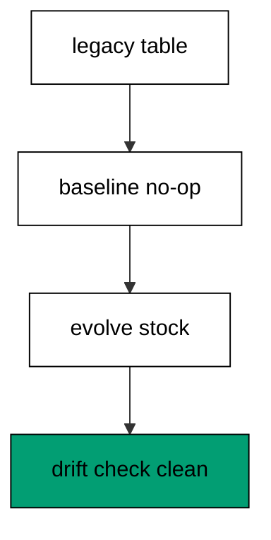

The hand-built gadgets stand in for any inherited schema with live data, and the guarded baseline adopts them without touching a row. The evolution adds a defaulted stock column and fills ten units per legacy row through the ordinary alter path. Row proof shows both survivors with their stock, and the drift query closes the loop: every applied migration has its table present. Adoption, growth, and agreement in one run is what baselining exists to deliver.

**`learning/code/ex-53-baselining-review-adopt-evolve-verify/main.clj`**:

```clojure
;; => Example 53: Baselining Review.
;; => The cluster closes on the full adoption: legacy in, baseline recorded, evolution clean.
(require '[migratus.core :as migratus]) ;; => migrate, rollback, up, and down move history
(require '[next.jdbc :as jdbc]) ;; => verification reads prove each migration landed
(require '[next.jdbc.result-set :as rs]) ;; => unqualified rows print without table prefixes
(require '[clojure.java.io :as io]) ;; => migration files are staged, then removed
;; => The database address comes from the harness, with local-run defaults.
(defn db-spec [] ;; => one builder owns every address default
  {:dbtype "postgresql" ;; => pgjdbc speaks the PostgreSQL wire protocol
   :host (or (System/getenv "PGHOST") "localhost") ;; => harness sets the service host
   :port (Integer/parseInt (or (System/getenv "PGPORT") "5432")) ;; => service port default
   :dbname (or (System/getenv "PGDATABASE") "postgres") ;; => fresh database per unit run
   :user (or (System/getenv "PGUSER") "postgres")}) ;; => trust auth needs no password
;; => One config carries the store, the relative migration dir, and the history table.
(defn config [dir table] ;; => every example owns its dir and history table
  {:store :database ;; => the SQL store journals history in a table
   :migration-dir dir ;; => relative to the unit folder, staged at runtime
   :migration-table-name table ;; => per-example history isolates every rerun
   :db (db-spec)}) ;; => next.jdbc connects from this spec
;; => Staging writes one up/down pair per call into the relative dir.
(defn write-migration [dir id name up down] ;; => one helper stages every migration
  (spit (str dir "/" id "-" name ".up.sql") up) ;; => forward change runs on migrate
  (when down ;; => up-only examples skip the down file on purpose
    (spit (str dir "/" id "-" name ".down.sql") down))) ;; => reverse runs on rollback
;; => Reset clears leftovers of a killed run so reruns print alike.
(defn reset-unit! [ds dir table tables views] ;; => one reset owns every leftover
  (doseq [v views] ;; => views drop before the tables they read
    (jdbc/execute! ds [(str "DROP VIEW IF EXISTS " v)])) ;; => stale views vanish first
  (let [d (io/file dir)] ;; => the relative staging dir of this unit
    (when (.exists d) ;; => a killed run may leave files behind
      (doseq [f (.listFiles d)] ;; => every staged file goes first
        (.delete ^java.io.File f)) ;; => delete each staged migration
      (.delete d)) ;; => the empty staging dir goes too
    (.mkdirs d)) ;; => a fresh dir for this run
  (doseq [t tables] ;; => every table this example owns
    (jdbc/execute! ds [(str "DROP TABLE IF EXISTS " t " CASCADE")])) ;; => killed runs vanish
  (jdbc/execute! ds [(str "DROP TABLE IF EXISTS " table)])) ;; => stale history vanishes too
;; => Reads print their own proof; ids sort so output never depends on disk order.
(defn applied-names [ds table] ;; => applied migration names in id order
  (mapv :description ;; => description stores the migration name
    (jdbc/execute! ds [(str "SELECT description FROM " table " WHERE id > 0 ORDER BY id")] ;; => id order, reserve row excluded
                     {:builder-fn rs/as-unqualified-lower-maps}))) ;; => short keys print cleanly
;; => Column lists read the catalog, so the schema proves itself.
(defn table-columns [ds table] ;; => column names in position order
  (mapv :column_name ;; => one name per row, nothing else
    (jdbc/execute! ds [(str "SELECT column_name FROM information_schema.columns WHERE table_name = '" table "' ORDER BY ordinal_position")] ;; => catalog order is stable
                     {:builder-fn rs/as-unqualified-lower-maps}))) ;; => short keys print cleanly
(def ds (jdbc/get-datasource (db-spec))) ;; => one shared datasource per unit run
(def cfg (config "mig" "m53_migrations")) ;; => store plus history table for this example
(reset-unit! ds "mig" "m53_migrations" ["m53_gadget"] []) ;; => leftovers of a killed run vanish first
(jdbc/execute! ds ["CREATE TABLE m53_gadget (id SERIAL PRIMARY KEY, sku TEXT NOT NULL)"]) ;; => legacy gadgets predate history
(jdbc/execute! ds ["INSERT INTO m53_gadget (sku) VALUES ('g-1'), ('g-2')"]) ;; => two legacy rows must survive
(write-migration "mig" "20260101005301" "baseline-gadget" ;; => baseline matches the legacy shape
  "CREATE TABLE IF NOT EXISTS m53_gadget (id SERIAL PRIMARY KEY, sku TEXT NOT NULL);\n" ;; => no-op against the legacy table
  "-- nothing to undo: baseline adopted existing objects\n") ;; => down keeps adopted objects
(write-migration "mig" "20260101005302" "track-stock" ;; => evolution adds tracked stock
  (str "ALTER TABLE m53_gadget ADD COLUMN stock INTEGER DEFAULT 0 NOT NULL;\n" ;; => stock lands with a default
       "--;;\n" ;; => separator splits the evolution
       "UPDATE m53_gadget SET stock = 10 WHERE stock = 0;\n") ;; => legacy rows gain ten units
  (str "ALTER TABLE m53_gadget DROP COLUMN stock;\n" ;; => reverse drops the evolution
       "--;;\n" ;; => same separator on the way down
       "UPDATE m53_gadget SET stock = 0;\n")) ;; => down zeroes before dropping
(println "migrate:" (pr-str (migratus/migrate cfg))) ;; => nil means every pending migration applied
(println "completed:" (pr-str (applied-names ds "m53_migrations"))) ;; => id order straight from history
(println "rows:" (pr-str (mapv (juxt :sku :stock) ;; => legacy rows plus stock
  (jdbc/execute! ds ["SELECT sku, stock FROM m53_gadget ORDER BY id"] ;; => adopt then evolve, nothing lost (part 1)
                   {:builder-fn rs/as-unqualified-lower-maps})))) ;; => adopt then evolve, nothing lost (part 2)
(println "drift:" (pr-str (mapv :table_name ;; => every history table exists
  (jdbc/execute! ds ["SELECT table_name FROM information_schema.tables WHERE table_name LIKE 'm53%' AND table_name <> 'm53_migrations' ORDER BY 1"] ;; => catalog lists the adopted table
                   {:builder-fn rs/as-unqualified-lower-maps})))) ;; => journal and catalog agree
;; => Cleanup drops every object this example made, leaving no residue.
(defn cleanup-unit! [ds dir table tables views] ;; => one cleanup owns every created object
  (doseq [v views] ;; => views drop before the tables they read
    (jdbc/execute! ds [(str "DROP VIEW IF EXISTS " v)])) ;; => view residue vanishes
  (doseq [t tables] ;; => every table this example owns
    (jdbc/execute! ds [(str "DROP TABLE IF EXISTS " t " CASCADE")])) ;; => tables vanish with dependents
  (jdbc/execute! ds [(str "DROP TABLE IF EXISTS " table)]) ;; => history table vanishes too
  (let [d (io/file dir)] ;; => the staging dir from this run
    (when (.exists d) ;; => files were staged above
      (doseq [f (.listFiles d)] ;; => every staged file goes first
        (.delete ^java.io.File f)) ;; => delete each staged migration
      (.delete d)))) ;; => the empty staging dir goes too
(cleanup-unit! ds "mig" "m53_migrations" ["m53_gadget"] []) ;; => drop every object this example created
```

**Output** (`learning/code/ex-53-baselining-review-adopt-evolve-verify/expected/main.stdout.txt`):

```text
migrate: nil
completed: ["baseline-gadget" "track-stock"]
rows: [["g-1" 10] ["g-2" 10]]
drift: ["m53_gadget"]
```

**Key takeaway**: Adopt with a guarded baseline, evolve like anything built, verify journal against catalog.

**Why it matters**: Inherited systems arrive with history the journal never saw and data nobody may lose, which tempts teams to freeze them forever. The baselining chain proves the alternative: adopt honestly, evolve normally, and verify continuously. Teams that run this chain inherit without fear, because every step either preserves or proves.
