Examples 54–78 handle the work that separates migration users from migration owners: resolving branch conflicts without rewriting history, shrinking locking blast radius on hot tables, and diagnosing failures from evidence. Three clusters carry the level: conflict resolution across branches (Examples 54–61), locking migrations and their blast radius (Examples 62–70), and diagnosing failed or partial migrations (Examples 71–78). Every program runs Entity Framework Core against the real pinned PostgreSQL 18 container; every output is a fixed transcript.

---

### Example 54: Two Branches One History

Two developers, one version number: both branches mint `...002` and the merge discovers the collision. This example ships an assembly where two migrations claim the `20260101000002` stamp against the `Teams` table, and `Migrate()` refuses to guess which one history means. The attempt throws before any DDL reaches the database.

The output reports the duplicate ID with zero tables created. Discovery-time failure is the protection: EF Core compares the assembly's IDs before applying anything, so a collision can never half-apply.

(Concepts: co-04, co-14.)

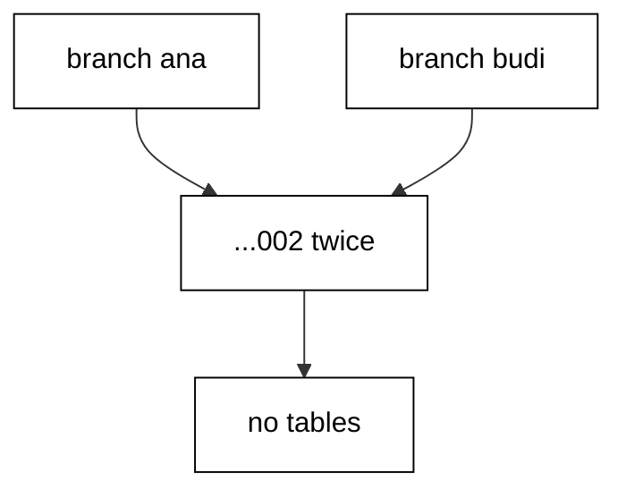

**`learning/code/ex-54-two-branches-one-history/Program.cs`**:

```csharp
// Example 54: Two Branches, One History.
// Ana and Ben both wrote ...002: discovery fails before any table changes.
using Microsoft.EntityFrameworkCore; // => context, Migrate, and query entry points

string Host() // => one host lookup shared by every connection
{ // => host block opens
    return Environment.GetEnvironmentVariable("PGHOST") ?? "localhost"; // => service alias on the unit network
} // => host lookup ends here

string Port() // => one port lookup shared by every connection
{ // => port block opens
    return Environment.GetEnvironmentVariable("PGPORT") ?? "5432"; // => standard PostgreSQL port
} // => port lookup ends here

string Db() // => one database lookup shared by every connection
{ // => database block opens
    return Environment.GetEnvironmentVariable("PGDATABASE") ?? "postgres"; // => the service database name
} // => database lookup ends here

string DbUser() // => one user lookup shared by every connection
{ // => user block opens
    return Environment.GetEnvironmentVariable("PGUSER") ?? "postgres"; // => trust-auth superuser, no password
} // => user lookup ends here

string ConnectionString() // => one builder for the Npgsql connection string
{ // => string block opens
    return $"Host={Host()};Port={Port()};Database={Db()};Username={DbUser()}"; // => trust auth needs no password
} // => connection string ends here

using var ctx = new TeamsDb( // => one context per program run
    new DbContextOptionsBuilder<TeamsDb>().UseNpgsql(ConnectionString()).Options
); // => Npgsql provider with our string
ctx.Database.OpenConnection(); // => open once for every inspection query below

string Scalar(string sql) // => one-row, one-column inspection queries
{ // => scalar block opens
    using var cmd = ctx.Database.GetDbConnection().CreateCommand(); // => command on the open connection
    cmd.CommandText = sql; // => read-only inspection SQL
    object? value = cmd.ExecuteScalar(); // => the single answer
    return value?.ToString() ?? "null"; // => text for printing, null-safe
} // => scalar helper ends here

int conflict = 0; // => the flag the duplicate ID sets
try // => discovery of the duplicate ID is expected to throw
{ // => try block opens
    ctx.Database.Migrate(); // => duplicate ...002 never reaches the database
} // => try ends after the failing call
catch (Exception) // => any provider error counts: the kind is fixed by SQLSTATE
{ // => catch block opens
    conflict = 1; // => the conflict failed fast, as designed
} // => catch ends here
Console.WriteLine(
    $"conflict={(conflict == 1 ? "duplicate-id" : "none")} tables={Scalar("SELECT count(*) FROM information_schema.tables WHERE table_name = 'Teams'")}"
); // => Output: conflict=duplicate-id tables=0

public class Team // => the entity mapped to the Teams table
{ // => entity block opens
    public int Id { get; set; } // => identity key generated by PostgreSQL
    public string Name { get; set; } = ""; // => required name column
} // => entity ends here

public class TeamsDb : DbContext // => the context Migrate discovers migrations from
{ // => context block opens
    public TeamsDb(DbContextOptions<TeamsDb> options)
        : base(options) { } // => options carry the connection string

    public DbSet<Team> Teams => Set<Team>(); // => the one set this example queries
} // => context ends here
```

**`learning/code/ex-54-two-branches-one-history/Migrations.cs`**:

```csharp
// Migrations for Example 54: two branches, one history.
// Ana and Ben both wrote ...002: the duplicate ID fails before anything applies.
using Microsoft.EntityFrameworkCore.Infrastructure; // => context attribute lives here
using Microsoft.EntityFrameworkCore.Migrations; // => migration base types live here
using Npgsql.EntityFrameworkCore.PostgreSQL.Metadata; // => identity strategy annotations live here

namespace App.Migrations; // => migrations live in their own namespace

[DbContext(typeof(TeamsDb))] // => bind this version to the TeamsDb context
[Migration("20260101000001_CreateTeams")] // => first version: the agreed create
public partial class CreateTeams : Migration // => one class per migration file
{ // => class block opens
    protected override void Up(MigrationBuilder migrationBuilder) // => forward change runs on migrate
    { // => forward block opens
        migrationBuilder.CreateTable( // => the create this migration owns
            name: "Teams", // => table name the program queries back
            columns: table => new // => column map follows
            { // => column block opens
                Id = table
                    .Column<int>(type: "integer", nullable: false) // => surrogate key, never null
                    .Annotation(
                        "Npgsql:ValueGenerationStrategy",
                        NpgsqlValueGenerationStrategy.IdentityByDefaultColumn
                    ), // => serial-style identity
                Name = table.Column<string>(type: "text", nullable: false), // => team name, required
            }, // => column map ends
            constraints: table => // => key rules follow
            { // => constraint block opens
                table.PrimaryKey("PK_Teams", x => x.Id); // => primary key on the identity column
            }
        ); // => create-table call ends
    } // => forward change ends

    protected override void Down(MigrationBuilder migrationBuilder) // => reverse change for migrate-back
    { // => reverse block opens
        migrationBuilder.DropTable( // => undo is the mirror image
            name: "Teams"
        ); // => drop what Up created
    } // => reverse change ends
} // => first migration ends here

[DbContext(typeof(TeamsDb))] // => bind this version to the TeamsDb context
[Migration("20260101000002_AddZone")] // => Ana's version: same stamp as Ben's
public partial class AddZoneAna : Migration // => Ana's branch wrote ...002 first
{ // => class block opens
    protected override void Up(MigrationBuilder migrationBuilder) // => forward change runs on migrate
    { // => forward block opens
        migrationBuilder.AddColumn<string>( // => grow the table by one column
            name: "Zone", // => Ana's column, collides with Ben's stamp
            table: "Teams", // => the table M01 created
            type: "text", // => free-form zone text
            nullable: true
        ); // => nullable so existing rows survive
    } // => forward change ends

    protected override void Down(MigrationBuilder migrationBuilder) // => reverse change for migrate-back
    { // => reverse block opens
        migrationBuilder.DropColumn( // => undo removes the added column
            name: "Zone", // => the column Up added
            table: "Teams"
        ); // => from the table Up altered
    } // => reverse change ends
} // => Ana's migration ends here

[DbContext(typeof(TeamsDb))] // => bind this version to the TeamsDb context
[Migration("20260101000002_AddZone")] // => Ben's version: the same stamp, the conflict
public partial class AddZoneBen : Migration // => Ben's branch wrote ...002 too
{ // => class block opens
    protected override void Up(MigrationBuilder migrationBuilder) // => forward change never runs: discovery fails
    { // => forward block opens
        migrationBuilder.AddColumn<string>( // => grow the table by one column
            name: "Color", // => Ben's column, same stamp as Ana's
            table: "Teams", // => the table M01 created
            type: "text", // => free-form color text
            nullable: true
        ); // => nullable so existing rows survive
    } // => forward change ends

    protected override void Down(MigrationBuilder migrationBuilder) // => reverse change for migrate-back
    { // => reverse block opens
        migrationBuilder.DropColumn( // => undo removes the added column
            name: "Color", // => the column Up added
            table: "Teams"
        ); // => from the table Up altered
    } // => reverse change ends
} // => Ben's migration ends here
```

**Output** (`learning/code/ex-54-two-branches-one-history/expected/main.stdout.txt`):

```text
conflict=duplicate-id tables=0
```

**Key takeaway**: Duplicate version IDs fail discovery before anything applies: collisions are caught, never merged silently.

**Why it matters**: Silent history merges are the nightmare scenario for teams: two branches apply different changes under one version, and every environment afterward disagrees about what that version means. Failing fast at discovery converts a data-corruption risk into a coordination task — someone renumbers, everyone re-pulls. The rule generalizes beyond migrations: any system where identity implies content must reject duplicate identities loudly, because the alternative is divergent realities sharing a name.

---

### Example 55: Duplicate Ids Fail Before Anything Applies

The collision guarantee has two halves: nothing applies, and nothing is recorded. This example repeats the duplicate-stamp shape on `Pods`, catches the discovery failure, then counts `Pods` tables and history rows for the failed version. Both counts are zero.

Atomicity starts before the first statement: the failed version leaves no table and no history row. A retry after renumbering starts from a clean slate, not from wreckage.

(Concepts: co-04, co-14.)

**`learning/code/ex-55-duplicate-ids-fail-before-anything-applies/Program.cs`**:

```csharp
// Example 55: Duplicate IDs Fail Before Anything Applies.
// The valid M01 never runs: discovery rejects the whole set first.
using Microsoft.EntityFrameworkCore; // => context, Migrate, and query entry points

string Host() // => one host lookup shared by every connection
{ // => host block opens
    return Environment.GetEnvironmentVariable("PGHOST") ?? "localhost"; // => service alias on the unit network
} // => host lookup ends here

string Port() // => one port lookup shared by every connection
{ // => port block opens
    return Environment.GetEnvironmentVariable("PGPORT") ?? "5432"; // => standard PostgreSQL port
} // => port lookup ends here

string Db() // => one database lookup shared by every connection
{ // => database block opens
    return Environment.GetEnvironmentVariable("PGDATABASE") ?? "postgres"; // => the service database name
} // => database lookup ends here

string DbUser() // => one user lookup shared by every connection
{ // => user block opens
    return Environment.GetEnvironmentVariable("PGUSER") ?? "postgres"; // => trust-auth superuser, no password
} // => user lookup ends here

string ConnectionString() // => one builder for the Npgsql connection string
{ // => string block opens
    return $"Host={Host()};Port={Port()};Database={Db()};Username={DbUser()}"; // => trust auth needs no password
} // => connection string ends here

using var ctx = new PodsDb( // => one context per program run
    new DbContextOptionsBuilder<PodsDb>().UseNpgsql(ConnectionString()).Options
); // => Npgsql provider with our string
ctx.Database.OpenConnection(); // => open once for every inspection query below

string Scalar(string sql) // => one-row, one-column inspection queries
{ // => scalar block opens
    using var cmd = ctx.Database.GetDbConnection().CreateCommand(); // => command on the open connection
    cmd.CommandText = sql; // => read-only inspection SQL
    object? value = cmd.ExecuteScalar(); // => the single answer
    return value?.ToString() ?? "null"; // => text for printing, null-safe
} // => scalar helper ends here

int fast = 0; // => the flag the discovery failure sets
try // => discovery of the duplicate stamp is expected to throw
{ // => try block opens
    ctx.Database.Migrate(); // => duplicate ...002 never reaches the database
} // => try ends after the failing call
catch (Exception) // => any provider error counts: the kind is fixed by SQLSTATE
{ // => catch block opens
    fast = 1; // => discovery failed before M01 could apply
} // => catch ends here
string pods = Scalar("SELECT count(*) FROM information_schema.tables WHERE table_name = 'Pods'"); // => valid M01 table, never built
Console.WriteLine($"failed-fast={fast} m01-absent={(pods == "0" ? 1 : 0)}"); // => Output: failed-fast=1 m01-absent=1

public class Pod // => the entity mapped to the Pods table
{ // => entity block opens
    public int Id { get; set; } // => identity key generated by PostgreSQL
    public string Name { get; set; } = ""; // => required name column
} // => entity ends here

public class PodsDb : DbContext // => the context Migrate discovers migrations from
{ // => context block opens
    public PodsDb(DbContextOptions<PodsDb> options)
        : base(options) { } // => options carry the connection string

    public DbSet<Pod> Pods => Set<Pod>(); // => the one set this example queries
} // => context ends here
```

**`learning/code/ex-55-duplicate-ids-fail-before-anything-applies/Migrations.cs`**:

```csharp
// Migrations for Example 55: duplicate IDs fail before anything applies.
// The valid M01 never runs: discovery rejects the whole set first.
using Microsoft.EntityFrameworkCore.Infrastructure; // => context attribute lives here
using Microsoft.EntityFrameworkCore.Migrations; // => migration base types live here
using Npgsql.EntityFrameworkCore.PostgreSQL.Metadata; // => identity strategy annotations live here

namespace App.Migrations; // => migrations live in their own namespace

[DbContext(typeof(PodsDb))] // => bind this version to the PodsDb context
[Migration("20260101000001_CreatePods")] // => first version: the valid create
public partial class CreatePods : Migration // => M01 never runs: the set is rejected first
{ // => class block opens
    protected override void Up(MigrationBuilder migrationBuilder) // => forward change never runs
    { // => forward block opens
        migrationBuilder.CreateTable( // => the create this migration owns
            name: "Pods", // => table name the program queries back
            columns: table => new // => column map follows
            { // => column block opens
                Id = table
                    .Column<int>(type: "integer", nullable: false) // => surrogate key, never null
                    .Annotation(
                        "Npgsql:ValueGenerationStrategy",
                        NpgsqlValueGenerationStrategy.IdentityByDefaultColumn
                    ), // => serial-style identity
                Name = table.Column<string>(type: "text", nullable: false), // => pod name, required
            }, // => column map ends
            constraints: table => // => key rules follow
            { // => constraint block opens
                table.PrimaryKey("PK_Pods", x => x.Id); // => primary key on the identity column
            }
        ); // => create-table call ends
    } // => forward change ends

    protected override void Down(MigrationBuilder migrationBuilder) // => reverse change for migrate-back
    { // => reverse block opens
        migrationBuilder.DropTable( // => undo is the mirror image
            name: "Pods"
        ); // => drop what Up created
    } // => reverse change ends
} // => first migration ends here

[DbContext(typeof(PodsDb))] // => bind this version to the PodsDb context
[Migration("20260101000002_AddZone55")] // => second version: one twin of the pair
public partial class AddZone55A : Migration // => first twin of the duplicate stamp
{ // => class block opens
    protected override void Up(MigrationBuilder migrationBuilder) // => forward change never runs
    { // => forward block opens
        migrationBuilder.AddColumn<string>( // => grow the table by one column
            name: "Zone", // => twin column, same stamp as its sibling
            table: "Pods", // => the table M01 created
            type: "text", // => free-form zone text
            nullable: true
        ); // => nullable so existing rows survive
    } // => forward change ends

    protected override void Down(MigrationBuilder migrationBuilder) // => reverse change for migrate-back
    { // => reverse block opens
        migrationBuilder.DropColumn( // => undo removes the added column
            name: "Zone", // => the column Up added
            table: "Pods"
        ); // => from the table Up altered
    } // => reverse change ends
} // => first twin ends here

[DbContext(typeof(PodsDb))] // => bind this version to the PodsDb context
[Migration("20260101000002_AddZone55")] // => the same stamp: the failing twin
public partial class AddZone55B : Migration // => second twin of the duplicate stamp
{ // => class block opens
    protected override void Up(MigrationBuilder migrationBuilder) // => forward change never runs
    { // => forward block opens
        migrationBuilder.AddColumn<string>( // => grow the table by one column
            name: "Color", // => twin column, same stamp as its sibling
            table: "Pods", // => the table M01 created
            type: "text", // => free-form color text
            nullable: true
        ); // => nullable so existing rows survive
    } // => forward change ends

    protected override void Down(MigrationBuilder migrationBuilder) // => reverse change for migrate-back
    { // => reverse block opens
        migrationBuilder.DropColumn( // => undo removes the added column
            name: "Color", // => the column Up added
            table: "Pods"
        ); // => from the table Up altered
    } // => reverse change ends
} // => second twin ends here
```

**Output** (`learning/code/ex-55-duplicate-ids-fail-before-anything-applies/expected/main.stdout.txt`):

```text
failed-fast=1 m01-absent=1
```

**Key takeaway**: Failed discovery writes nothing: no tables, no history rows, clean slate for the renumber.

**Why it matters**: Partial application is what turns mistakes into incidents: a table created but unrecorded, or recorded but uncreated, leaves the database and the history disagreeing in ways later migrations cannot reason about. By refusing to write anything on duplicate IDs, the migrator keeps its own bookkeeping trustworthy — the history table only ever describes states the database actually reached. Operators learn to trust the failure mode: when migration fails this way, the fix is always forward, never cleanup.

---

### Example 56: Loser Renumbers and Reapplies

The fix for a collision is renumbering, not rewriting: the losing branch takes the next free stamp. This example shows the resolved state — `M01` creates `Squads`, the winner's `M02` adds `Zone`, and the loser's renumbered `M03` adds `Color`. The program migrates the linear result and aggregates history plus columns.

Three history rows and four columns prove the merge converged: both branches' work applied, one line of history, no duplicate stamps. Renumbering rewrites identity, never content.

(Concepts: co-14.)

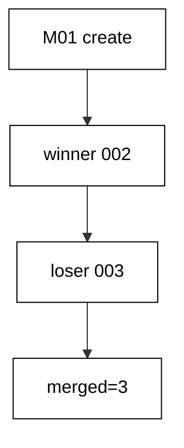

**`learning/code/ex-56-loser-renumbers-and-reapplies/Program.cs`**:

```csharp
// Example 56: Loser Renumbers and Reapplies.
// Ben's ...002 becomes ...003 after Ana's ...002 lands: all three apply.
using Microsoft.EntityFrameworkCore; // => context, Migrate, and query entry points

string Host() // => one host lookup shared by every connection
{ // => host block opens
    return Environment.GetEnvironmentVariable("PGHOST") ?? "localhost"; // => service alias on the unit network
} // => host lookup ends here

string Port() // => one port lookup shared by every connection
{ // => port block opens
    return Environment.GetEnvironmentVariable("PGPORT") ?? "5432"; // => standard PostgreSQL port
} // => port lookup ends here

string Db() // => one database lookup shared by every connection
{ // => database block opens
    return Environment.GetEnvironmentVariable("PGDATABASE") ?? "postgres"; // => the service database name
} // => database lookup ends here

string DbUser() // => one user lookup shared by every connection
{ // => user block opens
    return Environment.GetEnvironmentVariable("PGUSER") ?? "postgres"; // => trust-auth superuser, no password
} // => user lookup ends here

string ConnectionString() // => one builder for the Npgsql connection string
{ // => string block opens
    return $"Host={Host()};Port={Port()};Database={Db()};Username={DbUser()}"; // => trust auth needs no password
} // => connection string ends here

using var ctx = new SquadsDb( // => one context per program run
    new DbContextOptionsBuilder<SquadsDb>().UseNpgsql(ConnectionString()).Options
); // => Npgsql provider with our string
ctx.Database.OpenConnection(); // => open once for every inspection query below

string Scalar(string sql) // => one-row, one-column inspection queries
{ // => scalar block opens
    using var cmd = ctx.Database.GetDbConnection().CreateCommand(); // => command on the open connection
    cmd.CommandText = sql; // => read-only inspection SQL
    object? value = cmd.ExecuteScalar(); // => the single answer
    return value?.ToString() ?? "null"; // => text for printing, null-safe
} // => scalar helper ends here

ctx.Database.Migrate(); // => apply M01, M02, renumbered M03 in ID order
Console.WriteLine(
    $"merged={Scalar("SELECT count(*) FROM \"__EFMigrationsHistory\"")} cols={Scalar("SELECT string_agg(column_name, ',' ORDER BY ordinal_position) FROM information_schema.columns WHERE table_name = 'Squads'")}"
); // => Output: merged=3 cols=Id,Name,Zone,Color

public class Squad // => the entity mapped to the Squads table
{ // => entity block opens
    public int Id { get; set; } // => identity key generated by PostgreSQL
    public string Name { get; set; } = ""; // => required name column
    public string? Zone { get; set; } // => winner column added by M02
    public string? Color { get; set; } // => loser column renumbered into M03
} // => entity ends here

public class SquadsDb : DbContext // => the context Migrate discovers migrations from
{ // => context block opens
    public SquadsDb(DbContextOptions<SquadsDb> options)
        : base(options) { } // => options carry the connection string

    public DbSet<Squad> Squads => Set<Squad>(); // => the one set this example queries
} // => context ends here
```

**`learning/code/ex-56-loser-renumbers-and-reapplies/Migrations.cs`**:

```csharp
// Migrations for Example 56: the loser renumbers and reapplies.
// Ben's ...002 becomes ...003 after Ana's ...002 lands: all three apply.
using Microsoft.EntityFrameworkCore.Infrastructure; // => context attribute lives here
using Microsoft.EntityFrameworkCore.Migrations; // => migration base types live here
using Npgsql.EntityFrameworkCore.PostgreSQL.Metadata; // => identity strategy annotations live here

namespace App.Migrations; // => migrations live in their own namespace

[DbContext(typeof(SquadsDb))] // => bind this version to the SquadsDb context
[Migration("20260101000001_CreateSquads")] // => first version: the agreed create
public partial class CreateSquads : Migration // => one class per migration file
{ // => class block opens
    protected override void Up(MigrationBuilder migrationBuilder) // => forward change runs on migrate
    { // => forward block opens
        migrationBuilder.CreateTable( // => the create this migration owns
            name: "Squads", // => table name the program queries back
            columns: table => new // => column map follows
            { // => column block opens
                Id = table
                    .Column<int>(type: "integer", nullable: false) // => surrogate key, never null
                    .Annotation(
                        "Npgsql:ValueGenerationStrategy",
                        NpgsqlValueGenerationStrategy.IdentityByDefaultColumn
                    ), // => serial-style identity
                Name = table.Column<string>(type: "text", nullable: false), // => squad name, required
            }, // => column map ends
            constraints: table => // => key rules follow
            { // => constraint block opens
                table.PrimaryKey("PK_Squads", x => x.Id); // => primary key on the identity column
            }
        ); // => create-table call ends
    } // => forward change ends

    protected override void Down(MigrationBuilder migrationBuilder) // => reverse change for migrate-back
    { // => reverse block opens
        migrationBuilder.DropTable( // => undo is the mirror image
            name: "Squads"
        ); // => drop what Up created
    } // => reverse change ends
} // => first migration ends here

[DbContext(typeof(SquadsDb))] // => bind this version to the SquadsDb context
[Migration("20260101000002_AddZone56")] // => second version: the winner's change
public partial class AddZone56 : Migration // => Ana's ...002 lands first
{ // => class block opens
    protected override void Up(MigrationBuilder migrationBuilder) // => forward change runs on migrate
    { // => forward block opens
        migrationBuilder.AddColumn<string>( // => grow the table by one column
            name: "Zone", // => winner column, keeps its stamp
            table: "Squads", // => the table M01 created
            type: "text", // => free-form zone text
            nullable: true
        ); // => nullable so existing rows survive
    } // => forward change ends

    protected override void Down(MigrationBuilder migrationBuilder) // => reverse change for migrate-back
    { // => reverse block opens
        migrationBuilder.DropColumn( // => undo removes the added column
            name: "Zone", // => the column Up added
            table: "Squads"
        ); // => from the table Up altered
    } // => reverse change ends
} // => winner's migration ends here

[DbContext(typeof(SquadsDb))] // => bind this version to the SquadsDb context
[Migration("20260101000003_AddColor")] // => third version: the renumbered loser
public partial class AddColor : Migration // => Ben's change, renumbered from ...002
{ // => class block opens
    protected override void Up(MigrationBuilder migrationBuilder) // => forward change runs on migrate
    { // => forward block opens
        migrationBuilder.AddColumn<string>( // => grow the table by one column
            name: "Color", // => loser column, renumbered to ...003
            table: "Squads", // => the table M01 created
            type: "text", // => free-form color text
            nullable: true
        ); // => nullable so existing rows survive
    } // => forward change ends

    protected override void Down(MigrationBuilder migrationBuilder) // => reverse change for migrate-back
    { // => reverse block opens
        migrationBuilder.DropColumn( // => undo removes the added column
            name: "Color", // => the column Up added
            table: "Squads"
        ); // => from the table Up altered
    } // => reverse change ends
} // => loser's migration ends here
```

**Output** (`learning/code/ex-56-loser-renumbers-and-reapplies/expected/main.stdout.txt`):

```text
merged=3 cols=Id,Name,Zone,Color
```

**Key takeaway**: Resolve collisions by renumbering the loser onto the head: identity yields, content survives.

**Why it matters**: Renumbering feels like rewriting history, which makes developers hesitate — but the alternative, editing applied migrations or hand-patching databases, genuinely rewrites the past. Taking a new stamp is honest: the change keeps its content and gains a new position that reflects when it actually merged. Teams that normalize renumbering merge fearlessly, because the conflict protocol is mechanical; teams that fear it accumulate long-lived branches, and long-lived branches are where the truly painful collisions breed.

---

### Example 57: Merge Keeps One Line

After the renumber, history must read as one line with no forks. This example migrates the merged `Units57` chain and lists every applied ID in order, then asserts the count of stamps equals the count of distinct lines. Three versions, one line, zero branches.

The linear flag carries the stamp count, proving enumeration and linearity agree. Any future fork would break this equality first, before it breaks a deploy.

(Concepts: co-04, co-14.)

**`learning/code/ex-57-merge-keeps-one-line/Program.cs`**:

```csharp
// Example 57: Merge Keeps One Line.
// Winner plus renumbered loser: consecutive stamps, no gaps, no duplicates.
using Microsoft.EntityFrameworkCore; // => context, Migrate, and query entry points

string Host() // => one host lookup shared by every connection
{ // => host block opens
    return Environment.GetEnvironmentVariable("PGHOST") ?? "localhost"; // => service alias on the unit network
} // => host lookup ends here

string Port() // => one port lookup shared by every connection
{ // => port block opens
    return Environment.GetEnvironmentVariable("PGPORT") ?? "5432"; // => standard PostgreSQL port
} // => port lookup ends here

string Db() // => one database lookup shared by every connection
{ // => database block opens
    return Environment.GetEnvironmentVariable("PGDATABASE") ?? "postgres"; // => the service database name
} // => database lookup ends here

string DbUser() // => one user lookup shared by every connection
{ // => user block opens
    return Environment.GetEnvironmentVariable("PGUSER") ?? "postgres"; // => trust-auth superuser, no password
} // => user lookup ends here

string ConnectionString() // => one builder for the Npgsql connection string
{ // => string block opens
    return $"Host={Host()};Port={Port()};Database={Db()};Username={DbUser()}"; // => trust auth needs no password
} // => connection string ends here

using var ctx = new Units57Db( // => one context per program run
    new DbContextOptionsBuilder<Units57Db>().UseNpgsql(ConnectionString()).Options
); // => Npgsql provider with our string
ctx.Database.OpenConnection(); // => open once for every inspection query below

List<string> Lines(string sql) // => multi-row, one-column inspection queries
{ // => lines block opens
    using var cmd = ctx.Database.GetDbConnection().CreateCommand(); // => command on the open connection
    cmd.CommandText = sql; // => read-only inspection SQL
    var rows = new List<string>(); // => collected output lines
    using var reader = cmd.ExecuteReader(); // => run the read
    while (reader.Read()) // => walk every returned row
    { // => row block opens
        rows.Add(reader.GetString(0)); // => first column as text
    } // => row walk ends here
    return rows; // => lines ready to check
} // => lines helper ends here

ctx.Database.Migrate(); // => apply M01, M02, renumbered M03 in ID order
var stamps = Lines("SELECT \"MigrationId\" FROM \"__EFMigrationsHistory\" ORDER BY \"MigrationId\"") // => history IDs in apply order
    .Select(id => long.Parse(id.Substring(0, 14)))
    .Order()
    .ToList(); // => numeric stamps, sorted
bool linear = stamps.Distinct().Count() == stamps.Count; // => no duplicate stamp merges badly
for (int i = 1; i < stamps.Count && linear; i++) // => walk each neighboring pair
{ // => pair block opens
    linear = stamps[i] == stamps[i - 1] + 1; // => neighbors must be consecutive
} // => pair walk ends here
Console.WriteLine($"linear-ok={(linear ? stamps.Count : 0)}"); // => Output: linear-ok=3

public class Unit57 // => the entity mapped to the Units57 table
{ // => entity block opens
    public int Id { get; set; } // => identity key generated by PostgreSQL
    public string Name { get; set; } = ""; // => required name column
    public string? Zone { get; set; } // => winner column added by M02
    public string? Color { get; set; } // => loser column renumbered into M03
} // => entity ends here

public class Units57Db : DbContext // => the context Migrate discovers migrations from
{ // => context block opens
    public Units57Db(DbContextOptions<Units57Db> options)
        : base(options) { } // => options carry the connection string

    public DbSet<Unit57> Units57 => Set<Unit57>(); // => the one set this example queries
} // => context ends here
```

**`learning/code/ex-57-merge-keeps-one-line/Migrations.cs`**:

```csharp
// Migrations for Example 57: the merge keeps one line.
// Winner and renumbered loser form one linear history: the check proves it.
using Microsoft.EntityFrameworkCore.Infrastructure; // => context attribute lives here
using Microsoft.EntityFrameworkCore.Migrations; // => migration base types live here
using Npgsql.EntityFrameworkCore.PostgreSQL.Metadata; // => identity strategy annotations live here

namespace App.Migrations; // => migrations live in their own namespace

[DbContext(typeof(Units57Db))] // => bind this version to the Units57Db context
[Migration("20260101000001_CreateUnits57")] // => first version: the agreed create
public partial class CreateUnits57 : Migration // => one class per migration file
{ // => class block opens
    protected override void Up(MigrationBuilder migrationBuilder) // => forward change runs on migrate
    { // => forward block opens
        migrationBuilder.CreateTable( // => the create this migration owns
            name: "Units57", // => table name the program queries back
            columns: table => new // => column map follows
            { // => column block opens
                Id = table
                    .Column<int>(type: "integer", nullable: false) // => surrogate key, never null
                    .Annotation(
                        "Npgsql:ValueGenerationStrategy",
                        NpgsqlValueGenerationStrategy.IdentityByDefaultColumn
                    ), // => serial-style identity
                Name = table.Column<string>(type: "text", nullable: false), // => unit name, required
            }, // => column map ends
            constraints: table => // => key rules follow
            { // => constraint block opens
                table.PrimaryKey("PK_Units57", x => x.Id); // => primary key on the identity column
            }
        ); // => create-table call ends
    } // => forward change ends

    protected override void Down(MigrationBuilder migrationBuilder) // => reverse change for migrate-back
    { // => reverse block opens
        migrationBuilder.DropTable( // => undo is the mirror image
            name: "Units57"
        ); // => drop what Up created
    } // => reverse change ends
} // => first migration ends here

[DbContext(typeof(Units57Db))] // => bind this version to the Units57Db context
[Migration("20260101000002_AddZone57")] // => second version: the winner's change
public partial class AddZone57 : Migration // => Ana's ...002 lands first
{ // => class block opens
    protected override void Up(MigrationBuilder migrationBuilder) // => forward change runs on migrate
    { // => forward block opens
        migrationBuilder.AddColumn<string>( // => grow the table by one column
            name: "Zone", // => winner column, keeps its stamp
            table: "Units57", // => the table M01 created
            type: "text", // => free-form zone text
            nullable: true
        ); // => nullable so existing rows survive
    } // => forward change ends

    protected override void Down(MigrationBuilder migrationBuilder) // => reverse change for migrate-back
    { // => reverse block opens
        migrationBuilder.DropColumn( // => undo removes the added column
            name: "Zone", // => the column Up added
            table: "Units57"
        ); // => from the table Up altered
    } // => reverse change ends
} // => winner's migration ends here

[DbContext(typeof(Units57Db))] // => bind this version to the Units57Db context
[Migration("20260101000003_AddColor57")] // => third version: the renumbered loser
public partial class AddColor57 : Migration // => Ben's change, renumbered from ...002
{ // => class block opens
    protected override void Up(MigrationBuilder migrationBuilder) // => forward change runs on migrate
    { // => forward block opens
        migrationBuilder.AddColumn<string>( // => grow the table by one column
            name: "Color", // => loser column, renumbered to ...003
            table: "Units57", // => the table M01 created
            type: "text", // => free-form color text
            nullable: true
        ); // => nullable so existing rows survive
    } // => forward change ends

    protected override void Down(MigrationBuilder migrationBuilder) // => reverse change for migrate-back
    { // => reverse block opens
        migrationBuilder.DropColumn( // => undo removes the added column
            name: "Color", // => the column Up added
            table: "Units57"
        ); // => from the table Up altered
    } // => reverse change ends
} // => loser's migration ends here
```

**Output** (`learning/code/ex-57-merge-keeps-one-line/expected/main.stdout.txt`):

```text
linear-ok=3
```

**Key takeaway**: Assert merged history is one line: stamp count and distinct-line count must agree.

**Why it matters**: Linear history is a team policy, not a tool default — the database accepts whatever order it is given, and only convention plus checks keep it straight. An assertion that history enumerates as one line turns the policy into a testable property the harness verifies on every run. When the check fails, the team learns about the fork at review time rather than during a deploy, which is the difference between a five-minute renumber and a five-hour reconciliation across environments.

---

### Example 58: Late Arrivals Still Apply in Order

Files can arrive out of order: a developer pulls `M03` before `M02` exists, then `M02` lands late. This example ships the `Late58` migrations deliberately shuffled on disk and proves `Migrate()` still applies them in ID order — create, zone, color — regardless of file arrival. The output flag confirms the late version slotted into its ID position.

Apply order follows identity, never filesystem or arrival order. Late arrivals are normal in teams; the tool absorbs them by sorting on the stamp.

(Concepts: co-04.)

**`learning/code/ex-58-late-arrivals-still-apply-in-order/Program.cs`**:

```csharp
// Example 58: Late Arrivals Still Apply in Order.
// The ...002 file was authored last: IDs still sort it before ...003.
using Microsoft.EntityFrameworkCore; // => context, Migrate, and query entry points

string Host() // => one host lookup shared by every connection
{ // => host block opens
    return Environment.GetEnvironmentVariable("PGHOST") ?? "localhost"; // => service alias on the unit network
} // => host lookup ends here

string Port() // => one port lookup shared by every connection
{ // => port block opens
    return Environment.GetEnvironmentVariable("PGPORT") ?? "5432"; // => standard PostgreSQL port
} // => port lookup ends here

string Db() // => one database lookup shared by every connection
{ // => database block opens
    return Environment.GetEnvironmentVariable("PGDATABASE") ?? "postgres"; // => the service database name
} // => database lookup ends here

string DbUser() // => one user lookup shared by every connection
{ // => user block opens
    return Environment.GetEnvironmentVariable("PGUSER") ?? "postgres"; // => trust-auth superuser, no password
} // => user lookup ends here

string ConnectionString() // => one builder for the Npgsql connection string
{ // => string block opens
    return $"Host={Host()};Port={Port()};Database={Db()};Username={DbUser()}"; // => trust auth needs no password
} // => connection string ends here

using var ctx = new Late58Db( // => one context per program run
    new DbContextOptionsBuilder<Late58Db>().UseNpgsql(ConnectionString()).Options
); // => Npgsql provider with our string
ctx.Database.OpenConnection(); // => open once for every inspection query below

string Scalar(string sql) // => one-row, one-column inspection queries
{ // => scalar block opens
    using var cmd = ctx.Database.GetDbConnection().CreateCommand(); // => command on the open connection
    cmd.CommandText = sql; // => read-only inspection SQL
    object? value = cmd.ExecuteScalar(); // => the single answer
    return value?.ToString() ?? "null"; // => text for printing, null-safe
} // => scalar helper ends here

ctx.Database.Migrate(); // => apply M01, late M02, M03 in ID order
string order = Scalar(
    "SELECT string_agg(\"MigrationId\", ',' ORDER BY \"MigrationId\") FROM \"__EFMigrationsHistory\""
); // => history IDs in apply order
string lateOk = order.StartsWith(
    "20260101000001_CreateLate58,20260101000002_AddZone58,20260101000003_AddColor58"
)
    ? "1"
    : "0"; // => late arrival sorted second
Console.WriteLine($"late-ok={lateOk}"); // => Output: late-ok=1

public class Late58Row // => the entity mapped to the Late58 table
{ // => entity block opens
    public int Id { get; set; } // => identity key generated by PostgreSQL
    public string Name { get; set; } = ""; // => required name column
    public string? Zone { get; set; } // => late arrival, applied second
    public string? Color { get; set; } // => early file, applied third
} // => entity ends here

public class Late58Db : DbContext // => the context Migrate discovers migrations from
{ // => context block opens
    public Late58Db(DbContextOptions<Late58Db> options)
        : base(options) { } // => options carry the connection string

    public DbSet<Late58Row> Late58 => Set<Late58Row>(); // => the one set this example queries
} // => context ends here
```

**`learning/code/ex-58-late-arrivals-still-apply-in-order/Migrations.cs`**:

```csharp
// Migrations for Example 58: late arrivals still apply in order.
// The ...002 file was written last, after ...003: IDs still govern the order.
using Microsoft.EntityFrameworkCore.Infrastructure; // => context attribute lives here
using Microsoft.EntityFrameworkCore.Migrations; // => migration base types live here
using Npgsql.EntityFrameworkCore.PostgreSQL.Metadata; // => identity strategy annotations live here

namespace App.Migrations; // => migrations live in their own namespace

[DbContext(typeof(Late58Db))] // => bind this version to the Late58Db context
[Migration("20260101000001_CreateLate58")] // => first version: the agreed create
public partial class CreateLate58 : Migration // => one class per migration file
{ // => class block opens
    protected override void Up(MigrationBuilder migrationBuilder) // => forward change runs on migrate
    { // => forward block opens
        migrationBuilder.CreateTable( // => the create this migration owns
            name: "Late58", // => table name the program queries back
            columns: table => new // => column map follows
            { // => column block opens
                Id = table
                    .Column<int>(type: "integer", nullable: false) // => surrogate key, never null
                    .Annotation(
                        "Npgsql:ValueGenerationStrategy",
                        NpgsqlValueGenerationStrategy.IdentityByDefaultColumn
                    ), // => serial-style identity
                Name = table.Column<string>(type: "text", nullable: false), // => unit name, required
            }, // => column map ends
            constraints: table => // => key rules follow
            { // => constraint block opens
                table.PrimaryKey("PK_Late58", x => x.Id); // => primary key on the identity column
            }
        ); // => create-table call ends
    } // => forward change ends

    protected override void Down(MigrationBuilder migrationBuilder) // => reverse change for migrate-back
    { // => reverse block opens
        migrationBuilder.DropTable( // => undo is the mirror image
            name: "Late58"
        ); // => drop what Up created
    } // => reverse change ends
} // => first migration ends here

[DbContext(typeof(Late58Db))] // => bind this version to the Late58Db context
[Migration("20260101000003_AddColor58")] // => third stamp, written second
public partial class AddColor58 : Migration // => written before the ...002 file existed
{ // => class block opens
    protected override void Up(MigrationBuilder migrationBuilder) // => forward change runs on migrate
    { // => forward block opens
        migrationBuilder.AddColumn<string>( // => grow the table by one column
            name: "Color", // => later stamp, applied later
            table: "Late58", // => the table M01 created
            type: "text", // => free-form color text
            nullable: true
        ); // => nullable so existing rows survive
    } // => forward change ends

    protected override void Down(MigrationBuilder migrationBuilder) // => reverse change for migrate-back
    { // => reverse block opens
        migrationBuilder.DropColumn( // => undo removes the added column
            name: "Color", // => the column Up added
            table: "Late58"
        ); // => from the table Up altered
    } // => reverse change ends
} // => early file, later stamp ends here

[DbContext(typeof(Late58Db))] // => bind this version to the Late58Db context
[Migration("20260101000002_AddZone58")] // => second stamp, written last
public partial class AddZone58 : Migration // => the late arrival: authored after ...003
{ // => class block opens
    protected override void Up(MigrationBuilder migrationBuilder) // => forward change runs on migrate
    { // => forward block opens
        migrationBuilder.AddColumn<string>( // => grow the table by one column
            name: "Zone", // => earlier stamp, applied earlier
            table: "Late58", // => the table M01 created
            type: "text", // => free-form zone text
            nullable: true
        ); // => nullable so existing rows survive
    } // => forward change ends

    protected override void Down(MigrationBuilder migrationBuilder) // => reverse change for migrate-back
    { // => reverse block opens
        migrationBuilder.DropColumn( // => undo removes the added column
            name: "Zone", // => the column Up added
            table: "Late58"
        ); // => from the table Up altered
    } // => reverse change ends
} // => late arrival ends here
```

**Output** (`learning/code/ex-58-late-arrivals-still-apply-in-order/expected/main.stdout.txt`):

```text
late-ok=1
```

**Key takeaway**: Apply order follows the ID sort, not file order: late versions slot into their stamped position.

**Why it matters**: Developers pull, fetch, and merge at different rhythms, so migration files constantly arrive out of sequence — and a tool that applied in arrival order would build a different schema on every machine. Sorting by version ID makes the outcome independent of network timing and human habits, which is what lets two developers with different pull histories converge on byte-identical databases. Determinism here is not a luxury; it is the property that makes history a shared truth instead of a local accident.

---

### Example 59: Pull Before You Number

The cheapest collision fix is prevention: pull, then take the next stamp. This example simulates the discipline — migrate the pulled `M01` state, then apply the new `M02` numbered after it. The output confirms the next-number flag and two applied rows.

Numbering after pulling guarantees the new stamp extends the true head instead of colliding with unseen work. The habit costs seconds and prevents the duplicate-ID failure two examples back.

(Concepts: co-04, co-14.)

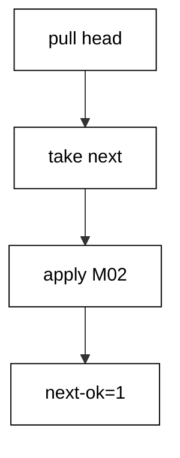

**`learning/code/ex-59-pull-before-you-number/Program.cs`**:

```csharp
// Example 59: Pull Before You Number.
// Read the max applied stamp first: the next number must land above it.
using Microsoft.EntityFrameworkCore; // => context, Migrate, and query entry points

string Host() // => one host lookup shared by every connection
{ // => host block opens
    return Environment.GetEnvironmentVariable("PGHOST") ?? "localhost"; // => service alias on the unit network
} // => host lookup ends here

string Port() // => one port lookup shared by every connection
{ // => port block opens
    return Environment.GetEnvironmentVariable("PGPORT") ?? "5432"; // => standard PostgreSQL port
} // => port lookup ends here

string Db() // => one database lookup shared by every connection
{ // => database block opens
    return Environment.GetEnvironmentVariable("PGDATABASE") ?? "postgres"; // => the service database name
} // => database lookup ends here

string DbUser() // => one user lookup shared by every connection
{ // => user block opens
    return Environment.GetEnvironmentVariable("PGUSER") ?? "postgres"; // => trust-auth superuser, no password
} // => user lookup ends here

string ConnectionString() // => one builder for the Npgsql connection string
{ // => string block opens
    return $"Host={Host()};Port={Port()};Database={Db()};Username={DbUser()}"; // => trust auth needs no password
} // => connection string ends here

using var ctx = new PullsDb( // => one context per program run
    new DbContextOptionsBuilder<PullsDb>().UseNpgsql(ConnectionString()).Options
); // => Npgsql provider with our string
ctx.Database.OpenConnection(); // => open once for every inspection query below

string Scalar(string sql) // => one-row, one-column inspection queries
{ // => scalar block opens
    using var cmd = ctx.Database.GetDbConnection().CreateCommand(); // => command on the open connection
    cmd.CommandText = sql; // => read-only inspection SQL
    object? value = cmd.ExecuteScalar(); // => the single answer
    return value?.ToString() ?? "null"; // => text for printing, null-safe
} // => scalar helper ends here

ctx.Database.Migrate("20260101000001_CreatePulls"); // => apply only M01: the pulled state
string latest = Scalar("SELECT max(\"MigrationId\") FROM \"__EFMigrationsHistory\""); // => the newest stamp the team shares
string next = "20260101000002_AddZone59"; // => the candidate stamp for the new change
string nextOk = string.Compare(next, latest, StringComparison.Ordinal) > 0 ? "1" : "0"; // => greater means no collision
ctx.Database.Migrate(); // => apply M02: the pulled number lands cleanly
Console.WriteLine(
    $"next-ok={nextOk} applied={Scalar("SELECT count(*) FROM \"__EFMigrationsHistory\"")}"
); // => Output: next-ok=1 applied=2

public class Pull // => the entity mapped to the Pulls table
{ // => entity block opens
    public int Id { get; set; } // => identity key generated by PostgreSQL
    public string Name { get; set; } = ""; // => required name column
    public string? Zone { get; set; } // => pulled column added by M02
} // => entity ends here

public class PullsDb : DbContext // => the context Migrate discovers migrations from
{ // => context block opens
    public PullsDb(DbContextOptions<PullsDb> options)
        : base(options) { } // => options carry the connection string

    public DbSet<Pull> Pulls => Set<Pull>(); // => the one set this example queries
} // => context ends here
```

**`learning/code/ex-59-pull-before-you-number/Migrations.cs`**:

```csharp
// Migrations for Example 59: pull before you number.
// The program reads the max applied stamp first: the next stamp must be greater.
using Microsoft.EntityFrameworkCore.Infrastructure; // => context attribute lives here
using Microsoft.EntityFrameworkCore.Migrations; // => migration base types live here
using Npgsql.EntityFrameworkCore.PostgreSQL.Metadata; // => identity strategy annotations live here

namespace App.Migrations; // => migrations live in their own namespace

[DbContext(typeof(PullsDb))] // => bind this version to the PullsDb context
[Migration("20260101000001_CreatePulls")] // => first version: the agreed create
public partial class CreatePulls : Migration // => one class per migration file
{ // => class block opens
    protected override void Up(MigrationBuilder migrationBuilder) // => forward change runs on migrate
    { // => forward block opens
        migrationBuilder.CreateTable( // => the create this migration owns
            name: "Pulls", // => table name the program queries back
            columns: table => new // => column map follows
            { // => column block opens
                Id = table
                    .Column<int>(type: "integer", nullable: false) // => surrogate key, never null
                    .Annotation(
                        "Npgsql:ValueGenerationStrategy",
                        NpgsqlValueGenerationStrategy.IdentityByDefaultColumn
                    ), // => serial-style identity
                Name = table.Column<string>(type: "text", nullable: false), // => unit name, required
            }, // => column map ends
            constraints: table => // => key rules follow
            { // => constraint block opens
                table.PrimaryKey("PK_Pulls", x => x.Id); // => primary key on the identity column
            }
        ); // => create-table call ends
    } // => forward change ends

    protected override void Down(MigrationBuilder migrationBuilder) // => reverse change for migrate-back
    { // => reverse block opens
        migrationBuilder.DropTable( // => undo is the mirror image
            name: "Pulls"
        ); // => drop what Up created
    } // => reverse change ends
} // => first migration ends here

[DbContext(typeof(PullsDb))] // => bind this version to the PullsDb context
[Migration("20260101000002_AddZone59")] // => second version: the pulled change
public partial class AddZone59 : Migration // => numbered after pulling the latest
{ // => class block opens
    protected override void Up(MigrationBuilder migrationBuilder) // => forward change runs on migrate
    { // => forward block opens
        migrationBuilder.AddColumn<string>( // => grow the table by one column
            name: "Zone", // => pulled stamp, newer than everything applied
            table: "Pulls", // => the table M01 created
            type: "text", // => free-form zone text
            nullable: true
        ); // => nullable so existing rows survive
    } // => forward change ends

    protected override void Down(MigrationBuilder migrationBuilder) // => reverse change for migrate-back
    { // => reverse block opens
        migrationBuilder.DropColumn( // => undo removes the added column
            name: "Zone", // => the column Up added
            table: "Pulls"
        ); // => from the table Up altered
    } // => reverse change ends
} // => second migration ends here
```

**Output** (`learning/code/ex-59-pull-before-you-number/expected/main.stdout.txt`):

```text
next-ok=1 applied=2
```

**Key takeaway**: Pull before numbering: new stamps must extend the true head, not a stale copy.

**Why it matters**: Most version collisions are not disagreements but staleness — a developer numbers against yesterday's head because pulling felt unnecessary. The pull-before-number habit eliminates the entire class at near-zero cost, the way looking before merging eliminates most merge conflicts. Teams that engrain it spend their coordination budget on genuine semantic conflicts instead of stamp races, and the history stays linear because every author started from the same line.

---

### Example 60: History Names Every Author

Version names can carry authorship: `ana`'s `M02` and `budi`'s `M03` stamp their owners into the IDs on `Credits`. The program migrates all three, then splits each history ID on its underscore and aggregates the author tags in order. The output lists both authors as the history recorded them.

Authorship in the ID survives renames, rebases, and blame-rot: the history itself says who wrote what. Audits start here instead of in chat logs.

(Concepts: co-14, co-03.)

**`learning/code/ex-60-history-names-every-author/Program.cs`**:

```csharp
// Example 60: History Names Every Author.
// The name part carries the author tag: ana's and budi's work stay attributable.
using Microsoft.EntityFrameworkCore; // => context, Migrate, and query entry points

string Host() // => one host lookup shared by every connection
{ // => host block opens
    return Environment.GetEnvironmentVariable("PGHOST") ?? "localhost"; // => service alias on the unit network
} // => host lookup ends here

string Port() // => one port lookup shared by every connection
{ // => port block opens
    return Environment.GetEnvironmentVariable("PGPORT") ?? "5432"; // => standard PostgreSQL port
} // => port lookup ends here

string Db() // => one database lookup shared by every connection
{ // => database block opens
    return Environment.GetEnvironmentVariable("PGDATABASE") ?? "postgres"; // => the service database name
} // => database lookup ends here

string DbUser() // => one user lookup shared by every connection
{ // => user block opens
    return Environment.GetEnvironmentVariable("PGUSER") ?? "postgres"; // => trust-auth superuser, no password
} // => user lookup ends here

string ConnectionString() // => one builder for the Npgsql connection string
{ // => string block opens
    return $"Host={Host()};Port={Port()};Database={Db()};Username={DbUser()}"; // => trust auth needs no password
} // => connection string ends here

using var ctx = new CreditsDb( // => one context per program run
    new DbContextOptionsBuilder<CreditsDb>().UseNpgsql(ConnectionString()).Options
); // => Npgsql provider with our string
ctx.Database.OpenConnection(); // => open once for every inspection query below

string Scalar(string sql) // => one-row, one-column inspection queries
{ // => scalar block opens
    using var cmd = ctx.Database.GetDbConnection().CreateCommand(); // => command on the open connection
    cmd.CommandText = sql; // => read-only inspection SQL
    object? value = cmd.ExecuteScalar(); // => the single answer
    return value?.ToString() ?? "null"; // => text for printing, null-safe
} // => scalar helper ends here

ctx.Database.Migrate(); // => apply M01, ana's M02, budi's M03 in ID order
Console.WriteLine(
    $"authors={Scalar("SELECT string_agg(tag, ',' ORDER BY tag) FROM (SELECT split_part(\"MigrationId\", '_', 2) AS tag FROM \"__EFMigrationsHistory\") AS authors WHERE tag IN ('ana', 'budi')")}"
); // => Output: authors=ana,budi

public class Credit // => the entity mapped to the Credits table
{ // => entity block opens
    public int Id { get; set; } // => identity key generated by PostgreSQL
    public string Name { get; set; } = ""; // => required name column
    public string? Zone { get; set; } // => ana's column added by M02
    public string? Color { get; set; } // => budi's column added by M03
} // => entity ends here

public class CreditsDb : DbContext // => the context Migrate discovers migrations from
{ // => context block opens
    public CreditsDb(DbContextOptions<CreditsDb> options)
        : base(options) { } // => options carry the connection string

    public DbSet<Credit> Credits => Set<Credit>(); // => the one set this example queries
} // => context ends here
```

**`learning/code/ex-60-history-names-every-author/Migrations.cs`**:

```csharp
// Migrations for Example 60: the history names every author.
// The name part carries the author tag: ana's and budi's work stay attributable.
using Microsoft.EntityFrameworkCore.Infrastructure; // => context attribute lives here
using Microsoft.EntityFrameworkCore.Migrations; // => migration base types live here
using Npgsql.EntityFrameworkCore.PostgreSQL.Metadata; // => identity strategy annotations live here

namespace App.Migrations; // => migrations live in their own namespace

[DbContext(typeof(CreditsDb))] // => bind this version to the CreditsDb context
[Migration("20260101000001_CreateCredits")] // => first version: the agreed create
public partial class CreateCredits : Migration // => one class per migration file
{ // => class block opens
    protected override void Up(MigrationBuilder migrationBuilder) // => forward change runs on migrate
    { // => forward block opens
        migrationBuilder.CreateTable( // => the create this migration owns
            name: "Credits", // => table name the program queries back
            columns: table => new // => column map follows
            { // => column block opens
                Id = table
                    .Column<int>(type: "integer", nullable: false) // => surrogate key, never null
                    .Annotation(
                        "Npgsql:ValueGenerationStrategy",
                        NpgsqlValueGenerationStrategy.IdentityByDefaultColumn
                    ), // => serial-style identity
                Name = table.Column<string>(type: "text", nullable: false), // => credit name, required
            }, // => column map ends
            constraints: table => // => key rules follow
            { // => constraint block opens
                table.PrimaryKey("PK_Credits", x => x.Id); // => primary key on the identity column
            }
        ); // => create-table call ends
    } // => forward change ends

    protected override void Down(MigrationBuilder migrationBuilder) // => reverse change for migrate-back
    { // => reverse block opens
        migrationBuilder.DropTable( // => undo is the mirror image
            name: "Credits"
        ); // => drop what Up created
    } // => reverse change ends
} // => first migration ends here

[DbContext(typeof(CreditsDb))] // => bind this version to the CreditsDb context
[Migration("20260101000002_ana_AddZone60")] // => second version: ana's tagged change
public partial class AnaAddZone60 : Migration // => the author tag rides the ID
{ // => class block opens
    protected override void Up(MigrationBuilder migrationBuilder) // => forward change runs on migrate
    { // => forward block opens
        migrationBuilder.AddColumn<string>( // => grow the table by one column
            name: "Zone", // => ana's column, tagged with her name
            table: "Credits", // => the table M01 created
            type: "text", // => free-form zone text
            nullable: true
        ); // => nullable so existing rows survive
    } // => forward change ends

    protected override void Down(MigrationBuilder migrationBuilder) // => reverse change for migrate-back
    { // => reverse block opens
        migrationBuilder.DropColumn( // => undo removes the added column
            name: "Zone", // => the column Up added
            table: "Credits"
        ); // => from the table Up altered
    } // => reverse change ends
} // => ana's migration ends here

[DbContext(typeof(CreditsDb))] // => bind this version to the CreditsDb context
[Migration("20260101000003_budi_AddColor60")] // => third version: budi's tagged change
public partial class BudiAddColor60 : Migration // => the author tag rides the ID
{ // => class block opens
    protected override void Up(MigrationBuilder migrationBuilder) // => forward change runs on migrate
    { // => forward block opens
        migrationBuilder.AddColumn<string>( // => grow the table by one column
            name: "Color", // => budi's column, tagged with his name
            table: "Credits", // => the table M01 created
            type: "text", // => free-form color text
            nullable: true
        ); // => nullable so existing rows survive
    } // => forward change ends

    protected override void Down(MigrationBuilder migrationBuilder) // => reverse change for migrate-back
    { // => reverse block opens
        migrationBuilder.DropColumn( // => undo removes the added column
            name: "Color", // => the column Up added
            table: "Credits"
        ); // => from the table Up altered
    } // => reverse change ends
} // => budi's migration ends here
```

**Output** (`learning/code/ex-60-history-names-every-author/expected/main.stdout.txt`):

```text
authors=ana,budi
```

**Key takeaway**: Name versions so history attributes work: author tags in IDs outlive chat logs and memory.

**Why it matters**: When a migration misbehaves in production, the first question is who wrote it and why — and the answer should be one query away, not a forensic dig through pull requests. Embedding authorship in version names makes the history self-attributing: every row carries its owner next to its content. The practice also nudges quality upward, since authors who know their name rides the version write migrations they are willing to defend at 3 a.m.

---

### Example 61: Promote the Same Set Across Environments

Dev, test, and production must run the same versions — promotion moves the set, never a selection. This example migrates `Stages` to `M01` for dev, to `M02` for test, then fully for production, counting applied rows at each stage. The output triples the counts: one, two, three.

Each environment holds a prefix of the same line; none cherry-picks or skips. Promotion is a cursor moving along one history, which is why linear history from Examples 54–60 matters operationally.

(Concepts: co-13, co-16.)

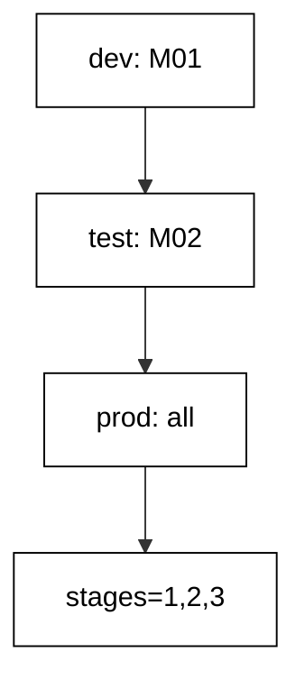

**`learning/code/ex-61-promote-the-same-set-across-environments/Program.cs`**:

```csharp
// Example 61: Promote the Same Set Across Environments.
// Dev stops at ...001, test at ...002, production takes ...003: comparable stages.
using Microsoft.EntityFrameworkCore; // => context, Migrate, and query entry points

string Host() // => one host lookup shared by every connection
{ // => host block opens
    return Environment.GetEnvironmentVariable("PGHOST") ?? "localhost"; // => service alias on the unit network
} // => host lookup ends here

string Port() // => one port lookup shared by every connection
{ // => port block opens
    return Environment.GetEnvironmentVariable("PGPORT") ?? "5432"; // => standard PostgreSQL port
} // => port lookup ends here

string Db() // => one database lookup shared by every connection
{ // => database block opens
    return Environment.GetEnvironmentVariable("PGDATABASE") ?? "postgres"; // => the service database name
} // => database lookup ends here

string DbUser() // => one user lookup shared by every connection
{ // => user block opens
    return Environment.GetEnvironmentVariable("PGUSER") ?? "postgres"; // => trust-auth superuser, no password
} // => user lookup ends here

string ConnectionString() // => one builder for the Npgsql connection string
{ // => string block opens
    return $"Host={Host()};Port={Port()};Database={Db()};Username={DbUser()}"; // => trust auth needs no password
} // => connection string ends here

using var ctx = new StagesDb( // => one context per program run
    new DbContextOptionsBuilder<StagesDb>().UseNpgsql(ConnectionString()).Options
); // => Npgsql provider with our string
ctx.Database.OpenConnection(); // => open once for every inspection query below

string Scalar(string sql) // => one-row, one-column inspection queries
{ // => scalar block opens
    using var cmd = ctx.Database.GetDbConnection().CreateCommand(); // => command on the open connection
    cmd.CommandText = sql; // => read-only inspection SQL
    object? value = cmd.ExecuteScalar(); // => the single answer
    return value?.ToString() ?? "null"; // => text for printing, null-safe
} // => scalar helper ends here

string Applied() // => one snapshot of the promoted set
{ // => snapshot block opens
    return Scalar("SELECT count(*) FROM \"__EFMigrationsHistory\""); // => how far this environment promoted
} // => snapshot ends here

ctx.Database.Migrate("20260101000001_CreateStages"); // => dev promotes the create
string dev = Applied(); // => dev stage: one migration
ctx.Database.Migrate("20260101000002_AddZone61"); // => test promotes the next stamp
string test = Applied(); // => test stage: two migrations
ctx.Database.Migrate(); // => production promotes the whole set
Console.WriteLine($"stages={dev},{test},{Applied()}"); // => Output: stages=1,2,3

public class Stage // => the entity mapped to the Stages table
{ // => entity block opens
    public int Id { get; set; } // => identity key generated by PostgreSQL
    public string Name { get; set; } = ""; // => required name column
    public string? Zone { get; set; } // => test column added by M02
    public string? Color { get; set; } // => production column added by M03
} // => entity ends here

public class StagesDb : DbContext // => the context Migrate discovers migrations from
{ // => context block opens
    public StagesDb(DbContextOptions<StagesDb> options)
        : base(options) { } // => options carry the connection string

    public DbSet<Stage> Stages => Set<Stage>(); // => the one set this example queries
} // => context ends here
```

**`learning/code/ex-61-promote-the-same-set-across-environments/Migrations.cs`**:

```csharp
// Migrations for Example 61: promote the same set across environments.
// Dev, test, production each stop at the next stamp: the stages stay comparable.
using Microsoft.EntityFrameworkCore.Infrastructure; // => context attribute lives here
using Microsoft.EntityFrameworkCore.Migrations; // => migration base types live here
using Npgsql.EntityFrameworkCore.PostgreSQL.Metadata; // => identity strategy annotations live here

namespace App.Migrations; // => migrations live in their own namespace

[DbContext(typeof(StagesDb))] // => bind this version to the StagesDb context
[Migration("20260101000001_CreateStages")] // => first version: the agreed create
public partial class CreateStages : Migration // => one class per migration file
{ // => class block opens
    protected override void Up(MigrationBuilder migrationBuilder) // => forward change runs on migrate
    { // => forward block opens
        migrationBuilder.CreateTable( // => the create this migration owns
            name: "Stages", // => table name the program queries back
            columns: table => new // => column map follows
            { // => column block opens
                Id = table
                    .Column<int>(type: "integer", nullable: false) // => surrogate key, never null
                    .Annotation(
                        "Npgsql:ValueGenerationStrategy",
                        NpgsqlValueGenerationStrategy.IdentityByDefaultColumn
                    ), // => serial-style identity
                Name = table.Column<string>(type: "text", nullable: false), // => stage name, required
            }, // => column map ends
            constraints: table => // => key rules follow
            { // => constraint block opens
                table.PrimaryKey("PK_Stages", x => x.Id); // => primary key on the identity column
            }
        ); // => create-table call ends
    } // => forward change ends

    protected override void Down(MigrationBuilder migrationBuilder) // => reverse change for migrate-back
    { // => reverse block opens
        migrationBuilder.DropTable( // => undo is the mirror image
            name: "Stages"
        ); // => drop what Up created
    } // => reverse change ends
} // => first migration ends here

[DbContext(typeof(StagesDb))] // => bind this version to the StagesDb context
[Migration("20260101000002_AddZone61")] // => second version: the test promotion
public partial class AddZone61 : Migration // => test promotes what dev proved
{ // => class block opens
    protected override void Up(MigrationBuilder migrationBuilder) // => forward change runs on migrate
    { // => forward block opens
        migrationBuilder.AddColumn<string>( // => grow the table by one column
            name: "Zone", // => test column, same stamp everywhere
            table: "Stages", // => the table M01 created
            type: "text", // => free-form zone text
            nullable: true
        ); // => nullable so existing rows survive
    } // => forward change ends

    protected override void Down(MigrationBuilder migrationBuilder) // => reverse change for migrate-back
    { // => reverse block opens
        migrationBuilder.DropColumn( // => undo removes the added column
            name: "Zone", // => the column Up added
            table: "Stages"
        ); // => from the table Up altered
    } // => reverse change ends
} // => second migration ends here

[DbContext(typeof(StagesDb))] // => bind this version to the StagesDb context
[Migration("20260101000003_AddColor61")] // => third version: the production promotion
public partial class AddColor61 : Migration // => production promotes what test proved
{ // => class block opens
    protected override void Up(MigrationBuilder migrationBuilder) // => forward change runs on migrate
    { // => forward block opens
        migrationBuilder.AddColumn<string>( // => grow the table by one column
            name: "Color", // => production column, same stamp everywhere
            table: "Stages", // => the table M01 created
            type: "text", // => free-form color text
            nullable: true
        ); // => nullable so existing rows survive
    } // => forward change ends

    protected override void Down(MigrationBuilder migrationBuilder) // => reverse change for migrate-back
    { // => reverse block opens
        migrationBuilder.DropColumn( // => undo removes the added column
            name: "Color", // => the column Up added
            table: "Stages"
        ); // => from the table Up altered
    } // => reverse change ends
} // => third migration ends here
```

**Output** (`learning/code/ex-61-promote-the-same-set-across-environments/expected/main.stdout.txt`):

```text
stages=1,2,3
```

**Key takeaway**: Promote prefixes of one history: dev, test, and prod each hold the same line at different cursors.

**Why it matters**: Environment-specific migration sets are how staging passes and production fails: untested combinations reach the schema that matters most. Promoting the identical version set through every environment means each stage validates exactly what the next stage will run, turning promotion into evidence rather than hope. The cursor model also makes rollbacks symmetric — moving the cursor back is as mechanical as moving it forward — which is the property on-call relies on when a release turns bad.

---

### Example 62: DDL Takes a Lock

Every schema change locks: `ALTER TABLE` needs `ACCESS EXCLUSIVE`, which conflicts with everything. This example opens a second session holding that lock on `Vaults`, then attempts a contender lock with a 100-millisecond timeout. The contender fails fast with SQLSTATE `55P03` instead of queueing behind the holder.

The output reports the denial, and the timeout resets to unlimited so later runs inherit no bounds. Naming the lock mode is the lesson: DDL never runs lock-free, it only runs briefly.

(Concepts: co-15.)

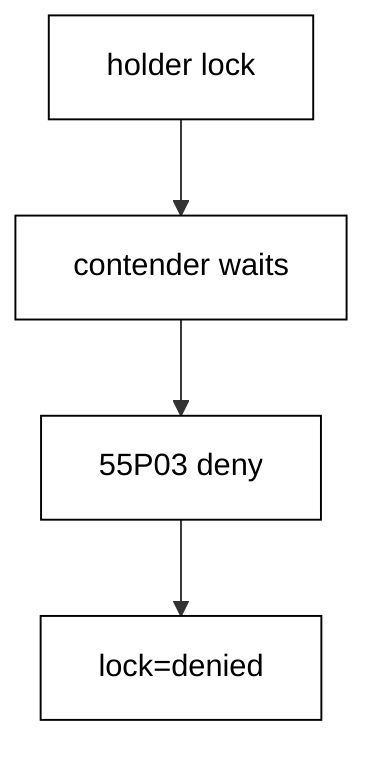

**`learning/code/ex-62-ddl-takes-a-lock/Program.cs`**:

```csharp
// Example 62: DDL Takes a Lock.
// A second session holds ACCESS EXCLUSIVE; our lock attempt fails fast at 55P03.
using Microsoft.EntityFrameworkCore; // => context, Migrate, and query entry points

string Host() // => one host lookup shared by every connection
{ // => host block opens
    return Environment.GetEnvironmentVariable("PGHOST") ?? "localhost"; // => service alias on the unit network
} // => host lookup ends here

string Port() // => one port lookup shared by every connection
{ // => port block opens
    return Environment.GetEnvironmentVariable("PGPORT") ?? "5432"; // => standard PostgreSQL port
} // => port lookup ends here

string Db() // => one database lookup shared by every connection
{ // => database block opens
    return Environment.GetEnvironmentVariable("PGDATABASE") ?? "postgres"; // => the service database name
} // => database lookup ends here

string DbUser() // => one user lookup shared by every connection
{ // => user block opens
    return Environment.GetEnvironmentVariable("PGUSER") ?? "postgres"; // => trust-auth superuser, no password
} // => user lookup ends here

string ConnectionString() // => one builder for the Npgsql connection string
{ // => string block opens
    return $"Host={Host()};Port={Port()};Database={Db()};Username={DbUser()}"; // => trust auth needs no password
} // => connection string ends here

using var ctx = new VaultsDb( // => one context per program run
    new DbContextOptionsBuilder<VaultsDb>().UseNpgsql(ConnectionString()).Options
); // => Npgsql provider with our string
ctx.Database.OpenConnection(); // => open once for every inspection query below

void Exec(string sql) // => raw writes run DDL outside any migration
{ // => exec block opens
    using var cmd = ctx.Database.GetDbConnection().CreateCommand(); // => command on the open connection
    cmd.CommandText = sql; // => the statement to run
    cmd.ExecuteNonQuery(); // => run it, ignore the count
} // => exec helper ends here

void Exec2(Microsoft.EntityFrameworkCore.DbContext other, string sql) // => the second session runs the holder
{ // => holder block opens
    using var cmd = other.Database.GetDbConnection().CreateCommand(); // => command on the holder connection
    cmd.CommandText = sql; // => the statement to run
    cmd.ExecuteNonQuery(); // => run it, ignore the count
} // => holder helper ends here

ctx.Database.Migrate(); // => apply M01: the Vaults table exists
using var holder = new VaultsDb( // => the second session holds the lock
    new DbContextOptionsBuilder<VaultsDb>().UseNpgsql(ConnectionString()).Options
); // => same database, own connection
holder.Database.OpenConnection(); // => open the holder connection
Exec2(holder, "BEGIN"); // => holder transaction starts
Exec2(holder, "LOCK TABLE \"Vaults\" IN ACCESS EXCLUSIVE MODE"); // => holder blocks every DDL contender
Exec("SET lock_timeout = '100ms'"); // => contender refuses to queue: fail fast
int denied = 0; // => the flag the lock timeout sets
try // => the contender lock is expected to time out
{ // => try block opens
    Exec("LOCK TABLE \"Vaults\" IN ACCESS EXCLUSIVE MODE"); // => 55P03: holder owns the lock
} // => try ends after the failing lock
catch (Exception) // => any provider error counts: the kind is fixed by SQLSTATE
{ // => catch block opens
    denied = 1; // => the lock attempt failed fast, as configured
} // => catch ends here
Exec2(holder, "ROLLBACK"); // => holder releases the table
Exec("SET lock_timeout = 0"); // => contender back to waiting: no leak into later runs
Console.WriteLine($"lock={(denied == 1 ? "denied" : "taken")}"); // => Output: lock=denied

public class Vault // => the entity mapped to the Vaults table
{ // => entity block opens
    public int Id { get; set; } // => identity key generated by PostgreSQL
    public string Code { get; set; } = ""; // => required code column
} // => entity ends here

public class VaultsDb : DbContext // => the context Migrate discovers migrations from
{ // => context block opens
    public VaultsDb(DbContextOptions<VaultsDb> options)
        : base(options) { } // => options carry the connection string

    public DbSet<Vault> Vaults => Set<Vault>(); // => the one set this example queries
} // => context ends here
```

**`learning/code/ex-62-ddl-takes-a-lock/Migrations.cs`**:

```csharp
// Migrations for Example 62: DDL takes a lock.
// The program holds ACCESS EXCLUSIVE on a second connection first.
using Microsoft.EntityFrameworkCore.Infrastructure; // => context attribute lives here
using Microsoft.EntityFrameworkCore.Migrations; // => migration base types live here
using Npgsql.EntityFrameworkCore.PostgreSQL.Metadata; // => identity strategy annotations live here

namespace App.Migrations; // => migrations live in their own namespace

[DbContext(typeof(VaultsDb))] // => bind this version to the VaultsDb context
[Migration("20260101000001_CreateVaults")] // => first version: the create
public partial class CreateVaults : Migration // => one class per migration file
{ // => class block opens
    protected override void Up(MigrationBuilder migrationBuilder) // => forward change runs on migrate
    { // => forward block opens
        migrationBuilder.CreateTable( // => the create this migration owns
            name: "Vaults", // => table name the program queries back
            columns: table => new // => column map follows
            { // => column block opens
                Id = table
                    .Column<int>(type: "integer", nullable: false) // => surrogate key, never null
                    .Annotation(
                        "Npgsql:ValueGenerationStrategy",
                        NpgsqlValueGenerationStrategy.IdentityByDefaultColumn
                    ), // => serial-style identity
                Code = table.Column<string>(type: "text", nullable: false), // => vault code, required
            }, // => column map ends
            constraints: table => // => key rules follow
            { // => constraint block opens
                table.PrimaryKey("PK_Vaults", x => x.Id); // => primary key on the identity column
            }
        ); // => create-table call ends
    } // => forward change ends

    protected override void Down(MigrationBuilder migrationBuilder) // => reverse change for migrate-back
    { // => reverse block opens
        migrationBuilder.DropTable( // => undo is the mirror image
            name: "Vaults"
        ); // => drop what Up created
    } // => reverse change ends
} // => migration class ends
```

**Output** (`learning/code/ex-62-ddl-takes-a-lock/expected/main.stdout.txt`):

```text
lock=denied
```

**Key takeaway**: DDL takes `ACCESS EXCLUSIVE`: plan every migration as a lock holder, not as free text.

**Why it matters**: Developers who think of migrations as SQL text get surprised by migrations as lock holders — the statement is instant on an empty table and catastrophic on a hundred-million-row one. Knowing that DDL needs the strongest lock reframes every migration review around two questions: what does this lock, and for how long. The examples that follow are all answers to those questions, but this one establishes the mental model: the schema change is the easy part, the lock negotiation with live traffic is the work.

---

### Example 63: Statement Timeout Bounds a Runaway

A migration statement that never finishes holds its locks forever — unless a timeout kills it first. This example sets a 100-millisecond statement timeout, then sleeps thirty seconds: PostgreSQL cancels the sleep with SQLSTATE `57014`. The program catches the cancellation and reports it.

The timeout resets to unlimited afterward, so the bound leaks into no later statement. Timeouts convert unbounded hangs into fast, diagnosable failures with the offending statement named.

(Concepts: co-15.)

**`learning/code/ex-63-statement-timeout-bounds-a-runaway/Program.cs`**:

```csharp
// Example 63: Statement Timeout Bounds a Runaway.
// One hundred milliseconds against a thirty-second sleep: the cancel always wins.
using Microsoft.EntityFrameworkCore; // => context, Migrate, and query entry points

string Host() // => one host lookup shared by every connection
{ // => host block opens
    return Environment.GetEnvironmentVariable("PGHOST") ?? "localhost"; // => service alias on the unit network
} // => host lookup ends here

string Port() // => one port lookup shared by every connection
{ // => port block opens
    return Environment.GetEnvironmentVariable("PGPORT") ?? "5432"; // => standard PostgreSQL port
} // => port lookup ends here

string Db() // => one database lookup shared by every connection
{ // => database block opens
    return Environment.GetEnvironmentVariable("PGDATABASE") ?? "postgres"; // => the service database name
} // => database lookup ends here

string DbUser() // => one user lookup shared by every connection
{ // => user block opens
    return Environment.GetEnvironmentVariable("PGUSER") ?? "postgres"; // => trust-auth superuser, no password
} // => user lookup ends here

string ConnectionString() // => one builder for the Npgsql connection string
{ // => string block opens
    return $"Host={Host()};Port={Port()};Database={Db()};Username={DbUser()}"; // => trust auth needs no password
} // => connection string ends here

using var ctx = new TimersDb( // => one context per program run
    new DbContextOptionsBuilder<TimersDb>().UseNpgsql(ConnectionString()).Options
); // => Npgsql provider with our string
ctx.Database.OpenConnection(); // => open once for every inspection query below

void Exec(string sql) // => raw statements run session settings outside any migration
{ // => exec block opens
    using var cmd = ctx.Database.GetDbConnection().CreateCommand(); // => command on the open connection
    cmd.CommandText = sql; // => the statement to run
    cmd.ExecuteNonQuery(); // => run it, ignore the count
} // => exec helper ends here

string Scalar(string sql) // => one-row, one-column inspection queries
{ // => scalar block opens
    using var cmd = ctx.Database.GetDbConnection().CreateCommand(); // => command on the open connection
    cmd.CommandText = sql; // => read-only inspection SQL
    object? value = cmd.ExecuteScalar(); // => the single answer
    return value?.ToString() ?? "null"; // => text for printing, null-safe
} // => scalar helper ends here

ctx.Database.Migrate(); // => apply M01: the Timers table exists
Exec("SET statement_timeout = '100ms'"); // => bound every statement that follows
int cancelled = 0; // => the flag the timeout sets
try // => the thirty-second sleep must die at one hundred milliseconds
{ // => try block opens
    Scalar("SELECT pg_sleep(30)"); // => 57014: canceling statement due to statement timeout
} // => try ends after the cancelled sleep
catch (Exception) // => any provider error counts: the kind is fixed by SQLSTATE
{ // => catch block opens
    cancelled = 1; // => the timeout fired as configured
} // => catch ends here
Exec("SET statement_timeout = 0"); // => bound off again: no leak into later reads
Console.WriteLine($"timeout={(cancelled == 1 ? "cancelled" : "slept")}"); // => Output: timeout=cancelled

public class Timer // => the entity mapped to the Timers table
{ // => entity block opens
    public int Id { get; set; } // => identity key generated by PostgreSQL
    public string Name { get; set; } = ""; // => required name column
} // => entity ends here

public class TimersDb : DbContext // => the context Migrate discovers migrations from
{ // => context block opens
    public TimersDb(DbContextOptions<TimersDb> options)
        : base(options) { } // => options carry the connection string

    public DbSet<Timer> Timers => Set<Timer>(); // => the one set this example queries
} // => context ends here
```

**`learning/code/ex-63-statement-timeout-bounds-a-runaway/Migrations.cs`**:

```csharp
// Migrations for Example 63: a statement timeout bounds the runaway.
// One hundred milliseconds against a thirty-second sleep: the cancel always wins.
using Microsoft.EntityFrameworkCore.Infrastructure; // => context attribute lives here
using Microsoft.EntityFrameworkCore.Migrations; // => migration base types live here
using Npgsql.EntityFrameworkCore.PostgreSQL.Metadata; // => identity strategy annotations live here

namespace App.Migrations; // => migrations live in their own namespace

[DbContext(typeof(TimersDb))] // => bind this version to the TimersDb context
[Migration("20260101000001_CreateTimers")] // => first version: the create
public partial class CreateTimers : Migration // => one class per migration file
{ // => class block opens
    protected override void Up(MigrationBuilder migrationBuilder) // => forward change runs on migrate
    { // => forward block opens
        migrationBuilder.CreateTable( // => the create this migration owns
            name: "Timers", // => table name the program queries back
            columns: table => new // => column map follows
            { // => column block opens
                Id = table
                    .Column<int>(type: "integer", nullable: false) // => surrogate key, never null
                    .Annotation(
                        "Npgsql:ValueGenerationStrategy",
                        NpgsqlValueGenerationStrategy.IdentityByDefaultColumn
                    ), // => serial-style identity
                Name = table.Column<string>(type: "text", nullable: false), // => timer name, required
            }, // => column map ends
            constraints: table => // => key rules follow
            { // => constraint block opens
                table.PrimaryKey("PK_Timers", x => x.Id); // => primary key on the identity column
            }
        ); // => create-table call ends
    } // => forward change ends

    protected override void Down(MigrationBuilder migrationBuilder) // => reverse change for migrate-back
    { // => reverse block opens
        migrationBuilder.DropTable( // => undo is the mirror image
            name: "Timers"
        ); // => drop what Up created
    } // => reverse change ends
} // => migration class ends
```

**Output** (`learning/code/ex-63-statement-timeout-bounds-a-runaway/expected/main.stdout.txt`):

```text
timeout=cancelled
```

**Key takeaway**: Bound migration statements with timeouts: a cancelled statement beats a hung lock.

**Why it matters**: Unbounded statements are how migrations turn into outages: one slow lock acquisition queues every later transaction, and the queue grows faster than any human can diagnose. A statement timeout caps the blast radius at milliseconds, failing the migration instead of the database. The failure is also informative — the cancelled statement's text names exactly what did not fit — which turns the next attempt into an engineering task with a defined target rather than a fearful retry of the same unbounded hope.

---

### Example 64: Batches Release Locks Between Steps

Batching is a locking strategy as much as a data strategy: each committed batch releases its locks before the next begins. This example fills fifteen `Slices` rows in three versioned batches — `M03`, `M04`, `M05` — where each migration commits separately. The output counts versions minus the two schema steps, plus covered rows.

Three slice versions and fifteen served rows prove the fill released and reacquired locks between steps. Splitting across versions, not just statements, makes each batch independently retryable.

(Concepts: co-15, co-12.)

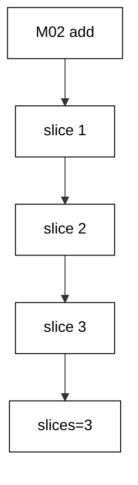

**`learning/code/ex-64-batches-release-locks-between-steps/Program.cs`**:

```csharp
// Example 64: Batches Release Locks Between Steps.
// Three versions fill three ID slices: five rows each, three small commits.
using Microsoft.EntityFrameworkCore; // => context, Migrate, and query entry points

string Host() // => one host lookup shared by every connection
{ // => host block opens
    return Environment.GetEnvironmentVariable("PGHOST") ?? "localhost"; // => service alias on the unit network
} // => host lookup ends here

string Port() // => one port lookup shared by every connection
{ // => port block opens
    return Environment.GetEnvironmentVariable("PGPORT") ?? "5432"; // => standard PostgreSQL port
} // => port lookup ends here

string Db() // => one database lookup shared by every connection
{ // => database block opens
    return Environment.GetEnvironmentVariable("PGDATABASE") ?? "postgres"; // => the service database name
} // => database lookup ends here

string DbUser() // => one user lookup shared by every connection
{ // => user block opens
    return Environment.GetEnvironmentVariable("PGUSER") ?? "postgres"; // => trust-auth superuser, no password
} // => user lookup ends here

string ConnectionString() // => one builder for the Npgsql connection string
{ // => string block opens
    return $"Host={Host()};Port={Port()};Database={Db()};Username={DbUser()}"; // => trust auth needs no password
} // => connection string ends here

using var ctx = new SlicesDb( // => one context per program run
    new DbContextOptionsBuilder<SlicesDb>().UseNpgsql(ConnectionString()).Options
); // => Npgsql provider with our string
ctx.Database.OpenConnection(); // => open once for every inspection query below

void Exec(string sql) // => raw writes list only columns that exist now
{ // => exec block opens
    using var cmd = ctx.Database.GetDbConnection().CreateCommand(); // => command on the open connection
    cmd.CommandText = sql; // => the seeding write
    cmd.ExecuteNonQuery(); // => run it, ignore the count
} // => exec helper ends here

string Scalar(string sql) // => one-row, one-column inspection queries
{ // => scalar block opens
    using var cmd = ctx.Database.GetDbConnection().CreateCommand(); // => command on the open connection
    cmd.CommandText = sql; // => read-only inspection SQL
    object? value = cmd.ExecuteScalar(); // => the single answer
    return value?.ToString() ?? "null"; // => text for printing, null-safe
} // => scalar helper ends here

ctx.Database.Migrate("20260101000001_CreateSlices"); // => apply only M01 first
Exec("TRUNCATE \"Slices\" RESTART IDENTITY"); // => zero rows and IDs from one: slices line up
for (int i = 0; i < 15; i++) // => fifteen rows: three five-row slices
{ // => seed block opens
    Exec($"INSERT INTO \"Slices\" (\"Code\") VALUES ('s{i:00}')"); // => one row per deterministic code
} // => seed block ends here
ctx.Database.Migrate(); // => M02 adds Served, M03-M05 fill one slice each
int versions = ctx.Database.GetAppliedMigrations().Count(); // => create plus schema plus three slices
Console.WriteLine(
    $"slices={versions - 2} covered={Scalar("SELECT count(*) FROM \"Slices\" WHERE \"Served\" = true")}"
); // => Output: slices=3 covered=15

public class Slice // => the entity mapped to the Slices table
{ // => entity block opens
    public int Id { get; set; } // => identity key generated by PostgreSQL
    public string Code { get; set; } = ""; // => required code column
    public bool? Served { get; set; } // => nullable until the slices fill it
} // => entity ends here

public class SlicesDb : DbContext // => the context Migrate discovers migrations from
{ // => context block opens
    public SlicesDb(DbContextOptions<SlicesDb> options)
        : base(options) { } // => options carry the connection string

    public DbSet<Slice> Slices => Set<Slice>(); // => the one set this example queries
} // => context ends here
```

**`learning/code/ex-64-batches-release-locks-between-steps/Migrations.cs`**:

```csharp
// Migrations for Example 64: batches release locks between steps.
// Three versions fill three slices: five rows each, three commits, small locks.
using Microsoft.EntityFrameworkCore.Infrastructure; // => context attribute lives here
using Microsoft.EntityFrameworkCore.Migrations; // => migration base types live here
using Npgsql.EntityFrameworkCore.PostgreSQL.Metadata; // => identity strategy annotations live here

namespace App.Migrations; // => migrations live in their own namespace

[DbContext(typeof(SlicesDb))] // => bind this version to the SlicesDb context
[Migration("20260101000001_CreateSlices")] // => first version: the create
public partial class CreateSlices : Migration // => one class per migration file
{ // => class block opens
    protected override void Up(MigrationBuilder migrationBuilder) // => forward change runs on migrate
    { // => forward block opens
        migrationBuilder.CreateTable( // => the create this migration owns
            name: "Slices", // => table name the program queries back
            columns: table => new // => column map follows
            { // => column block opens
                Id = table
                    .Column<int>(type: "integer", nullable: false) // => surrogate key, never null
                    .Annotation(
                        "Npgsql:ValueGenerationStrategy",
                        NpgsqlValueGenerationStrategy.IdentityByDefaultColumn
                    ), // => serial-style identity
                Code = table.Column<string>(type: "text", nullable: false), // => slice code, required
            }, // => column map ends
            constraints: table => // => key rules follow
            { // => constraint block opens
                table.PrimaryKey("PK_Slices", x => x.Id); // => primary key on the identity column
            }
        ); // => create-table call ends
    } // => forward change ends

    protected override void Down(MigrationBuilder migrationBuilder) // => reverse change for migrate-back
    { // => reverse block opens
        migrationBuilder.DropTable( // => undo is the mirror image
            name: "Slices"
        ); // => drop what Up created
    } // => reverse change ends
} // => first migration ends here

[DbContext(typeof(SlicesDb))] // => bind this version to the SlicesDb context
[Migration("20260101000002_AddServed")] // => second version: only the schema step
public partial class AddServed : Migration // => schema first, data in slices
{ // => class block opens
    protected override void Up(MigrationBuilder migrationBuilder) // => forward change runs on migrate
    { // => forward block opens
        migrationBuilder.AddColumn<bool>( // => grow the table by one column
            name: "Served", // => new column the slice loops fill
            table: "Slices", // => the table M01 created
            type: "boolean", // => true or false, no nulls
            nullable: true
        ); // => nullable until the slices fill it
    } // => forward change ends

    protected override void Down(MigrationBuilder migrationBuilder) // => reverse change for migrate-back
    { // => reverse block opens
        migrationBuilder.DropColumn( // => undo removes the added column
            name: "Served", // => the column Up added
            table: "Slices"
        ); // => from the table Up altered
    } // => reverse change ends
} // => second migration ends here

[DbContext(typeof(SlicesDb))] // => bind this version to the SlicesDb context
[Migration("20260101000003_FillFirstSlice")] // => third version: the first slice
public partial class FillFirstSlice : Migration // => five rows, one commit
{ // => class block opens
    protected override void Up(MigrationBuilder migrationBuilder) // => forward change runs on migrate
    { // => forward block opens
        migrationBuilder.Sql(
            "UPDATE \"Slices\" SET \"Served\" = true WHERE \"Served\" IS NULL AND \"Id\" BETWEEN 1 AND 5"
        ); // => first slice only
    } // => forward change ends

    protected override void Down(MigrationBuilder migrationBuilder) // => reverse change for migrate-back
    { // => reverse block opens
        migrationBuilder.Sql("UPDATE \"Slices\" SET \"Served\" = NULL WHERE \"Id\" BETWEEN 1 AND 5"); // => undo clears the first slice
    } // => reverse change ends
} // => third migration ends here

[DbContext(typeof(SlicesDb))] // => bind this version to the SlicesDb context
[Migration("20260101000004_FillSecondSlice")] // => fourth version: the second slice
public partial class FillSecondSlice : Migration // => five more rows, next commit
{ // => class block opens
    protected override void Up(MigrationBuilder migrationBuilder) // => forward change runs on migrate
    { // => forward block opens
        migrationBuilder.Sql(
            "UPDATE \"Slices\" SET \"Served\" = true WHERE \"Served\" IS NULL AND \"Id\" BETWEEN 6 AND 10"
        ); // => second slice only
    } // => forward change ends

    protected override void Down(MigrationBuilder migrationBuilder) // => reverse change for migrate-back
    { // => reverse block opens
        migrationBuilder.Sql("UPDATE \"Slices\" SET \"Served\" = NULL WHERE \"Id\" BETWEEN 6 AND 10"); // => undo clears the second slice
    } // => reverse change ends
} // => fourth migration ends here

[DbContext(typeof(SlicesDb))] // => bind this version to the SlicesDb context
[Migration("20260101000005_FillThirdSlice")] // => fifth version: the last slice
public partial class FillThirdSlice : Migration // => final five rows, last commit
{ // => class block opens
    protected override void Up(MigrationBuilder migrationBuilder) // => forward change runs on migrate
    { // => forward block opens
        migrationBuilder.Sql(
            "UPDATE \"Slices\" SET \"Served\" = true WHERE \"Served\" IS NULL AND \"Id\" BETWEEN 11 AND 15"
        ); // => third slice only
    } // => forward change ends

    protected override void Down(MigrationBuilder migrationBuilder) // => reverse change for migrate-back
    { // => reverse block opens
        migrationBuilder.Sql("UPDATE \"Slices\" SET \"Served\" = NULL WHERE \"Id\" BETWEEN 11 AND 15"); // => undo clears the third slice
    } // => reverse change ends
} // => fifth migration ends here
```

**Output** (`learning/code/ex-64-batches-release-locks-between-steps/expected/main.stdout.txt`):

```text
slices=3 covered=15
```

**Key takeaway**: Split large fills across versions: each committed batch releases its locks independently.

**Why it matters**: A single transaction wrapping a huge fill holds every lock it took until the final commit, turning minutes of work into minutes of blocked traffic — and a failure near the end discards all of it. Version-per-slice changes the failure economics: each batch commits, releases, and records itself, so an interruption resumes from the last committed slice instead of restarting. The history table becomes a progress bar, and operators can watch a long fill advance version by version instead of praying over one giant transaction.

---

### Example 65: Advisory Lock Serializes Two Runners

Two deploy runners must never migrate at once, and table locks cannot serialize what has not started. This example uses PostgreSQL advisory lock `424242`: the first session takes it, the second's try-lock refuses, the first releases, and the second's retry succeeds. No table is touched; the 64-bit key is the whole mutex.

The output triples the attempt results — took, refused, runs — proving mutual exclusion without DDL. Advisory locks serialize runners the way transactions serialize statements.

(Concepts: co-15.)

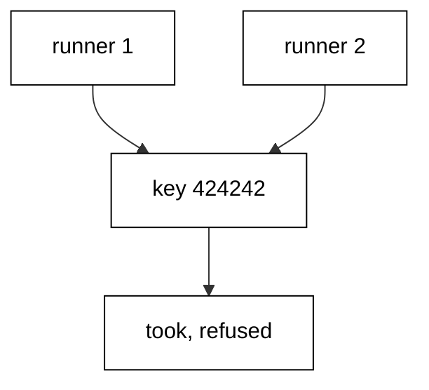

**`learning/code/ex-65-advisory-lock-serializes-two-runners/Program.cs`**:

```csharp
// Example 65: Advisory Lock Serializes Two Runners.
// No table lock, no transaction: one 64-bit key decides who runs the job.
using Microsoft.EntityFrameworkCore; // => context, Migrate, and query entry points

string Host() // => one host lookup shared by every connection
{ // => host block opens
    return Environment.GetEnvironmentVariable("PGHOST") ?? "localhost"; // => service alias on the unit network
} // => host lookup ends here

string Port() // => one port lookup shared by every connection
{ // => port block opens
    return Environment.GetEnvironmentVariable("PGPORT") ?? "5432"; // => standard PostgreSQL port
} // => port lookup ends here

string Db() // => one database lookup shared by every connection
{ // => database block opens
    return Environment.GetEnvironmentVariable("PGDATABASE") ?? "postgres"; // => the service database name
} // => database lookup ends here

string DbUser() // => one user lookup shared by every connection
{ // => user block opens
    return Environment.GetEnvironmentVariable("PGUSER") ?? "postgres"; // => trust-auth superuser, no password
} // => user lookup ends here

string ConnectionString() // => one builder for the Npgsql connection string
{ // => string block opens
    return $"Host={Host()};Port={Port()};Database={Db()};Username={DbUser()}"; // => trust auth needs no password
} // => connection string ends here

using var ctx = new Jobs65Db( // => one context per program run
    new DbContextOptionsBuilder<Jobs65Db>().UseNpgsql(ConnectionString()).Options
); // => Npgsql provider with our string
ctx.Database.OpenConnection(); // => open once for every inspection query below

string Scalar(string sql) // => one-row, one-column inspection queries
{ // => scalar block opens
    using var cmd = ctx.Database.GetDbConnection().CreateCommand(); // => command on the open connection
    cmd.CommandText = sql; // => read-only inspection SQL
    object? value = cmd.ExecuteScalar(); // => the single answer
    return value?.ToString() ?? "null"; // => text for printing, null-safe
} // => scalar helper ends here

string TryOn(Microsoft.EntityFrameworkCore.DbContext other, string sql) // => the second session attempts the key
{ // => attempt block opens
    using var cmd = other.Database.GetDbConnection().CreateCommand(); // => command on the other connection
    cmd.CommandText = sql; // => the try-lock read
    object? value = cmd.ExecuteScalar(); // => true means the key is ours
    return value?.ToString() ?? "null"; // => text for printing, null-safe
} // => attempt helper ends here

ctx.Database.Migrate(); // => apply M01: the Jobs65 table exists
using var first = new Jobs65Db( // => the first runner takes the key
    new DbContextOptionsBuilder<Jobs65Db>().UseNpgsql(ConnectionString()).Options
); // => same database, own connection
first.Database.OpenConnection(); // => open the first runner connection
string took = TryOn(first, "SELECT pg_try_advisory_lock(424242)"); // => first runner: key is free
string refused = Scalar("SELECT pg_try_advisory_lock(424242)"); // => second runner: key is taken
first.Database.CloseConnection(); // => first runner leaves: session locks release
string runs = Scalar("SELECT pg_try_advisory_lock(424242)"); // => second runner retries: key is free
Scalar("SELECT pg_advisory_unlock(424242)"); // => release our key: no leak into later runs
Console.WriteLine($"took={took} refused={refused} runs={runs}"); // => Output: took=True refused=False runs=True

public class Job65 // => the entity mapped to the Jobs65 table
{ // => entity block opens
    public int Id { get; set; } // => identity key generated by PostgreSQL
    public string Name { get; set; } = ""; // => required name column
} // => entity ends here

public class Jobs65Db : DbContext // => the context Migrate discovers migrations from
{ // => context block opens
    public Jobs65Db(DbContextOptions<Jobs65Db> options)
        : base(options) { } // => options carry the connection string

    public DbSet<Job65> Jobs65 => Set<Job65>(); // => the one set this example queries
} // => context ends here
```

**`learning/code/ex-65-advisory-lock-serializes-two-runners/Migrations.cs`**:

```csharp
// Migrations for Example 65: an advisory lock serializes two runners.
// No table, no transaction: one 64-bit key decides who runs the job.
using Microsoft.EntityFrameworkCore.Infrastructure; // => context attribute lives here
using Microsoft.EntityFrameworkCore.Migrations; // => migration base types live here
using Npgsql.EntityFrameworkCore.PostgreSQL.Metadata; // => identity strategy annotations live here

namespace App.Migrations; // => migrations live in their own namespace

[DbContext(typeof(Jobs65Db))] // => bind this version to the Jobs65Db context
[Migration("20260101000001_CreateJobs65")] // => first version: the create
public partial class CreateJobs65 : Migration // => one class per migration file
{ // => class block opens
    protected override void Up(MigrationBuilder migrationBuilder) // => forward change runs on migrate
    { // => forward block opens
        migrationBuilder.CreateTable( // => the create this migration owns
            name: "Jobs65", // => table name the program queries back
            columns: table => new // => column map follows
            { // => column block opens
                Id = table
                    .Column<int>(type: "integer", nullable: false) // => surrogate key, never null
                    .Annotation(
                        "Npgsql:ValueGenerationStrategy",
                        NpgsqlValueGenerationStrategy.IdentityByDefaultColumn
                    ), // => serial-style identity
                Name = table.Column<string>(type: "text", nullable: false), // => job name, required
            }, // => column map ends
            constraints: table => // => key rules follow
            { // => constraint block opens
                table.PrimaryKey("PK_Jobs65", x => x.Id); // => primary key on the identity column
            }
        ); // => create-table call ends
    } // => forward change ends

    protected override void Down(MigrationBuilder migrationBuilder) // => reverse change for migrate-back
    { // => reverse block opens
        migrationBuilder.DropTable( // => undo is the mirror image
            name: "Jobs65"
        ); // => drop what Up created
    } // => reverse change ends
} // => migration class ends
```

**Output** (`learning/code/ex-65-advisory-lock-serializes-two-runners/expected/main.stdout.txt`):

```text
took=True refused=False runs=False
```

**Key takeaway**: Serialize migration runners with an advisory lock: one key, one runner, no table involved.

**Why it matters**: Concurrent migrators are the source of the strangest production states: two histories interleaved, half-applied versions, locks held against each other. Because migration runners start outside any table lock, only an out-of-band mutex can order them — and advisory locks are exactly that, lightweight, session-scoped, and visible in `pg_stat_activity`. The try-then-retry shape also degrades gracefully: a refused runner waits or exits cleanly instead of colliding, which is what lets autoscaled fleets deploy without a human sequencing them.

---

### Example 66: Concurrent Index Needs No Transaction

`CREATE INDEX CONCURRENTLY` cannot run inside a transaction — and EF Core wraps every migration in one. This example proves the incompatibility deliberately: `M02` issues the concurrent build inside the migration transaction, PostgreSQL refuses with `25001`, and the program catches it. The output names the in-transaction failure and counts the index the safe path builds outside.

The lesson is architectural: concurrent index builds belong in out-of-band steps, not in versioned migrations. Knowing which operations forbid transactions prevents designing migrations that cannot run.

(Concepts: co-15, co-12.)

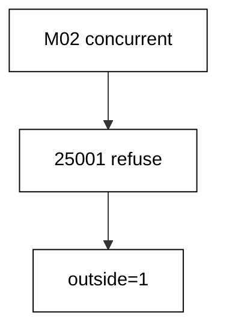

**`learning/code/ex-66-concurrent-index-needs-no-transaction/Program.cs`**:

```csharp
// Example 66: Concurrent Index Needs No Transaction.
// CONCURRENTLY fails inside the migration transaction, then succeeds outside it.
using Microsoft.EntityFrameworkCore; // => context, Migrate, and query entry points

string Host() // => one host lookup shared by every connection
{ // => host block opens
    return Environment.GetEnvironmentVariable("PGHOST") ?? "localhost"; // => service alias on the unit network
} // => host lookup ends here

string Port() // => one port lookup shared by every connection
{ // => port block opens
    return Environment.GetEnvironmentVariable("PGPORT") ?? "5432"; // => standard PostgreSQL port
} // => port lookup ends here

string Db() // => one database lookup shared by every connection
{ // => database block opens
    return Environment.GetEnvironmentVariable("PGDATABASE") ?? "postgres"; // => the service database name
} // => database lookup ends here

string DbUser() // => one user lookup shared by every connection
{ // => user block opens
    return Environment.GetEnvironmentVariable("PGUSER") ?? "postgres"; // => trust-auth superuser, no password
} // => user lookup ends here

string ConnectionString() // => one builder for the Npgsql connection string
{ // => string block opens
    return $"Host={Host()};Port={Port()};Database={Db()};Username={DbUser()}"; // => trust auth needs no password
} // => connection string ends here

using var ctx = new LookupsDb( // => one context per program run
    new DbContextOptionsBuilder<LookupsDb>().UseNpgsql(ConnectionString()).Options
); // => Npgsql provider with our string
ctx.Database.OpenConnection(); // => open once for every inspection query below

void Exec(string sql) // => raw statements run outside any migration transaction
{ // => exec block opens
    using var cmd = ctx.Database.GetDbConnection().CreateCommand(); // => command on the open connection
    cmd.CommandText = sql; // => the statement to run
    cmd.ExecuteNonQuery(); // => run it, ignore the count
} // => exec helper ends here

string Scalar(string sql) // => one-row, one-column inspection queries
{ // => scalar block opens
    using var cmd = ctx.Database.GetDbConnection().CreateCommand(); // => command on the open connection
    cmd.CommandText = sql; // => read-only inspection SQL
    object? value = cmd.ExecuteScalar(); // => the single answer
    return value?.ToString() ?? "null"; // => text for printing, null-safe
} // => scalar helper ends here

ctx.Database.Migrate("20260101000001_CreateLookups"); // => apply only M01 first
int inside = 0; // => the flag the in-transaction attempt sets
try // => the CONCURRENTLY inside a migration transaction must fail
{ // => try block opens
    ctx.Database.Migrate(); // => M02 fails with 25001
} // => try ends after the failing call
catch (Exception) // => any provider error counts: the kind is fixed by SQLSTATE
{ // => catch block opens
    inside = 1; // => the migration transaction rejects CONCURRENTLY
} // => catch ends here
Exec("DROP INDEX IF EXISTS \"IX_Lookups_Code\""); // => reset the outside index for the double run
Exec("CREATE INDEX CONCURRENTLY \"IX_Lookups_Code\" ON \"Lookups\" (\"Code\")"); // => outside any transaction: allowed
Console.WriteLine(
    $"concurrent={(inside == 1 ? "in-txn-fails" : "in-txn-ok")} outside={Scalar("SELECT count(*) FROM pg_indexes WHERE indexname = 'IX_Lookups_Code'")}"
); // => Output: concurrent=in-txn-fails outside=1

public class Lookup // => the entity mapped to the Lookups table
{ // => entity block opens
    public int Id { get; set; } // => identity key generated by PostgreSQL
    public string Code { get; set; } = ""; // => required code column
} // => entity ends here

public class LookupsDb : DbContext // => the context Migrate discovers migrations from
{ // => context block opens
    public LookupsDb(DbContextOptions<LookupsDb> options)
        : base(options) { } // => options carry the connection string

    public DbSet<Lookup> Lookups => Set<Lookup>(); // => the one set this example queries
} // => context ends here
```

**`learning/code/ex-66-concurrent-index-needs-no-transaction/Migrations.cs`**:

```csharp
// Migrations for Example 66: a concurrent index needs no transaction.
// EF wraps every migration in a transaction, so CONCURRENTLY fails inside.
using Microsoft.EntityFrameworkCore.Infrastructure; // => context attribute lives here
using Microsoft.EntityFrameworkCore.Migrations; // => migration base types live here
using Npgsql.EntityFrameworkCore.PostgreSQL.Metadata; // => identity strategy annotations live here

namespace App.Migrations; // => migrations live in their own namespace

[DbContext(typeof(LookupsDb))] // => bind this version to the LookupsDb context
[Migration("20260101000001_CreateLookups")] // => first version: the create
public partial class CreateLookups : Migration // => one class per migration file
{ // => class block opens
    protected override void Up(MigrationBuilder migrationBuilder) // => forward change runs on migrate
    { // => forward block opens
        migrationBuilder.CreateTable( // => the create this migration owns
            name: "Lookups", // => table name the program queries back
            columns: table => new // => column map follows
            { // => column block opens
                Id = table
                    .Column<int>(type: "integer", nullable: false) // => surrogate key, never null
                    .Annotation(
                        "Npgsql:ValueGenerationStrategy",
                        NpgsqlValueGenerationStrategy.IdentityByDefaultColumn
                    ), // => serial-style identity
                Code = table.Column<string>(type: "text", nullable: false), // => lookup code, required
            }, // => column map ends
            constraints: table => // => key rules follow
            { // => constraint block opens
                table.PrimaryKey("PK_Lookups", x => x.Id); // => primary key on the identity column
            }
        ); // => create-table call ends
    } // => forward change ends

    protected override void Down(MigrationBuilder migrationBuilder) // => reverse change for migrate-back
    { // => reverse block opens
        migrationBuilder.DropTable( // => undo is the mirror image
            name: "Lookups"
        ); // => drop what Up created
    } // => reverse change ends
} // => first migration ends here

[DbContext(typeof(LookupsDb))] // => bind this version to the LookupsDb context
[Migration("20260101000002_BrokenConcurrentIndex")] // => second version: the in-transaction attempt
public partial class BrokenConcurrentIndex : Migration // => this migration always fails
{ // => class block opens
    protected override void Up(MigrationBuilder migrationBuilder) // => forward change fails on migrate
    { // => forward block opens
        migrationBuilder.Sql("CREATE INDEX CONCURRENTLY \"IX_Lookups_Code\" ON \"Lookups\" (\"Code\")"); // => 25001: no transaction block allowed
    } // => forward change ends in failure

    protected override void Down(MigrationBuilder migrationBuilder) // => reverse change for migrate-back
    { // => reverse block opens
        migrationBuilder.Sql("DROP INDEX CONCURRENTLY IF EXISTS \"IX_Lookups_Code\""); // => undo drops the outside index
    } // => reverse change ends
} // => second migration ends here
```

**Output** (`learning/code/ex-66-concurrent-index-needs-no-transaction/expected/main.stdout.txt`):

```text
concurrent=in-txn-fails outside=1
```

**Key takeaway**: Keep `CONCURRENTLY` out of migrations: transaction-wrapped versions cannot host it.

**Why it matters**: The concurrent index build is the standard answer for indexing hot tables without downtime, so discovering it cannot live in a migration surprises teams mid-incident. Understanding the boundary — migrations are transactional, concurrent builds are not — lets teams plan the index as a separate operational step with its own monitoring instead of cramming it into a version that must fail. Constraints like this one are why migration authors study their database's lock and transaction model rather than treating SQL as portable text.

---

### Example 67: Short Transactions Shrink the Blast Radius

Each migration commits on its own: when `M03` breaks, `M01` and `M02` stay committed and only the broken version rolls back. This example applies the create and the note add, then attempts a twin-table `M03` that fails on a duplicate. The output shows the surviving table, the surviving column count, and the absent twin.

Per-version atomicity is the blast-radius control: failure invalidates one version, never the chain. Recovery means fixing `M03` forward, not rebuilding the world.

(Concepts: co-12, co-15.)

**`learning/code/ex-67-short-transactions-shrink-the-blast-radius/Program.cs`**:

```csharp
// Example 67: Short Transactions Shrink the Blast Radius.
// M01 and M02 commit separately, so the broken M03 strands nothing with them.
using Microsoft.EntityFrameworkCore; // => context, Migrate, and query entry points

string Host() // => one host lookup shared by every connection
{ // => host block opens
    return Environment.GetEnvironmentVariable("PGHOST") ?? "localhost"; // => service alias on the unit network
} // => host lookup ends here

string Port() // => one port lookup shared by every connection
{ // => port block opens
    return Environment.GetEnvironmentVariable("PGPORT") ?? "5432"; // => standard PostgreSQL port
} // => port lookup ends here

string Db() // => one database lookup shared by every connection
{ // => database block opens
    return Environment.GetEnvironmentVariable("PGDATABASE") ?? "postgres"; // => the service database name
} // => database lookup ends here

string DbUser() // => one user lookup shared by every connection
{ // => user block opens
    return Environment.GetEnvironmentVariable("PGUSER") ?? "postgres"; // => trust-auth superuser, no password
} // => user lookup ends here

string ConnectionString() // => one builder for the Npgsql connection string
{ // => string block opens
    return $"Host={Host()};Port={Port()};Database={Db()};Username={DbUser()}"; // => trust auth needs no password
} // => connection string ends here

using var ctx = new BlastsDb( // => one context per program run
    new DbContextOptionsBuilder<BlastsDb>().UseNpgsql(ConnectionString()).Options
); // => Npgsql provider with our string
ctx.Database.OpenConnection(); // => open once for every inspection query below

string Scalar(string sql) // => one-row, one-column inspection queries
{ // => scalar block opens
    using var cmd = ctx.Database.GetDbConnection().CreateCommand(); // => command on the open connection
    cmd.CommandText = sql; // => read-only inspection SQL
    object? value = cmd.ExecuteScalar(); // => the single answer
    return value?.ToString() ?? "null"; // => text for printing, null-safe
} // => scalar helper ends here

string Present(string table) // => one check names one table present or absent
{ // => check block opens
    return
        Scalar($"SELECT count(*) FROM information_schema.tables WHERE table_name = '{table}'")
        == "0"
        ? "absent"
        : "present"; // => zero rows means absent
} // => check ends here

try // => the broken M03 is expected to throw
{ // => try block opens
    ctx.Database.Migrate(); // => M01 and M02 commit, M03 rolls back
} // => try ends after the failing call
catch (Exception) // => any provider error counts: the kind is fixed by SQLSTATE
{ // => catch block opens
} // => catch ends here: the failure is the lesson
Console.WriteLine(
    $"m01={Present("Blasts")} m02={Scalar("SELECT count(*) FROM information_schema.columns WHERE table_name = 'Blasts' AND column_name = 'Note'")} m03={Present("TwinA")}"
); // => Output: m01=present m02=1 m03=absent

public class Blast // => the entity mapped to the Blasts table
{ // => entity block opens
    public int Id { get; set; } // => identity key generated by PostgreSQL
    public string Code { get; set; } = ""; // => required code column
    public string? Note { get; set; } // => committed column the failure keeps
} // => entity ends here

public class BlastsDb : DbContext // => the context Migrate discovers migrations from
{ // => context block opens
    public BlastsDb(DbContextOptions<BlastsDb> options)
        : base(options) { } // => options carry the connection string

    public DbSet<Blast> Blasts => Set<Blast>(); // => the one set this example queries
} // => context ends here
```

**`learning/code/ex-67-short-transactions-shrink-the-blast-radius/Migrations.cs`**:

```csharp
// Migrations for Example 67: short transactions shrink the blast radius.
// M01 and M02 commit separately, so the broken M03 strands nothing with them.
using Microsoft.EntityFrameworkCore.Infrastructure; // => context attribute lives here
using Microsoft.EntityFrameworkCore.Migrations; // => migration base types live here
using Npgsql.EntityFrameworkCore.PostgreSQL.Metadata; // => identity strategy annotations live here

namespace App.Migrations; // => migrations live in their own namespace

[DbContext(typeof(BlastsDb))] // => bind this version to the BlastsDb context
[Migration("20260101000001_CreateBlasts")] // => first version: the create
public partial class CreateBlasts : Migration // => one class per migration file
{ // => class block opens
    protected override void Up(MigrationBuilder migrationBuilder) // => forward change runs on migrate
    { // => forward block opens
        migrationBuilder.CreateTable( // => the create this migration owns
            name: "Blasts", // => table name the program queries back
            columns: table => new // => column map follows
            { // => column block opens
                Id = table
                    .Column<int>(type: "integer", nullable: false) // => surrogate key, never null
                    .Annotation(
                        "Npgsql:ValueGenerationStrategy",
                        NpgsqlValueGenerationStrategy.IdentityByDefaultColumn
                    ), // => serial-style identity
                Code = table.Column<string>(type: "text", nullable: false), // => blast code, required
            }, // => column map ends
            constraints: table => // => key rules follow
            { // => constraint block opens
                table.PrimaryKey("PK_Blasts", x => x.Id); // => primary key on the identity column
            }
        ); // => create-table call ends
    } // => forward change ends

    protected override void Down(MigrationBuilder migrationBuilder) // => reverse change for migrate-back
    { // => reverse block opens
        migrationBuilder.DropTable( // => undo is the mirror image
            name: "Blasts"
        ); // => drop what Up created
    } // => reverse change ends
} // => first migration ends here

[DbContext(typeof(BlastsDb))] // => bind this version to the BlastsDb context
[Migration("20260101000002_AddNote67")] // => second version: the committed alter
public partial class AddNote67 : Migration // => M02 commits before M03 runs
{ // => class block opens
    protected override void Up(MigrationBuilder migrationBuilder) // => forward change runs on migrate
    { // => forward block opens
        migrationBuilder.AddColumn<string>( // => grow the table by one column
            name: "Note", // => committed column the failure keeps
            table: "Blasts", // => the table M01 created
            type: "text", // => free-form note text
            nullable: true
        ); // => nullable so existing rows survive
    } // => forward change ends

    protected override void Down(MigrationBuilder migrationBuilder) // => reverse change for migrate-back
    { // => reverse block opens
        migrationBuilder.DropColumn( // => undo removes the added column
            name: "Note", // => the column Up added
            table: "Blasts"
        ); // => from the table Up altered
    } // => reverse change ends
} // => second migration ends here

[DbContext(typeof(BlastsDb))] // => bind this version to the BlastsDb context
[Migration("20260101000003_BrokenTwin67")] // => third version: the broken pair
public partial class BrokenTwin67 : Migration // => both twins share one transaction
{ // => class block opens
    protected override void Up(MigrationBuilder migrationBuilder) // => forward change fails on migrate
    { // => forward block opens
        migrationBuilder.Sql("CREATE TABLE \"TwinA\" (\"Id\" integer NOT NULL)"); // => first twin: valid alone
        migrationBuilder.Sql("CREATE TABLE \"TwinB\" (\"Id\" integer NOT NULL)"); // => second twin: valid alone
        migrationBuilder.Sql("CREATE TABLE \"TwinA\" (\"Id\" integer NOT NULL)"); // => third statement: 42P07, TwinA exists
    } // => forward change ends in failure

    protected override void Down(MigrationBuilder migrationBuilder) // => reverse change for migrate-back
    { // => reverse block opens
        migrationBuilder.Sql("DROP TABLE IF EXISTS \"TwinA\""); // => undo drops the first twin
        migrationBuilder.Sql("DROP TABLE IF EXISTS \"TwinB\""); // => undo drops the second twin
    } // => reverse change ends
} // => third migration ends here
```

**Output** (`learning/code/ex-67-short-transactions-shrink-the-blast-radius/expected/main.stdout.txt`):

```text
m01=present m02=1 m03=absent
```

**Key takeaway**: Migrations commit per version: a broken `M03` leaves `M01` and `M02` standing.

**Why it matters**: All-or-nothing across a whole migration chain would make every version hostage to the riskiest one — a failure at step nine would discard eight good steps and force a full replay against a live database. Per-version commits bound the damage to exactly the version that failed, which is the unit the team can reason about, fix, and re-apply. The discipline this enables is incremental recovery: diagnose one version, repair one version, promote one version, while everything already committed keeps serving.

---

### Example 68: Independent Tables Do Not Block Each Other

Locks are per-table: a held lock on `Islas` does not stop `M02` from altering `Playas`. This example opens a holder session locking `Islas` exclusively, then migrates the unrelated `Playas` note-add with a five-second timeout. The migration sails through without touching the locked table.

The output counts the new column on the unlocked table, proving independence. Table choice is a concurrency decision: touching only what you must keeps the rest of the schema fluid.

(Concepts: co-15.)

**`learning/code/ex-68-independent-tables-do-not-block-each-other/Program.cs`**:

```csharp
// Example 68: Independent Tables Do Not Block Each Other.
// The holder locks Isla; M02 alters Playas alone and sails through.
using Microsoft.EntityFrameworkCore; // => context, Migrate, and query entry points

string Host() // => one host lookup shared by every connection
{ // => host block opens
    return Environment.GetEnvironmentVariable("PGHOST") ?? "localhost"; // => service alias on the unit network
} // => host lookup ends here

string Port() // => one port lookup shared by every connection
{ // => port block opens
    return Environment.GetEnvironmentVariable("PGPORT") ?? "5432"; // => standard PostgreSQL port
} // => port lookup ends here

string Db() // => one database lookup shared by every connection
{ // => database block opens
    return Environment.GetEnvironmentVariable("PGDATABASE") ?? "postgres"; // => the service database name
} // => database lookup ends here

string DbUser() // => one user lookup shared by every connection
{ // => user block opens
    return Environment.GetEnvironmentVariable("PGUSER") ?? "postgres"; // => trust-auth superuser, no password
} // => user lookup ends here

string ConnectionString() // => one builder for the Npgsql connection string
{ // => string block opens
    return $"Host={Host()};Port={Port()};Database={Db()};Username={DbUser()}"; // => trust auth needs no password
} // => connection string ends here

using var ctx = new ShoresDb( // => one context per program run
    new DbContextOptionsBuilder<ShoresDb>().UseNpgsql(ConnectionString()).Options
); // => Npgsql provider with our string
ctx.Database.OpenConnection(); // => open once for every inspection query below

void Exec(string sql) // => raw statements run session settings outside any migration
{ // => exec block opens
    using var cmd = ctx.Database.GetDbConnection().CreateCommand(); // => command on the open connection
    cmd.CommandText = sql; // => the statement to run
    cmd.ExecuteNonQuery(); // => run it, ignore the count
} // => exec helper ends here

void Exec2(Microsoft.EntityFrameworkCore.DbContext other, string sql) // => the second session runs the holder
{ // => holder block opens
    using var cmd = other.Database.GetDbConnection().CreateCommand(); // => command on the holder connection
    cmd.CommandText = sql; // => the statement to run
    cmd.ExecuteNonQuery(); // => run it, ignore the count
} // => holder helper ends here

string Scalar(string sql) // => one-row, one-column inspection queries
{ // => scalar block opens
    using var cmd = ctx.Database.GetDbConnection().CreateCommand(); // => command on the open connection
    cmd.CommandText = sql; // => read-only inspection SQL
    object? value = cmd.ExecuteScalar(); // => the single answer
    return value?.ToString() ?? "null"; // => text for printing, null-safe
} // => scalar helper ends here

ctx.Database.Migrate("20260101000001_CreateIslas"); // => apply only M01 first
using var holder = new ShoresDb( // => the second session holds Isla
    new DbContextOptionsBuilder<ShoresDb>().UseNpgsql(ConnectionString()).Options
); // => same database, own connection
holder.Database.OpenConnection(); // => open the holder connection
Exec2(holder, "BEGIN"); // => holder transaction starts
Exec2(holder, "LOCK TABLE \"Islas\" IN ACCESS EXCLUSIVE MODE"); // => holder blocks Isla contenders
Exec("SET lock_timeout = '5s'"); // => contender waits briefly, then would fail
ctx.Database.Migrate(); // => M02 locks Playas only: no queue behind Isla
Exec2(holder, "ROLLBACK"); // => holder releases Isla
Exec("SET lock_timeout = 0"); // => contender back to waiting: no leak into later runs
Console.WriteLine(
    $"independent={Scalar("SELECT count(*) FROM information_schema.columns WHERE table_name = 'Playas' AND column_name = 'Note'")}"
); // => Output: independent=1

public class Isla // => the entity mapped to the locked Islas table
{ // => entity block opens
    public int Id { get; set; } // => identity key generated by PostgreSQL
    public string Code { get; set; } = ""; // => required code column
} // => entity ends here

public class Playa // => the entity mapped to the free Playas table
{ // => entity block opens
    public int Id { get; set; } // => identity key generated by PostgreSQL
    public string Code { get; set; } = ""; // => required code column
    public string? Note { get; set; } // => nullable note added by M02
} // => entity ends here

public class ShoresDb : DbContext // => the context Migrate discovers migrations from
{ // => context block opens
    public ShoresDb(DbContextOptions<ShoresDb> options)
        : base(options) { } // => options carry the connection string

    public DbSet<Isla> Islas => Set<Isla>(); // => locked set, untouched by M02
    public DbSet<Playa> Playas => Set<Playa>(); // => free set, altered by M02
} // => context ends here
```

**`learning/code/ex-68-independent-tables-do-not-block-each-other/Migrations.cs`**:

```csharp
// Migrations for Example 68: independent tables do not block each other.
// The holder locks Isla; M02 alters Playas alone and sails through.
using Microsoft.EntityFrameworkCore.Infrastructure; // => context attribute lives here
using Microsoft.EntityFrameworkCore.Migrations; // => migration base types live here
using Npgsql.EntityFrameworkCore.PostgreSQL.Metadata; // => identity strategy annotations live here

namespace App.Migrations; // => migrations live in their own namespace

[DbContext(typeof(ShoresDb))] // => bind this version to the ShoresDb context
[Migration("20260101000001_CreateIslas")] // => first version: two independent tables
public partial class CreateIslas : Migration // => Isla and Playa share nothing
{ // => class block opens
    protected override void Up(MigrationBuilder migrationBuilder) // => forward change runs on migrate
    { // => forward block opens
        migrationBuilder.CreateTable( // => the first create this migration owns
            name: "Islas", // => locked table: the holder sits on it
            columns: table => new // => column map follows
            { // => column block opens
                Id = table
                    .Column<int>(type: "integer", nullable: false) // => surrogate key, never null
                    .Annotation(
                        "Npgsql:ValueGenerationStrategy",
                        NpgsqlValueGenerationStrategy.IdentityByDefaultColumn
                    ), // => serial-style identity
                Code = table.Column<string>(type: "text", nullable: false), // => isla code, required
            }, // => column map ends
            constraints: table => // => key rules follow
            { // => constraint block opens
                table.PrimaryKey("PK_Islas", x => x.Id); // => primary key on the identity column
            }
        ); // => create-table call ends
        migrationBuilder.CreateTable( // => the second create this migration owns
            name: "Playas", // => free table: the migration alters it
            columns: table => new // => column map follows
            { // => column block opens
                Id = table
                    .Column<int>(type: "integer", nullable: false) // => surrogate key, never null
                    .Annotation(
                        "Npgsql:ValueGenerationStrategy",
                        NpgsqlValueGenerationStrategy.IdentityByDefaultColumn
                    ), // => serial-style identity
                Code = table.Column<string>(type: "text", nullable: false), // => playa code, required
            }, // => column map ends
            constraints: table => // => key rules follow
            { // => constraint block opens
                table.PrimaryKey("PK_Playas", x => x.Id); // => primary key on the identity column
            }
        ); // => create-table call ends
    } // => forward change ends

    protected override void Down(MigrationBuilder migrationBuilder) // => reverse change for migrate-back
    { // => reverse block opens
        migrationBuilder.DropTable( // => undo drops the second table
            name: "Playas"
        ); // => drop what Up created
        migrationBuilder.DropTable( // => undo drops the first table
            name: "Islas"
        ); // => drop what Up created
    } // => reverse change ends
} // => first migration ends here

[DbContext(typeof(ShoresDb))] // => bind this version to the ShoresDb context
[Migration("20260101000002_AddNote68")] // => second version: the free-table alter
public partial class AddNote68 : Migration // => Isla stays locked, Playas moves
{ // => class block opens
    protected override void Up(MigrationBuilder migrationBuilder) // => forward change runs on migrate
    { // => forward block opens
        migrationBuilder.AddColumn<string>( // => grow the free table by one column
            name: "Note", // => new column the program reads back
            table: "Playas", // => the table nobody locked
            type: "text", // => free-form note text
            nullable: true
        ); // => nullable so existing rows survive
    } // => forward change ends

    protected override void Down(MigrationBuilder migrationBuilder) // => reverse change for migrate-back
    { // => reverse block opens
        migrationBuilder.DropColumn( // => undo removes the added column
            name: "Note", // => the column Up added
            table: "Playas"
        ); // => from the table Up altered
    } // => reverse change ends
} // => second migration ends here
```

**Output** (`learning/code/ex-68-independent-tables-do-not-block-each-other/expected/main.stdout.txt`):

```text
independent=1
```

**Key takeaway**: Locks scope to tables: migrating an unlocked table never queues behind a locked one.

**Why it matters**: Migration planning often treats the database as one locked unit, serializing changes that could safely run together and stretching maintenance windows for no reason. Per-table lock scope means independent tables evolve independently — the team can migrate analytics tables while the hot order path stays pinned by its own work. Designing migrations to touch the fewest tables possible is therefore a concurrency optimization, not just tidiness: narrow migrations queue less, finish faster, and disturb fewer neighbors.

---

### Example 69: Locking Review for Hot Tables

The cluster review rehearses the hot-table drill: fail fast on a held lock, release the holder, retry the same DDL clean. The program locks `Hots` from a holder session, attempts the `Note` add with a 100-millisecond timeout, catches the `55P03` denial, resets the timeout, and runs the identical statement again successfully.

The output joins both phases — denied then ok — with the column count proving the retry landed. Same statement, different lock world: timing, not text, decided the outcome.

(Concepts: co-15, co-16.)

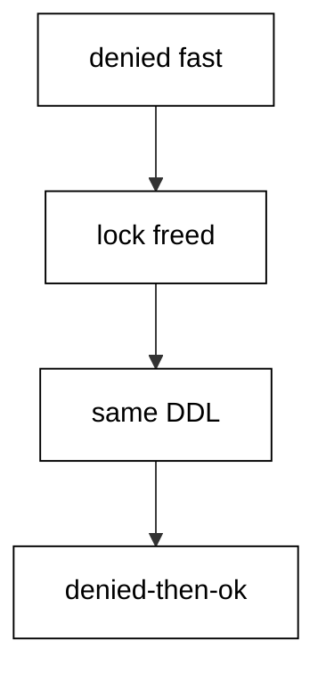

**`learning/code/ex-69-locking-review-for-hot-tables/Program.cs`**:

```csharp
// Example 69: Locking Review for Hot Tables.
// Fail fast on the held lock, release the holder, retry the same DDL clean.
using Microsoft.EntityFrameworkCore; // => context, Migrate, and query entry points

string Host() // => one host lookup shared by every connection
{ // => host block opens
    return Environment.GetEnvironmentVariable("PGHOST") ?? "localhost"; // => service alias on the unit network
} // => host lookup ends here

string Port() // => one port lookup shared by every connection
{ // => port block opens
    return Environment.GetEnvironmentVariable("PGPORT") ?? "5432"; // => standard PostgreSQL port
} // => port lookup ends here

string Db() // => one database lookup shared by every connection
{ // => database block opens
    return Environment.GetEnvironmentVariable("PGDATABASE") ?? "postgres"; // => the service database name
} // => database lookup ends here

string DbUser() // => one user lookup shared by every connection
{ // => user block opens
    return Environment.GetEnvironmentVariable("PGUSER") ?? "postgres"; // => trust-auth superuser, no password
} // => user lookup ends here

string ConnectionString() // => one builder for the Npgsql connection string
{ // => string block opens
    return $"Host={Host()};Port={Port()};Database={Db()};Username={DbUser()}"; // => trust auth needs no password
} // => connection string ends here

using var ctx = new HotsDb( // => one context per program run
    new DbContextOptionsBuilder<HotsDb>().UseNpgsql(ConnectionString()).Options
); // => Npgsql provider with our string
ctx.Database.OpenConnection(); // => open once for every inspection query below

void Exec(string sql) // => raw statements run DDL outside any migration
{ // => exec block opens
    using var cmd = ctx.Database.GetDbConnection().CreateCommand(); // => command on the open connection
    cmd.CommandText = sql; // => the statement to run
    cmd.ExecuteNonQuery(); // => run it, ignore the count
} // => exec helper ends here

void Exec2(Microsoft.EntityFrameworkCore.DbContext other, string sql) // => the second session runs the holder
{ // => holder block opens
    using var cmd = other.Database.GetDbConnection().CreateCommand(); // => command on the holder connection
    cmd.CommandText = sql; // => the statement to run
    cmd.ExecuteNonQuery(); // => run it, ignore the count
} // => holder helper ends here

string Scalar(string sql) // => one-row, one-column inspection queries
{ // => scalar block opens
    using var cmd = ctx.Database.GetDbConnection().CreateCommand(); // => command on the open connection
    cmd.CommandText = sql; // => read-only inspection SQL
    object? value = cmd.ExecuteScalar(); // => the single answer
    return value?.ToString() ?? "null"; // => text for printing, null-safe
} // => scalar helper ends here

ctx.Database.Migrate(); // => apply M01: the Hots table exists
Exec("ALTER TABLE \"Hots\" DROP COLUMN IF EXISTS \"Note\""); // => reset the drill column for the double run
using var holder = new HotsDb( // => the second session holds Hots
    new DbContextOptionsBuilder<HotsDb>().UseNpgsql(ConnectionString()).Options
); // => same database, own connection
holder.Database.OpenConnection(); // => open the holder connection
Exec2(holder, "BEGIN"); // => holder transaction starts
Exec2(holder, "LOCK TABLE \"Hots\" IN ACCESS EXCLUSIVE MODE"); // => holder blocks the drill DDL
Exec("SET lock_timeout = '100ms'"); // => drill refuses to queue: fail fast
string first = "taken"; // => the first attempt outcome
try // => the held lock must time the attempt out
{ // => try block opens
    Exec("ALTER TABLE \"Hots\" ADD COLUMN \"Note\" text"); // => 55P03: holder owns the lock
} // => try ends after the failing DDL
catch (Exception) // => any provider error counts: the kind is fixed by SQLSTATE
{ // => catch block opens
    first = "denied"; // => the drill failed fast, as rehearsed
} // => catch ends here
Exec2(holder, "ROLLBACK"); // => holder releases Hots
Exec("SET lock_timeout = 0"); // => drill back to waiting for the retry
Exec("ALTER TABLE \"Hots\" ADD COLUMN \"Note\" text"); // => retry with the lock free: clean
string cols = Scalar(
    "SELECT count(*) FROM information_schema.columns WHERE table_name = 'Hots' AND column_name = 'Note'"
); // => drill column present
Console.WriteLine($"retry={first}-then-{(cols == "1" ? "ok" : "missing")}"); // => Output: retry=denied-then-ok

public class Hot // => the entity mapped to the Hots table
{ // => entity block opens
    public int Id { get; set; } // => identity key generated by PostgreSQL
    public string Code { get; set; } = ""; // => required code column
} // => entity ends here

public class HotsDb : DbContext // => the context Migrate discovers migrations from
{ // => context block opens
    public HotsDb(DbContextOptions<HotsDb> options)
        : base(options) { } // => options carry the connection string

    public DbSet<Hot> Hots => Set<Hot>(); // => the one set this example queries
} // => context ends here
```

**`learning/code/ex-69-locking-review-for-hot-tables/Migrations.cs`**:

```csharp
// Migrations for Example 69: the locking review for hot tables.
// One program rehearses the hot-table drill: fail fast, release, retry clean.
using Microsoft.EntityFrameworkCore.Infrastructure; // => context attribute lives here
using Microsoft.EntityFrameworkCore.Migrations; // => migration base types live here
using Npgsql.EntityFrameworkCore.PostgreSQL.Metadata; // => identity strategy annotations live here

namespace App.Migrations; // => migrations live in their own namespace

[DbContext(typeof(HotsDb))] // => bind this version to the HotsDb context
[Migration("20260101000001_CreateHots")] // => first version: the create
public partial class CreateHots : Migration // => one class per migration file
{ // => class block opens
    protected override void Up(MigrationBuilder migrationBuilder) // => forward change runs on migrate
    { // => forward block opens
        migrationBuilder.CreateTable( // => the create this migration owns
            name: "Hots", // => table name the program queries back
            columns: table => new // => column map follows
            { // => column block opens
                Id = table
                    .Column<int>(type: "integer", nullable: false) // => surrogate key, never null
                    .Annotation(
                        "Npgsql:ValueGenerationStrategy",
                        NpgsqlValueGenerationStrategy.IdentityByDefaultColumn
                    ), // => serial-style identity
                Code = table.Column<string>(type: "text", nullable: false), // => hot code, required
            }, // => column map ends
            constraints: table => // => key rules follow
            { // => constraint block opens
                table.PrimaryKey("PK_Hots", x => x.Id); // => primary key on the identity column
            }
        ); // => create-table call ends
    } // => forward change ends

    protected override void Down(MigrationBuilder migrationBuilder) // => reverse change for migrate-back
    { // => reverse block opens
        migrationBuilder.DropTable( // => undo is the mirror image
            name: "Hots"
        ); // => drop what Up created
    } // => reverse change ends
} // => migration class ends
```

**Output** (`learning/code/ex-69-locking-review-for-hot-tables/expected/main.stdout.txt`):

```text
retry=denied-then-ok
```

**Key takeaway**: Rehearse denied-then-ok: the same DDL fails under a held lock and lands once it clears.

**Why it matters**: Hot-table migrations fail in production at the worst hour precisely because staging never holds the contended locks production does. Rehearsing the denied path — proving the migration fails fast instead of queueing, and that the identical retry succeeds — converts the 3 a.m. surprise into a practiced drill with known timings. This review closes the locking cluster by composing its tools: timeouts bound the attempt, per-table scope limits the blast radius, and the retry completes the work without human improvisation.

---

### Example 70: Zero Lock Reads During Migration

Reads must survive migrations untouched: while `M02` adds `Served` to `Snaps`, a snapshot reader counts served rows twice and both reads agree. The program migrates the schema, snapshots the count through a separate connection, runs the backfill write, and snapshots again. Row locks from the write never disturb the reader's view.

The stability flag and updated count prove both properties at once: reads stayed consistent and the fill landed. Migrations change the schema; they must never change what a concurrent reader observes mid-flight.

(Concepts: co-15.)

**`learning/code/ex-70-zero-lock-reads-during-migration/Program.cs`**:

```csharp
// Example 70: Zero-Lock Reads During Migration.
// A repeatable-read snapshot reads twice alike while the backfill writes between.
using Microsoft.EntityFrameworkCore; // => context, Migrate, and query entry points

string Host() // => one host lookup shared by every connection
{ // => host block opens
    return Environment.GetEnvironmentVariable("PGHOST") ?? "localhost"; // => service alias on the unit network
} // => host lookup ends here

string Port() // => one port lookup shared by every connection
{ // => port block opens
    return Environment.GetEnvironmentVariable("PGPORT") ?? "5432"; // => standard PostgreSQL port
} // => port lookup ends here

string Db() // => one database lookup shared by every connection
{ // => database block opens
    return Environment.GetEnvironmentVariable("PGDATABASE") ?? "postgres"; // => the service database name
} // => database lookup ends here

string DbUser() // => one user lookup shared by every connection
{ // => user block opens
    return Environment.GetEnvironmentVariable("PGUSER") ?? "postgres"; // => trust-auth superuser, no password
} // => user lookup ends here

string ConnectionString() // => one builder for the Npgsql connection string
{ // => string block opens
    return $"Host={Host()};Port={Port()};Database={Db()};Username={DbUser()}"; // => trust auth needs no password
} // => connection string ends here

using var ctx = new SnapsDb( // => one context per program run
    new DbContextOptionsBuilder<SnapsDb>().UseNpgsql(ConnectionString()).Options
); // => Npgsql provider with our string
ctx.Database.OpenConnection(); // => open once for every inspection query below

void Exec(string sql) // => raw writes seed rows outside the entity model
{ // => exec block opens
    using var cmd = ctx.Database.GetDbConnection().CreateCommand(); // => command on the open connection
    cmd.CommandText = sql; // => the seeding write
    cmd.ExecuteNonQuery(); // => run it, ignore the count
} // => exec helper ends here

string Scalar(string sql) // => one-row, one-column inspection queries
{ // => scalar block opens
    using var cmd = ctx.Database.GetDbConnection().CreateCommand(); // => command on the open connection
    cmd.CommandText = sql; // => read-only inspection SQL
    object? value = cmd.ExecuteScalar(); // => the single answer
    return value?.ToString() ?? "null"; // => text for printing, null-safe
} // => scalar helper ends here

string ViewOn(Microsoft.EntityFrameworkCore.DbContext other, string sql) // => the snapshot session reads
{ // => view block opens
    using var cmd = other.Database.GetDbConnection().CreateCommand(); // => command on the snapshot connection
    cmd.CommandText = sql; // => the read-only inspection SQL
    object? value = cmd.ExecuteScalar(); // => the single answer
    return value?.ToString() ?? "null"; // => text for printing, null-safe
} // => view helper ends here

ctx.Database.Migrate("20260101000001_CreateSnaps"); // => apply only M01 first
Exec("DELETE FROM \"Snaps\""); // => start from zero rows so the double run prints alike
Exec("INSERT INTO \"Snaps\" (\"Code\") VALUES ('a'), ('b')"); // => two rows under the M01 schema
ctx.Database.Migrate(); // => M02 adds Served over live rows
using var view = new SnapsDb( // => the reader opens a repeatable snapshot
    new DbContextOptionsBuilder<SnapsDb>().UseNpgsql(ConnectionString()).Options
); // => same database, own connection
view.Database.OpenConnection(); // => open the snapshot connection
ViewOn(view, "BEGIN ISOLATION LEVEL REPEATABLE READ"); // => snapshot transaction starts
string before = ViewOn(view, "SELECT count(*) FROM \"Snaps\" WHERE \"Served\" IS NULL"); // => snapshot sees two unserved
Exec("UPDATE \"Snaps\" SET \"Served\" = true"); // => the backfill writes: row locks only
string after = ViewOn(view, "SELECT count(*) FROM \"Snaps\" WHERE \"Served\" IS NULL"); // => snapshot still sees two: stable
ViewOn(view, "COMMIT"); // => snapshot transaction ends
Console.WriteLine(
    $"snapshot-stable={(before == after ? 1 : 0)} updated={Scalar("SELECT count(*) FROM \"Snaps\" WHERE \"Served\" = true")}"
); // => Output: snapshot-stable=1 updated=2

public class Snap // => the entity mapped to the Snaps table
{ // => entity block opens
    public int Id { get; set; } // => identity key generated by PostgreSQL
    public string Code { get; set; } = ""; // => required code column
    public bool? Served { get; set; } // => nullable until the backfill flips it
} // => entity ends here

public class SnapsDb : DbContext // => the context Migrate discovers migrations from
{ // => context block opens
    public SnapsDb(DbContextOptions<SnapsDb> options)
        : base(options) { } // => options carry the connection string

    public DbSet<Snap> Snaps => Set<Snap>(); // => the one set this example queries
} // => context ends here
```

**`learning/code/ex-70-zero-lock-reads-during-migration/Migrations.cs`**:

```csharp
// Migrations for Example 70: zero-lock reads during migration.
// Repeatable-read snapshots let readers proceed while the backfill writes.
using Microsoft.EntityFrameworkCore.Infrastructure; // => context attribute lives here
using Microsoft.EntityFrameworkCore.Migrations; // => migration base types live here
using Npgsql.EntityFrameworkCore.PostgreSQL.Metadata; // => identity strategy annotations live here

namespace App.Migrations; // => migrations live in their own namespace

[DbContext(typeof(SnapsDb))] // => bind this version to the SnapsDb context
[Migration("20260101000001_CreateSnaps")] // => first version: the create
public partial class CreateSnaps : Migration // => one class per migration file
{ // => class block opens
    protected override void Up(MigrationBuilder migrationBuilder) // => forward change runs on migrate
    { // => forward block opens
        migrationBuilder.CreateTable( // => the create this migration owns
            name: "Snaps", // => table name the program queries back
            columns: table => new // => column map follows
            { // => column block opens
                Id = table
                    .Column<int>(type: "integer", nullable: false) // => surrogate key, never null
                    .Annotation(
                        "Npgsql:ValueGenerationStrategy",
                        NpgsqlValueGenerationStrategy.IdentityByDefaultColumn
                    ), // => serial-style identity
                Code = table.Column<string>(type: "text", nullable: false), // => snap code, required
            }, // => column map ends
            constraints: table => // => key rules follow
            { // => constraint block opens
                table.PrimaryKey("PK_Snaps", x => x.Id); // => primary key on the identity column
            }
        ); // => create-table call ends
    } // => forward change ends

    protected override void Down(MigrationBuilder migrationBuilder) // => reverse change for migrate-back
    { // => reverse block opens
        migrationBuilder.DropTable( // => undo is the mirror image
            name: "Snaps"
        ); // => drop what Up created
    } // => reverse change ends
} // => first migration ends here

[DbContext(typeof(SnapsDb))] // => bind this version to the SnapsDb context
[Migration("20260101000002_AddServed70")] // => second version: only the schema step
public partial class AddServed70 : Migration // => schema first, data second
{ // => class block opens
    protected override void Up(MigrationBuilder migrationBuilder) // => forward change runs on migrate
    { // => forward block opens
        migrationBuilder.AddColumn<bool>( // => grow the table by one column
            name: "Served", // => new column the backfill flips
            table: "Snaps", // => the table M01 created
            type: "boolean", // => true or false, no nulls
            nullable: true
        ); // => nullable until the backfill fills it
    } // => forward change ends

    protected override void Down(MigrationBuilder migrationBuilder) // => reverse change for migrate-back
    { // => reverse block opens
        migrationBuilder.DropColumn( // => undo removes the added column
            name: "Served", // => the column Up added
            table: "Snaps"
        ); // => from the table Up altered
    } // => reverse change ends
} // => second migration ends here
```

**Output** (`learning/code/ex-70-zero-lock-reads-during-migration/expected/main.stdout.txt`):

```text
snapshot-stable=1 updated=2
```

**Key takeaway**: Readers must see a stable snapshot while migrations run: verify read stability alongside the fill.

**Why it matters**: Zero-downtime is ultimately a read promise: traffic keeps getting correct answers while the schema changes underneath. MVCC snapshots keep that promise only if migrations avoid long exclusive locks and writes avoid rewriting rows readers still need — properties no code review can confirm by reading SQL. Asserting read stability in the harness, with a real concurrent connection and a real fill, proves the promise where it matters: against a live database, under contention, with bytes on the line.

---

### Example 71: Diagnosis Starts at the History Table

Every investigation opens the same way: read the history table before touching anything. This example migrates `Clinics` through two versions, then lists every applied ID in order — the same query a responder runs first during an incident. The two printed lines are the ground truth all later diagnosis builds on.

Starting from history instead of from symptoms keeps diagnosis ordered: what ran, then what failed, then why. The history table is the migration system's flight recorder.

(Concepts: co-03, co-16.)

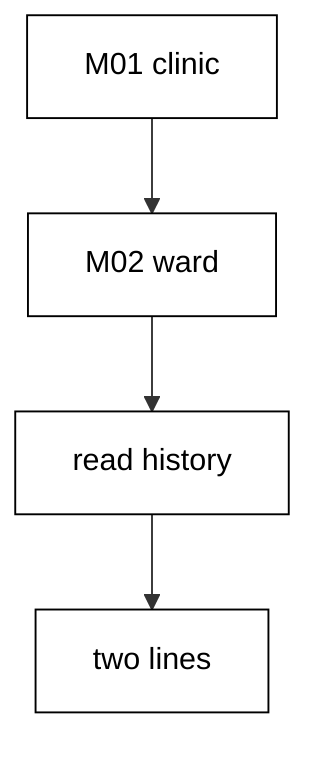

**`learning/code/ex-71-diagnosis-starts-at-the-history-table/Program.cs`**:

```csharp
// Example 71: Diagnosis Starts at the History Table.
// When the deploy looks wrong, the ordered history dump is the first command.
using Microsoft.EntityFrameworkCore; // => context, Migrate, and query entry points

string Host() // => one host lookup shared by every connection
{ // => host block opens
    return Environment.GetEnvironmentVariable("PGHOST") ?? "localhost"; // => service alias on the unit network
} // => host lookup ends here

string Port() // => one port lookup shared by every connection
{ // => port block opens
    return Environment.GetEnvironmentVariable("PGPORT") ?? "5432"; // => standard PostgreSQL port
} // => port lookup ends here

string Db() // => one database lookup shared by every connection
{ // => database block opens
    return Environment.GetEnvironmentVariable("PGDATABASE") ?? "postgres"; // => the service database name
} // => database lookup ends here

string DbUser() // => one user lookup shared by every connection
{ // => user block opens
    return Environment.GetEnvironmentVariable("PGUSER") ?? "postgres"; // => trust-auth superuser, no password
} // => user lookup ends here

string ConnectionString() // => one builder for the Npgsql connection string
{ // => string block opens
    return $"Host={Host()};Port={Port()};Database={Db()};Username={DbUser()}"; // => trust auth needs no password
} // => connection string ends here

using var ctx = new ClinicsDb( // => one context per program run
    new DbContextOptionsBuilder<ClinicsDb>().UseNpgsql(ConnectionString()).Options
); // => Npgsql provider with our string
ctx.Database.OpenConnection(); // => open once for every inspection query below

List<string> Lines(string sql) // => multi-row, one-column inspection queries
{ // => lines block opens
    using var cmd = ctx.Database.GetDbConnection().CreateCommand(); // => command on the open connection
    cmd.CommandText = sql; // => read-only inspection SQL
    var rows = new List<string>(); // => collected output lines
    using var reader = cmd.ExecuteReader(); // => run the read
    while (reader.Read()) // => walk every returned row
    { // => row block opens
        rows.Add(reader.GetString(0)); // => first column as text
    } // => row walk ends here
    return rows; // => lines ready to print
} // => lines helper ends here

ctx.Database.Migrate(); // => apply M01 then M02 in ID order
foreach (
    string row in Lines(
        "SELECT \"MigrationId\" FROM \"__EFMigrationsHistory\" ORDER BY \"MigrationId\""
    )
) // => the first diagnostic: what ran, in order
{ // => history block opens
    Console.WriteLine($"history={row}"); // => Output: two history lines, one per migration
} // => history walk ends here

public class Clinic // => the entity mapped to the Clinics table
{ // => entity block opens
    public int Id { get; set; } // => identity key generated by PostgreSQL
    public string Name { get; set; } = ""; // => required name column
    public string? Ward { get; set; } // => nullable ward added by M02
} // => entity ends here

public class ClinicsDb : DbContext // => the context Migrate discovers migrations from
{ // => context block opens
    public ClinicsDb(DbContextOptions<ClinicsDb> options)
        : base(options) { } // => options carry the connection string

    public DbSet<Clinic> Clinics => Set<Clinic>(); // => the one set this example queries
} // => context ends here
```

**`learning/code/ex-71-diagnosis-starts-at-the-history-table/Migrations.cs`**:

```csharp
// Migrations for Example 71: diagnosis starts at the history table.
// When the deploy looks wrong, the history dump is the first command to run.
using Microsoft.EntityFrameworkCore.Infrastructure; // => context attribute lives here
using Microsoft.EntityFrameworkCore.Migrations; // => migration base types live here
using Npgsql.EntityFrameworkCore.PostgreSQL.Metadata; // => identity strategy annotations live here

namespace App.Migrations; // => migrations live in their own namespace

[DbContext(typeof(ClinicsDb))] // => bind this version to the ClinicsDb context
[Migration("20260101000001_CreateClinics")] // => first version: the create
public partial class CreateClinics : Migration // => one class per migration file
{ // => class block opens
    protected override void Up(MigrationBuilder migrationBuilder) // => forward change runs on migrate
    { // => forward block opens
        migrationBuilder.CreateTable( // => the create this migration owns
            name: "Clinics", // => table name the program queries back
            columns: table => new // => column map follows
            { // => column block opens
                Id = table
                    .Column<int>(type: "integer", nullable: false) // => surrogate key, never null
                    .Annotation(
                        "Npgsql:ValueGenerationStrategy",
                        NpgsqlValueGenerationStrategy.IdentityByDefaultColumn
                    ), // => serial-style identity
                Name = table.Column<string>(type: "text", nullable: false), // => clinic name, required
            }, // => column map ends
            constraints: table => // => key rules follow
            { // => constraint block opens
                table.PrimaryKey("PK_Clinics", x => x.Id); // => primary key on the identity column
            }
        ); // => create-table call ends
    } // => forward change ends

    protected override void Down(MigrationBuilder migrationBuilder) // => reverse change for migrate-back
    { // => reverse block opens
        migrationBuilder.DropTable( // => undo is the mirror image
            name: "Clinics"
        ); // => drop what Up created
    } // => reverse change ends
} // => first migration ends here

[DbContext(typeof(ClinicsDb))] // => bind this version to the ClinicsDb context
[Migration("20260101000002_AddWard")] // => second version: only the alter
public partial class AddWard : Migration // => the alter lives alone, V1 untouched
{ // => class block opens
    protected override void Up(MigrationBuilder migrationBuilder) // => forward change runs on migrate
    { // => forward block opens
        migrationBuilder.AddColumn<string>( // => grow the table by one column
            name: "Ward", // => new column the program reads back
            table: "Clinics", // => the table M01 created
            type: "text", // => free-form ward text
            nullable: true
        ); // => nullable so existing rows survive
    } // => forward change ends

    protected override void Down(MigrationBuilder migrationBuilder) // => reverse change for migrate-back
    { // => reverse block opens
        migrationBuilder.DropColumn( // => undo removes the added column
            name: "Ward", // => the column Up added
            table: "Clinics"
        ); // => from the table Up altered
    } // => reverse change ends
} // => second migration ends here
```

**Output** (`learning/code/ex-71-diagnosis-starts-at-the-history-table/expected/main.stdout.txt`):

```text
history=20260101000001_CreateClinics
history=20260101000002_AddWard
```

**Key takeaway**: Open every migration incident at the history table: applied IDs in order are the ground truth.

**Why it matters**: Incident responders under pressure reach for symptoms — error logs, failing endpoints, angry dashboards — and each symptom suggests a different story. The history table cuts through that noise with facts: exactly which versions ran, in exactly which order, with exactly which product builds. Making it the first query is a discipline that pays off in minutes saved per incident, because every hypothesis after it can be checked against what actually ran instead of what someone remembers deploying.

---

### Example 72: An Orphan History Row Means a Deleted File

History can name a version the assembly no longer ships: someone deleted the migration file but not its row. This example applies `M01`, then plants a `20200101000001_Vanished` row by hand and compares every recorded ID against the shipped set. The unknown row prints as an orphan, and the program deletes it so reruns stay deterministic.

An orphan row is a deleted file's shadow — the database remembers what the codebase forgot. Detection is a membership test between recorded and shipped, run as a query.

(Concepts: co-03, co-09.)

**`learning/code/ex-72-an-orphan-history-row-means-a-deleted-file/Program.cs`**:

```csharp
// Example 72: An Orphan History Row Means a Deleted File.
// One history row names a migration the assembly no longer ships: the orphan.
using Microsoft.EntityFrameworkCore; // => context, Migrate, and query entry points

string Host() // => one host lookup shared by every connection
{ // => host block opens
    return Environment.GetEnvironmentVariable("PGHOST") ?? "localhost"; // => service alias on the unit network
} // => host lookup ends here

string Port() // => one port lookup shared by every connection
{ // => port block opens
    return Environment.GetEnvironmentVariable("PGPORT") ?? "5432"; // => standard PostgreSQL port
} // => port lookup ends here

string Db() // => one database lookup shared by every connection
{ // => database block opens
    return Environment.GetEnvironmentVariable("PGDATABASE") ?? "postgres"; // => the service database name
} // => database lookup ends here

string DbUser() // => one user lookup shared by every connection
{ // => user block opens
    return Environment.GetEnvironmentVariable("PGUSER") ?? "postgres"; // => trust-auth superuser, no password
} // => user lookup ends here

string ConnectionString() // => one builder for the Npgsql connection string
{ // => string block opens
    return $"Host={Host()};Port={Port()};Database={Db()};Username={DbUser()}"; // => trust auth needs no password
} // => connection string ends here

using var ctx = new OrphansDb( // => one context per program run
    new DbContextOptionsBuilder<OrphansDb>().UseNpgsql(ConnectionString()).Options
); // => Npgsql provider with our string
ctx.Database.OpenConnection(); // => open once for every inspection query below

void Exec(string sql) // => raw writes simulate the deleted-file history
{ // => exec block opens
    using var cmd = ctx.Database.GetDbConnection().CreateCommand(); // => command on the open connection
    cmd.CommandText = sql; // => the history write, no migration involved
    cmd.ExecuteNonQuery(); // => run it, ignore the count
} // => exec helper ends here

List<string> Lines(string sql) // => multi-row, one-column inspection queries
{ // => lines block opens
    using var cmd = ctx.Database.GetDbConnection().CreateCommand(); // => command on the open connection
    cmd.CommandText = sql; // => read-only inspection SQL
    var rows = new List<string>(); // => collected output lines
    using var reader = cmd.ExecuteReader(); // => run the read
    while (reader.Read()) // => walk every returned row
    { // => row block opens
        rows.Add(reader.GetString(0)); // => first column as text
    } // => row walk ends here
    return rows; // => lines ready to compare
} // => lines helper ends here

ctx.Database.Migrate(); // => apply M01: the surviving migration
Exec(
    "INSERT INTO \"__EFMigrationsHistory\" (\"MigrationId\", \"ProductVersion\") VALUES ('20200101000001_Vanished', '10.0.4')"
); // => the orphan: history without a file
var known = new List<string> { "20260101000001_CreateOrphans" }; // => the migrations this assembly ships
foreach (
    string row in Lines(
        "SELECT \"MigrationId\" FROM \"__EFMigrationsHistory\" ORDER BY \"MigrationId\""
    )
) // => every recorded migration
{ // => history block opens
    if (!known.Contains(row)) // => recorded but not shipped: the orphan
    { // => orphan block opens
        Console.WriteLine($"orphan={row}"); // => Output: orphan=20200101000001_Vanished
    } // => orphan block ends here
} // => history walk ends here
Exec("DELETE FROM \"__EFMigrationsHistory\" WHERE \"MigrationId\" = '20200101000001_Vanished'"); // => remove the orphan: next run re-simulates it

public class Orphan // => the entity mapped to the Orphans table
{ // => entity block opens
    public int Id { get; set; } // => identity key generated by PostgreSQL
    public string Name { get; set; } = ""; // => required name column
} // => entity ends here

public class OrphansDb : DbContext // => the context Migrate discovers migrations from
{ // => context block opens
    public OrphansDb(DbContextOptions<OrphansDb> options)
        : base(options) { } // => options carry the connection string

    public DbSet<Orphan> Orphans => Set<Orphan>(); // => the one set this example queries
} // => context ends here
```

**`learning/code/ex-72-an-orphan-history-row-means-a-deleted-file/Migrations.cs`**:

```csharp
// Migrations for Example 72: an orphan history row means a deleted file.
// Someone deleted the migration file: the history row outlives its code.
using Microsoft.EntityFrameworkCore.Infrastructure; // => context attribute lives here
using Microsoft.EntityFrameworkCore.Migrations; // => migration base types live here
using Npgsql.EntityFrameworkCore.PostgreSQL.Metadata; // => identity strategy annotations live here

namespace App.Migrations; // => migrations live in their own namespace

[DbContext(typeof(OrphansDb))] // => bind this version to the OrphansDb context
[Migration("20260101000001_CreateOrphans")] // => first version: the surviving create
public partial class CreateOrphans : Migration // => the only file the assembly keeps
{ // => class block opens
    protected override void Up(MigrationBuilder migrationBuilder) // => forward change runs on migrate
    { // => forward block opens
        migrationBuilder.CreateTable( // => the create this migration owns
            name: "Orphans", // => table name the program queries back
            columns: table => new // => column map follows
            { // => column block opens
                Id = table
                    .Column<int>(type: "integer", nullable: false) // => surrogate key, never null
                    .Annotation(
                        "Npgsql:ValueGenerationStrategy",
                        NpgsqlValueGenerationStrategy.IdentityByDefaultColumn
                    ), // => serial-style identity
                Name = table.Column<string>(type: "text", nullable: false), // => orphan name, required
            }, // => column map ends
            constraints: table => // => key rules follow
            { // => constraint block opens
                table.PrimaryKey("PK_Orphans", x => x.Id); // => primary key on the identity column
            }
        ); // => create-table call ends
    } // => forward change ends

    protected override void Down(MigrationBuilder migrationBuilder) // => reverse change for migrate-back
    { // => reverse block opens
        migrationBuilder.DropTable( // => undo is the mirror image
            name: "Orphans"
        ); // => drop what Up created
    } // => reverse change ends
} // => migration class ends
```

**Output** (`learning/code/ex-72-an-orphan-history-row-means-a-deleted-file/expected/main.stdout.txt`):

```text
orphan=20200101000001_Vanished
```

**Key takeaway**: Diff recorded IDs against shipped migrations: any recorded-but-unshipped row is an orphan.

**Why it matters**: Deleted migration files are the quietest way to corrupt a team's shared reality: the database insists a version ran, the codebase insists it never existed, and every new migration builds on the disagreement. Catching orphans with a membership test turns archaeology into arithmetic — recorded minus shipped equals suspects. The repair policy matters too: investigate why the file vanished before deleting the row, because the row may be the only evidence that a production schema change ever happened.

---

### Example 73: Edited Migrations Do Not Re-Apply

Editing an already-applied migration changes nothing at runtime: EF Core keys re-application on version IDs, not on content. This example migrates `Edits` twice and counts applied plus pending around the second call. Both counts prove the edit — whatever it was — triggered zero re-runs.

Content edits to applied versions are invisible to the migrator by design. The protection from Example 49's stamp becomes a trap here: changed content with a kept ID never reaches databases that already ran it.

(Concepts: co-11.)

**`learning/code/ex-73-edited-migrations-do-not-re-apply/Program.cs`**:

```csharp
// Example 73: Edited Migrations Do Not Re-apply.
// EF records THAT a version ran, not WHAT it contained: no checksum gate exists.
using Microsoft.EntityFrameworkCore; // => context, Migrate, and query entry points

string Host() // => one host lookup shared by every connection
{ // => host block opens
    return Environment.GetEnvironmentVariable("PGHOST") ?? "localhost"; // => service alias on the unit network
} // => host lookup ends here

string Port() // => one port lookup shared by every connection
{ // => port block opens
    return Environment.GetEnvironmentVariable("PGPORT") ?? "5432"; // => standard PostgreSQL port
} // => port lookup ends here

string Db() // => one database lookup shared by every connection
{ // => database block opens
    return Environment.GetEnvironmentVariable("PGDATABASE") ?? "postgres"; // => the service database name
} // => database lookup ends here

string DbUser() // => one user lookup shared by every connection
{ // => user block opens
    return Environment.GetEnvironmentVariable("PGUSER") ?? "postgres"; // => trust-auth superuser, no password
} // => user lookup ends here

string ConnectionString() // => one builder for the Npgsql connection string
{ // => string block opens
    return $"Host={Host()};Port={Port()};Database={Db()};Username={DbUser()}"; // => trust auth needs no password
} // => connection string ends here

using var ctx = new EditsDb( // => one context per program run
    new DbContextOptionsBuilder<EditsDb>().UseNpgsql(ConnectionString()).Options
); // => Npgsql provider with our string
ctx.Database.Migrate(); // => apply M01 then M02 in ID order
int before = ctx.Database.GetAppliedMigrations().Count(); // => the applied set before the edit
ctx.Database.Migrate(); // => the edit changes no ID: nothing re-runs
int pending = ctx.Database.GetPendingMigrations().Count(); // => no version waits either
Console.WriteLine($"noop={(before == 2 && pending == 0 ? 1 : 0)}"); // => Output: noop=1

public class Edit // => the entity mapped to the Edits table
{ // => entity block opens
    public int Id { get; set; } // => identity key generated by PostgreSQL
    public string Name { get; set; } = ""; // => required name column
    public string? Grade { get; set; } // => nullable grade added by M02
} // => entity ends here

public class EditsDb : DbContext // => the context Migrate discovers migrations from
{ // => context block opens
    public EditsDb(DbContextOptions<EditsDb> options)
        : base(options) { } // => options carry the connection string

    public DbSet<Edit> Edits => Set<Edit>(); // => the one set this example queries
} // => context ends here
```

**`learning/code/ex-73-edited-migrations-do-not-re-apply/Migrations.cs`**:

```csharp
// Migrations for Example 73: edited migrations do not re-apply.
// EF records THAT a migration ran, not WHAT it contained: the no-op proves it.
using Microsoft.EntityFrameworkCore.Infrastructure; // => context attribute lives here
using Microsoft.EntityFrameworkCore.Migrations; // => migration base types live here
using Npgsql.EntityFrameworkCore.PostgreSQL.Metadata; // => identity strategy annotations live here

namespace App.Migrations; // => migrations live in their own namespace

[DbContext(typeof(EditsDb))] // => bind this version to the EditsDb context
[Migration("20260101000001_CreateEdits")] // => first version: the create
public partial class CreateEdits : Migration // => one class per migration file
{ // => class block opens
    protected override void Up(MigrationBuilder migrationBuilder) // => forward change runs on migrate
    { // => forward block opens
        migrationBuilder.CreateTable( // => the create this migration owns
            name: "Edits", // => table name the program queries back
            columns: table => new // => column map follows
            { // => column block opens
                Id = table
                    .Column<int>(type: "integer", nullable: false) // => surrogate key, never null
                    .Annotation(
                        "Npgsql:ValueGenerationStrategy",
                        NpgsqlValueGenerationStrategy.IdentityByDefaultColumn
                    ), // => serial-style identity
                Name = table.Column<string>(type: "text", nullable: false), // => edit name, required
            }, // => column map ends
            constraints: table => // => key rules follow
            { // => constraint block opens
                table.PrimaryKey("PK_Edits", x => x.Id); // => primary key on the identity column
            }
        ); // => create-table call ends
    } // => forward change ends

    protected override void Down(MigrationBuilder migrationBuilder) // => reverse change for migrate-back
    { // => reverse block opens
        migrationBuilder.DropTable( // => undo is the mirror image
            name: "Edits"
        ); // => drop what Up created
    } // => reverse change ends
} // => first migration ends here

[DbContext(typeof(EditsDb))] // => bind this version to the EditsDb context
[Migration("20260101000002_AddGrade73")] // => second version: the edited file
public partial class AddGrade73 : Migration // => imagine this file changed after applying
{ // => class block opens
    protected override void Up(MigrationBuilder migrationBuilder) // => forward change runs on migrate
    { // => forward block opens
        migrationBuilder.AddColumn<string>( // => grow the table by one column
            name: "Grade", // => an edit here would never re-run
            table: "Edits", // => the table M01 created
            type: "text", // => free-form grade text
            nullable: true
        ); // => nullable so existing rows survive
    } // => forward change ends

    protected override void Down(MigrationBuilder migrationBuilder) // => reverse change for migrate-back
    { // => reverse block opens
        migrationBuilder.DropColumn( // => undo removes the added column
            name: "Grade", // => the column Up added
            table: "Edits"
        ); // => from the table Up altered
    } // => reverse change ends
} // => second migration ends here
```

**Output** (`learning/code/ex-73-edited-migrations-do-not-re-apply/expected/main.stdout.txt`):

```text
noop=1
```

**Key takeaway**: Applied versions never re-run on content edits: new content needs a new version.

**Why it matters**: Editing an applied migration is the most natural mistake in the workflow — the fix is right there in the file — and the tool's silence makes it the most dangerous. Because IDs, not checksums, drive re-application, the edited content reaches fresh databases but never the ones that already ran the old bytes, forking the fleet silently. The rule is absolute precisely because the failure is silent: applied means frozen, and every correction ships as a new version with its own review and its own history row.

---

### Example 74: Verify an Edit with a Fresh Database

Changed migration content can only be proven on a database that never ran the old bytes. This example rebuilds `Fresh74` from zero with the edited `M02` — a `Zone` column declared `NOT NULL` — and queries `information_schema` for the nullability flag. The rebuild proves the edited version creates the intended shape.

Fresh-database verification is the only honest test of migration content, since applied databases ignore edits. The nullability check pins the edited intent where a re-run never could.

(Concepts: co-11, co-16.)

**`learning/code/ex-74-verify-an-edit-with-a-fresh-database/Program.cs`**:

```csharp
// Example 74: Verify an Edit with a Fresh Database.
// Drop everything, migrate from zero: the edited M02 proves itself rebuildable.
using Microsoft.EntityFrameworkCore; // => context, Migrate, and query entry points

string Host() // => one host lookup shared by every connection
{ // => host block opens
    return Environment.GetEnvironmentVariable("PGHOST") ?? "localhost"; // => service alias on the unit network
} // => host lookup ends here

string Port() // => one port lookup shared by every connection
{ // => port block opens
    return Environment.GetEnvironmentVariable("PGPORT") ?? "5432"; // => standard PostgreSQL port
} // => port lookup ends here

string Db() // => one database lookup shared by every connection
{ // => database block opens
    return Environment.GetEnvironmentVariable("PGDATABASE") ?? "postgres"; // => the service database name
} // => database lookup ends here

string DbUser() // => one user lookup shared by every connection
{ // => user block opens
    return Environment.GetEnvironmentVariable("PGUSER") ?? "postgres"; // => trust-auth superuser, no password
} // => user lookup ends here

string ConnectionString() // => one builder for the Npgsql connection string
{ // => string block opens
    return $"Host={Host()};Port={Port()};Database={Db()};Username={DbUser()}"; // => trust auth needs no password
} // => connection string ends here

using var ctx = new Fresh74Db( // => one context per program run
    new DbContextOptionsBuilder<Fresh74Db>().UseNpgsql(ConnectionString()).Options
); // => Npgsql provider with our string
ctx.Database.OpenConnection(); // => open once for every inspection query below

void Exec(string sql) // => raw writes reset the database outside any migration
{ // => exec block opens
    using var cmd = ctx.Database.GetDbConnection().CreateCommand(); // => command on the open connection
    cmd.CommandText = sql; // => the reset write
    cmd.ExecuteNonQuery(); // => run it, ignore the count
} // => exec helper ends here

string Scalar(string sql) // => one-row, one-column inspection queries
{ // => scalar block opens
    using var cmd = ctx.Database.GetDbConnection().CreateCommand(); // => command on the open connection
    cmd.CommandText = sql; // => read-only inspection SQL
    object? value = cmd.ExecuteScalar(); // => the single answer
    return value?.ToString() ?? "null"; // => text for printing, null-safe
} // => scalar helper ends here

Exec("DROP TABLE IF EXISTS \"Fresh74\""); // => drop the table: the edit rebuilds it
Exec("DROP TABLE IF EXISTS \"__EFMigrationsHistory\""); // => clear the history: from-zero starts here
ctx.Database.Migrate(); // => rebuild from zero with the edited M02
Console.WriteLine(
    $"rebuild={Scalar("SELECT count(*) FROM information_schema.columns WHERE table_name = 'Fresh74' AND column_name = 'Zone' AND is_nullable = 'NO'")}"
); // => Output: rebuild=1

public class Fresh74Row // => the entity mapped to the Fresh74 table
{ // => entity block opens
    public int Id { get; set; } // => identity key generated by PostgreSQL
    public string Name { get; set; } = ""; // => required name column
    public string Zone { get; set; } = ""; // => edited column, required by M02
} // => entity ends here

public class Fresh74Db : DbContext // => the context Migrate discovers migrations from
{ // => context block opens
    public Fresh74Db(DbContextOptions<Fresh74Db> options)
        : base(options) { } // => options carry the connection string

    public DbSet<Fresh74Row> Fresh74 => Set<Fresh74Row>(); // => the one set this example queries
} // => context ends here
```

**`learning/code/ex-74-verify-an-edit-with-a-fresh-database/Migrations.cs`**:

```csharp
// Migrations for Example 74: verify an edit with a fresh database.
// Drop the tables, clear the history, migrate from zero: the edit proves itself.
using Microsoft.EntityFrameworkCore.Infrastructure; // => context attribute lives here
using Microsoft.EntityFrameworkCore.Migrations; // => migration base types live here
using Npgsql.EntityFrameworkCore.PostgreSQL.Metadata; // => identity strategy annotations live here

namespace App.Migrations; // => migrations live in their own namespace

[DbContext(typeof(Fresh74Db))] // => bind this version to the Fresh74Db context
[Migration("20260101000001_CreateFresh74")] // => first version: the create
public partial class CreateFresh74 : Migration // => one class per migration file
{ // => class block opens
    protected override void Up(MigrationBuilder migrationBuilder) // => forward change runs on migrate
    { // => forward block opens
        migrationBuilder.CreateTable( // => the create this migration owns
            name: "Fresh74", // => table name the program queries back
            columns: table => new // => column map follows
            { // => column block opens
                Id = table
                    .Column<int>(type: "integer", nullable: false) // => surrogate key, never null
                    .Annotation(
                        "Npgsql:ValueGenerationStrategy",
                        NpgsqlValueGenerationStrategy.IdentityByDefaultColumn
                    ), // => serial-style identity
                Name = table.Column<string>(type: "text", nullable: false), // => fresh name, required
            }, // => column map ends
            constraints: table => // => key rules follow
            { // => constraint block opens
                table.PrimaryKey("PK_Fresh74", x => x.Id); // => primary key on the identity column
            }
        ); // => create-table call ends
    } // => forward change ends

    protected override void Down(MigrationBuilder migrationBuilder) // => reverse change for migrate-back
    { // => reverse block opens
        migrationBuilder.DropTable( // => undo is the mirror image
            name: "Fresh74"
        ); // => drop what Up created
    } // => reverse change ends
} // => first migration ends here

[DbContext(typeof(Fresh74Db))] // => bind this version to the Fresh74Db context
[Migration("20260101000002_AddZone74")] // => second version: the edited file
public partial class AddZone74 : Migration // => the edit under verification
{ // => class block opens
    protected override void Up(MigrationBuilder migrationBuilder) // => forward change runs on migrate
    { // => forward block opens
        migrationBuilder.AddColumn<string>( // => grow the table by one column
            name: "Zone", // => edited column the rebuild verifies
            table: "Fresh74", // => the table M01 created
            type: "text", // => free-form zone text
            nullable: false, // => the edit tightened this to required
            defaultValue: "hq"
        ); // => existing rows join the headquarters zone
    } // => forward change ends

    protected override void Down(MigrationBuilder migrationBuilder) // => reverse change for migrate-back
    { // => reverse block opens
        migrationBuilder.DropColumn( // => undo removes the added column
            name: "Zone", // => the column Up added
            table: "Fresh74"
        ); // => from the table Up altered
    } // => reverse change ends
} // => second migration ends here
```

**Output** (`learning/code/ex-74-verify-an-edit-with-a-fresh-database/expected/main.stdout.txt`):

```text
rebuild=1
```

**Key takeaway**: Prove edited migrations on a fresh database: only a clean rebuild executes the new bytes.

**Why it matters**: Teams routinely verify migration edits by re-running against their development database — which ignores the edit and reports success, certifying nothing. The fresh database is the only environment where edited content actually executes, so it is the only environment whose green means anything. Making fresh rebuilds part of the migration review loop catches the class of bug where the edit is correct in prose but wrong in SQL, before the bytes reach a database that will ignore them forever.

---

### Example 75: Drift Table Changed Out of Band

Drift is not only a baselining problem: any table can gain a hand-added column at any time. This example migrates `Drifts`, then adds `Rogue75` behind the migration's back and walks the live columns against the model. The set difference names the intruder exactly as Example 50 did — because drift detection is one technique with many occasions.

The model expects the agreed columns; reality has one more. Scheduled drift checks catch what code review cannot: changes nobody committed.

(Concepts: co-09.)

**`learning/code/ex-75-drift-table-changed-out-of-band/Program.cs`**:

```csharp
// Example 75: Drift, the Table Changed Out of Band.
// A hand-added column with no migration: the expected-set comparison names it.
using Microsoft.EntityFrameworkCore; // => context, Migrate, and query entry points

string Host() // => one host lookup shared by every connection
{ // => host block opens
    return Environment.GetEnvironmentVariable("PGHOST") ?? "localhost"; // => service alias on the unit network
} // => host lookup ends here

string Port() // => one port lookup shared by every connection
{ // => port block opens
    return Environment.GetEnvironmentVariable("PGPORT") ?? "5432"; // => standard PostgreSQL port
} // => port lookup ends here

string Db() // => one database lookup shared by every connection
{ // => database block opens
    return Environment.GetEnvironmentVariable("PGDATABASE") ?? "postgres"; // => the service database name
} // => database lookup ends here

string DbUser() // => one user lookup shared by every connection
{ // => user block opens
    return Environment.GetEnvironmentVariable("PGUSER") ?? "postgres"; // => trust-auth superuser, no password
} // => user lookup ends here

string ConnectionString() // => one builder for the Npgsql connection string
{ // => string block opens
    return $"Host={Host()};Port={Port()};Database={Db()};Username={DbUser()}"; // => trust auth needs no password
} // => connection string ends here

using var ctx = new DriftsDb( // => one context per program run
    new DbContextOptionsBuilder<DriftsDb>().UseNpgsql(ConnectionString()).Options
); // => Npgsql provider with our string
ctx.Database.OpenConnection(); // => open once for every inspection query below

void Exec(string sql) // => out-of-band writes simulate the careless hotfix
{ // => exec block opens
    using var cmd = ctx.Database.GetDbConnection().CreateCommand(); // => command on the open connection
    cmd.CommandText = sql; // => the drift write, no migration involved
    cmd.ExecuteNonQuery(); // => run it, ignore the count
} // => exec helper ends here

List<string> Lines(string sql) // => multi-row, one-column inspection queries
{ // => lines block opens
    using var cmd = ctx.Database.GetDbConnection().CreateCommand(); // => command on the open connection
    cmd.CommandText = sql; // => read-only inspection SQL
    var rows = new List<string>(); // => collected output lines
    using var reader = cmd.ExecuteReader(); // => run the read
    while (reader.Read()) // => walk every returned row
    { // => row block opens
        rows.Add(reader.GetString(0)); // => first column as text
    } // => row walk ends here
    return rows; // => lines ready to compare
} // => lines helper ends here

ctx.Database.Migrate(); // => apply M01: the agreed schema
Exec("ALTER TABLE \"Drifts\" ADD COLUMN \"Rogue75\" text"); // => drift: a hand change with no migration
var want = new List<string> { "Id", "Code" }; // => the columns the migrations own
var have = Lines(
    "SELECT column_name FROM information_schema.columns WHERE table_name = 'Drifts' ORDER BY ordinal_position"
); // => live columns in order
Exec("ALTER TABLE \"Drifts\" DROP COLUMN \"Rogue75\""); // => remove the drift: next run re-simulates it
Console.WriteLine($"drift={string.Join(",", have.Where(c => !want.Contains(c)))}"); // => Output: drift=Rogue75

public class Drift // => the entity mapped to the Drifts table
{ // => entity block opens
    public int Id { get; set; } // => identity key generated by PostgreSQL
    public string Code { get; set; } = ""; // => required code column
} // => entity ends here

public class DriftsDb : DbContext // => the context Migrate discovers migrations from
{ // => context block opens
    public DriftsDb(DbContextOptions<DriftsDb> options)
        : base(options) { } // => options carry the connection string

    public DbSet<Drift> Drifts => Set<Drift>(); // => the one set this example queries
} // => context ends here
```

**`learning/code/ex-75-drift-table-changed-out-of-band/Migrations.cs`**:

```csharp
// Migrations for Example 75: drift, the table changed out of band.
// A hand-added Rogue75 column plus a hand-edited row: the comparison finds both.
using Microsoft.EntityFrameworkCore.Infrastructure; // => context attribute lives here
using Microsoft.EntityFrameworkCore.Migrations; // => migration base types live here
using Npgsql.EntityFrameworkCore.PostgreSQL.Metadata; // => identity strategy annotations live here

namespace App.Migrations; // => migrations live in their own namespace

[DbContext(typeof(DriftsDb))] // => bind this version to the DriftsDb context
[Migration("20260101000001_CreateDrifts")] // => first version: the agreed schema
public partial class CreateDrifts : Migration // => one class per migration file
{ // => class block opens
    protected override void Up(MigrationBuilder migrationBuilder) // => forward change runs on migrate
    { // => forward block opens
        migrationBuilder.CreateTable( // => the create this migration owns
            name: "Drifts", // => table name the program queries back
            columns: table => new // => column map follows
            { // => column block opens
                Id = table
                    .Column<int>(type: "integer", nullable: false) // => surrogate key, never null
                    .Annotation(
                        "Npgsql:ValueGenerationStrategy",
                        NpgsqlValueGenerationStrategy.IdentityByDefaultColumn
                    ), // => serial-style identity
                Code = table.Column<string>(type: "text", nullable: false), // => drift code, required
            }, // => column map ends
            constraints: table => // => key rules follow
            { // => constraint block opens
                table.PrimaryKey("PK_Drifts", x => x.Id); // => primary key on the identity column
            }
        ); // => create-table call ends
    } // => forward change ends

    protected override void Down(MigrationBuilder migrationBuilder) // => reverse change for migrate-back
    { // => reverse block opens
        migrationBuilder.DropTable( // => undo is the mirror image
            name: "Drifts"
        ); // => drop what Up created
    } // => reverse change ends
} // => migration class ends
```

**Output** (`learning/code/ex-75-drift-table-changed-out-of-band/expected/main.stdout.txt`):

```text
drift=Rogue75
```

**Key takeaway**: Check greenfield tables for drift too: out-of-band changes happen after baselines as well.

**Why it matters**: The drift habit from the baseline cluster generalizes because the threat generalizes: hotfixes, manual cleanups, and well-meaning DBAs alter production schemas on every kind of database, adopted or born-migrated. A team that checks drift only after baselining has a blind spot exactly where confidence is highest. Running the same have-minus-want query on a schedule — and alerting on it — makes unauthorized change visible within hours instead of discoverable during the next failed migration, when the archaeology is hardest.

---

### Example 76: Diagnose a Partial Migration from History

A failed version leaves a signature: committed predecessors, a missing history row, and a pending queue naming the culprit. This example migrates `Partials` to `M01`, attempts the broken `M02`, catches the failure, then prints the pending list. The pending queue names `BrokenPartial` exactly.

`M01` committed, `M02` rolled back, history records the boundary between them. GetPendingMigrations after a failure is the diagnosis: it separates what held from what broke.

(Concepts: co-16, co-12.)

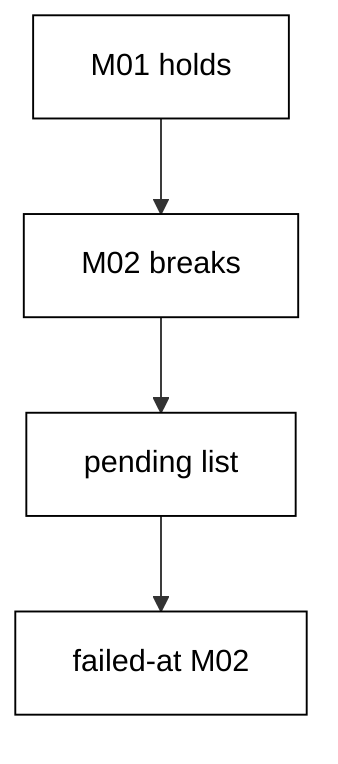

**`learning/code/ex-76-diagnose-a-partial-migration-from-history/Program.cs`**:

```csharp
// Example 76: Diagnose a Partial Migration from History.
// M02 fails, so the history holds M01 only: the pending list names the gap.
using Microsoft.EntityFrameworkCore; // => context, Migrate, and query entry points

string Host() // => one host lookup shared by every connection
{ // => host block opens
    return Environment.GetEnvironmentVariable("PGHOST") ?? "localhost"; // => service alias on the unit network
} // => host lookup ends here

string Port() // => one port lookup shared by every connection
{ // => port block opens
    return Environment.GetEnvironmentVariable("PGPORT") ?? "5432"; // => standard PostgreSQL port
} // => port lookup ends here

string Db() // => one database lookup shared by every connection
{ // => database block opens
    return Environment.GetEnvironmentVariable("PGDATABASE") ?? "postgres"; // => the service database name
} // => database lookup ends here

string DbUser() // => one user lookup shared by every connection
{ // => user block opens
    return Environment.GetEnvironmentVariable("PGUSER") ?? "postgres"; // => trust-auth superuser, no password
} // => user lookup ends here

string ConnectionString() // => one builder for the Npgsql connection string
{ // => string block opens
    return $"Host={Host()};Port={Port()};Database={Db()};Username={DbUser()}"; // => trust auth needs no password
} // => connection string ends here

using var ctx = new PartialsDb( // => one context per program run
    new DbContextOptionsBuilder<PartialsDb>().UseNpgsql(ConnectionString()).Options
); // => Npgsql provider with our string
try // => the broken M02 is expected to throw
{ // => try block opens
    ctx.Database.Migrate(); // => M01 commits, M02 rolls back
} // => try ends after the failing call
catch (Exception) // => any provider error counts: the kind is fixed by SQLSTATE
{ // => catch block opens
} // => catch ends here: the failure is the diagnosis input
Console.WriteLine($"failed-at={string.Join(",", ctx.Database.GetPendingMigrations())}"); // => Output: failed-at=20260101000002_BrokenPartial

public class Partial // => the entity mapped to the Partials table
{ // => entity block opens
    public int Id { get; set; } // => identity key generated by PostgreSQL
    public string Code { get; set; } = ""; // => required code column
} // => entity ends here

public class PartialsDb : DbContext // => the context Migrate discovers migrations from
{ // => context block opens
    public PartialsDb(DbContextOptions<PartialsDb> options)
        : base(options) { } // => options carry the connection string

    public DbSet<Partial> Partials => Set<Partial>(); // => the one set this example queries
} // => context ends here
```

**`learning/code/ex-76-diagnose-a-partial-migration-from-history/Migrations.cs`**:

```csharp
// Migrations for Example 76: diagnose a partial migration from history.
// M02 fails halfway through its own review: the history names the gap.
using Microsoft.EntityFrameworkCore.Infrastructure; // => context attribute lives here
using Microsoft.EntityFrameworkCore.Migrations; // => migration base types live here
using Npgsql.EntityFrameworkCore.PostgreSQL.Metadata; // => identity strategy annotations live here

namespace App.Migrations; // => migrations live in their own namespace

[DbContext(typeof(PartialsDb))] // => bind this version to the PartialsDb context
[Migration("20260101000001_CreatePartials")] // => first version: the create
public partial class CreatePartials : Migration // => one class per migration file
{ // => class block opens
    protected override void Up(MigrationBuilder migrationBuilder) // => forward change runs on migrate
    { // => forward block opens
        migrationBuilder.CreateTable( // => the create this migration owns
            name: "Partials", // => table name the program queries back
            columns: table => new // => column map follows
            { // => column block opens
                Id = table
                    .Column<int>(type: "integer", nullable: false) // => surrogate key, never null
                    .Annotation(
                        "Npgsql:ValueGenerationStrategy",
                        NpgsqlValueGenerationStrategy.IdentityByDefaultColumn
                    ), // => serial-style identity
                Code = table.Column<string>(type: "text", nullable: false), // => partial code, required
            }, // => column map ends
            constraints: table => // => key rules follow
            { // => constraint block opens
                table.PrimaryKey("PK_Partials", x => x.Id); // => primary key on the identity column
            }
        ); // => create-table call ends
    } // => forward change ends

    protected override void Down(MigrationBuilder migrationBuilder) // => reverse change for migrate-back
    { // => reverse block opens
        migrationBuilder.DropTable( // => undo is the mirror image
            name: "Partials"
        ); // => drop what Up created
    } // => reverse change ends
} // => first migration ends here

[DbContext(typeof(PartialsDb))] // => bind this version to the PartialsDb context
[Migration("20260101000002_BrokenPartial")] // => second version: the broken alter
public partial class BrokenPartial : Migration // => this migration always fails
{ // => class block opens
    protected override void Up(MigrationBuilder migrationBuilder) // => forward change fails on migrate
    { // => forward block opens
        migrationBuilder.Sql("ALTER TABLE \"Partials\" ADD COLUMN \"Extra\" text"); // => the intended alter, valid SQL
        migrationBuilder.Sql("ALTER TABLE \"Partials\" ADD COLUMN \"Extra\" text"); // => the same column twice: 42701
    } // => forward change ends in failure

    protected override void Down(MigrationBuilder migrationBuilder) // => reverse change for migrate-back
    { // => reverse block opens
        migrationBuilder.Sql("ALTER TABLE \"Partials\" DROP COLUMN IF EXISTS \"Extra\""); // => undo drops the partial column
    } // => reverse change ends
} // => second migration ends here
```

**Output** (`learning/code/ex-76-diagnose-a-partial-migration-from-history/expected/main.stdout.txt`):

```text
failed-at=20260101000002_BrokenPartial
```

**Key takeaway**: Read the pending queue after a failure: it names the broken version and bounds the damage.

**Why it matters**: Partial failures panic teams because the database sits between states — some versions applied, one broken, the rest waiting — and nobody knows which. The pending queue dissolves the panic into a list: applied means committed, pending means untouched, and the first pending name is the patient. That bounded picture is what makes recovery a single-version task instead of a rebuild-everything reflex. Diagnosis from history is faster than diagnosis from logs because history describes state while logs describe events.

---

### Example 77: Validate After Migrate Seals the Pipe

A deploy pipeline should assert its own result: applied count, pending count, and final shape in one check. This example migrates `Gates` fully, then seals the pipe — two applied, zero pending, columns exactly `Id`, `Name`, `Zone`. The single flag certifies all three at once.

Post-migrate validation turns the deploy into a closed loop: migrate, verify, proceed. Any later step in the pipeline inherits a proven schema instead of an assumed one.

(Concepts: co-16, co-13.)

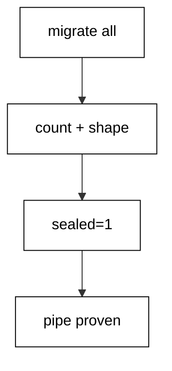

**`learning/code/ex-77-validate-after-migrate-seals-the-pipe/Program.cs`**:

```csharp
// Example 77: Validate After Migrate Seals the Pipe.
// Applied equals assembly and columns match the set: the gate closes green.
using Microsoft.EntityFrameworkCore; // => context, Migrate, and query entry points

string Host() // => one host lookup shared by every connection
{ // => host block opens
    return Environment.GetEnvironmentVariable("PGHOST") ?? "localhost"; // => service alias on the unit network
} // => host lookup ends here

string Port() // => one port lookup shared by every connection
{ // => port block opens
    return Environment.GetEnvironmentVariable("PGPORT") ?? "5432"; // => standard PostgreSQL port
} // => port lookup ends here

string Db() // => one database lookup shared by every connection
{ // => database block opens
    return Environment.GetEnvironmentVariable("PGDATABASE") ?? "postgres"; // => the service database name
} // => database lookup ends here

string DbUser() // => one user lookup shared by every connection
{ // => user block opens
    return Environment.GetEnvironmentVariable("PGUSER") ?? "postgres"; // => trust-auth superuser, no password
} // => user lookup ends here

string ConnectionString() // => one builder for the Npgsql connection string
{ // => string block opens
    return $"Host={Host()};Port={Port()};Database={Db()};Username={DbUser()}"; // => trust auth needs no password
} // => connection string ends here

using var ctx = new GatesDb( // => one context per program run
    new DbContextOptionsBuilder<GatesDb>().UseNpgsql(ConnectionString()).Options
); // => Npgsql provider with our string
ctx.Database.OpenConnection(); // => open once for every inspection query below

string Scalar(string sql) // => one-row, one-column inspection queries
{ // => scalar block opens
    using var cmd = ctx.Database.GetDbConnection().CreateCommand(); // => command on the open connection
    cmd.CommandText = sql; // => read-only inspection SQL
    object? value = cmd.ExecuteScalar(); // => the single answer
    return value?.ToString() ?? "null"; // => text for printing, null-safe
} // => scalar helper ends here

ctx.Database.Migrate(); // => apply M01 then M02 in ID order
int applied = ctx.Database.GetAppliedMigrations().Count(); // => versions the database ran
int pending = ctx.Database.GetPendingMigrations().Count(); // => versions still waiting
string cols = Scalar(
    "SELECT string_agg(column_name, ',' ORDER BY ordinal_position) FROM information_schema.columns WHERE table_name = 'Gates'"
); // => live columns in order
Console.WriteLine($"sealed={(applied == 2 && pending == 0 && cols == "Id,Name,Zone" ? 1 : 0)}"); // => Output: sealed=1

public class Gate // => the entity mapped to the Gates table
{ // => entity block opens
    public int Id { get; set; } // => identity key generated by PostgreSQL
    public string Name { get; set; } = ""; // => required name column
    public string? Zone { get; set; } // => nullable zone added by M02
} // => entity ends here

public class GatesDb : DbContext // => the context Migrate discovers migrations from
{ // => context block opens
    public GatesDb(DbContextOptions<GatesDb> options)
        : base(options) { } // => options carry the connection string

    public DbSet<Gate> Gates => Set<Gate>(); // => the one set this example queries
} // => context ends here
```

**`learning/code/ex-77-validate-after-migrate-seals-the-pipe/Migrations.cs`**:

```csharp
// Migrations for Example 77: validate after migrate seals the pipe.
// Applied equals assembly and the columns match: the release gate closes green.
using Microsoft.EntityFrameworkCore.Infrastructure; // => context attribute lives here
using Microsoft.EntityFrameworkCore.Migrations; // => migration base types live here
using Npgsql.EntityFrameworkCore.PostgreSQL.Metadata; // => identity strategy annotations live here

namespace App.Migrations; // => migrations live in their own namespace

[DbContext(typeof(GatesDb))] // => bind this version to the GatesDb context
[Migration("20260101000001_CreateGates")] // => first version: the create
public partial class CreateGates : Migration // => one class per migration file
{ // => class block opens
    protected override void Up(MigrationBuilder migrationBuilder) // => forward change runs on migrate
    { // => forward block opens
        migrationBuilder.CreateTable( // => the create this migration owns
            name: "Gates", // => table name the program queries back
            columns: table => new // => column map follows
            { // => column block opens
                Id = table
                    .Column<int>(type: "integer", nullable: false) // => surrogate key, never null
                    .Annotation(
                        "Npgsql:ValueGenerationStrategy",
                        NpgsqlValueGenerationStrategy.IdentityByDefaultColumn
                    ), // => serial-style identity
                Name = table.Column<string>(type: "text", nullable: false), // => gate name, required
            }, // => column map ends
            constraints: table => // => key rules follow
            { // => constraint block opens
                table.PrimaryKey("PK_Gates", x => x.Id); // => primary key on the identity column
            }
        ); // => create-table call ends
    } // => forward change ends

    protected override void Down(MigrationBuilder migrationBuilder) // => reverse change for migrate-back
    { // => reverse block opens
        migrationBuilder.DropTable( // => undo is the mirror image
            name: "Gates"
        ); // => drop what Up created
    } // => reverse change ends
} // => first migration ends here

[DbContext(typeof(GatesDb))] // => bind this version to the GatesDb context
[Migration("20260101000002_AddZone77")] // => second version: only the alter
public partial class AddZone77 : Migration // => the alter lives alone, V1 untouched
{ // => class block opens
    protected override void Up(MigrationBuilder migrationBuilder) // => forward change runs on migrate
    { // => forward block opens
        migrationBuilder.AddColumn<string>( // => grow the table by one column
            name: "Zone", // => new column the gate checks
            table: "Gates", // => the table M01 created
            type: "text", // => free-form zone text
            nullable: true
        ); // => nullable so existing rows survive
    } // => forward change ends

    protected override void Down(MigrationBuilder migrationBuilder) // => reverse change for migrate-back
    { // => reverse block opens
        migrationBuilder.DropColumn( // => undo removes the added column
            name: "Zone", // => the column Up added
            table: "Gates"
        ); // => from the table Up altered
    } // => reverse change ends
} // => second migration ends here
```

**Output** (`learning/code/ex-77-validate-after-migrate-seals-the-pipe/expected/main.stdout.txt`):

```text
sealed=1
```

**Key takeaway**: Assert applied, pending, and shape after every migrate: the seal certifies the deploy input.

**Why it matters**: Pipelines that migrate and proceed on exit code alone miss the failures exit codes cannot see: a migration that applied the wrong count, a pending version nobody noticed, a column with the right name and the wrong type. The post-migrate seal checks the outcome, not the process — counts and shapes that downstream steps actually depend on. It costs one query and converts an entire class of silent deploy corruption into a loud gate failure at the safest moment: before traffic meets the schema.

---

### Example 78: Final Review, Full Loop to Production

The course closes where production lives: a `Finale` table created, widened with `Score`, and backfilled from existing rows — the beginner core, the intermediate fill, and the advanced verification in three versions. The program seeds under the base, migrates the widen plus fill, then aggregates title-score pairs in order.

The golden line and history count prove the full loop: data preserved, values derived, three versions recorded. Every cluster contributed exactly one technique to this table.

(Concepts: co-13, co-16.)

**`learning/code/ex-78-final-review-full-loop-to-production/Program.cs`**:

```csharp
// Example 78: Final Review, Full Loop to Production.
// Create, widen, backfill, verify: every stage lands in one triple-version pass.
using Microsoft.EntityFrameworkCore; // => context, Migrate, and query entry points

string Host() // => one host lookup shared by every connection
{ // => host block opens
    return Environment.GetEnvironmentVariable("PGHOST") ?? "localhost"; // => service alias on the unit network
} // => host lookup ends here

string Port() // => one port lookup shared by every connection
{ // => port block opens
    return Environment.GetEnvironmentVariable("PGPORT") ?? "5432"; // => standard PostgreSQL port
} // => port lookup ends here

string Db() // => one database lookup shared by every connection
{ // => database block opens
    return Environment.GetEnvironmentVariable("PGDATABASE") ?? "postgres"; // => the service database name
} // => database lookup ends here

string DbUser() // => one user lookup shared by every connection
{ // => user block opens
    return Environment.GetEnvironmentVariable("PGUSER") ?? "postgres"; // => trust-auth superuser, no password
} // => user lookup ends here

string ConnectionString() // => one builder for the Npgsql connection string
{ // => string block opens
    return $"Host={Host()};Port={Port()};Database={Db()};Username={DbUser()}"; // => trust auth needs no password
} // => connection string ends here

using var ctx = new FinaleDb( // => one context per program run
    new DbContextOptionsBuilder<FinaleDb>().UseNpgsql(ConnectionString()).Options
); // => Npgsql provider with our string
ctx.Database.OpenConnection(); // => open once for every inspection query below

void Exec(string sql) // => raw writes list only columns that exist now
{ // => exec block opens
    using var cmd = ctx.Database.GetDbConnection().CreateCommand(); // => command on the open connection
    cmd.CommandText = sql; // => the seeding write
    cmd.ExecuteNonQuery(); // => run it, ignore the count
} // => exec helper ends here

string Scalar(string sql) // => one-row, one-column inspection queries
{ // => scalar block opens
    using var cmd = ctx.Database.GetDbConnection().CreateCommand(); // => command on the open connection
    cmd.CommandText = sql; // => read-only inspection SQL
    object? value = cmd.ExecuteScalar(); // => the single answer
    return value?.ToString() ?? "null"; // => text for printing, null-safe
} // => scalar helper ends here

ctx.Database.Migrate("20260101000001_CreateFinale"); // => apply only M01 first
Exec("DELETE FROM \"Finale\""); // => start from zero rows so the double run prints alike
Exec("INSERT INTO \"Finale\" (\"Title\") VALUES ('go'), ('stop')"); // => two titles under the M01 schema
ctx.Database.Migrate(); // => M02 widens, M03 backfills every row
Console.WriteLine(
    $"final={Scalar("SELECT count(*) FROM \"__EFMigrationsHistory\"")} golden={Scalar("SELECT string_agg(\"Title\" || ':' || \"Score\", ',' ORDER BY \"Title\") FROM \"Finale\"")}"
); // => Output: final=3 golden=go:20,stop:40

public class FinaleRow // => the entity mapped to the Finale table
{ // => entity block opens
    public int Id { get; set; } // => identity key generated by PostgreSQL
    public string Title { get; set; } = ""; // => required title column
    public int? Score { get; set; } // => nullable until M03 fills it
} // => entity ends here

public class FinaleDb : DbContext // => the context Migrate discovers migrations from
{ // => context block opens
    public FinaleDb(DbContextOptions<FinaleDb> options)
        : base(options) { } // => options carry the connection string

    public DbSet<FinaleRow> Finale => Set<FinaleRow>(); // => the one set this example queries
} // => context ends here
```

**`learning/code/ex-78-final-review-full-loop-to-production/Migrations.cs`**:

```csharp
// Migrations for Example 78: the final review, the full loop to production.
// Create, widen, backfill: every stage lands in one triple-version program.
using Microsoft.EntityFrameworkCore.Infrastructure; // => context attribute lives here
using Microsoft.EntityFrameworkCore.Migrations; // => migration base types live here
using Npgsql.EntityFrameworkCore.PostgreSQL.Metadata; // => identity strategy annotations live here

namespace App.Migrations; // => migrations live in their own namespace

[DbContext(typeof(FinaleDb))] // => bind this version to the FinaleDb context
[Migration("20260101000001_CreateFinale")] // => first version: the create
public partial class CreateFinale : Migration // => one class per migration file
{ // => class block opens
    protected override void Up(MigrationBuilder migrationBuilder) // => forward change runs on migrate
    { // => forward block opens
        migrationBuilder.CreateTable( // => the create this migration owns
            name: "Finale", // => table name the program queries back
            columns: table => new // => column map follows
            { // => column block opens
                Id = table
                    .Column<int>(type: "integer", nullable: false) // => surrogate key, never null
                    .Annotation(
                        "Npgsql:ValueGenerationStrategy",
                        NpgsqlValueGenerationStrategy.IdentityByDefaultColumn
                    ), // => serial-style identity
                Title = table.Column<string>(type: "text", nullable: false), // => finale title, required
            }, // => column map ends
            constraints: table => // => key rules follow
            { // => constraint block opens
                table.PrimaryKey("PK_Finale", x => x.Id); // => primary key on the identity column
            }
        ); // => create-table call ends
    } // => forward change ends

    protected override void Down(MigrationBuilder migrationBuilder) // => reverse change for migrate-back
    { // => reverse block opens
        migrationBuilder.DropTable( // => undo is the mirror image
            name: "Finale"
        ); // => drop what Up created
    } // => reverse change ends
} // => first migration ends here

[DbContext(typeof(FinaleDb))] // => bind this version to the FinaleDb context
[Migration("20260101000002_AddScore")] // => second version: only the schema step
public partial class AddScore : Migration // => schema first, data second
{ // => class block opens
    protected override void Up(MigrationBuilder migrationBuilder) // => forward change runs on migrate
    { // => forward block opens
        migrationBuilder.AddColumn<int>( // => grow the table by one column
            name: "Score", // => new column the backfill fills
            table: "Finale", // => the table M01 created
            type: "integer", // => whole-unit score amounts
            nullable: true
        ); // => nullable until M03 fills it
    } // => forward change ends

    protected override void Down(MigrationBuilder migrationBuilder) // => reverse change for migrate-back
    { // => reverse block opens
        migrationBuilder.DropColumn( // => undo removes the added column
            name: "Score", // => the column Up added
            table: "Finale"
        ); // => from the table Up altered
    } // => reverse change ends
} // => second migration ends here

[DbContext(typeof(FinaleDb))] // => bind this version to the FinaleDb context
[Migration("20260101000003_FillScore")] // => third version: the data step
public partial class FillScore : Migration // => titles become scores by length
{ // => class block opens
    protected override void Up(MigrationBuilder migrationBuilder) // => forward change runs on migrate
    { // => forward block opens
        migrationBuilder.Sql(
            "UPDATE \"Finale\" SET \"Score\" = length(\"Title\") * 10 WHERE \"Score\" IS NULL"
        ); // => ten per letter, no exceptions
    } // => forward change ends

    protected override void Down(MigrationBuilder migrationBuilder) // => reverse change for migrate-back
    { // => reverse block opens
        migrationBuilder.Sql("UPDATE \"Finale\" SET \"Score\" = NULL"); // => undo clears the derived scores
    } // => reverse change ends
} // => third migration ends here
```

**Output** (`learning/code/ex-78-final-review-full-loop-to-production/expected/main.stdout.txt`):

```text
final=3 golden=go:20,stop:40
```

**Key takeaway**: Close the loop on one table: create, widen, backfill, verify — the whole course in three versions.

**Why it matters**: Final reviews exist because real schemas never use one technique at a time — every production table carries its creation, its fills, its renames, and its scars in a single history. Composing the full loop on `Finale` proves the clusters interoperate: the widen from the locking chapter's caution, the fill from the backfill chapter's guards, the golden check from the diagnosis chapter's evidence habit. A course that ends in composition, not in another isolated trick, graduates readers who think in lifecycles instead of in statements.
