Examples 1–25 build the EF Core migration core loop from nothing: versioned C# classes that create and alter tables (Examples 1–8), the `__EFMigrationsHistory` table and ordering rules that keep teams honest (Examples 9–17), and rollback written as forward, compensating migrations (Examples 18–25). Every example is a complete, runnable C# program under `learning/code/` driving a real PostgreSQL container; run each with the command in its own `run.yaml`.

---

### Example 1: Create Your First Table

A migration is a versioned C# class that describes one schema change. This example keeps it as small as possible: a single `M01` class that creates a `Books` table. `Database.Migrate()` applies it, records the run in the `__EFMigrationsHistory` table, and never runs it twice against the same database.

The `[Migration]` attribute carries the contract: the timestamp prefix fixes the apply order and the name documents intent. The `[DbContext]` attribute above it binds the version to the BooksDb context, which is what lets Migrate discover it at all. The program migrates, then reads the history table back to prove the run was recorded.

(Concepts: co-01, co-03.)

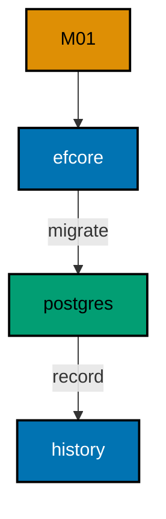

**`learning/code/ex-01-create-your-first-table/Program.cs`**:

```csharp
// Example 1: Create Your First Table.
// One versioned migration creates one table.
using Microsoft.EntityFrameworkCore; // => context, Migrate, and query entry points

string Host() // => one host lookup shared by every connection
{ // => host block opens
    return Environment.GetEnvironmentVariable("PGHOST") ?? "localhost"; // => service alias on the unit network
} // => host lookup ends here

string Port() // => one port lookup shared by every connection
{ // => port block opens
    return Environment.GetEnvironmentVariable("PGPORT") ?? "5432"; // => standard PostgreSQL port
} // => port lookup ends here

string Db() // => one database lookup shared by every connection
{ // => database block opens
    return Environment.GetEnvironmentVariable("PGDATABASE") ?? "postgres"; // => the service database name
} // => database lookup ends here

string DbUser() // => one user lookup shared by every connection
{ // => user block opens
    return Environment.GetEnvironmentVariable("PGUSER") ?? "postgres"; // => trust-auth superuser, no password
} // => user lookup ends here

string ConnectionString() // => one builder for the Npgsql connection string
{ // => string block opens
    return $"Host={Host()};Port={Port()};Database={Db()};Username={DbUser()}"; // => trust auth needs no password
} // => connection string ends here

using var ctx = new BooksDb( // => one context per program run
    new DbContextOptionsBuilder<BooksDb>().UseNpgsql(ConnectionString()).Options
); // => Npgsql provider with our string
ctx.Database.Migrate(); // => apply pending migrations; re-runs find nothing new
ctx.Books.ExecuteDelete(); // => start from zero rows so the double run prints alike
ctx.Books.Add(new Book { Title = "Dune" }); // => one seed row to prove the table works
ctx.SaveChanges(); // => persist the demo row
Console.WriteLine($"books={ctx.Books.Count()}"); // => Output: books=1
foreach (
    var row in ctx.Database.SqlQueryRaw<string>(
        "SELECT \"MigrationId\" FROM \"__EFMigrationsHistory\" ORDER BY \"MigrationId\""
    )
) // => history IDs in apply order
{ // => history block opens
    Console.WriteLine($"history={row}"); // => Output: history=20260101000001_CreateBooks
} // => history walk ends here

public class Book // => the entity mapped to the Books table
{ // => entity block opens
    public int Id { get; set; } // => identity key generated by PostgreSQL
    public string Title { get; set; } = ""; // => required title column
} // => entity ends here

public class BooksDb : DbContext // => the context Migrate discovers migrations from
{ // => context block opens
    public BooksDb(DbContextOptions<BooksDb> options)
        : base(options) { } // => options carry the connection string

    public DbSet<Book> Books => Set<Book>(); // => the one set this example queries
} // => context ends here
```

**`learning/code/ex-01-create-your-first-table/Migrations.cs`**:

```csharp
// Migration M01: create the Books table.
// One migration holds exactly one schema change.
using Microsoft.EntityFrameworkCore.Infrastructure; // => context attribute lives here
using Microsoft.EntityFrameworkCore.Migrations; // => migration base types live here
using Npgsql.EntityFrameworkCore.PostgreSQL.Metadata; // => identity strategy annotations live here

namespace App.Migrations; // => migrations live in their own namespace

[DbContext(typeof(BooksDb))] // => bind this version to the BooksDb context
[Migration("20260101000001_CreateBooks")] // => the ID fixes apply order; the name documents intent
public partial class CreateBooks : Migration // => one class per migration file
{
    protected override void Up(MigrationBuilder migrationBuilder) // => forward change runs on migrate
    { // => forward block opens
        migrationBuilder.CreateTable( // => the one schema change this migration owns
            name: "Books", // => table name the program queries back
            columns: table => new // => column map follows
            { // => column block opens
                Id = table
                    .Column<int>(type: "integer", nullable: false) // => surrogate key, never null
                    .Annotation(
                        "Npgsql:ValueGenerationStrategy",
                        NpgsqlValueGenerationStrategy.IdentityByDefaultColumn
                    ), // => serial-style identity
                Title = table.Column<string>(type: "text", nullable: false), // => book title, required
            }, // => column map ends
            constraints: table => // => key rules follow
            { // => constraint block opens
                table.PrimaryKey("PK_Books", x => x.Id); // => primary key on the identity column
            }
        ); // => create-table call ends
    } // => forward change ends

    protected override void Down(MigrationBuilder migrationBuilder) // => reverse change for migrate-back
    { // => reverse block opens
        migrationBuilder.DropTable( // => undo is the mirror image
            name: "Books"
        ); // => drop what Up created
    } // => reverse change ends
} // => migration class ends
```

**Output** (`learning/code/ex-01-create-your-first-table/expected/main.stdout.txt`):

```text
books=1
history=20260101000001_CreateBooks
```

**Key takeaway**: Name migrations `YYYYMMDDHHMMSS_Description`; EF Core applies them in ID order exactly once.

**Why it matters**: Versioned migration classes turn schema changes into artifacts a team can review, approve, and replay. Hand-run SQL lives only in whoever typed it, so two environments drift apart the moment someone improvises a fix on one of them. A class under version control carries its intent in its ID, its content in a diff, and its outcome in the history table. That chain is what lets a reviewer approve a change on Monday and trust it on production on Friday, because the thing that ran is byte-identical to the thing that was reviewed.

---

### Example 2: Add a Column with Alter

Schemas grow one column at a time, and each growth is its own migration. Here `M01` creates an `Authors` table and `M02` adds a nullable `Email` column. Nothing in `M01` is edited: the history stays append-only.

The program migrates both versions, then asks `information_schema` for the table's columns in ordinal order. The output lists all three columns, proving the alter landed on top of the create without touching existing structure.

(Concepts: co-01.)

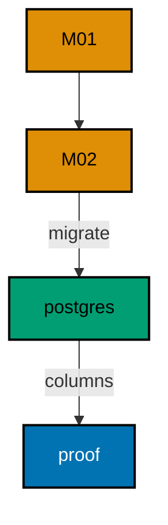

**`learning/code/ex-02-add-a-column-with-alter/Program.cs`**:

```csharp
// Example 2: Add a Column with Alter.
// V2 alters the table V1 created; V1 is never edited.
using Microsoft.EntityFrameworkCore; // => context, Migrate, and query entry points

string Host() // => one host lookup shared by every connection
{ // => host block opens
    return Environment.GetEnvironmentVariable("PGHOST") ?? "localhost"; // => service alias on the unit network
} // => host lookup ends here

string Port() // => one port lookup shared by every connection
{ // => port block opens
    return Environment.GetEnvironmentVariable("PGPORT") ?? "5432"; // => standard PostgreSQL port
} // => port lookup ends here

string Db() // => one database lookup shared by every connection
{ // => database block opens
    return Environment.GetEnvironmentVariable("PGDATABASE") ?? "postgres"; // => the service database name
} // => database lookup ends here

string DbUser() // => one user lookup shared by every connection
{ // => user block opens
    return Environment.GetEnvironmentVariable("PGUSER") ?? "postgres"; // => trust-auth superuser, no password
} // => user lookup ends here

string ConnectionString() // => one builder for the Npgsql connection string
{ // => string block opens
    return $"Host={Host()};Port={Port()};Database={Db()};Username={DbUser()}"; // => trust auth needs no password
} // => connection string ends here

using var ctx = new AuthorsDb( // => one context per program run
    new DbContextOptionsBuilder<AuthorsDb>().UseNpgsql(ConnectionString()).Options
); // => Npgsql provider with our string
ctx.Database.OpenConnection(); // => open once for every inspection query below

string Scalar(string sql) // => one-row, one-column inspection queries
{ // => scalar block opens
    using var cmd = ctx.Database.GetDbConnection().CreateCommand(); // => command on the open connection
    cmd.CommandText = sql; // => read-only inspection SQL
    object? value = cmd.ExecuteScalar(); // => the single answer
    return value?.ToString() ?? "null"; // => text for printing, null-safe
} // => scalar helper ends here

ctx.Database.Migrate(); // => apply M01 then M02 in ID order
Console.WriteLine(
    $"columns={Scalar("SELECT string_agg(column_name, ',' ORDER BY ordinal_position) FROM information_schema.columns WHERE table_name = 'Authors'")}"
); // => Output: columns=Id,Name,Email

public class Author // => the entity mapped to the Authors table
{ // => entity block opens
    public int Id { get; set; } // => identity key generated by PostgreSQL
    public string Name { get; set; } = ""; // => required name column
    public string? Email { get; set; } // => nullable email added by M02
} // => entity ends here

public class AuthorsDb : DbContext // => the context Migrate discovers migrations from
{ // => context block opens
    public AuthorsDb(DbContextOptions<AuthorsDb> options)
        : base(options) { } // => options carry the connection string

    public DbSet<Author> Authors => Set<Author>(); // => the one set this example queries
} // => context ends here
```

**`learning/code/ex-02-add-a-column-with-alter/Migrations.cs`**:

```csharp
// Migrations for Example 2: create Authors, then add Email.
// M01 holds the create; M02 holds only the alter.
using Microsoft.EntityFrameworkCore.Infrastructure; // => context attribute lives here
using Microsoft.EntityFrameworkCore.Migrations; // => migration base types live here
using Npgsql.EntityFrameworkCore.PostgreSQL.Metadata; // => identity strategy annotations live here

namespace App.Migrations; // => migrations live in their own namespace

[DbContext(typeof(AuthorsDb))] // => bind this version to the AuthorsDb context
[Migration("20260101000001_CreateAuthors")] // => first version: the create
public partial class CreateAuthors : Migration // => one class per migration file
{ // => class block opens
    protected override void Up(MigrationBuilder migrationBuilder) // => forward change runs on migrate
    { // => forward block opens
        migrationBuilder.CreateTable( // => the create this migration owns
            name: "Authors", // => table name the program queries back
            columns: table => new // => column map follows
            { // => column block opens
                Id = table
                    .Column<int>(type: "integer", nullable: false) // => surrogate key, never null
                    .Annotation(
                        "Npgsql:ValueGenerationStrategy",
                        NpgsqlValueGenerationStrategy.IdentityByDefaultColumn
                    ), // => serial-style identity
                Name = table.Column<string>(type: "text", nullable: false), // => author name, required
            }, // => column map ends
            constraints: table => // => key rules follow
            { // => constraint block opens
                table.PrimaryKey("PK_Authors", x => x.Id); // => primary key on the identity column
            }
        ); // => create-table call ends
    } // => forward change ends

    protected override void Down(MigrationBuilder migrationBuilder) // => reverse change for migrate-back
    { // => reverse block opens
        migrationBuilder.DropTable( // => undo is the mirror image
            name: "Authors"
        ); // => drop what Up created
    } // => reverse change ends
} // => first migration ends here

[DbContext(typeof(AuthorsDb))] // => bind this version to the AuthorsDb context
[Migration("20260101000002_AddEmail")] // => second version: only the alter
public partial class AddEmail : Migration // => the alter lives alone, V1 untouched
{ // => class block opens
    protected override void Up(MigrationBuilder migrationBuilder) // => forward change runs on migrate
    { // => forward block opens
        migrationBuilder.AddColumn<string>( // => grow the table by one column
            name: "Email", // => new column the program reads back
            table: "Authors", // => the table M01 created
            type: "text", // => free-form address text
            nullable: true
        ); // => nullable so existing rows survive
    } // => forward change ends

    protected override void Down(MigrationBuilder migrationBuilder) // => reverse change for migrate-back
    { // => reverse block opens
        migrationBuilder.DropColumn( // => undo removes the added column
            name: "Email", // => the column Up added
            table: "Authors"
        ); // => from the table Up altered
    } // => reverse change ends
} // => second migration ends here
```

**Output** (`learning/code/ex-02-add-a-column-with-alter/expected/main.stdout.txt`):

```text
columns=Id,Name,Email
```

**Key takeaway**: Grow tables with new versions; never edit an applied migration to add a column.

**Why it matters**: Append-only history is what lets two developers reason about the same database without talking: every change is a new version with a reviewable diff, and nobody rewrites what someone else already ran. Editing an applied migration would fork every environment that ran the old bytes, hiding the disagreement inside a version both sides claim to share. New versions cost a file and buy a shared past; that trade is the cheapest coordination a team will ever purchase.

---

### Example 3: Migrations Run Once

Running the same migrate twice must change nothing the second time. The program calls Migrate twice against Widgets, then counts applied versions through the context API.

One applied version proves the history comparison works: the second call found nothing pending and applied nothing. Idempotency is what makes retries safe.

(Concepts: co-01, co-05.)

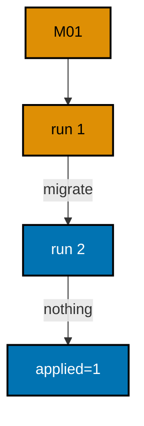

**`learning/code/ex-03-migrations-run-once/Program.cs`**:

```csharp
// Example 3: Migrations Run Once.
// The second Migrate call finds nothing pending and changes nothing.
using Microsoft.EntityFrameworkCore; // => context, Migrate, and query entry points

string Host() // => one host lookup shared by every connection
{ // => host block opens
    return Environment.GetEnvironmentVariable("PGHOST") ?? "localhost"; // => service alias on the unit network
} // => host lookup ends here

string Port() // => one port lookup shared by every connection
{ // => port block opens
    return Environment.GetEnvironmentVariable("PGPORT") ?? "5432"; // => standard PostgreSQL port
} // => port lookup ends here

string Db() // => one database lookup shared by every connection
{ // => database block opens
    return Environment.GetEnvironmentVariable("PGDATABASE") ?? "postgres"; // => the service database name
} // => database lookup ends here

string DbUser() // => one user lookup shared by every connection
{ // => user block opens
    return Environment.GetEnvironmentVariable("PGUSER") ?? "postgres"; // => trust-auth superuser, no password
} // => user lookup ends here

string ConnectionString() // => one builder for the Npgsql connection string
{ // => string block opens
    return $"Host={Host()};Port={Port()};Database={Db()};Username={DbUser()}"; // => trust auth needs no password
} // => connection string ends here

using var ctx = new WidgetsDb( // => one context per program run
    new DbContextOptionsBuilder<WidgetsDb>().UseNpgsql(ConnectionString()).Options
); // => Npgsql provider with our string
ctx.Database.Migrate(); // => first call applies the one pending migration
ctx.Database.Migrate(); // => second call finds nothing pending: idempotent
Console.WriteLine($"applied={ctx.Database.GetAppliedMigrations().Count()}"); // => Output: applied=1

public class Widget // => the entity mapped to the Widgets table
{ // => entity block opens
    public int Id { get; set; } // => identity key generated by PostgreSQL
    public string Label { get; set; } = ""; // => required label column
} // => entity ends here

public class WidgetsDb : DbContext // => the context Migrate discovers migrations from
{ // => context block opens
    public WidgetsDb(DbContextOptions<WidgetsDb> options)
        : base(options) { } // => options carry the connection string

    public DbSet<Widget> Widgets => Set<Widget>(); // => the one set this example queries
} // => context ends here
```

**`learning/code/ex-03-migrations-run-once/Migrations.cs`**:

```csharp
// Migrations for Example 3: one table, applied once.
// Calling Migrate twice still records a single history row.
using Microsoft.EntityFrameworkCore.Infrastructure; // => context attribute lives here
using Microsoft.EntityFrameworkCore.Migrations; // => migration base types live here
using Npgsql.EntityFrameworkCore.PostgreSQL.Metadata; // => identity strategy annotations live here

namespace App.Migrations; // => migrations live in their own namespace

[DbContext(typeof(WidgetsDb))] // => bind this version to the WidgetsDb context
[Migration("20260101000001_CreateWidgets")] // => the only version in this example
public partial class CreateWidgets : Migration // => one class per migration file
{ // => class block opens
    protected override void Up(MigrationBuilder migrationBuilder) // => forward change runs on migrate
    { // => forward block opens
        migrationBuilder.CreateTable( // => the create this migration owns
            name: "Widgets", // => table name the program queries back
            columns: table => new // => column map follows
            { // => column block opens
                Id = table
                    .Column<int>(type: "integer", nullable: false) // => surrogate key, never null
                    .Annotation(
                        "Npgsql:ValueGenerationStrategy",
                        NpgsqlValueGenerationStrategy.IdentityByDefaultColumn
                    ), // => serial-style identity
                Label = table.Column<string>(type: "text", nullable: false), // => widget label, required
            }, // => column map ends
            constraints: table => // => key rules follow
            { // => constraint block opens
                table.PrimaryKey("PK_Widgets", x => x.Id); // => primary key on the identity column
            }
        ); // => create-table call ends
    } // => forward change ends

    protected override void Down(MigrationBuilder migrationBuilder) // => reverse change for migrate-back
    { // => reverse block opens
        migrationBuilder.DropTable( // => undo is the mirror image
            name: "Widgets"
        ); // => drop what Up created
    } // => reverse change ends
} // => migration class ends
```

**Output** (`learning/code/ex-03-migrations-run-once/expected/main.stdout.txt`):

```text
applied=1
```

**Key takeaway**: `Migrate()` is idempotent; re-running it applies nothing twice.

**Why it matters**: Deploy pipelines retry. A container that crashes mid-release runs the migration step again on restart, and idempotency turns that rerun from a corruption risk into a no-op. Without the history comparison, every retry would re-execute DDL against a half-migrated schema. Idempotent migrate calls also make local development fearless: running the app twice never requires resetting the database first.

---

### Example 4: History Table Records Every Run

`__EFMigrationsHistory` holds one row per applied migration, in apply order. Two migrations produce two rows, and dumping them is the fastest way to answer "what ran here?".

The program applies both versions, then selects every history ID in order. The two-line output is the audit trail the rest of the course keeps returning to.

(Concepts: co-03.)

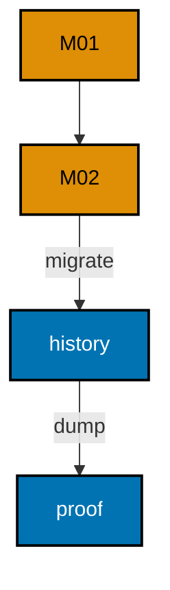

**`learning/code/ex-04-history-table-records-every-run/Program.cs`**:

```csharp
// Example 4: History Table Records Every Run.
// __EFMigrationsHistory holds one row per applied migration, in order.
using Microsoft.EntityFrameworkCore; // => context, Migrate, and query entry points

string Host() // => one host lookup shared by every connection
{ // => host block opens
    return Environment.GetEnvironmentVariable("PGHOST") ?? "localhost"; // => service alias on the unit network
} // => host lookup ends here

string Port() // => one port lookup shared by every connection
{ // => port block opens
    return Environment.GetEnvironmentVariable("PGPORT") ?? "5432"; // => standard PostgreSQL port
} // => port lookup ends here

string Db() // => one database lookup shared by every connection
{ // => database block opens
    return Environment.GetEnvironmentVariable("PGDATABASE") ?? "postgres"; // => the service database name
} // => database lookup ends here

string DbUser() // => one user lookup shared by every connection
{ // => user block opens
    return Environment.GetEnvironmentVariable("PGUSER") ?? "postgres"; // => trust-auth superuser, no password
} // => user lookup ends here

string ConnectionString() // => one builder for the Npgsql connection string
{ // => string block opens
    return $"Host={Host()};Port={Port()};Database={Db()};Username={DbUser()}"; // => trust auth needs no password
} // => connection string ends here

using var ctx = new GadgetsDb( // => one context per program run
    new DbContextOptionsBuilder<GadgetsDb>().UseNpgsql(ConnectionString()).Options
); // => Npgsql provider with our string
ctx.Database.OpenConnection(); // => open once for every inspection query below

List<string> Lines(string sql) // => multi-row, one-column inspection queries
{ // => lines block opens
    using var cmd = ctx.Database.GetDbConnection().CreateCommand(); // => command on the open connection
    cmd.CommandText = sql; // => read-only inspection SQL
    var rows = new List<string>(); // => collected output lines
    using var reader = cmd.ExecuteReader(); // => run the read
    while (reader.Read()) // => walk every returned row
    { // => row block opens
        rows.Add(reader.GetString(0)); // => first column as text
    } // => row walk ends here
    return rows; // => lines ready to print
} // => lines helper ends here

ctx.Database.Migrate(); // => apply both migrations in ID order
foreach (
    string row in Lines(
        "SELECT \"MigrationId\" FROM \"__EFMigrationsHistory\" ORDER BY \"MigrationId\""
    )
) // => history IDs in apply order
{ // => history block opens
    Console.WriteLine($"history={row}"); // => Output: two history lines, one per migration
} // => history walk ends here

public class Gadget // => the entity mapped to the Gadgets table
{ // => entity block opens
    public int Id { get; set; } // => identity key generated by PostgreSQL
    public string Sku { get; set; } = ""; // => required sku column
    public int Stock { get; set; } // => stock column added by M02
} // => entity ends here

public class GadgetsDb : DbContext // => the context Migrate discovers migrations from
{ // => context block opens
    public GadgetsDb(DbContextOptions<GadgetsDb> options)
        : base(options) { } // => options carry the connection string

    public DbSet<Gadget> Gadgets => Set<Gadget>(); // => the one set this example queries
} // => context ends here
```

**`learning/code/ex-04-history-table-records-every-run/Migrations.cs`**:

```csharp
// Migrations for Example 4: two tables record two history rows.
// The history table remembers every migration that ran.
using Microsoft.EntityFrameworkCore.Infrastructure; // => context attribute lives here
using Microsoft.EntityFrameworkCore.Migrations; // => migration base types live here
using Npgsql.EntityFrameworkCore.PostgreSQL.Metadata; // => identity strategy annotations live here

namespace App.Migrations; // => migrations live in their own namespace

[DbContext(typeof(GadgetsDb))] // => bind this version to the GadgetsDb context
[Migration("20260101000001_CreateGadgets")] // => first version: the create
public partial class CreateGadgets : Migration // => one class per migration file
{ // => class block opens
    protected override void Up(MigrationBuilder migrationBuilder) // => forward change runs on migrate
    { // => forward block opens
        migrationBuilder.CreateTable( // => the create this migration owns
            name: "Gadgets", // => table name the program queries back
            columns: table => new // => column map follows
            { // => column block opens
                Id = table
                    .Column<int>(type: "integer", nullable: false) // => surrogate key, never null
                    .Annotation(
                        "Npgsql:ValueGenerationStrategy",
                        NpgsqlValueGenerationStrategy.IdentityByDefaultColumn
                    ), // => serial-style identity
                Sku = table.Column<string>(type: "text", nullable: false), // => gadget sku, required
            }, // => column map ends
            constraints: table => // => key rules follow
            { // => constraint block opens
                table.PrimaryKey("PK_Gadgets", x => x.Id); // => primary key on the identity column
            }
        ); // => create-table call ends
    } // => forward change ends

    protected override void Down(MigrationBuilder migrationBuilder) // => reverse change for migrate-back
    { // => reverse block opens
        migrationBuilder.DropTable( // => undo is the mirror image
            name: "Gadgets"
        ); // => drop what Up created
    } // => reverse change ends
} // => first migration ends here

[DbContext(typeof(GadgetsDb))] // => bind this version to the GadgetsDb context
[Migration("20260101000002_AddStock")] // => second version: only the alter
public partial class AddStock : Migration // => the alter lives alone, V1 untouched
{ // => class block opens
    protected override void Up(MigrationBuilder migrationBuilder) // => forward change runs on migrate
    { // => forward block opens
        migrationBuilder.AddColumn<int>( // => grow the table by one column
            name: "Stock", // => new column the program reads back
            table: "Gadgets", // => the table M01 created
            type: "integer", // => whole-unit stock counts
            nullable: false, // => every row gets a value
            defaultValue: 0
        ); // => existing rows start at zero
    } // => forward change ends

    protected override void Down(MigrationBuilder migrationBuilder) // => reverse change for migrate-back
    { // => reverse block opens
        migrationBuilder.DropColumn( // => undo removes the added column
            name: "Stock", // => the column Up added
            table: "Gadgets"
        ); // => from the table Up altered
    } // => reverse change ends
} // => second migration ends here
```

**Output** (`learning/code/ex-04-history-table-records-every-run/expected/main.stdout.txt`):

```text
history=20260101000001_CreateGadgets
history=20260101000002_AddStock
```

**Key takeaway**: Query `__EFMigrationsHistory` first whenever a database looks wrong.

**Why it matters**: Production diagnosis starts with facts, and the history table is the cheapest fact available: one ordered query lists exactly what ran. Teams that guess at schema state waste incidents re-checking assumptions, while a history dump settles "did M02 run here?" in seconds. Building the habit early pays off in every later chapter, because conflicts, baselines, and drift all reduce to comparing this table against the assembly.

---

### Example 5: Version Numbers Order Execution

The `MigrationId` string decides the apply order, not file names or creation time. Three sequential IDs on Parts produce three history rows in the same order.

The program prints that order as one comma-joined line. Matching stamp order to ID order proves the sort is lexical: zero-padded timestamps keep string order and time order identical.

(Concepts: co-01, co-04.)

**`learning/code/ex-05-version-numbers-order-execution/Program.cs`**:

```csharp
// Example 5: Version Numbers Order Execution.
// Three IDs sort into the apply order; the history proves it.
using Microsoft.EntityFrameworkCore; // => context, Migrate, and query entry points

string Host() // => one host lookup shared by every connection
{ // => host block opens
    return Environment.GetEnvironmentVariable("PGHOST") ?? "localhost"; // => service alias on the unit network
} // => host lookup ends here

string Port() // => one port lookup shared by every connection
{ // => port block opens
    return Environment.GetEnvironmentVariable("PGPORT") ?? "5432"; // => standard PostgreSQL port
} // => port lookup ends here

string Db() // => one database lookup shared by every connection
{ // => database block opens
    return Environment.GetEnvironmentVariable("PGDATABASE") ?? "postgres"; // => the service database name
} // => database lookup ends here

string DbUser() // => one user lookup shared by every connection
{ // => user block opens
    return Environment.GetEnvironmentVariable("PGUSER") ?? "postgres"; // => trust-auth superuser, no password
} // => user lookup ends here

string ConnectionString() // => one builder for the Npgsql connection string
{ // => string block opens
    return $"Host={Host()};Port={Port()};Database={Db()};Username={DbUser()}"; // => trust auth needs no password
} // => connection string ends here

using var ctx = new PartsDb( // => one context per program run
    new DbContextOptionsBuilder<PartsDb>().UseNpgsql(ConnectionString()).Options
); // => Npgsql provider with our string
ctx.Database.OpenConnection(); // => open once for every inspection query below

string Scalar(string sql) // => one-row, one-column inspection queries
{ // => scalar block opens
    using var cmd = ctx.Database.GetDbConnection().CreateCommand(); // => command on the open connection
    cmd.CommandText = sql; // => read-only inspection SQL
    object? value = cmd.ExecuteScalar(); // => the single answer
    return value?.ToString() ?? "null"; // => text for printing, null-safe
} // => scalar helper ends here

ctx.Database.Migrate(); // => apply M01, M02, M03 in ID order
Console.WriteLine(
    $"order={Scalar("SELECT string_agg(\"MigrationId\", ',' ORDER BY \"MigrationId\") FROM \"__EFMigrationsHistory\"")}"
); // => one line: the three IDs in apply order

public class Part // => the entity mapped to the Parts table
{ // => entity block opens
    public int Id { get; set; } // => identity key generated by PostgreSQL
    public string Code { get; set; } = ""; // => required code column
    public string? Bin { get; set; } // => nullable bin added by M02
    public int ReorderLevel { get; set; } // => threshold added by M03
} // => entity ends here

public class PartsDb : DbContext // => the context Migrate discovers migrations from
{ // => context block opens
    public PartsDb(DbContextOptions<PartsDb> options)
        : base(options) { } // => options carry the connection string

    public DbSet<Part> Parts => Set<Part>(); // => the one set this example queries
} // => context ends here
```

**`learning/code/ex-05-version-numbers-order-execution/Migrations.cs`**:

```csharp
// Migrations for Example 5: three versions apply in ID order.
// The ID string decides the order, not the file creation time.
using Microsoft.EntityFrameworkCore.Infrastructure; // => context attribute lives here
using Microsoft.EntityFrameworkCore.Migrations; // => migration base types live here
using Npgsql.EntityFrameworkCore.PostgreSQL.Metadata; // => identity strategy annotations live here

namespace App.Migrations; // => migrations live in their own namespace

[DbContext(typeof(PartsDb))] // => bind this version to the PartsDb context
[Migration("20260101000001_CreateParts")] // => first version: the create
public partial class CreateParts : Migration // => one class per migration file
{ // => class block opens
    protected override void Up(MigrationBuilder migrationBuilder) // => forward change runs on migrate
    { // => forward block opens
        migrationBuilder.CreateTable( // => the create this migration owns
            name: "Parts", // => table name the program queries back
            columns: table => new // => column map follows
            { // => column block opens
                Id = table
                    .Column<int>(type: "integer", nullable: false) // => surrogate key, never null
                    .Annotation(
                        "Npgsql:ValueGenerationStrategy",
                        NpgsqlValueGenerationStrategy.IdentityByDefaultColumn
                    ), // => serial-style identity
                Code = table.Column<string>(type: "text", nullable: false), // => part code, required
            }, // => column map ends
            constraints: table => // => key rules follow
            { // => constraint block opens
                table.PrimaryKey("PK_Parts", x => x.Id); // => primary key on the identity column
            }
        ); // => create-table call ends
    } // => forward change ends

    protected override void Down(MigrationBuilder migrationBuilder) // => reverse change for migrate-back
    { // => reverse block opens
        migrationBuilder.DropTable( // => undo is the mirror image
            name: "Parts"
        ); // => drop what Up created
    } // => reverse change ends
} // => first migration ends here

[DbContext(typeof(PartsDb))] // => bind this version to the PartsDb context
[Migration("20260101000002_AddBin")] // => second version: only the alter
public partial class AddBin : Migration // => the alter lives alone, V1 untouched
{ // => class block opens
    protected override void Up(MigrationBuilder migrationBuilder) // => forward change runs on migrate
    { // => forward block opens
        migrationBuilder.AddColumn<string>( // => grow the table by one column
            name: "Bin", // => new column the program reads back
            table: "Parts", // => the table M01 created
            type: "text", // => free-form bin label
            nullable: true
        ); // => nullable so existing rows survive
    } // => forward change ends

    protected override void Down(MigrationBuilder migrationBuilder) // => reverse change for migrate-back
    { // => reverse block opens
        migrationBuilder.DropColumn( // => undo removes the added column
            name: "Bin", // => the column Up added
            table: "Parts"
        ); // => from the table Up altered
    } // => reverse change ends
} // => second migration ends here

[DbContext(typeof(PartsDb))] // => bind this version to the PartsDb context
[Migration("20260101000003_AddReorderLevel")] // => third version: another alter
public partial class AddReorderLevel : Migration // => each version stays reviewable alone
{ // => class block opens
    protected override void Up(MigrationBuilder migrationBuilder) // => forward change runs on migrate
    { // => forward block opens
        migrationBuilder.AddColumn<int>( // => grow the table by one column
            name: "ReorderLevel", // => new column the program reads back
            table: "Parts", // => the table M01 created
            type: "integer", // => whole-unit reorder threshold
            nullable: false, // => every row gets a value
            defaultValue: 0
        ); // => existing rows start at zero
    } // => forward change ends

    protected override void Down(MigrationBuilder migrationBuilder) // => reverse change for migrate-back
    { // => reverse block opens
        migrationBuilder.DropColumn( // => undo removes the added column
            name: "ReorderLevel", // => the column Up added
            table: "Parts"
        ); // => from the table Up altered
    } // => reverse change ends
} // => third migration ends here
```

**Output** (`learning/code/ex-05-version-numbers-order-execution/expected/main.stdout.txt`):

```text
order=20260101000001_CreateParts,20260101000002_AddBin,20260101000003_AddReorderLevel
```

**Key takeaway**: IDs sort the versions; keep stamps zero-padded so string order matches time order.

**Why it matters**: Teams generate IDs from clocks, and clocks produce fixed-width stamps precisely so that alphabetical order equals chronological order. A short or unpadded counter would sort `M10` before `M2` and silently reorder history. The convention costs nothing at authoring time and removes a whole class of ordering surprises, which is why every later chapter can assume the history reads oldest-first without sorting tricks.

---

### Example 6: Names Document Intent

The name half of the ID is a verb phrase a reviewer reads: create, add, index. The program checks every history ID against the team's naming rule — a stamp, an underscore, a capital verb — and counts the matches.

Three matches mean every version documents its own intent. The history reads as a change log without opening a single file.

(Concepts: co-01.)

**`learning/code/ex-06-names-document-intent/Program.cs`**:

```csharp
// Example 6: Names Document Intent.
// Every history ID carries a timestamp plus a verb phrase a reviewer reads.
using Microsoft.EntityFrameworkCore; // => context, Migrate, and query entry points

string Host() // => one host lookup shared by every connection
{ // => host block opens
    return Environment.GetEnvironmentVariable("PGHOST") ?? "localhost"; // => service alias on the unit network
} // => host lookup ends here

string Port() // => one port lookup shared by every connection
{ // => port block opens
    return Environment.GetEnvironmentVariable("PGPORT") ?? "5432"; // => standard PostgreSQL port
} // => port lookup ends here

string Db() // => one database lookup shared by every connection
{ // => database block opens
    return Environment.GetEnvironmentVariable("PGDATABASE") ?? "postgres"; // => the service database name
} // => database lookup ends here

string DbUser() // => one user lookup shared by every connection
{ // => user block opens
    return Environment.GetEnvironmentVariable("PGUSER") ?? "postgres"; // => trust-auth superuser, no password
} // => user lookup ends here

string ConnectionString() // => one builder for the Npgsql connection string
{ // => string block opens
    return $"Host={Host()};Port={Port()};Database={Db()};Username={DbUser()}"; // => trust auth needs no password
} // => connection string ends here

using var ctx = new ToolsDb( // => one context per program run
    new DbContextOptionsBuilder<ToolsDb>().UseNpgsql(ConnectionString()).Options
); // => Npgsql provider with our string
ctx.Database.OpenConnection(); // => open once for every inspection query below

List<string> Lines(string sql) // => multi-row, one-column inspection queries
{ // => lines block opens
    using var cmd = ctx.Database.GetDbConnection().CreateCommand(); // => command on the open connection
    cmd.CommandText = sql; // => read-only inspection SQL
    var rows = new List<string>(); // => collected output lines
    using var reader = cmd.ExecuteReader(); // => run the read
    while (reader.Read()) // => walk every returned row
    { // => row block opens
        rows.Add(reader.GetString(0)); // => first column as text
    } // => row walk ends here
    return rows; // => lines ready to print
} // => lines helper ends here

bool NameIsIntent(string id) // => one rule: stamp, underscore, verb phrase
{ // => rule block opens
    return id.Length > 15 && id[14] == '_' && char.IsUpper(id[15]); // => 14-digit stamp, then a capital verb
} // => rule ends here

ctx.Database.Migrate(); // => apply M01, M02, M03 in ID order
int ok = 0; // => count of IDs that document intent
foreach (
    string row in Lines(
        "SELECT \"MigrationId\" FROM \"__EFMigrationsHistory\" ORDER BY \"MigrationId\""
    )
) // => history IDs in apply order
{ // => history block opens
    if (NameIsIntent(row)) // => every ID must read as a change log entry
    { // => match block opens
        ok++; // => one more well-named migration
    } // => match block ends here
} // => history walk ends here
Console.WriteLine($"names-ok={ok}"); // => Output: names-ok=3

public class Tool // => the entity mapped to the Tools table
{ // => entity block opens
    public int Id { get; set; } // => identity key generated by PostgreSQL
    public string Handle { get; set; } = ""; // => required handle column
    public string? SerialNumber { get; set; } // => nullable serial added by M02
} // => entity ends here

public class ToolsDb : DbContext // => the context Migrate discovers migrations from
{ // => context block opens
    public ToolsDb(DbContextOptions<ToolsDb> options)
        : base(options) { } // => options carry the connection string

    public DbSet<Tool> Tools => Set<Tool>(); // => the one set this example queries
} // => context ends here
```

**`learning/code/ex-06-names-document-intent/Migrations.cs`**:

```csharp
// Migrations for Example 6: names document intent.
// Timestamped IDs with verb phrases read as a change log.
using Microsoft.EntityFrameworkCore.Infrastructure; // => context attribute lives here
using Microsoft.EntityFrameworkCore.Migrations; // => migration base types live here
using Npgsql.EntityFrameworkCore.PostgreSQL.Metadata; // => identity strategy annotations live here

namespace App.Migrations; // => migrations live in their own namespace

[DbContext(typeof(ToolsDb))] // => bind this version to the ToolsDb context
[Migration("20260101000001_CreateTools")] // => verb-first name: what the change does
public partial class CreateTools : Migration // => one class per migration file
{ // => class block opens
    protected override void Up(MigrationBuilder migrationBuilder) // => forward change runs on migrate
    { // => forward block opens
        migrationBuilder.CreateTable( // => the create this migration owns
            name: "Tools", // => table name the program queries back
            columns: table => new // => column map follows
            { // => column block opens
                Id = table
                    .Column<int>(type: "integer", nullable: false) // => surrogate key, never null
                    .Annotation(
                        "Npgsql:ValueGenerationStrategy",
                        NpgsqlValueGenerationStrategy.IdentityByDefaultColumn
                    ), // => serial-style identity
                Handle = table.Column<string>(type: "text", nullable: false), // => tool handle, required
            }, // => column map ends
            constraints: table => // => key rules follow
            { // => constraint block opens
                table.PrimaryKey("PK_Tools", x => x.Id); // => primary key on the identity column
            }
        ); // => create-table call ends
    } // => forward change ends

    protected override void Down(MigrationBuilder migrationBuilder) // => reverse change for migrate-back
    { // => reverse block opens
        migrationBuilder.DropTable( // => undo is the mirror image
            name: "Tools"
        ); // => drop what Up created
    } // => reverse change ends
} // => first migration ends here

[DbContext(typeof(ToolsDb))] // => bind this version to the ToolsDb context
[Migration("20260101000002_AddSerialNumber")] // => verb-first name: what the change does
public partial class AddSerialNumber : Migration // => the alter lives alone, V1 untouched
{ // => class block opens
    protected override void Up(MigrationBuilder migrationBuilder) // => forward change runs on migrate
    { // => forward block opens
        migrationBuilder.AddColumn<string>( // => grow the table by one column
            name: "SerialNumber", // => new column the program reads back
            table: "Tools", // => the table M01 created
            type: "text", // => free-form serial text
            nullable: true
        ); // => nullable so existing rows survive
    } // => forward change ends

    protected override void Down(MigrationBuilder migrationBuilder) // => reverse change for migrate-back
    { // => reverse block opens
        migrationBuilder.DropColumn( // => undo removes the added column
            name: "SerialNumber", // => the column Up added
            table: "Tools"
        ); // => from the table Up altered
    } // => reverse change ends
} // => second migration ends here

[DbContext(typeof(ToolsDb))] // => bind this version to the ToolsDb context
[Migration("20260101000003_IndexSerialNumber")] // => verb-first name: what the change does
public partial class IndexSerialNumber : Migration // => indexes get their own migration too
{ // => class block opens
    protected override void Up(MigrationBuilder migrationBuilder) // => forward change runs on migrate
    { // => forward block opens
        migrationBuilder.CreateIndex( // => one index, its own versioned step
            name: "IX_Tools_SerialNumber", // => index name the database catalog holds
            table: "Tools", // => the table M01 created
            column: "SerialNumber"
        ); // => the column M02 added
    } // => forward change ends

    protected override void Down(MigrationBuilder migrationBuilder) // => reverse change for migrate-back
    { // => reverse block opens
        migrationBuilder.DropIndex( // => undo removes the added index
            name: "IX_Tools_SerialNumber", // => the index Up added
            table: "Tools"
        ); // => from the table Up altered
    } // => reverse change ends
} // => third migration ends here
```

**Output** (`learning/code/ex-06-names-document-intent/expected/main.stdout.txt`):

```text
names-ok=3
```

**Key takeaway**: Start every migration name with a verb; the history then reads as a change log.

**Why it matters**: Incident reviews happen under pressure, and a history of `Create`, `Add`, and `Drop` entries tells the story without opening files. Vague names like `Update` or `Fix` force every future reader to diff the class to learn what changed, which defeats the purpose of versioning. A naming rule enforced at authoring time compounds across hundreds of migrations into a log the whole team can skim.

---

### Example 7: Alter Safely Keeps Data

Rows inserted after `M01` must survive the `M02` alter. The program migrates to `M01` first, inserts two rows, then migrates fully: the new nullable column fills with `NULL` for the old rows instead of rejecting them.

The check counts rows and nulls together. Two rows and two nulls prove the alter widened the table without touching a single existing value.

(Concepts: co-01, co-06.)

**`learning/code/ex-07-alter-safely-keeps-data/Program.cs`**:

```csharp
// Example 7: Alter Safely Keeps Data.
// Rows inserted after M01 survive the M02 alter untouched.
using Microsoft.EntityFrameworkCore; // => context, Migrate, and query entry points

string Host() // => one host lookup shared by every connection
{ // => host block opens
    return Environment.GetEnvironmentVariable("PGHOST") ?? "localhost"; // => service alias on the unit network
} // => host lookup ends here

string Port() // => one port lookup shared by every connection
{ // => port block opens
    return Environment.GetEnvironmentVariable("PGPORT") ?? "5432"; // => standard PostgreSQL port
} // => port lookup ends here

string Db() // => one database lookup shared by every connection
{ // => database block opens
    return Environment.GetEnvironmentVariable("PGDATABASE") ?? "postgres"; // => the service database name
} // => database lookup ends here

string DbUser() // => one user lookup shared by every connection
{ // => user block opens
    return Environment.GetEnvironmentVariable("PGUSER") ?? "postgres"; // => trust-auth superuser, no password
} // => user lookup ends here

string ConnectionString() // => one builder for the Npgsql connection string
{ // => string block opens
    return $"Host={Host()};Port={Port()};Database={Db()};Username={DbUser()}"; // => trust auth needs no password
} // => connection string ends here

using var ctx = new KeepsDb( // => one context per program run
    new DbContextOptionsBuilder<KeepsDb>().UseNpgsql(ConnectionString()).Options
); // => Npgsql provider with our string
ctx.Database.OpenConnection(); // => open once for every inspection query below

string Scalar(string sql) // => one-row, one-column inspection queries
{ // => scalar block opens
    using var cmd = ctx.Database.GetDbConnection().CreateCommand(); // => command on the open connection
    cmd.CommandText = sql; // => read-only inspection SQL
    object? value = cmd.ExecuteScalar(); // => the single answer
    return value?.ToString() ?? "null"; // => text for printing, null-safe
} // => scalar helper ends here

void Exec(string sql) // => raw writes list only columns that exist now
{ // => exec block opens
    using var cmd = ctx.Database.GetDbConnection().CreateCommand(); // => command on the open connection
    cmd.CommandText = sql; // => the seeding write
    cmd.ExecuteNonQuery(); // => run it, ignore the count
} // => exec helper ends here

ctx.Database.Migrate("20260101000001_CreateKeeps"); // => apply only M01 first
Exec("DELETE FROM \"Keeps\""); // => start from zero rows so the double run prints alike
Exec("INSERT INTO \"Keeps\" (\"Name\") VALUES ('alpha'), ('beta')"); // => two rows, written before the alter
ctx.Database.Migrate(); // => now apply M02 over live data
Console.WriteLine(
    $"rows={Scalar("SELECT count(*) FROM \"Keeps\"")} nulls={Scalar("SELECT count(*) FROM \"Keeps\" WHERE \"Note\" IS NULL")}"
); // => Output: rows=2 nulls=2

public class Keep // => the entity mapped to the Keeps table
{ // => entity block opens
    public int Id { get; set; } // => identity key generated by PostgreSQL
    public string Name { get; set; } = ""; // => required name column
    public string? Note { get; set; } // => nullable note added by M02
} // => entity ends here

public class KeepsDb : DbContext // => the context Migrate discovers migrations from
{ // => context block opens
    public KeepsDb(DbContextOptions<KeepsDb> options)
        : base(options) { } // => options carry the connection string

    public DbSet<Keep> Keeps => Set<Keep>(); // => the one set this example queries
} // => context ends here
```

**`learning/code/ex-07-alter-safely-keeps-data/Migrations.cs`**:

```csharp
// Migrations for Example 7: data survives the alter.
// M01 creates; M02 widens; rows inserted between the two stay intact.
using Microsoft.EntityFrameworkCore.Infrastructure; // => context attribute lives here
using Microsoft.EntityFrameworkCore.Migrations; // => migration base types live here
using Npgsql.EntityFrameworkCore.PostgreSQL.Metadata; // => identity strategy annotations live here

namespace App.Migrations; // => migrations live in their own namespace

[DbContext(typeof(KeepsDb))] // => bind this version to the KeepsDb context
[Migration("20260101000001_CreateKeeps")] // => first version: the create
public partial class CreateKeeps : Migration // => one class per migration file
{ // => class block opens
    protected override void Up(MigrationBuilder migrationBuilder) // => forward change runs on migrate
    { // => forward block opens
        migrationBuilder.CreateTable( // => the create this migration owns
            name: "Keeps", // => table name the program queries back
            columns: table => new // => column map follows
            { // => column block opens
                Id = table
                    .Column<int>(type: "integer", nullable: false) // => surrogate key, never null
                    .Annotation(
                        "Npgsql:ValueGenerationStrategy",
                        NpgsqlValueGenerationStrategy.IdentityByDefaultColumn
                    ), // => serial-style identity
                Name = table.Column<string>(type: "text", nullable: false), // => keep name, required
            }, // => column map ends
            constraints: table => // => key rules follow
            { // => constraint block opens
                table.PrimaryKey("PK_Keeps", x => x.Id); // => primary key on the identity column
            }
        ); // => create-table call ends
    } // => forward change ends

    protected override void Down(MigrationBuilder migrationBuilder) // => reverse change for migrate-back
    { // => reverse block opens
        migrationBuilder.DropTable( // => undo is the mirror image
            name: "Keeps"
        ); // => drop what Up created
    } // => reverse change ends
} // => first migration ends here

[DbContext(typeof(KeepsDb))] // => bind this version to the KeepsDb context
[Migration("20260101000002_AddNote")] // => second version: only the alter
public partial class AddNote : Migration // => the alter lives alone, V1 untouched
{ // => class block opens
    protected override void Up(MigrationBuilder migrationBuilder) // => forward change runs on migrate
    { // => forward block opens
        migrationBuilder.AddColumn<string>( // => grow the table without touching rows
            name: "Note", // => new column the program reads back
            table: "Keeps", // => the table M01 created
            type: "text", // => free-form note text
            nullable: true
        ); // => nullable so existing rows survive
    } // => forward change ends

    protected override void Down(MigrationBuilder migrationBuilder) // => reverse change for migrate-back
    { // => reverse block opens
        migrationBuilder.DropColumn( // => undo removes the added column
            name: "Note", // => the column Up added
            table: "Keeps"
        ); // => from the table Up altered
    } // => reverse change ends
} // => second migration ends here
```

**Output** (`learning/code/ex-07-alter-safely-keeps-data/expected/main.stdout.txt`):

```text
rows=2 nulls=2
```

**Key takeaway**: Add nullable columns (or defaults) so live rows survive the alter.

**Why it matters**: Production tables always have rows when the alter lands, and a `NOT NULL` column without a default rejects the migration against live data. This example's nullable `Note` is the safe default shape: old rows get `NULL`, new code fills values going forward, and a later backfill can tighten the rule. Designing every alter for a populated table is what separates a migration that passes review from one that only passes on an empty dev database.

---

### Example 8: One Migration One Change

A reviewable migration does exactly one thing. Here the single version creates one table, and the program proves the catalog gained exactly that table beside the history table.

The check lists every table in the schema in order. Two names — the new table and the history table — mean the migration added precisely what it claimed and nothing else.

(Concepts: co-01.)

**`learning/code/ex-08-one-migration-one-change/Program.cs`**:

```csharp
// Example 8: One Migration One Change.
// The catalog gains exactly one table: Solo beside the history table.
using Microsoft.EntityFrameworkCore; // => context, Migrate, and query entry points

string Host() // => one host lookup shared by every connection
{ // => host block opens
    return Environment.GetEnvironmentVariable("PGHOST") ?? "localhost"; // => service alias on the unit network
} // => host lookup ends here

string Port() // => one port lookup shared by every connection
{ // => port block opens
    return Environment.GetEnvironmentVariable("PGPORT") ?? "5432"; // => standard PostgreSQL port
} // => port lookup ends here

string Db() // => one database lookup shared by every connection
{ // => database block opens
    return Environment.GetEnvironmentVariable("PGDATABASE") ?? "postgres"; // => the service database name
} // => database lookup ends here

string DbUser() // => one user lookup shared by every connection
{ // => user block opens
    return Environment.GetEnvironmentVariable("PGUSER") ?? "postgres"; // => trust-auth superuser, no password
} // => user lookup ends here

string ConnectionString() // => one builder for the Npgsql connection string
{ // => string block opens
    return $"Host={Host()};Port={Port()};Database={Db()};Username={DbUser()}"; // => trust auth needs no password
} // => connection string ends here

using var ctx = new SoloDb( // => one context per program run
    new DbContextOptionsBuilder<SoloDb>().UseNpgsql(ConnectionString()).Options
); // => Npgsql provider with our string
ctx.Database.OpenConnection(); // => open once for every inspection query below

string Scalar(string sql) // => one-row, one-column inspection queries
{ // => scalar block opens
    using var cmd = ctx.Database.GetDbConnection().CreateCommand(); // => command on the open connection
    cmd.CommandText = sql; // => read-only inspection SQL
    object? value = cmd.ExecuteScalar(); // => the single answer
    return value?.ToString() ?? "null"; // => text for printing, null-safe
} // => scalar helper ends here

ctx.Database.Migrate(); // => apply the single migration
Console.WriteLine(
    $"tables={Scalar("SELECT string_agg(table_name, ',' ORDER BY table_name) FROM information_schema.tables WHERE table_schema = 'public'")}"
); // => Output: tables=Solo,__EFMigrationsHistory

public class Solo // => the entity mapped to the Solo table
{ // => entity block opens
    public int Id { get; set; } // => identity key generated by PostgreSQL
    public string Code { get; set; } = ""; // => required code column
} // => entity ends here

public class SoloDb : DbContext // => the context Migrate discovers migrations from
{ // => context block opens
    public SoloDb(DbContextOptions<SoloDb> options)
        : base(options) { } // => options carry the connection string

    public DbSet<Solo> Solos => Set<Solo>(); // => the one set this example queries
} // => context ends here
```

**`learning/code/ex-08-one-migration-one-change/Migrations.cs`**:

```csharp
// Migrations for Example 8: one migration, one change.
// A single CreateTable keeps the review to one idea.
using Microsoft.EntityFrameworkCore.Infrastructure; // => context attribute lives here
using Microsoft.EntityFrameworkCore.Migrations; // => migration base types live here
using Npgsql.EntityFrameworkCore.PostgreSQL.Metadata; // => identity strategy annotations live here

namespace App.Migrations; // => migrations live in their own namespace

[DbContext(typeof(SoloDb))] // => bind this version to the SoloDb context
[Migration("20260101000001_CreateSolo")] // => the only version in this example
public partial class CreateSolo : Migration // => one class per migration file
{ // => class block opens
    protected override void Up(MigrationBuilder migrationBuilder) // => forward change runs on migrate
    { // => forward block opens
        migrationBuilder.CreateTable( // => the single change this migration owns
            name: "Solo", // => table name the program queries back
            columns: table => new // => column map follows
            { // => column block opens
                Id = table
                    .Column<int>(type: "integer", nullable: false) // => surrogate key, never null
                    .Annotation(
                        "Npgsql:ValueGenerationStrategy",
                        NpgsqlValueGenerationStrategy.IdentityByDefaultColumn
                    ), // => serial-style identity
                Code = table.Column<string>(type: "text", nullable: false), // => solo code, required
            }, // => column map ends
            constraints: table => // => key rules follow
            { // => constraint block opens
                table.PrimaryKey("PK_Solo", x => x.Id); // => primary key on the identity column
            }
        ); // => create-table call ends
    } // => forward change ends

    protected override void Down(MigrationBuilder migrationBuilder) // => reverse change for migrate-back
    { // => reverse block opens
        migrationBuilder.DropTable( // => undo is the mirror image
            name: "Solo"
        ); // => drop what Up created
    } // => reverse change ends
} // => migration class ends
```

**Output** (`learning/code/ex-08-one-migration-one-change/expected/main.stdout.txt`):

```text
tables=Solo,__EFMigrationsHistory
```

**Key takeaway**: One migration, one change: keep every version reviewable in isolation.

**Why it matters**: A migration that creates three tables and alters two more cannot be reasoned about, rolled back selectively, or bisected when it fails. Single-change versions turn each deploy into a sequence of small, reversible steps where the failing step names itself. Reviewers approve faster because the diff fits in one screen, and on-call engineers thank you because the history tells them exactly which step to revert.

---

### Example 9: History Table Is the Source of Truth

The history table and the assembly must agree: every recorded ID ships in the code, and every shipped ID is recorded after a full migrate. The program migrates fully, then counts the IDs present on both sides.

Two matches mean the database and the code tell the same story. Any future disagreement — an orphan row, a missing file — starts from this comparison.

(Concepts: co-03.)

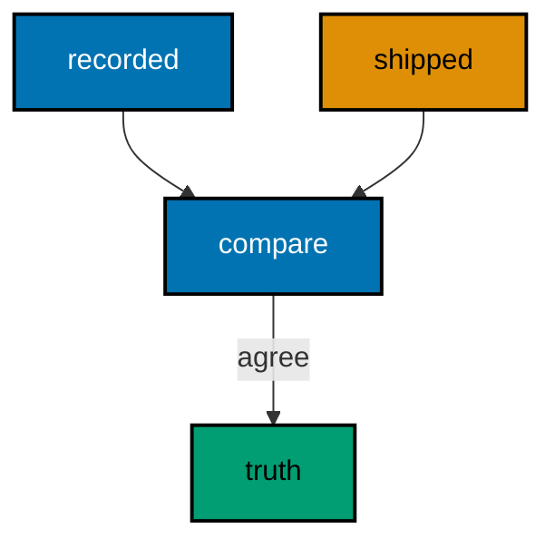

**`learning/code/ex-09-history-table-is-the-source-of-truth/Program.cs`**:

```csharp
// Example 9: History Table Is the Source of Truth.
// The recorded set must equal the assembly set: that equality is the audit.
using Microsoft.EntityFrameworkCore; // => context, Migrate, and query entry points

string Host() // => one host lookup shared by every connection
{ // => host block opens
    return Environment.GetEnvironmentVariable("PGHOST") ?? "localhost"; // => service alias on the unit network
} // => host lookup ends here

string Port() // => one port lookup shared by every connection
{ // => port block opens
    return Environment.GetEnvironmentVariable("PGPORT") ?? "5432"; // => standard PostgreSQL port
} // => port lookup ends here

string Db() // => one database lookup shared by every connection
{ // => database block opens
    return Environment.GetEnvironmentVariable("PGDATABASE") ?? "postgres"; // => the service database name
} // => database lookup ends here

string DbUser() // => one user lookup shared by every connection
{ // => user block opens
    return Environment.GetEnvironmentVariable("PGUSER") ?? "postgres"; // => trust-auth superuser, no password
} // => user lookup ends here

string ConnectionString() // => one builder for the Npgsql connection string
{ // => string block opens
    return $"Host={Host()};Port={Port()};Database={Db()};Username={DbUser()}"; // => trust auth needs no password
} // => connection string ends here

using var ctx = new LedgerDb( // => one context per program run
    new DbContextOptionsBuilder<LedgerDb>().UseNpgsql(ConnectionString()).Options
); // => Npgsql provider with our string
ctx.Database.OpenConnection(); // => open once for every inspection query below

List<string> Lines(string sql) // => multi-row, one-column inspection queries
{ // => lines block opens
    using var cmd = ctx.Database.GetDbConnection().CreateCommand(); // => command on the open connection
    cmd.CommandText = sql; // => read-only inspection SQL
    var rows = new List<string>(); // => collected output lines
    using var reader = cmd.ExecuteReader(); // => run the read
    while (reader.Read()) // => walk every returned row
    { // => row block opens
        rows.Add(reader.GetString(0)); // => first column as text
    } // => row walk ends here
    return rows; // => lines ready to compare
} // => lines helper ends here

ctx.Database.Migrate(); // => apply M01 then M02 in ID order
var recorded = Lines(
    "SELECT \"MigrationId\" FROM \"__EFMigrationsHistory\" ORDER BY \"MigrationId\""
); // => what the database remembers
var known = ctx.Database.GetAppliedMigrations().Order().ToList(); // => what the context reports applied
int agree = recorded.Count(id => known.Contains(id)); // => IDs present on both sides
Console.WriteLine($"truth-agrees={agree}"); // => Output: truth-agrees=2

public class LedgerRow // => the entity mapped to the Ledger table
{ // => entity block opens
    public int Id { get; set; } // => identity key generated by PostgreSQL
    public string Entry { get; set; } = ""; // => required entry column
    public string? PostedOn { get; set; } // => nullable date added by M02
} // => entity ends here

public class LedgerDb : DbContext // => the context Migrate discovers migrations from
{ // => context block opens
    public LedgerDb(DbContextOptions<LedgerDb> options)
        : base(options) { } // => options carry the connection string

    public DbSet<LedgerRow> Ledger => Set<LedgerRow>(); // => the one set this example queries
} // => context ends here
```

**`learning/code/ex-09-history-table-is-the-source-of-truth/Migrations.cs`**:

```csharp
// Migrations for Example 9: the history table is the source of truth.
// Two migrations apply; the program compares the assembly set to the recorded set.
using Microsoft.EntityFrameworkCore.Infrastructure; // => context attribute lives here
using Microsoft.EntityFrameworkCore.Migrations; // => migration base types live here
using Npgsql.EntityFrameworkCore.PostgreSQL.Metadata; // => identity strategy annotations live here

namespace App.Migrations; // => migrations live in their own namespace

[DbContext(typeof(LedgerDb))] // => bind this version to the LedgerDb context
[Migration("20260101000001_CreateLedger")] // => first version: the create
public partial class CreateLedger : Migration // => one class per migration file
{ // => class block opens
    protected override void Up(MigrationBuilder migrationBuilder) // => forward change runs on migrate
    { // => forward block opens
        migrationBuilder.CreateTable( // => the create this migration owns
            name: "Ledger", // => table name the program queries back
            columns: table => new // => column map follows
            { // => column block opens
                Id = table
                    .Column<int>(type: "integer", nullable: false) // => surrogate key, never null
                    .Annotation(
                        "Npgsql:ValueGenerationStrategy",
                        NpgsqlValueGenerationStrategy.IdentityByDefaultColumn
                    ), // => serial-style identity
                Entry = table.Column<string>(type: "text", nullable: false), // => ledger entry, required
            }, // => column map ends
            constraints: table => // => key rules follow
            { // => constraint block opens
                table.PrimaryKey("PK_Ledger", x => x.Id); // => primary key on the identity column
            }
        ); // => create-table call ends
    } // => forward change ends

    protected override void Down(MigrationBuilder migrationBuilder) // => reverse change for migrate-back
    { // => reverse block opens
        migrationBuilder.DropTable( // => undo is the mirror image
            name: "Ledger"
        ); // => drop what Up created
    } // => reverse change ends
} // => first migration ends here

[DbContext(typeof(LedgerDb))] // => bind this version to the LedgerDb context
[Migration("20260101000002_AddPostedOn")] // => second version: only the alter
public partial class AddPostedOn : Migration // => the alter lives alone, V1 untouched
{ // => class block opens
    protected override void Up(MigrationBuilder migrationBuilder) // => forward change runs on migrate
    { // => forward block opens
        migrationBuilder.AddColumn<string>( // => grow the table by one column
            name: "PostedOn", // => new column the program reads back
            table: "Ledger", // => the table M01 created
            type: "text", // => ISO date text, deterministic
            nullable: true
        ); // => nullable so existing rows survive
    } // => forward change ends

    protected override void Down(MigrationBuilder migrationBuilder) // => reverse change for migrate-back
    { // => reverse block opens
        migrationBuilder.DropColumn( // => undo removes the added column
            name: "PostedOn", // => the column Up added
            table: "Ledger"
        ); // => from the table Up altered
    } // => reverse change ends
} // => second migration ends here
```

**Output** (`learning/code/ex-09-history-table-is-the-source-of-truth/expected/main.stdout.txt`):

```text
truth-agrees=2
```

**Key takeaway**: Treat the history table as the audit: recorded and shipped sets must match.

**Why it matters**: Incident response starts with what ran, and the history table answers in one query instead of a dig through deploy logs. Comparing recorded IDs against shipped migrations turns vague unease into a number: two and two, or a named gap. Teams that check this comparison in staging gates catch the missing migration before production does, which is the difference between a five-minute re-run and a customer-visible outage.

---

### Example 10: Linear History Stays Mergeable

History must read as one line: every version extends the same consecutive sequence with no forks. The program migrates Queues fully, then parses each stamp and walks every neighboring pair.

Three consecutive stamps prove the line is mergeable: any branch built on this head renumbers onto the tip instead of forking it.

(Concepts: co-04.)

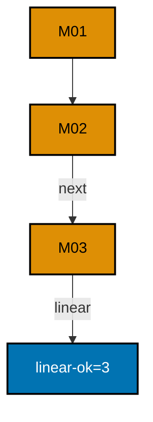

**`learning/code/ex-10-linear-history-stays-mergeable/Program.cs`**:

```csharp
// Example 10: Linear History Stays Mergeable.
// Sequential stamps with no gaps and no duplicates merge without negotiation.
using Microsoft.EntityFrameworkCore; // => context, Migrate, and query entry points

string Host() // => one host lookup shared by every connection
{ // => host block opens
    return Environment.GetEnvironmentVariable("PGHOST") ?? "localhost"; // => service alias on the unit network
} // => host lookup ends here

string Port() // => one port lookup shared by every connection
{ // => port block opens
    return Environment.GetEnvironmentVariable("PGPORT") ?? "5432"; // => standard PostgreSQL port
} // => port lookup ends here

string Db() // => one database lookup shared by every connection
{ // => database block opens
    return Environment.GetEnvironmentVariable("PGDATABASE") ?? "postgres"; // => the service database name
} // => database lookup ends here

string DbUser() // => one user lookup shared by every connection
{ // => user block opens
    return Environment.GetEnvironmentVariable("PGUSER") ?? "postgres"; // => trust-auth superuser, no password
} // => user lookup ends here

string ConnectionString() // => one builder for the Npgsql connection string
{ // => string block opens
    return $"Host={Host()};Port={Port()};Database={Db()};Username={DbUser()}"; // => trust auth needs no password
} // => connection string ends here

using var ctx = new QueuesDb( // => one context per program run
    new DbContextOptionsBuilder<QueuesDb>().UseNpgsql(ConnectionString()).Options
); // => Npgsql provider with our string
ctx.Database.OpenConnection(); // => open once for every inspection query below

List<string> Lines(string sql) // => multi-row, one-column inspection queries
{ // => lines block opens
    using var cmd = ctx.Database.GetDbConnection().CreateCommand(); // => command on the open connection
    cmd.CommandText = sql; // => read-only inspection SQL
    var rows = new List<string>(); // => collected output lines
    using var reader = cmd.ExecuteReader(); // => run the read
    while (reader.Read()) // => walk every returned row
    { // => row block opens
        rows.Add(reader.GetString(0)); // => first column as text
    } // => row walk ends here
    return rows; // => lines ready to check
} // => lines helper ends here

ctx.Database.Migrate(); // => apply M01, M02, M03 in ID order
var stamps = Lines("SELECT \"MigrationId\" FROM \"__EFMigrationsHistory\" ORDER BY \"MigrationId\"") // => history IDs in apply order
    .Select(id => long.Parse(id.Substring(0, 14)))
    .Order()
    .ToList(); // => numeric stamps, sorted
bool linear = stamps.Distinct().Count() == stamps.Count; // => no duplicate stamp merges badly
for (int i = 1; i < stamps.Count && linear; i++) // => walk each neighboring pair
{ // => pair block opens
    linear = stamps[i] == stamps[i - 1] + 1; // => neighbors must be consecutive
} // => pair walk ends here
Console.WriteLine($"linear-ok={(linear ? stamps.Count : 0)}"); // => Output: linear-ok=3

public class QueueJob // => the entity mapped to the Queues table
{ // => entity block opens
    public int Id { get; set; } // => identity key generated by PostgreSQL
    public string Job { get; set; } = ""; // => required job column
    public int Priority { get; set; } // => priority added by M02
} // => entity ends here

public class QueuesDb : DbContext // => the context Migrate discovers migrations from
{ // => context block opens
    public QueuesDb(DbContextOptions<QueuesDb> options)
        : base(options) { } // => options carry the connection string

    public DbSet<QueueJob> Queues => Set<QueueJob>(); // => the one set this example queries
} // => context ends here
```

**`learning/code/ex-10-linear-history-stays-mergeable/Migrations.cs`**:

```csharp
// Migrations for Example 10: a linear history stays mergeable.
// Three sequential IDs with no gaps and no duplicates merge cleanly.
using Microsoft.EntityFrameworkCore.Infrastructure; // => context attribute lives here
using Microsoft.EntityFrameworkCore.Migrations; // => migration base types live here
using Npgsql.EntityFrameworkCore.PostgreSQL.Metadata; // => identity strategy annotations live here

namespace App.Migrations; // => migrations live in their own namespace

[DbContext(typeof(QueuesDb))] // => bind this version to the QueuesDb context
[Migration("20260101000001_CreateQueues")] // => first version: the create
public partial class CreateQueues : Migration // => one class per migration file
{ // => class block opens
    protected override void Up(MigrationBuilder migrationBuilder) // => forward change runs on migrate
    { // => forward block opens
        migrationBuilder.CreateTable( // => the create this migration owns
            name: "Queues", // => table name the program queries back
            columns: table => new // => column map follows
            { // => column block opens
                Id = table
                    .Column<int>(type: "integer", nullable: false) // => surrogate key, never null
                    .Annotation(
                        "Npgsql:ValueGenerationStrategy",
                        NpgsqlValueGenerationStrategy.IdentityByDefaultColumn
                    ), // => serial-style identity
                Job = table.Column<string>(type: "text", nullable: false), // => job name, required
            }, // => column map ends
            constraints: table => // => key rules follow
            { // => constraint block opens
                table.PrimaryKey("PK_Queues", x => x.Id); // => primary key on the identity column
            }
        ); // => create-table call ends
    } // => forward change ends

    protected override void Down(MigrationBuilder migrationBuilder) // => reverse change for migrate-back
    { // => reverse block opens
        migrationBuilder.DropTable( // => undo is the mirror image
            name: "Queues"
        ); // => drop what Up created
    } // => reverse change ends
} // => first migration ends here

[DbContext(typeof(QueuesDb))] // => bind this version to the QueuesDb context
[Migration("20260101000002_AddPriority")] // => second version: only the alter
public partial class AddPriority : Migration // => the alter lives alone, V1 untouched
{ // => class block opens
    protected override void Up(MigrationBuilder migrationBuilder) // => forward change runs on migrate
    { // => forward block opens
        migrationBuilder.AddColumn<int>( // => grow the table by one column
            name: "Priority", // => new column the program reads back
            table: "Queues", // => the table M01 created
            type: "integer", // => whole-unit priority rank
            nullable: false, // => every row gets a value
            defaultValue: 0
        ); // => existing rows start at zero
    } // => forward change ends

    protected override void Down(MigrationBuilder migrationBuilder) // => reverse change for migrate-back
    { // => reverse block opens
        migrationBuilder.DropColumn( // => undo removes the added column
            name: "Priority", // => the column Up added
            table: "Queues"
        ); // => from the table Up altered
    } // => reverse change ends
} // => second migration ends here

[DbContext(typeof(QueuesDb))] // => bind this version to the QueuesDb context
[Migration("20260101000003_IndexPriority")] // => third version: the index
public partial class IndexPriority : Migration // => each version stays reviewable alone
{ // => class block opens
    protected override void Up(MigrationBuilder migrationBuilder) // => forward change runs on migrate
    { // => forward block opens
        migrationBuilder.CreateIndex( // => one index, its own versioned step
            name: "IX_Queues_Priority", // => index name the database catalog holds
            table: "Queues", // => the table M01 created
            column: "Priority"
        ); // => the column M02 added
    } // => forward change ends

    protected override void Down(MigrationBuilder migrationBuilder) // => reverse change for migrate-back
    { // => reverse block opens
        migrationBuilder.DropIndex( // => undo removes the added index
            name: "IX_Queues_Priority", // => the index Up added
            table: "Queues"
        ); // => from the table Up altered
    } // => reverse change ends
} // => third migration ends here
```

**Output** (`learning/code/ex-10-linear-history-stays-mergeable/expected/main.stdout.txt`):

```text
linear-ok=3
```

**Key takeaway**: Keep stamps consecutive and unique; a linear history merges itself.

**Why it matters**: Merge conflicts in migration IDs are the most common team friction in schema work, and they are entirely avoidable with a pull-before-you-number habit. A linear history means any developer can rebase, renumber once, and move on — no negotiation about whose change applies first. The check in this example is worth automating: a CI step that fails on duplicate or gapped stamps catches the problem at pull-request time, when fixing it costs one renumber instead of a release-day scramble.

---

### Example 11: Gaps in Versions Still Apply

Numbering can skip a stamp: here `...002` was never written, so history jumps from `...001` straight to `...003`. The program migrates fully and counts applied versions through the context API — no raw SQL needed.

Two applied versions prove the gap is history, not an error: EF applies versions in ID order whether or not the stamps run consecutively.

(Concepts: co-01, co-04.)

**`learning/code/ex-11-gaps-in-versions-still-apply/Program.cs`**:

```csharp
// Example 11: Gaps in Versions Still Apply.
// The missing ...002 stamp is history, not an error: both versions apply.
using Microsoft.EntityFrameworkCore; // => context, Migrate, and query entry points

string Host() // => one host lookup shared by every connection
{ // => host block opens
    return Environment.GetEnvironmentVariable("PGHOST") ?? "localhost"; // => service alias on the unit network
} // => host lookup ends here

string Port() // => one port lookup shared by every connection
{ // => port block opens
    return Environment.GetEnvironmentVariable("PGPORT") ?? "5432"; // => standard PostgreSQL port
} // => port lookup ends here

string Db() // => one database lookup shared by every connection
{ // => database block opens
    return Environment.GetEnvironmentVariable("PGDATABASE") ?? "postgres"; // => the service database name
} // => database lookup ends here

string DbUser() // => one user lookup shared by every connection
{ // => user block opens
    return Environment.GetEnvironmentVariable("PGUSER") ?? "postgres"; // => trust-auth superuser, no password
} // => user lookup ends here

string ConnectionString() // => one builder for the Npgsql connection string
{ // => string block opens
    return $"Host={Host()};Port={Port()};Database={Db()};Username={DbUser()}"; // => trust auth needs no password
} // => connection string ends here

using var ctx = new ShelvesDb( // => one context per program run
    new DbContextOptionsBuilder<ShelvesDb>().UseNpgsql(ConnectionString()).Options
); // => Npgsql provider with our string
ctx.Database.Migrate(); // => apply ...001 then ...003; the gap needs no flag
Console.WriteLine($"applied={ctx.Database.GetAppliedMigrations().Count()}"); // => Output: applied=2

public class Shelf // => the entity mapped to the Shelves table
{ // => entity block opens
    public int Id { get; set; } // => identity key generated by PostgreSQL
    public string Aisle { get; set; } = ""; // => required aisle column
    public string? Section { get; set; } // => nullable section added by M03
} // => entity ends here

public class ShelvesDb : DbContext // => the context Migrate discovers migrations from
{ // => context block opens
    public ShelvesDb(DbContextOptions<ShelvesDb> options)
        : base(options) { } // => options carry the connection string

    public DbSet<Shelf> Shelves => Set<Shelf>(); // => the one set this example queries
} // => context ends here
```

**`learning/code/ex-11-gaps-in-versions-still-apply/Migrations.cs`**:

```csharp
// Migrations for Example 11: gaps in versions still apply.
// Numbering skips ...002; EF applies ...001 then ...003 without complaint.
using Microsoft.EntityFrameworkCore.Infrastructure; // => context attribute lives here
using Microsoft.EntityFrameworkCore.Migrations; // => migration base types live here
using Npgsql.EntityFrameworkCore.PostgreSQL.Metadata; // => identity strategy annotations live here

namespace App.Migrations; // => migrations live in their own namespace

[DbContext(typeof(ShelvesDb))] // => bind this version to the ShelvesDb context
[Migration("20260101000001_CreateShelves")] // => first version: the create
public partial class CreateShelves : Migration // => one class per migration file
{ // => class block opens
    protected override void Up(MigrationBuilder migrationBuilder) // => forward change runs on migrate
    { // => forward block opens
        migrationBuilder.CreateTable( // => the create this migration owns
            name: "Shelves", // => table name the program queries back
            columns: table => new // => column map follows
            { // => column block opens
                Id = table
                    .Column<int>(type: "integer", nullable: false) // => surrogate key, never null
                    .Annotation(
                        "Npgsql:ValueGenerationStrategy",
                        NpgsqlValueGenerationStrategy.IdentityByDefaultColumn
                    ), // => serial-style identity
                Aisle = table.Column<string>(type: "text", nullable: false), // => shelf aisle, required
            }, // => column map ends
            constraints: table => // => key rules follow
            { // => constraint block opens
                table.PrimaryKey("PK_Shelves", x => x.Id); // => primary key on the identity column
            }
        ); // => create-table call ends
    } // => forward change ends

    protected override void Down(MigrationBuilder migrationBuilder) // => reverse change for migrate-back
    { // => reverse block opens
        migrationBuilder.DropTable( // => undo is the mirror image
            name: "Shelves"
        ); // => drop what Up created
    } // => reverse change ends
} // => first migration ends here

[DbContext(typeof(ShelvesDb))] // => bind this version to the ShelvesDb context
[Migration("20260101000003_AddSection")] // => third stamp, no second: the gap is legal
public partial class AddSection : Migration // => gaps record renames, not failures
{ // => class block opens
    protected override void Up(MigrationBuilder migrationBuilder) // => forward change runs on migrate
    { // => forward block opens
        migrationBuilder.AddColumn<string>( // => grow the table by one column
            name: "Section", // => new column the program reads back
            table: "Shelves", // => the table M01 created
            type: "text", // => free-form section text
            nullable: true
        ); // => nullable so existing rows survive
    } // => forward change ends

    protected override void Down(MigrationBuilder migrationBuilder) // => reverse change for migrate-back
    { // => reverse block opens
        migrationBuilder.DropColumn( // => undo removes the added column
            name: "Section", // => the column Up added
            table: "Shelves"
        ); // => from the table Up altered
    } // => reverse change ends
} // => second migration ends here
```

**Output** (`learning/code/ex-11-gaps-in-versions-still-apply/expected/main.stdout.txt`):

```text
applied=2
```

**Key takeaway**: A skipped stamp is legal: EF applies versions in ID order, gaps included.

**Why it matters**: Renames and abandoned drafts leave gaps in every long-lived project, and panicking about them wastes the exact review time better spent on the changes themselves. Knowing gaps apply cleanly keeps the team calm when history shows `...001` followed by `...003`. Reserve the alarm for duplicate stamps, which genuinely cannot merge — that distinction is what the previous example's linearity check is for.

---

### Example 12: Pending Migrations Are Visible

Migrating to `...001` leaves `...002` and `...003` pending, and EF names them on demand. The program migrates to the first version, then counts pending versions through the context API.

Two pending versions prove partial states are listable: the deploy knows exactly what remains before it runs.

(Concepts: co-03.)

**`learning/code/ex-12-pending-migrations-are-visible/Program.cs`**:

```csharp
// Example 12: Pending Migrations Are Visible.
// Migrating to ...001 leaves ...002 and ...003 pending: the list names them.
using Microsoft.EntityFrameworkCore; // => context, Migrate, and query entry points

string Host() // => one host lookup shared by every connection
{ // => host block opens
    return Environment.GetEnvironmentVariable("PGHOST") ?? "localhost"; // => service alias on the unit network
} // => host lookup ends here

string Port() // => one port lookup shared by every connection
{ // => port block opens
    return Environment.GetEnvironmentVariable("PGPORT") ?? "5432"; // => standard PostgreSQL port
} // => port lookup ends here

string Db() // => one database lookup shared by every connection
{ // => database block opens
    return Environment.GetEnvironmentVariable("PGDATABASE") ?? "postgres"; // => the service database name
} // => database lookup ends here

string DbUser() // => one user lookup shared by every connection
{ // => user block opens
    return Environment.GetEnvironmentVariable("PGUSER") ?? "postgres"; // => trust-auth superuser, no password
} // => user lookup ends here

string ConnectionString() // => one builder for the Npgsql connection string
{ // => string block opens
    return $"Host={Host()};Port={Port()};Database={Db()};Username={DbUser()}"; // => trust auth needs no password
} // => connection string ends here

using var ctx = new CratesDb( // => one context per program run
    new DbContextOptionsBuilder<CratesDb>().UseNpgsql(ConnectionString()).Options
); // => Npgsql provider with our string
ctx.Database.Migrate("20260101000001_CreateCrates"); // => apply only M01; M02 and M03 stay pending
Console.WriteLine($"pending={ctx.Database.GetPendingMigrations().Count()}"); // => Output: pending=2

public class Crate // => the entity mapped to the Crates table
{ // => entity block opens
    public int Id { get; set; } // => identity key generated by PostgreSQL
    public string Mark { get; set; } = ""; // => required mark column
    public int Weight { get; set; } // => weight added by M02
    public string? Origin { get; set; } // => nullable origin added by M03
} // => entity ends here

public class CratesDb : DbContext // => the context Migrate discovers migrations from
{ // => context block opens
    public CratesDb(DbContextOptions<CratesDb> options)
        : base(options) { } // => options carry the connection string

    public DbSet<Crate> Crates => Set<Crate>(); // => the one set this example queries
} // => context ends here
```

**`learning/code/ex-12-pending-migrations-are-visible/Migrations.cs`**:

```csharp
// Migrations for Example 12: pending work is visible before it applies.
// Three versions exist; migrating to ...001 leaves two pending.
using Microsoft.EntityFrameworkCore.Infrastructure; // => context attribute lives here
using Microsoft.EntityFrameworkCore.Migrations; // => migration base types live here
using Npgsql.EntityFrameworkCore.PostgreSQL.Metadata; // => identity strategy annotations live here

namespace App.Migrations; // => migrations live in their own namespace

[DbContext(typeof(CratesDb))] // => bind this version to the CratesDb context
[Migration("20260101000001_CreateCrates")] // => first version: the create
public partial class CreateCrates : Migration // => one class per migration file
{ // => class block opens
    protected override void Up(MigrationBuilder migrationBuilder) // => forward change runs on migrate
    { // => forward block opens
        migrationBuilder.CreateTable( // => the create this migration owns
            name: "Crates", // => table name the program queries back
            columns: table => new // => column map follows
            { // => column block opens
                Id = table
                    .Column<int>(type: "integer", nullable: false) // => surrogate key, never null
                    .Annotation(
                        "Npgsql:ValueGenerationStrategy",
                        NpgsqlValueGenerationStrategy.IdentityByDefaultColumn
                    ), // => serial-style identity
                Mark = table.Column<string>(type: "text", nullable: false), // => crate mark, required
            }, // => column map ends
            constraints: table => // => key rules follow
            { // => constraint block opens
                table.PrimaryKey("PK_Crates", x => x.Id); // => primary key on the identity column
            }
        ); // => create-table call ends
    } // => forward change ends

    protected override void Down(MigrationBuilder migrationBuilder) // => reverse change for migrate-back
    { // => reverse block opens
        migrationBuilder.DropTable( // => undo is the mirror image
            name: "Crates"
        ); // => drop what Up created
    } // => reverse change ends
} // => first migration ends here

[DbContext(typeof(CratesDb))] // => bind this version to the CratesDb context
[Migration("20260101000002_AddWeight")] // => second version: only the alter
public partial class AddWeight : Migration // => the alter lives alone, V1 untouched
{ // => class block opens
    protected override void Up(MigrationBuilder migrationBuilder) // => forward change runs on migrate
    { // => forward block opens
        migrationBuilder.AddColumn<int>( // => grow the table by one column
            name: "Weight", // => new column the program reads back
            table: "Crates", // => the table M01 created
            type: "integer", // => whole-unit weight
            nullable: false, // => every row gets a value
            defaultValue: 0
        ); // => existing rows start at zero
    } // => forward change ends

    protected override void Down(MigrationBuilder migrationBuilder) // => reverse change for migrate-back
    { // => reverse block opens
        migrationBuilder.DropColumn( // => undo removes the added column
            name: "Weight", // => the column Up added
            table: "Crates"
        ); // => from the table Up altered
    } // => reverse change ends
} // => second migration ends here

[DbContext(typeof(CratesDb))] // => bind this version to the CratesDb context
[Migration("20260101000003_AddOrigin")] // => third version: another alter
public partial class AddOrigin : Migration // => each version stays reviewable alone
{ // => class block opens
    protected override void Up(MigrationBuilder migrationBuilder) // => forward change runs on migrate
    { // => forward block opens
        migrationBuilder.AddColumn<string>( // => grow the table by one column
            name: "Origin", // => new column the program reads back
            table: "Crates", // => the table M01 created
            type: "text", // => free-form origin text
            nullable: true
        ); // => nullable so existing rows survive
    } // => forward change ends

    protected override void Down(MigrationBuilder migrationBuilder) // => reverse change for migrate-back
    { // => reverse block opens
        migrationBuilder.DropColumn( // => undo removes the added column
            name: "Origin", // => the column Up added
            table: "Crates"
        ); // => from the table Up altered
    } // => reverse change ends
} // => third migration ends here
```

**Output** (`learning/code/ex-12-pending-migrations-are-visible/expected/main.stdout.txt`):

```text
pending=2
```

**Key takeaway**: Ask EF what is pending before you migrate: partial states are listable.

**Why it matters**: Deploy dashboards and pre-flight checks need this exact number: "this database is two versions behind" is actionable, while "migrate and hope" is not. Exposing the pending list in staging gates catches the forgotten migration before it becomes a production incident. Human-readable pending output also settles arguments about whether a deploy actually applied everything it claimed.

---

### Example 13: Info Shows Pending and Applied

One pinned migrate plus two list calls show both sides at once: migrate to `...002`, then count applied and pending separately. The database sits exactly between versions — two behind it, one ahead.

Two numbers on one line give the full position: what ran and what remains. No history-table SQL required; the context API reports both lists.

(Concepts: co-03.)

**`learning/code/ex-13-info-shows-pending-and-applied/Program.cs`**:

```csharp
// Example 13: Info Shows Pending and Applied.
// Migrate to ...002, then read both lists: two applied, one pending.
using Microsoft.EntityFrameworkCore; // => context, Migrate, and query entry points

string Host() // => one host lookup shared by every connection
{ // => host block opens
    return Environment.GetEnvironmentVariable("PGHOST") ?? "localhost"; // => service alias on the unit network
} // => host lookup ends here

string Port() // => one port lookup shared by every connection
{ // => port block opens
    return Environment.GetEnvironmentVariable("PGPORT") ?? "5432"; // => standard PostgreSQL port
} // => port lookup ends here

string Db() // => one database lookup shared by every connection
{ // => database block opens
    return Environment.GetEnvironmentVariable("PGDATABASE") ?? "postgres"; // => the service database name
} // => database lookup ends here

string DbUser() // => one user lookup shared by every connection
{ // => user block opens
    return Environment.GetEnvironmentVariable("PGUSER") ?? "postgres"; // => trust-auth superuser, no password
} // => user lookup ends here

string ConnectionString() // => one builder for the Npgsql connection string
{ // => string block opens
    return $"Host={Host()};Port={Port()};Database={Db()};Username={DbUser()}"; // => trust auth needs no password
} // => connection string ends here

using var ctx = new BinsDb( // => one context per program run
    new DbContextOptionsBuilder<BinsDb>().UseNpgsql(ConnectionString()).Options
); // => Npgsql provider with our string
ctx.Database.Migrate("20260101000002_AddBayCount"); // => apply M01 and M02; M03 stays pending
Console.WriteLine(
    $"applied={ctx.Database.GetAppliedMigrations().Count()} pending={ctx.Database.GetPendingMigrations().Count()}"
); // => Output: applied=2 pending=1

public class Bin // => the entity mapped to the Bins table
{ // => entity block opens
    public int Id { get; set; } // => identity key generated by PostgreSQL
    public string Bay { get; set; } = ""; // => required bay column
    public int BayCount { get; set; } // => bay count added by M02
    public string? Zone { get; set; } // => nullable zone added by M03
} // => entity ends here

public class BinsDb : DbContext // => the context Migrate discovers migrations from
{ // => context block opens
    public BinsDb(DbContextOptions<BinsDb> options)
        : base(options) { } // => options carry the connection string

    public DbSet<Bin> Bins => Set<Bin>(); // => the one set this example queries
} // => context ends here
```

**`learning/code/ex-13-info-shows-pending-and-applied/Migrations.cs`**:

```csharp
// Migrations for Example 13: applied and pending lists side by side.
// Migrate to ...002, then read both lists: two applied, one pending.
using Microsoft.EntityFrameworkCore.Infrastructure; // => context attribute lives here
using Microsoft.EntityFrameworkCore.Migrations; // => migration base types live here
using Npgsql.EntityFrameworkCore.PostgreSQL.Metadata; // => identity strategy annotations live here

namespace App.Migrations; // => migrations live in their own namespace

[DbContext(typeof(BinsDb))] // => bind this version to the BinsDb context
[Migration("20260101000001_CreateBins")] // => first version: the create
public partial class CreateBins : Migration // => one class per migration file
{ // => class block opens
    protected override void Up(MigrationBuilder migrationBuilder) // => forward change runs on migrate
    { // => forward block opens
        migrationBuilder.CreateTable( // => the create this migration owns
            name: "Bins", // => table name the program queries back
            columns: table => new // => column map follows
            { // => column block opens
                Id = table
                    .Column<int>(type: "integer", nullable: false) // => surrogate key, never null
                    .Annotation(
                        "Npgsql:ValueGenerationStrategy",
                        NpgsqlValueGenerationStrategy.IdentityByDefaultColumn
                    ), // => serial-style identity
                Bay = table.Column<string>(type: "text", nullable: false), // => bin bay, required
            }, // => column map ends
            constraints: table => // => key rules follow
            { // => constraint block opens
                table.PrimaryKey("PK_Bins", x => x.Id); // => primary key on the identity column
            }
        ); // => create-table call ends
    } // => forward change ends

    protected override void Down(MigrationBuilder migrationBuilder) // => reverse change for migrate-back
    { // => reverse block opens
        migrationBuilder.DropTable( // => undo is the mirror image
            name: "Bins"
        ); // => drop what Up created
    } // => reverse change ends
} // => first migration ends here

[DbContext(typeof(BinsDb))] // => bind this version to the BinsDb context
[Migration("20260101000002_AddBayCount")] // => second version: only the alter
public partial class AddBayCount : Migration // => the alter lives alone, V1 untouched
{ // => class block opens
    protected override void Up(MigrationBuilder migrationBuilder) // => forward change runs on migrate
    { // => forward block opens
        migrationBuilder.AddColumn<int>( // => grow the table by one column
            name: "BayCount", // => new column the program reads back
            table: "Bins", // => the table M01 created
            type: "integer", // => whole-unit bay counts
            nullable: false, // => every row gets a value
            defaultValue: 0
        ); // => existing rows start at zero
    } // => forward change ends

    protected override void Down(MigrationBuilder migrationBuilder) // => reverse change for migrate-back
    { // => reverse block opens
        migrationBuilder.DropColumn( // => undo removes the added column
            name: "BayCount", // => the column Up added
            table: "Bins"
        ); // => from the table Up altered
    } // => reverse change ends
} // => second migration ends here

[DbContext(typeof(BinsDb))] // => bind this version to the BinsDb context
[Migration("20260101000003_AddZone")] // => third version: another alter, still pending
public partial class AddZone : Migration // => each version stays reviewable alone
{ // => class block opens
    protected override void Up(MigrationBuilder migrationBuilder) // => forward change runs on migrate
    { // => forward block opens
        migrationBuilder.AddColumn<string>( // => grow the table by one column
            name: "Zone", // => new column the program reads back
            table: "Bins", // => the table M01 created
            type: "text", // => free-form zone text
            nullable: true
        ); // => nullable so existing rows survive
    } // => forward change ends

    protected override void Down(MigrationBuilder migrationBuilder) // => reverse change for migrate-back
    { // => reverse block opens
        migrationBuilder.DropColumn( // => undo removes the added column
            name: "Zone", // => the column Up added
            table: "Bins"
        ); // => from the table Up altered
    } // => reverse change ends
} // => third migration ends here
```

**Output** (`learning/code/ex-13-info-shows-pending-and-applied/expected/main.stdout.txt`):

```text
applied=2 pending=1
```

**Key takeaway**: One pinned database, two list calls: applied and pending side by side.

**Why it matters**: Status pages answer "where is this database?" in one glance when they show both numbers together. A deploy that reports only "migrated OK" hides whether anything was actually pending; a deploy that reports both counts lets the next engineer see the database stopped mid-line on purpose. Pairing the two calls also prevents the classic mistake of reading one list and assuming the other.

---

### Example 14: Every Entry Records Its Product

Each history row stamps the EF build that applied it. The program migrates fully, then aggregates the distinct `ProductVersion` values from the history table.

One product string proves all three rows came from the same toolchain. When two builds ever mix, this query is the first line of the investigation.

(Concepts: co-03, co-16.)

**`learning/code/ex-14-every-entry-records-its-product/Program.cs`**:

```csharp
// Example 14: Every Entry Records Its Product.
// Each history row stamps the EF build that applied it: the audit trail.
using Microsoft.EntityFrameworkCore; // => context, Migrate, and query entry points

string Host() // => one host lookup shared by every connection
{ // => host block opens
    return Environment.GetEnvironmentVariable("PGHOST") ?? "localhost"; // => service alias on the unit network
} // => host lookup ends here

string Port() // => one port lookup shared by every connection
{ // => port block opens
    return Environment.GetEnvironmentVariable("PGPORT") ?? "5432"; // => standard PostgreSQL port
} // => port lookup ends here

string Db() // => one database lookup shared by every connection
{ // => database block opens
    return Environment.GetEnvironmentVariable("PGDATABASE") ?? "postgres"; // => the service database name
} // => database lookup ends here

string DbUser() // => one user lookup shared by every connection
{ // => user block opens
    return Environment.GetEnvironmentVariable("PGUSER") ?? "postgres"; // => trust-auth superuser, no password
} // => user lookup ends here

string ConnectionString() // => one builder for the Npgsql connection string
{ // => string block opens
    return $"Host={Host()};Port={Port()};Database={Db()};Username={DbUser()}"; // => trust auth needs no password
} // => connection string ends here

using var ctx = new SealsDb( // => one context per program run
    new DbContextOptionsBuilder<SealsDb>().UseNpgsql(ConnectionString()).Options
); // => Npgsql provider with our string
ctx.Database.OpenConnection(); // => open once for every inspection query below

string Scalar(string sql) // => one-row, one-column inspection queries
{ // => scalar block opens
    using var cmd = ctx.Database.GetDbConnection().CreateCommand(); // => command on the open connection
    cmd.CommandText = sql; // => read-only inspection SQL
    object? value = cmd.ExecuteScalar(); // => the single answer
    return value?.ToString() ?? "null"; // => text for printing, null-safe
} // => scalar helper ends here

ctx.Database.Migrate(); // => apply M01, M02, M03 in ID order
Console.WriteLine(
    $"products={Scalar("SELECT string_agg(DISTINCT \"ProductVersion\", ',' ORDER BY \"ProductVersion\") FROM \"__EFMigrationsHistory\"")}"
); // => one line: the EF build that applied all three

public class Seal // => the entity mapped to the Seals table
{ // => entity block opens
    public int Id { get; set; } // => identity key generated by PostgreSQL
    public string Mark { get; set; } = ""; // => required mark column
    public string? Grade { get; set; } // => nullable grade added by M02
} // => entity ends here

public class SealsDb : DbContext // => the context Migrate discovers migrations from
{ // => context block opens
    public SealsDb(DbContextOptions<SealsDb> options)
        : base(options) { } // => options carry the connection string

    public DbSet<Seal> Seals => Set<Seal>(); // => the one set this example queries
} // => context ends here
```

**`learning/code/ex-14-every-entry-records-its-product/Migrations.cs`**:

```csharp
// Migrations for Example 14: every entry records its product version.
// The history row stamps which EF build applied it.
using Microsoft.EntityFrameworkCore.Infrastructure; // => context attribute lives here
using Microsoft.EntityFrameworkCore.Migrations; // => migration base types live here
using Npgsql.EntityFrameworkCore.PostgreSQL.Metadata; // => identity strategy annotations live here

namespace App.Migrations; // => migrations live in their own namespace

[DbContext(typeof(SealsDb))] // => bind this version to the SealsDb context
[Migration("20260101000001_CreateSeals")] // => first version: the create
public partial class CreateSeals : Migration // => one class per migration file
{ // => class block opens
    protected override void Up(MigrationBuilder migrationBuilder) // => forward change runs on migrate
    { // => forward block opens
        migrationBuilder.CreateTable( // => the create this migration owns
            name: "Seals", // => table name the program queries back
            columns: table => new // => column map follows
            { // => column block opens
                Id = table
                    .Column<int>(type: "integer", nullable: false) // => surrogate key, never null
                    .Annotation(
                        "Npgsql:ValueGenerationStrategy",
                        NpgsqlValueGenerationStrategy.IdentityByDefaultColumn
                    ), // => serial-style identity
                Mark = table.Column<string>(type: "text", nullable: false), // => seal mark, required
            }, // => column map ends
            constraints: table => // => key rules follow
            { // => constraint block opens
                table.PrimaryKey("PK_Seals", x => x.Id); // => primary key on the identity column
            }
        ); // => create-table call ends
    } // => forward change ends

    protected override void Down(MigrationBuilder migrationBuilder) // => reverse change for migrate-back
    { // => reverse block opens
        migrationBuilder.DropTable( // => undo is the mirror image
            name: "Seals"
        ); // => drop what Up created
    } // => reverse change ends
} // => first migration ends here

[DbContext(typeof(SealsDb))] // => bind this version to the SealsDb context
[Migration("20260101000002_AddGrade")] // => second version: only the alter
public partial class AddGrade : Migration // => the alter lives alone, V1 untouched
{ // => class block opens
    protected override void Up(MigrationBuilder migrationBuilder) // => forward change runs on migrate
    { // => forward block opens
        migrationBuilder.AddColumn<string>( // => grow the table by one column
            name: "Grade", // => new column the program reads back
            table: "Seals", // => the table M01 created
            type: "text", // => free-form grade text
            nullable: true
        ); // => nullable so existing rows survive
    } // => forward change ends

    protected override void Down(MigrationBuilder migrationBuilder) // => reverse change for migrate-back
    { // => reverse block opens
        migrationBuilder.DropColumn( // => undo removes the added column
            name: "Grade", // => the column Up added
            table: "Seals"
        ); // => from the table Up altered
    } // => reverse change ends
} // => second migration ends here

[DbContext(typeof(SealsDb))] // => bind this version to the SealsDb context
[Migration("20260101000003_IndexGrade")] // => third version: the index
public partial class IndexGrade : Migration // => each version stays reviewable alone
{ // => class block opens
    protected override void Up(MigrationBuilder migrationBuilder) // => forward change runs on migrate
    { // => forward block opens
        migrationBuilder.CreateIndex( // => one index, its own versioned step
            name: "IX_Seals_Grade", // => index name the database catalog holds
            table: "Seals", // => the table M01 created
            column: "Grade"
        ); // => the column M02 added
    } // => forward change ends

    protected override void Down(MigrationBuilder migrationBuilder) // => reverse change for migrate-back
    { // => reverse block opens
        migrationBuilder.DropIndex( // => undo removes the added index
            name: "IX_Seals_Grade", // => the index Up added
            table: "Seals"
        ); // => from the table Up altered
    } // => reverse change ends
} // => third migration ends here
```

**Output** (`learning/code/ex-14-every-entry-records-its-product/expected/main.stdout.txt`):

```text
products=10.0.4
```

**Key takeaway**: The history table records which EF build applied each row: read it when builds mix.

**Why it matters**: Mixed toolchains cause the subtlest migration bugs: a row applied by a newer EF build can carry semantics the older build cannot reproduce. The product stamp turns "which build touched this database?" from archaeology into a one-line query. Pinning the toolchain per unit keeps this answer to a single value — and the lockfile is what makes that pin enforceable rather than aspirational.

---

### Example 15: Migrate to a Target Stays Partial

A release migrates exactly as far as its code understands: passing a target ID stops the advance mid-line. The program migrates Parcels to `...002`, leaving `...003` shipped but unapplied.

Two applied and one pending prove the partial state is deliberate. Newer versions wait in the assembly until the next release adopts them.

(Concepts: co-03, co-13.)

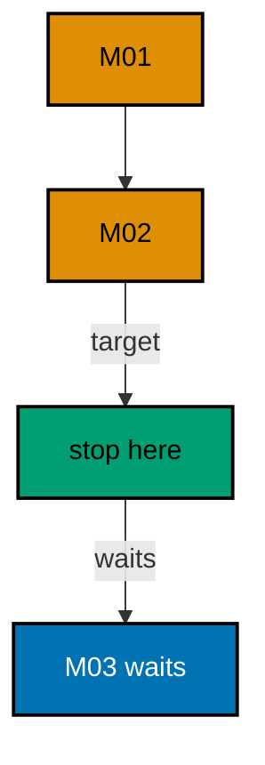

**`learning/code/ex-15-migrate-to-a-target-stays-partial/Program.cs`**:

```csharp
// Example 15: Migrate to a Target Stays Partial.
// Deploy ...002 today; ...003 waits in the assembly until the next release.
using Microsoft.EntityFrameworkCore; // => context, Migrate, and query entry points

string Host() // => one host lookup shared by every connection
{ // => host block opens
    return Environment.GetEnvironmentVariable("PGHOST") ?? "localhost"; // => service alias on the unit network
} // => host lookup ends here

string Port() // => one port lookup shared by every connection
{ // => port block opens
    return Environment.GetEnvironmentVariable("PGPORT") ?? "5432"; // => standard PostgreSQL port
} // => port lookup ends here

string Db() // => one database lookup shared by every connection
{ // => database block opens
    return Environment.GetEnvironmentVariable("PGDATABASE") ?? "postgres"; // => the service database name
} // => database lookup ends here

string DbUser() // => one user lookup shared by every connection
{ // => user block opens
    return Environment.GetEnvironmentVariable("PGUSER") ?? "postgres"; // => trust-auth superuser, no password
} // => user lookup ends here

string ConnectionString() // => one builder for the Npgsql connection string
{ // => string block opens
    return $"Host={Host()};Port={Port()};Database={Db()};Username={DbUser()}"; // => trust auth needs no password
} // => connection string ends here

using var ctx = new ParcelsDb( // => one context per program run
    new DbContextOptionsBuilder<ParcelsDb>().UseNpgsql(ConnectionString()).Options
); // => Npgsql provider with our string
ctx.Database.Migrate("20260101000002_AddFragile"); // => apply M01 and M02 only
Console.WriteLine(
    $"applied={ctx.Database.GetAppliedMigrations().Count()} pending={ctx.Database.GetPendingMigrations().Count()}"
); // => Output: applied=2 pending=1

public class Parcel // => the entity mapped to the Parcels table
{ // => entity block opens
    public int Id { get; set; } // => identity key generated by PostgreSQL
    public string Code { get; set; } = ""; // => required code column
    public bool Fragile { get; set; } // => fragile flag added by M02
    public bool Insured { get; set; } // => insured flag added by M03
} // => entity ends here

public class ParcelsDb : DbContext // => the context Migrate discovers migrations from
{ // => context block opens
    public ParcelsDb(DbContextOptions<ParcelsDb> options)
        : base(options) { } // => options carry the connection string

    public DbSet<Parcel> Parcels => Set<Parcel>(); // => the one set this example queries
} // => context ends here
```

**`learning/code/ex-15-migrate-to-a-target-stays-partial/Migrations.cs`**:

```csharp
// Migrations for Example 15: a partial migrate stays partial.
// Migrate to ...002; ...003 stays pending until the release wants it.
using Microsoft.EntityFrameworkCore.Infrastructure; // => context attribute lives here
using Microsoft.EntityFrameworkCore.Migrations; // => migration base types live here
using Npgsql.EntityFrameworkCore.PostgreSQL.Metadata; // => identity strategy annotations live here

namespace App.Migrations; // => migrations live in their own namespace

[DbContext(typeof(ParcelsDb))] // => bind this version to the ParcelsDb context
[Migration("20260101000001_CreateParcels")] // => first version: the create
public partial class CreateParcels : Migration // => one class per migration file
{ // => class block opens
    protected override void Up(MigrationBuilder migrationBuilder) // => forward change runs on migrate
    { // => forward block opens
        migrationBuilder.CreateTable( // => the create this migration owns
            name: "Parcels", // => table name the program queries back
            columns: table => new // => column map follows
            { // => column block opens
                Id = table
                    .Column<int>(type: "integer", nullable: false) // => surrogate key, never null
                    .Annotation(
                        "Npgsql:ValueGenerationStrategy",
                        NpgsqlValueGenerationStrategy.IdentityByDefaultColumn
                    ), // => serial-style identity
                Code = table.Column<string>(type: "text", nullable: false), // => parcel code, required
            }, // => column map ends
            constraints: table => // => key rules follow
            { // => constraint block opens
                table.PrimaryKey("PK_Parcels", x => x.Id); // => primary key on the identity column
            }
        ); // => create-table call ends
    } // => forward change ends

    protected override void Down(MigrationBuilder migrationBuilder) // => reverse change for migrate-back
    { // => reverse block opens
        migrationBuilder.DropTable( // => undo is the mirror image
            name: "Parcels"
        ); // => drop what Up created
    } // => reverse change ends
} // => first migration ends here

[DbContext(typeof(ParcelsDb))] // => bind this version to the ParcelsDb context
[Migration("20260101000002_AddFragile")] // => second version: only the alter
public partial class AddFragile : Migration // => the alter lives alone, V1 untouched
{ // => class block opens
    protected override void Up(MigrationBuilder migrationBuilder) // => forward change runs on migrate
    { // => forward block opens
        migrationBuilder.AddColumn<bool>( // => grow the table by one column
            name: "Fragile", // => new column the program reads back
            table: "Parcels", // => the table M01 created
            type: "boolean", // => true or false, no nulls
            nullable: false, // => every row gets a value
            defaultValue: false
        ); // => existing rows start intact
    } // => forward change ends

    protected override void Down(MigrationBuilder migrationBuilder) // => reverse change for migrate-back
    { // => reverse block opens
        migrationBuilder.DropColumn( // => undo removes the added column
            name: "Fragile", // => the column Up added
            table: "Parcels"
        ); // => from the table Up altered
    } // => reverse change ends
} // => second migration ends here

[DbContext(typeof(ParcelsDb))] // => bind this version to the ParcelsDb context
[Migration("20260101000003_AddInsured")] // => third version: held back this release
public partial class AddInsured : Migration // => pending until the release wants it
{ // => class block opens
    protected override void Up(MigrationBuilder migrationBuilder) // => forward change runs on migrate
    { // => forward block opens
        migrationBuilder.AddColumn<bool>( // => grow the table by one column
            name: "Insured", // => new column a later release reads
            table: "Parcels", // => the table M01 created
            type: "boolean", // => true or false, no nulls
            nullable: false, // => every row gets a value
            defaultValue: false
        ); // => existing rows start uninsured
    } // => forward change ends

    protected override void Down(MigrationBuilder migrationBuilder) // => reverse change for migrate-back
    { // => reverse block opens
        migrationBuilder.DropColumn( // => undo removes the added column
            name: "Insured", // => the column Up added
            table: "Parcels"
        ); // => from the table Up altered
    } // => reverse change ends
} // => third migration ends here
```

**Output** (`learning/code/ex-15-migrate-to-a-target-stays-partial/expected/main.stdout.txt`):

```text
applied=2 pending=1
```

**Key takeaway**: Pin the release to a target: newer shipped versions wait their turn.

**Why it matters**: Schema and code ship on different schedules, and the target argument is the coupling between them: the release migrates exactly as far as its code understands. Without pinned targets, a schema that runs ahead of its code breaks the running service with columns nothing reads yet — or constraints nothing satisfies. Staged migrates let the schema change land one release early and the code catch up one release later.

---

### Example 16: History Proves Two Environments Match

Dump the ordered IDs: the artifact a release diffs across environments. The program migrates fully, then compares the applied IDs against the release's expected list.

Two of two matching means this database runs exactly what the release expects — the same comparison run on staging and production proves they match each other.

(Concepts: co-03, co-13.)

**`learning/code/ex-16-history-proves-two-environments-match/Program.cs`**:

```csharp
// Example 16: History Proves Two Environments Match.
// Dump the ordered IDs: the artifact a release diffs across environments.
using Microsoft.EntityFrameworkCore; // => context, Migrate, and query entry points

string Host() // => one host lookup shared by every connection
{ // => host block opens
    return Environment.GetEnvironmentVariable("PGHOST") ?? "localhost"; // => service alias on the unit network
} // => host lookup ends here

string Port() // => one port lookup shared by every connection
{ // => port block opens
    return Environment.GetEnvironmentVariable("PGPORT") ?? "5432"; // => standard PostgreSQL port
} // => port lookup ends here

string Db() // => one database lookup shared by every connection
{ // => database block opens
    return Environment.GetEnvironmentVariable("PGDATABASE") ?? "postgres"; // => the service database name
} // => database lookup ends here

string DbUser() // => one user lookup shared by every connection
{ // => user block opens
    return Environment.GetEnvironmentVariable("PGUSER") ?? "postgres"; // => trust-auth superuser, no password
} // => user lookup ends here

string ConnectionString() // => one builder for the Npgsql connection string
{ // => string block opens
    return $"Host={Host()};Port={Port()};Database={Db()};Username={DbUser()}"; // => trust auth needs no password
} // => connection string ends here

using var ctx = new EnvsDb( // => one context per program run
    new DbContextOptionsBuilder<EnvsDb>().UseNpgsql(ConnectionString()).Options
); // => Npgsql provider with our string
ctx.Database.OpenConnection(); // => open once for every inspection query below

string Scalar(string sql) // => one-row, one-column inspection queries
{ // => scalar block opens
    using var cmd = ctx.Database.GetDbConnection().CreateCommand(); // => command on the open connection
    cmd.CommandText = sql; // => read-only inspection SQL
    object? value = cmd.ExecuteScalar(); // => the single answer
    return value?.ToString() ?? "null"; // => text for printing, null-safe
} // => scalar helper ends here

ctx.Database.Migrate(); // => apply M01 then M02 in ID order
var applied = ctx.Database.GetAppliedMigrations().Order().ToList(); // => what this database ran
var want = new List<string> { "20260101000001_CreateEnvs", "20260101000002_AddRegion" }; // => what the release expects
int match = applied.Count(id => want.Contains(id)); // => IDs on both lists
Console.WriteLine($"match={match}of{want.Count}"); // => Output: match=2of2

public class Env // => the entity mapped to the Envs table
{ // => entity block opens
    public int Id { get; set; } // => identity key generated by PostgreSQL
    public string Stage { get; set; } = ""; // => required stage column
    public string? Region { get; set; } // => nullable region added by M02
} // => entity ends here

public class EnvsDb : DbContext // => the context Migrate discovers migrations from
{ // => context block opens
    public EnvsDb(DbContextOptions<EnvsDb> options)
        : base(options) { } // => options carry the connection string

    public DbSet<Env> Envs => Set<Env>(); // => the one set this example queries
} // => context ends here
```

**`learning/code/ex-16-history-proves-two-environments-match/Migrations.cs`**:

```csharp
// Migrations for Example 16: the history is the artifact two environments diff.
// Identical ID lists on staging and production prove identical schemas.
using Microsoft.EntityFrameworkCore.Infrastructure; // => context attribute lives here
using Microsoft.EntityFrameworkCore.Migrations; // => migration base types live here
using Npgsql.EntityFrameworkCore.PostgreSQL.Metadata; // => identity strategy annotations live here

namespace App.Migrations; // => migrations live in their own namespace

[DbContext(typeof(EnvsDb))] // => bind this version to the EnvsDb context
[Migration("20260101000001_CreateEnvs")] // => first version: the create
public partial class CreateEnvs : Migration // => one class per migration file
{ // => class block opens
    protected override void Up(MigrationBuilder migrationBuilder) // => forward change runs on migrate
    { // => forward block opens
        migrationBuilder.CreateTable( // => the create this migration owns
            name: "Envs", // => table name the program queries back
            columns: table => new // => column map follows
            { // => column block opens
                Id = table
                    .Column<int>(type: "integer", nullable: false) // => surrogate key, never null
                    .Annotation(
                        "Npgsql:ValueGenerationStrategy",
                        NpgsqlValueGenerationStrategy.IdentityByDefaultColumn
                    ), // => serial-style identity
                Stage = table.Column<string>(type: "text", nullable: false), // => stage name, required
            }, // => column map ends
            constraints: table => // => key rules follow
            { // => constraint block opens
                table.PrimaryKey("PK_Envs", x => x.Id); // => primary key on the identity column
            }
        ); // => create-table call ends
    } // => forward change ends

    protected override void Down(MigrationBuilder migrationBuilder) // => reverse change for migrate-back
    { // => reverse block opens
        migrationBuilder.DropTable( // => undo is the mirror image
            name: "Envs"
        ); // => drop what Up created
    } // => reverse change ends
} // => first migration ends here

[DbContext(typeof(EnvsDb))] // => bind this version to the EnvsDb context
[Migration("20260101000002_AddRegion")] // => second version: only the alter
public partial class AddRegion : Migration // => the alter lives alone, V1 untouched
{ // => class block opens
    protected override void Up(MigrationBuilder migrationBuilder) // => forward change runs on migrate
    { // => forward block opens
        migrationBuilder.AddColumn<string>( // => grow the table by one column
            name: "Region", // => new column the program reads back
            table: "Envs", // => the table M01 created
            type: "text", // => free-form region text
            nullable: true
        ); // => nullable so existing rows survive
    } // => forward change ends

    protected override void Down(MigrationBuilder migrationBuilder) // => reverse change for migrate-back
    { // => reverse block opens
        migrationBuilder.DropColumn( // => undo removes the added column
            name: "Region", // => the column Up added
            table: "Envs"
        ); // => from the table Up altered
    } // => reverse change ends
} // => second migration ends here
```

**Output** (`learning/code/ex-16-history-proves-two-environments-match/expected/main.stdout.txt`):

```text
match=2of2
```

**Key takeaway**: Diff ordered history IDs across environments: identical lists prove identical schemas.

**Why it matters**: "Works on staging" fails as evidence the moment staging and production drift apart, and schema drift is invisible to application tests. Comparing history-ID lists is the cheapest environment-parity check a release pipeline can run — one query per database, diffed as text. Teams that gate promotion on this comparison stop shipping code against a schema it was never tested with.

---

### Example 17: Applied Equals Assembly After Migrate

Reflection counts the `Migration` classes in the assembly; the history must match that count. The program migrates twice — the second call is the idempotency seal — then prints applied and assembly counts together.

Three and three prove the database and the shipped code agree completely. Any future mismatch between these two numbers names the problem: orphan rows or missing files.

(Concepts: co-03, co-16.)

**`learning/code/ex-17-applied-equals-assembly-after-migrate/Program.cs`**:

```csharp
// Example 17: Applied Equals Assembly After Migrate.
// Reflection counts the Migration classes; the history must match that count.
using System.Reflection; // => assembly inspection for the class census
using Microsoft.EntityFrameworkCore; // => context, Migrate, and query entry points
using Microsoft.EntityFrameworkCore.Migrations; // => the Migration base type to count

string Host() // => one host lookup shared by every connection
{ // => host block opens
    return Environment.GetEnvironmentVariable("PGHOST") ?? "localhost"; // => service alias on the unit network
} // => host lookup ends here

string Port() // => one port lookup shared by every connection
{ // => port block opens
    return Environment.GetEnvironmentVariable("PGPORT") ?? "5432"; // => standard PostgreSQL port
} // => port lookup ends here

string Db() // => one database lookup shared by every connection
{ // => database block opens
    return Environment.GetEnvironmentVariable("PGDATABASE") ?? "postgres"; // => the service database name
} // => database lookup ends here

string DbUser() // => one user lookup shared by every connection
{ // => user block opens
    return Environment.GetEnvironmentVariable("PGUSER") ?? "postgres"; // => trust-auth superuser, no password
} // => user lookup ends here

string ConnectionString() // => one builder for the Npgsql connection string
{ // => string block opens
    return $"Host={Host()};Port={Port()};Database={Db()};Username={DbUser()}"; // => trust auth needs no password
} // => connection string ends here

using var ctx = new Seals17Db( // => one context per program run
    new DbContextOptionsBuilder<Seals17Db>().UseNpgsql(ConnectionString()).Options
); // => Npgsql provider with our string
ctx.Database.Migrate(); // => apply every pending migration
ctx.Database.Migrate(); // => second call is a no-op: the seal on idempotency
int assembly = typeof(Seals17Db).Assembly.GetTypes().Count(t => t.IsSubclassOf(typeof(Migration))); // => Migration classes shipped
Console.WriteLine($"applied={ctx.Database.GetAppliedMigrations().Count()} assembly={assembly}"); // => Output: applied=3 assembly=3

public class Seal17 // => the entity mapped to the Seals17 table
{ // => entity block opens
    public int Id { get; set; } // => identity key generated by PostgreSQL
    public string Mark { get; set; } = ""; // => required mark column
    public string? Grade { get; set; } // => nullable grade added by M02
} // => entity ends here

public class Seals17Db : DbContext // => the context Migrate discovers migrations from
{ // => context block opens
    public Seals17Db(DbContextOptions<Seals17Db> options)
        : base(options) { } // => options carry the connection string

    public DbSet<Seal17> Seals17 => Set<Seal17>(); // => the one set this example queries
} // => context ends here
```

**`learning/code/ex-17-applied-equals-assembly-after-migrate/Migrations.cs`**:

```csharp
// Migrations for Example 17: applied equals assembly after a full migrate.
// Reflection counts the Migration classes; the history must match that count.
using Microsoft.EntityFrameworkCore.Infrastructure; // => context attribute lives here
using Microsoft.EntityFrameworkCore.Migrations; // => migration base types live here
using Npgsql.EntityFrameworkCore.PostgreSQL.Metadata; // => identity strategy annotations live here

namespace App.Migrations; // => migrations live in their own namespace

[DbContext(typeof(Seals17Db))] // => bind this version to the Seals17Db context
[Migration("20260101000001_CreateSeals17")] // => first version: the create
public partial class CreateSeals17 : Migration // => one class per migration file
{ // => class block opens
    protected override void Up(MigrationBuilder migrationBuilder) // => forward change runs on migrate
    { // => forward block opens
        migrationBuilder.CreateTable( // => the create this migration owns
            name: "Seals17", // => table name the program queries back
            columns: table => new // => column map follows
            { // => column block opens
                Id = table
                    .Column<int>(type: "integer", nullable: false) // => surrogate key, never null
                    .Annotation(
                        "Npgsql:ValueGenerationStrategy",
                        NpgsqlValueGenerationStrategy.IdentityByDefaultColumn
                    ), // => serial-style identity
                Mark = table.Column<string>(type: "text", nullable: false), // => seal mark, required
            }, // => column map ends
            constraints: table => // => key rules follow
            { // => constraint block opens
                table.PrimaryKey("PK_Seals17", x => x.Id); // => primary key on the identity column
            }
        ); // => create-table call ends
    } // => forward change ends

    protected override void Down(MigrationBuilder migrationBuilder) // => reverse change for migrate-back
    { // => reverse block opens
        migrationBuilder.DropTable( // => undo is the mirror image
            name: "Seals17"
        ); // => drop what Up created
    } // => reverse change ends
} // => first migration ends here

[DbContext(typeof(Seals17Db))] // => bind this version to the Seals17Db context
[Migration("20260101000002_AddGrade17")] // => second version: only the alter
public partial class AddGrade17 : Migration // => the alter lives alone, V1 untouched
{ // => class block opens
    protected override void Up(MigrationBuilder migrationBuilder) // => forward change runs on migrate
    { // => forward block opens
        migrationBuilder.AddColumn<string>( // => grow the table by one column
            name: "Grade", // => new column the program reads back
            table: "Seals17", // => the table M01 created
            type: "text", // => free-form grade text
            nullable: true
        ); // => nullable so existing rows survive
    } // => forward change ends

    protected override void Down(MigrationBuilder migrationBuilder) // => reverse change for migrate-back
    { // => reverse block opens
        migrationBuilder.DropColumn( // => undo removes the added column
            name: "Grade", // => the column Up added
            table: "Seals17"
        ); // => from the table Up altered
    } // => reverse change ends
} // => second migration ends here

[DbContext(typeof(Seals17Db))] // => bind this version to the Seals17Db context
[Migration("20260101000003_IndexGrade17")] // => third version: the index
public partial class IndexGrade17 : Migration // => each version stays reviewable alone
{ // => class block opens
    protected override void Up(MigrationBuilder migrationBuilder) // => forward change runs on migrate
    { // => forward block opens
        migrationBuilder.CreateIndex( // => one index, its own versioned step
            name: "IX_Seals17_Grade", // => index name the database catalog holds
            table: "Seals17", // => the table M01 created
            column: "Grade"
        ); // => the column M02 added
    } // => forward change ends

    protected override void Down(MigrationBuilder migrationBuilder) // => reverse change for migrate-back
    { // => reverse block opens
        migrationBuilder.DropIndex( // => undo removes the added index
            name: "IX_Seals17_Grade", // => the index Up added
            table: "Seals17"
        ); // => from the table Up altered
    } // => reverse change ends
} // => third migration ends here
```

**Output** (`learning/code/ex-17-applied-equals-assembly-after-migrate/expected/main.stdout.txt`):

```text
applied=3 assembly=3
```

**Key takeaway**: Count shipped migration classes and compare with applied rows: the numbers must match.

**Why it matters**: Deploys fail in the gap between "code shipped" and "database migrated", and this comparison closes exactly that gap with one line of output. Baking the check into a health endpoint turns a whole class of release incidents — migrations built but never applied — into a startup failure with a clear message. The second `Migrate` call costs nothing and proves the entrypoint is safe to re-run.

---

### Example 18: Rollback Means a Forward Fix

`M02` adds `Email` by mistake; `M03` drops it again. The program migrates through all three versions, then checks the catalog: the column is absent, while the history still records every version including the mistake.

Absent column with three applied versions proves rollback moves forward: no version is deleted, no history rewritten — the fix is a new version on top.

(Concepts: co-02, co-08.)

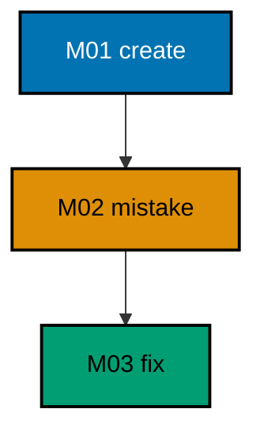

**`learning/code/ex-18-rollback-means-a-forward-fix/Program.cs`**:

```csharp
// Example 18: Rollback Means a Forward Fix.
// M03 drops the column M02 added by mistake; the history never goes back.
using Microsoft.EntityFrameworkCore; // => context, Migrate, and query entry points

string Host() // => one host lookup shared by every connection
{ // => host block opens
    return Environment.GetEnvironmentVariable("PGHOST") ?? "localhost"; // => service alias on the unit network
} // => host lookup ends here

string Port() // => one port lookup shared by every connection
{ // => port block opens
    return Environment.GetEnvironmentVariable("PGPORT") ?? "5432"; // => standard PostgreSQL port
} // => port lookup ends here

string Db() // => one database lookup shared by every connection
{ // => database block opens
    return Environment.GetEnvironmentVariable("PGDATABASE") ?? "postgres"; // => the service database name
} // => database lookup ends here

string DbUser() // => one user lookup shared by every connection
{ // => user block opens
    return Environment.GetEnvironmentVariable("PGUSER") ?? "postgres"; // => trust-auth superuser, no password
} // => user lookup ends here

string ConnectionString() // => one builder for the Npgsql connection string
{ // => string block opens
    return $"Host={Host()};Port={Port()};Database={Db()};Username={DbUser()}"; // => trust auth needs no password
} // => connection string ends here

using var ctx = new MembersDb( // => one context per program run
    new DbContextOptionsBuilder<MembersDb>().UseNpgsql(ConnectionString()).Options
); // => Npgsql provider with our string
ctx.Database.OpenConnection(); // => open once for every inspection query below

string Scalar(string sql) // => one-row, one-column inspection queries
{ // => scalar block opens
    using var cmd = ctx.Database.GetDbConnection().CreateCommand(); // => command on the open connection
    cmd.CommandText = sql; // => read-only inspection SQL
    object? value = cmd.ExecuteScalar(); // => the single answer
    return value?.ToString() ?? "null"; // => text for printing, null-safe
} // => scalar helper ends here

ctx.Database.Migrate(); // => apply M01, M02, M03: fix included
Console.WriteLine(
    $"email={(Scalar("SELECT count(*) FROM information_schema.columns WHERE table_name = 'Members' AND column_name = 'Email'") == "0" ? "absent" : "present")}"
); // => Output: email=absent

public class Member // => the entity mapped to the Members table
{ // => entity block opens
    public int Id { get; set; } // => identity key generated by PostgreSQL
    public string Handle { get; set; } = ""; // => required handle column
} // => entity ends here

public class MembersDb : DbContext // => the context Migrate discovers migrations from
{ // => context block opens
    public MembersDb(DbContextOptions<MembersDb> options)
        : base(options) { } // => options carry the connection string

    public DbSet<Member> Members => Set<Member>(); // => the one set this example queries
} // => context ends here
```

**`learning/code/ex-18-rollback-means-a-forward-fix/Migrations.cs`**:

```csharp
// Migrations for Example 18: rollback means a forward fix.
// M02 adds Email by mistake; M03 drops it. History only moves forward.
using Microsoft.EntityFrameworkCore.Infrastructure; // => context attribute lives here
using Microsoft.EntityFrameworkCore.Migrations; // => migration base types live here
using Npgsql.EntityFrameworkCore.PostgreSQL.Metadata; // => identity strategy annotations live here

namespace App.Migrations; // => migrations live in their own namespace

[DbContext(typeof(MembersDb))] // => bind this version to the MembersDb context
[Migration("20260101000001_CreateMembers")] // => first version: the create
public partial class CreateMembers : Migration // => one class per migration file
{ // => class block opens
    protected override void Up(MigrationBuilder migrationBuilder) // => forward change runs on migrate
    { // => forward block opens
        migrationBuilder.CreateTable( // => the create this migration owns
            name: "Members", // => table name the program queries back
            columns: table => new // => column map follows
            { // => column block opens
                Id = table
                    .Column<int>(type: "integer", nullable: false) // => surrogate key, never null
                    .Annotation(
                        "Npgsql:ValueGenerationStrategy",
                        NpgsqlValueGenerationStrategy.IdentityByDefaultColumn
                    ), // => serial-style identity
                Handle = table.Column<string>(type: "text", nullable: false), // => member handle, required
            }, // => column map ends
            constraints: table => // => key rules follow
            { // => constraint block opens
                table.PrimaryKey("PK_Members", x => x.Id); // => primary key on the identity column
            }
        ); // => create-table call ends
    } // => forward change ends

    protected override void Down(MigrationBuilder migrationBuilder) // => reverse change for migrate-back
    { // => reverse block opens
        migrationBuilder.DropTable( // => undo is the mirror image
            name: "Members"
        ); // => drop what Up created
    } // => reverse change ends
} // => first migration ends here

[DbContext(typeof(MembersDb))] // => bind this version to the MembersDb context
[Migration("20260101000002_AddEmailMistake")] // => second version: the mistaken add
public partial class AddEmailMistake : Migration // => the mistake is versioned too
{ // => class block opens
    protected override void Up(MigrationBuilder migrationBuilder) // => forward change runs on migrate
    { // => forward block opens
        migrationBuilder.AddColumn<string>( // => the column the team regrets
            name: "Email", // => mistaken column, removed by M03
            table: "Members", // => the table M01 created
            type: "text", // => free-form address text
            nullable: true
        ); // => nullable so existing rows survive
    } // => forward change ends

    protected override void Down(MigrationBuilder migrationBuilder) // => reverse change for migrate-back
    { // => reverse block opens
        migrationBuilder.DropColumn( // => undo removes the added column
            name: "Email", // => the column Up added
            table: "Members"
        ); // => from the table Up altered
    } // => reverse change ends
} // => second migration ends here

[DbContext(typeof(MembersDb))] // => bind this version to the MembersDb context
[Migration("20260101000003_DropEmailFix")] // => third version: the forward fix
public partial class DropEmailFix : Migration // => rollback by moving forward
{ // => class block opens
    protected override void Up(MigrationBuilder migrationBuilder) // => forward change runs on migrate
    { // => forward block opens
        migrationBuilder.DropColumn( // => the fix undoes M02 going forward
            name: "Email", // => the mistaken column, now gone
            table: "Members"
        ); // => from the table M01 created
    } // => forward change ends

    protected override void Down(MigrationBuilder migrationBuilder) // => reverse change for migrate-back
    { // => reverse block opens
        migrationBuilder.AddColumn<string>( // => undo re-adds what Up dropped
            name: "Email", // => the mistaken column, restored
            table: "Members", // => the table M01 created
            type: "text", // => free-form address text
            nullable: true
        ); // => nullable so existing rows survive
    } // => reverse change ends
} // => third migration ends here
```

**Output** (`learning/code/ex-18-rollback-means-a-forward-fix/expected/main.stdout.txt`):

```text
email=absent
```

**Key takeaway**: Never delete a migration: roll back by shipping a new version that undoes it.

**Why it matters**: Deleting an applied migration corrupts every database that already ran it — their history references a version that no longer exists, and the next migrate fails in a way no forward step can repair. A forward-fix version applies cleanly everywhere: databases that ran the mistake get the undo, and fresh databases pass through both. Append-only history is the one rule that keeps a fleet of databases repairable.

---

### Example 19: Reverse by Re-adding, Not by Undo

`M02` dropped `Name` by mistake; `M03` re-adds it as a new version — nullable, because the dropped data cannot return. The program migrates fully and checks the catalog: the column is present again.

Present column with a nullable shape proves the restore worked within forward-only rules. The honest nullability is the point: history can rebuild structure, never lost data.

(Concepts: co-02, co-08.)

**`learning/code/ex-19-reverse-by-re-adding-not-by-undo/Program.cs`**:

```csharp
// Example 19: Reverse by Re-adding, Not by Undo.
// M02 dropped Name by mistake; M03 re-adds it as a new version.
using Microsoft.EntityFrameworkCore; // => context, Migrate, and query entry points

string Host() // => one host lookup shared by every connection
{ // => host block opens
    return Environment.GetEnvironmentVariable("PGHOST") ?? "localhost"; // => service alias on the unit network
} // => host lookup ends here

string Port() // => one port lookup shared by every connection
{ // => port block opens
    return Environment.GetEnvironmentVariable("PGPORT") ?? "5432"; // => standard PostgreSQL port
} // => port lookup ends here

string Db() // => one database lookup shared by every connection
{ // => database block opens
    return Environment.GetEnvironmentVariable("PGDATABASE") ?? "postgres"; // => the service database name
} // => database lookup ends here

string DbUser() // => one user lookup shared by every connection
{ // => user block opens
    return Environment.GetEnvironmentVariable("PGUSER") ?? "postgres"; // => trust-auth superuser, no password
} // => user lookup ends here

string ConnectionString() // => one builder for the Npgsql connection string
{ // => string block opens
    return $"Host={Host()};Port={Port()};Database={Db()};Username={DbUser()}"; // => trust auth needs no password
} // => connection string ends here

using var ctx = new ClubsDb( // => one context per program run
    new DbContextOptionsBuilder<ClubsDb>().UseNpgsql(ConnectionString()).Options
); // => Npgsql provider with our string
ctx.Database.OpenConnection(); // => open once for every inspection query below

string Scalar(string sql) // => one-row, one-column inspection queries
{ // => scalar block opens
    using var cmd = ctx.Database.GetDbConnection().CreateCommand(); // => command on the open connection
    cmd.CommandText = sql; // => read-only inspection SQL
    object? value = cmd.ExecuteScalar(); // => the single answer
    return value?.ToString() ?? "null"; // => text for printing, null-safe
} // => scalar helper ends here

ctx.Database.Migrate(); // => apply M01, M02, M03: drop then re-add
Console.WriteLine(
    $"name={(Scalar("SELECT count(*) FROM information_schema.columns WHERE table_name = 'Clubs' AND column_name = 'Name'") == "1" ? "present" : "absent")}"
); // => Output: name=present

public class Club // => the entity mapped to the Clubs table
{ // => entity block opens
    public int Id { get; set; } // => identity key generated by PostgreSQL
    public string? Name { get; set; } // => re-added nullable: history cannot restore data
} // => entity ends here

public class ClubsDb : DbContext // => the context Migrate discovers migrations from
{ // => context block opens
    public ClubsDb(DbContextOptions<ClubsDb> options)
        : base(options) { } // => options carry the connection string

    public DbSet<Club> Clubs => Set<Club>(); // => the one set this example queries
} // => context ends here
```

**`learning/code/ex-19-reverse-by-re-adding-not-by-undo/Migrations.cs`**:

```csharp
// Migrations for Example 19: reverse by re-adding, not by undo.
// M02 drops Name by mistake; M03 re-adds it. The restore is a new version.
using Microsoft.EntityFrameworkCore.Infrastructure; // => context attribute lives here
using Microsoft.EntityFrameworkCore.Migrations; // => migration base types live here
using Npgsql.EntityFrameworkCore.PostgreSQL.Metadata; // => identity strategy annotations live here

namespace App.Migrations; // => migrations live in their own namespace

[DbContext(typeof(ClubsDb))] // => bind this version to the ClubsDb context
[Migration("20260101000001_CreateClubs")] // => first version: the create
public partial class CreateClubs : Migration // => one class per migration file
{ // => class block opens
    protected override void Up(MigrationBuilder migrationBuilder) // => forward change runs on migrate
    { // => forward block opens
        migrationBuilder.CreateTable( // => the create this migration owns
            name: "Clubs", // => table name the program queries back
            columns: table => new // => column map follows
            { // => column block opens
                Id = table
                    .Column<int>(type: "integer", nullable: false) // => surrogate key, never null
                    .Annotation(
                        "Npgsql:ValueGenerationStrategy",
                        NpgsqlValueGenerationStrategy.IdentityByDefaultColumn
                    ), // => serial-style identity
                Name = table.Column<string>(type: "text", nullable: false), // => club name, required
            }, // => column map ends
            constraints: table => // => key rules follow
            { // => constraint block opens
                table.PrimaryKey("PK_Clubs", x => x.Id); // => primary key on the identity column
            }
        ); // => create-table call ends
    } // => forward change ends

    protected override void Down(MigrationBuilder migrationBuilder) // => reverse change for migrate-back
    { // => reverse block opens
        migrationBuilder.DropTable( // => undo is the mirror image
            name: "Clubs"
        ); // => drop what Up created
    } // => reverse change ends
} // => first migration ends here

[DbContext(typeof(ClubsDb))] // => bind this version to the ClubsDb context
[Migration("20260101000002_DropNameMistake")] // => second version: the mistaken drop
public partial class DropNameMistake : Migration // => the mistake is versioned too
{ // => class block opens
    protected override void Up(MigrationBuilder migrationBuilder) // => forward change runs on migrate
    { // => forward block opens
        migrationBuilder.DropColumn( // => the column the team still needs
            name: "Name", // => mistakenly dropped, restored by M03
            table: "Clubs"
        ); // => from the table M01 created
    } // => forward change ends

    protected override void Down(MigrationBuilder migrationBuilder) // => reverse change for migrate-back
    { // => reverse block opens
        migrationBuilder.AddColumn<string>( // => undo re-adds what Up dropped
            name: "Name", // => the dropped column, restored
            table: "Clubs", // => the table M01 created
            type: "text", // => free-form name text
            nullable: true
        ); // => nullable so surviving rows restore
    } // => reverse change ends
} // => second migration ends here

[DbContext(typeof(ClubsDb))] // => bind this version to the ClubsDb context
[Migration("20260101000003_ReaddNameFix")] // => third version: the forward restore
public partial class ReaddNameFix : Migration // => restore by re-adding, not by undo
{ // => class block opens
    protected override void Up(MigrationBuilder migrationBuilder) // => forward change runs on migrate
    { // => forward block opens
        migrationBuilder.AddColumn<string>( // => the fix restores the column going forward
            name: "Name", // => the mistakenly dropped column, back again
            table: "Clubs", // => the table M01 created
            type: "text", // => free-form name text
            nullable: true
        ); // => nullable: dropped data cannot return
    } // => forward change ends

    protected override void Down(MigrationBuilder migrationBuilder) // => reverse change for migrate-back
    { // => reverse block opens
        migrationBuilder.DropColumn( // => undo removes the restored column
            name: "Name", // => the column Up re-added
            table: "Clubs"
        ); // => from the table Up altered
    } // => reverse change ends
} // => third migration ends here
```

**Output** (`learning/code/ex-19-reverse-by-re-adding-not-by-undo/expected/main.stdout.txt`):

```text
name=present
```

**Key takeaway**: A dropped column comes back as a new version — nullable, because the dropped data is gone for good.

**Why it matters**: Re-adding a dropped column as a new version looks wasteful until the alternative is priced: editing the old migration forks every database that already ran it, while the forward version applies cleanly everywhere. The honest nullability is the point — history can rebuild structure but never resurrects deleted data, and the new version says so in its schema. Append-only history costs a version per mistake and buys a fleet that always converges.

---

### Example 20: Failed Migration Leaves Earlier Work Intact

A failing version must abort itself without touching earlier work. The program applies `M01` with one invoice row, attempts the broken `M02` in a `try`, swallows the expected failure, then counts rows and history.

One row and one history entry prove the failure was contained. The broken version left no table and no record.

(Concepts: co-08, co-12.)

**`learning/code/ex-20-failed-migration-leaves-earlier-work-intact/Program.cs`**:

```csharp
// Example 20: Failed Migration Leaves Earlier Work Intact.
// M02 fails on the duplicate column; the M01 row and history stay clean.
using Microsoft.EntityFrameworkCore; // => context, Migrate, and query entry points

string Host() // => one host lookup shared by every connection
{ // => host block opens
    return Environment.GetEnvironmentVariable("PGHOST") ?? "localhost"; // => service alias on the unit network
} // => host lookup ends here

string Port() // => one port lookup shared by every connection
{ // => port block opens
    return Environment.GetEnvironmentVariable("PGPORT") ?? "5432"; // => standard PostgreSQL port
} // => port lookup ends here

string Db() // => one database lookup shared by every connection
{ // => database block opens
    return Environment.GetEnvironmentVariable("PGDATABASE") ?? "postgres"; // => the service database name
} // => database lookup ends here

string DbUser() // => one user lookup shared by every connection
{ // => user block opens
    return Environment.GetEnvironmentVariable("PGUSER") ?? "postgres"; // => trust-auth superuser, no password
} // => user lookup ends here

string ConnectionString() // => one builder for the Npgsql connection string
{ // => string block opens
    return $"Host={Host()};Port={Port()};Database={Db()};Username={DbUser()}"; // => trust auth needs no password
} // => connection string ends here

using var ctx = new InvoicesDb( // => one context per program run
    new DbContextOptionsBuilder<InvoicesDb>().UseNpgsql(ConnectionString()).Options
); // => Npgsql provider with our string
ctx.Database.OpenConnection(); // => open once for every inspection query below

string Scalar(string sql) // => one-row, one-column inspection queries
{ // => scalar block opens
    using var cmd = ctx.Database.GetDbConnection().CreateCommand(); // => command on the open connection
    cmd.CommandText = sql; // => read-only inspection SQL
    object? value = cmd.ExecuteScalar(); // => the single answer
    return value?.ToString() ?? "null"; // => text for printing, null-safe
} // => scalar helper ends here

ctx.Database.Migrate("20260101000001_CreateInvoices"); // => apply only M01 first
ctx.Invoices.ExecuteDelete(); // => start from zero rows so the double run prints alike
ctx.Invoices.Add(new Invoice { Total = 900 }); // => the row the failure must not touch
ctx.SaveChanges(); // => persist the M01 row before the broken migration
int failed = 0; // => the failure flag the catch sets
try // => the broken migration is expected to throw
{ // => try block opens
    ctx.Database.Migrate(); // => M02 fails on the duplicate Paid column
} // => try ends after the failing call
catch (Exception) // => any provider error counts: the kind is fixed by SQLSTATE
{ // => catch block opens
    failed = 1; // => the failure happened as designed
} // => catch ends here
Console.WriteLine(
    $"failed={failed} rows={Scalar("SELECT count(*) FROM \"Invoices\"")} history={Scalar("SELECT count(*) FROM \"__EFMigrationsHistory\"")}"
); // => Output: failed=1 rows=1 history=1

public class Invoice // => the entity mapped to the Invoices table
{ // => entity block opens
    public int Id { get; set; } // => identity key generated by PostgreSQL
    public int Total { get; set; } // => required total column
} // => entity ends here

public class InvoicesDb : DbContext // => the context Migrate discovers migrations from
{ // => context block opens
    public InvoicesDb(DbContextOptions<InvoicesDb> options)
        : base(options) { } // => options carry the connection string

    public DbSet<Invoice> Invoices => Set<Invoice>(); // => the one set this example queries
} // => context ends here
```

**`learning/code/ex-20-failed-migration-leaves-earlier-work-intact/Migrations.cs`**:

```csharp
// Migrations for Example 20: a failed migration leaves earlier work intact.
// M01 seeds one row; M02 fails on a duplicate column, so M01 stays the truth.
using Microsoft.EntityFrameworkCore.Infrastructure; // => context attribute lives here
using Microsoft.EntityFrameworkCore.Migrations; // => migration base types live here
using Npgsql.EntityFrameworkCore.PostgreSQL.Metadata; // => identity strategy annotations live here

namespace App.Migrations; // => migrations live in their own namespace

[DbContext(typeof(InvoicesDb))] // => bind this version to the InvoicesDb context
[Migration("20260101000001_CreateInvoices")] // => first version: the create
public partial class CreateInvoices : Migration // => one class per migration file
{ // => class block opens
    protected override void Up(MigrationBuilder migrationBuilder) // => forward change runs on migrate
    { // => forward block opens
        migrationBuilder.CreateTable( // => the create this migration owns
            name: "Invoices", // => table name the program queries back
            columns: table => new // => column map follows
            { // => column block opens
                Id = table
                    .Column<int>(type: "integer", nullable: false) // => surrogate key, never null
                    .Annotation(
                        "Npgsql:ValueGenerationStrategy",
                        NpgsqlValueGenerationStrategy.IdentityByDefaultColumn
                    ), // => serial-style identity
                Total = table.Column<int>(type: "integer", nullable: false), // => invoice total, required
            }, // => column map ends
            constraints: table => // => key rules follow
            { // => constraint block opens
                table.PrimaryKey("PK_Invoices", x => x.Id); // => primary key on the identity column
            }
        ); // => create-table call ends
    } // => forward change ends

    protected override void Down(MigrationBuilder migrationBuilder) // => reverse change for migrate-back
    { // => reverse block opens
        migrationBuilder.DropTable( // => undo is the mirror image
            name: "Invoices"
        ); // => drop what Up created
    } // => reverse change ends
} // => first migration ends here

[DbContext(typeof(InvoicesDb))] // => bind this version to the InvoicesDb context
[Migration("20260101000002_BrokenAddPaid")] // => second version: the broken alter
public partial class BrokenAddPaid : Migration // => this migration always fails
{ // => class block opens
    protected override void Up(MigrationBuilder migrationBuilder) // => forward change fails on migrate
    { // => forward block opens
        migrationBuilder.Sql("ALTER TABLE \"Invoices\" ADD COLUMN \"Paid\" boolean NOT NULL"); // => the intended alter, valid SQL
        migrationBuilder.Sql("ALTER TABLE \"Invoices\" ADD COLUMN \"Paid\" boolean NOT NULL"); // => the same column twice: 42701
    } // => forward change ends in failure

    protected override void Down(MigrationBuilder migrationBuilder) // => reverse change for migrate-back
    { // => reverse block opens
        migrationBuilder.DropColumn( // => undo removes the added column
            name: "Paid", // => the column Up meant to add
            table: "Invoices"
        ); // => from the table M01 created
    } // => reverse change ends
} // => second migration ends here
```

**Output** (`learning/code/ex-20-failed-migration-leaves-earlier-work-intact/expected/main.stdout.txt`):

```text
failed=1 rows=1 history=1
```

**Key takeaway**: A failing version aborts itself: earlier rows and history entries survive.

**Why it matters**: The fear behind every production migrate is collateral damage — that a failed version takes good data with it. EF's per-migration transaction boundary contains the failure, and this example proves it with counts rather than promises. Knowing the blast radius ends at the failing version changes incident response from "restore from backup" to "fix the migration and re-run". The `try`/`catch` shape here is also the template for deploy scripts that must report failure without crashing the release pipeline.

---

### Example 21: Partial Statements Roll Back Together

`M02` fails on its second statement; transactional DDL removes the first too. The program applies `M01`, attempts the full migrate in a `try`, swallows the expected failure, then counts the `Stamps` table and history rows.

Zero stamps tables with one history row prove the whole version rolled back as one unit: no half-applied statements linger.

(Concepts: co-02, co-12.)

**`learning/code/ex-21-partial-statements-roll-back-together/Program.cs`**:

```csharp
// Example 21: Partial Statements Roll Back Together.
// M02 fails on its second statement; transactional DDL removes the first too.
using Microsoft.EntityFrameworkCore; // => context, Migrate, and query entry points

string Host() // => one host lookup shared by every connection
{ // => host block opens
    return Environment.GetEnvironmentVariable("PGHOST") ?? "localhost"; // => service alias on the unit network
} // => host lookup ends here

string Port() // => one port lookup shared by every connection
{ // => port block opens
    return Environment.GetEnvironmentVariable("PGPORT") ?? "5432"; // => standard PostgreSQL port
} // => port lookup ends here

string Db() // => one database lookup shared by every connection
{ // => database block opens
    return Environment.GetEnvironmentVariable("PGDATABASE") ?? "postgres"; // => the service database name
} // => database lookup ends here

string DbUser() // => one user lookup shared by every connection
{ // => user block opens
    return Environment.GetEnvironmentVariable("PGUSER") ?? "postgres"; // => trust-auth superuser, no password
} // => user lookup ends here

string ConnectionString() // => one builder for the Npgsql connection string
{ // => string block opens
    return $"Host={Host()};Port={Port()};Database={Db()};Username={DbUser()}"; // => trust auth needs no password
} // => connection string ends here

using var ctx = new ReceiptsDb( // => one context per program run
    new DbContextOptionsBuilder<ReceiptsDb>().UseNpgsql(ConnectionString()).Options
); // => Npgsql provider with our string
ctx.Database.OpenConnection(); // => open once for every inspection query below

string Scalar(string sql) // => one-row, one-column inspection queries
{ // => scalar block opens
    using var cmd = ctx.Database.GetDbConnection().CreateCommand(); // => command on the open connection
    cmd.CommandText = sql; // => read-only inspection SQL
    object? value = cmd.ExecuteScalar(); // => the single answer
    return value?.ToString() ?? "null"; // => text for printing, null-safe
} // => scalar helper ends here

ctx.Database.Migrate("20260101000001_CreateReceipts"); // => apply only M01 first
try // => the broken pair is expected to throw
{ // => try block opens
    ctx.Database.Migrate(); // => M02 fails on the duplicate Stamps table
} // => try ends after the failing call
catch (Exception) // => any provider error counts: the kind is fixed by SQLSTATE
{ // => catch block opens
} // => catch ends here: the failure is the lesson
string stamps = Scalar(
    "SELECT count(*) FROM information_schema.tables WHERE table_name = 'Stamps'"
); // => rolled back: zero
Console.WriteLine(
    $"stamps={stamps} history={Scalar("SELECT count(*) FROM \"__EFMigrationsHistory\"")}"
); // => Output: stamps=0 history=1

public class Receipt // => the entity mapped to the Receipts table
{ // => entity block opens
    public int Id { get; set; } // => identity key generated by PostgreSQL
    public int Total { get; set; } // => required total column
} // => entity ends here

public class ReceiptsDb : DbContext // => the context Migrate discovers migrations from
{ // => context block opens
    public ReceiptsDb(DbContextOptions<ReceiptsDb> options)
        : base(options) { } // => options carry the connection string

    public DbSet<Receipt> Receipts => Set<Receipt>(); // => the one set this example queries
} // => context ends here
```

**`learning/code/ex-21-partial-statements-roll-back-together/Migrations.cs`**:

```csharp
// Migrations for Example 21: partial statements roll back together.
// M02 holds two statements and the second fails, so neither lands.
using Microsoft.EntityFrameworkCore.Infrastructure; // => context attribute lives here
using Microsoft.EntityFrameworkCore.Migrations; // => migration base types live here
using Npgsql.EntityFrameworkCore.PostgreSQL.Metadata; // => identity strategy annotations live here

namespace App.Migrations; // => migrations live in their own namespace

[DbContext(typeof(ReceiptsDb))] // => bind this version to the ReceiptsDb context
[Migration("20260101000001_CreateReceipts")] // => first version: the create
public partial class CreateReceipts : Migration // => one class per migration file
{ // => class block opens
    protected override void Up(MigrationBuilder migrationBuilder) // => forward change runs on migrate
    { // => forward block opens
        migrationBuilder.CreateTable( // => the create this migration owns
            name: "Receipts", // => table name the program queries back
            columns: table => new // => column map follows
            { // => column block opens
                Id = table
                    .Column<int>(type: "integer", nullable: false) // => surrogate key, never null
                    .Annotation(
                        "Npgsql:ValueGenerationStrategy",
                        NpgsqlValueGenerationStrategy.IdentityByDefaultColumn
                    ), // => serial-style identity
                Total = table.Column<int>(type: "integer", nullable: false), // => receipt total, required
            }, // => column map ends
            constraints: table => // => key rules follow
            { // => constraint block opens
                table.PrimaryKey("PK_Receipts", x => x.Id); // => primary key on the identity column
            }
        ); // => create-table call ends
    } // => forward change ends

    protected override void Down(MigrationBuilder migrationBuilder) // => reverse change for migrate-back
    { // => reverse block opens
        migrationBuilder.DropTable( // => undo is the mirror image
            name: "Receipts"
        ); // => drop what Up created
    } // => reverse change ends
} // => first migration ends here

[DbContext(typeof(ReceiptsDb))] // => bind this version to the ReceiptsDb context
[Migration("20260101000002_BrokenPair")] // => second version: the broken pair
public partial class BrokenPair : Migration // => both statements share one transaction
{ // => class block opens
    protected override void Up(MigrationBuilder migrationBuilder) // => forward change fails on migrate
    { // => forward block opens
        migrationBuilder.Sql("CREATE TABLE \"Stamps\" (\"Id\" integer NOT NULL)"); // => first statement: valid alone
        migrationBuilder.Sql("CREATE TABLE \"Stamps\" (\"Id\" integer NOT NULL)"); // => second statement: 42P07, table exists
    } // => forward change ends in failure

    protected override void Down(MigrationBuilder migrationBuilder) // => reverse change for migrate-back
    { // => reverse block opens
        migrationBuilder.Sql("DROP TABLE IF EXISTS \"Stamps\""); // => undo drops the partial table
    } // => reverse change ends
} // => second migration ends here
```

**Output** (`learning/code/ex-21-partial-statements-roll-back-together/expected/main.stdout.txt`):

```text
stamps=0 history=1
```

**Key takeaway**: Statements inside one migration share one transaction on PostgreSQL: all or nothing.

**Why it matters**: Multi-statement migrations are where "half-applied" horror stories come from on databases without transactional DDL. PostgreSQL rolls DDL back like any other statement, so EF users get atomic versions for free — but only if they know to rely on it. This example is the proof to cite when a teammate proposes manual cleanup scripts: the database already cleaned up, and the history table proves nothing landed.

---

### Example 22: Two Tables or None

`M02` creates `Alpha` and `Beta`, then fails: neither table survives the rollback. The program applies the anchor `M01`, attempts the full migrate, then asks the catalog about each table by name.

Two absents prove atomicity across objects: a version that creates several tables either lands them all or lands none.

(Concepts: co-02, co-12.)

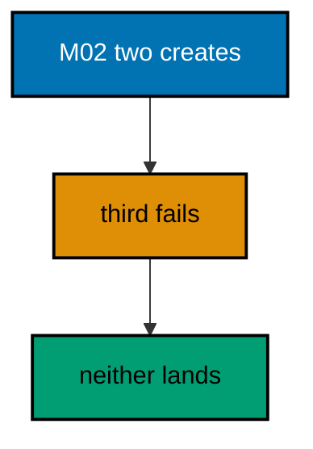

**`learning/code/ex-22-two-tables-or-none/Program.cs`**:

```csharp
// Example 22: Two Tables or None.
// M02 creates Alpha and Beta, then fails: neither table survives the rollback.
using Microsoft.EntityFrameworkCore; // => context, Migrate, and query entry points

string Host() // => one host lookup shared by every connection
{ // => host block opens
    return Environment.GetEnvironmentVariable("PGHOST") ?? "localhost"; // => service alias on the unit network
} // => host lookup ends here

string Port() // => one port lookup shared by every connection
{ // => port block opens
    return Environment.GetEnvironmentVariable("PGPORT") ?? "5432"; // => standard PostgreSQL port
} // => port lookup ends here

string Db() // => one database lookup shared by every connection
{ // => database block opens
    return Environment.GetEnvironmentVariable("PGDATABASE") ?? "postgres"; // => the service database name
} // => database lookup ends here

string DbUser() // => one user lookup shared by every connection
{ // => user block opens
    return Environment.GetEnvironmentVariable("PGUSER") ?? "postgres"; // => trust-auth superuser, no password
} // => user lookup ends here

string ConnectionString() // => one builder for the Npgsql connection string
{ // => string block opens
    return $"Host={Host()};Port={Port()};Database={Db()};Username={DbUser()}"; // => trust auth needs no password
} // => connection string ends here

using var ctx = new TwinsDb( // => one context per program run
    new DbContextOptionsBuilder<TwinsDb>().UseNpgsql(ConnectionString()).Options
); // => Npgsql provider with our string
ctx.Database.OpenConnection(); // => open once for every inspection query below

string Scalar(string sql) // => one-row, one-column inspection queries
{ // => scalar block opens
    using var cmd = ctx.Database.GetDbConnection().CreateCommand(); // => command on the open connection
    cmd.CommandText = sql; // => read-only inspection SQL
    object? value = cmd.ExecuteScalar(); // => the single answer
    return value?.ToString() ?? "null"; // => text for printing, null-safe
} // => scalar helper ends here

ctx.Database.Migrate("20260101000001_CreateLedger22"); // => apply only M01 first
try // => the broken pair is expected to throw
{ // => try block opens
    ctx.Database.Migrate(); // => M02 fails on the duplicate Alpha table
} // => try ends after the failing call
catch (Exception) // => any provider error counts: the kind is fixed by SQLSTATE
{ // => catch block opens
} // => catch ends here: the failure is the lesson
string Present(string table) // => one check names one table present or absent
{ // => check block opens
    return
        Scalar($"SELECT count(*) FROM information_schema.tables WHERE table_name = '{table}'")
        == "0"
        ? "absent"
        : "present"; // => zero rows means absent
} // => check ends here
Console.WriteLine($"alpha={Present("Alpha")} beta={Present("Beta")}"); // => Output: alpha=absent beta=absent

public class TwinsDb : DbContext // => the context Migrate discovers migrations from
{ // => context block opens
    public TwinsDb(DbContextOptions<TwinsDb> options)
        : base(options) { } // => options carry the connection string
} // => context ends here
```

**`learning/code/ex-22-two-tables-or-none/Migrations.cs`**:

```csharp
// Migrations for Example 22: two tables or none.
// M02 creates Alpha and Beta, then fails: transactional DDL keeps neither.
using Microsoft.EntityFrameworkCore.Infrastructure; // => context attribute lives here
using Microsoft.EntityFrameworkCore.Migrations; // => migration base types live here

namespace App.Migrations; // => migrations live in their own namespace

[DbContext(typeof(TwinsDb))] // => bind this version to the TwinsDb context
[Migration("20260101000001_CreateLedger22")] // => first version: the anchor create
public partial class CreateLedger22 : Migration // => one class per migration file
{ // => class block opens
    protected override void Up(MigrationBuilder migrationBuilder) // => forward change runs on migrate
    { // => forward block opens
        migrationBuilder.Sql("CREATE TABLE \"Ledger22\" (\"Id\" integer NOT NULL)"); // => the anchor the failure must not touch
    } // => forward change ends

    protected override void Down(MigrationBuilder migrationBuilder) // => reverse change for migrate-back
    { // => reverse block opens
        migrationBuilder.Sql("DROP TABLE IF EXISTS \"Ledger22\""); // => undo drops the anchor table
    } // => reverse change ends
} // => first migration ends here

[DbContext(typeof(TwinsDb))] // => bind this version to the TwinsDb context
[Migration("20260101000002_BrokenTwinPair")] // => second version: the broken pair
public partial class BrokenTwinPair : Migration // => both tables share one transaction
{ // => class block opens
    protected override void Up(MigrationBuilder migrationBuilder) // => forward change fails on migrate
    { // => forward block opens
        migrationBuilder.Sql("CREATE TABLE \"Alpha\" (\"Id\" integer NOT NULL)"); // => first table: valid alone
        migrationBuilder.Sql("CREATE TABLE \"Beta\" (\"Id\" integer NOT NULL)"); // => second table: valid alone
        migrationBuilder.Sql("CREATE TABLE \"Alpha\" (\"Id\" integer NOT NULL)"); // => third statement: 42P07, Alpha exists
    } // => forward change ends in failure

    protected override void Down(MigrationBuilder migrationBuilder) // => reverse change for migrate-back
    { // => reverse block opens
        migrationBuilder.Sql("DROP TABLE IF EXISTS \"Alpha\""); // => undo drops the first table
        migrationBuilder.Sql("DROP TABLE IF EXISTS \"Beta\""); // => undo drops the second table
    } // => reverse change ends
} // => second migration ends here
```

**Output** (`learning/code/ex-22-two-tables-or-none/expected/main.stdout.txt`):

```text
alpha=absent beta=absent
```

**Key takeaway**: Atomic versions span objects: two creates and a failure leave zero tables.

**Why it matters**: Multi-table versions are the norm in real features — a new entity plus its join table, a table plus its index. If the second create fails and the first one lingers, every retry collides with the leftover and every diagnosis starts with manual cleanup. Atomicity means the retry starts from the same clean state as the first attempt. Design versions to exploit this: pack related creates into one version instead of spreading them across three.

---

### Example 23: Down Reverses Up on Demand

Migrate back to `...001` runs `M02.Down`: `Lines23` disappears, `Orders23` stays. The program migrates fully, then migrates back to the first version, then asks the catalog about each table.

One present and one absent prove `Down` is a real, runnable path — not dead code. The migrate-back is how staging rehearses the rollback before production ever needs it.

(Concepts: co-02, co-08.)

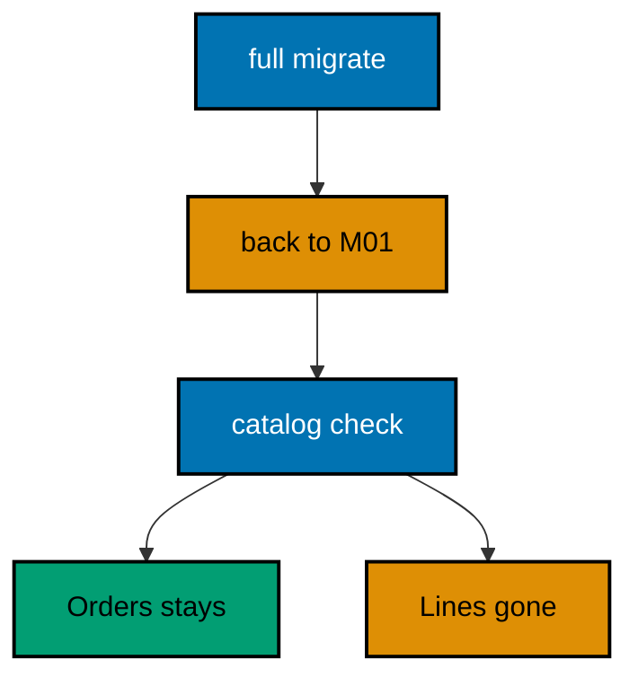

**`learning/code/ex-23-down-reverses-up-on-demand/Program.cs`**:

```csharp
// Example 23: Down Reverses Up on Demand.
// Migrate back to ...001 runs M02.Down: Lines23 disappears, Orders23 stays.
using Microsoft.EntityFrameworkCore; // => context, Migrate, and query entry points

string Host() // => one host lookup shared by every connection
{ // => host block opens
    return Environment.GetEnvironmentVariable("PGHOST") ?? "localhost"; // => service alias on the unit network
} // => host lookup ends here

string Port() // => one port lookup shared by every connection
{ // => port block opens
    return Environment.GetEnvironmentVariable("PGPORT") ?? "5432"; // => standard PostgreSQL port
} // => port lookup ends here

string Db() // => one database lookup shared by every connection
{ // => database block opens
    return Environment.GetEnvironmentVariable("PGDATABASE") ?? "postgres"; // => the service database name
} // => database lookup ends here

string DbUser() // => one user lookup shared by every connection
{ // => user block opens
    return Environment.GetEnvironmentVariable("PGUSER") ?? "postgres"; // => trust-auth superuser, no password
} // => user lookup ends here

string ConnectionString() // => one builder for the Npgsql connection string
{ // => string block opens
    return $"Host={Host()};Port={Port()};Database={Db()};Username={DbUser()}"; // => trust auth needs no password
} // => connection string ends here

using var ctx = new Shop23Db( // => one context per program run
    new DbContextOptionsBuilder<Shop23Db>().UseNpgsql(ConnectionString()).Options
); // => Npgsql provider with our string
ctx.Database.OpenConnection(); // => open once for every inspection query below

string Scalar(string sql) // => one-row, one-column inspection queries
{ // => scalar block opens
    using var cmd = ctx.Database.GetDbConnection().CreateCommand(); // => command on the open connection
    cmd.CommandText = sql; // => read-only inspection SQL
    object? value = cmd.ExecuteScalar(); // => the single answer
    return value?.ToString() ?? "null"; // => text for printing, null-safe
} // => scalar helper ends here

string Present(string table) // => one check names one table present or absent
{ // => check block opens
    return
        Scalar($"SELECT count(*) FROM information_schema.tables WHERE table_name = '{table}'")
        == "0"
        ? "absent"
        : "present"; // => zero rows means absent
} // => check ends here

ctx.Database.Migrate(); // => apply M01 then M02 in ID order
ctx.Database.Migrate("20260101000001_CreateOrders23"); // => back to M01: M02.Down drops Lines23
Console.WriteLine($"orders={Present("Orders23")} lines={Present("Lines23")}"); // => Output: orders=present lines=absent

public class Order23 // => the entity mapped to the Orders23 table
{ // => entity block opens
    public int Id { get; set; } // => identity key generated by PostgreSQL
    public string Code { get; set; } = ""; // => required code column
} // => entity ends here

public class Line23 // => the entity mapped to the Lines23 table
{ // => entity block opens
    public int Id { get; set; } // => identity key generated by PostgreSQL
    public string Sku { get; set; } = ""; // => required sku column
} // => entity ends here

public class Shop23Db : DbContext // => the context Migrate discovers migrations from
{ // => context block opens
    public Shop23Db(DbContextOptions<Shop23Db> options)
        : base(options) { } // => options carry the connection string

    public DbSet<Order23> Orders23 => Set<Order23>(); // => orders set stays after the migrate-back
    public DbSet<Line23> Lines23 => Set<Line23>(); // => lines set leaves with the migrate-back
} // => context ends here
```

**`learning/code/ex-23-down-reverses-up-on-demand/Migrations.cs`**:

```csharp
// Migrations for Example 23: Down reverses Up on demand.
// Migrate to ...001 runs M02.Down: the second table disappears, the first stays.
using Microsoft.EntityFrameworkCore.Infrastructure; // => context attribute lives here
using Microsoft.EntityFrameworkCore.Migrations; // => migration base types live here
using Npgsql.EntityFrameworkCore.PostgreSQL.Metadata; // => identity strategy annotations live here

namespace App.Migrations; // => migrations live in their own namespace

[DbContext(typeof(Shop23Db))] // => bind this version to the Shop23Db context
[Migration("20260101000001_CreateOrders23")] // => first version: the create
public partial class CreateOrders23 : Migration // => one class per migration file
{ // => class block opens
    protected override void Up(MigrationBuilder migrationBuilder) // => forward change runs on migrate
    { // => forward block opens
        migrationBuilder.CreateTable( // => the create this migration owns
            name: "Orders23", // => table name the program queries back
            columns: table => new // => column map follows
            { // => column block opens
                Id = table
                    .Column<int>(type: "integer", nullable: false) // => surrogate key, never null
                    .Annotation(
                        "Npgsql:ValueGenerationStrategy",
                        NpgsqlValueGenerationStrategy.IdentityByDefaultColumn
                    ), // => serial-style identity
                Code = table.Column<string>(type: "text", nullable: false), // => order code, required
            }, // => column map ends
            constraints: table => // => key rules follow
            { // => constraint block opens
                table.PrimaryKey("PK_Orders23", x => x.Id); // => primary key on the identity column
            }
        ); // => create-table call ends
    } // => forward change ends

    protected override void Down(MigrationBuilder migrationBuilder) // => reverse change for migrate-back
    { // => reverse block opens
        migrationBuilder.DropTable( // => undo is the mirror image
            name: "Orders23"
        ); // => drop what Up created
    } // => reverse change ends
} // => first migration ends here

[DbContext(typeof(Shop23Db))] // => bind this version to the Shop23Db context
[Migration("20260101000002_CreateLines23")] // => second version: the second table
public partial class CreateLines23 : Migration // => the step the migrate-back removes
{ // => class block opens
    protected override void Up(MigrationBuilder migrationBuilder) // => forward change runs on migrate
    { // => forward block opens
        migrationBuilder.CreateTable( // => the create this migration owns
            name: "Lines23", // => table name the program queries back
            columns: table => new // => column map follows
            { // => column block opens
                Id = table
                    .Column<int>(type: "integer", nullable: false) // => surrogate key, never null
                    .Annotation(
                        "Npgsql:ValueGenerationStrategy",
                        NpgsqlValueGenerationStrategy.IdentityByDefaultColumn
                    ), // => serial-style identity
                Sku = table.Column<string>(type: "text", nullable: false), // => line sku, required
            }, // => column map ends
            constraints: table => // => key rules follow
            { // => constraint block opens
                table.PrimaryKey("PK_Lines23", x => x.Id); // => primary key on the identity column
            }
        ); // => create-table call ends
    } // => forward change ends

    protected override void Down(MigrationBuilder migrationBuilder) // => reverse change for migrate-back
    { // => reverse block opens
        migrationBuilder.DropTable( // => undo is the mirror image
            name: "Lines23"
        ); // => drop what Up created
    } // => reverse change ends
} // => second migration ends here
```

**Output** (`learning/code/ex-23-down-reverses-up-on-demand/expected/main.stdout.txt`):

```text
orders=present lines=absent
```

**Key takeaway**: `Migrate` to an older target runs the `Down` path: rehearse rollbacks, don't just write them.

**Why it matters**: An untested `Down` is a rumor, not a rollback plan — and rumors fail at 3 AM. Running the migrate-back in staging proves the reverse path works against realistic data volumes and constraints before production depends on it. Teams that rehearse rollbacks discover the missing `Down` implementation during business hours, when fixing it costs a commit instead of an outage.

---

### Example 24: Rollback Plan for a Bad Deploy

Ship `M02`, fail the deploy check, migrate back to `M01`: rows kept, column gone. The program migrates fully, seeds two tickets, then migrates back to the first version and counts rows and the removed column.

Two tickets with zero `Escalated` columns prove the rollback kept the data while removing the bad schema: the deploy failed, the data survived.

(Concepts: co-02, co-08, co-16.)

**`learning/code/ex-24-rollback-plan-for-a-bad-deploy/Program.cs`**:

```csharp
// Example 24: Rollback Plan for a Bad Deploy.
// Ship M02, fail the deploy check, migrate back to M01: rows kept, column gone.
using Microsoft.EntityFrameworkCore; // => context, Migrate, and query entry points

string Host() // => one host lookup shared by every connection
{ // => host block opens
    return Environment.GetEnvironmentVariable("PGHOST") ?? "localhost"; // => service alias on the unit network
} // => host lookup ends here

string Port() // => one port lookup shared by every connection
{ // => port block opens
    return Environment.GetEnvironmentVariable("PGPORT") ?? "5432"; // => standard PostgreSQL port
} // => port lookup ends here

string Db() // => one database lookup shared by every connection
{ // => database block opens
    return Environment.GetEnvironmentVariable("PGDATABASE") ?? "postgres"; // => the service database name
} // => database lookup ends here

string DbUser() // => one user lookup shared by every connection
{ // => user block opens
    return Environment.GetEnvironmentVariable("PGUSER") ?? "postgres"; // => trust-auth superuser, no password
} // => user lookup ends here

string ConnectionString() // => one builder for the Npgsql connection string
{ // => string block opens
    return $"Host={Host()};Port={Port()};Database={Db()};Username={DbUser()}"; // => trust auth needs no password
} // => connection string ends here

using var ctx = new TicketsDb( // => one context per program run
    new DbContextOptionsBuilder<TicketsDb>().UseNpgsql(ConnectionString()).Options
); // => Npgsql provider with our string
ctx.Database.OpenConnection(); // => open once for every inspection query below

string Scalar(string sql) // => one-row, one-column inspection queries
{ // => scalar block opens
    using var cmd = ctx.Database.GetDbConnection().CreateCommand(); // => command on the open connection
    cmd.CommandText = sql; // => read-only inspection SQL
    object? value = cmd.ExecuteScalar(); // => the single answer
    return value?.ToString() ?? "null"; // => text for printing, null-safe
} // => scalar helper ends here

ctx.Database.Migrate(); // => ship the release: M01 then M02
ctx.Tickets.ExecuteDelete(); // => start from zero rows so the double run prints alike
ctx.Tickets.Add(new Ticket { Title = "login-flake" }); // => first production ticket
ctx.Tickets.Add(new Ticket { Title = "slow-report" }); // => second production ticket
ctx.SaveChanges(); // => persist both rows under the shipped schema
ctx.Database.Migrate("20260101000001_CreateTickets"); // => the check failed: roll back to M01
Console.WriteLine(
    $"tickets={Scalar("SELECT count(*) FROM \"Tickets\"")} escalated-cols={Scalar("SELECT count(*) FROM information_schema.columns WHERE table_name = 'Tickets' AND column_name = 'Escalated'")}"
); // => Output: tickets=2 escalated-cols=0

public class Ticket // => the entity mapped to the Tickets table
{ // => entity block opens
    public int Id { get; set; } // => identity key generated by PostgreSQL
    public string Title { get; set; } = ""; // => required title column
} // => entity ends here

public class TicketsDb : DbContext // => the context Migrate discovers migrations from
{ // => context block opens
    public TicketsDb(DbContextOptions<TicketsDb> options)
        : base(options) { } // => options carry the connection string

    public DbSet<Ticket> Tickets => Set<Ticket>(); // => the one set this example queries
} // => context ends here
```

**`learning/code/ex-24-rollback-plan-for-a-bad-deploy/Migrations.cs`**:

```csharp
// Migrations for Example 24: a rollback plan for a bad deploy.
// The deploy ships M02, the check fails it, and Migrate back to M01 restores service.
using Microsoft.EntityFrameworkCore.Infrastructure; // => context attribute lives here
using Microsoft.EntityFrameworkCore.Migrations; // => migration base types live here
using Npgsql.EntityFrameworkCore.PostgreSQL.Metadata; // => identity strategy annotations live here

namespace App.Migrations; // => migrations live in their own namespace

[DbContext(typeof(TicketsDb))] // => bind this version to the TicketsDb context
[Migration("20260101000001_CreateTickets")] // => first version: the create
public partial class CreateTickets : Migration // => one class per migration file
{ // => class block opens
    protected override void Up(MigrationBuilder migrationBuilder) // => forward change runs on migrate
    { // => forward block opens
        migrationBuilder.CreateTable( // => the create this migration owns
            name: "Tickets", // => table name the program queries back
            columns: table => new // => column map follows
            { // => column block opens
                Id = table
                    .Column<int>(type: "integer", nullable: false) // => surrogate key, never null
                    .Annotation(
                        "Npgsql:ValueGenerationStrategy",
                        NpgsqlValueGenerationStrategy.IdentityByDefaultColumn
                    ), // => serial-style identity
                Title = table.Column<string>(type: "text", nullable: false), // => ticket title, required
            }, // => column map ends
            constraints: table => // => key rules follow
            { // => constraint block opens
                table.PrimaryKey("PK_Tickets", x => x.Id); // => primary key on the identity column
            }
        ); // => create-table call ends
    } // => forward change ends

    protected override void Down(MigrationBuilder migrationBuilder) // => reverse change for migrate-back
    { // => reverse block opens
        migrationBuilder.DropTable( // => undo is the mirror image
            name: "Tickets"
        ); // => drop what Up created
    } // => reverse change ends
} // => first migration ends here

[DbContext(typeof(TicketsDb))] // => bind this version to the TicketsDb context
[Migration("20260101000002_AddEscalated")] // => second version: the bad deploy
public partial class AddEscalated : Migration // => the deploy the check rejects
{ // => class block opens
    protected override void Up(MigrationBuilder migrationBuilder) // => forward change runs on migrate
    { // => forward block opens
        migrationBuilder.AddColumn<bool>( // => grow the table by one column
            name: "Escalated", // => the column the rollback removes
            table: "Tickets", // => the table M01 created
            type: "boolean", // => true or false, no nulls
            nullable: false, // => every row gets a value
            defaultValue: false
        ); // => existing rows start calm
    } // => forward change ends

    protected override void Down(MigrationBuilder migrationBuilder) // => reverse change for migrate-back
    { // => reverse block opens
        migrationBuilder.DropColumn( // => the rollback removes the bad deploy
            name: "Escalated", // => the column Up added
            table: "Tickets"
        ); // => from the table Up altered
    } // => reverse change ends
} // => second migration ends here
```

**Output** (`learning/code/ex-24-rollback-plan-for-a-bad-deploy/expected/main.stdout.txt`):

```text
tickets=2 escalated-cols=0
```

**Key takeaway**: A rollback plan is two tested motions: migrate back, then verify rows survived.

**Why it matters**: Deploy runbooks that say "roll back if the check fails" without naming the target version or the verification query leave the decision to adrenaline. This example is the runbook filled in: the target is `M01`, the proof is two surviving rows and zero leftover columns. Copy the shape into your own runbooks — target plus verification — and the 3 AM decision becomes a command, not a debate.

---

### Example 25: Beginner Review, Order History Rollback

Create, alter, compensate: the whole core loop reviewed in one program. The program migrates three versions, seeds one badge, then counts history rows, table columns, and data rows together.

Three versions, four columns, one row close the beginner arc in a single line: order from the history, shape from the catalog, data from the table.

(Concepts: co-01, co-02, co-03, co-08.)

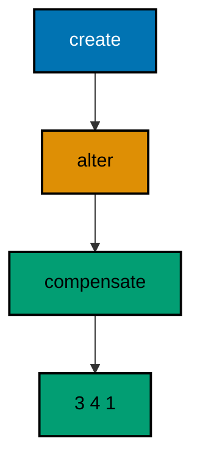

**`learning/code/ex-25-beginner-review-order-history-rollback/Program.cs`**:

```csharp
// Example 25: Beginner Review, Order History Rollback.
// Create, alter, compensate: the whole core loop reviewed in one program.
using Microsoft.EntityFrameworkCore; // => context, Migrate, and query entry points

string Host() // => one host lookup shared by every connection
{ // => host block opens
    return Environment.GetEnvironmentVariable("PGHOST") ?? "localhost"; // => service alias on the unit network
} // => host lookup ends here

string Port() // => one port lookup shared by every connection
{ // => port block opens
    return Environment.GetEnvironmentVariable("PGPORT") ?? "5432"; // => standard PostgreSQL port
} // => port lookup ends here

string Db() // => one database lookup shared by every connection
{ // => database block opens
    return Environment.GetEnvironmentVariable("PGDATABASE") ?? "postgres"; // => the service database name
} // => database lookup ends here

string DbUser() // => one user lookup shared by every connection
{ // => user block opens
    return Environment.GetEnvironmentVariable("PGUSER") ?? "postgres"; // => trust-auth superuser, no password
} // => user lookup ends here

string ConnectionString() // => one builder for the Npgsql connection string
{ // => string block opens
    return $"Host={Host()};Port={Port()};Database={Db()};Username={DbUser()}"; // => trust auth needs no password
} // => connection string ends here

using var ctx = new BadgesDb( // => one context per program run
    new DbContextOptionsBuilder<BadgesDb>().UseNpgsql(ConnectionString()).Options
); // => Npgsql provider with our string
ctx.Database.OpenConnection(); // => open once for every inspection query below

string Scalar(string sql) // => one-row, one-column inspection queries
{ // => scalar block opens
    using var cmd = ctx.Database.GetDbConnection().CreateCommand(); // => command on the open connection
    cmd.CommandText = sql; // => read-only inspection SQL
    object? value = cmd.ExecuteScalar(); // => the single answer
    return value?.ToString() ?? "null"; // => text for printing, null-safe
} // => scalar helper ends here

ctx.Database.Migrate(); // => apply M01, M02, M03 in ID order
ctx.Badges.ExecuteDelete(); // => start from zero rows so the double run prints alike
ctx.Badges.Add(new Badge { Name = "early", Level = 2 }); // => one badge through all three versions
ctx.SaveChanges(); // => persist the review row
Console.WriteLine(
    $"review={Scalar("SELECT count(*) FROM \"__EFMigrationsHistory\"")} cols={Scalar("SELECT count(*) FROM information_schema.columns WHERE table_name = 'Badges'")} rows={Scalar("SELECT count(*) FROM \"Badges\"")}"
); // => Output: review=3 cols=4 rows=1

public class Badge // => the entity mapped to the Badges table
{ // => entity block opens
    public int Id { get; set; } // => identity key generated by PostgreSQL
    public string Name { get; set; } = ""; // => required name column
    public int Level { get; set; } // => level added by M02
    public bool Retired { get; set; } // => retire flag added by M03
} // => entity ends here

public class BadgesDb : DbContext // => the context Migrate discovers migrations from
{ // => context block opens
    public BadgesDb(DbContextOptions<BadgesDb> options)
        : base(options) { } // => options carry the connection string

    public DbSet<Badge> Badges => Set<Badge>(); // => the one set this example queries
} // => context ends here
```

**`learning/code/ex-25-beginner-review-order-history-rollback/Migrations.cs`**:

```csharp
// Migrations for Example 25: beginner review in one pass.
// Create, alter, compensate: the whole core loop in three versions.
using Microsoft.EntityFrameworkCore.Infrastructure; // => context attribute lives here
using Microsoft.EntityFrameworkCore.Migrations; // => migration base types live here
using Npgsql.EntityFrameworkCore.PostgreSQL.Metadata; // => identity strategy annotations live here

namespace App.Migrations; // => migrations live in their own namespace

[DbContext(typeof(BadgesDb))] // => bind this version to the BadgesDb context
[Migration("20260101000001_CreateBadges")] // => first version: the create
public partial class CreateBadges : Migration // => one class per migration file
{ // => class block opens
    protected override void Up(MigrationBuilder migrationBuilder) // => forward change runs on migrate
    { // => forward block opens
        migrationBuilder.CreateTable( // => the create this migration owns
            name: "Badges", // => table name the program queries back
            columns: table => new // => column map follows
            { // => column block opens
                Id = table
                    .Column<int>(type: "integer", nullable: false) // => surrogate key, never null
                    .Annotation(
                        "Npgsql:ValueGenerationStrategy",
                        NpgsqlValueGenerationStrategy.IdentityByDefaultColumn
                    ), // => serial-style identity
                Name = table.Column<string>(type: "text", nullable: false), // => badge name, required
            }, // => column map ends
            constraints: table => // => key rules follow
            { // => constraint block opens
                table.PrimaryKey("PK_Badges", x => x.Id); // => primary key on the identity column
            }
        ); // => create-table call ends
    } // => forward change ends

    protected override void Down(MigrationBuilder migrationBuilder) // => reverse change for migrate-back
    { // => reverse block opens
        migrationBuilder.DropTable( // => undo is the mirror image
            name: "Badges"
        ); // => drop what Up created
    } // => reverse change ends
} // => first migration ends here

[DbContext(typeof(BadgesDb))] // => bind this version to the BadgesDb context
[Migration("20260101000002_AddLevel")] // => second version: only the alter
public partial class AddLevel : Migration // => the alter lives alone, V1 untouched
{ // => class block opens
    protected override void Up(MigrationBuilder migrationBuilder) // => forward change runs on migrate
    { // => forward block opens
        migrationBuilder.AddColumn<int>( // => grow the table by one column
            name: "Level", // => new column the program reads back
            table: "Badges", // => the table M01 created
            type: "integer", // => whole-unit badge level
            nullable: false, // => every row gets a value
            defaultValue: 1
        ); // => existing rows start at level one
    } // => forward change ends

    protected override void Down(MigrationBuilder migrationBuilder) // => reverse change for migrate-back
    { // => reverse block opens
        migrationBuilder.DropColumn( // => undo removes the added column
            name: "Level", // => the column Up added
            table: "Badges"
        ); // => from the table Up altered
    } // => reverse change ends
} // => second migration ends here

[DbContext(typeof(BadgesDb))] // => bind this version to the BadgesDb context
[Migration("20260101000003_AddRetiredFix")] // => third version: the compensating fix
public partial class AddRetiredFix : Migration // => rollback by moving forward
{ // => class block opens
    protected override void Up(MigrationBuilder migrationBuilder) // => forward change runs on migrate
    { // => forward block opens
        migrationBuilder.AddColumn<bool>( // => the fix retires badges without deleting rows
            name: "Retired", // => new flag the program reads back
            table: "Badges", // => the table M01 created
            type: "boolean", // => true or false, no nulls
            nullable: false, // => every row gets a value
            defaultValue: false
        ); // => existing badges stay active
    } // => forward change ends

    protected override void Down(MigrationBuilder migrationBuilder) // => reverse change for migrate-back
    { // => reverse block opens
        migrationBuilder.DropColumn( // => undo removes the added flag
            name: "Retired", // => the column Up added
            table: "Badges"
        ); // => from the table Up altered
    } // => reverse change ends
} // => third migration ends here
```

**Output** (`learning/code/ex-25-beginner-review-order-history-rollback/expected/main.stdout.txt`):

```text
review=3 cols=4 rows=1
```

**Key takeaway**: One line can verify the whole loop: ordered history, final shape, surviving data.

**Why it matters**: Reviews stick when they compress a level into a single check you can re-run. This triple count is the beginner level in miniature — every later level reuses the same three questions at larger scale: did the right versions run, does the schema look right, did the data survive? Carry this line into the intermediate level as your smoke test after every migrate, and most regressions will announce themselves before the lesson does.
