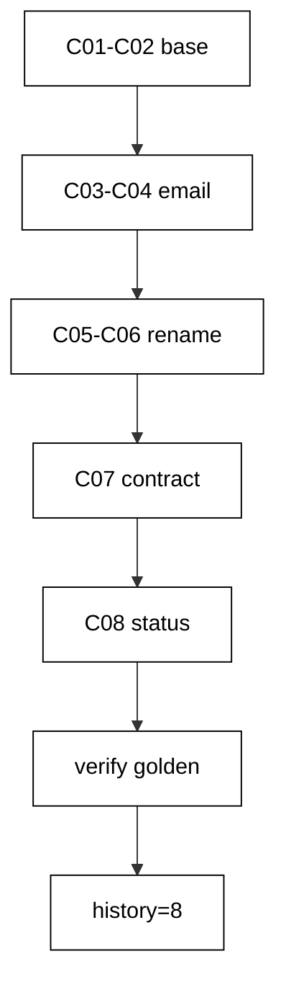

The capstone evolves a small order-management schema through eight realistic EF Core migrations: two related tables with a foreign key, an email backfill, a zero-downtime customer-name rename, and a shippable status column with its index, all verified by one golden query. Every technique from the course appears exactly where a production deploy would need it.

## Why this exists -- the big idea

**The problem before the solution**: course examples prove each migration technique in isolation — one class, one idea, one clean database. Real evolutions stack the techniques: the rename lands while traffic reads the old name, the backfill lands while orders keep arriving, and the history must stay linear through all of it. The capstone wires the layers together so the seams are load-bearing: schema steps, data steps, and verification steps in one chain, with the transcript proving the whole chain ran.

**Keep this if you forget everything else**: evolve the schema and the data on separate schedules, keep every step reversible or explicitly one-way, and verify the ending with a query — not with confidence.

## What you will build

A single `Program.cs` plus `Migrations.cs` that apply eight versions in order. `20260101000001_CreateCustomers` creates `Customers`; `20260101000002_CreateOrders` creates `Orders` with a foreign key to its customer, a total, and the seed shape; `20260101000003_AddEmail` adds a nullable email; `20260101000004_BackfillEmail` fills it; `20260101000005_AddFullName` expands with the replacement name; `20260101000006_BackfillFullName` copies every name into it; `20260101000007_DropName` contracts by dropping the old column; `20260101000008_AddStatus` adds a `NOT NULL` status with a `'new'` default plus its index. Seeds arrive after the schema base so the data steps have real rows to work on; the backfill Down steps clear their fills, keeping every version reversible.

## How the pieces compose

Schema base (Examples 1–8) creates the tables and the foreign key; the nullable add (Example 31) keeps the email deployable; the fill (Examples 26–34) backfills email then names; the three-step rename (Examples 35–40) moves `Name` to `FullName` without a flag day; the default-backed `NOT NULL` (Example 31) ships the status column; the receipt checks (Examples 12, 17, 77) verify the ending. No new technique appears here — composition is the test. Read the program top to bottom and name the example each section comes from; if a section has no ancestor, it does not belong.



## Reading the transcript

The four output lines each prove one stage: the three customer lines prove the seed, the rename, and the backfill math together — every customer carries its order count and summed total, including order-free cici with her zero row. The applied count proves all eight versions ran with linear history. Any missing line names its broken stage exactly. Rerun the unit and diff: identical bytes, because fixed version IDs, per-example tables, ordered queries, and label-only output leave no room for variance.

## The pinning note

This capstone runs on the locked course feed: `app.csproj` pins Entity Framework Core 10.0.4 with the Npgsql provider, and `packages.lock.json` records every transitive package with its content hash, restored from the course-local feed with no network. Pinning is a habit, not a file: the toolchain pins the .NET and PostgreSQL 18 images by digest, the lockfile pins the packages, and the history table pins the schema. The capstone migrates with exactly the bytes the examples trained on — the same connection prelude, the same per-version commits, the same `__EFMigrationsHistory` shape. Declare the floor, pin everything, and review pin diffs like code.

**`learning/capstone/code/Program.cs`**:

```csharp
// Capstone: evolve an order-management schema through eight migrations.
// Rename without downtime, backfill twice, and prove the final state golden.
using Microsoft.EntityFrameworkCore; // => context, Migrate, and query entry points

string Host() // => one host lookup shared by every connection
{ // => host block opens
    return Environment.GetEnvironmentVariable("PGHOST") ?? "localhost"; // => service alias on the unit network
} // => host lookup ends here

string Port() // => one port lookup shared by every connection
{ // => port block opens
    return Environment.GetEnvironmentVariable("PGPORT") ?? "5432"; // => standard PostgreSQL port
} // => port lookup ends here

string Db() // => one database lookup shared by every connection
{ // => database block opens
    return Environment.GetEnvironmentVariable("PGDATABASE") ?? "postgres"; // => the service database name
} // => database lookup ends here

string DbUser() // => one user lookup shared by every connection
{ // => user block opens
    return Environment.GetEnvironmentVariable("PGUSER") ?? "postgres"; // => trust-auth superuser, no password
} // => user lookup ends here

string ConnectionString() // => one builder for the Npgsql connection string
{ // => string block opens
    return $"Host={Host()};Port={Port()};Database={Db()};Username={DbUser()}"; // => trust auth needs no password
} // => connection string ends here

using var ctx = new ShopDb( // => one context per program run
    new DbContextOptionsBuilder<ShopDb>().UseNpgsql(ConnectionString()).Options
); // => Npgsql provider with our string
ctx.Database.OpenConnection(); // => open once for every inspection query below

List<string> Lines(string sql) // => multi-row, one-column inspection queries
{ // => lines block opens
    using var cmd = ctx.Database.GetDbConnection().CreateCommand(); // => command on the open connection
    cmd.CommandText = sql; // => read-only inspection SQL
    var rows = new List<string>(); // => collected output lines
    using var reader = cmd.ExecuteReader(); // => run the read
    while (reader.Read()) // => walk every returned row
    { // => row block opens
        rows.Add(reader.GetString(0)); // => first column as text
    } // => row walk ends here
    return rows; // => lines ready to print
} // => lines helper ends here

ctx.Database.Migrate(); // => apply C01 through C08 in ID order
ctx.Orders.ExecuteDelete(); // => children first: the foreign key demands it
ctx.Customers.ExecuteDelete(); // => then parents: zero rows for the double run
ctx.Customers.Add(new Customer { FullName = "ali", Email = "ali@example.test" }); // => first customer, post-rename shape
ctx.Customers.Add(new Customer { FullName = "budi", Email = "budi@example.test" }); // => second customer, post-rename shape
ctx.Customers.Add(new Customer { FullName = "cici", Email = "cici@example.test" }); // => third customer, order-free
ctx.SaveChanges(); // => persist customers to read back their IDs
int ali = ctx.Customers.Where(c => c.FullName == "ali").Select(c => c.Id).Single(); // => ali's generated ID
int budi = ctx.Customers.Where(c => c.FullName == "budi").Select(c => c.Id).Single(); // => budi's generated ID
ctx.Orders.Add(
    new Order
    {
        CustomerId = ali,
        Total = 100,
        Status = "new",
    }
); // => ali's first order
ctx.Orders.Add(
    new Order
    {
        CustomerId = ali,
        Total = 210,
        Status = "new",
    }
); // => ali's second order
ctx.Orders.Add(
    new Order
    {
        CustomerId = budi,
        Total = 50,
        Status = "new",
    }
); // => budi's only order
ctx.SaveChanges(); // => persist all three orders
foreach (
    string row in Lines(
        "SELECT c.\"FullName\" || '|' || count(o.\"Id\") || '|' || coalesce(sum(o.\"Total\"), 0) FROM \"Customers\" c LEFT JOIN \"Orders\" o ON o.\"CustomerId\" = c.\"Id\" GROUP BY c.\"Id\", c.\"FullName\" ORDER BY c.\"FullName\""
    )
) // => one golden line per customer
{ // => customer block opens
    Console.WriteLine($"capstone={row}"); // => Output: capstone=ali|2|310 and siblings
} // => customer walk ends here
Console.WriteLine($"history={ctx.Database.GetAppliedMigrations().Count()}"); // => Output: history=8

public class Customer // => the entity mapped to the Customers table
{ // => entity block opens
    public int Id { get; set; } // => identity key generated by PostgreSQL
    public string? FullName { get; set; } // => post-rename name, filled by C06
    public string? Email { get; set; } // => address column added by C03
} // => entity ends here

public class Order // => the entity mapped to the Orders table
{ // => entity block opens
    public int Id { get; set; } // => identity key generated by PostgreSQL
    public int CustomerId { get; set; } // => owner reference to Customers
    public int Total { get; set; } // => required total column
    public string Status { get; set; } = ""; // => status added by C08
} // => entity ends here

public class ShopDb : DbContext // => the context Migrate discovers migrations from
{ // => context block opens
    public ShopDb(DbContextOptions<ShopDb> options)
        : base(options) { } // => options carry the connection string

    public DbSet<Customer> Customers => Set<Customer>(); // => customers set for seeding and joins
    public DbSet<Order> Orders => Set<Order>(); // => orders set for seeding and joins
} // => context ends here
```

**`learning/capstone/code/Migrations.cs`**:

```csharp
// Capstone migrations: an eight-step order-management evolution.
// Create, relate, widen, backfill, rename without downtime, and ship a status.
using Microsoft.EntityFrameworkCore; // => ReferentialAction lives here
using Microsoft.EntityFrameworkCore.Infrastructure; // => context attribute lives here
using Microsoft.EntityFrameworkCore.Migrations; // => migration base types live here
using Npgsql.EntityFrameworkCore.PostgreSQL.Metadata; // => identity strategy annotations live here

namespace App.Migrations; // => migrations live in their own namespace

[DbContext(typeof(ShopDb))] // => bind this version to the ShopDb context
[Migration("20260101000001_CreateCustomers")] // => first version: the customer create
public partial class CreateCustomers : Migration // => one class per migration file
{ // => class block opens
    protected override void Up(MigrationBuilder migrationBuilder) // => forward change runs on migrate
    { // => forward block opens
        migrationBuilder.CreateTable( // => the create this migration owns
            name: "Customers", // => table name the program queries back
            columns: table => new // => column map follows
            { // => column block opens
                Id = table
                    .Column<int>(type: "integer", nullable: false) // => surrogate key, never null
                    .Annotation(
                        "Npgsql:ValueGenerationStrategy",
                        NpgsqlValueGenerationStrategy.IdentityByDefaultColumn
                    ), // => serial-style identity
                Name = table.Column<string>(type: "text", nullable: false), // => customer name, required
            }, // => column map ends
            constraints: table => // => key rules follow
            { // => constraint block opens
                table.PrimaryKey("PK_Customers", x => x.Id); // => primary key on the identity column
            }
        ); // => create-table call ends
    } // => forward change ends

    protected override void Down(MigrationBuilder migrationBuilder) // => reverse change for migrate-back
    { // => reverse block opens
        migrationBuilder.DropTable( // => undo is the mirror image
            name: "Customers"
        ); // => drop what Up created
    } // => reverse change ends
} // => first migration ends here

[DbContext(typeof(ShopDb))] // => bind this version to the ShopDb context
[Migration("20260101000002_CreateOrders")] // => second version: orders reference customers
public partial class CreateOrders : Migration // => relations get their own version
{ // => class block opens
    protected override void Up(MigrationBuilder migrationBuilder) // => forward change runs on migrate
    { // => forward block opens
        migrationBuilder.CreateTable( // => the create this migration owns
            name: "Orders", // => table name the program queries back
            columns: table => new // => column map follows
            { // => column block opens
                Id = table
                    .Column<int>(type: "integer", nullable: false) // => surrogate key, never null
                    .Annotation(
                        "Npgsql:ValueGenerationStrategy",
                        NpgsqlValueGenerationStrategy.IdentityByDefaultColumn
                    ), // => serial-style identity
                CustomerId = table.Column<int>(type: "integer", nullable: false), // => owner reference, required
                Total = table.Column<int>(type: "integer", nullable: false), // => order total, required
            }, // => column map ends
            constraints: table => // => key rules follow
            { // => constraint block opens
                table.PrimaryKey("PK_Orders", x => x.Id); // => primary key on the identity column
                table.ForeignKey( // => the relation this migration owns
                    name: "FK_Orders_Customers_CustomerId", // => constraint name the catalog holds
                    column: x => x.CustomerId, // => the referencing column
                    principalTable: "Customers", // => the referenced table
                    principalColumn: "Id", // => the referenced column
                    onDelete: ReferentialAction.Cascade
                ); // => deleting a customer removes its orders
            }
        ); // => create-table call ends
    } // => forward change ends

    protected override void Down(MigrationBuilder migrationBuilder) // => reverse change for migrate-back
    { // => reverse block opens
        migrationBuilder.DropTable( // => undo is the mirror image
            name: "Orders"
        ); // => drop what Up created
    } // => reverse change ends
} // => second migration ends here

[DbContext(typeof(ShopDb))] // => bind this version to the ShopDb context
[Migration("20260101000003_AddEmail")] // => third version: only the alter
public partial class AddEmail : Migration // => the alter lives alone, V1 untouched
{ // => class block opens
    protected override void Up(MigrationBuilder migrationBuilder) // => forward change runs on migrate
    { // => forward block opens
        migrationBuilder.AddColumn<string>( // => grow the table by one column
            name: "Email", // => new column the program reads back
            table: "Customers", // => the table C01 created
            type: "text", // => free-form address text
            nullable: true
        ); // => nullable so existing rows survive
    } // => forward change ends

    protected override void Down(MigrationBuilder migrationBuilder) // => reverse change for migrate-back
    { // => reverse block opens
        migrationBuilder.DropColumn( // => undo removes the added column
            name: "Email", // => the column Up added
            table: "Customers"
        ); // => from the table Up altered
    } // => reverse change ends
} // => third migration ends here

[DbContext(typeof(ShopDb))] // => bind this version to the ShopDb context
[Migration("20260101000004_BackfillEmail")] // => fourth version: data only, no schema change
public partial class BackfillEmail : Migration // => backfills ride their own version
{ // => class block opens
    protected override void Up(MigrationBuilder migrationBuilder) // => forward change runs on migrate
    { // => forward block opens
        migrationBuilder.Sql(
            "UPDATE \"Customers\" SET \"Email\" = lower(\"Name\") || '@example.test' WHERE \"Email\" IS NULL"
        ); // => derive every missing address
    } // => forward change ends

    protected override void Down(MigrationBuilder migrationBuilder) // => reverse change for migrate-back
    { // => reverse block opens
        migrationBuilder.Sql("UPDATE \"Customers\" SET \"Email\" = NULL"); // => undo clears the derived addresses
    } // => reverse change ends
} // => fourth migration ends here

[DbContext(typeof(ShopDb))] // => bind this version to the ShopDb context
[Migration("20260101000005_AddFullName")] // => fifth version: expand for the rename
public partial class AddFullName : Migration // => expand first, contract later
{ // => class block opens
    protected override void Up(MigrationBuilder migrationBuilder) // => forward change runs on migrate
    { // => forward block opens
        migrationBuilder.AddColumn<string>( // => the new name lives beside the old one
            name: "FullName", // => new column the program reads back
            table: "Customers", // => the table C01 created
            type: "text", // => free-form full-name text
            nullable: true
        ); // => nullable until the backfill fills it
    } // => forward change ends

    protected override void Down(MigrationBuilder migrationBuilder) // => reverse change for migrate-back
    { // => reverse block opens
        migrationBuilder.DropColumn( // => undo removes the added column
            name: "FullName", // => the column Up added
            table: "Customers"
        ); // => from the table Up altered
    } // => reverse change ends
} // => fifth migration ends here

[DbContext(typeof(ShopDb))] // => bind this version to the ShopDb context
[Migration("20260101000006_BackfillFullName")] // => sixth version: move old names across
public partial class BackfillFullName : Migration // => backfills ride their own version
{ // => class block opens
    protected override void Up(MigrationBuilder migrationBuilder) // => forward change runs on migrate
    { // => forward block opens
        migrationBuilder.Sql(
            "UPDATE \"Customers\" SET \"FullName\" = \"Name\" WHERE \"FullName\" IS NULL"
        ); // => copy every missing full name
    } // => forward change ends

    protected override void Down(MigrationBuilder migrationBuilder) // => reverse change for migrate-back
    { // => reverse block opens
        migrationBuilder.Sql("UPDATE \"Customers\" SET \"FullName\" = NULL"); // => undo clears the copied names
    } // => reverse change ends
} // => sixth migration ends here

[DbContext(typeof(ShopDb))] // => bind this version to the ShopDb context
[Migration("20260101000007_DropName")] // => seventh version: contract after the move
public partial class DropName : Migration // => the old column leaves only when unused
{ // => class block opens
    protected override void Up(MigrationBuilder migrationBuilder) // => forward change runs on migrate
    { // => forward block opens
        migrationBuilder.DropColumn( // => the rename completes: old name gone
            name: "Name", // => the column C06 replaced
            table: "Customers"
        ); // => from the table C01 created
    } // => forward change ends

    protected override void Down(MigrationBuilder migrationBuilder) // => reverse change for migrate-back
    { // => reverse block opens
        migrationBuilder.AddColumn<string>( // => undo restores the old column
            name: "Name", // => the dropped column, restored
            table: "Customers", // => the table C01 created
            type: "text", // => free-form name text
            nullable: true
        ); // => nullable: dropped data cannot return
    } // => reverse change ends
} // => seventh migration ends here

[DbContext(typeof(ShopDb))] // => bind this version to the ShopDb context
[Migration("20260101000008_AddStatus")] // => eighth version: the shippable status
public partial class AddStatus : Migration // => each version stays reviewable alone
{ // => class block opens
    protected override void Up(MigrationBuilder migrationBuilder) // => forward change runs on migrate
    { // => forward block opens
        migrationBuilder.AddColumn<string>( // => grow orders by one column
            name: "Status", // => new column the program reads back
            table: "Orders", // => the table C02 created
            type: "text", // => free-form status text
            nullable: false, // => every order carries a status
            defaultValue: "new"
        ); // => existing orders start new
        migrationBuilder.CreateIndex( // => the status gets its own index
            name: "IX_Orders_Status", // => index name the database catalog holds
            table: "Orders", // => the table C02 created
            column: "Status"
        ); // => the column Up added
    } // => forward change ends

    protected override void Down(MigrationBuilder migrationBuilder) // => reverse change for migrate-back
    { // => reverse block opens
        migrationBuilder.DropIndex( // => undo removes the added index
            name: "IX_Orders_Status", // => the index Up added
            table: "Orders"
        ); // => from the table Up altered
        migrationBuilder.DropColumn( // => undo removes the added column
            name: "Status", // => the column Up added
            table: "Orders"
        ); // => from the table Up altered
    } // => reverse change ends
} // => eighth migration ends here
```

**Output** (`learning/capstone/code/expected/main/main.stdout.txt`):

```text
capstone=ali|2|310
capstone=budi|1|50
capstone=cici|0|0
history=8
```
