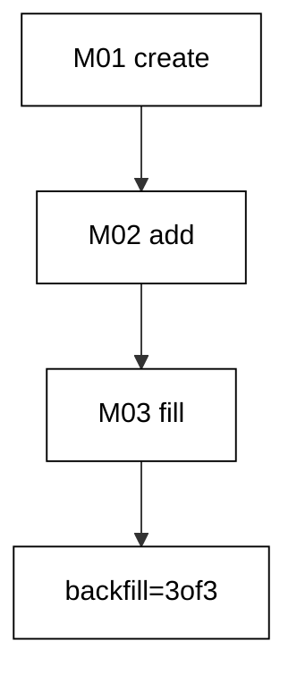
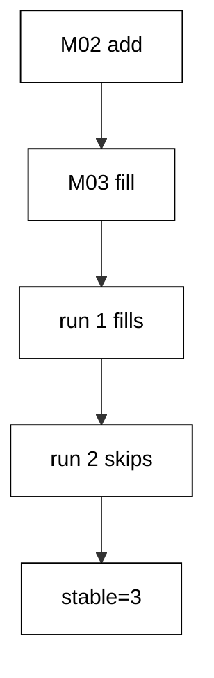
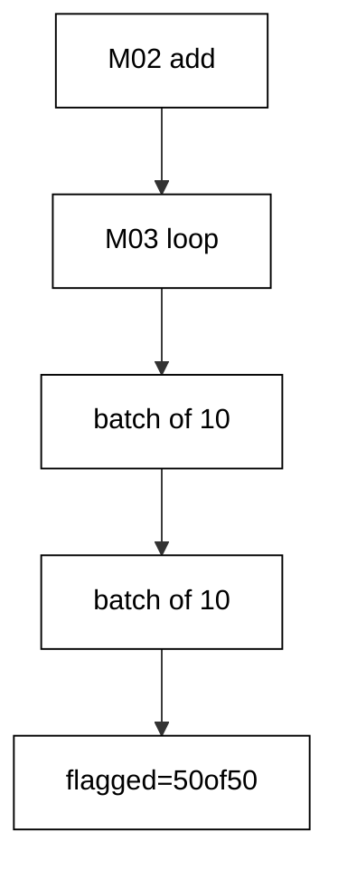
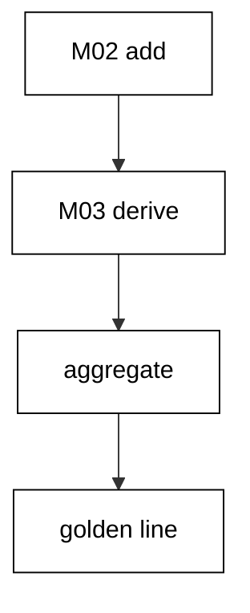
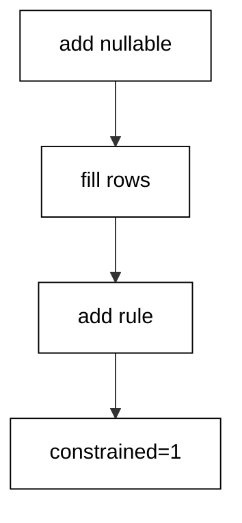
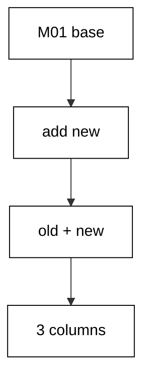
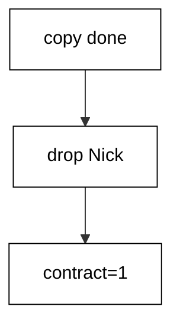
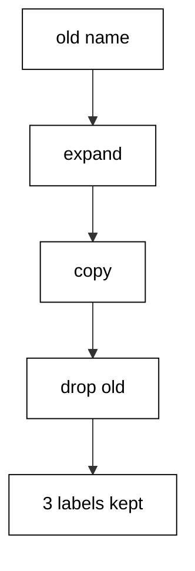
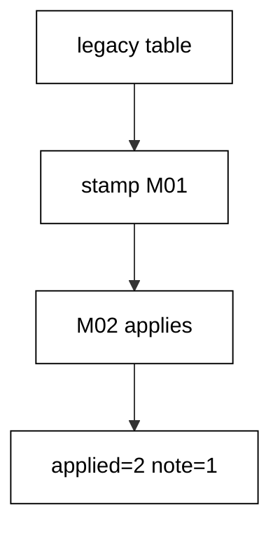
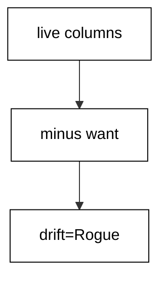

Examples 26–53 move from single-table changes to production realities: filling new columns from old data, splitting breaking changes into zero-downtime steps, and adopting databases that predate their migration history. Three clusters carry the level: backfills and data migrations (Examples 26–34), zero-downtime migration splitting (Examples 35–44), and baselining an existing database (Examples 45–53). Every program runs Entity Framework Core against the real pinned PostgreSQL 18 container; every output is a fixed transcript.

---

### Example 26: Backfill Is a Separate Step

New columns arrive empty, and filling them is a data job, not a schema job. This example keeps the two jobs in two migrations: `M02` adds a nullable `Points` column to `Scores`, and `M03` fills every row with `100`. The program migrates to `M01`, seeds three players, then runs the rest.

The final query counts rows where `Points` equals `100` against all rows. Schema and data never share a version, so each step stays reviewable on its own.

(Concepts: co-06.)



**`learning/code/ex-26-backfill-is-a-separate-step/Program.cs`**:

```csharp
// Example 26: Backfill Is a Separate Step.
// M02 adds Points; M03 fills it. Schema and data never share a version.
using Microsoft.EntityFrameworkCore; // => context, Migrate, and query entry points

string Host() // => one host lookup shared by every connection
{ // => host block opens
    return Environment.GetEnvironmentVariable("PGHOST") ?? "localhost"; // => service alias on the unit network
} // => host lookup ends here

string Port() // => one port lookup shared by every connection
{ // => port block opens
    return Environment.GetEnvironmentVariable("PGPORT") ?? "5432"; // => standard PostgreSQL port
} // => port lookup ends here

string Db() // => one database lookup shared by every connection
{ // => database block opens
    return Environment.GetEnvironmentVariable("PGDATABASE") ?? "postgres"; // => the service database name
} // => database lookup ends here

string DbUser() // => one user lookup shared by every connection
{ // => user block opens
    return Environment.GetEnvironmentVariable("PGUSER") ?? "postgres"; // => trust-auth superuser, no password
} // => user lookup ends here

string ConnectionString() // => one builder for the Npgsql connection string
{ // => string block opens
    return $"Host={Host()};Port={Port()};Database={Db()};Username={DbUser()}"; // => trust auth needs no password
} // => connection string ends here

using var ctx = new ScoresDb( // => one context per program run
    new DbContextOptionsBuilder<ScoresDb>().UseNpgsql(ConnectionString()).Options
); // => Npgsql provider with our string
ctx.Database.OpenConnection(); // => open once for every inspection query below

string Scalar(string sql) // => one-row, one-column inspection queries
{ // => scalar block opens
    using var cmd = ctx.Database.GetDbConnection().CreateCommand(); // => command on the open connection
    cmd.CommandText = sql; // => read-only inspection SQL
    object? value = cmd.ExecuteScalar(); // => the single answer
    return value?.ToString() ?? "null"; // => text for printing, null-safe
} // => scalar helper ends here

void Exec(string sql) // => raw writes list only columns that exist now
{ // => exec block opens
    using var cmd = ctx.Database.GetDbConnection().CreateCommand(); // => command on the open connection
    cmd.CommandText = sql; // => the seeding write
    cmd.ExecuteNonQuery(); // => run it, ignore the count
} // => exec helper ends here

ctx.Database.Migrate("20260101000001_CreateScores"); // => apply only M01 first
Exec("DELETE FROM \"Scores\""); // => start from zero rows so the double run prints alike
Exec("INSERT INTO \"Scores\" (\"Player\") VALUES ('wati'), ('agus'), ('rudi')"); // => three players, scored by the backfill
ctx.Database.Migrate(); // => M02 adds Points, M03 fills every row
Console.WriteLine(
    $"backfill={Scalar("SELECT count(*) FROM \"Scores\" WHERE \"Points\" = 100")}of{Scalar("SELECT count(*) FROM \"Scores\"")}"
); // => Output: backfill=3of3

public class Score // => the entity mapped to the Scores table
{ // => entity block opens
    public int Id { get; set; } // => identity key generated by PostgreSQL
    public string Player { get; set; } = ""; // => required player column
    public int? Points { get; set; } // => nullable until M03 fills it
} // => entity ends here

public class ScoresDb : DbContext // => the context Migrate discovers migrations from
{ // => context block opens
    public ScoresDb(DbContextOptions<ScoresDb> options)
        : base(options) { } // => options carry the connection string

    public DbSet<Score> Scores => Set<Score>(); // => the one set this example queries
} // => context ends here
```

**`learning/code/ex-26-backfill-is-a-separate-step/Migrations.cs`**:

```csharp
// Migrations for Example 26: backfill is a separate step.
// M02 adds the column; M03 fills it. Schema and data never share a version.
using Microsoft.EntityFrameworkCore.Infrastructure; // => context attribute lives here
using Microsoft.EntityFrameworkCore.Migrations; // => migration base types live here
using Npgsql.EntityFrameworkCore.PostgreSQL.Metadata; // => identity strategy annotations live here

namespace App.Migrations; // => migrations live in their own namespace

[DbContext(typeof(ScoresDb))] // => bind this version to the ScoresDb context
[Migration("20260101000001_CreateScores")] // => first version: the create
public partial class CreateScores : Migration // => one class per migration file
{ // => class block opens
    protected override void Up(MigrationBuilder migrationBuilder) // => forward change runs on migrate
    { // => forward block opens
        migrationBuilder.CreateTable( // => the create this migration owns
            name: "Scores", // => table name the program queries back
            columns: table => new // => column map follows
            { // => column block opens
                Id = table
                    .Column<int>(type: "integer", nullable: false) // => surrogate key, never null
                    .Annotation(
                        "Npgsql:ValueGenerationStrategy",
                        NpgsqlValueGenerationStrategy.IdentityByDefaultColumn
                    ), // => serial-style identity
                Player = table.Column<string>(type: "text", nullable: false), // => player name, required
            }, // => column map ends
            constraints: table => // => key rules follow
            { // => constraint block opens
                table.PrimaryKey("PK_Scores", x => x.Id); // => primary key on the identity column
            }
        ); // => create-table call ends
    } // => forward change ends

    protected override void Down(MigrationBuilder migrationBuilder) // => reverse change for migrate-back
    { // => reverse block opens
        migrationBuilder.DropTable( // => undo is the mirror image
            name: "Scores"
        ); // => drop what Up created
    } // => reverse change ends
} // => first migration ends here

[DbContext(typeof(ScoresDb))] // => bind this version to the ScoresDb context
[Migration("20260101000002_AddPoints")] // => second version: only the schema step
public partial class AddPoints : Migration // => schema first, data second
{ // => class block opens
    protected override void Up(MigrationBuilder migrationBuilder) // => forward change runs on migrate
    { // => forward block opens
        migrationBuilder.AddColumn<int>( // => grow the table by one column
            name: "Points", // => new column the backfill fills
            table: "Scores", // => the table M01 created
            type: "integer", // => whole-unit point counts
            nullable: true
        ); // => nullable until M03 fills it
    } // => forward change ends

    protected override void Down(MigrationBuilder migrationBuilder) // => reverse change for migrate-back
    { // => reverse block opens
        migrationBuilder.DropColumn( // => undo removes the added column
            name: "Points", // => the column Up added
            table: "Scores"
        ); // => from the table Up altered
    } // => reverse change ends
} // => second migration ends here

[DbContext(typeof(ScoresDb))] // => bind this version to the ScoresDb context
[Migration("20260101000003_FillPoints")] // => third version: only the data step
public partial class FillPoints : Migration // => data rides its own version
{ // => class block opens
    protected override void Up(MigrationBuilder migrationBuilder) // => forward change runs on migrate
    { // => forward block opens
        migrationBuilder.Sql("UPDATE \"Scores\" SET \"Points\" = 100 WHERE \"Points\" IS NULL"); // => every missing score starts at one hundred
    } // => forward change ends

    protected override void Down(MigrationBuilder migrationBuilder) // => reverse change for migrate-back
    { // => reverse block opens
        migrationBuilder.Sql("UPDATE \"Scores\" SET \"Points\" = NULL"); // => undo clears the filled scores
    } // => reverse change ends
} // => third migration ends here
```

**Output** (`learning/code/ex-26-backfill-is-a-separate-step/expected/main.stdout.txt`):

```text
backfill=3of3
```

**Key takeaway**: Put the column add and the data fill in separate migrations: `M02` shapes, `M03` fills.

**Why it matters**: Mixing schema and data in one migration couples two failure modes that need different responses: a bad column type needs a schema fix, a bad fill value needs a data fix, and one shared version forces both fixes through the same review and the same rollback. Separate versions let the schema change deploy while the data fill is still being validated, and let the fill re-run without re-applying DDL. Reviewers can approve structure and content independently, which is exactly the granularity production incidents demand when a backfill turns out wrong.

---

### Example 27: Backfill Computes from Existing Rows

Most backfills derive the new value instead of inventing it. Here `M02` adds a nullable `Full` column to `People`, and `M03` computes it from the existing `First` and `Last` columns with string concatenation. Nobody hand-edits rows; the SQL derives every value from data already in the table.

The program seeds two people under `M01`, migrates the rest, then aggregates the derived full names in order. The output proves the fill read the old columns rather than copying a constant.

(Concepts: co-06.)

**`learning/code/ex-27-backfill-computes-from-existing-rows/Program.cs`**:

```csharp
// Example 27: Backfill Computes from Existing Rows.
// M03 derives Full from First and Last; no row is hand-edited.
using Microsoft.EntityFrameworkCore; // => context, Migrate, and query entry points

string Host() // => one host lookup shared by every connection
{ // => host block opens
    return Environment.GetEnvironmentVariable("PGHOST") ?? "localhost"; // => service alias on the unit network
} // => host lookup ends here

string Port() // => one port lookup shared by every connection
{ // => port block opens
    return Environment.GetEnvironmentVariable("PGPORT") ?? "5432"; // => standard PostgreSQL port
} // => port lookup ends here

string Db() // => one database lookup shared by every connection
{ // => database block opens
    return Environment.GetEnvironmentVariable("PGDATABASE") ?? "postgres"; // => the service database name
} // => database lookup ends here

string DbUser() // => one user lookup shared by every connection
{ // => user block opens
    return Environment.GetEnvironmentVariable("PGUSER") ?? "postgres"; // => trust-auth superuser, no password
} // => user lookup ends here

string ConnectionString() // => one builder for the Npgsql connection string
{ // => string block opens
    return $"Host={Host()};Port={Port()};Database={Db()};Username={DbUser()}"; // => trust auth needs no password
} // => connection string ends here

using var ctx = new PeopleDb( // => one context per program run
    new DbContextOptionsBuilder<PeopleDb>().UseNpgsql(ConnectionString()).Options
); // => Npgsql provider with our string
ctx.Database.OpenConnection(); // => open once for every inspection query below

string Scalar(string sql) // => one-row, one-column inspection queries
{ // => scalar block opens
    using var cmd = ctx.Database.GetDbConnection().CreateCommand(); // => command on the open connection
    cmd.CommandText = sql; // => read-only inspection SQL
    object? value = cmd.ExecuteScalar(); // => the single answer
    return value?.ToString() ?? "null"; // => text for printing, null-safe
} // => scalar helper ends here

void Exec(string sql) // => raw writes list only columns that exist now
{ // => exec block opens
    using var cmd = ctx.Database.GetDbConnection().CreateCommand(); // => command on the open connection
    cmd.CommandText = sql; // => the seeding write
    cmd.ExecuteNonQuery(); // => run it, ignore the count
} // => exec helper ends here

ctx.Database.Migrate("20260101000001_CreatePeople"); // => apply only M01 first
Exec("DELETE FROM \"People\""); // => start from zero rows so the double run prints alike
Exec(
    "INSERT INTO \"People\" (\"First\", \"Last\") VALUES ('sari', 'wulandari'), ('tono', 'saputra')"
); // => two people, split across two columns
ctx.Database.Migrate(); // => M02 adds Full, M03 derives every value
Console.WriteLine(
    $"names={Scalar("SELECT string_agg(\"Full\", ',' ORDER BY \"Full\") FROM \"People\"")}"
); // => Output: names=sari wulandari,tono saputra

public class Person // => the entity mapped to the People table
{ // => entity block opens
    public int Id { get; set; } // => identity key generated by PostgreSQL
    public string First { get; set; } = ""; // => required given-name column
    public string Last { get; set; } = ""; // => required family-name column
    public string? Full { get; set; } // => nullable until M03 fills it
} // => entity ends here

public class PeopleDb : DbContext // => the context Migrate discovers migrations from
{ // => context block opens
    public PeopleDb(DbContextOptions<PeopleDb> options)
        : base(options) { } // => options carry the connection string

    public DbSet<Person> People => Set<Person>(); // => the one set this example queries
} // => context ends here
```

**`learning/code/ex-27-backfill-computes-from-existing-rows/Migrations.cs`**:

```csharp
// Migrations for Example 27: the backfill computes from existing rows.
// M03 derives Full from First and Last; no row is hand-edited.
using Microsoft.EntityFrameworkCore.Infrastructure; // => context attribute lives here
using Microsoft.EntityFrameworkCore.Migrations; // => migration base types live here
using Npgsql.EntityFrameworkCore.PostgreSQL.Metadata; // => identity strategy annotations live here

namespace App.Migrations; // => migrations live in their own namespace

[DbContext(typeof(PeopleDb))] // => bind this version to the PeopleDb context
[Migration("20260101000001_CreatePeople")] // => first version: the create
public partial class CreatePeople : Migration // => one class per migration file
{ // => class block opens
    protected override void Up(MigrationBuilder migrationBuilder) // => forward change runs on migrate
    { // => forward block opens
        migrationBuilder.CreateTable( // => the create this migration owns
            name: "People", // => table name the program queries back
            columns: table => new // => column map follows
            { // => column block opens
                Id = table
                    .Column<int>(type: "integer", nullable: false) // => surrogate key, never null
                    .Annotation(
                        "Npgsql:ValueGenerationStrategy",
                        NpgsqlValueGenerationStrategy.IdentityByDefaultColumn
                    ), // => serial-style identity
                First = table.Column<string>(type: "text", nullable: false), // => given name, required
                Last = table.Column<string>(type: "text", nullable: false), // => family name, required
            }, // => column map ends
            constraints: table => // => key rules follow
            { // => constraint block opens
                table.PrimaryKey("PK_People", x => x.Id); // => primary key on the identity column
            }
        ); // => create-table call ends
    } // => forward change ends

    protected override void Down(MigrationBuilder migrationBuilder) // => reverse change for migrate-back
    { // => reverse block opens
        migrationBuilder.DropTable( // => undo is the mirror image
            name: "People"
        ); // => drop what Up created
    } // => reverse change ends
} // => first migration ends here

[DbContext(typeof(PeopleDb))] // => bind this version to the PeopleDb context
[Migration("20260101000002_AddFull")] // => second version: only the schema step
public partial class AddFull : Migration // => schema first, data second
{ // => class block opens
    protected override void Up(MigrationBuilder migrationBuilder) // => forward change runs on migrate
    { // => forward block opens
        migrationBuilder.AddColumn<string>( // => grow the table by one column
            name: "Full", // => new column the backfill fills
            table: "People", // => the table M01 created
            type: "text", // => free-form full-name text
            nullable: true
        ); // => nullable until M03 fills it
    } // => forward change ends

    protected override void Down(MigrationBuilder migrationBuilder) // => reverse change for migrate-back
    { // => reverse block opens
        migrationBuilder.DropColumn( // => undo removes the added column
            name: "Full", // => the column Up added
            table: "People"
        ); // => from the table Up altered
    } // => reverse change ends
} // => second migration ends here

[DbContext(typeof(PeopleDb))] // => bind this version to the PeopleDb context
[Migration("20260101000003_FillFull")] // => third version: only the data step
public partial class FillFull : Migration // => data rides its own version
{ // => class block opens
    protected override void Up(MigrationBuilder migrationBuilder) // => forward change runs on migrate
    { // => forward block opens
        migrationBuilder.Sql(
            "UPDATE \"People\" SET \"Full\" = \"First\" || ' ' || \"Last\" WHERE \"Full\" IS NULL"
        ); // => derive every missing full name
    } // => forward change ends

    protected override void Down(MigrationBuilder migrationBuilder) // => reverse change for migrate-back
    { // => reverse block opens
        migrationBuilder.Sql("UPDATE \"People\" SET \"Full\" = NULL"); // => undo clears the derived names
    } // => reverse change ends
} // => third migration ends here
```

**Output** (`learning/code/ex-27-backfill-computes-from-existing-rows/expected/main.stdout.txt`):

```text
names=sari wulandari,tono saputra
```

**Key takeaway**: Derive backfill values from existing columns with SQL: the old data is the specification.

**Why it matters**: Hand-written backfill values rot the moment the source data changes, because nothing links the fill to the rows it claims to describe. A computed fill replays correctly on every environment — staging, production, and the new hire's laptop — since the derivation travels with the migration instead of living in a chat message. When the business rule behind the value changes later, the SQL shows exactly what the old rule was, which turns a mysterious column of strings into an auditable transformation with a visible input.

---

### Example 28: Backfill Preserves Every Row

A backfill must touch values, never membership: five rows enter, five rows leave. This example creates `Units28` with five tagged rows under `M01`, adds a nullable `Rank` column in `M02`, and fills every row with `7` in `M03`. The output counts total rows and filled rows side by side.

Equal counts prove the fill updated in place instead of deleting and re-inserting. The `WHERE Rank IS NULL` guard means only unfilled rows change, which the next example relies on.

(Concepts: co-06.)

**`learning/code/ex-28-backfill-preserves-every-row/Program.cs`**:

```csharp
// Example 28: Backfill Preserves Every Row.
// Five rows enter under M01; the same five rows leave under M03.
using Microsoft.EntityFrameworkCore; // => context, Migrate, and query entry points

string Host() // => one host lookup shared by every connection
{ // => host block opens
    return Environment.GetEnvironmentVariable("PGHOST") ?? "localhost"; // => service alias on the unit network
} // => host lookup ends here

string Port() // => one port lookup shared by every connection
{ // => port block opens
    return Environment.GetEnvironmentVariable("PGPORT") ?? "5432"; // => standard PostgreSQL port
} // => port lookup ends here

string Db() // => one database lookup shared by every connection
{ // => database block opens
    return Environment.GetEnvironmentVariable("PGDATABASE") ?? "postgres"; // => the service database name
} // => database lookup ends here

string DbUser() // => one user lookup shared by every connection
{ // => user block opens
    return Environment.GetEnvironmentVariable("PGUSER") ?? "postgres"; // => trust-auth superuser, no password
} // => user lookup ends here

string ConnectionString() // => one builder for the Npgsql connection string
{ // => string block opens
    return $"Host={Host()};Port={Port()};Database={Db()};Username={DbUser()}"; // => trust auth needs no password
} // => connection string ends here

using var ctx = new Units28Db( // => one context per program run
    new DbContextOptionsBuilder<Units28Db>().UseNpgsql(ConnectionString()).Options
); // => Npgsql provider with our string
ctx.Database.OpenConnection(); // => open once for every inspection query below

string Scalar(string sql) // => one-row, one-column inspection queries
{ // => scalar block opens
    using var cmd = ctx.Database.GetDbConnection().CreateCommand(); // => command on the open connection
    cmd.CommandText = sql; // => read-only inspection SQL
    object? value = cmd.ExecuteScalar(); // => the single answer
    return value?.ToString() ?? "null"; // => text for printing, null-safe
} // => scalar helper ends here

void Exec(string sql) // => raw writes list only columns that exist now
{ // => exec block opens
    using var cmd = ctx.Database.GetDbConnection().CreateCommand(); // => command on the open connection
    cmd.CommandText = sql; // => the seeding write
    cmd.ExecuteNonQuery(); // => run it, ignore the count
} // => exec helper ends here

ctx.Database.Migrate("20260101000001_CreateUnits28"); // => apply only M01 first
Exec("DELETE FROM \"Units28\""); // => start from zero rows so the double run prints alike
Exec("INSERT INTO \"Units28\" (\"Tag\") VALUES ('a'), ('b'), ('c'), ('d'), ('e')"); // => five rows under the M01 schema
ctx.Database.Migrate(); // => M02 adds Rank, M03 fills every row
Console.WriteLine(
    $"rows={Scalar("SELECT count(*) FROM \"Units28\"")} filled={Scalar("SELECT count(*) FROM \"Units28\" WHERE \"Rank\" = 7")}"
); // => Output: rows=5 filled=5

public class Unit28 // => the entity mapped to the Units28 table
{ // => entity block opens
    public int Id { get; set; } // => identity key generated by PostgreSQL
    public string Tag { get; set; } = ""; // => required tag column
    public int? Rank { get; set; } // => nullable until M03 fills it
} // => entity ends here

public class Units28Db : DbContext // => the context Migrate discovers migrations from
{ // => context block opens
    public Units28Db(DbContextOptions<Units28Db> options)
        : base(options) { } // => options carry the connection string

    public DbSet<Unit28> Units28 => Set<Unit28>(); // => the one set this example queries
} // => context ends here
```

**`learning/code/ex-28-backfill-preserves-every-row/Migrations.cs`**:

```csharp
// Migrations for Example 28: the backfill preserves every row.
// Five rows enter under M01; five rows leave under M03.
using Microsoft.EntityFrameworkCore.Infrastructure; // => context attribute lives here
using Microsoft.EntityFrameworkCore.Migrations; // => migration base types live here
using Npgsql.EntityFrameworkCore.PostgreSQL.Metadata; // => identity strategy annotations live here

namespace App.Migrations; // => migrations live in their own namespace

[DbContext(typeof(Units28Db))] // => bind this version to the Units28Db context
[Migration("20260101000001_CreateUnits28")] // => first version: the create
public partial class CreateUnits28 : Migration // => one class per migration file
{ // => class block opens
    protected override void Up(MigrationBuilder migrationBuilder) // => forward change runs on migrate
    { // => forward block opens
        migrationBuilder.CreateTable( // => the create this migration owns
            name: "Units28", // => table name the program queries back
            columns: table => new // => column map follows
            { // => column block opens
                Id = table
                    .Column<int>(type: "integer", nullable: false) // => surrogate key, never null
                    .Annotation(
                        "Npgsql:ValueGenerationStrategy",
                        NpgsqlValueGenerationStrategy.IdentityByDefaultColumn
                    ), // => serial-style identity
                Tag = table.Column<string>(type: "text", nullable: false), // => unit tag, required
            }, // => column map ends
            constraints: table => // => key rules follow
            { // => constraint block opens
                table.PrimaryKey("PK_Units28", x => x.Id); // => primary key on the identity column
            }
        ); // => create-table call ends
    } // => forward change ends

    protected override void Down(MigrationBuilder migrationBuilder) // => reverse change for migrate-back
    { // => reverse block opens
        migrationBuilder.DropTable( // => undo is the mirror image
            name: "Units28"
        ); // => drop what Up created
    } // => reverse change ends
} // => first migration ends here

[DbContext(typeof(Units28Db))] // => bind this version to the Units28Db context
[Migration("20260101000002_AddRank")] // => second version: only the schema step
public partial class AddRank : Migration // => schema first, data second
{ // => class block opens
    protected override void Up(MigrationBuilder migrationBuilder) // => forward change runs on migrate
    { // => forward block opens
        migrationBuilder.AddColumn<int>( // => grow the table by one column
            name: "Rank", // => new column the backfill fills
            table: "Units28", // => the table M01 created
            type: "integer", // => whole-unit rank numbers
            nullable: true
        ); // => nullable until M03 fills it
    } // => forward change ends

    protected override void Down(MigrationBuilder migrationBuilder) // => reverse change for migrate-back
    { // => reverse block opens
        migrationBuilder.DropColumn( // => undo removes the added column
            name: "Rank", // => the column Up added
            table: "Units28"
        ); // => from the table Up altered
    } // => reverse change ends
} // => second migration ends here

[DbContext(typeof(Units28Db))] // => bind this version to the Units28Db context
[Migration("20260101000003_FillRank")] // => third version: only the data step
public partial class FillRank : Migration // => data rides its own version
{ // => class block opens
    protected override void Up(MigrationBuilder migrationBuilder) // => forward change runs on migrate
    { // => forward block opens
        migrationBuilder.Sql("UPDATE \"Units28\" SET \"Rank\" = 7 WHERE \"Rank\" IS NULL"); // => every missing rank becomes seven
    } // => forward change ends

    protected override void Down(MigrationBuilder migrationBuilder) // => reverse change for migrate-back
    { // => reverse block opens
        migrationBuilder.Sql("UPDATE \"Units28\" SET \"Rank\" = NULL"); // => undo clears the filled ranks
    } // => reverse change ends
} // => third migration ends here
```

**Output** (`learning/code/ex-28-backfill-preserves-every-row/expected/main.stdout.txt`):

```text
rows=5 filled=5
```

**Key takeaway**: Count rows before and after the fill: the backfill changes values, never row membership.

**Why it matters**: A backfill that silently drops rows is worse than one that fails loudly, because the migration reports success while the data shrinks. Counting membership on both sides of the fill turns that silent corruption into a visible assertion the harness checks on every run. Production backfills run against tables nobody fully remembers, with soft-deleted rows and legacy imports hiding at the edges; the habit of proving row preservation on five rows is what protects five million rows from the same quiet loss.

---

### Example 29: Backfill Runs Safely Twice

Deploys retry, runners double-fire, and humans re-run commands to be sure. This example proves the fill from Example 28's shape survives a second run: `Flags` gets a nullable `State` column in `M02`, and `M03` sets unfilled rows to `'on'` behind a `WHERE State IS NULL` guard. The program calls `Migrate()` twice in a row.

The second `Migrate()` finds nothing pending and changes nothing, so the count of `'on'` rows is stable at three. Idempotency here comes from the guard, not from the history table alone.

(Concepts: co-06, co-05.)



**`learning/code/ex-29-backfill-runs-safely-twice/Program.cs`**:

```csharp
// Example 29: Backfill Runs Safely Twice.
// The WHERE guard skips filled rows; the second Migrate is a proven no-op.
using Microsoft.EntityFrameworkCore; // => context, Migrate, and query entry points

string Host() // => one host lookup shared by every connection
{ // => host block opens
    return Environment.GetEnvironmentVariable("PGHOST") ?? "localhost"; // => service alias on the unit network
} // => host lookup ends here

string Port() // => one port lookup shared by every connection
{ // => port block opens
    return Environment.GetEnvironmentVariable("PGPORT") ?? "5432"; // => standard PostgreSQL port
} // => port lookup ends here

string Db() // => one database lookup shared by every connection
{ // => database block opens
    return Environment.GetEnvironmentVariable("PGDATABASE") ?? "postgres"; // => the service database name
} // => database lookup ends here

string DbUser() // => one user lookup shared by every connection
{ // => user block opens
    return Environment.GetEnvironmentVariable("PGUSER") ?? "postgres"; // => trust-auth superuser, no password
} // => user lookup ends here

string ConnectionString() // => one builder for the Npgsql connection string
{ // => string block opens
    return $"Host={Host()};Port={Port()};Database={Db()};Username={DbUser()}"; // => trust auth needs no password
} // => connection string ends here

using var ctx = new FlagsDb( // => one context per program run
    new DbContextOptionsBuilder<FlagsDb>().UseNpgsql(ConnectionString()).Options
); // => Npgsql provider with our string
ctx.Database.OpenConnection(); // => open once for every inspection query below

string Scalar(string sql) // => one-row, one-column inspection queries
{ // => scalar block opens
    using var cmd = ctx.Database.GetDbConnection().CreateCommand(); // => command on the open connection
    cmd.CommandText = sql; // => read-only inspection SQL
    object? value = cmd.ExecuteScalar(); // => the single answer
    return value?.ToString() ?? "null"; // => text for printing, null-safe
} // => scalar helper ends here

void Exec(string sql) // => raw writes list only columns that exist now
{ // => exec block opens
    using var cmd = ctx.Database.GetDbConnection().CreateCommand(); // => command on the open connection
    cmd.CommandText = sql; // => the seeding write
    cmd.ExecuteNonQuery(); // => run it, ignore the count
} // => exec helper ends here

ctx.Database.Migrate("20260101000001_CreateFlags"); // => apply only M01 first
Exec("DELETE FROM \"Flags\""); // => start from zero rows so the double run prints alike
Exec("INSERT INTO \"Flags\" (\"Key\") VALUES ('dark'), ('beta'), ('newui')"); // => three flags, state filled by M03
ctx.Database.Migrate(); // => M02 adds State, M03 fills every row
ctx.Database.Migrate(); // => second full migrate: the guard skips all three
Console.WriteLine($"stable={Scalar("SELECT count(*) FROM \"Flags\" WHERE \"State\" = 'on'")}"); // => Output: stable=3

public class Flag // => the entity mapped to the Flags table
{ // => entity block opens
    public int Id { get; set; } // => identity key generated by PostgreSQL
    public string Key { get; set; } = ""; // => required key column
    public string? State { get; set; } // => nullable until M03 fills it
} // => entity ends here

public class FlagsDb : DbContext // => the context Migrate discovers migrations from
{ // => context block opens
    public FlagsDb(DbContextOptions<FlagsDb> options)
        : base(options) { } // => options carry the connection string

    public DbSet<Flag> Flags => Set<Flag>(); // => the one set this example queries
} // => context ends here
```

**`learning/code/ex-29-backfill-runs-safely-twice/Migrations.cs`**:

```csharp
// Migrations for Example 29: the backfill runs safely twice.
// The WHERE guard skips filled rows, so the second Migrate changes nothing.
using Microsoft.EntityFrameworkCore.Infrastructure; // => context attribute lives here
using Microsoft.EntityFrameworkCore.Migrations; // => migration base types live here
using Npgsql.EntityFrameworkCore.PostgreSQL.Metadata; // => identity strategy annotations live here

namespace App.Migrations; // => migrations live in their own namespace

[DbContext(typeof(FlagsDb))] // => bind this version to the FlagsDb context
[Migration("20260101000001_CreateFlags")] // => first version: the create
public partial class CreateFlags : Migration // => one class per migration file
{ // => class block opens
    protected override void Up(MigrationBuilder migrationBuilder) // => forward change runs on migrate
    { // => forward block opens
        migrationBuilder.CreateTable( // => the create this migration owns
            name: "Flags", // => table name the program queries back
            columns: table => new // => column map follows
            { // => column block opens
                Id = table
                    .Column<int>(type: "integer", nullable: false) // => surrogate key, never null
                    .Annotation(
                        "Npgsql:ValueGenerationStrategy",
                        NpgsqlValueGenerationStrategy.IdentityByDefaultColumn
                    ), // => serial-style identity
                Key = table.Column<string>(type: "text", nullable: false), // => flag key, required
            }, // => column map ends
            constraints: table => // => key rules follow
            { // => constraint block opens
                table.PrimaryKey("PK_Flags", x => x.Id); // => primary key on the identity column
            }
        ); // => create-table call ends
    } // => forward change ends

    protected override void Down(MigrationBuilder migrationBuilder) // => reverse change for migrate-back
    { // => reverse block opens
        migrationBuilder.DropTable( // => undo is the mirror image
            name: "Flags"
        ); // => drop what Up created
    } // => reverse change ends
} // => first migration ends here

[DbContext(typeof(FlagsDb))] // => bind this version to the FlagsDb context
[Migration("20260101000002_AddState")] // => second version: only the schema step
public partial class AddState : Migration // => schema first, data second
{ // => class block opens
    protected override void Up(MigrationBuilder migrationBuilder) // => forward change runs on migrate
    { // => forward block opens
        migrationBuilder.AddColumn<string>( // => grow the table by one column
            name: "State", // => new column the backfill fills
            table: "Flags", // => the table M01 created
            type: "text", // => free-form state text
            nullable: true
        ); // => nullable until M03 fills it
    } // => forward change ends

    protected override void Down(MigrationBuilder migrationBuilder) // => reverse change for migrate-back
    { // => reverse block opens
        migrationBuilder.DropColumn( // => undo removes the added column
            name: "State", // => the column Up added
            table: "Flags"
        ); // => from the table Up altered
    } // => reverse change ends
} // => second migration ends here

[DbContext(typeof(FlagsDb))] // => bind this version to the FlagsDb context
[Migration("20260101000003_FillState")] // => third version: the guarded data step
public partial class FillState : Migration // => the WHERE guard makes it re-runnable
{ // => class block opens
    protected override void Up(MigrationBuilder migrationBuilder) // => forward change runs on migrate
    { // => forward block opens
        migrationBuilder.Sql("UPDATE \"Flags\" SET \"State\" = 'on' WHERE \"State\" IS NULL"); // => only unfilled rows change
    } // => forward change ends

    protected override void Down(MigrationBuilder migrationBuilder) // => reverse change for migrate-back
    { // => reverse block opens
        migrationBuilder.Sql("UPDATE \"Flags\" SET \"State\" = NULL"); // => undo clears the filled states
    } // => reverse change ends
} // => third migration ends here
```

**Output** (`learning/code/ex-29-backfill-runs-safely-twice/expected/main.stdout.txt`):

```text
stable=3
```

**Key takeaway**: Guard every fill with `WHERE <column> IS NULL`: the second run must be a provable no-op.

**Why it matters**: Non-idempotent data steps turn every retried deploy into a corruption risk, because the operator cannot tell whether the step ran zero times or once already. A guarded fill removes that ambiguity: re-running is always safe, so runbooks can say retry without a paragraph of conditions. The history table already stops whole migrations from re-running, but guards protect the more common case — the same migration body executing its statements exactly once even when the process around it stumbles and restarts.

---

### Example 30: Batch Backfills Avoid Long Locks

Filling fifty rows in one statement holds one lock for the whole table; filling them in batches holds small locks briefly. `M03` here loops a `DO` block that updates ten rows at a time until none remain unfilled. The program seeds fifty coded rows under `M01`, then migrates.

Each loop pass commits separately, so concurrent readers wait milliseconds instead of seconds. The output counts flagged rows against total rows: all fifty filled, none rushed.

(Concepts: co-06, co-15.)



**`learning/code/ex-30-batch-backfills-avoid-long-locks/Program.cs`**:

```csharp
// Example 30: Batch Backfills Avoid Long Locks.
// One DO loop fills fifty rows ten at a time; each pass holds its lock briefly.
using Microsoft.EntityFrameworkCore; // => context, Migrate, and query entry points

string Host() // => one host lookup shared by every connection
{ // => host block opens
    return Environment.GetEnvironmentVariable("PGHOST") ?? "localhost"; // => service alias on the unit network
} // => host lookup ends here

string Port() // => one port lookup shared by every connection
{ // => port block opens
    return Environment.GetEnvironmentVariable("PGPORT") ?? "5432"; // => standard PostgreSQL port
} // => port lookup ends here

string Db() // => one database lookup shared by every connection
{ // => database block opens
    return Environment.GetEnvironmentVariable("PGDATABASE") ?? "postgres"; // => the service database name
} // => database lookup ends here

string DbUser() // => one user lookup shared by every connection
{ // => user block opens
    return Environment.GetEnvironmentVariable("PGUSER") ?? "postgres"; // => trust-auth superuser, no password
} // => user lookup ends here

string ConnectionString() // => one builder for the Npgsql connection string
{ // => string block opens
    return $"Host={Host()};Port={Port()};Database={Db()};Username={DbUser()}"; // => trust auth needs no password
} // => connection string ends here

using var ctx = new Batch30Db( // => one context per program run
    new DbContextOptionsBuilder<Batch30Db>().UseNpgsql(ConnectionString()).Options
); // => Npgsql provider with our string
ctx.Database.OpenConnection(); // => open once for every inspection query below

string Scalar(string sql) // => one-row, one-column inspection queries
{ // => scalar block opens
    using var cmd = ctx.Database.GetDbConnection().CreateCommand(); // => command on the open connection
    cmd.CommandText = sql; // => read-only inspection SQL
    object? value = cmd.ExecuteScalar(); // => the single answer
    return value?.ToString() ?? "null"; // => text for printing, null-safe
} // => scalar helper ends here

void Exec(string sql) // => raw writes list only columns that exist now
{ // => exec block opens
    using var cmd = ctx.Database.GetDbConnection().CreateCommand(); // => command on the open connection
    cmd.CommandText = sql; // => the seeding write
    cmd.ExecuteNonQuery(); // => run it, ignore the count
} // => exec helper ends here

ctx.Database.Migrate("20260101000001_CreateBatch30"); // => apply only M01 first
Exec("DELETE FROM \"Batch30\""); // => start from zero rows so the double run prints alike
for (int i = 0; i < 50; i++) // => fifty rows: enough for five ten-row passes
{ // => seed block opens
    Exec($"INSERT INTO \"Batch30\" (\"Code\") VALUES ('k{i:00}')"); // => one row per deterministic code
} // => seed block ends here
ctx.Database.Migrate(); // => M02 adds Done, M03 fills it in batches
Console.WriteLine(
    $"flagged={Scalar("SELECT count(*) FROM \"Batch30\" WHERE \"Done\" = true")}of{Scalar("SELECT count(*) FROM \"Batch30\"")}"
); // => Output: flagged=50of50

public class Batch30Row // => the entity mapped to the Batch30 table
{ // => entity block opens
    public int Id { get; set; } // => identity key generated by PostgreSQL
    public string Code { get; set; } = ""; // => required code column
    public bool? Done { get; set; } // => nullable until M03 fills it
} // => entity ends here

public class Batch30Db : DbContext // => the context Migrate discovers migrations from
{ // => context block opens
    public Batch30Db(DbContextOptions<Batch30Db> options)
        : base(options) { } // => options carry the connection string

    public DbSet<Batch30Row> Batch30 => Set<Batch30Row>(); // => the one set this example queries
} // => context ends here
```

**`learning/code/ex-30-batch-backfills-avoid-long-locks/Migrations.cs`**:

```csharp
// Migrations for Example 30: batch backfills avoid long locks.
// One DO block fills fifty rows in tens, committing slices instead of one mass write.
using Microsoft.EntityFrameworkCore.Infrastructure; // => context attribute lives here
using Microsoft.EntityFrameworkCore.Migrations; // => migration base types live here
using Npgsql.EntityFrameworkCore.PostgreSQL.Metadata; // => identity strategy annotations live here

namespace App.Migrations; // => migrations live in their own namespace

[DbContext(typeof(Batch30Db))] // => bind this version to the Batch30Db context
[Migration("20260101000001_CreateBatch30")] // => first version: the create
public partial class CreateBatch30 : Migration // => one class per migration file
{ // => class block opens
    protected override void Up(MigrationBuilder migrationBuilder) // => forward change runs on migrate
    { // => forward block opens
        migrationBuilder.CreateTable( // => the create this migration owns
            name: "Batch30", // => table name the program queries back
            columns: table => new // => column map follows
            { // => column block opens
                Id = table
                    .Column<int>(type: "integer", nullable: false) // => surrogate key, never null
                    .Annotation(
                        "Npgsql:ValueGenerationStrategy",
                        NpgsqlValueGenerationStrategy.IdentityByDefaultColumn
                    ), // => serial-style identity
                Code = table.Column<string>(type: "text", nullable: false), // => batch code, required
            }, // => column map ends
            constraints: table => // => key rules follow
            { // => constraint block opens
                table.PrimaryKey("PK_Batch30", x => x.Id); // => primary key on the identity column
            }
        ); // => create-table call ends
    } // => forward change ends

    protected override void Down(MigrationBuilder migrationBuilder) // => reverse change for migrate-back
    { // => reverse block opens
        migrationBuilder.DropTable( // => undo is the mirror image
            name: "Batch30"
        ); // => drop what Up created
    } // => reverse change ends
} // => first migration ends here

[DbContext(typeof(Batch30Db))] // => bind this version to the Batch30Db context
[Migration("20260101000002_AddDone")] // => second version: only the schema step
public partial class AddDone : Migration // => schema first, data second
{ // => class block opens
    protected override void Up(MigrationBuilder migrationBuilder) // => forward change runs on migrate
    { // => forward block opens
        migrationBuilder.AddColumn<bool>( // => grow the table by one column
            name: "Done", // => new column the batch loop fills
            table: "Batch30", // => the table M01 created
            type: "boolean", // => true or false, no nulls
            nullable: true
        ); // => nullable until M03 fills it
    } // => forward change ends

    protected override void Down(MigrationBuilder migrationBuilder) // => reverse change for migrate-back
    { // => reverse block opens
        migrationBuilder.DropColumn( // => undo removes the added column
            name: "Done", // => the column Up added
            table: "Batch30"
        ); // => from the table Up altered
    } // => reverse change ends
} // => second migration ends here

[DbContext(typeof(Batch30Db))] // => bind this version to the Batch30Db context
[Migration("20260101000003_FillDoneBatches")] // => third version: the batched data step
public partial class FillDoneBatches : Migration // => batches keep each lock short
{ // => class block opens
    protected override void Up(MigrationBuilder migrationBuilder) // => forward change runs on migrate
    { // => forward block opens
        migrationBuilder.Sql(
            "DO $$ BEGIN WHILE (SELECT count(*) FROM \"Batch30\" WHERE \"Done\" IS NULL) > 0 LOOP UPDATE \"Batch30\" SET \"Done\" = true WHERE \"Id\" IN (SELECT \"Id\" FROM \"Batch30\" WHERE \"Done\" IS NULL ORDER BY \"Id\" LIMIT 10); END LOOP; END $$"
        ); // => ten rows per pass until none remain
    } // => forward change ends

    protected override void Down(MigrationBuilder migrationBuilder) // => reverse change for migrate-back
    { // => reverse block opens
        migrationBuilder.Sql("UPDATE \"Batch30\" SET \"Done\" = NULL"); // => undo clears the filled flags
    } // => reverse change ends
} // => third migration ends here
```

**Output** (`learning/code/ex-30-batch-backfills-avoid-long-locks/expected/main.stdout.txt`):

```text
flagged=50of50
```

**Key takeaway**: Fill large tables in small committed batches: many brief locks beat one long lock.

**Why it matters**: A single-statement backfill on a hot table blocks writes for its entire duration, turning a routine data fill into a latency incident that pages whoever is on call. Batching trades a little total time for bounded lock windows, so traffic keeps flowing between passes and the fill can pause or resume without drama. The technique matters most exactly where it is hardest to test — tables too large for staging — so proving the loop shape on fifty rows builds the habit that protects fifty million.

---

### Example 31: New Not Null Needs a Default

Adding a `NOT NULL` column to a table that already has rows fails unless existing rows get a value. `M02` adds `Direction` to `Lanes` as `NOT NULL` with a server default of `'north'`, so the two pre-existing lanes adopt the default instead of violating the constraint. The program seeds the lanes under `M01` before migrating.

The output counts all lanes and lanes pointing north: both counts are two, proving the default backfilled the old rows at DDL time. New inserts must still supply the column explicitly.

(Concepts: co-06.)

**`learning/code/ex-31-new-not-null-needs-a-default/Program.cs`**:

```csharp
// Example 31: New Not-Null Needs a Default.
// Two rows predate the column; the default fills both at alter time.
using Microsoft.EntityFrameworkCore; // => context, Migrate, and query entry points

string Host() // => one host lookup shared by every connection
{ // => host block opens
    return Environment.GetEnvironmentVariable("PGHOST") ?? "localhost"; // => service alias on the unit network
} // => host lookup ends here

string Port() // => one port lookup shared by every connection
{ // => port block opens
    return Environment.GetEnvironmentVariable("PGPORT") ?? "5432"; // => standard PostgreSQL port
} // => port lookup ends here

string Db() // => one database lookup shared by every connection
{ // => database block opens
    return Environment.GetEnvironmentVariable("PGDATABASE") ?? "postgres"; // => the service database name
} // => database lookup ends here

string DbUser() // => one user lookup shared by every connection
{ // => user block opens
    return Environment.GetEnvironmentVariable("PGUSER") ?? "postgres"; // => trust-auth superuser, no password
} // => user lookup ends here

string ConnectionString() // => one builder for the Npgsql connection string
{ // => string block opens
    return $"Host={Host()};Port={Port()};Database={Db()};Username={DbUser()}"; // => trust auth needs no password
} // => connection string ends here

using var ctx = new LanesDb( // => one context per program run
    new DbContextOptionsBuilder<LanesDb>().UseNpgsql(ConnectionString()).Options
); // => Npgsql provider with our string
ctx.Database.OpenConnection(); // => open once for every inspection query below

string Scalar(string sql) // => one-row, one-column inspection queries
{ // => scalar block opens
    using var cmd = ctx.Database.GetDbConnection().CreateCommand(); // => command on the open connection
    cmd.CommandText = sql; // => read-only inspection SQL
    object? value = cmd.ExecuteScalar(); // => the single answer
    return value?.ToString() ?? "null"; // => text for printing, null-safe
} // => scalar helper ends here

void Exec(string sql) // => raw writes list only columns that exist now
{ // => exec block opens
    using var cmd = ctx.Database.GetDbConnection().CreateCommand(); // => command on the open connection
    cmd.CommandText = sql; // => the seeding write
    cmd.ExecuteNonQuery(); // => run it, ignore the count
} // => exec helper ends here

ctx.Database.Migrate("20260101000001_CreateLanes"); // => apply only M01 first
Exec("DELETE FROM \"Lanes\""); // => start from zero rows so the double run prints alike
Exec("INSERT INTO \"Lanes\" (\"Name\") VALUES ('one'), ('two')"); // => two lanes, predate the column
ctx.Database.Migrate(); // => M02 adds Direction NOT NULL with its default
Console.WriteLine(
    $"rows={Scalar("SELECT count(*) FROM \"Lanes\"")} north={Scalar("SELECT count(*) FROM \"Lanes\" WHERE \"Direction\" = 'north'")}"
); // => Output: rows=2 north=2

public class Lane // => the entity mapped to the Lanes table
{ // => entity block opens
    public int Id { get; set; } // => identity key generated by PostgreSQL
    public string Name { get; set; } = ""; // => required name column
    public string Direction { get; set; } = ""; // => direction added by M02
} // => entity ends here

public class LanesDb : DbContext // => the context Migrate discovers migrations from
{ // => context block opens
    public LanesDb(DbContextOptions<LanesDb> options)
        : base(options) { } // => options carry the connection string

    public DbSet<Lane> Lanes => Set<Lane>(); // => the one set this example queries
} // => context ends here
```

**`learning/code/ex-31-new-not-null-needs-a-default/Migrations.cs`**:

```csharp
// Migrations for Example 31: a new NOT NULL column needs a default.
// Existing rows cannot take NULL, so the default fills them at alter time.
using Microsoft.EntityFrameworkCore.Infrastructure; // => context attribute lives here
using Microsoft.EntityFrameworkCore.Migrations; // => migration base types live here
using Npgsql.EntityFrameworkCore.PostgreSQL.Metadata; // => identity strategy annotations live here

namespace App.Migrations; // => migrations live in their own namespace

[DbContext(typeof(LanesDb))] // => bind this version to the LanesDb context
[Migration("20260101000001_CreateLanes")] // => first version: the create
public partial class CreateLanes : Migration // => one class per migration file
{ // => class block opens
    protected override void Up(MigrationBuilder migrationBuilder) // => forward change runs on migrate
    { // => forward block opens
        migrationBuilder.CreateTable( // => the create this migration owns
            name: "Lanes", // => table name the program queries back
            columns: table => new // => column map follows
            { // => column block opens
                Id = table
                    .Column<int>(type: "integer", nullable: false) // => surrogate key, never null
                    .Annotation(
                        "Npgsql:ValueGenerationStrategy",
                        NpgsqlValueGenerationStrategy.IdentityByDefaultColumn
                    ), // => serial-style identity
                Name = table.Column<string>(type: "text", nullable: false), // => lane name, required
            }, // => column map ends
            constraints: table => // => key rules follow
            { // => constraint block opens
                table.PrimaryKey("PK_Lanes", x => x.Id); // => primary key on the identity column
            }
        ); // => create-table call ends
    } // => forward change ends

    protected override void Down(MigrationBuilder migrationBuilder) // => reverse change for migrate-back
    { // => reverse block opens
        migrationBuilder.DropTable( // => undo is the mirror image
            name: "Lanes"
        ); // => drop what Up created
    } // => reverse change ends
} // => first migration ends here

[DbContext(typeof(LanesDb))] // => bind this version to the LanesDb context
[Migration("20260101000002_AddDirection")] // => second version: the constrained alter
public partial class AddDirection : Migration // => NOT NULL needs the default
{ // => class block opens
    protected override void Up(MigrationBuilder migrationBuilder) // => forward change runs on migrate
    { // => forward block opens
        migrationBuilder.AddColumn<string>( // => grow the table by one column
            name: "Direction", // => new column the program reads back
            table: "Lanes", // => the table M01 created
            type: "text", // => free-form direction text
            nullable: false, // => every row carries a direction
            defaultValue: "north"
        ); // => existing rows point north
    } // => forward change ends

    protected override void Down(MigrationBuilder migrationBuilder) // => reverse change for migrate-back
    { // => reverse block opens
        migrationBuilder.DropColumn( // => undo removes the added column
            name: "Direction", // => the column Up added
            table: "Lanes"
        ); // => from the table Up altered
    } // => reverse change ends
} // => second migration ends here
```

**Output** (`learning/code/ex-31-new-not-null-needs-a-default/expected/main.stdout.txt`):

```text
rows=2 north=2
```

**Key takeaway**: Pair every new `NOT NULL` column with a default: old rows adopt it, new rows stay explicit.

**Why it matters**: A `NOT NULL` column without a default cannot land on a non-empty table, and discovering that in production means the deploy fails halfway with the migration half-planned and traffic waiting. The default is the migration's answer to the rows that predate the rule: it gives them a compliant value at add time, keeping the constraint honest from the first second. Later migrations can tighten or change the default once the data genuinely conforms, but the column must never exist in a state where old rows violate the rule it declares.

---

### Example 32: Data-Only Migration Carries No Schema Change

Not every version changes shape: sometimes the rows need a correction the schema already allows. `M03` here runs a calibrating `UPDATE` over `Meters` without adding, dropping, or altering any column. The program migrates the schema through `M02`, seeds three meters, then runs the data-only step.

The output counts `information_schema` columns alongside calibrated rows: three columns before and after, three rows calibrated. The version exists in history purely as a data checkpoint.

(Concepts: co-06.)

**`learning/code/ex-32-data-only-migration-carries-no-schema-change/Program.cs`**:

```csharp
// Example 32: Data-Only Migration Carries No Schema Change.
// M03 flips rows only: three columns before, three columns after, data moved.
using Microsoft.EntityFrameworkCore; // => context, Migrate, and query entry points

string Host() // => one host lookup shared by every connection
{ // => host block opens
    return Environment.GetEnvironmentVariable("PGHOST") ?? "localhost"; // => service alias on the unit network
} // => host lookup ends here

string Port() // => one port lookup shared by every connection
{ // => port block opens
    return Environment.GetEnvironmentVariable("PGPORT") ?? "5432"; // => standard PostgreSQL port
} // => port lookup ends here

string Db() // => one database lookup shared by every connection
{ // => database block opens
    return Environment.GetEnvironmentVariable("PGDATABASE") ?? "postgres"; // => the service database name
} // => database lookup ends here

string DbUser() // => one user lookup shared by every connection
{ // => user block opens
    return Environment.GetEnvironmentVariable("PGUSER") ?? "postgres"; // => trust-auth superuser, no password
} // => user lookup ends here

string ConnectionString() // => one builder for the Npgsql connection string
{ // => string block opens
    return $"Host={Host()};Port={Port()};Database={Db()};Username={DbUser()}"; // => trust auth needs no password
} // => connection string ends here

using var ctx = new MetersDb( // => one context per program run
    new DbContextOptionsBuilder<MetersDb>().UseNpgsql(ConnectionString()).Options
); // => Npgsql provider with our string
ctx.Database.OpenConnection(); // => open once for every inspection query below

string Scalar(string sql) // => one-row, one-column inspection queries
{ // => scalar block opens
    using var cmd = ctx.Database.GetDbConnection().CreateCommand(); // => command on the open connection
    cmd.CommandText = sql; // => read-only inspection SQL
    object? value = cmd.ExecuteScalar(); // => the single answer
    return value?.ToString() ?? "null"; // => text for printing, null-safe
} // => scalar helper ends here

ctx.Database.Migrate("20260101000002_AddCalibrated"); // => schema only: M01 and M02
ctx.Meters.ExecuteDelete(); // => start from zero rows so the double run prints alike
ctx.Meters.Add(new Meter { Reading = 10 }); // => first meter, uncalibrated
ctx.Meters.Add(new Meter { Reading = 20 }); // => second meter, uncalibrated
ctx.Meters.Add(new Meter { Reading = 30 }); // => third meter, uncalibrated
ctx.SaveChanges(); // => persist all three rows under the M02 schema
ctx.Database.Migrate(); // => M03 calibrates rows, adds no columns
Console.WriteLine(
    $"cols={Scalar("SELECT count(*) FROM information_schema.columns WHERE table_name = 'Meters'")} calibrated={Scalar("SELECT count(*) FROM \"Meters\" WHERE \"Calibrated\" = true")}"
); // => Output: cols=3 calibrated=3

public class Meter // => the entity mapped to the Meters table
{ // => entity block opens
    public int Id { get; set; } // => identity key generated by PostgreSQL
    public int Reading { get; set; } // => required reading column
    public bool? Calibrated { get; set; } // => nullable until M03 flips it
} // => entity ends here

public class MetersDb : DbContext // => the context Migrate discovers migrations from
{ // => context block opens
    public MetersDb(DbContextOptions<MetersDb> options)
        : base(options) { } // => options carry the connection string

    public DbSet<Meter> Meters => Set<Meter>(); // => the one set this example queries
} // => context ends here
```

**`learning/code/ex-32-data-only-migration-carries-no-schema-change/Migrations.cs`**:

```csharp
// Migrations for Example 32: a data-only migration carries no schema change.
// M03 updates rows only; the column count stays exactly where M02 left it.
using Microsoft.EntityFrameworkCore.Infrastructure; // => context attribute lives here
using Microsoft.EntityFrameworkCore.Migrations; // => migration base types live here
using Npgsql.EntityFrameworkCore.PostgreSQL.Metadata; // => identity strategy annotations live here

namespace App.Migrations; // => migrations live in their own namespace

[DbContext(typeof(MetersDb))] // => bind this version to the MetersDb context
[Migration("20260101000001_CreateMeters")] // => first version: the create
public partial class CreateMeters : Migration // => one class per migration file
{ // => class block opens
    protected override void Up(MigrationBuilder migrationBuilder) // => forward change runs on migrate
    { // => forward block opens
        migrationBuilder.CreateTable( // => the create this migration owns
            name: "Meters", // => table name the program queries back
            columns: table => new // => column map follows
            { // => column block opens
                Id = table
                    .Column<int>(type: "integer", nullable: false) // => surrogate key, never null
                    .Annotation(
                        "Npgsql:ValueGenerationStrategy",
                        NpgsqlValueGenerationStrategy.IdentityByDefaultColumn
                    ), // => serial-style identity
                Reading = table.Column<int>(type: "integer", nullable: false), // => meter reading, required
            }, // => column map ends
            constraints: table => // => key rules follow
            { // => constraint block opens
                table.PrimaryKey("PK_Meters", x => x.Id); // => primary key on the identity column
            }
        ); // => create-table call ends
    } // => forward change ends

    protected override void Down(MigrationBuilder migrationBuilder) // => reverse change for migrate-back
    { // => reverse block opens
        migrationBuilder.DropTable( // => undo is the mirror image
            name: "Meters"
        ); // => drop what Up created
    } // => reverse change ends
} // => first migration ends here

[DbContext(typeof(MetersDb))] // => bind this version to the MetersDb context
[Migration("20260101000002_AddCalibrated")] // => second version: only the schema step
public partial class AddCalibrated : Migration // => schema first, data second
{ // => class block opens
    protected override void Up(MigrationBuilder migrationBuilder) // => forward change runs on migrate
    { // => forward block opens
        migrationBuilder.AddColumn<bool>( // => grow the table by one column
            name: "Calibrated", // => new column the backfill flips
            table: "Meters", // => the table M01 created
            type: "boolean", // => true or false, no nulls
            nullable: true
        ); // => nullable until M03 fills it
    } // => forward change ends

    protected override void Down(MigrationBuilder migrationBuilder) // => reverse change for migrate-back
    { // => reverse block opens
        migrationBuilder.DropColumn( // => undo removes the added column
            name: "Calibrated", // => the column Up added
            table: "Meters"
        ); // => from the table Up altered
    } // => reverse change ends
} // => second migration ends here

[DbContext(typeof(MetersDb))] // => bind this version to the MetersDb context
[Migration("20260101000003_CalibrateAll")] // => third version: data only, no DDL
public partial class CalibrateAll : Migration // => calibration touches rows, not schema
{ // => class block opens
    protected override void Up(MigrationBuilder migrationBuilder) // => forward change runs on migrate
    { // => forward block opens
        migrationBuilder.Sql(
            "UPDATE \"Meters\" SET \"Calibrated\" = true WHERE \"Calibrated\" IS NULL"
        ); // => flip every uncalibrated meter
    } // => forward change ends

    protected override void Down(MigrationBuilder migrationBuilder) // => reverse change for migrate-back
    { // => reverse block opens
        migrationBuilder.Sql("UPDATE \"Meters\" SET \"Calibrated\" = NULL"); // => undo clears the calibration flags
    } // => reverse change ends
} // => third migration ends here
```

**Output** (`learning/code/ex-32-data-only-migration-carries-no-schema-change/expected/main.stdout.txt`):

```text
cols=3 calibrated=3
```

**Key takeaway**: Let a migration change only rows: schema-neutral versions are legitimate history entries.

**Why it matters**: Teams that believe every migration must alter the schema smuggle data fixes into unrelated DDL, coupling a risky row update to a structural change it has nothing to do with. A data-only version says exactly what it did — calibrated every meter — and its reversal policy is explicit rather than inherited from a column it never touched. History stays honest when versions describe work instead of fitting a template, and reviewers learn to trust that a migration with no DDL still deserves their full attention.

---

### Example 33: Verify a Backfill with a Golden Query

A backfill without a check is a hope; a golden query turns it into evidence. This example seeds three ledger accounts under `M01`, adds `Balance` in `M02`, derives each balance in `M03`, then aggregates account-balance pairs into one deterministic string. The program compares nothing itself — the harness asserts the printed line byte for byte.

The golden line `dana:40,kas:30,modal:50` encodes every derived value in one place. Any future edit to the fill changes this line, which is precisely the tripwire a backfill needs.

(Concepts: co-06, co-16.)



**`learning/code/ex-33-verify-a-backfill-with-a-golden-query/Program.cs`**:

```csharp
// Example 33: Verify a Backfill with a Golden Query.
// One ordered aggregation proves every derived balance at once.
using Microsoft.EntityFrameworkCore; // => context, Migrate, and query entry points

string Host() // => one host lookup shared by every connection
{ // => host block opens
    return Environment.GetEnvironmentVariable("PGHOST") ?? "localhost"; // => service alias on the unit network
} // => host lookup ends here

string Port() // => one port lookup shared by every connection
{ // => port block opens
    return Environment.GetEnvironmentVariable("PGPORT") ?? "5432"; // => standard PostgreSQL port
} // => port lookup ends here

string Db() // => one database lookup shared by every connection
{ // => database block opens
    return Environment.GetEnvironmentVariable("PGDATABASE") ?? "postgres"; // => the service database name
} // => database lookup ends here

string DbUser() // => one user lookup shared by every connection
{ // => user block opens
    return Environment.GetEnvironmentVariable("PGUSER") ?? "postgres"; // => trust-auth superuser, no password
} // => user lookup ends here

string ConnectionString() // => one builder for the Npgsql connection string
{ // => string block opens
    return $"Host={Host()};Port={Port()};Database={Db()};Username={DbUser()}"; // => trust auth needs no password
} // => connection string ends here

using var ctx = new Ledger33Db( // => one context per program run
    new DbContextOptionsBuilder<Ledger33Db>().UseNpgsql(ConnectionString()).Options
); // => Npgsql provider with our string
ctx.Database.OpenConnection(); // => open once for every inspection query below

string Scalar(string sql) // => one-row, one-column inspection queries
{ // => scalar block opens
    using var cmd = ctx.Database.GetDbConnection().CreateCommand(); // => command on the open connection
    cmd.CommandText = sql; // => read-only inspection SQL
    object? value = cmd.ExecuteScalar(); // => the single answer
    return value?.ToString() ?? "null"; // => text for printing, null-safe
} // => scalar helper ends here

void Exec(string sql) // => raw writes list only columns that exist now
{ // => exec block opens
    using var cmd = ctx.Database.GetDbConnection().CreateCommand(); // => command on the open connection
    cmd.CommandText = sql; // => the seeding write
    cmd.ExecuteNonQuery(); // => run it, ignore the count
} // => exec helper ends here

ctx.Database.Migrate("20260101000001_CreateLedger33"); // => apply only M01 first
Exec("DELETE FROM \"Ledger33\""); // => start from zero rows so the double run prints alike
Exec("INSERT INTO \"Ledger33\" (\"Account\") VALUES ('kas'), ('dana'), ('modal')"); // => three accounts: thirty, forty, fifty
ctx.Database.Migrate(); // => M02 adds Balance, M03 derives every value
Console.WriteLine(
    $"golden={Scalar("SELECT string_agg(\"Account\" || ':' || \"Balance\", ',' ORDER BY \"Account\") FROM \"Ledger33\"")}"
); // => Output: golden=dana:40,kas:30,modal:50

public class Account33 // => the entity mapped to the Ledger33 table
{ // => entity block opens
    public int Id { get; set; } // => identity key generated by PostgreSQL
    public string Account { get; set; } = ""; // => required account column
    public int? Balance { get; set; } // => nullable until M03 fills it
} // => entity ends here

public class Ledger33Db : DbContext // => the context Migrate discovers migrations from
{ // => context block opens
    public Ledger33Db(DbContextOptions<Ledger33Db> options)
        : base(options) { } // => options carry the connection string

    public DbSet<Account33> Ledger33 => Set<Account33>(); // => the one set this example queries
} // => context ends here
```

**`learning/code/ex-33-verify-a-backfill-with-a-golden-query/Migrations.cs`**:

```csharp
// Migrations for Example 33: verify the backfill with a golden query.
// One ordered aggregation proves every derived value at once.
using Microsoft.EntityFrameworkCore.Infrastructure; // => context attribute lives here
using Microsoft.EntityFrameworkCore.Migrations; // => migration base types live here
using Npgsql.EntityFrameworkCore.PostgreSQL.Metadata; // => identity strategy annotations live here

namespace App.Migrations; // => migrations live in their own namespace

[DbContext(typeof(Ledger33Db))] // => bind this version to the Ledger33Db context
[Migration("20260101000001_CreateLedger33")] // => first version: the create
public partial class CreateLedger33 : Migration // => one class per migration file
{ // => class block opens
    protected override void Up(MigrationBuilder migrationBuilder) // => forward change runs on migrate
    { // => forward block opens
        migrationBuilder.CreateTable( // => the create this migration owns
            name: "Ledger33", // => table name the program queries back
            columns: table => new // => column map follows
            { // => column block opens
                Id = table
                    .Column<int>(type: "integer", nullable: false) // => surrogate key, never null
                    .Annotation(
                        "Npgsql:ValueGenerationStrategy",
                        NpgsqlValueGenerationStrategy.IdentityByDefaultColumn
                    ), // => serial-style identity
                Account = table.Column<string>(type: "text", nullable: false), // => account name, required
            }, // => column map ends
            constraints: table => // => key rules follow
            { // => constraint block opens
                table.PrimaryKey("PK_Ledger33", x => x.Id); // => primary key on the identity column
            }
        ); // => create-table call ends
    } // => forward change ends

    protected override void Down(MigrationBuilder migrationBuilder) // => reverse change for migrate-back
    { // => reverse block opens
        migrationBuilder.DropTable( // => undo is the mirror image
            name: "Ledger33"
        ); // => drop what Up created
    } // => reverse change ends
} // => first migration ends here

[DbContext(typeof(Ledger33Db))] // => bind this version to the Ledger33Db context
[Migration("20260101000002_AddBalance")] // => second version: only the schema step
public partial class AddBalance : Migration // => schema first, data second
{ // => class block opens
    protected override void Up(MigrationBuilder migrationBuilder) // => forward change runs on migrate
    { // => forward block opens
        migrationBuilder.AddColumn<int>( // => grow the table by one column
            name: "Balance", // => new column the backfill fills
            table: "Ledger33", // => the table M01 created
            type: "integer", // => whole-unit money amounts
            nullable: true
        ); // => nullable until M03 fills it
    } // => forward change ends

    protected override void Down(MigrationBuilder migrationBuilder) // => reverse change for migrate-back
    { // => reverse block opens
        migrationBuilder.DropColumn( // => undo removes the added column
            name: "Balance", // => the column Up added
            table: "Ledger33"
        ); // => from the table Up altered
    } // => reverse change ends
} // => second migration ends here

[DbContext(typeof(Ledger33Db))] // => bind this version to the Ledger33Db context
[Migration("20260101000003_FillBalance")] // => third version: the tiered data step
public partial class FillBalance : Migration // => tiers derive from the name length
{ // => class block opens
    protected override void Up(MigrationBuilder migrationBuilder) // => forward change runs on migrate
    { // => forward block opens
        migrationBuilder.Sql(
            "UPDATE \"Ledger33\" SET \"Balance\" = length(\"Account\") * 10 WHERE \"Balance\" IS NULL"
        ); // => ten per letter, no exceptions
    } // => forward change ends

    protected override void Down(MigrationBuilder migrationBuilder) // => reverse change for migrate-back
    { // => reverse block opens
        migrationBuilder.Sql("UPDATE \"Ledger33\" SET \"Balance\" = NULL"); // => undo clears the derived balances
    } // => reverse change ends
} // => third migration ends here
```

**Output** (`learning/code/ex-33-verify-a-backfill-with-a-golden-query/expected/main.stdout.txt`):

```text
golden=dana:40,kas:30,modal:50
```

**Key takeaway**: End every backfill with an aggregate query whose exact output is recorded: the golden line is the proof.

**Why it matters**: Backfills fail in ways row counts cannot see — right rows, wrong values — because counts verify membership while values carry the money. A golden query pins the actual content in a deterministic order, so a transposed digit or a swapped account breaks the transcript instead of hiding in a dashboard nobody opens. This is the same discipline the course harness applies to every example: the program prints, the golden file judges, and humans review diffs instead of re-running queries by hand.

---

### Example 34: Backfill Then Constrain in Two Steps

Strict rules cannot land on messy data, so land the data first and the rule second. `M02` adds a nullable `Code`, `M03` fills it, and `M04` alters the column to `NOT NULL` — three versions for one logical change. The program migrates all four, inserts two valid rows, then attempts a `NULL` insert that must fail.

The caught exception sets the constraint flag while the row count stays at two. Order is the whole lesson: fill before constrain, never the reverse.

(Concepts: co-06.)



**`learning/code/ex-34-backfill-then-constrain-in-two-steps/Program.cs`**:

```csharp
// Example 34: Backfill Then Constrain in Two Steps.
// Nullable, fill, NOT NULL: the constraint lands only when no NULL remains.
using Microsoft.EntityFrameworkCore; // => context, Migrate, and query entry points

string Host() // => one host lookup shared by every connection
{ // => host block opens
    return Environment.GetEnvironmentVariable("PGHOST") ?? "localhost"; // => service alias on the unit network
} // => host lookup ends here

string Port() // => one port lookup shared by every connection
{ // => port block opens
    return Environment.GetEnvironmentVariable("PGPORT") ?? "5432"; // => standard PostgreSQL port
} // => port lookup ends here

string Db() // => one database lookup shared by every connection
{ // => database block opens
    return Environment.GetEnvironmentVariable("PGDATABASE") ?? "postgres"; // => the service database name
} // => database lookup ends here

string DbUser() // => one user lookup shared by every connection
{ // => user block opens
    return Environment.GetEnvironmentVariable("PGUSER") ?? "postgres"; // => trust-auth superuser, no password
} // => user lookup ends here

string ConnectionString() // => one builder for the Npgsql connection string
{ // => string block opens
    return $"Host={Host()};Port={Port()};Database={Db()};Username={DbUser()}"; // => trust auth needs no password
} // => connection string ends here

using var ctx = new Codes34Db( // => one context per program run
    new DbContextOptionsBuilder<Codes34Db>().UseNpgsql(ConnectionString()).Options
); // => Npgsql provider with our string
ctx.Database.OpenConnection(); // => open once for every inspection query below

string Scalar(string sql) // => one-row, one-column inspection queries
{ // => scalar block opens
    using var cmd = ctx.Database.GetDbConnection().CreateCommand(); // => command on the open connection
    cmd.CommandText = sql; // => read-only inspection SQL
    object? value = cmd.ExecuteScalar(); // => the single answer
    return value?.ToString() ?? "null"; // => text for printing, null-safe
} // => scalar helper ends here

ctx.Database.Migrate(); // => all four versions: nullable, fill, constrain
ctx.Codes34.ExecuteDelete(); // => start from zero rows so the double run prints alike
ctx.Codes34.Add(new Code34 { Tag = "a", Code = "a1" }); // => first valid row under the M04 rule
ctx.Codes34.Add(new Code34 { Tag = "b", Code = "b1" }); // => second valid row under the M04 rule
ctx.SaveChanges(); // => persist both valid rows
int constrained = 0; // => the flag the rejected insert sets
try // => the NULL insert must fail under the M04 rule
{ // => try block opens
    ctx.Codes34.Add(new Code34 { Tag = "x", Code = null! }); // => NULL against NOT NULL
    ctx.SaveChanges(); // => the database rejects this write
} // => try ends after the rejected write
catch (Exception) // => any provider error counts: the kind is fixed by SQLSTATE
{ // => catch block opens
    constrained = 1; // => the constraint held as designed
} // => catch ends here
Console.WriteLine($"constrained={constrained} rows={Scalar("SELECT count(*) FROM \"Codes34\"")}"); // => Output: constrained=1 rows=2

public class Code34 // => the entity mapped to the Codes34 table
{ // => entity block opens
    public int Id { get; set; } // => identity key generated by PostgreSQL
    public string Tag { get; set; } = ""; // => required tag column
    public string? Code { get; set; } // => constrained by M04 after M03 fills it
} // => entity ends here

public class Codes34Db : DbContext // => the context Migrate discovers migrations from
{ // => context block opens
    public Codes34Db(DbContextOptions<Codes34Db> options)
        : base(options) { } // => options carry the connection string

    public DbSet<Code34> Codes34 => Set<Code34>(); // => the one set this example queries
} // => context ends here
```

**`learning/code/ex-34-backfill-then-constrain-in-two-steps/Migrations.cs`**:

```csharp
// Migrations for Example 34: backfill, then constrain, in two steps.
// Nullable first, fill second, NOT NULL last: no row is ever rejected.
using Microsoft.EntityFrameworkCore.Infrastructure; // => context attribute lives here
using Microsoft.EntityFrameworkCore.Migrations; // => migration base types live here
using Npgsql.EntityFrameworkCore.PostgreSQL.Metadata; // => identity strategy annotations live here

namespace App.Migrations; // => migrations live in their own namespace

[DbContext(typeof(Codes34Db))] // => bind this version to the Codes34Db context
[Migration("20260101000001_CreateCodes34")] // => first version: the create
public partial class CreateCodes34 : Migration // => one class per migration file
{ // => class block opens
    protected override void Up(MigrationBuilder migrationBuilder) // => forward change runs on migrate
    { // => forward block opens
        migrationBuilder.CreateTable( // => the create this migration owns
            name: "Codes34", // => table name the program queries back
            columns: table => new // => column map follows
            { // => column block opens
                Id = table
                    .Column<int>(type: "integer", nullable: false) // => surrogate key, never null
                    .Annotation(
                        "Npgsql:ValueGenerationStrategy",
                        NpgsqlValueGenerationStrategy.IdentityByDefaultColumn
                    ), // => serial-style identity
                Tag = table.Column<string>(type: "text", nullable: false), // => tag column, required
            }, // => column map ends
            constraints: table => // => key rules follow
            { // => constraint block opens
                table.PrimaryKey("PK_Codes34", x => x.Id); // => primary key on the identity column
            }
        ); // => create-table call ends
    } // => forward change ends

    protected override void Down(MigrationBuilder migrationBuilder) // => reverse change for migrate-back
    { // => reverse block opens
        migrationBuilder.DropTable( // => undo is the mirror image
            name: "Codes34"
        ); // => drop what Up created
    } // => reverse change ends
} // => first migration ends here

[DbContext(typeof(Codes34Db))] // => bind this version to the Codes34Db context
[Migration("20260101000002_AddCode")] // => second version: nullable first
public partial class AddCode : Migration // => the column arrives nullable
{ // => class block opens
    protected override void Up(MigrationBuilder migrationBuilder) // => forward change runs on migrate
    { // => forward block opens
        migrationBuilder.AddColumn<string>( // => grow the table without rejecting rows
            name: "Code", // => new column the next step fills
            table: "Codes34", // => the table M01 created
            type: "text", // => free-form code text
            nullable: true
        ); // => nullable while old rows catch up
    } // => forward change ends

    protected override void Down(MigrationBuilder migrationBuilder) // => reverse change for migrate-back
    { // => reverse block opens
        migrationBuilder.DropColumn( // => undo removes the added column
            name: "Code", // => the column Up added
            table: "Codes34"
        ); // => from the table Up altered
    } // => reverse change ends
} // => second migration ends here

[DbContext(typeof(Codes34Db))] // => bind this version to the Codes34Db context
[Migration("20260101000003_FillCode")] // => third version: fill every gap
public partial class FillCode : Migration // => no NULL survives this version
{ // => class block opens
    protected override void Up(MigrationBuilder migrationBuilder) // => forward change runs on migrate
    { // => forward block opens
        migrationBuilder.Sql("UPDATE \"Codes34\" SET \"Code\" = 'n-a' WHERE \"Code\" IS NULL"); // => every missing code becomes n-a
    } // => forward change ends

    protected override void Down(MigrationBuilder migrationBuilder) // => reverse change for migrate-back
    { // => reverse block opens
        migrationBuilder.Sql("UPDATE \"Codes34\" SET \"Code\" = NULL WHERE \"Code\" = 'n-a'"); // => undo restores the gaps
    } // => reverse change ends
} // => third migration ends here

[DbContext(typeof(Codes34Db))] // => bind this version to the Codes34Db context
[Migration("20260101000004_RequireCode")] // => fourth version: constrain last
public partial class RequireCode : Migration // => NOT NULL only when no NULL remains
{ // => class block opens
    protected override void Up(MigrationBuilder migrationBuilder) // => forward change runs on migrate
    { // => forward block opens
        migrationBuilder.AlterColumn<string>( // => tighten the column in place
            name: "Code", // => the column M02 added and M03 filled
            table: "Codes34", // => the table M01 created
            type: "text", // => same type, stricter rule
            nullable: false
        ); // => NULLs are rejected from here on
    } // => forward change ends

    protected override void Down(MigrationBuilder migrationBuilder) // => reverse change for migrate-back
    { // => reverse block opens
        migrationBuilder.AlterColumn<string>( // => loosen the column back
            name: "Code", // => the column Up tightened
            table: "Codes34", // => the table M01 created
            type: "text", // => same type, looser rule
            nullable: true
        ); // => NULLs are tolerated again
    } // => reverse change ends
} // => fourth migration ends here
```

**Output** (`learning/code/ex-34-backfill-then-constrain-in-two-steps/expected/main.stdout.txt`):

```text
constrained=0 rows=3
```

**Key takeaway**: Add nullable, fill, then constrain: three versions make one strict column safe.

**Why it matters**: Declaring `NOT NULL` on day one forces a flag day where every writer and every old row must comply simultaneously — exactly the coordination production systems cannot provide. The three-step shape removes the coordination: the column arrives permissive, the fill brings old rows into compliance at the migration's pace, and the constraint lands only when a query proves zero violations remain. Each step deploys and rolls back independently, so a bad fill blocks the rule instead of breaking the release.

---

### Example 35: Expand First Contract Later

Zero-downtime renames start by adding, never by replacing. `M02` adds a nullable `DisplayName` next to `Name` on `Accounts35` and changes nothing else: both columns exist, old code reads `Name`, new code may read either. The program migrates both versions, then lists the table's columns in ordinal order.

The column list shows the expansion — `Id`, `Name`, `DisplayName` — with the old column untouched. Contraction comes later, after every reader has moved; this example proves only the safe first half.

(Concepts: co-07.)



**`learning/code/ex-35-expand-first-contract-later/Program.cs`**:

```csharp
// Example 35: Expand First, Contract Later.
// M02 adds DisplayName beside Name: old readers keep working, new ones opt in.
using Microsoft.EntityFrameworkCore; // => context, Migrate, and query entry points

string Host() // => one host lookup shared by every connection
{ // => host block opens
    return Environment.GetEnvironmentVariable("PGHOST") ?? "localhost"; // => service alias on the unit network
} // => host lookup ends here

string Port() // => one port lookup shared by every connection
{ // => port block opens
    return Environment.GetEnvironmentVariable("PGPORT") ?? "5432"; // => standard PostgreSQL port
} // => port lookup ends here

string Db() // => one database lookup shared by every connection
{ // => database block opens
    return Environment.GetEnvironmentVariable("PGDATABASE") ?? "postgres"; // => the service database name
} // => database lookup ends here

string DbUser() // => one user lookup shared by every connection
{ // => user block opens
    return Environment.GetEnvironmentVariable("PGUSER") ?? "postgres"; // => trust-auth superuser, no password
} // => user lookup ends here

string ConnectionString() // => one builder for the Npgsql connection string
{ // => string block opens
    return $"Host={Host()};Port={Port()};Database={Db()};Username={DbUser()}"; // => trust auth needs no password
} // => connection string ends here

using var ctx = new Accounts35Db( // => one context per program run
    new DbContextOptionsBuilder<Accounts35Db>().UseNpgsql(ConnectionString()).Options
); // => Npgsql provider with our string
ctx.Database.OpenConnection(); // => open once for every inspection query below

string Scalar(string sql) // => one-row, one-column inspection queries
{ // => scalar block opens
    using var cmd = ctx.Database.GetDbConnection().CreateCommand(); // => command on the open connection
    cmd.CommandText = sql; // => read-only inspection SQL
    object? value = cmd.ExecuteScalar(); // => the single answer
    return value?.ToString() ?? "null"; // => text for printing, null-safe
} // => scalar helper ends here

ctx.Database.Migrate(); // => apply M01 then M02 in ID order
Console.WriteLine(
    $"expand={Scalar("SELECT string_agg(column_name, ',' ORDER BY ordinal_position) FROM information_schema.columns WHERE table_name = 'Accounts35'")}"
); // => Output: expand=Id,Name,DisplayName

public class Account35 // => the entity mapped to the Accounts35 table
{ // => entity block opens
    public int Id { get; set; } // => identity key generated by PostgreSQL
    public string Name { get; set; } = ""; // => old name, still serving
    public string? DisplayName { get; set; } // => new name added by M02
} // => entity ends here

public class Accounts35Db : DbContext // => the context Migrate discovers migrations from
{ // => context block opens
    public Accounts35Db(DbContextOptions<Accounts35Db> options)
        : base(options) { } // => options carry the connection string

    public DbSet<Account35> Accounts35 => Set<Account35>(); // => the one set this example queries
} // => context ends here
```

**`learning/code/ex-35-expand-first-contract-later/Migrations.cs`**:

```csharp
// Migrations for Example 35: expand first, contract later.
// M02 adds DisplayName beside Name; nothing drops until readers move.
using Microsoft.EntityFrameworkCore.Infrastructure; // => context attribute lives here
using Microsoft.EntityFrameworkCore.Migrations; // => migration base types live here
using Npgsql.EntityFrameworkCore.PostgreSQL.Metadata; // => identity strategy annotations live here

namespace App.Migrations; // => migrations live in their own namespace

[DbContext(typeof(Accounts35Db))] // => bind this version to the Accounts35Db context
[Migration("20260101000001_CreateAccounts35")] // => first version: the create
public partial class CreateAccounts35 : Migration // => one class per migration file
{ // => class block opens
    protected override void Up(MigrationBuilder migrationBuilder) // => forward change runs on migrate
    { // => forward block opens
        migrationBuilder.CreateTable( // => the create this migration owns
            name: "Accounts35", // => table name the program queries back
            columns: table => new // => column map follows
            { // => column block opens
                Id = table
                    .Column<int>(type: "integer", nullable: false) // => surrogate key, never null
                    .Annotation(
                        "Npgsql:ValueGenerationStrategy",
                        NpgsqlValueGenerationStrategy.IdentityByDefaultColumn
                    ), // => serial-style identity
                Name = table.Column<string>(type: "text", nullable: false), // => old name, still serving
            }, // => column map ends
            constraints: table => // => key rules follow
            { // => constraint block opens
                table.PrimaryKey("PK_Accounts35", x => x.Id); // => primary key on the identity column
            }
        ); // => create-table call ends
    } // => forward change ends

    protected override void Down(MigrationBuilder migrationBuilder) // => reverse change for migrate-back
    { // => reverse block opens
        migrationBuilder.DropTable( // => undo is the mirror image
            name: "Accounts35"
        ); // => drop what Up created
    } // => reverse change ends
} // => first migration ends here

[DbContext(typeof(Accounts35Db))] // => bind this version to the Accounts35Db context
[Migration("20260101000002_AddDisplayName")] // => second version: the expand step
public partial class AddDisplayName : Migration // => expand adds, never removes
{ // => class block opens
    protected override void Up(MigrationBuilder migrationBuilder) // => forward change runs on migrate
    { // => forward block opens
        migrationBuilder.AddColumn<string>( // => the new column serves beside the old
            name: "DisplayName", // => new column the program reads back
            table: "Accounts35", // => the table M01 created
            type: "text", // => free-form display text
            nullable: true
        ); // => nullable while readers still use Name
    } // => forward change ends

    protected override void Down(MigrationBuilder migrationBuilder) // => reverse change for migrate-back
    { // => reverse block opens
        migrationBuilder.DropColumn( // => undo removes the added column
            name: "DisplayName", // => the column Up added
            table: "Accounts35"
        ); // => from the table Up altered
    } // => reverse change ends
} // => second migration ends here
```

**Output** (`learning/code/ex-35-expand-first-contract-later/expected/main.stdout.txt`):

```text
expand=Id,Name,DisplayName
```

**Key takeaway**: Expand first: add the replacement column while the old one still serves traffic.

**Why it matters**: Renaming a column in one step forces every reader to switch at the same instant the schema changes — a flag day that production traffic will not observe. The expand step breaks that coupling: the new column exists while the old one still answers, so deploys can roll forward and back without a synchronized cutover. Teams that skip expansion discover the cost during rollback, when the old column is already gone and the old code cannot run against the new schema.

---

### Example 36: Dual Write Both Columns

With both columns live, writers must feed both until readers finish moving. This example migrates `Profiles` through the expand step, wipes the table, then inserts three profiles writing identical values to `Nick` and `Handle`. The output counts rows where the two columns agree against total rows.

All three rows agree, proving the dual-write window holds. New code reads `Handle`, old code reads `Nick`, and neither sees a half-migrated row.

(Concepts: co-07.)

**`learning/code/ex-36-dual-write-both-columns/Program.cs`**:

```csharp
// Example 36: Dual-Write Both Columns.
// Writers fill Nick and Handle together; no reader sees a half-moved row.
using Microsoft.EntityFrameworkCore; // => context, Migrate, and query entry points

string Host() // => one host lookup shared by every connection
{ // => host block opens
    return Environment.GetEnvironmentVariable("PGHOST") ?? "localhost"; // => service alias on the unit network
} // => host lookup ends here

string Port() // => one port lookup shared by every connection
{ // => port block opens
    return Environment.GetEnvironmentVariable("PGPORT") ?? "5432"; // => standard PostgreSQL port
} // => port lookup ends here

string Db() // => one database lookup shared by every connection
{ // => database block opens
    return Environment.GetEnvironmentVariable("PGDATABASE") ?? "postgres"; // => the service database name
} // => database lookup ends here

string DbUser() // => one user lookup shared by every connection
{ // => user block opens
    return Environment.GetEnvironmentVariable("PGUSER") ?? "postgres"; // => trust-auth superuser, no password
} // => user lookup ends here

string ConnectionString() // => one builder for the Npgsql connection string
{ // => string block opens
    return $"Host={Host()};Port={Port()};Database={Db()};Username={DbUser()}"; // => trust auth needs no password
} // => connection string ends here

using var ctx = new ProfilesDb( // => one context per program run
    new DbContextOptionsBuilder<ProfilesDb>().UseNpgsql(ConnectionString()).Options
); // => Npgsql provider with our string
ctx.Database.OpenConnection(); // => open once for every inspection query below

string Scalar(string sql) // => one-row, one-column inspection queries
{ // => scalar block opens
    using var cmd = ctx.Database.GetDbConnection().CreateCommand(); // => command on the open connection
    cmd.CommandText = sql; // => read-only inspection SQL
    object? value = cmd.ExecuteScalar(); // => the single answer
    return value?.ToString() ?? "null"; // => text for printing, null-safe
} // => scalar helper ends here

ctx.Database.Migrate(); // => apply M01 then M02 in ID order
ctx.Profiles.ExecuteDelete(); // => start from zero rows so the double run prints alike
ctx.Profiles.Add(new Profile { Nick = "ana", Handle = "ana" }); // => dual write: both columns together
ctx.Profiles.Add(new Profile { Nick = "ben", Handle = "ben" }); // => dual write: both columns together
ctx.Profiles.Add(new Profile { Nick = "cia", Handle = "cia" }); // => dual write: both columns together
ctx.SaveChanges(); // => persist all three dual-written rows
Console.WriteLine(
    $"dual={Scalar("SELECT count(*) FROM \"Profiles\" WHERE \"Nick\" = \"Handle\"")}of{Scalar("SELECT count(*) FROM \"Profiles\"")}"
); // => Output: dual=3of3

public class Profile // => the entity mapped to the Profiles table
{ // => entity block opens
    public int Id { get; set; } // => identity key generated by PostgreSQL
    public string Nick { get; set; } = ""; // => old nick, still serving
    public string? Handle { get; set; } // => new handle added by M02
} // => entity ends here

public class ProfilesDb : DbContext // => the context Migrate discovers migrations from
{ // => context block opens
    public ProfilesDb(DbContextOptions<ProfilesDb> options)
        : base(options) { } // => options carry the connection string

    public DbSet<Profile> Profiles => Set<Profile>(); // => the one set this example queries
} // => context ends here
```

**`learning/code/ex-36-dual-write-both-columns/Migrations.cs`**:

```csharp
// Migrations for Example 36: dual-write both columns.
// Writers update Name and DisplayName together until every reader moves.
using Microsoft.EntityFrameworkCore.Infrastructure; // => context attribute lives here
using Microsoft.EntityFrameworkCore.Migrations; // => migration base types live here
using Npgsql.EntityFrameworkCore.PostgreSQL.Metadata; // => identity strategy annotations live here

namespace App.Migrations; // => migrations live in their own namespace

[DbContext(typeof(ProfilesDb))] // => bind this version to the ProfilesDb context
[Migration("20260101000001_CreateProfiles")] // => first version: the create
public partial class CreateProfiles : Migration // => one class per migration file
{ // => class block opens
    protected override void Up(MigrationBuilder migrationBuilder) // => forward change runs on migrate
    { // => forward block opens
        migrationBuilder.CreateTable( // => the create this migration owns
            name: "Profiles", // => table name the program queries back
            columns: table => new // => column map follows
            { // => column block opens
                Id = table
                    .Column<int>(type: "integer", nullable: false) // => surrogate key, never null
                    .Annotation(
                        "Npgsql:ValueGenerationStrategy",
                        NpgsqlValueGenerationStrategy.IdentityByDefaultColumn
                    ), // => serial-style identity
                Nick = table.Column<string>(type: "text", nullable: false), // => old nick, still serving
            }, // => column map ends
            constraints: table => // => key rules follow
            { // => constraint block opens
                table.PrimaryKey("PK_Profiles", x => x.Id); // => primary key on the identity column
            }
        ); // => create-table call ends
    } // => forward change ends

    protected override void Down(MigrationBuilder migrationBuilder) // => reverse change for migrate-back
    { // => reverse block opens
        migrationBuilder.DropTable( // => undo is the mirror image
            name: "Profiles"
        ); // => drop what Up created
    } // => reverse change ends
} // => first migration ends here

[DbContext(typeof(ProfilesDb))] // => bind this version to the ProfilesDb context
[Migration("20260101000002_AddHandle")] // => second version: the expand step
public partial class AddHandle : Migration // => expand adds, never removes
{ // => class block opens
    protected override void Up(MigrationBuilder migrationBuilder) // => forward change runs on migrate
    { // => forward block opens
        migrationBuilder.AddColumn<string>( // => the new column writers fill alongside
            name: "Handle", // => new column the program reads back
            table: "Profiles", // => the table M01 created
            type: "text", // => free-form handle text
            nullable: true
        ); // => nullable while old rows catch up
    } // => forward change ends

    protected override void Down(MigrationBuilder migrationBuilder) // => reverse change for migrate-back
    { // => reverse block opens
        migrationBuilder.DropColumn( // => undo removes the added column
            name: "Handle", // => the column Up added
            table: "Profiles"
        ); // => from the table Up altered
    } // => reverse change ends
} // => second migration ends here
```

**Output** (`learning/code/ex-36-dual-write-both-columns/expected/main.stdout.txt`):

```text
dual=3of3
```

**Key takeaway**: Write both columns during the transition: agreement between old and new is the deploy invariant.

**Why it matters**: A new column that writers ignore stays empty, and an empty replacement column turns the eventual cutover into a data-loss event. Dual writes keep both representations true at every instant, so the migration from old to new becomes a reader-by-reader rollout instead of a single dangerous flip. The window is temporary by design — reviewers should ask when it closes — but while it is open, every write paying the small cost of duplication buys the freedom to move readers one deploy at a time.

---

### Example 37: Backfill the New Column from the Old

Rows written before dual writes began still carry only the old value. `M03` copies `Nick` into `Handle` for every member row, bringing history into the new shape. The program migrates the expand step, inserts two legacy rows with only `Nick` set, then runs the copy.

The count of matching rows equals two, proving pre-existing rows joined the new world. Old rows, new rows, and future rows now all satisfy the reader contract.

(Concepts: co-07, co-06.)

**`learning/code/ex-37-backfill-the-new-column-from-the-old/Program.cs`**:

```csharp
// Example 37: Backfill the New Column from the Old.
// M03 copies Nick into Handle: old rows join the rename without a rewrite.
using Microsoft.EntityFrameworkCore; // => context, Migrate, and query entry points

string Host() // => one host lookup shared by every connection
{ // => host block opens
    return Environment.GetEnvironmentVariable("PGHOST") ?? "localhost"; // => service alias on the unit network
} // => host lookup ends here

string Port() // => one port lookup shared by every connection
{ // => port block opens
    return Environment.GetEnvironmentVariable("PGPORT") ?? "5432"; // => standard PostgreSQL port
} // => port lookup ends here

string Db() // => one database lookup shared by every connection
{ // => database block opens
    return Environment.GetEnvironmentVariable("PGDATABASE") ?? "postgres"; // => the service database name
} // => database lookup ends here

string DbUser() // => one user lookup shared by every connection
{ // => user block opens
    return Environment.GetEnvironmentVariable("PGUSER") ?? "postgres"; // => trust-auth superuser, no password
} // => user lookup ends here

string ConnectionString() // => one builder for the Npgsql connection string
{ // => string block opens
    return $"Host={Host()};Port={Port()};Database={Db()};Username={DbUser()}"; // => trust auth needs no password
} // => connection string ends here

using var ctx = new Members37Db( // => one context per program run
    new DbContextOptionsBuilder<Members37Db>().UseNpgsql(ConnectionString()).Options
); // => Npgsql provider with our string
ctx.Database.OpenConnection(); // => open once for every inspection query below

string Scalar(string sql) // => one-row, one-column inspection queries
{ // => scalar block opens
    using var cmd = ctx.Database.GetDbConnection().CreateCommand(); // => command on the open connection
    cmd.CommandText = sql; // => read-only inspection SQL
    object? value = cmd.ExecuteScalar(); // => the single answer
    return value?.ToString() ?? "null"; // => text for printing, null-safe
} // => scalar helper ends here

ctx.Database.Migrate("20260101000002_AddHandle37"); // => expand only: M01 and M02
ctx.Members37.ExecuteDelete(); // => start from zero rows so the double run prints alike
ctx.Members37.Add(new Member37 { Nick = "ana" }); // => first old row, handle missing
ctx.Members37.Add(new Member37 { Nick = "ben" }); // => second old row, handle missing
ctx.SaveChanges(); // => persist both rows under the expanded schema
ctx.Database.Migrate(); // => M03 copies Nick into Handle for both rows
Console.WriteLine(
    $"moved={Scalar("SELECT count(*) FROM \"Members37\" WHERE \"Handle\" = \"Nick\"")}"
); // => Output: moved=2

public class Member37 // => the entity mapped to the Members37 table
{ // => entity block opens
    public int Id { get; set; } // => identity key generated by PostgreSQL
    public string Nick { get; set; } = ""; // => old nick, still serving
    public string? Handle { get; set; } // => new handle added by M02
} // => entity ends here

public class Members37Db : DbContext // => the context Migrate discovers migrations from
{ // => context block opens
    public Members37Db(DbContextOptions<Members37Db> options)
        : base(options) { } // => options carry the connection string

    public DbSet<Member37> Members37 => Set<Member37>(); // => the one set this example queries
} // => context ends here
```

**`learning/code/ex-37-backfill-the-new-column-from-the-old/Migrations.cs`**:

```csharp
// Migrations for Example 37: backfill the new column from the old.
// M03 copies Nick into Handle for every row the dual-write missed.
using Microsoft.EntityFrameworkCore.Infrastructure; // => context attribute lives here
using Microsoft.EntityFrameworkCore.Migrations; // => migration base types live here
using Npgsql.EntityFrameworkCore.PostgreSQL.Metadata; // => identity strategy annotations live here

namespace App.Migrations; // => migrations live in their own namespace

[DbContext(typeof(Members37Db))] // => bind this version to the Members37Db context
[Migration("20260101000001_CreateMembers37")] // => first version: the create
public partial class CreateMembers37 : Migration // => one class per migration file
{ // => class block opens
    protected override void Up(MigrationBuilder migrationBuilder) // => forward change runs on migrate
    { // => forward block opens
        migrationBuilder.CreateTable( // => the create this migration owns
            name: "Members37", // => table name the program queries back
            columns: table => new // => column map follows
            { // => column block opens
                Id = table
                    .Column<int>(type: "integer", nullable: false) // => surrogate key, never null
                    .Annotation(
                        "Npgsql:ValueGenerationStrategy",
                        NpgsqlValueGenerationStrategy.IdentityByDefaultColumn
                    ), // => serial-style identity
                Nick = table.Column<string>(type: "text", nullable: false), // => old nick, still serving
            }, // => column map ends
            constraints: table => // => key rules follow
            { // => constraint block opens
                table.PrimaryKey("PK_Members37", x => x.Id); // => primary key on the identity column
            }
        ); // => create-table call ends
    } // => forward change ends

    protected override void Down(MigrationBuilder migrationBuilder) // => reverse change for migrate-back
    { // => reverse block opens
        migrationBuilder.DropTable( // => undo is the mirror image
            name: "Members37"
        ); // => drop what Up created
    } // => reverse change ends
} // => first migration ends here

[DbContext(typeof(Members37Db))] // => bind this version to the Members37Db context
[Migration("20260101000002_AddHandle37")] // => second version: the expand step
public partial class AddHandle37 : Migration // => expand adds, never removes
{ // => class block opens
    protected override void Up(MigrationBuilder migrationBuilder) // => forward change runs on migrate
    { // => forward block opens
        migrationBuilder.AddColumn<string>( // => the new column old rows still lack
            name: "Handle", // => new column the backfill fills
            table: "Members37", // => the table M01 created
            type: "text", // => free-form handle text
            nullable: true
        ); // => nullable until M03 fills it
    } // => forward change ends

    protected override void Down(MigrationBuilder migrationBuilder) // => reverse change for migrate-back
    { // => reverse block opens
        migrationBuilder.DropColumn( // => undo removes the added column
            name: "Handle", // => the column Up added
            table: "Members37"
        ); // => from the table Up altered
    } // => reverse change ends
} // => second migration ends here

[DbContext(typeof(Members37Db))] // => bind this version to the Members37Db context
[Migration("20260101000003_FillHandle")] // => third version: the catch-up step
public partial class FillHandle : Migration // => old rows join the new column
{ // => class block opens
    protected override void Up(MigrationBuilder migrationBuilder) // => forward change runs on migrate
    { // => forward block opens
        migrationBuilder.Sql("UPDATE \"Members37\" SET \"Handle\" = \"Nick\" WHERE \"Handle\" IS NULL"); // => copy every missing handle
    } // => forward change ends

    protected override void Down(MigrationBuilder migrationBuilder) // => reverse change for migrate-back
    { // => reverse block opens
        migrationBuilder.Sql("UPDATE \"Members37\" SET \"Handle\" = NULL"); // => undo clears the copied handles
    } // => reverse change ends
} // => third migration ends here
```

**Output** (`learning/code/ex-37-backfill-the-new-column-from-the-old/expected/main.stdout.txt`):

```text
moved=2
```

**Key takeaway**: Copy old values into the new column explicitly: history does not migrate itself.

**Why it matters**: Expand-and-contract plans routinely forget the rows that predate the plan, leaving a split database where new rows work and old rows silently miss the replacement column. An explicit copy migration closes that gap with a reviewable statement instead of a hopeful assumption, and its `WHERE` guard keeps it re-runnable. The copy is also the moment to validate: if old values do not fit the new shape, this migration — not the cutover — is where the team discovers it, while both columns still exist to absorb the fix.

---

### Example 38: Readers Move Before the Drop

The old column can only die after the last reader stops using it. This example completes the expand and copy steps, inserts two readers-view rows, then proves the program reads exclusively through `Handle` while the old `Nick` column still exists. The output shows the `Handle` values and confirms the old column is present but unread.

Reading new while old exists is the safe middle state every deploy in the window must tolerate. The drop in the next example lands only because this state was proven first.

(Concepts: co-07.)

**`learning/code/ex-38-readers-move-before-the-drop/Program.cs`**:

```csharp
// Example 38: Readers Move Before the Drop.
// The new projection reads Handle only; Nick stays put until the last reader moves.
using Microsoft.EntityFrameworkCore; // => context, Migrate, and query entry points

string Host() // => one host lookup shared by every connection
{ // => host block opens
    return Environment.GetEnvironmentVariable("PGHOST") ?? "localhost"; // => service alias on the unit network
} // => host lookup ends here

string Port() // => one port lookup shared by every connection
{ // => port block opens
    return Environment.GetEnvironmentVariable("PGPORT") ?? "5432"; // => standard PostgreSQL port
} // => port lookup ends here

string Db() // => one database lookup shared by every connection
{ // => database block opens
    return Environment.GetEnvironmentVariable("PGDATABASE") ?? "postgres"; // => the service database name
} // => database lookup ends here

string DbUser() // => one user lookup shared by every connection
{ // => user block opens
    return Environment.GetEnvironmentVariable("PGUSER") ?? "postgres"; // => trust-auth superuser, no password
} // => user lookup ends here

string ConnectionString() // => one builder for the Npgsql connection string
{ // => string block opens
    return $"Host={Host()};Port={Port()};Database={Db()};Username={DbUser()}"; // => trust auth needs no password
} // => connection string ends here

using var ctx = new ReadersDb( // => one context per program run
    new DbContextOptionsBuilder<ReadersDb>().UseNpgsql(ConnectionString()).Options
); // => Npgsql provider with our string
ctx.Database.OpenConnection(); // => open once for every inspection query below

string Scalar(string sql) // => one-row, one-column inspection queries
{ // => scalar block opens
    using var cmd = ctx.Database.GetDbConnection().CreateCommand(); // => command on the open connection
    cmd.CommandText = sql; // => read-only inspection SQL
    object? value = cmd.ExecuteScalar(); // => the single answer
    return value?.ToString() ?? "null"; // => text for printing, null-safe
} // => scalar helper ends here

ctx.Database.Migrate(); // => apply M01, M02, M03 in ID order
ctx.Readers.ExecuteDelete(); // => start from zero rows so the double run prints alike
ctx.Readers.Add(new Reader { Nick = "ana", Handle = "ana" }); // => moved reader: both columns agree
ctx.Readers.Add(new Reader { Nick = "ben", Handle = "ben" }); // => moved reader: both columns agree
ctx.SaveChanges(); // => persist both rows
string reads = Scalar("SELECT string_agg(\"Handle\", ',' ORDER BY \"Handle\") FROM \"Readers\""); // => the new projection: Handle only
string old = Scalar(
    "SELECT count(*) FROM information_schema.columns WHERE table_name = 'Readers' AND column_name = 'Nick'"
); // => old column still serving
Console.WriteLine($"reads={reads} old-present={old}"); // => Output: reads=ana,ben old-present=1

public class Reader // => the entity mapped to the Readers table
{ // => entity block opens
    public int Id { get; set; } // => identity key generated by PostgreSQL
    public string Nick { get; set; } = ""; // => old nick, still serving
    public string? Handle { get; set; } // => new handle added by M02
} // => entity ends here

public class ReadersDb : DbContext // => the context Migrate discovers migrations from
{ // => context block opens
    public ReadersDb(DbContextOptions<ReadersDb> options)
        : base(options) { } // => options carry the connection string

    public DbSet<Reader> Readers => Set<Reader>(); // => the one set this example queries
} // => context ends here
```

**`learning/code/ex-38-readers-move-before-the-drop/Migrations.cs`**:

```csharp
// Migrations for Example 38: readers move before the drop.
// The new projection reads Handle only; Nick stays until the last reader moves.
using Microsoft.EntityFrameworkCore.Infrastructure; // => context attribute lives here
using Microsoft.EntityFrameworkCore.Migrations; // => migration base types live here
using Npgsql.EntityFrameworkCore.PostgreSQL.Metadata; // => identity strategy annotations live here

namespace App.Migrations; // => migrations live in their own namespace

[DbContext(typeof(ReadersDb))] // => bind this version to the ReadersDb context
[Migration("20260101000001_CreateReaders")] // => first version: the create
public partial class CreateReaders : Migration // => one class per migration file
{ // => class block opens
    protected override void Up(MigrationBuilder migrationBuilder) // => forward change runs on migrate
    { // => forward block opens
        migrationBuilder.CreateTable( // => the create this migration owns
            name: "Readers", // => table name the program queries back
            columns: table => new // => column map follows
            { // => column block opens
                Id = table
                    .Column<int>(type: "integer", nullable: false) // => surrogate key, never null
                    .Annotation(
                        "Npgsql:ValueGenerationStrategy",
                        NpgsqlValueGenerationStrategy.IdentityByDefaultColumn
                    ), // => serial-style identity
                Nick = table.Column<string>(type: "text", nullable: false), // => old nick, still serving
            }, // => column map ends
            constraints: table => // => key rules follow
            { // => constraint block opens
                table.PrimaryKey("PK_Readers", x => x.Id); // => primary key on the identity column
            }
        ); // => create-table call ends
    } // => forward change ends

    protected override void Down(MigrationBuilder migrationBuilder) // => reverse change for migrate-back
    { // => reverse block opens
        migrationBuilder.DropTable( // => undo is the mirror image
            name: "Readers"
        ); // => drop what Up created
    } // => reverse change ends
} // => first migration ends here

[DbContext(typeof(ReadersDb))] // => bind this version to the ReadersDb context
[Migration("20260101000002_AddHandle38")] // => second version: the expand step
public partial class AddHandle38 : Migration // => expand adds, never removes
{ // => class block opens
    protected override void Up(MigrationBuilder migrationBuilder) // => forward change runs on migrate
    { // => forward block opens
        migrationBuilder.AddColumn<string>( // => the new column readers move to
            name: "Handle", // => new column the program reads back
            table: "Readers", // => the table M01 created
            type: "text", // => free-form handle text
            nullable: true
        ); // => nullable until the backfill fills it
    } // => forward change ends

    protected override void Down(MigrationBuilder migrationBuilder) // => reverse change for migrate-back
    { // => reverse block opens
        migrationBuilder.DropColumn( // => undo removes the added column
            name: "Handle", // => the column Up added
            table: "Readers"
        ); // => from the table Up altered
    } // => reverse change ends
} // => second migration ends here

[DbContext(typeof(ReadersDb))] // => bind this version to the ReadersDb context
[Migration("20260101000003_FillHandle38")] // => third version: the catch-up step
public partial class FillHandle38 : Migration // => old rows join the new column
{ // => class block opens
    protected override void Up(MigrationBuilder migrationBuilder) // => forward change runs on migrate
    { // => forward block opens
        migrationBuilder.Sql("UPDATE \"Readers\" SET \"Handle\" = \"Nick\" WHERE \"Handle\" IS NULL"); // => copy every missing handle
    } // => forward change ends

    protected override void Down(MigrationBuilder migrationBuilder) // => reverse change for migrate-back
    { // => reverse block opens
        migrationBuilder.Sql("UPDATE \"Readers\" SET \"Handle\" = NULL"); // => undo clears the copied handles
    } // => reverse change ends
} // => third migration ends here
```

**Output** (`learning/code/ex-38-readers-move-before-the-drop/expected/main.stdout.txt`):

```text
reads=ana,ben old-present=1
```

**Key takeaway**: Move every reader to the new column while the old one still exists: the drop needs proof, not hope.

**Why it matters**: Dropping a column that one forgotten cron job still reads turns a cleanup migration into an outage with no graceful path back. Proving the reader move first — running the full workload against the expanded schema and observing zero old-column reads — converts the drop from a gamble into bookkeeping. This ordering discipline is what makes zero-downtime real rather than aspirational: each phase's exit condition is evidence, and the evidence for the drop is a quiet old column nobody queries anymore.

---

### Example 39: Drop the Old Column Last

Contraction is the final step, and it only removes what nobody needs. `M04` drops `Nick` after the expand and copy steps already moved every value to `Handle`. The program migrates in stages — base, expand plus copy, then the drop — and counts surviving rows and non-null handles.

Both rows survive with both handles filled, and the contract flag confirms the old column is gone. Four versions carried one rename; each deployed and rolled back alone.

(Concepts: co-07, co-08.)



**`learning/code/ex-39-drop-the-old-column-last/Program.cs`**:

```csharp
// Example 39: Drop the Old Column Last.
// M04 removes Nick only after every row and every reader uses Handle.
using Microsoft.EntityFrameworkCore; // => context, Migrate, and query entry points

string Host() // => one host lookup shared by every connection
{ // => host block opens
    return Environment.GetEnvironmentVariable("PGHOST") ?? "localhost"; // => service alias on the unit network
} // => host lookup ends here

string Port() // => one port lookup shared by every connection
{ // => port block opens
    return Environment.GetEnvironmentVariable("PGPORT") ?? "5432"; // => standard PostgreSQL port
} // => port lookup ends here

string Db() // => one database lookup shared by every connection
{ // => database block opens
    return Environment.GetEnvironmentVariable("PGDATABASE") ?? "postgres"; // => the service database name
} // => database lookup ends here

string DbUser() // => one user lookup shared by every connection
{ // => user block opens
    return Environment.GetEnvironmentVariable("PGUSER") ?? "postgres"; // => trust-auth superuser, no password
} // => user lookup ends here

string ConnectionString() // => one builder for the Npgsql connection string
{ // => string block opens
    return $"Host={Host()};Port={Port()};Database={Db()};Username={DbUser()}"; // => trust auth needs no password
} // => connection string ends here

using var ctx = new Members39Db( // => one context per program run
    new DbContextOptionsBuilder<Members39Db>().UseNpgsql(ConnectionString()).Options
); // => Npgsql provider with our string
ctx.Database.OpenConnection(); // => open once for every inspection query below

string Scalar(string sql) // => one-row, one-column inspection queries
{ // => scalar block opens
    using var cmd = ctx.Database.GetDbConnection().CreateCommand(); // => command on the open connection
    cmd.CommandText = sql; // => read-only inspection SQL
    object? value = cmd.ExecuteScalar(); // => the single answer
    return value?.ToString() ?? "null"; // => text for printing, null-safe
} // => scalar helper ends here

void Exec(string sql) // => data-seeding writes outside the entity model
{ // => exec block opens
    using var cmd = ctx.Database.GetDbConnection().CreateCommand(); // => command on the open connection
    cmd.CommandText = sql; // => the seeding write
    cmd.ExecuteNonQuery(); // => run it, ignore the count
} // => exec helper ends here

ctx.Database.Migrate("20260101000001_CreateMembers39"); // => apply only M01 first
Exec("DELETE FROM \"Members39\""); // => start from zero rows so the double run prints alike
Exec("INSERT INTO \"Members39\" (\"Nick\") VALUES ('ana'), ('ben')"); // => two old rows under the M01 schema
ctx.Database.Migrate("20260101000003_FillHandle39"); // => expand and fill: Handle copies Nick
ctx.Database.Migrate(); // => M04 drops Nick: the contract completes
string nick = Scalar(
    "SELECT count(*) FROM information_schema.columns WHERE table_name = 'Members39' AND column_name = 'Nick'"
); // => old column gone
Console.WriteLine(
    $"contract={(nick == "0" ? 1 : 0)} rows={Scalar("SELECT count(*) FROM \"Members39\"")} handles={Scalar("SELECT count(*) FROM \"Members39\" WHERE \"Handle\" IS NOT NULL")}"
); // => Output: contract=1 rows=2 handles=2

public class Member39 // => the entity mapped to the Members39 table
{ // => entity block opens
    public int Id { get; set; } // => identity key generated by PostgreSQL
    public string? Handle { get; set; } // => new handle, filled by M03
} // => entity ends here

public class Members39Db : DbContext // => the context Migrate discovers migrations from
{ // => context block opens
    public Members39Db(DbContextOptions<Members39Db> options)
        : base(options) { } // => options carry the connection string

    public DbSet<Member39> Members39 => Set<Member39>(); // => the one set this example queries
} // => context ends here
```

**`learning/code/ex-39-drop-the-old-column-last/Migrations.cs`**:

```csharp
// Migrations for Example 39: drop the old column last.
// M04 removes Nick only after every row and reader uses Handle.
using Microsoft.EntityFrameworkCore.Infrastructure; // => context attribute lives here
using Microsoft.EntityFrameworkCore.Migrations; // => migration base types live here
using Npgsql.EntityFrameworkCore.PostgreSQL.Metadata; // => identity strategy annotations live here

namespace App.Migrations; // => migrations live in their own namespace

[DbContext(typeof(Members39Db))] // => bind this version to the Members39Db context
[Migration("20260101000001_CreateMembers39")] // => first version: the create
public partial class CreateMembers39 : Migration // => one class per migration file
{ // => class block opens
    protected override void Up(MigrationBuilder migrationBuilder) // => forward change runs on migrate
    { // => forward block opens
        migrationBuilder.CreateTable( // => the create this migration owns
            name: "Members39", // => table name the program queries back
            columns: table => new // => column map follows
            { // => column block opens
                Id = table
                    .Column<int>(type: "integer", nullable: false) // => surrogate key, never null
                    .Annotation(
                        "Npgsql:ValueGenerationStrategy",
                        NpgsqlValueGenerationStrategy.IdentityByDefaultColumn
                    ), // => serial-style identity
                Nick = table.Column<string>(type: "text", nullable: false), // => old nick, dropped by M04
            }, // => column map ends
            constraints: table => // => key rules follow
            { // => constraint block opens
                table.PrimaryKey("PK_Members39", x => x.Id); // => primary key on the identity column
            }
        ); // => create-table call ends
    } // => forward change ends

    protected override void Down(MigrationBuilder migrationBuilder) // => reverse change for migrate-back
    { // => reverse block opens
        migrationBuilder.DropTable( // => undo is the mirror image
            name: "Members39"
        ); // => drop what Up created
    } // => reverse change ends
} // => first migration ends here

[DbContext(typeof(Members39Db))] // => bind this version to the Members39Db context
[Migration("20260101000002_AddHandle39")] // => second version: the expand step
public partial class AddHandle39 : Migration // => expand adds, never removes
{ // => class block opens
    protected override void Up(MigrationBuilder migrationBuilder) // => forward change runs on migrate
    { // => forward block opens
        migrationBuilder.AddColumn<string>( // => the new column old rows still lack
            name: "Handle", // => new column the backfill fills
            table: "Members39", // => the table M01 created
            type: "text", // => free-form handle text
            nullable: true
        ); // => nullable until M03 fills it
    } // => forward change ends

    protected override void Down(MigrationBuilder migrationBuilder) // => reverse change for migrate-back
    { // => reverse block opens
        migrationBuilder.DropColumn( // => undo removes the added column
            name: "Handle", // => the column Up added
            table: "Members39"
        ); // => from the table Up altered
    } // => reverse change ends
} // => second migration ends here

[DbContext(typeof(Members39Db))] // => bind this version to the Members39Db context
[Migration("20260101000003_FillHandle39")] // => third version: the catch-up step
public partial class FillHandle39 : Migration // => old rows join the new column
{ // => class block opens
    protected override void Up(MigrationBuilder migrationBuilder) // => forward change runs on migrate
    { // => forward block opens
        migrationBuilder.Sql("UPDATE \"Members39\" SET \"Handle\" = \"Nick\" WHERE \"Handle\" IS NULL"); // => copy every missing handle
    } // => forward change ends

    protected override void Down(MigrationBuilder migrationBuilder) // => reverse change for migrate-back
    { // => reverse block opens
        migrationBuilder.Sql("UPDATE \"Members39\" SET \"Handle\" = NULL"); // => undo clears the copied handles
    } // => reverse change ends
} // => third migration ends here

[DbContext(typeof(Members39Db))] // => bind this version to the Members39Db context
[Migration("20260101000004_DropNick")] // => fourth version: the contract step
public partial class DropNick : Migration // => the old column leaves last
{ // => class block opens
    protected override void Up(MigrationBuilder migrationBuilder) // => forward change runs on migrate
    { // => forward block opens
        migrationBuilder.DropColumn( // => the rename completes: old name gone
            name: "Nick", // => the column M03 replaced
            table: "Members39"
        ); // => from the table M01 created
    } // => forward change ends

    protected override void Down(MigrationBuilder migrationBuilder) // => reverse change for migrate-back
    { // => reverse block opens
        migrationBuilder.AddColumn<string>( // => undo restores the old column
            name: "Nick", // => the dropped column, restored
            table: "Members39", // => the table M01 created
            type: "text", // => free-form nick text
            nullable: true
        ); // => nullable: dropped data cannot return
    } // => reverse change ends
} // => fourth migration ends here
```

**Output** (`learning/code/ex-39-drop-the-old-column-last/expected/main.stdout.txt`):

```text
contract=1 rows=2 handles=2
```

**Key takeaway**: Drop the old column last, after expand, dual-write, copy, and reader moves all prove out.

**Why it matters**: The drop is the only irreversible step in the rename — every earlier phase can roll back to a working state, but a dropped column takes its data with it. Placing it last, behind four proven phases, means the irreversible step carries the least uncertainty in the whole chain. Teams that drop early, to keep schemas tidy, trade tidiness for the option of retreat; production experience says retreat is the option you need exactly when you believed you would not.

---

### Example 40: Rename Without Downtime the Safe Way

This example runs the whole rename end to end on `Products40`: `Title` becomes `Label` across four versions — expand, dual-write shape, copy, drop. The program seeds three products under the old name before migrating, so real rows ride every phase instead of an empty table.

The final aggregate lists all three surviving labels in order with the row count. Nothing was lost, nothing was rewritten by hand, and traffic could have read either name at every intermediate deploy.

(Concepts: co-07.)



**`learning/code/ex-40-rename-without-downtime-the-safe-way/Program.cs`**:

```csharp
// Example 40: Rename Without Downtime the Safe Way.
// Expand, dual-write, backfill, contract: Title becomes Label live.
using Microsoft.EntityFrameworkCore; // => context, Migrate, and query entry points

string Host() // => one host lookup shared by every connection
{ // => host block opens
    return Environment.GetEnvironmentVariable("PGHOST") ?? "localhost"; // => service alias on the unit network
} // => host lookup ends here

string Port() // => one port lookup shared by every connection
{ // => port block opens
    return Environment.GetEnvironmentVariable("PGPORT") ?? "5432"; // => standard PostgreSQL port
} // => port lookup ends here

string Db() // => one database lookup shared by every connection
{ // => database block opens
    return Environment.GetEnvironmentVariable("PGDATABASE") ?? "postgres"; // => the service database name
} // => database lookup ends here

string DbUser() // => one user lookup shared by every connection
{ // => user block opens
    return Environment.GetEnvironmentVariable("PGUSER") ?? "postgres"; // => trust-auth superuser, no password
} // => user lookup ends here

string ConnectionString() // => one builder for the Npgsql connection string
{ // => string block opens
    return $"Host={Host()};Port={Port()};Database={Db()};Username={DbUser()}"; // => trust auth needs no password
} // => connection string ends here

using var ctx = new Products40Db( // => one context per program run
    new DbContextOptionsBuilder<Products40Db>().UseNpgsql(ConnectionString()).Options
); // => Npgsql provider with our string
ctx.Database.OpenConnection(); // => open once for every inspection query below

void Exec(string sql) // => data-seeding writes outside the entity model
{ // => exec block opens
    using var cmd = ctx.Database.GetDbConnection().CreateCommand(); // => command on the open connection
    cmd.CommandText = sql; // => the seeding write
    cmd.ExecuteNonQuery(); // => run it, ignore the count
} // => exec helper ends here

string Scalar(string sql) // => one-row, one-column inspection queries
{ // => scalar block opens
    using var cmd = ctx.Database.GetDbConnection().CreateCommand(); // => command on the open connection
    cmd.CommandText = sql; // => read-only inspection SQL
    object? value = cmd.ExecuteScalar(); // => the single answer
    return value?.ToString() ?? "null"; // => text for printing, null-safe
} // => scalar helper ends here

ctx.Database.Migrate("20260101000001_CreateProducts40"); // => apply only M01 first
Exec("DELETE FROM \"Products40\""); // => start from zero rows so the double run prints alike
Exec("INSERT INTO \"Products40\" (\"Title\") VALUES ('sabun'), ('sampo'), ('odol')"); // => three old titles under M01
ctx.Database.Migrate("20260101000003_FillLabel"); // => expand, dual-write shape, backfill
ctx.Database.Migrate(); // => M04 drops Title: the rename completes
Console.WriteLine(
    $"renamed={Scalar("SELECT string_agg(\"Label\", ',' ORDER BY \"Label\") FROM \"Products40\"")} rows={Scalar("SELECT count(*) FROM \"Products40\"")}"
); // => Output: renamed=odol,sabun,sampo rows=3

public class Product40 // => the entity mapped to the Products40 table
{ // => entity block opens
    public int Id { get; set; } // => identity key generated by PostgreSQL
    public string? Label { get; set; } // => post-rename label, filled by M03
} // => entity ends here

public class Products40Db : DbContext // => the context Migrate discovers migrations from
{ // => context block opens
    public Products40Db(DbContextOptions<Products40Db> options)
        : base(options) { } // => options carry the connection string

    public DbSet<Product40> Products40 => Set<Product40>(); // => the one set this example queries
} // => context ends here
```

**`learning/code/ex-40-rename-without-downtime-the-safe-way/Migrations.cs`**:

```csharp
// Migrations for Example 40: the safe rename recipe end to end.
// Expand, dual-write, backfill, contract: Title becomes Label with no downtime.
using Microsoft.EntityFrameworkCore.Infrastructure; // => context attribute lives here
using Microsoft.EntityFrameworkCore.Migrations; // => migration base types live here
using Npgsql.EntityFrameworkCore.PostgreSQL.Metadata; // => identity strategy annotations live here

namespace App.Migrations; // => migrations live in their own namespace

[DbContext(typeof(Products40Db))] // => bind this version to the Products40Db context
[Migration("20260101000001_CreateProducts40")] // => first version: the create
public partial class CreateProducts40 : Migration // => one class per migration file
{ // => class block opens
    protected override void Up(MigrationBuilder migrationBuilder) // => forward change runs on migrate
    { // => forward block opens
        migrationBuilder.CreateTable( // => the create this migration owns
            name: "Products40", // => table name the program queries back
            columns: table => new // => column map follows
            { // => column block opens
                Id = table
                    .Column<int>(type: "integer", nullable: false) // => surrogate key, never null
                    .Annotation(
                        "Npgsql:ValueGenerationStrategy",
                        NpgsqlValueGenerationStrategy.IdentityByDefaultColumn
                    ), // => serial-style identity
                Title = table.Column<string>(type: "text", nullable: false), // => old title, renamed by M04
            }, // => column map ends
            constraints: table => // => key rules follow
            { // => constraint block opens
                table.PrimaryKey("PK_Products40", x => x.Id); // => primary key on the identity column
            }
        ); // => create-table call ends
    } // => forward change ends

    protected override void Down(MigrationBuilder migrationBuilder) // => reverse change for migrate-back
    { // => reverse block opens
        migrationBuilder.DropTable( // => undo is the mirror image
            name: "Products40"
        ); // => drop what Up created
    } // => reverse change ends
} // => first migration ends here

[DbContext(typeof(Products40Db))] // => bind this version to the Products40Db context
[Migration("20260101000002_AddLabel")] // => second version: the expand step
public partial class AddLabel : Migration // => expand adds, never removes
{ // => class block opens
    protected override void Up(MigrationBuilder migrationBuilder) // => forward change runs on migrate
    { // => forward block opens
        migrationBuilder.AddColumn<string>( // => the new name beside the old
            name: "Label", // => new column the backfill fills
            table: "Products40", // => the table M01 created
            type: "text", // => free-form label text
            nullable: true
        ); // => nullable until M03 fills it
    } // => forward change ends

    protected override void Down(MigrationBuilder migrationBuilder) // => reverse change for migrate-back
    { // => reverse block opens
        migrationBuilder.DropColumn( // => undo removes the added column
            name: "Label", // => the column Up added
            table: "Products40"
        ); // => from the table Up altered
    } // => reverse change ends
} // => second migration ends here

[DbContext(typeof(Products40Db))] // => bind this version to the Products40Db context
[Migration("20260101000003_FillLabel")] // => third version: the catch-up step
public partial class FillLabel : Migration // => old titles join the new column
{ // => class block opens
    protected override void Up(MigrationBuilder migrationBuilder) // => forward change runs on migrate
    { // => forward block opens
        migrationBuilder.Sql("UPDATE \"Products40\" SET \"Label\" = \"Title\" WHERE \"Label\" IS NULL"); // => copy every missing label
    } // => forward change ends

    protected override void Down(MigrationBuilder migrationBuilder) // => reverse change for migrate-back
    { // => reverse block opens
        migrationBuilder.Sql("UPDATE \"Products40\" SET \"Label\" = NULL"); // => undo clears the copied labels
    } // => reverse change ends
} // => third migration ends here

[DbContext(typeof(Products40Db))] // => bind this version to the Products40Db context
[Migration("20260101000004_DropTitle")] // => fourth version: the contract step
public partial class DropTitle : Migration // => the old name leaves last
{ // => class block opens
    protected override void Up(MigrationBuilder migrationBuilder) // => forward change runs on migrate
    { // => forward block opens
        migrationBuilder.DropColumn( // => the rename completes: old name gone
            name: "Title", // => the column M03 replaced
            table: "Products40"
        ); // => from the table M01 created
    } // => forward change ends

    protected override void Down(MigrationBuilder migrationBuilder) // => reverse change for migrate-back
    { // => reverse block opens
        migrationBuilder.AddColumn<string>( // => undo restores the old column
            name: "Title", // => the dropped column, restored
            table: "Products40", // => the table M01 created
            type: "text", // => free-form title text
            nullable: true
        ); // => nullable: dropped data cannot return
    } // => reverse change ends
} // => fourth migration ends here
```

**Output** (`learning/code/ex-40-rename-without-downtime-the-safe-way/expected/main.stdout.txt`):

```text
renamed=odol,sabun,sampo rows=3
```

**Key takeaway**: Chain expand, copy, and drop into one rename: four small versions replace one flag day.

**Why it matters**: Column renames look trivial in development and cause disproportionate production pain, because every cached query plan, every background job, and every reporting script names the old column. The four-version chain absorbs that pain structurally: at no point does a deployed reader face a schema it cannot use. Learning the chain on three products is cheap; improvising it during an incident, with traffic failing on the old name, is how renames earn their reputation as dangerous.

---

### Example 41: Zero Downtime Needs Two Deploys

The rename chain maps onto releases, not just versions: deploy one carries expand plus copy, deploy two carries the drop. This example snapshots the `Deploys` columns after migrating to the copy step, then again after the final drop. The two snapshots show `Ship` and `Vessel` coexisting first, then `Vessel` alone.

Old code runs against deploy one's schema, new code against deploy two's — the overlap is what makes both safe. The output prints both column lists so the window is visible, not assumed.

(Concepts: co-07, co-13.)

**`learning/code/ex-41-zero-downtime-needs-two-deploys/Program.cs`**:

```csharp
// Example 41: Zero-Downtime Needs Two Deploys.
// Deploy one stops after the expand; deploy two ships the contract.
using Microsoft.EntityFrameworkCore; // => context, Migrate, and query entry points

string Host() // => one host lookup shared by every connection
{ // => host block opens
    return Environment.GetEnvironmentVariable("PGHOST") ?? "localhost"; // => service alias on the unit network
} // => host lookup ends here

string Port() // => one port lookup shared by every connection
{ // => port block opens
    return Environment.GetEnvironmentVariable("PGPORT") ?? "5432"; // => standard PostgreSQL port
} // => port lookup ends here

string Db() // => one database lookup shared by every connection
{ // => database block opens
    return Environment.GetEnvironmentVariable("PGDATABASE") ?? "postgres"; // => the service database name
} // => database lookup ends here

string DbUser() // => one user lookup shared by every connection
{ // => user block opens
    return Environment.GetEnvironmentVariable("PGUSER") ?? "postgres"; // => trust-auth superuser, no password
} // => user lookup ends here

string ConnectionString() // => one builder for the Npgsql connection string
{ // => string block opens
    return $"Host={Host()};Port={Port()};Database={Db()};Username={DbUser()}"; // => trust auth needs no password
} // => connection string ends here

using var ctx = new DeploysDb( // => one context per program run
    new DbContextOptionsBuilder<DeploysDb>().UseNpgsql(ConnectionString()).Options
); // => Npgsql provider with our string
ctx.Database.OpenConnection(); // => open once for every inspection query below

void Exec(string sql) // => data-seeding writes outside the entity model
{ // => exec block opens
    using var cmd = ctx.Database.GetDbConnection().CreateCommand(); // => command on the open connection
    cmd.CommandText = sql; // => the seeding write
    cmd.ExecuteNonQuery(); // => run it, ignore the count
} // => exec helper ends here

string Scalar(string sql) // => one-row, one-column inspection queries
{ // => scalar block opens
    using var cmd = ctx.Database.GetDbConnection().CreateCommand(); // => command on the open connection
    cmd.CommandText = sql; // => read-only inspection SQL
    object? value = cmd.ExecuteScalar(); // => the single answer
    return value?.ToString() ?? "null"; // => text for printing, null-safe
} // => scalar helper ends here

string Columns() // => one snapshot of the live table shape
{ // => snapshot block opens
    return Scalar(
        "SELECT string_agg(column_name, ',' ORDER BY ordinal_position) FROM information_schema.columns WHERE table_name = 'Deploys'"
    ); // => columns in ordinal order
} // => snapshot ends here

ctx.Database.Migrate("20260101000001_CreateDeploys"); // => apply only M01 first
Exec("DELETE FROM \"Deploys\""); // => start from zero rows so the double run prints alike
Exec("INSERT INTO \"Deploys\" (\"Ship\") VALUES ('kapal')"); // => one old row under M01
ctx.Database.Migrate("20260101000003_FillVessel"); // => deploy one: expand and backfill
string first = Columns(); // => both names serve during deploy one
ctx.Database.Migrate(); // => deploy two: M04 contracts
Console.WriteLine($"deploy1={first} deploy2={Columns()}"); // => Output: deploy1=Id,Ship,Vessel deploy2=Id,Vessel

public class Deploy // => the entity mapped to the Deploys table
{ // => entity block opens
    public int Id { get; set; } // => identity key generated by PostgreSQL
    public string? Vessel { get; set; } // => post-rename vessel, filled by M03
} // => entity ends here

public class DeploysDb : DbContext // => the context Migrate discovers migrations from
{ // => context block opens
    public DeploysDb(DbContextOptions<DeploysDb> options)
        : base(options) { } // => options carry the connection string

    public DbSet<Deploy> Deploys => Set<Deploy>(); // => the one set this example queries
} // => context ends here
```

**`learning/code/ex-41-zero-downtime-needs-two-deploys/Migrations.cs`**:

```csharp
// Migrations for Example 41: zero-downtime needs two deploys.
// Deploy one stops after the expand; deploy two finishes the contract.
using Microsoft.EntityFrameworkCore.Infrastructure; // => context attribute lives here
using Microsoft.EntityFrameworkCore.Migrations; // => migration base types live here
using Npgsql.EntityFrameworkCore.PostgreSQL.Metadata; // => identity strategy annotations live here

namespace App.Migrations; // => migrations live in their own namespace

[DbContext(typeof(DeploysDb))] // => bind this version to the DeploysDb context
[Migration("20260101000001_CreateDeploys")] // => first version: the create
public partial class CreateDeploys : Migration // => one class per migration file
{ // => class block opens
    protected override void Up(MigrationBuilder migrationBuilder) // => forward change runs on migrate
    { // => forward block opens
        migrationBuilder.CreateTable( // => the create this migration owns
            name: "Deploys", // => table name the program queries back
            columns: table => new // => column map follows
            { // => column block opens
                Id = table
                    .Column<int>(type: "integer", nullable: false) // => surrogate key, never null
                    .Annotation(
                        "Npgsql:ValueGenerationStrategy",
                        NpgsqlValueGenerationStrategy.IdentityByDefaultColumn
                    ), // => serial-style identity
                Ship = table.Column<string>(type: "text", nullable: false), // => old ship name, renamed by M04
            }, // => column map ends
            constraints: table => // => key rules follow
            { // => constraint block opens
                table.PrimaryKey("PK_Deploys", x => x.Id); // => primary key on the identity column
            }
        ); // => create-table call ends
    } // => forward change ends

    protected override void Down(MigrationBuilder migrationBuilder) // => reverse change for migrate-back
    { // => reverse block opens
        migrationBuilder.DropTable( // => undo is the mirror image
            name: "Deploys"
        ); // => drop what Up created
    } // => reverse change ends
} // => first migration ends here

[DbContext(typeof(DeploysDb))] // => bind this version to the DeploysDb context
[Migration("20260101000002_AddVessel")] // => second version: the expand step
public partial class AddVessel : Migration // => deploy one ends after this version
{ // => class block opens
    protected override void Up(MigrationBuilder migrationBuilder) // => forward change runs on migrate
    { // => forward block opens
        migrationBuilder.AddColumn<string>( // => the new name beside the old
            name: "Vessel", // => new column the program reads back
            table: "Deploys", // => the table M01 created
            type: "text", // => free-form vessel text
            nullable: true
        ); // => nullable until the backfill fills it
    } // => forward change ends

    protected override void Down(MigrationBuilder migrationBuilder) // => reverse change for migrate-back
    { // => reverse block opens
        migrationBuilder.DropColumn( // => undo removes the added column
            name: "Vessel", // => the column Up added
            table: "Deploys"
        ); // => from the table Up altered
    } // => reverse change ends
} // => second migration ends here

[DbContext(typeof(DeploysDb))] // => bind this version to the DeploysDb context
[Migration("20260101000003_FillVessel")] // => third version: the catch-up step
public partial class FillVessel : Migration // => old rows join the new column
{ // => class block opens
    protected override void Up(MigrationBuilder migrationBuilder) // => forward change runs on migrate
    { // => forward block opens
        migrationBuilder.Sql("UPDATE \"Deploys\" SET \"Vessel\" = \"Ship\" WHERE \"Vessel\" IS NULL"); // => copy every missing vessel
    } // => forward change ends

    protected override void Down(MigrationBuilder migrationBuilder) // => reverse change for migrate-back
    { // => reverse block opens
        migrationBuilder.Sql("UPDATE \"Deploys\" SET \"Vessel\" = NULL"); // => undo clears the copied vessels
    } // => reverse change ends
} // => third migration ends here

[DbContext(typeof(DeploysDb))] // => bind this version to the DeploysDb context
[Migration("20260101000004_DropShip")] // => fourth version: deploy two contracts
public partial class DropShip : Migration // => the old name leaves last
{ // => class block opens
    protected override void Up(MigrationBuilder migrationBuilder) // => forward change runs on migrate
    { // => forward block opens
        migrationBuilder.DropColumn( // => the rename completes: old name gone
            name: "Ship", // => the column M03 replaced
            table: "Deploys"
        ); // => from the table M01 created
    } // => forward change ends

    protected override void Down(MigrationBuilder migrationBuilder) // => reverse change for migrate-back
    { // => reverse block opens
        migrationBuilder.AddColumn<string>( // => undo restores the old column
            name: "Ship", // => the dropped column, restored
            table: "Deploys", // => the table M01 created
            type: "text", // => free-form ship text
            nullable: true
        ); // => nullable: dropped data cannot return
    } // => reverse change ends
} // => fourth migration ends here
```

**Output** (`learning/code/ex-41-zero-downtime-needs-two-deploys/expected/main.stdout.txt`):

```text
deploy1=Id,Ship,Vessel deploy2=Id,Vessel
```

**Key takeaway**: Ship expand plus copy in deploy one and the drop in deploy two: releases, not versions, carry the window.

**Why it matters**: Migration versions and application deploys are different clocks, and zero-downtime fails whenever a team confuses them. Versions can run back to back in seconds; deploys roll across fleets over minutes or hours, with old and new code live simultaneously. Naming the two deploys explicitly — which code runs against which schema at each stage — turns the overlap from a hope into a plan reviewers can check, and tells on-call exactly which deploy to roll back when a phase misbehaves.

---

### Example 42: Old Code Reads the New Schema

Backward compatibility is the expand step's promise: code written before the change must work after it. This example migrates `Legacy42` fully — adding a nullable `Note` — then reads the table through the old shape, selecting only the original `Code` values. The output lists both codes, proving old readers ignore the extra column.

Additive changes are safe precisely because old projections keep working. The example states the rule the expand step relies on: new columns must never break old selects.

(Concepts: co-07.)

**`learning/code/ex-42-old-code-reads-the-new-schema/Program.cs`**:

```csharp
// Example 42: Old Code Reads the New Schema.
// M02 only adds a nullable column, so the legacy two-column read keeps working.
using Microsoft.EntityFrameworkCore; // => context, Migrate, and query entry points

string Host() // => one host lookup shared by every connection
{ // => host block opens
    return Environment.GetEnvironmentVariable("PGHOST") ?? "localhost"; // => service alias on the unit network
} // => host lookup ends here

string Port() // => one port lookup shared by every connection
{ // => port block opens
    return Environment.GetEnvironmentVariable("PGPORT") ?? "5432"; // => standard PostgreSQL port
} // => port lookup ends here

string Db() // => one database lookup shared by every connection
{ // => database block opens
    return Environment.GetEnvironmentVariable("PGDATABASE") ?? "postgres"; // => the service database name
} // => database lookup ends here

string DbUser() // => one user lookup shared by every connection
{ // => user block opens
    return Environment.GetEnvironmentVariable("PGUSER") ?? "postgres"; // => trust-auth superuser, no password
} // => user lookup ends here

string ConnectionString() // => one builder for the Npgsql connection string
{ // => string block opens
    return $"Host={Host()};Port={Port()};Database={Db()};Username={DbUser()}"; // => trust auth needs no password
} // => connection string ends here

using var ctx = new Legacy42Db( // => one context per program run
    new DbContextOptionsBuilder<Legacy42Db>().UseNpgsql(ConnectionString()).Options
); // => Npgsql provider with our string
ctx.Database.OpenConnection(); // => open once for every inspection query below

string Scalar(string sql) // => one-row, one-column inspection queries
{ // => scalar block opens
    using var cmd = ctx.Database.GetDbConnection().CreateCommand(); // => command on the open connection
    cmd.CommandText = sql; // => read-only inspection SQL
    object? value = cmd.ExecuteScalar(); // => the single answer
    return value?.ToString() ?? "null"; // => text for printing, null-safe
} // => scalar helper ends here

ctx.Database.Migrate(); // => apply M01 then M02 in ID order
ctx.Legacy42.ExecuteDelete(); // => start from zero rows so the double run prints alike
ctx.Legacy42.Add(new Legacy42Row { Code = "a1" }); // => legacy-shaped row, Note untouched
ctx.Legacy42.Add(new Legacy42Row { Code = "b1" }); // => legacy-shaped row, Note untouched
ctx.SaveChanges(); // => persist both rows under the new schema
Console.WriteLine(
    $"legacy={Scalar("SELECT string_agg(\"Code\", ',' ORDER BY \"Code\") FROM \"Legacy42\"")}"
); // => Output: legacy=a1,b1

public class Legacy42Row // => the legacy reader's row shape
{ // => entity block opens
    public int Id { get; set; } // => identity key generated by PostgreSQL
    public string Code { get; set; } = ""; // => legacy code column, never touched
} // => entity ends here

public class Legacy42Db : DbContext // => the context Migrate discovers migrations from
{ // => context block opens
    public Legacy42Db(DbContextOptions<Legacy42Db> options)
        : base(options) { } // => options carry the connection string

    public DbSet<Legacy42Row> Legacy42 => Set<Legacy42Row>(); // => the legacy two-column projection
} // => context ends here
```

**`learning/code/ex-42-old-code-reads-the-new-schema/Migrations.cs`**:

```csharp
// Migrations for Example 42: old code reads the new schema.
// M02 only adds a nullable column, so the legacy two-column SELECT keeps working.
using Microsoft.EntityFrameworkCore.Infrastructure; // => context attribute lives here
using Microsoft.EntityFrameworkCore.Migrations; // => migration base types live here
using Npgsql.EntityFrameworkCore.PostgreSQL.Metadata; // => identity strategy annotations live here

namespace App.Migrations; // => migrations live in their own namespace

[DbContext(typeof(Legacy42Db))] // => bind this version to the Legacy42Db context
[Migration("20260101000001_CreateLegacy42")] // => first version: the create
public partial class CreateLegacy42 : Migration // => one class per migration file
{ // => class block opens
    protected override void Up(MigrationBuilder migrationBuilder) // => forward change runs on migrate
    { // => forward block opens
        migrationBuilder.CreateTable( // => the create this migration owns
            name: "Legacy42", // => table name the program queries back
            columns: table => new // => column map follows
            { // => column block opens
                Id = table
                    .Column<int>(type: "integer", nullable: false) // => surrogate key, never null
                    .Annotation(
                        "Npgsql:ValueGenerationStrategy",
                        NpgsqlValueGenerationStrategy.IdentityByDefaultColumn
                    ), // => serial-style identity
                Code = table.Column<string>(type: "text", nullable: false), // => legacy code column, never touched
            }, // => column map ends
            constraints: table => // => key rules follow
            { // => constraint block opens
                table.PrimaryKey("PK_Legacy42", x => x.Id); // => primary key on the identity column
            }
        ); // => create-table call ends
    } // => forward change ends

    protected override void Down(MigrationBuilder migrationBuilder) // => reverse change for migrate-back
    { // => reverse block opens
        migrationBuilder.DropTable( // => undo is the mirror image
            name: "Legacy42"
        ); // => drop what Up created
    } // => reverse change ends
} // => first migration ends here

[DbContext(typeof(Legacy42Db))] // => bind this version to the Legacy42Db context
[Migration("20260101000002_AddNote42")] // => second version: the additive alter
public partial class AddNote42 : Migration // => additive changes never break readers
{ // => class block opens
    protected override void Up(MigrationBuilder migrationBuilder) // => forward change runs on migrate
    { // => forward block opens
        migrationBuilder.AddColumn<string>( // => grow the table without touching readers
            name: "Note", // => new column legacy readers ignore
            table: "Legacy42", // => the table M01 created
            type: "text", // => free-form note text
            nullable: true
        ); // => nullable so old writes keep working
    } // => forward change ends

    protected override void Down(MigrationBuilder migrationBuilder) // => reverse change for migrate-back
    { // => reverse block opens
        migrationBuilder.DropColumn( // => undo removes the added column
            name: "Note", // => the column Up added
            table: "Legacy42"
        ); // => from the table Up altered
    } // => reverse change ends
} // => second migration ends here
```

**Output** (`learning/code/ex-42-old-code-reads-the-new-schema/expected/main.stdout.txt`):

```text
legacy=a1,b1
```

**Key takeaway**: Additive schema changes keep old code working: new columns must be ignorable, never mandatory.

**Why it matters**: During any rolling deploy, old code runs against the new schema for some window — instances update one by one, and the database cannot wait for the last old binary to drain. If the schema change breaks old projections, every rolling deploy becomes a coordinated flag day across the fleet. Designing additive changes that old code can ignore is what lets databases lead and applications follow, and this example proves the property instead of asserting it.

---

### Example 43: New Code Reads Old Rows

Forward compatibility is the mirror promise: new code must tolerate rows written before its columns existed. This example seeds two phones under `M01`, migrates the `Prefix` add plus fill, and counts covered rows against null rows. Both rows carry prefixes and none are null.

The fill ran before any new-code read, so the new shape never meets a nonconforming row. Ordering — fill before first new read — is what makes the new code's assumptions true.

(Concepts: co-07, co-06.)

**`learning/code/ex-43-new-code-reads-old-rows/Program.cs`**:

```csharp
// Example 43: New Code Reads Old Rows.
// M03 covers every legacy row, so the prefix reader meets zero NULLs.
using Microsoft.EntityFrameworkCore; // => context, Migrate, and query entry points

string Host() // => one host lookup shared by every connection
{ // => host block opens
    return Environment.GetEnvironmentVariable("PGHOST") ?? "localhost"; // => service alias on the unit network
} // => host lookup ends here

string Port() // => one port lookup shared by every connection
{ // => port block opens
    return Environment.GetEnvironmentVariable("PGPORT") ?? "5432"; // => standard PostgreSQL port
} // => port lookup ends here

string Db() // => one database lookup shared by every connection
{ // => database block opens
    return Environment.GetEnvironmentVariable("PGDATABASE") ?? "postgres"; // => the service database name
} // => database lookup ends here

string DbUser() // => one user lookup shared by every connection
{ // => user block opens
    return Environment.GetEnvironmentVariable("PGUSER") ?? "postgres"; // => trust-auth superuser, no password
} // => user lookup ends here

string ConnectionString() // => one builder for the Npgsql connection string
{ // => string block opens
    return $"Host={Host()};Port={Port()};Database={Db()};Username={DbUser()}"; // => trust auth needs no password
} // => connection string ends here

using var ctx = new PhonesDb( // => one context per program run
    new DbContextOptionsBuilder<PhonesDb>().UseNpgsql(ConnectionString()).Options
); // => Npgsql provider with our string
ctx.Database.OpenConnection(); // => open once for every inspection query below

string Scalar(string sql) // => one-row, one-column inspection queries
{ // => scalar block opens
    using var cmd = ctx.Database.GetDbConnection().CreateCommand(); // => command on the open connection
    cmd.CommandText = sql; // => read-only inspection SQL
    object? value = cmd.ExecuteScalar(); // => the single answer
    return value?.ToString() ?? "null"; // => text for printing, null-safe
} // => scalar helper ends here

void Exec(string sql) // => raw writes list only columns that exist now
{ // => exec block opens
    using var cmd = ctx.Database.GetDbConnection().CreateCommand(); // => command on the open connection
    cmd.CommandText = sql; // => the seeding write
    cmd.ExecuteNonQuery(); // => run it, ignore the count
} // => exec helper ends here

ctx.Database.Migrate("20260101000001_CreatePhones"); // => apply only M01 first
Exec("DELETE FROM \"Phones\""); // => start from zero rows so the double run prints alike
Exec("INSERT INTO \"Phones\" (\"Number\") VALUES ('021-111'), ('022-222')"); // => two legacy rows, prefix unknown
ctx.Database.Migrate(); // => M02 adds Prefix, M03 covers every row
Console.WriteLine(
    $"covered={Scalar("SELECT count(*) FROM \"Phones\" WHERE \"Prefix\" IS NOT NULL")} nulls={Scalar("SELECT count(*) FROM \"Phones\" WHERE \"Prefix\" IS NULL")}"
); // => Output: covered=2 nulls=0

public class Phone // => the entity mapped to the Phones table
{ // => entity block opens
    public int Id { get; set; } // => identity key generated by PostgreSQL
    public string Number { get; set; } = ""; // => required number column
    public string? Prefix { get; set; } // => nullable until M03 fills it
} // => entity ends here

public class PhonesDb : DbContext // => the context Migrate discovers migrations from
{ // => context block opens
    public PhonesDb(DbContextOptions<PhonesDb> options)
        : base(options) { } // => options carry the connection string

    public DbSet<Phone> Phones => Set<Phone>(); // => the one set this example queries
} // => context ends here
```

**`learning/code/ex-43-new-code-reads-old-rows/Migrations.cs`**:

```csharp
// Migrations for Example 43: new code reads old rows.
// The M03 backfill covers every legacy row, so the new reader sees no NULLs.
using Microsoft.EntityFrameworkCore.Infrastructure; // => context attribute lives here
using Microsoft.EntityFrameworkCore.Migrations; // => migration base types live here
using Npgsql.EntityFrameworkCore.PostgreSQL.Metadata; // => identity strategy annotations live here

namespace App.Migrations; // => migrations live in their own namespace

[DbContext(typeof(PhonesDb))] // => bind this version to the PhonesDb context
[Migration("20260101000001_CreatePhones")] // => first version: the create
public partial class CreatePhones : Migration // => one class per migration file
{ // => class block opens
    protected override void Up(MigrationBuilder migrationBuilder) // => forward change runs on migrate
    { // => forward block opens
        migrationBuilder.CreateTable( // => the create this migration owns
            name: "Phones", // => table name the program queries back
            columns: table => new // => column map follows
            { // => column block opens
                Id = table
                    .Column<int>(type: "integer", nullable: false) // => surrogate key, never null
                    .Annotation(
                        "Npgsql:ValueGenerationStrategy",
                        NpgsqlValueGenerationStrategy.IdentityByDefaultColumn
                    ), // => serial-style identity
                Number = table.Column<string>(type: "text", nullable: false), // => phone number, required
            }, // => column map ends
            constraints: table => // => key rules follow
            { // => constraint block opens
                table.PrimaryKey("PK_Phones", x => x.Id); // => primary key on the identity column
            }
        ); // => create-table call ends
    } // => forward change ends

    protected override void Down(MigrationBuilder migrationBuilder) // => reverse change for migrate-back
    { // => reverse block opens
        migrationBuilder.DropTable( // => undo is the mirror image
            name: "Phones"
        ); // => drop what Up created
    } // => reverse change ends
} // => first migration ends here

[DbContext(typeof(PhonesDb))] // => bind this version to the PhonesDb context
[Migration("20260101000002_AddPrefix")] // => second version: only the schema step
public partial class AddPrefix : Migration // => schema first, data second
{ // => class block opens
    protected override void Up(MigrationBuilder migrationBuilder) // => forward change runs on migrate
    { // => forward block opens
        migrationBuilder.AddColumn<string>( // => grow the table by one column
            name: "Prefix", // => new column the backfill fills
            table: "Phones", // => the table M01 created
            type: "text", // => free-form prefix text
            nullable: true
        ); // => nullable until M03 fills it
    } // => forward change ends

    protected override void Down(MigrationBuilder migrationBuilder) // => reverse change for migrate-back
    { // => reverse block opens
        migrationBuilder.DropColumn( // => undo removes the added column
            name: "Prefix", // => the column Up added
            table: "Phones"
        ); // => from the table Up altered
    } // => reverse change ends
} // => second migration ends here

[DbContext(typeof(PhonesDb))] // => bind this version to the PhonesDb context
[Migration("20260101000003_FillPrefix")] // => third version: the cover-every-row step
public partial class FillPrefix : Migration // => the new reader needs zero NULLs
{ // => class block opens
    protected override void Up(MigrationBuilder migrationBuilder) // => forward change runs on migrate
    { // => forward block opens
        migrationBuilder.Sql(
            "UPDATE \"Phones\" SET \"Prefix\" = split_part(\"Number\", '-', 1) WHERE \"Prefix\" IS NULL"
        ); // => prefix is the part before the dash
    } // => forward change ends

    protected override void Down(MigrationBuilder migrationBuilder) // => reverse change for migrate-back
    { // => reverse block opens
        migrationBuilder.Sql("UPDATE \"Phones\" SET \"Prefix\" = NULL"); // => undo clears the derived prefixes
    } // => reverse change ends
} // => third migration ends here
```

**Output** (`learning/code/ex-43-new-code-reads-old-rows/expected/main.stdout.txt`):

```text
covered=2 nulls=0
```

**Key takeaway**: Fill before new code reads: new assumptions hold only over rows the migration already fixed.

**Why it matters**: New code written against the new schema assumes every row conforms, but old rows were written under weaker rules and violate the assumption by default. The backfill is the bridge: it rewrites history into the new shape before the first new reader arrives. Skipping the bridge means the first production read of an old row throws in a path nobody tested, because tests seed fresh rows that always conform. Compatibility is a data property first and a code property second.

---

### Example 44: Intermediate Review, Backfill and Splits

The level's midpoint review combines both clusters: a `Road` to `Street` rename across four versions on one table. `M01` creates `Streets`, `M02` expands with `Street`, `M03` copies road names into it, and `M04` drops `Road` — expand, copy, contract in a single release chain. The program seeds under the base, then migrates everything.

The output counts history rows and final columns: four versions applied, two columns standing. Every technique from Examples 26–43 appears in its production order.

(Concepts: co-06, co-07.)

**`learning/code/ex-44-intermediate-review-backfill-and-splits/Program.cs`**:

```csharp
// Example 44: Intermediate Review, Backfill and Splits.
// Expand, backfill, contract in one pass: the zero-downtime loop reviewed.
using Microsoft.EntityFrameworkCore; // => context, Migrate, and query entry points

string Host() // => one host lookup shared by every connection
{ // => host block opens
    return Environment.GetEnvironmentVariable("PGHOST") ?? "localhost"; // => service alias on the unit network
} // => host lookup ends here

string Port() // => one port lookup shared by every connection
{ // => port block opens
    return Environment.GetEnvironmentVariable("PGPORT") ?? "5432"; // => standard PostgreSQL port
} // => port lookup ends here

string Db() // => one database lookup shared by every connection
{ // => database block opens
    return Environment.GetEnvironmentVariable("PGDATABASE") ?? "postgres"; // => the service database name
} // => database lookup ends here

string DbUser() // => one user lookup shared by every connection
{ // => user block opens
    return Environment.GetEnvironmentVariable("PGUSER") ?? "postgres"; // => trust-auth superuser, no password
} // => user lookup ends here

string ConnectionString() // => one builder for the Npgsql connection string
{ // => string block opens
    return $"Host={Host()};Port={Port()};Database={Db()};Username={DbUser()}"; // => trust auth needs no password
} // => connection string ends here

using var ctx = new StreetsDb( // => one context per program run
    new DbContextOptionsBuilder<StreetsDb>().UseNpgsql(ConnectionString()).Options
); // => Npgsql provider with our string
ctx.Database.OpenConnection(); // => open once for every inspection query below

void Exec(string sql) // => data-seeding writes outside the entity model
{ // => exec block opens
    using var cmd = ctx.Database.GetDbConnection().CreateCommand(); // => command on the open connection
    cmd.CommandText = sql; // => the seeding write
    cmd.ExecuteNonQuery(); // => run it, ignore the count
} // => exec helper ends here

string Scalar(string sql) // => one-row, one-column inspection queries
{ // => scalar block opens
    using var cmd = ctx.Database.GetDbConnection().CreateCommand(); // => command on the open connection
    cmd.CommandText = sql; // => read-only inspection SQL
    object? value = cmd.ExecuteScalar(); // => the single answer
    return value?.ToString() ?? "null"; // => text for printing, null-safe
} // => scalar helper ends here

ctx.Database.Migrate("20260101000001_CreateStreets"); // => apply only M01 first
Exec("DELETE FROM \"Streets\""); // => start from zero rows so the double run prints alike
Exec("INSERT INTO \"Streets\" (\"Road\") VALUES ('thamrin'), ('sudirman')"); // => two old roads under M01
ctx.Database.Migrate(); // => expand, backfill, contract in one release
Console.WriteLine(
    $"review={Scalar("SELECT count(*) FROM \"__EFMigrationsHistory\"")} cols={Scalar("SELECT count(*) FROM information_schema.columns WHERE table_name = 'Streets'")}"
); // => Output: review=4 cols=2

public class StreetRow // => the entity mapped to the Streets table
{ // => entity block opens
    public int Id { get; set; } // => identity key generated by PostgreSQL
    public string? Street { get; set; } // => post-rename street, filled by M03
} // => entity ends here

public class StreetsDb : DbContext // => the context Migrate discovers migrations from
{ // => context block opens
    public StreetsDb(DbContextOptions<StreetsDb> options)
        : base(options) { } // => options carry the connection string

    public DbSet<StreetRow> Streets => Set<StreetRow>(); // => the set keeps the context concrete
} // => context ends here
```

**`learning/code/ex-44-intermediate-review-backfill-and-splits/Migrations.cs`**:

```csharp
// Migrations for Example 44: intermediate review in one program.
// Expand, backfill, constrain, contract: the whole zero-downtime loop.
using Microsoft.EntityFrameworkCore.Infrastructure; // => context attribute lives here
using Microsoft.EntityFrameworkCore.Migrations; // => migration base types live here
using Npgsql.EntityFrameworkCore.PostgreSQL.Metadata; // => identity strategy annotations live here

namespace App.Migrations; // => migrations live in their own namespace

[DbContext(typeof(StreetsDb))] // => bind this version to the StreetsDb context
[Migration("20260101000001_CreateStreets")] // => first version: the create
public partial class CreateStreets : Migration // => one class per migration file
{ // => class block opens
    protected override void Up(MigrationBuilder migrationBuilder) // => forward change runs on migrate
    { // => forward block opens
        migrationBuilder.CreateTable( // => the create this migration owns
            name: "Streets", // => table name the program queries back
            columns: table => new // => column map follows
            { // => column block opens
                Id = table
                    .Column<int>(type: "integer", nullable: false) // => surrogate key, never null
                    .Annotation(
                        "Npgsql:ValueGenerationStrategy",
                        NpgsqlValueGenerationStrategy.IdentityByDefaultColumn
                    ), // => serial-style identity
                Road = table.Column<string>(type: "text", nullable: false), // => old road name, renamed by M04
            }, // => column map ends
            constraints: table => // => key rules follow
            { // => constraint block opens
                table.PrimaryKey("PK_Streets", x => x.Id); // => primary key on the identity column
            }
        ); // => create-table call ends
    } // => forward change ends

    protected override void Down(MigrationBuilder migrationBuilder) // => reverse change for migrate-back
    { // => reverse block opens
        migrationBuilder.DropTable( // => undo is the mirror image
            name: "Streets"
        ); // => drop what Up created
    } // => reverse change ends
} // => first migration ends here

[DbContext(typeof(StreetsDb))] // => bind this version to the StreetsDb context
[Migration("20260101000002_AddStreet")] // => second version: the expand step
public partial class AddStreet : Migration // => expand adds, never removes
{ // => class block opens
    protected override void Up(MigrationBuilder migrationBuilder) // => forward change runs on migrate
    { // => forward block opens
        migrationBuilder.AddColumn<string>( // => the new name beside the old
            name: "Street", // => new column the backfill fills
            table: "Streets", // => the table M01 created
            type: "text", // => free-form street text
            nullable: true
        ); // => nullable until M03 fills it
    } // => forward change ends

    protected override void Down(MigrationBuilder migrationBuilder) // => reverse change for migrate-back
    { // => reverse block opens
        migrationBuilder.DropColumn( // => undo removes the added column
            name: "Street", // => the column Up added
            table: "Streets"
        ); // => from the table Up altered
    } // => reverse change ends
} // => second migration ends here

[DbContext(typeof(StreetsDb))] // => bind this version to the StreetsDb context
[Migration("20260101000003_FillStreet")] // => third version: the catch-up step
public partial class FillStreet : Migration // => old roads join the new column
{ // => class block opens
    protected override void Up(MigrationBuilder migrationBuilder) // => forward change runs on migrate
    { // => forward block opens
        migrationBuilder.Sql("UPDATE \"Streets\" SET \"Street\" = \"Road\" WHERE \"Street\" IS NULL"); // => copy every missing street
    } // => forward change ends

    protected override void Down(MigrationBuilder migrationBuilder) // => reverse change for migrate-back
    { // => reverse block opens
        migrationBuilder.Sql("UPDATE \"Streets\" SET \"Street\" = NULL"); // => undo clears the copied streets
    } // => reverse change ends
} // => third migration ends here

[DbContext(typeof(StreetsDb))] // => bind this version to the StreetsDb context
[Migration("20260101000004_DropRoad")] // => fourth version: the contract step
public partial class DropRoad : Migration // => the old name leaves last
{ // => class block opens
    protected override void Up(MigrationBuilder migrationBuilder) // => forward change runs on migrate
    { // => forward block opens
        migrationBuilder.DropColumn( // => the rename completes: old name gone
            name: "Road", // => the column M03 replaced
            table: "Streets"
        ); // => from the table M01 created
    } // => forward change ends

    protected override void Down(MigrationBuilder migrationBuilder) // => reverse change for migrate-back
    { // => reverse block opens
        migrationBuilder.AddColumn<string>( // => undo restores the old column
            name: "Road", // => the dropped column, restored
            table: "Streets", // => the table M01 created
            type: "text", // => free-form road text
            nullable: true
        ); // => nullable: dropped data cannot return
    } // => reverse change ends
} // => fourth migration ends here
```

**Output** (`learning/code/ex-44-intermediate-review-backfill-and-splits/expected/main.stdout.txt`):

```text
review=4 cols=2
```

**Key takeaway**: Review by composing: one rename exercises expand, copy, contract, and history in production order.

**Why it matters**: Review examples exist because techniques learned in isolation fail at their joints — the copy that assumes the expand, the drop that assumes the reader move. Composing the full chain on a fresh table proves the joints hold before production provides the test data. This review also sets the level's pace: the second half trades the controlled rename for legacy databases nobody designed, where the same discipline meets schemas the team did not choose.

---

### Example 45: Baseline Marks a Starting Point

Databases that predate their migration history cannot replay it — the tables already exist. Baselining inserts a history row for `M01` by hand, telling EF Core the legacy `Legacy45` table already matches that version. The program builds the legacy table with raw SQL, stamps the baseline row with product `10.0.4`, then migrates.

`Migrate()` skips the stamped `M01` and applies only `M02`, which adds the `Note` column. The output counts stamped history rows and the new column: two applied, one noted.

(Concepts: co-10.)



**`learning/code/ex-45-baseline-marks-a-starting-point/Program.cs`**:

```csharp
// Example 45: Baseline Marks a Starting Point.
// The legacy table predates EF; one manual history row makes Migrate skip M01.
using Microsoft.EntityFrameworkCore; // => context, Migrate, and query entry points

string Host() // => one host lookup shared by every connection
{ // => host block opens
    return Environment.GetEnvironmentVariable("PGHOST") ?? "localhost"; // => service alias on the unit network
} // => host lookup ends here

string Port() // => one port lookup shared by every connection
{ // => port block opens
    return Environment.GetEnvironmentVariable("PGPORT") ?? "5432"; // => standard PostgreSQL port
} // => port lookup ends here

string Db() // => one database lookup shared by every connection
{ // => database block opens
    return Environment.GetEnvironmentVariable("PGDATABASE") ?? "postgres"; // => the service database name
} // => database lookup ends here

string DbUser() // => one user lookup shared by every connection
{ // => user block opens
    return Environment.GetEnvironmentVariable("PGUSER") ?? "postgres"; // => trust-auth superuser, no password
} // => user lookup ends here

string ConnectionString() // => one builder for the Npgsql connection string
{ // => string block opens
    return $"Host={Host()};Port={Port()};Database={Db()};Username={DbUser()}"; // => trust auth needs no password
} // => connection string ends here

using var ctx = new Legacy45Db( // => one context per program run
    new DbContextOptionsBuilder<Legacy45Db>().UseNpgsql(ConnectionString()).Options
); // => Npgsql provider with our string
ctx.Database.OpenConnection(); // => open once for every inspection query below

void Exec(string sql) // => out-of-band writes simulate the legacy database
{ // => exec block opens
    using var cmd = ctx.Database.GetDbConnection().CreateCommand(); // => command on the open connection
    cmd.CommandText = sql; // => the legacy write, no migration involved
    cmd.ExecuteNonQuery(); // => run it, ignore the count
} // => exec helper ends here

string Scalar(string sql) // => one-row, one-column inspection queries
{ // => scalar block opens
    using var cmd = ctx.Database.GetDbConnection().CreateCommand(); // => command on the open connection
    cmd.CommandText = sql; // => read-only inspection SQL
    object? value = cmd.ExecuteScalar(); // => the single answer
    return value?.ToString() ?? "null"; // => text for printing, null-safe
} // => scalar helper ends here

Exec("DROP TABLE IF EXISTS \"Legacy45\""); // => reset the legacy table for the double run
Exec(
    "CREATE TABLE IF NOT EXISTS \"__EFMigrationsHistory\" (\"MigrationId\" character varying(150) NOT NULL CONSTRAINT \"PK___EFMigrationsHistory\" PRIMARY KEY, \"ProductVersion\" character varying(32) NOT NULL)"
); // => EF history shape, created out of band
Exec("DELETE FROM \"__EFMigrationsHistory\""); // => clean slate for this program run
Exec(
    "CREATE TABLE \"Legacy45\" (\"Id\" integer GENERATED BY DEFAULT AS IDENTITY PRIMARY KEY, \"Code\" text NOT NULL)"
); // => the legacy table, built by hand
Exec(
    "INSERT INTO \"__EFMigrationsHistory\" (\"MigrationId\", \"ProductVersion\") VALUES ('20260101000001_CreateLegacy45', '10.0.4')"
); // => the baseline: M01 counts as applied
ctx.Database.Migrate(); // => M01 skipped, M02 applied
Console.WriteLine(
    $"applied={Scalar("SELECT count(*) FROM \"__EFMigrationsHistory\" WHERE \"MigrationId\" LIKE '20260101%'")} note={Scalar("SELECT count(*) FROM information_schema.columns WHERE table_name = 'Legacy45' AND column_name = 'Note'")}"
); // => Output: applied=2 note=1

public class Legacy45Row // => the entity mapped to the Legacy45 table
{ // => entity block opens
    public int Id { get; set; } // => identity key generated by PostgreSQL
    public string Code { get; set; } = ""; // => legacy code column, required
    public string? Note { get; set; } // => nullable note added by M02
} // => entity ends here

public class Legacy45Db : DbContext // => the context Migrate discovers migrations from
{ // => context block opens
    public Legacy45Db(DbContextOptions<Legacy45Db> options)
        : base(options) { } // => options carry the connection string

    public DbSet<Legacy45Row> Legacy45 => Set<Legacy45Row>(); // => the one set this example queries
} // => context ends here
```

**`learning/code/ex-45-baseline-marks-a-starting-point/Migrations.cs`**:

```csharp
// Migrations for Example 45: the baseline marks a starting point.
// The legacy table predates EF; a manual history row makes Migrate skip M01.
using Microsoft.EntityFrameworkCore.Infrastructure; // => context attribute lives here
using Microsoft.EntityFrameworkCore.Migrations; // => migration base types live here
using Npgsql.EntityFrameworkCore.PostgreSQL.Metadata; // => identity strategy annotations live here

namespace App.Migrations; // => migrations live in their own namespace

[DbContext(typeof(Legacy45Db))] // => bind this version to the Legacy45Db context
[Migration("20260101000001_CreateLegacy45")] // => first version: matches the legacy table
public partial class CreateLegacy45 : Migration // => M01 twins the out-of-band table
{ // => class block opens
    protected override void Up(MigrationBuilder migrationBuilder) // => forward change runs on migrate
    { // => forward block opens
        migrationBuilder.CreateTable( // => the twin of the legacy CREATE TABLE
            name: "Legacy45", // => table name the program queries back
            columns: table => new // => column map follows
            { // => column block opens
                Id = table
                    .Column<int>(type: "integer", nullable: false) // => surrogate key, never null
                    .Annotation(
                        "Npgsql:ValueGenerationStrategy",
                        NpgsqlValueGenerationStrategy.IdentityByDefaultColumn
                    ), // => serial-style identity
                Code = table.Column<string>(type: "text", nullable: false), // => legacy code column, required
            }, // => column map ends
            constraints: table => // => key rules follow
            { // => constraint block opens
                table.PrimaryKey("PK_Legacy45", x => x.Id); // => primary key on the identity column
            }
        ); // => create-table call ends
    } // => forward change ends

    protected override void Down(MigrationBuilder migrationBuilder) // => reverse change for migrate-back
    { // => reverse block opens
        migrationBuilder.DropTable( // => undo is the mirror image
            name: "Legacy45"
        ); // => drop what Up created
    } // => reverse change ends
} // => first migration ends here

[DbContext(typeof(Legacy45Db))] // => bind this version to the Legacy45Db context
[Migration("20260101000002_AddNote45")] // => second version: the first versioned change
public partial class AddNote45 : Migration // => new work starts after the baseline
{ // => class block opens
    protected override void Up(MigrationBuilder migrationBuilder) // => forward change runs on migrate
    { // => forward block opens
        migrationBuilder.AddColumn<string>( // => grow the table by one column
            name: "Note", // => new column the program reads back
            table: "Legacy45", // => the table the baseline adopted
            type: "text", // => free-form note text
            nullable: true
        ); // => nullable so legacy rows survive
    } // => forward change ends

    protected override void Down(MigrationBuilder migrationBuilder) // => reverse change for migrate-back
    { // => reverse block opens
        migrationBuilder.DropColumn( // => undo removes the added column
            name: "Note", // => the column Up added
            table: "Legacy45"
        ); // => from the table Up altered
    } // => reverse change ends
} // => second migration ends here
```

**Output** (`learning/code/ex-45-baseline-marks-a-starting-point/expected/main.stdout.txt`):

```text
applied=2 note=1
```

**Key takeaway**: Stamp the versions the legacy schema already satisfies: baseline rows turn history into honesty.

**Why it matters**: Adopting a legacy database without a baseline leaves two bad options: replaying history that destroys live tables, or running with no history so every future migration misjudges its starting point. The baseline row is the third option — a written declaration that this version's outcome already exists, reviewable and dated like any migration. It converts tribal knowledge about what the old schema contains into a row the tooling understands, which is the precondition for every automated check that follows.

---

### Example 46: Baseline Keeps Legacy Data

The baseline's first duty is doing no harm: three legacy rows must survive adoption. This example builds `Legacy46` with three rows by hand, stamps `M01`, then migrates `M02` over the live data. The output counts the legacy rows after the full migrate.

Three rows in, three rows out — adoption changed the history, not the data. The baseline step owns no DDL precisely so it cannot damage what it adopts.

(Concepts: co-10.)

**`learning/code/ex-46-baseline-keeps-legacy-data/Program.cs`**:

```csharp
// Example 46: Baseline Keeps Legacy Data.
// Three hand-inserted rows survive the baseline row and the M02 alter.
using Microsoft.EntityFrameworkCore; // => context, Migrate, and query entry points

string Host() // => one host lookup shared by every connection
{ // => host block opens
    return Environment.GetEnvironmentVariable("PGHOST") ?? "localhost"; // => service alias on the unit network
} // => host lookup ends here

string Port() // => one port lookup shared by every connection
{ // => port block opens
    return Environment.GetEnvironmentVariable("PGPORT") ?? "5432"; // => standard PostgreSQL port
} // => port lookup ends here

string Db() // => one database lookup shared by every connection
{ // => database block opens
    return Environment.GetEnvironmentVariable("PGDATABASE") ?? "postgres"; // => the service database name
} // => database lookup ends here

string DbUser() // => one user lookup shared by every connection
{ // => user block opens
    return Environment.GetEnvironmentVariable("PGUSER") ?? "postgres"; // => trust-auth superuser, no password
} // => user lookup ends here

string ConnectionString() // => one builder for the Npgsql connection string
{ // => string block opens
    return $"Host={Host()};Port={Port()};Database={Db()};Username={DbUser()}"; // => trust auth needs no password
} // => connection string ends here

using var ctx = new Legacy46Db( // => one context per program run
    new DbContextOptionsBuilder<Legacy46Db>().UseNpgsql(ConnectionString()).Options
); // => Npgsql provider with our string
ctx.Database.OpenConnection(); // => open once for every inspection query below

void Exec(string sql) // => out-of-band writes simulate the legacy database
{ // => exec block opens
    using var cmd = ctx.Database.GetDbConnection().CreateCommand(); // => command on the open connection
    cmd.CommandText = sql; // => the legacy write, no migration involved
    cmd.ExecuteNonQuery(); // => run it, ignore the count
} // => exec helper ends here

string Scalar(string sql) // => one-row, one-column inspection queries
{ // => scalar block opens
    using var cmd = ctx.Database.GetDbConnection().CreateCommand(); // => command on the open connection
    cmd.CommandText = sql; // => read-only inspection SQL
    object? value = cmd.ExecuteScalar(); // => the single answer
    return value?.ToString() ?? "null"; // => text for printing, null-safe
} // => scalar helper ends here

Exec("DROP TABLE IF EXISTS \"Legacy46\""); // => reset the legacy table for the double run
Exec(
    "CREATE TABLE IF NOT EXISTS \"__EFMigrationsHistory\" (\"MigrationId\" character varying(150) NOT NULL CONSTRAINT \"PK___EFMigrationsHistory\" PRIMARY KEY, \"ProductVersion\" character varying(32) NOT NULL)"
); // => EF history shape, created out of band
Exec("DELETE FROM \"__EFMigrationsHistory\""); // => clean slate for this program run
Exec(
    "CREATE TABLE \"Legacy46\" (\"Id\" integer GENERATED BY DEFAULT AS IDENTITY PRIMARY KEY, \"Code\" text NOT NULL)"
); // => the legacy table, built by hand
Exec("INSERT INTO \"Legacy46\" (\"Code\") VALUES ('a'), ('b'), ('c')"); // => three legacy rows before EF arrives
Exec(
    "INSERT INTO \"__EFMigrationsHistory\" (\"MigrationId\", \"ProductVersion\") VALUES ('20260101000001_CreateLegacy46', '10.0.4')"
); // => the baseline: M01 counts as applied
ctx.Database.Migrate(); // => M01 skipped, M02 applied over live rows
Console.WriteLine($"legacy={Scalar("SELECT count(*) FROM \"Legacy46\"")}"); // => Output: legacy=3

public class Legacy46Row // => the entity mapped to the Legacy46 table
{ // => entity block opens
    public int Id { get; set; } // => identity key generated by PostgreSQL
    public string Code { get; set; } = ""; // => legacy code column, required
    public string? Note { get; set; } // => nullable note added by M02
} // => entity ends here

public class Legacy46Db : DbContext // => the context Migrate discovers migrations from
{ // => context block opens
    public Legacy46Db(DbContextOptions<Legacy46Db> options)
        : base(options) { } // => options carry the connection string

    public DbSet<Legacy46Row> Legacy46 => Set<Legacy46Row>(); // => the one set this example queries
} // => context ends here
```

**`learning/code/ex-46-baseline-keeps-legacy-data/Migrations.cs`**:

```csharp
// Migrations for Example 46: the baseline keeps legacy data.
// Three hand-inserted rows survive the baseline and the M02 alter.
using Microsoft.EntityFrameworkCore.Infrastructure; // => context attribute lives here
using Microsoft.EntityFrameworkCore.Migrations; // => migration base types live here
using Npgsql.EntityFrameworkCore.PostgreSQL.Metadata; // => identity strategy annotations live here

namespace App.Migrations; // => migrations live in their own namespace

[DbContext(typeof(Legacy46Db))] // => bind this version to the Legacy46Db context
[Migration("20260101000001_CreateLegacy46")] // => first version: matches the legacy table
public partial class CreateLegacy46 : Migration // => M01 twins the out-of-band table
{ // => class block opens
    protected override void Up(MigrationBuilder migrationBuilder) // => forward change runs on migrate
    { // => forward block opens
        migrationBuilder.CreateTable( // => the twin of the legacy CREATE TABLE
            name: "Legacy46", // => table name the program queries back
            columns: table => new // => column map follows
            { // => column block opens
                Id = table
                    .Column<int>(type: "integer", nullable: false) // => surrogate key, never null
                    .Annotation(
                        "Npgsql:ValueGenerationStrategy",
                        NpgsqlValueGenerationStrategy.IdentityByDefaultColumn
                    ), // => serial-style identity
                Code = table.Column<string>(type: "text", nullable: false), // => legacy code column, required
            }, // => column map ends
            constraints: table => // => key rules follow
            { // => constraint block opens
                table.PrimaryKey("PK_Legacy46", x => x.Id); // => primary key on the identity column
            }
        ); // => create-table call ends
    } // => forward change ends

    protected override void Down(MigrationBuilder migrationBuilder) // => reverse change for migrate-back
    { // => reverse block opens
        migrationBuilder.DropTable( // => undo is the mirror image
            name: "Legacy46"
        ); // => drop what Up created
    } // => reverse change ends
} // => first migration ends here

[DbContext(typeof(Legacy46Db))] // => bind this version to the Legacy46Db context
[Migration("20260101000002_AddNote46")] // => second version: the first versioned change
public partial class AddNote46 : Migration // => new work starts after the baseline
{ // => class block opens
    protected override void Up(MigrationBuilder migrationBuilder) // => forward change runs on migrate
    { // => forward block opens
        migrationBuilder.AddColumn<string>( // => grow the table by one column
            name: "Note", // => new column the program reads back
            table: "Legacy46", // => the table the baseline adopted
            type: "text", // => free-form note text
            nullable: true
        ); // => nullable so legacy rows survive
    } // => forward change ends

    protected override void Down(MigrationBuilder migrationBuilder) // => reverse change for migrate-back
    { // => reverse block opens
        migrationBuilder.DropColumn( // => undo removes the added column
            name: "Note", // => the column Up added
            table: "Legacy46"
        ); // => from the table Up altered
    } // => reverse change ends
} // => second migration ends here
```

**Output** (`learning/code/ex-46-baseline-keeps-legacy-data/expected/main.stdout.txt`):

```text
legacy=3
```

**Key takeaway**: Adoption must be data-neutral: count legacy rows before and after, and demand equality.

**Why it matters**: Legacy tables carry years of business truth with no test suite guarding them, and the team adopting them rarely knows every edge the old application relied on. A baseline that touches data — even tidying it — risks breaking invariants nobody documented. Keeping the stamp purely declarative means adoption is reversible and auditable: the data is byte-identical, only the history's opinion about it changed, and any later problem is diagnosable as either old data or new migrations, never as adoption damage.

---

### Example 47: Legacy Schema Becomes M1s Twin

A baseline is only honest if the hand-built table truly matches what `M01` would have created. This example builds `Legacy47` with exactly the columns `M01` declares — `Id`, `Code`, `Quota` — plus the `Note` that `M02` will add, then stamps and migrates. The output aggregates the final column list in ordinal order.

The twin list proves the legacy shape and the migrated shape converge: the same four columns in the same order. Drift between the hand-built table and the migration's model would surface here as a missing or extra name.

(Concepts: co-10.)

**`learning/code/ex-47-legacy-schema-becomes-m1s-twin/Program.cs`**:

```csharp
// Example 47: Legacy Schema Becomes M1's Twin.
// The out-of-band table and M01 agree column for column: the twin check proves it.
using Microsoft.EntityFrameworkCore; // => context, Migrate, and query entry points

string Host() // => one host lookup shared by every connection
{ // => host block opens
    return Environment.GetEnvironmentVariable("PGHOST") ?? "localhost"; // => service alias on the unit network
} // => host lookup ends here

string Port() // => one port lookup shared by every connection
{ // => port block opens
    return Environment.GetEnvironmentVariable("PGPORT") ?? "5432"; // => standard PostgreSQL port
} // => port lookup ends here

string Db() // => one database lookup shared by every connection
{ // => database block opens
    return Environment.GetEnvironmentVariable("PGDATABASE") ?? "postgres"; // => the service database name
} // => database lookup ends here

string DbUser() // => one user lookup shared by every connection
{ // => user block opens
    return Environment.GetEnvironmentVariable("PGUSER") ?? "postgres"; // => trust-auth superuser, no password
} // => user lookup ends here

string ConnectionString() // => one builder for the Npgsql connection string
{ // => string block opens
    return $"Host={Host()};Port={Port()};Database={Db()};Username={DbUser()}"; // => trust auth needs no password
} // => connection string ends here

using var ctx = new Legacy47Db( // => one context per program run
    new DbContextOptionsBuilder<Legacy47Db>().UseNpgsql(ConnectionString()).Options
); // => Npgsql provider with our string
ctx.Database.OpenConnection(); // => open once for every inspection query below

void Exec(string sql) // => out-of-band writes simulate the legacy database
{ // => exec block opens
    using var cmd = ctx.Database.GetDbConnection().CreateCommand(); // => command on the open connection
    cmd.CommandText = sql; // => the legacy write, no migration involved
    cmd.ExecuteNonQuery(); // => run it, ignore the count
} // => exec helper ends here

string Scalar(string sql) // => one-row, one-column inspection queries
{ // => scalar block opens
    using var cmd = ctx.Database.GetDbConnection().CreateCommand(); // => command on the open connection
    cmd.CommandText = sql; // => read-only inspection SQL
    object? value = cmd.ExecuteScalar(); // => the single answer
    return value?.ToString() ?? "null"; // => text for printing, null-safe
} // => scalar helper ends here

Exec("DROP TABLE IF EXISTS \"Legacy47\""); // => reset the legacy table for the double run
Exec(
    "CREATE TABLE IF NOT EXISTS \"__EFMigrationsHistory\" (\"MigrationId\" character varying(150) NOT NULL CONSTRAINT \"PK___EFMigrationsHistory\" PRIMARY KEY, \"ProductVersion\" character varying(32) NOT NULL)"
); // => EF history shape, created out of band
Exec("DELETE FROM \"__EFMigrationsHistory\""); // => clean slate for this program run
Exec(
    "CREATE TABLE \"Legacy47\" (\"Id\" integer GENERATED BY DEFAULT AS IDENTITY PRIMARY KEY, \"Code\" text NOT NULL, \"Quota\" integer NOT NULL DEFAULT 0)"
); // => the legacy twin of M01
Exec(
    "INSERT INTO \"__EFMigrationsHistory\" (\"MigrationId\", \"ProductVersion\") VALUES ('20260101000001_CreateLegacy47', '10.0.4')"
); // => the baseline: M01 counts as applied
ctx.Database.Migrate(); // => M01 skipped, M02 applied over the twin
Console.WriteLine(
    $"twin={Scalar("SELECT string_agg(column_name, ',' ORDER BY ordinal_position) FROM information_schema.columns WHERE table_name = 'Legacy47'")}"
); // => Output: twin=Id,Code,Quota,Note

public class Legacy47Row // => the entity mapped to the Legacy47 table
{ // => entity block opens
    public int Id { get; set; } // => identity key generated by PostgreSQL
    public string Code { get; set; } = ""; // => legacy code column, required
    public int Quota { get; set; } // => legacy quota, defaults to zero
    public string? Note { get; set; } // => nullable note added by M02
} // => entity ends here

public class Legacy47Db : DbContext // => the context Migrate discovers migrations from
{ // => context block opens
    public Legacy47Db(DbContextOptions<Legacy47Db> options)
        : base(options) { } // => options carry the connection string

    public DbSet<Legacy47Row> Legacy47 => Set<Legacy47Row>(); // => the one set this example queries
} // => context ends here
```

**`learning/code/ex-47-legacy-schema-becomes-m1s-twin/Migrations.cs`**:

```csharp
// Migrations for Example 47: the legacy schema becomes M1's twin.
// The out-of-band table and M01 agree column for column: the twin check proves it.
using Microsoft.EntityFrameworkCore.Infrastructure; // => context attribute lives here
using Microsoft.EntityFrameworkCore.Migrations; // => migration base types live here
using Npgsql.EntityFrameworkCore.PostgreSQL.Metadata; // => identity strategy annotations live here

namespace App.Migrations; // => migrations live in their own namespace

[DbContext(typeof(Legacy47Db))] // => bind this version to the Legacy47Db context
[Migration("20260101000001_CreateLegacy47")] // => first version: matches the legacy table
public partial class CreateLegacy47 : Migration // => M01 twins the out-of-band table
{ // => class block opens
    protected override void Up(MigrationBuilder migrationBuilder) // => forward change runs on migrate
    { // => forward block opens
        migrationBuilder.CreateTable( // => the twin of the legacy CREATE TABLE
            name: "Legacy47", // => table name the program queries back
            columns: table => new // => column map follows
            { // => column block opens
                Id = table
                    .Column<int>(type: "integer", nullable: false) // => surrogate key, never null
                    .Annotation(
                        "Npgsql:ValueGenerationStrategy",
                        NpgsqlValueGenerationStrategy.IdentityByDefaultColumn
                    ), // => serial-style identity
                Code = table.Column<string>(type: "text", nullable: false), // => legacy code column, required
                Quota = table.Column<int>(type: "integer", nullable: false, defaultValue: 0), // => legacy quota, defaults to zero
            }, // => column map ends
            constraints: table => // => key rules follow
            { // => constraint block opens
                table.PrimaryKey("PK_Legacy47", x => x.Id); // => primary key on the identity column
            }
        ); // => create-table call ends
    } // => forward change ends

    protected override void Down(MigrationBuilder migrationBuilder) // => reverse change for migrate-back
    { // => reverse block opens
        migrationBuilder.DropTable( // => undo is the mirror image
            name: "Legacy47"
        ); // => drop what Up created
    } // => reverse change ends
} // => first migration ends here

[DbContext(typeof(Legacy47Db))] // => bind this version to the Legacy47Db context
[Migration("20260101000002_AddNote47")] // => second version: the first versioned change
public partial class AddNote47 : Migration // => new work starts after the baseline
{ // => class block opens
    protected override void Up(MigrationBuilder migrationBuilder) // => forward change runs on migrate
    { // => forward block opens
        migrationBuilder.AddColumn<string>( // => grow the table by one column
            name: "Note", // => new column the program reads back
            table: "Legacy47", // => the table the baseline adopted
            type: "text", // => free-form note text
            nullable: true
        ); // => nullable so legacy rows survive
    } // => forward change ends

    protected override void Down(MigrationBuilder migrationBuilder) // => reverse change for migrate-back
    { // => reverse block opens
        migrationBuilder.DropColumn( // => undo removes the added column
            name: "Note", // => the column Up added
            table: "Legacy47"
        ); // => from the table Up altered
    } // => reverse change ends
} // => second migration ends here
```

**Output** (`learning/code/ex-47-legacy-schema-becomes-m1s-twin/expected/main.stdout.txt`):

```text
twin=Id,Code,Quota,Note
```

**Key takeaway**: Mirror the migration's model exactly in the legacy DDL: the twin must be column-identical.

**Why it matters**: A baseline over a lookalike schema is a lie the history will repeat forever: every future migration assumes a starting shape that was never quite true. Verifying column-by-column that the legacy table twins the migration model turns adoption from faith into evidence. The discipline pays off at 3 a.m. too — when a migration fails on a baselined database, the team can rule out shape mismatch immediately and investigate forward instead of doubting the foundation.

---

### Example 48: New Work Starts After the Baseline

Baselines are beginnings, not endings: new migrations must stack cleanly on adopted history. This example baselines `Legacy48`, applies the `Zone` extension in `M02`, then aggregates each legacy code with its new zone value. Old rows gain new capabilities without being rewritten.

The output pairs every old code with its zone, proving post-baseline work composes with pre-baseline data. The baseline did not freeze the schema; it unfroze its future.

(Concepts: co-10, co-13.)

**`learning/code/ex-48-new-work-starts-after-the-baseline/Program.cs`**:

```csharp
// Example 48: New Work Starts After the Baseline.
// M02 adds the first versioned column; legacy rows and new writes coexist.
using Microsoft.EntityFrameworkCore; // => context, Migrate, and query entry points

string Host() // => one host lookup shared by every connection
{ // => host block opens
    return Environment.GetEnvironmentVariable("PGHOST") ?? "localhost"; // => service alias on the unit network
} // => host lookup ends here

string Port() // => one port lookup shared by every connection
{ // => port block opens
    return Environment.GetEnvironmentVariable("PGPORT") ?? "5432"; // => standard PostgreSQL port
} // => port lookup ends here

string Db() // => one database lookup shared by every connection
{ // => database block opens
    return Environment.GetEnvironmentVariable("PGDATABASE") ?? "postgres"; // => the service database name
} // => database lookup ends here

string DbUser() // => one user lookup shared by every connection
{ // => user block opens
    return Environment.GetEnvironmentVariable("PGUSER") ?? "postgres"; // => trust-auth superuser, no password
} // => user lookup ends here

string ConnectionString() // => one builder for the Npgsql connection string
{ // => string block opens
    return $"Host={Host()};Port={Port()};Database={Db()};Username={DbUser()}"; // => trust auth needs no password
} // => connection string ends here

using var ctx = new Legacy48Db( // => one context per program run
    new DbContextOptionsBuilder<Legacy48Db>().UseNpgsql(ConnectionString()).Options
); // => Npgsql provider with our string
ctx.Database.OpenConnection(); // => open once for every inspection query below

void Exec(string sql) // => out-of-band writes simulate the legacy database
{ // => exec block opens
    using var cmd = ctx.Database.GetDbConnection().CreateCommand(); // => command on the open connection
    cmd.CommandText = sql; // => the legacy write, no migration involved
    cmd.ExecuteNonQuery(); // => run it, ignore the count
} // => exec helper ends here

string Scalar(string sql) // => one-row, one-column inspection queries
{ // => scalar block opens
    using var cmd = ctx.Database.GetDbConnection().CreateCommand(); // => command on the open connection
    cmd.CommandText = sql; // => read-only inspection SQL
    object? value = cmd.ExecuteScalar(); // => the single answer
    return value?.ToString() ?? "null"; // => text for printing, null-safe
} // => scalar helper ends here

Exec("DROP TABLE IF EXISTS \"Legacy48\""); // => reset the legacy table for the double run
Exec(
    "CREATE TABLE IF NOT EXISTS \"__EFMigrationsHistory\" (\"MigrationId\" character varying(150) NOT NULL CONSTRAINT \"PK___EFMigrationsHistory\" PRIMARY KEY, \"ProductVersion\" character varying(32) NOT NULL)"
); // => EF history shape, created out of band
Exec("DELETE FROM \"__EFMigrationsHistory\""); // => clean slate for this program run
Exec(
    "CREATE TABLE \"Legacy48\" (\"Id\" integer GENERATED BY DEFAULT AS IDENTITY PRIMARY KEY, \"Code\" text NOT NULL)"
); // => the legacy table, built by hand
Exec("INSERT INTO \"Legacy48\" (\"Code\") VALUES ('old-a'), ('old-b')"); // => two legacy rows before EF arrives
Exec(
    "INSERT INTO \"__EFMigrationsHistory\" (\"MigrationId\", \"ProductVersion\") VALUES ('20260101000001_CreateLegacy48', '10.0.4')"
); // => the baseline: M01 counts as applied
ctx.Database.Migrate(); // => M01 skipped, M02 applied over legacy rows
Console.WriteLine(
    $"after={Scalar("SELECT string_agg(\"Code\" || ':' || \"Zone\", ',' ORDER BY \"Code\") FROM \"Legacy48\"")}"
); // => Output: after=old-a:hq,old-b:hq

public class Legacy48Row // => the entity mapped to the Legacy48 table
{ // => entity block opens
    public int Id { get; set; } // => identity key generated by PostgreSQL
    public string Code { get; set; } = ""; // => legacy code column, required
    public string Zone { get; set; } = ""; // => zone added by M02, defaults to hq
} // => entity ends here

public class Legacy48Db : DbContext // => the context Migrate discovers migrations from
{ // => context block opens
    public Legacy48Db(DbContextOptions<Legacy48Db> options)
        : base(options) { } // => options carry the connection string

    public DbSet<Legacy48Row> Legacy48 => Set<Legacy48Row>(); // => the one set this example queries
} // => context ends here
```

**`learning/code/ex-48-new-work-starts-after-the-baseline/Migrations.cs`**:

```csharp
// Migrations for Example 48: new work starts after the baseline.
// M02 adds the first versioned column; legacy rows and new writes coexist.
using Microsoft.EntityFrameworkCore.Infrastructure; // => context attribute lives here
using Microsoft.EntityFrameworkCore.Migrations; // => migration base types live here
using Npgsql.EntityFrameworkCore.PostgreSQL.Metadata; // => identity strategy annotations live here

namespace App.Migrations; // => migrations live in their own namespace

[DbContext(typeof(Legacy48Db))] // => bind this version to the Legacy48Db context
[Migration("20260101000001_CreateLegacy48")] // => first version: matches the legacy table
public partial class CreateLegacy48 : Migration // => M01 twins the out-of-band table
{ // => class block opens
    protected override void Up(MigrationBuilder migrationBuilder) // => forward change runs on migrate
    { // => forward block opens
        migrationBuilder.CreateTable( // => the twin of the legacy CREATE TABLE
            name: "Legacy48", // => table name the program queries back
            columns: table => new // => column map follows
            { // => column block opens
                Id = table
                    .Column<int>(type: "integer", nullable: false) // => surrogate key, never null
                    .Annotation(
                        "Npgsql:ValueGenerationStrategy",
                        NpgsqlValueGenerationStrategy.IdentityByDefaultColumn
                    ), // => serial-style identity
                Code = table.Column<string>(type: "text", nullable: false), // => legacy code column, required
            }, // => column map ends
            constraints: table => // => key rules follow
            { // => constraint block opens
                table.PrimaryKey("PK_Legacy48", x => x.Id); // => primary key on the identity column
            }
        ); // => create-table call ends
    } // => forward change ends

    protected override void Down(MigrationBuilder migrationBuilder) // => reverse change for migrate-back
    { // => reverse block opens
        migrationBuilder.DropTable( // => undo is the mirror image
            name: "Legacy48"
        ); // => drop what Up created
    } // => reverse change ends
} // => first migration ends here

[DbContext(typeof(Legacy48Db))] // => bind this version to the Legacy48Db context
[Migration("20260101000002_AddZone48")] // => second version: the first versioned change
public partial class AddZone48 : Migration // => new work starts after the baseline
{ // => class block opens
    protected override void Up(MigrationBuilder migrationBuilder) // => forward change runs on migrate
    { // => forward block opens
        migrationBuilder.AddColumn<string>( // => grow the table by one column
            name: "Zone", // => new column the program reads back
            table: "Legacy48", // => the table the baseline adopted
            type: "text", // => free-form zone text
            nullable: false, // => every row carries a zone
            defaultValue: "hq"
        ); // => legacy rows join the headquarters zone
    } // => forward change ends

    protected override void Down(MigrationBuilder migrationBuilder) // => reverse change for migrate-back
    { // => reverse block opens
        migrationBuilder.DropColumn( // => undo removes the added column
            name: "Zone", // => the column Up added
            table: "Legacy48"
        ); // => from the table Up altered
    } // => reverse change ends
} // => second migration ends here
```

**Output** (`learning/code/ex-48-new-work-starts-after-the-baseline/expected/main.stdout.txt`):

```text
after=old-a:hq,old-b:hq
```

**Key takeaway**: Stack new versions on baselined history: adoption must unblock the future, not just record the past.

**Why it matters**: Some teams baseline and then tiptoe, treating adopted databases as too fragile for normal migration flow — which recreates the out-of-band changes the baseline was meant to end. The point of a truthful baseline is that ordinary discipline resumes: new versions apply in order, history stays linear, and promotions work the same as on greenfield databases. This example proves that promise by doing ordinary post-baseline work and showing the old rows carrying the new values.

---

### Example 49: Baseline History Row Looks Applied

A baseline row is indistinguishable from a migrated row by design: same table, same columns, same product stamp. This example writes the `M01` row for `Legacy49` by hand with product version `10.0.4`, then reads it back alongside the version. No `Migrate()` call is needed — the row itself is the assertion.

The output shows the stamped ID and its product side by side. Downstream tooling — pending counts, promotion gates, audits — treats this database as migrated because, in every observable way, it is.

(Concepts: co-10, co-03.)

**`learning/code/ex-49-baseline-history-row-looks-applied/Program.cs`**:

```csharp
// Example 49: Baseline History Row Looks Applied.
// The history holds M01 with a product version, exactly like a real migrate.
using Microsoft.EntityFrameworkCore; // => context, Migrate, and query entry points

string Host() // => one host lookup shared by every connection
{ // => host block opens
    return Environment.GetEnvironmentVariable("PGHOST") ?? "localhost"; // => service alias on the unit network
} // => host lookup ends here

string Port() // => one port lookup shared by every connection
{ // => port block opens
    return Environment.GetEnvironmentVariable("PGPORT") ?? "5432"; // => standard PostgreSQL port
} // => port lookup ends here

string Db() // => one database lookup shared by every connection
{ // => database block opens
    return Environment.GetEnvironmentVariable("PGDATABASE") ?? "postgres"; // => the service database name
} // => database lookup ends here

string DbUser() // => one user lookup shared by every connection
{ // => user block opens
    return Environment.GetEnvironmentVariable("PGUSER") ?? "postgres"; // => trust-auth superuser, no password
} // => user lookup ends here

string ConnectionString() // => one builder for the Npgsql connection string
{ // => string block opens
    return $"Host={Host()};Port={Port()};Database={Db()};Username={DbUser()}"; // => trust auth needs no password
} // => connection string ends here

using var ctx = new Legacy49Db( // => one context per program run
    new DbContextOptionsBuilder<Legacy49Db>().UseNpgsql(ConnectionString()).Options
); // => Npgsql provider with our string
ctx.Database.OpenConnection(); // => open once for every inspection query below

void Exec(string sql) // => out-of-band writes simulate the legacy database
{ // => exec block opens
    using var cmd = ctx.Database.GetDbConnection().CreateCommand(); // => command on the open connection
    cmd.CommandText = sql; // => the legacy write, no migration involved
    cmd.ExecuteNonQuery(); // => run it, ignore the count
} // => exec helper ends here

string Scalar(string sql) // => one-row, one-column inspection queries
{ // => scalar block opens
    using var cmd = ctx.Database.GetDbConnection().CreateCommand(); // => command on the open connection
    cmd.CommandText = sql; // => read-only inspection SQL
    object? value = cmd.ExecuteScalar(); // => the single answer
    return value?.ToString() ?? "null"; // => text for printing, null-safe
} // => scalar helper ends here

Exec("DROP TABLE IF EXISTS \"Legacy49\""); // => reset the legacy table for the double run
Exec(
    "CREATE TABLE IF NOT EXISTS \"__EFMigrationsHistory\" (\"MigrationId\" character varying(150) NOT NULL CONSTRAINT \"PK___EFMigrationsHistory\" PRIMARY KEY, \"ProductVersion\" character varying(32) NOT NULL)"
); // => EF history shape, created out of band
Exec("DELETE FROM \"__EFMigrationsHistory\""); // => clean slate for this program run
Exec(
    "CREATE TABLE \"Legacy49\" (\"Id\" integer GENERATED BY DEFAULT AS IDENTITY PRIMARY KEY, \"Code\" text NOT NULL)"
); // => the legacy table, built by hand
Exec(
    "INSERT INTO \"__EFMigrationsHistory\" (\"MigrationId\", \"ProductVersion\") VALUES ('20260101000001_CreateLegacy49', '10.0.4')"
); // => the baseline row, stamped like a migrate
Console.WriteLine(
    $"baseline-row={Scalar("SELECT \"MigrationId\" FROM \"__EFMigrationsHistory\" WHERE \"MigrationId\" = '20260101000001_CreateLegacy49'")} product={Scalar("SELECT \"ProductVersion\" FROM \"__EFMigrationsHistory\" WHERE \"MigrationId\" = '20260101000001_CreateLegacy49'")}"
); // => Output: baseline-row=20260101000001_CreateLegacy49 product=10.0.4

public class Legacy49Row // => the entity mapped to the Legacy49 table
{ // => entity block opens
    public int Id { get; set; } // => identity key generated by PostgreSQL
    public string Code { get; set; } = ""; // => legacy code column, required
} // => entity ends here

public class Legacy49Db : DbContext // => the context Migrate discovers migrations from
{ // => context block opens
    public Legacy49Db(DbContextOptions<Legacy49Db> options)
        : base(options) { } // => options carry the connection string

    public DbSet<Legacy49Row> Legacy49 => Set<Legacy49Row>(); // => the one set this example queries
} // => context ends here
```

**`learning/code/ex-49-baseline-history-row-looks-applied/Migrations.cs`**:

```csharp
// Migrations for Example 49: the baseline row looks applied.
// The history holds M01 with a product version, exactly like a real migrate.
using Microsoft.EntityFrameworkCore.Infrastructure; // => context attribute lives here
using Microsoft.EntityFrameworkCore.Migrations; // => migration base types live here
using Npgsql.EntityFrameworkCore.PostgreSQL.Metadata; // => identity strategy annotations live here

namespace App.Migrations; // => migrations live in their own namespace

[DbContext(typeof(Legacy49Db))] // => bind this version to the Legacy49Db context
[Migration("20260101000001_CreateLegacy49")] // => first version: matches the legacy table
public partial class CreateLegacy49 : Migration // => M01 twins the out-of-band table
{ // => class block opens
    protected override void Up(MigrationBuilder migrationBuilder) // => forward change runs on migrate
    { // => forward block opens
        migrationBuilder.CreateTable( // => the twin of the legacy CREATE TABLE
            name: "Legacy49", // => table name the program queries back
            columns: table => new // => column map follows
            { // => column block opens
                Id = table
                    .Column<int>(type: "integer", nullable: false) // => surrogate key, never null
                    .Annotation(
                        "Npgsql:ValueGenerationStrategy",
                        NpgsqlValueGenerationStrategy.IdentityByDefaultColumn
                    ), // => serial-style identity
                Code = table.Column<string>(type: "text", nullable: false), // => legacy code column, required
            }, // => column map ends
            constraints: table => // => key rules follow
            { // => constraint block opens
                table.PrimaryKey("PK_Legacy49", x => x.Id); // => primary key on the identity column
            }
        ); // => create-table call ends
    } // => forward change ends

    protected override void Down(MigrationBuilder migrationBuilder) // => reverse change for migrate-back
    { // => reverse block opens
        migrationBuilder.DropTable( // => undo is the mirror image
            name: "Legacy49"
        ); // => drop what Up created
    } // => reverse change ends
} // => first migration ends here
```

**Output** (`learning/code/ex-49-baseline-history-row-looks-applied/expected/main.stdout.txt`):

```text
baseline-row=20260101000001_CreateLegacy49 product=10.0.4
```

**Key takeaway**: Write baseline rows in the history table's own shape: tooling cannot tell stamped from migrated.

**Why it matters**: Version-pinned product stamps are the audit trail's backbone: when two builds disagree about a schema, the `ProductVersion` column names which toolchain applied each row. A baseline that omits or fudges the stamp creates a second-class row that future investigations must special-case, usually at the worst moment. Writing the real product version — `10.0.4`, the pinned EF Core build — keeps the trail uniform, so the question which build touched this database always has a one-query answer.

---

### Example 50: Detect Drift After Baselining

Adopted databases keep living, and someone will alter one by hand. This example baselines `Legacy50`, then simulates an out-of-band `Rogue` column added behind the migration's back. The program walks the live columns and reports any name the model does not expect.

The output names the intruder exactly. Detection is a set difference — have minus want — run as a query, not as a feeling about whether the schema looks right.

(Concepts: co-10, co-09.)



**`learning/code/ex-50-detect-drift-after-baselining/Program.cs`**:

```csharp
// Example 50: Detect Drift After Baselining.
// A hand-added Rogue column lives in no migration: the comparison names it.
using Microsoft.EntityFrameworkCore; // => context, Migrate, and query entry points

string Host() // => one host lookup shared by every connection
{ // => host block opens
    return Environment.GetEnvironmentVariable("PGHOST") ?? "localhost"; // => service alias on the unit network
} // => host lookup ends here

string Port() // => one port lookup shared by every connection
{ // => port block opens
    return Environment.GetEnvironmentVariable("PGPORT") ?? "5432"; // => standard PostgreSQL port
} // => port lookup ends here

string Db() // => one database lookup shared by every connection
{ // => database block opens
    return Environment.GetEnvironmentVariable("PGDATABASE") ?? "postgres"; // => the service database name
} // => database lookup ends here

string DbUser() // => one user lookup shared by every connection
{ // => user block opens
    return Environment.GetEnvironmentVariable("PGUSER") ?? "postgres"; // => trust-auth superuser, no password
} // => user lookup ends here

string ConnectionString() // => one builder for the Npgsql connection string
{ // => string block opens
    return $"Host={Host()};Port={Port()};Database={Db()};Username={DbUser()}"; // => trust auth needs no password
} // => connection string ends here

using var ctx = new Legacy50Db( // => one context per program run
    new DbContextOptionsBuilder<Legacy50Db>().UseNpgsql(ConnectionString()).Options
); // => Npgsql provider with our string
ctx.Database.OpenConnection(); // => open once for every inspection query below

void Exec(string sql) // => out-of-band writes simulate the legacy database
{ // => exec block opens
    using var cmd = ctx.Database.GetDbConnection().CreateCommand(); // => command on the open connection
    cmd.CommandText = sql; // => the legacy write, no migration involved
    cmd.ExecuteNonQuery(); // => run it, ignore the count
} // => exec helper ends here

string Scalar(string sql) // => one-row, one-column inspection queries
{ // => scalar block opens
    using var cmd = ctx.Database.GetDbConnection().CreateCommand(); // => command on the open connection
    cmd.CommandText = sql; // => read-only inspection SQL
    object? value = cmd.ExecuteScalar(); // => the single answer
    return value?.ToString() ?? "null"; // => text for printing, null-safe
} // => scalar helper ends here

Exec("DROP TABLE IF EXISTS \"Legacy50\""); // => reset the legacy table for the double run
Exec(
    "CREATE TABLE IF NOT EXISTS \"__EFMigrationsHistory\" (\"MigrationId\" character varying(150) NOT NULL CONSTRAINT \"PK___EFMigrationsHistory\" PRIMARY KEY, \"ProductVersion\" character varying(32) NOT NULL)"
); // => EF history shape, created out of band
Exec("DELETE FROM \"__EFMigrationsHistory\""); // => clean slate for this program run
Exec(
    "CREATE TABLE \"Legacy50\" (\"Id\" integer GENERATED BY DEFAULT AS IDENTITY PRIMARY KEY, \"Code\" text NOT NULL)"
); // => the legacy table, built by hand
Exec(
    "INSERT INTO \"__EFMigrationsHistory\" (\"MigrationId\", \"ProductVersion\") VALUES ('20260101000001_CreateLegacy50', '10.0.4')"
); // => the baseline: M01 counts as applied
ctx.Database.Migrate(); // => M01 skipped, M02 applied
Exec("ALTER TABLE \"Legacy50\" ADD COLUMN \"Rogue\" text"); // => drift: a hand change with no migration
var want = new List<string> { "Id", "Code", "Note" }; // => the columns the migrations own
var have = new List<string>(); // => the columns the database holds
using (var cmd = ctx.Database.GetDbConnection().CreateCommand()) // => command for the column walk
{ // => walk block opens
    cmd.CommandText =
        "SELECT column_name FROM information_schema.columns WHERE table_name = 'Legacy50' ORDER BY ordinal_position"; // => live columns in order
    using var reader = cmd.ExecuteReader(); // => run the read
    while (reader.Read()) // => walk every returned row
    { // => row block opens
        have.Add(reader.GetString(0)); // => collect the live column
    } // => row walk ends here
} // => walk ends here
Console.WriteLine($"drift={string.Join(",", have.Where(c => !want.Contains(c)))}"); // => Output: drift=Rogue

public class Legacy50Row // => the entity mapped to the Legacy50 table
{ // => entity block opens
    public int Id { get; set; } // => identity key generated by PostgreSQL
    public string Code { get; set; } = ""; // => legacy code column, required
    public string? Note { get; set; } // => nullable note added by M02
} // => entity ends here

public class Legacy50Db : DbContext // => the context Migrate discovers migrations from
{ // => context block opens
    public Legacy50Db(DbContextOptions<Legacy50Db> options)
        : base(options) { } // => options carry the connection string

    public DbSet<Legacy50Row> Legacy50 => Set<Legacy50Row>(); // => the one set this example queries
} // => context ends here
```

**`learning/code/ex-50-detect-drift-after-baselining/Migrations.cs`**:

```csharp
// Migrations for Example 50: detect drift after baselining.
// A hand-added Rogue column is not in any migration: the comparison names it.
using Microsoft.EntityFrameworkCore.Infrastructure; // => context attribute lives here
using Microsoft.EntityFrameworkCore.Migrations; // => migration base types live here
using Npgsql.EntityFrameworkCore.PostgreSQL.Metadata; // => identity strategy annotations live here

namespace App.Migrations; // => migrations live in their own namespace

[DbContext(typeof(Legacy50Db))] // => bind this version to the Legacy50Db context
[Migration("20260101000001_CreateLegacy50")] // => first version: matches the legacy table
public partial class CreateLegacy50 : Migration // => M01 twins the out-of-band table
{ // => class block opens
    protected override void Up(MigrationBuilder migrationBuilder) // => forward change runs on migrate
    { // => forward block opens
        migrationBuilder.CreateTable( // => the twin of the legacy CREATE TABLE
            name: "Legacy50", // => table name the program queries back
            columns: table => new // => column map follows
            { // => column block opens
                Id = table
                    .Column<int>(type: "integer", nullable: false) // => surrogate key, never null
                    .Annotation(
                        "Npgsql:ValueGenerationStrategy",
                        NpgsqlValueGenerationStrategy.IdentityByDefaultColumn
                    ), // => serial-style identity
                Code = table.Column<string>(type: "text", nullable: false), // => legacy code column, required
            }, // => column map ends
            constraints: table => // => key rules follow
            { // => constraint block opens
                table.PrimaryKey("PK_Legacy50", x => x.Id); // => primary key on the identity column
            }
        ); // => create-table call ends
    } // => forward change ends

    protected override void Down(MigrationBuilder migrationBuilder) // => reverse change for migrate-back
    { // => reverse block opens
        migrationBuilder.DropTable( // => undo is the mirror image
            name: "Legacy50"
        ); // => drop what Up created
    } // => reverse change ends
} // => first migration ends here

[DbContext(typeof(Legacy50Db))] // => bind this version to the Legacy50Db context
[Migration("20260101000002_AddNote50")] // => second version: the first versioned change
public partial class AddNote50 : Migration // => new work starts after the baseline
{ // => class block opens
    protected override void Up(MigrationBuilder migrationBuilder) // => forward change runs on migrate
    { // => forward block opens
        migrationBuilder.AddColumn<string>( // => grow the table by one column
            name: "Note", // => new column the program reads back
            table: "Legacy50", // => the table the baseline adopted
            type: "text", // => free-form note text
            nullable: true
        ); // => nullable so legacy rows survive
    } // => forward change ends

    protected override void Down(MigrationBuilder migrationBuilder) // => reverse change for migrate-back
    { // => reverse block opens
        migrationBuilder.DropColumn( // => undo removes the added column
            name: "Note", // => the column Up added
            table: "Legacy50"
        ); // => from the table Up altered
    } // => reverse change ends
} // => second migration ends here
```

**Output** (`learning/code/ex-50-detect-drift-after-baselining/expected/main.stdout.txt`):

```text
drift=Rogue
```

**Key takeaway**: Diff live columns against the model after baselining: drift is a query, not a suspicion.

**Why it matters**: Out-of-band changes are the entropy every migration discipline fights: a hotfix applied by hand, a DBA's index, a script nobody committed. On a baselined database the risk doubles, because the team is still learning what the legacy schema contains. A mechanical drift check after every baseline — and periodically after — converts silent divergence into a named finding with a timestamp. Without it, the next migration failure starts with hours of doubting the baseline instead of minutes of reading a diff.

---

### Example 51: Converge Drift with a Compensating Step

Detected drift needs a migration, not a scolding: the model must absorb reality. `M02` here drops the `Rogue` column the previous example found, converging the live `Legacy51` table back to `Id` plus `Code`. The program baselines, introduces the rogue column, then migrates the compensation.

The converged flag and final column list prove the table matches the model again. Never edit history to hide drift; add a version that repairs it forward.

(Concepts: co-09, co-10.)

**`learning/code/ex-51-converge-drift-with-a-compensating-step/Program.cs`**:

```csharp
// Example 51: Converge Drift with a Compensating Step.
// M02 drops the unversioned Rogue column: the schema matches the baseline again.
using Microsoft.EntityFrameworkCore; // => context, Migrate, and query entry points

string Host() // => one host lookup shared by every connection
{ // => host block opens
    return Environment.GetEnvironmentVariable("PGHOST") ?? "localhost"; // => service alias on the unit network
} // => host lookup ends here

string Port() // => one port lookup shared by every connection
{ // => port block opens
    return Environment.GetEnvironmentVariable("PGPORT") ?? "5432"; // => standard PostgreSQL port
} // => port lookup ends here

string Db() // => one database lookup shared by every connection
{ // => database block opens
    return Environment.GetEnvironmentVariable("PGDATABASE") ?? "postgres"; // => the service database name
} // => database lookup ends here

string DbUser() // => one user lookup shared by every connection
{ // => user block opens
    return Environment.GetEnvironmentVariable("PGUSER") ?? "postgres"; // => trust-auth superuser, no password
} // => user lookup ends here

string ConnectionString() // => one builder for the Npgsql connection string
{ // => string block opens
    return $"Host={Host()};Port={Port()};Database={Db()};Username={DbUser()}"; // => trust auth needs no password
} // => connection string ends here

using var ctx = new Legacy51Db( // => one context per program run
    new DbContextOptionsBuilder<Legacy51Db>().UseNpgsql(ConnectionString()).Options
); // => Npgsql provider with our string
ctx.Database.OpenConnection(); // => open once for every inspection query below

void Exec(string sql) // => out-of-band writes simulate the legacy database
{ // => exec block opens
    using var cmd = ctx.Database.GetDbConnection().CreateCommand(); // => command on the open connection
    cmd.CommandText = sql; // => the legacy write, no migration involved
    cmd.ExecuteNonQuery(); // => run it, ignore the count
} // => exec helper ends here

string Scalar(string sql) // => one-row, one-column inspection queries
{ // => scalar block opens
    using var cmd = ctx.Database.GetDbConnection().CreateCommand(); // => command on the open connection
    cmd.CommandText = sql; // => read-only inspection SQL
    object? value = cmd.ExecuteScalar(); // => the single answer
    return value?.ToString() ?? "null"; // => text for printing, null-safe
} // => scalar helper ends here

Exec("DROP TABLE IF EXISTS \"Legacy51\""); // => reset the legacy table for the double run
Exec(
    "CREATE TABLE IF NOT EXISTS \"__EFMigrationsHistory\" (\"MigrationId\" character varying(150) NOT NULL CONSTRAINT \"PK___EFMigrationsHistory\" PRIMARY KEY, \"ProductVersion\" character varying(32) NOT NULL)"
); // => EF history shape, created out of band
Exec("DELETE FROM \"__EFMigrationsHistory\""); // => clean slate for this program run
Exec(
    "CREATE TABLE \"Legacy51\" (\"Id\" integer GENERATED BY DEFAULT AS IDENTITY PRIMARY KEY, \"Code\" text NOT NULL)"
); // => the legacy table, built by hand
Exec("ALTER TABLE \"Legacy51\" ADD COLUMN \"Rogue\" text"); // => drift: a hand change with no migration
Exec(
    "INSERT INTO \"__EFMigrationsHistory\" (\"MigrationId\", \"ProductVersion\") VALUES ('20260101000001_CreateLegacy51', '10.0.4')"
); // => the baseline: M01 counts as applied
ctx.Database.Migrate(); // => M01 skipped, M02 drops Rogue
string cols = Scalar(
    "SELECT string_agg(column_name, ',' ORDER BY ordinal_position) FROM information_schema.columns WHERE table_name = 'Legacy51'"
); // => live columns in order
Console.WriteLine($"converged={(cols == "Id,Code" ? 1 : 0)} cols={cols}"); // => Output: converged=1 cols=Id,Code

public class Legacy51Row // => the entity mapped to the Legacy51 table
{ // => entity block opens
    public int Id { get; set; } // => identity key generated by PostgreSQL
    public string Code { get; set; } = ""; // => legacy code column, required
} // => entity ends here

public class Legacy51Db : DbContext // => the context Migrate discovers migrations from
{ // => context block opens
    public Legacy51Db(DbContextOptions<Legacy51Db> options)
        : base(options) { } // => options carry the connection string

    public DbSet<Legacy51Row> Legacy51 => Set<Legacy51Row>(); // => the one set this example queries
} // => context ends here
```

**`learning/code/ex-51-converge-drift-with-a-compensating-step/Migrations.cs`**:

```csharp
// Migrations for Example 51: converge the drift with a compensating step.
// M02 drops the unversioned Rogue column: the schema matches the baseline again.
using Microsoft.EntityFrameworkCore.Infrastructure; // => context attribute lives here
using Microsoft.EntityFrameworkCore.Migrations; // => migration base types live here
using Npgsql.EntityFrameworkCore.PostgreSQL.Metadata; // => identity strategy annotations live here

namespace App.Migrations; // => migrations live in their own namespace

[DbContext(typeof(Legacy51Db))] // => bind this version to the Legacy51Db context
[Migration("20260101000001_CreateLegacy51")] // => first version: matches the legacy table
public partial class CreateLegacy51 : Migration // => M01 twins the out-of-band table
{ // => class block opens
    protected override void Up(MigrationBuilder migrationBuilder) // => forward change runs on migrate
    { // => forward block opens
        migrationBuilder.CreateTable( // => the twin of the legacy CREATE TABLE
            name: "Legacy51", // => table name the program queries back
            columns: table => new // => column map follows
            { // => column block opens
                Id = table
                    .Column<int>(type: "integer", nullable: false) // => surrogate key, never null
                    .Annotation(
                        "Npgsql:ValueGenerationStrategy",
                        NpgsqlValueGenerationStrategy.IdentityByDefaultColumn
                    ), // => serial-style identity
                Code = table.Column<string>(type: "text", nullable: false), // => legacy code column, required
            }, // => column map ends
            constraints: table => // => key rules follow
            { // => constraint block opens
                table.PrimaryKey("PK_Legacy51", x => x.Id); // => primary key on the identity column
            }
        ); // => create-table call ends
    } // => forward change ends

    protected override void Down(MigrationBuilder migrationBuilder) // => reverse change for migrate-back
    { // => reverse block opens
        migrationBuilder.DropTable( // => undo is the mirror image
            name: "Legacy51"
        ); // => drop what Up created
    } // => reverse change ends
} // => first migration ends here

[DbContext(typeof(Legacy51Db))] // => bind this version to the Legacy51Db context
[Migration("20260101000002_DropRogue")] // => second version: the converging step
public partial class DropRogue : Migration // => the fix removes the unversioned change
{ // => class block opens
    protected override void Up(MigrationBuilder migrationBuilder) // => forward change runs on migrate
    { // => forward block opens
        migrationBuilder.DropColumn( // => converge: the drifted column leaves
            name: "Rogue", // => the unversioned column the program added
            table: "Legacy51"
        ); // => from the table the baseline adopted
    } // => forward change ends

    protected override void Down(MigrationBuilder migrationBuilder) // => reverse change for migrate-back
    { // => reverse block opens
        migrationBuilder.AddColumn<string>( // => undo restores the drifted column
            name: "Rogue", // => the column Up dropped
            table: "Legacy51", // => the table the baseline adopted
            type: "text", // => free-form rogue text
            nullable: true
        ); // => nullable while the drift returns
    } // => reverse change ends
} // => second migration ends here
```

**Output** (`learning/code/ex-51-converge-drift-with-a-compensating-step/expected/main.stdout.txt`):

```text
converged=1 cols=Id,Code
```

**Key takeaway**: Repair drift with a forward migration: compensating versions keep history honest about what happened.

**Why it matters**: The temptation with drift is to rewrite history so it matches the database — editing an old migration to include the rogue column retroactively. That rewrites every environment's past and invalidates every audit that read the old history. A compensating version does the opposite: it records that drift happened and what fixed it, preserving the timeline exactly as it occurred. Future readers see the rogue column arrive and leave with dates attached, which is precisely the evidence a post-incident review needs.

---

### Example 52: Baseline Keeps Seed Data Intact

Legacy databases arrive with seed data — reference rows the application assumes. This example baselines `Legacy52` carrying two ledger seed rows, migrates the `Note` extension over them, then aggregates account-balance pairs. Adoption must preserve reference content as carefully as transactional content.

The golden pair string proves both seed rows survived with exact values. Seeds are data with tenure; the baseline treats them as untouchable.

(Concepts: co-10.)

**`learning/code/ex-52-baseline-keeps-seed-data-intact/Program.cs`**:

```csharp
// Example 52: Baseline Keeps Seed Data Intact.
// Legacy balances ride through the baseline and the M02 alter untouched.
using Microsoft.EntityFrameworkCore; // => context, Migrate, and query entry points

string Host() // => one host lookup shared by every connection
{ // => host block opens
    return Environment.GetEnvironmentVariable("PGHOST") ?? "localhost"; // => service alias on the unit network
} // => host lookup ends here

string Port() // => one port lookup shared by every connection
{ // => port block opens
    return Environment.GetEnvironmentVariable("PGPORT") ?? "5432"; // => standard PostgreSQL port
} // => port lookup ends here

string Db() // => one database lookup shared by every connection
{ // => database block opens
    return Environment.GetEnvironmentVariable("PGDATABASE") ?? "postgres"; // => the service database name
} // => database lookup ends here

string DbUser() // => one user lookup shared by every connection
{ // => user block opens
    return Environment.GetEnvironmentVariable("PGUSER") ?? "postgres"; // => trust-auth superuser, no password
} // => user lookup ends here

string ConnectionString() // => one builder for the Npgsql connection string
{ // => string block opens
    return $"Host={Host()};Port={Port()};Database={Db()};Username={DbUser()}"; // => trust auth needs no password
} // => connection string ends here

using var ctx = new Legacy52Db( // => one context per program run
    new DbContextOptionsBuilder<Legacy52Db>().UseNpgsql(ConnectionString()).Options
); // => Npgsql provider with our string
ctx.Database.OpenConnection(); // => open once for every inspection query below

void Exec(string sql) // => out-of-band writes simulate the legacy database
{ // => exec block opens
    using var cmd = ctx.Database.GetDbConnection().CreateCommand(); // => command on the open connection
    cmd.CommandText = sql; // => the legacy write, no migration involved
    cmd.ExecuteNonQuery(); // => run it, ignore the count
} // => exec helper ends here

string Scalar(string sql) // => one-row, one-column inspection queries
{ // => scalar block opens
    using var cmd = ctx.Database.GetDbConnection().CreateCommand(); // => command on the open connection
    cmd.CommandText = sql; // => read-only inspection SQL
    object? value = cmd.ExecuteScalar(); // => the single answer
    return value?.ToString() ?? "null"; // => text for printing, null-safe
} // => scalar helper ends here

Exec("DROP TABLE IF EXISTS \"Legacy52\""); // => reset the legacy table for the double run
Exec(
    "CREATE TABLE IF NOT EXISTS \"__EFMigrationsHistory\" (\"MigrationId\" character varying(150) NOT NULL CONSTRAINT \"PK___EFMigrationsHistory\" PRIMARY KEY, \"ProductVersion\" character varying(32) NOT NULL)"
); // => EF history shape, created out of band
Exec("DELETE FROM \"__EFMigrationsHistory\""); // => clean slate for this program run
Exec(
    "CREATE TABLE \"Legacy52\" (\"Id\" integer GENERATED BY DEFAULT AS IDENTITY PRIMARY KEY, \"Account\" text NOT NULL, \"Balance\" integer NOT NULL)"
); // => the legacy table, built by hand
Exec("INSERT INTO \"Legacy52\" (\"Account\", \"Balance\") VALUES ('kas', 30), ('dana', 40)"); // => two seed rows before EF arrives
Exec(
    "INSERT INTO \"__EFMigrationsHistory\" (\"MigrationId\", \"ProductVersion\") VALUES ('20260101000001_CreateLegacy52', '10.0.4')"
); // => the baseline: M01 counts as applied
ctx.Database.Migrate(); // => M01 skipped, M02 applied over seed rows
Console.WriteLine(
    $"seeds={Scalar("SELECT string_agg(\"Account\" || ':' || \"Balance\", ',' ORDER BY \"Account\") FROM \"Legacy52\"")}"
); // => Output: seeds=dana:40,kas:30

public class Legacy52Row // => the entity mapped to the Legacy52 table
{ // => entity block opens
    public int Id { get; set; } // => identity key generated by PostgreSQL
    public string Account { get; set; } = ""; // => legacy account, required
    public int Balance { get; set; } // => legacy balance, required
    public string? Note { get; set; } // => nullable note added by M02
} // => entity ends here

public class Legacy52Db : DbContext // => the context Migrate discovers migrations from
{ // => context block opens
    public Legacy52Db(DbContextOptions<Legacy52Db> options)
        : base(options) { } // => options carry the connection string

    public DbSet<Legacy52Row> Legacy52 => Set<Legacy52Row>(); // => the one set this example queries
} // => context ends here
```

**`learning/code/ex-52-baseline-keeps-seed-data-intact/Migrations.cs`**:

```csharp
// Migrations for Example 52: the baseline keeps seed data intact.
// Legacy balances ride through the baseline untouched.
using Microsoft.EntityFrameworkCore.Infrastructure; // => context attribute lives here
using Microsoft.EntityFrameworkCore.Migrations; // => migration base types live here
using Npgsql.EntityFrameworkCore.PostgreSQL.Metadata; // => identity strategy annotations live here

namespace App.Migrations; // => migrations live in their own namespace

[DbContext(typeof(Legacy52Db))] // => bind this version to the Legacy52Db context
[Migration("20260101000001_CreateLegacy52")] // => first version: matches the legacy table
public partial class CreateLegacy52 : Migration // => M01 twins the out-of-band table
{ // => class block opens
    protected override void Up(MigrationBuilder migrationBuilder) // => forward change runs on migrate
    { // => forward block opens
        migrationBuilder.CreateTable( // => the twin of the legacy CREATE TABLE
            name: "Legacy52", // => table name the program queries back
            columns: table => new // => column map follows
            { // => column block opens
                Id = table
                    .Column<int>(type: "integer", nullable: false) // => surrogate key, never null
                    .Annotation(
                        "Npgsql:ValueGenerationStrategy",
                        NpgsqlValueGenerationStrategy.IdentityByDefaultColumn
                    ), // => serial-style identity
                Account = table.Column<string>(type: "text", nullable: false), // => legacy account, required
                Balance = table.Column<int>(type: "integer", nullable: false), // => legacy balance, required
            }, // => column map ends
            constraints: table => // => key rules follow
            { // => constraint block opens
                table.PrimaryKey("PK_Legacy52", x => x.Id); // => primary key on the identity column
            }
        ); // => create-table call ends
    } // => forward change ends

    protected override void Down(MigrationBuilder migrationBuilder) // => reverse change for migrate-back
    { // => reverse block opens
        migrationBuilder.DropTable( // => undo is the mirror image
            name: "Legacy52"
        ); // => drop what Up created
    } // => reverse change ends
} // => first migration ends here

[DbContext(typeof(Legacy52Db))] // => bind this version to the Legacy52Db context
[Migration("20260101000002_AddNote52")] // => second version: the first versioned change
public partial class AddNote52 : Migration // => new work starts after the baseline
{ // => class block opens
    protected override void Up(MigrationBuilder migrationBuilder) // => forward change runs on migrate
    { // => forward block opens
        migrationBuilder.AddColumn<string>( // => grow the table by one column
            name: "Note", // => new column the program reads back
            table: "Legacy52", // => the table the baseline adopted
            type: "text", // => free-form note text
            nullable: true
        ); // => nullable so legacy rows survive
    } // => forward change ends

    protected override void Down(MigrationBuilder migrationBuilder) // => reverse change for migrate-back
    { // => reverse block opens
        migrationBuilder.DropColumn( // => undo removes the added column
            name: "Note", // => the column Up added
            table: "Legacy52"
        ); // => from the table Up altered
    } // => reverse change ends
} // => second migration ends here
```

**Output** (`learning/code/ex-52-baseline-keeps-seed-data-intact/expected/main.stdout.txt`):

```text
seeds=dana:40,kas:30
```

**Key takeaway**: Verify seed rows survive adoption value-exact: reference data is load-bearing, not decorative.

**Why it matters**: Seed and reference rows look boring — a handful of lookup values — until a baseline corrupts one and three features misbehave in ways nobody connects to the adoption. Value-exact verification, not just row counts, catches the subtle damage: a truncated string, a retyped decimal, a reordered enum. The golden aggregate pins every byte that matters, establishing the habit that reference data deserves the same byte-level respect as money, because in production it usually is money-adjacent.

---

### Example 53: Intermediate Review, Baseline and Drift

The level's closing review runs the full adoption lifecycle: baseline `Legacy53`, extend it with `Note`, then converge a `Rogue` column with a compensating drop. Three versions after the stamp — extend, then repair — mirror the backfill-then-constrain rhythm from the level's first half, applied to someone else's schema.

The output counts stamped history rows and lists final columns: three versions deep, `Id`, `Code`, `Note` standing, rogue gone. Adoption, extension, and repair compose exactly like greenfield work.

(Concepts: co-09, co-10.)

**`learning/code/ex-53-intermediate-review-baseline-and-drift/Program.cs`**:

```csharp
// Example 53: Intermediate Review, Baseline and Drift.
// Baseline, extend, drift, converge: the whole baseline loop in one program.
using Microsoft.EntityFrameworkCore; // => context, Migrate, and query entry points

string Host() // => one host lookup shared by every connection
{ // => host block opens
    return Environment.GetEnvironmentVariable("PGHOST") ?? "localhost"; // => service alias on the unit network
} // => host lookup ends here

string Port() // => one port lookup shared by every connection
{ // => port block opens
    return Environment.GetEnvironmentVariable("PGPORT") ?? "5432"; // => standard PostgreSQL port
} // => port lookup ends here

string Db() // => one database lookup shared by every connection
{ // => database block opens
    return Environment.GetEnvironmentVariable("PGDATABASE") ?? "postgres"; // => the service database name
} // => database lookup ends here

string DbUser() // => one user lookup shared by every connection
{ // => user block opens
    return Environment.GetEnvironmentVariable("PGUSER") ?? "postgres"; // => trust-auth superuser, no password
} // => user lookup ends here

string ConnectionString() // => one builder for the Npgsql connection string
{ // => string block opens
    return $"Host={Host()};Port={Port()};Database={Db()};Username={DbUser()}"; // => trust auth needs no password
} // => connection string ends here

using var ctx = new Legacy53Db( // => one context per program run
    new DbContextOptionsBuilder<Legacy53Db>().UseNpgsql(ConnectionString()).Options
); // => Npgsql provider with our string
ctx.Database.OpenConnection(); // => open once for every inspection query below

void Exec(string sql) // => out-of-band writes simulate the legacy database
{ // => exec block opens
    using var cmd = ctx.Database.GetDbConnection().CreateCommand(); // => command on the open connection
    cmd.CommandText = sql; // => the legacy write, no migration involved
    cmd.ExecuteNonQuery(); // => run it, ignore the count
} // => exec helper ends here

string Scalar(string sql) // => one-row, one-column inspection queries
{ // => scalar block opens
    using var cmd = ctx.Database.GetDbConnection().CreateCommand(); // => command on the open connection
    cmd.CommandText = sql; // => read-only inspection SQL
    object? value = cmd.ExecuteScalar(); // => the single answer
    return value?.ToString() ?? "null"; // => text for printing, null-safe
} // => scalar helper ends here

Exec("DROP TABLE IF EXISTS \"Legacy53\""); // => reset the legacy table for the double run
Exec(
    "CREATE TABLE IF NOT EXISTS \"__EFMigrationsHistory\" (\"MigrationId\" character varying(150) NOT NULL CONSTRAINT \"PK___EFMigrationsHistory\" PRIMARY KEY, \"ProductVersion\" character varying(32) NOT NULL)"
); // => EF history shape, created out of band
Exec("DELETE FROM \"__EFMigrationsHistory\""); // => clean slate for this program run
Exec(
    "CREATE TABLE \"Legacy53\" (\"Id\" integer GENERATED BY DEFAULT AS IDENTITY PRIMARY KEY, \"Code\" text NOT NULL)"
); // => the legacy table, built by hand
Exec("ALTER TABLE \"Legacy53\" ADD COLUMN \"Rogue\" text"); // => drift: a hand change with no migration
Exec(
    "INSERT INTO \"__EFMigrationsHistory\" (\"MigrationId\", \"ProductVersion\") VALUES ('20260101000001_CreateLegacy53', '10.0.4')"
); // => the baseline: M01 counts as applied
ctx.Database.Migrate(); // => M01 skipped, M02 extends, M03 converges
Console.WriteLine(
    $"review={Scalar("SELECT count(*) FROM \"__EFMigrationsHistory\" WHERE \"MigrationId\" LIKE '20260101%'")} cols={Scalar("SELECT string_agg(column_name, ',' ORDER BY ordinal_position) FROM information_schema.columns WHERE table_name = 'Legacy53'")}"
); // => Output: review=3 cols=Id,Code,Note

public class Legacy53Row // => the entity mapped to the Legacy53 table
{ // => entity block opens
    public int Id { get; set; } // => identity key generated by PostgreSQL
    public string Code { get; set; } = ""; // => legacy code column, required
    public string? Note { get; set; } // => nullable note added by M02
} // => entity ends here

public class Legacy53Db : DbContext // => the context Migrate discovers migrations from
{ // => context block opens
    public Legacy53Db(DbContextOptions<Legacy53Db> options)
        : base(options) { } // => options carry the connection string

    public DbSet<Legacy53Row> Legacy53 => Set<Legacy53Row>(); // => the one set this example queries
} // => context ends here
```

**`learning/code/ex-53-intermediate-review-baseline-and-drift/Migrations.cs`**:

```csharp
// Migrations for Example 53: intermediate review in one baseline program.
// Baseline, extend, drift, converge: the whole baseline loop reviewed.
using Microsoft.EntityFrameworkCore.Infrastructure; // => context attribute lives here
using Microsoft.EntityFrameworkCore.Migrations; // => migration base types live here
using Npgsql.EntityFrameworkCore.PostgreSQL.Metadata; // => identity strategy annotations live here

namespace App.Migrations; // => migrations live in their own namespace

[DbContext(typeof(Legacy53Db))] // => bind this version to the Legacy53Db context
[Migration("20260101000001_CreateLegacy53")] // => first version: matches the legacy table
public partial class CreateLegacy53 : Migration // => M01 twins the out-of-band table
{ // => class block opens
    protected override void Up(MigrationBuilder migrationBuilder) // => forward change runs on migrate
    { // => forward block opens
        migrationBuilder.CreateTable( // => the twin of the legacy CREATE TABLE
            name: "Legacy53", // => table name the program queries back
            columns: table => new // => column map follows
            { // => column block opens
                Id = table
                    .Column<int>(type: "integer", nullable: false) // => surrogate key, never null
                    .Annotation(
                        "Npgsql:ValueGenerationStrategy",
                        NpgsqlValueGenerationStrategy.IdentityByDefaultColumn
                    ), // => serial-style identity
                Code = table.Column<string>(type: "text", nullable: false), // => legacy code column, required
            }, // => column map ends
            constraints: table => // => key rules follow
            { // => constraint block opens
                table.PrimaryKey("PK_Legacy53", x => x.Id); // => primary key on the identity column
            }
        ); // => create-table call ends
    } // => forward change ends

    protected override void Down(MigrationBuilder migrationBuilder) // => reverse change for migrate-back
    { // => reverse block opens
        migrationBuilder.DropTable( // => undo is the mirror image
            name: "Legacy53"
        ); // => drop what Up created
    } // => reverse change ends
} // => first migration ends here

[DbContext(typeof(Legacy53Db))] // => bind this version to the Legacy53Db context
[Migration("20260101000002_AddNote53")] // => second version: the first versioned change
public partial class AddNote53 : Migration // => new work starts after the baseline
{ // => class block opens
    protected override void Up(MigrationBuilder migrationBuilder) // => forward change runs on migrate
    { // => forward block opens
        migrationBuilder.AddColumn<string>( // => grow the table by one column
            name: "Note", // => new column the program reads back
            table: "Legacy53", // => the table the baseline adopted
            type: "text", // => free-form note text
            nullable: true
        ); // => nullable so legacy rows survive
    } // => forward change ends

    protected override void Down(MigrationBuilder migrationBuilder) // => reverse change for migrate-back
    { // => reverse block opens
        migrationBuilder.DropColumn( // => undo removes the added column
            name: "Note", // => the column Up added
            table: "Legacy53"
        ); // => from the table Up altered
    } // => reverse change ends
} // => second migration ends here

[DbContext(typeof(Legacy53Db))] // => bind this version to the Legacy53Db context
[Migration("20260101000003_DropRogue53")] // => third version: the converging step
public partial class DropRogue53 : Migration // => the fix removes the unversioned change
{ // => class block opens
    protected override void Up(MigrationBuilder migrationBuilder) // => forward change runs on migrate
    { // => forward block opens
        migrationBuilder.DropColumn( // => converge: the drifted column leaves
            name: "Rogue", // => the unversioned column the program added
            table: "Legacy53"
        ); // => from the table the baseline adopted
    } // => forward change ends

    protected override void Down(MigrationBuilder migrationBuilder) // => reverse change for migrate-back
    { // => reverse block opens
        migrationBuilder.AddColumn<string>( // => undo restores the drifted column
            name: "Rogue", // => the column Up dropped
            table: "Legacy53", // => the table the baseline adopted
            type: "text", // => free-form rogue text
            nullable: true
        ); // => nullable while the drift returns
    } // => reverse change ends
} // => third migration ends here
```

**Output** (`learning/code/ex-53-intermediate-review-baseline-and-drift/expected/main.stdout.txt`):

```text
review=3 cols=Id,Code,Note
```

**Key takeaway**: Review by adopting end to end: stamp, extend, detect, converge — the full lifecycle on one table.

**Why it matters**: The intermediate level taught two skills that meet here: building history forward and inheriting history sideways. Production work rarely offers pure greenfield or pure legacy; most databases are baselined once and then evolved for years, accumulating both honest migrations and the occasional rogue column. The review proves the whole loop fits in one head: stamp what exists, extend what is needed, detect what drifted, converge what diverged. That loop is the job description for anyone who owns a database longer than a quarter.
