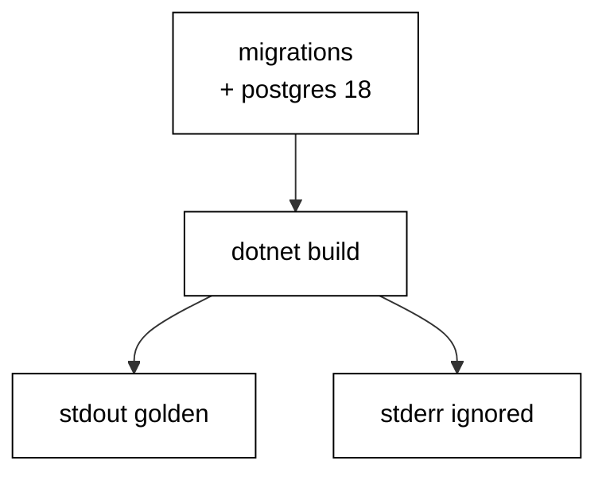

Prerequisites for this course: [just-enough-csharp](/en/learn/courses/just-enough-csharp/learning/overview) for C# syntax, tooling, and the `dotnet` workflow, and [sql-essentials](/en/learn/courses/sql-essentials/learning/overview) for CREATE and ALTER TABLE. Comfort editing and running C# console programs from a terminal is assumed throughout, and every example builds only on the primers plus earlier examples in this course.

## Why this exists -- the big idea

**The problem before the solution**: teams evolve production databases with chat messages and ad-hoc SQL scripts — nobody knows which changes ran where, rollbacks are improvised under pressure, and two developers' changes collide in the deploy queue. Entity Framework Core replaces folklore with artifacts: every change is a versioned C# migration class with a forward step and a reverse step, and the `__EFMigrationsHistory` table records which versions already ran.

**Keep this if you forget everything else**: A migration that cannot be rolled back safely is a migration that will eventually be run in production by accident.

## Tensions and trade-offs -- when NOT to reach for this

- **Small versus strict**: nullable columns land without disturbing traffic; NOT NULL, checks, and defaults constrain later once data complies. Each example names which side it takes and what the other side would cost, and Examples 31 and 34 collect the default-first and fill-then-constrain shapes for going strict safely.
- **One version versus many**: single-change migrations minimize lock windows but multiply files; multi-step versions read as one story but hold locks longer. The course defaults to small versions and merges steps only when the steps genuinely share a deploy window.
- **When NOT**: throwaway exploration against a scratch database needs no versioning — create, poke, drop, done. Migrations earn their place when the database outlives the session: shared development databases, staging, and anything resembling production.

## Lineage -- where this tool sits

Entity Framework Core is the data-access companion to the C# ecosystem, and this course assumes both the C# primer and basic SQL DDL as background. The data-access course teaches data access; this course teaches schema evolution — the versioned history that lets the schema change while the data and the traffic survive. Later data courses assume migrations exist and build pipelines, analytics, and services on top of versioned schemas.

## How this course is organized

[Beginner](/en/learn/courses/database-migrations-with-csharp-and-ef-core/learning/beginner) (Examples 1–25) writes first migrations and rolls them back: versioned classes, history stamps, ordering rules, and rollback basics. [Intermediate](/en/learn/courses/database-migrations-with-csharp-and-ef-core/learning/intermediate) (Examples 26–53) backfills data, splits breaking changes into zero-downtime steps, and adopts legacy databases with stamps and drift checks. [Advanced](/en/learn/courses/database-migrations-with-csharp-and-ef-core/learning/advanced) (Examples 54–78) resolves branch conflicts, shrinks locking blast radius, and diagnoses failures from the history table. The [capstone](/en/learn/courses/database-migrations-with-csharp-and-ef-core/learning/capstone/overview) evolves an order-management schema through eight realistic migrations with a golden verification query, and [drilling](/en/learn/courses/database-migrations-with-csharp-and-ef-core/drilling/overview) turns the sixteen concepts into recall, katas, and checklists.

## About the runtime

Every example runs as a compiled C# console program in the pinned .NET container against the real pinned PostgreSQL 18 service: no mocks, no fixtures-as-data. The harness network is closed and NuGet restores from the course-local locked package feed, so every unit restores byte-identical packages from `packages.lock.json` (Entity Framework Core 10.0.4 with the Npgsql provider). Each program migrates with `Database.Migrate()`, so the same versioned C# classes a developer reviews are what the database runs — the history shape, the ordering rules, and the `__EFMigrationsHistory` table are EF Core's own. Each example owns per-example tables, resets leftovers before running, and cleans up after itself, so reruns are byte-stable. Standard output is the asserted golden transcript; standard error is ignored. Programs print labels, counts, and row values — never paths, timings, temp names, or revision noise — so reruns match byte for byte.

## Examples by Level

### Beginner (Examples 1–25)

- [Example 1: Create Your First Table](/en/learn/courses/database-migrations-with-csharp-and-ef-core/learning/beginner#example-1-create-your-first-table)
- [Example 2: Add a Column with Alter](/en/learn/courses/database-migrations-with-csharp-and-ef-core/learning/beginner#example-2-add-a-column-with-alter)
- [Example 3: Migrations Run Once](/en/learn/courses/database-migrations-with-csharp-and-ef-core/learning/beginner#example-3-migrations-run-once)
- [Example 4: History Table Records Every Run](/en/learn/courses/database-migrations-with-csharp-and-ef-core/learning/beginner#example-4-history-table-records-every-run)
- [Example 5: Version Numbers Order Execution](/en/learn/courses/database-migrations-with-csharp-and-ef-core/learning/beginner#example-5-version-numbers-order-execution)
- [Example 6: Names Document Intent](/en/learn/courses/database-migrations-with-csharp-and-ef-core/learning/beginner#example-6-names-document-intent)
- [Example 7: Alter Safely Keeps Data](/en/learn/courses/database-migrations-with-csharp-and-ef-core/learning/beginner#example-7-alter-safely-keeps-data)
- [Example 8: One Migration One Change](/en/learn/courses/database-migrations-with-csharp-and-ef-core/learning/beginner#example-8-one-migration-one-change)
- [Example 9: History Table Is the Source of Truth](/en/learn/courses/database-migrations-with-csharp-and-ef-core/learning/beginner#example-9-history-table-is-the-source-of-truth)
- [Example 10: Linear History Stays Mergeable](/en/learn/courses/database-migrations-with-csharp-and-ef-core/learning/beginner#example-10-linear-history-stays-mergeable)
- [Example 11: Gaps in Versions Still Apply](/en/learn/courses/database-migrations-with-csharp-and-ef-core/learning/beginner#example-11-gaps-in-versions-still-apply)
- [Example 12: Pending Migrations Are Visible](/en/learn/courses/database-migrations-with-csharp-and-ef-core/learning/beginner#example-12-pending-migrations-are-visible)
- [Example 13: Info Shows Pending and Applied](/en/learn/courses/database-migrations-with-csharp-and-ef-core/learning/beginner#example-13-info-shows-pending-and-applied)
- [Example 14: Every Entry Records Its Product](/en/learn/courses/database-migrations-with-csharp-and-ef-core/learning/beginner#example-14-every-entry-records-its-product)
- [Example 15: Migrate to a Target Stays Partial](/en/learn/courses/database-migrations-with-csharp-and-ef-core/learning/beginner#example-15-migrate-to-a-target-stays-partial)
- [Example 16: History Proves Two Environments Match](/en/learn/courses/database-migrations-with-csharp-and-ef-core/learning/beginner#example-16-history-proves-two-environments-match)
- [Example 17: Applied Equals Assembly After Migrate](/en/learn/courses/database-migrations-with-csharp-and-ef-core/learning/beginner#example-17-applied-equals-assembly-after-migrate)
- [Example 18: Rollback Means a Forward Fix](/en/learn/courses/database-migrations-with-csharp-and-ef-core/learning/beginner#example-18-rollback-means-a-forward-fix)
- [Example 19: Reverse by Re-adding, Not by Undo](/en/learn/courses/database-migrations-with-csharp-and-ef-core/learning/beginner#example-19-reverse-by-re-adding-not-by-undo)
- [Example 20: Failed Migration Leaves Earlier Work Intact](/en/learn/courses/database-migrations-with-csharp-and-ef-core/learning/beginner#example-20-failed-migration-leaves-earlier-work-intact)
- [Example 21: Partial Statements Roll Back Together](/en/learn/courses/database-migrations-with-csharp-and-ef-core/learning/beginner#example-21-partial-statements-roll-back-together)
- [Example 22: Two Tables or None](/en/learn/courses/database-migrations-with-csharp-and-ef-core/learning/beginner#example-22-two-tables-or-none)
- [Example 23: Down Reverses Up on Demand](/en/learn/courses/database-migrations-with-csharp-and-ef-core/learning/beginner#example-23-down-reverses-up-on-demand)
- [Example 24: Rollback Plan for a Bad Deploy](/en/learn/courses/database-migrations-with-csharp-and-ef-core/learning/beginner#example-24-rollback-plan-for-a-bad-deploy)
- [Example 25: Beginner Review, Order History Rollback](/en/learn/courses/database-migrations-with-csharp-and-ef-core/learning/beginner#example-25-beginner-review-order-history-rollback)

### Intermediate (Examples 26–53)

- [Example 26: Backfill Is a Separate Step](/en/learn/courses/database-migrations-with-csharp-and-ef-core/learning/intermediate#example-26-backfill-is-a-separate-step)
- [Example 27: Backfill Computes from Existing Rows](/en/learn/courses/database-migrations-with-csharp-and-ef-core/learning/intermediate#example-27-backfill-computes-from-existing-rows)
- [Example 28: Backfill Preserves Every Row](/en/learn/courses/database-migrations-with-csharp-and-ef-core/learning/intermediate#example-28-backfill-preserves-every-row)
- [Example 29: Backfill Runs Safely Twice](/en/learn/courses/database-migrations-with-csharp-and-ef-core/learning/intermediate#example-29-backfill-runs-safely-twice)
- [Example 30: Batch Backfills Avoid Long Locks](/en/learn/courses/database-migrations-with-csharp-and-ef-core/learning/intermediate#example-30-batch-backfills-avoid-long-locks)
- [Example 31: New Not Null Needs a Default](/en/learn/courses/database-migrations-with-csharp-and-ef-core/learning/intermediate#example-31-new-not-null-needs-a-default)
- [Example 32: Data-Only Migration Carries No Schema Change](/en/learn/courses/database-migrations-with-csharp-and-ef-core/learning/intermediate#example-32-data-only-migration-carries-no-schema-change)
- [Example 33: Verify a Backfill with a Golden Query](/en/learn/courses/database-migrations-with-csharp-and-ef-core/learning/intermediate#example-33-verify-a-backfill-with-a-golden-query)
- [Example 34: Backfill Then Constrain in Two Steps](/en/learn/courses/database-migrations-with-csharp-and-ef-core/learning/intermediate#example-34-backfill-then-constrain-in-two-steps)
- [Example 35: Expand First Contract Later](/en/learn/courses/database-migrations-with-csharp-and-ef-core/learning/intermediate#example-35-expand-first-contract-later)
- [Example 36: Dual Write Both Columns](/en/learn/courses/database-migrations-with-csharp-and-ef-core/learning/intermediate#example-36-dual-write-both-columns)
- [Example 37: Backfill the New Column from the Old](/en/learn/courses/database-migrations-with-csharp-and-ef-core/learning/intermediate#example-37-backfill-the-new-column-from-the-old)
- [Example 38: Readers Move Before the Drop](/en/learn/courses/database-migrations-with-csharp-and-ef-core/learning/intermediate#example-38-readers-move-before-the-drop)
- [Example 39: Drop the Old Column Last](/en/learn/courses/database-migrations-with-csharp-and-ef-core/learning/intermediate#example-39-drop-the-old-column-last)
- [Example 40: Rename Without Downtime the Safe Way](/en/learn/courses/database-migrations-with-csharp-and-ef-core/learning/intermediate#example-40-rename-without-downtime-the-safe-way)
- [Example 41: Zero Downtime Needs Two Deploys](/en/learn/courses/database-migrations-with-csharp-and-ef-core/learning/intermediate#example-41-zero-downtime-needs-two-deploys)
- [Example 42: Old Code Reads the New Schema](/en/learn/courses/database-migrations-with-csharp-and-ef-core/learning/intermediate#example-42-old-code-reads-the-new-schema)
- [Example 43: New Code Reads Old Rows](/en/learn/courses/database-migrations-with-csharp-and-ef-core/learning/intermediate#example-43-new-code-reads-old-rows)
- [Example 44: Intermediate Review, Backfill and Splits](/en/learn/courses/database-migrations-with-csharp-and-ef-core/learning/intermediate#example-44-intermediate-review-backfill-and-splits)
- [Example 45: Baseline Marks a Starting Point](/en/learn/courses/database-migrations-with-csharp-and-ef-core/learning/intermediate#example-45-baseline-marks-a-starting-point)
- [Example 46: Baseline Keeps Legacy Data](/en/learn/courses/database-migrations-with-csharp-and-ef-core/learning/intermediate#example-46-baseline-keeps-legacy-data)
- [Example 47: Legacy Schema Becomes M1s Twin](/en/learn/courses/database-migrations-with-csharp-and-ef-core/learning/intermediate#example-47-legacy-schema-becomes-m1s-twin)
- [Example 48: New Work Starts After the Baseline](/en/learn/courses/database-migrations-with-csharp-and-ef-core/learning/intermediate#example-48-new-work-starts-after-the-baseline)
- [Example 49: Baseline History Row Looks Applied](/en/learn/courses/database-migrations-with-csharp-and-ef-core/learning/intermediate#example-49-baseline-history-row-looks-applied)
- [Example 50: Detect Drift After Baselining](/en/learn/courses/database-migrations-with-csharp-and-ef-core/learning/intermediate#example-50-detect-drift-after-baselining)
- [Example 51: Converge Drift with a Compensating Step](/en/learn/courses/database-migrations-with-csharp-and-ef-core/learning/intermediate#example-51-converge-drift-with-a-compensating-step)
- [Example 52: Baseline Keeps Seed Data Intact](/en/learn/courses/database-migrations-with-csharp-and-ef-core/learning/intermediate#example-52-baseline-keeps-seed-data-intact)
- [Example 53: Intermediate Review, Baseline and Drift](/en/learn/courses/database-migrations-with-csharp-and-ef-core/learning/intermediate#example-53-intermediate-review-baseline-and-drift)

### Advanced (Examples 54–78)

- [Example 54: Two Branches One History](/en/learn/courses/database-migrations-with-csharp-and-ef-core/learning/advanced#example-54-two-branches-one-history)
- [Example 55: Duplicate Ids Fail Before Anything Applies](/en/learn/courses/database-migrations-with-csharp-and-ef-core/learning/advanced#example-55-duplicate-ids-fail-before-anything-applies)
- [Example 56: Loser Renumbers and Reapplies](/en/learn/courses/database-migrations-with-csharp-and-ef-core/learning/advanced#example-56-loser-renumbers-and-reapplies)
- [Example 57: Merge Keeps One Line](/en/learn/courses/database-migrations-with-csharp-and-ef-core/learning/advanced#example-57-merge-keeps-one-line)
- [Example 58: Late Arrivals Still Apply in Order](/en/learn/courses/database-migrations-with-csharp-and-ef-core/learning/advanced#example-58-late-arrivals-still-apply-in-order)
- [Example 59: Pull Before You Number](/en/learn/courses/database-migrations-with-csharp-and-ef-core/learning/advanced#example-59-pull-before-you-number)
- [Example 60: History Names Every Author](/en/learn/courses/database-migrations-with-csharp-and-ef-core/learning/advanced#example-60-history-names-every-author)
- [Example 61: Promote the Same Set Across Environments](/en/learn/courses/database-migrations-with-csharp-and-ef-core/learning/advanced#example-61-promote-the-same-set-across-environments)
- [Example 62: DDL Takes a Lock](/en/learn/courses/database-migrations-with-csharp-and-ef-core/learning/advanced#example-62-ddl-takes-a-lock)
- [Example 63: Statement Timeout Bounds a Runaway](/en/learn/courses/database-migrations-with-csharp-and-ef-core/learning/advanced#example-63-statement-timeout-bounds-a-runaway)
- [Example 64: Batches Release Locks Between Steps](/en/learn/courses/database-migrations-with-csharp-and-ef-core/learning/advanced#example-64-batches-release-locks-between-steps)
- [Example 65: Advisory Lock Serializes Two Runners](/en/learn/courses/database-migrations-with-csharp-and-ef-core/learning/advanced#example-65-advisory-lock-serializes-two-runners)
- [Example 66: Concurrent Index Needs No Transaction](/en/learn/courses/database-migrations-with-csharp-and-ef-core/learning/advanced#example-66-concurrent-index-needs-no-transaction)
- [Example 67: Short Transactions Shrink the Blast Radius](/en/learn/courses/database-migrations-with-csharp-and-ef-core/learning/advanced#example-67-short-transactions-shrink-the-blast-radius)
- [Example 68: Independent Tables Do Not Block Each Other](/en/learn/courses/database-migrations-with-csharp-and-ef-core/learning/advanced#example-68-independent-tables-do-not-block-each-other)
- [Example 69: Locking Review for Hot Tables](/en/learn/courses/database-migrations-with-csharp-and-ef-core/learning/advanced#example-69-locking-review-for-hot-tables)
- [Example 70: Zero Lock Reads During Migration](/en/learn/courses/database-migrations-with-csharp-and-ef-core/learning/advanced#example-70-zero-lock-reads-during-migration)
- [Example 71: Diagnosis Starts at the History Table](/en/learn/courses/database-migrations-with-csharp-and-ef-core/learning/advanced#example-71-diagnosis-starts-at-the-history-table)
- [Example 72: An Orphan History Row Means a Deleted File](/en/learn/courses/database-migrations-with-csharp-and-ef-core/learning/advanced#example-72-an-orphan-history-row-means-a-deleted-file)
- [Example 73: Edited Migrations Do Not Re-Apply](/en/learn/courses/database-migrations-with-csharp-and-ef-core/learning/advanced#example-73-edited-migrations-do-not-re-apply)
- [Example 74: Verify an Edit with a Fresh Database](/en/learn/courses/database-migrations-with-csharp-and-ef-core/learning/advanced#example-74-verify-an-edit-with-a-fresh-database)
- [Example 75: Drift Table Changed Out of Band](/en/learn/courses/database-migrations-with-csharp-and-ef-core/learning/advanced#example-75-drift-table-changed-out-of-band)
- [Example 76: Diagnose a Partial Migration from History](/en/learn/courses/database-migrations-with-csharp-and-ef-core/learning/advanced#example-76-diagnose-a-partial-migration-from-history)
- [Example 77: Validate After Migrate Seals the Pipe](/en/learn/courses/database-migrations-with-csharp-and-ef-core/learning/advanced#example-77-validate-after-migrate-seals-the-pipe)
- [Example 78: Final Review, Full Loop to Production](/en/learn/courses/database-migrations-with-csharp-and-ef-core/learning/advanced#example-78-final-review-full-loop-to-production)
