Examples 54–78 take migrations to production: resolving the branch conflicts parallel work creates, shrinking the locking blast radius of deploys, and diagnosing failures from the history the database kept. Three clusters carry the level: team workflows and conflicts (Examples 54–61), locks and concurrency (Examples 62–70), and failure diagnosis and rehearsal (Examples 71–78). Every program runs against the real pinned PostgreSQL 18 container; every output is a fixed transcript.

### Example 54: Two Branches Two Versions

Two developers branching from the same base write two files with no common descendant — two tips, one history. This example builds both branches and proves both versions applied in one run. (Concepts: co-14.)

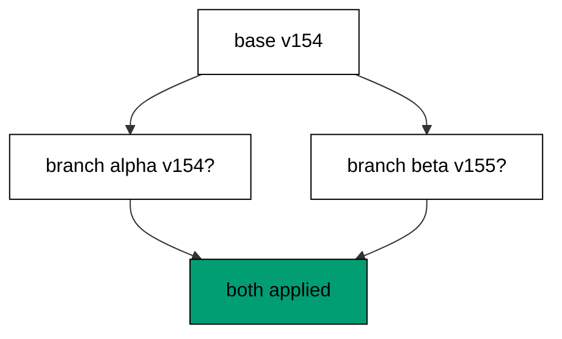

**`learning/code/ex-54-two-branches-two-versions/priv/main.exs`**:

```elixir
# => Example 54: Two Branches Two Versions
Logger.configure(level: :info)
# => debug query logs off; prints form the transcript
Code.compiler_options(ignore_module_conflict: true)
# => down-migration reloads stay silent on double runs
# => every unit keeps its own history table, never the shared default
Application.put_env(:app, Ex54.Repo, migration_source: "ex54_history")

# => one Repo module per unit keeps names unambiguous
defmodule Ex54.Repo do
  # => the Postgres 18 service adapter
  use Ecto.Repo, otp_app: :app, adapter: Ecto.Adapters.Postgres
  # => module boundary stays explicit
end

# => run/0 holds the whole example narrative
defmodule Ex54.Main do
  # => single entry point the last line calls
  def run do
    # => one keyword list owns every connection fact
    opts = [
      # => harness service hostname
      hostname: System.get_env("PGHOST", "postgres"),
      # => service port, parsed once
      port: System.get_env("PGPORT", "5432") |> String.to_integer(),
      # => fresh database for every run
      database: System.get_env("PGDATABASE", "postgres"),
      # => trust-auth role, no password
      username: System.get_env("PGUSER", "postgres"),
      # => Repo stays silent; the transcript is explicit
      log: false
      # => end opts: every fact above is environment-driven
    ]

    # => pool starts; the script owns the rest
    {:ok, _} = Ex54.Repo.start_link(opts)

    # => private script dir, never printed
    scratch = Path.join(System.tmp_dir!(), "ex54")
    # => create it fresh on every run
    File.mkdir_p!(scratch)
    # => migration source starts here
    File.write!(Path.join(scratch, "202601000154_branch_alpha.exs"), ~S"""
    # => branch alpha adds its own table
    defmodule Ex54.Repo.Migrations.BranchAlpha do
    # => the same DSL every history file uses
    use Ecto.Migration

    # => alpha's table lands first by version
    def change do
    # => the table branch alpha owns
    create table(:ex54_alpha) do
    # => a single label column, enough to prove the shape
      add :label, :string
    # => end create: alpha's table
    end
    # => end change: down drops what up created
    end
    # => end BranchAlpha: branch one of two
    end
    # => the exact file the lesson shows, now on disk
    """)

    # => migration source starts here
    File.write!(Path.join(scratch, "202601000155_branch_beta.exs"), ~S"""
    # => branch beta adds its own table
    defmodule Ex54.Repo.Migrations.BranchBeta do
    # => the same DSL every history file uses
    use Ecto.Migration

    # => beta's table lands second by version
    def change do
    # => the table branch beta owns
    create table(:ex54_beta) do
    # => a single label column, enough to prove the shape
      add :label, :string
    # => end create: beta's table
    end
    # => end change: down drops what up created
    end
    # => end BranchBeta: branch two of two
    end
    # => the exact file the lesson shows, now on disk
    """)

    # => stale receipts roll back first; empty history returns []
    Ecto.Migrator.run(Ex54.Repo, scratch, :down, to: 0, log: false)
    # => leftovers of a killed run vanish
    Ecto.Adapters.SQL.query!(Ex54.Repo, "DROP TABLE IF EXISTS ex54_alpha", [])
    # => leftovers of a killed run vanish
    Ecto.Adapters.SQL.query!(Ex54.Repo, "DROP TABLE IF EXISTS ex54_beta", [])

    # => run every pending file in version order
    Ecto.Migrator.run(Ex54.Repo, scratch, :up, all: true, log: false)
    # => two branches land in version order
    sql =
      "SELECT version FROM ex54_history WHERE version IN (202601000154, 202601000155) ORDER BY version"

    # => one call reads both receipts
    versions = Ecto.Adapters.SQL.query!(Ex54.Repo, sql, []).rows
    # => Output: merged: 202601000154, 202601000155
    IO.puts("merged: " <> Enum.map_join(versions, ", ", fn [v] -> "#{v}" end))
    # => reverse everything for the next run
    Ecto.Migrator.run(Ex54.Repo, scratch, :down, to: 0, log: false)
    # => Output: cleaned: yes
    IO.puts("cleaned: yes")

    # => end run: the narrative returns here
  end

  # => module boundary stays explicit
end

# => the entry point runs exactly once per execution
Ex54.Main.run()
```

**Output** (`learning/code/ex-54-two-branches-two-versions/expected/main.stdout.txt`):

```text
merged: 202601000154, 202601000155
cleaned: yes
```

**Key takeaway**: Independent branches are independent files; the merged run applies both versions in sorted order.

**Why it matters**: Parallel work is the point of version control, and migrations must survive it. Two tips do not block each other — the runner applies both — but they do create a choice the team must resolve before the next deploy. Seeing both versions land is the calm before the merge question. Seeing both versions land is the calm moment before the team resolves the merge question together.

### Example 55: Same Timestamp Collides

Two files with the same version are a conflict even when both are correct alone. This example writes two migrations sharing one version and captures the error the runner raises. (Concepts: co-11.)

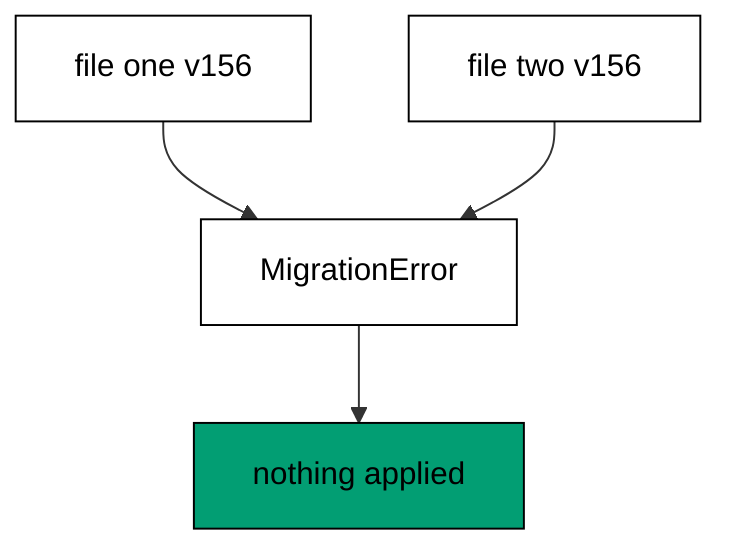

**`learning/code/ex-55-same-timestamp-collides/priv/main.exs`**:

```elixir
# => Example 55: Same Timestamp Collides
Logger.configure(level: :info)
# => debug query logs off; prints form the transcript
Code.compiler_options(ignore_module_conflict: true)
# => down-migration reloads stay silent on double runs
# => every unit keeps its own history table, never the shared default
Application.put_env(:app, Ex55.Repo, migration_source: "ex55_history")

# => one Repo module per unit keeps names unambiguous
defmodule Ex55.Repo do
  # => the Postgres 18 service adapter
  use Ecto.Repo, otp_app: :app, adapter: Ecto.Adapters.Postgres
  # => module boundary stays explicit
end

# => run/0 holds the whole example narrative
defmodule Ex55.Main do
  # => single entry point the last line calls
  def run do
    # => one keyword list owns every connection fact
    opts = [
      # => harness service hostname
      hostname: System.get_env("PGHOST", "postgres"),
      # => service port, parsed once
      port: System.get_env("PGPORT", "5432") |> String.to_integer(),
      # => fresh database for every run
      database: System.get_env("PGDATABASE", "postgres"),
      # => trust-auth role, no password
      username: System.get_env("PGUSER", "postgres"),
      # => Repo stays silent; the transcript is explicit
      log: false
      # => end opts: every fact above is environment-driven
    ]

    # => pool starts; the script owns the rest
    {:ok, _} = Ex55.Repo.start_link(opts)

    # => private script dir, never printed
    scratch = Path.join(System.tmp_dir!(), "ex55")
    # => create it fresh on every run
    File.mkdir_p!(scratch)
    # => migration source starts here
    File.write!(Path.join(scratch, "202601000155_branch_alpha.exs"), ~S"""
    # => alpha claims the shared timestamp
    defmodule Ex55.Repo.Migrations.BranchAlpha do
    # => the generator stamped both branches alike
    use Ecto.Migration

    # => alpha's table under the shared version
    def change do
    # => the table branch alpha owns
    create table(:ex55_alpha) do
    # => a single label column, enough to prove the shape
      add :label, :string
    # => end create: alpha's table
    end
    # => end change: down drops what up created
    end
    # => end BranchAlpha: first claim on the version
    end
    # => the exact file the lesson shows, now on disk
    """)

    # => migration source starts here
    File.write!(Path.join(scratch, "202601000155_branch_beta.exs"), ~S"""
    # => beta claims the same timestamp
    defmodule Ex55.Repo.Migrations.BranchBeta do
    # => the generator stamped both branches alike
    use Ecto.Migration

    # => beta's table under the shared version
    def change do
    # => the table branch beta owns
    create table(:ex55_beta) do
    # => a single label column, enough to prove the shape
      add :label, :string
    # => end create: beta's table
    end
    # => end change: down drops what up created
    end
    # => end BranchBeta: second claim on the version
    end
    # => the exact file the lesson shows, now on disk
    """)

    # => stale receipts roll back first; empty history returns []
    Ecto.Migrator.run(Ex55.Repo, scratch, :down, to: 0, log: false)
    # => leftovers of a killed run vanish
    Ecto.Adapters.SQL.query!(Ex55.Repo, "DROP TABLE IF EXISTS ex55_alpha", [])
    # => leftovers of a killed run vanish
    Ecto.Adapters.SQL.query!(Ex55.Repo, "DROP TABLE IF EXISTS ex55_beta", [])

    # => two branches claim one version: the migrator refuses
    # => the attempt runs; rescue below names any failure
    outcome =
      try do
        # => this call raises before touching the database
        Ecto.Migrator.run(Ex55.Repo, scratch, :up, all: true, log: false)
        # => unreachable: the error above skips the rest of try
        :ran
        # => only the migration conflict lands here
      rescue
        # => the struct names the failure without secrets
        e in Ecto.MigrationError ->
          # => the rescue reports the error struct
          {:raised, e.__struct__}
          # => end rescue: the database never changed
      end

    # => Output: outcome: raised Ecto.MigrationError
    IO.puts("outcome: raised #{inspect(elem(outcome, 1))}")
    # => reverse everything for the next run
    Ecto.Migrator.run(Ex55.Repo, scratch, :down, to: 0, log: false)
    # => Output: cleaned: yes
    IO.puts("cleaned: yes")

    # => end run: the narrative returns here
  end

  # => module boundary stays explicit
end

# => the entry point runs exactly once per execution
Ex55.Main.run()
```

**Output** (`learning/code/ex-55-same-timestamp-collides/expected/main.stdout.txt`):

```text
outcome: raised Ecto.MigrationError
cleaned: yes
```

**Key takeaway**: Same version twice fails at plan time; the error names the conflict before any DDL runs.

**Why it matters**: Timestamps collide when two developers generate migrations in the same second — rare, but real on busy teams. The failure is the system working: it refuses to silently pick a winner. The fix is a rename, not a debate, and this example teaches responders to reach for the rename first. Reach for the rename first and the debate never starts: the repair is smaller than the discussion.

### Example 56: Rename Resolves the Conflict

The standard repair for a version collision is a rename: give one file the next free version. This example renames the colliding file and shows both versions resolving in order. (Concepts: co-11.)

**`learning/code/ex-56-rename-resolves-the-conflict/priv/main.exs`**:

```elixir
# => Example 56: Rename Resolves the Conflict
Logger.configure(level: :info)
# => debug query logs off; prints form the transcript
Code.compiler_options(ignore_module_conflict: true)
# => down-migration reloads stay silent on double runs
# => every unit keeps its own history table, never the shared default
Application.put_env(:app, Ex56.Repo, migration_source: "ex56_history")

# => one Repo module per unit keeps names unambiguous
defmodule Ex56.Repo do
  # => the Postgres 18 service adapter
  use Ecto.Repo, otp_app: :app, adapter: Ecto.Adapters.Postgres
  # => module boundary stays explicit
end

# => run/0 holds the whole example narrative
defmodule Ex56.Main do
  # => single entry point the last line calls
  def run do
    # => one keyword list owns every connection fact
    opts = [
      # => harness service hostname
      hostname: System.get_env("PGHOST", "postgres"),
      # => service port, parsed once
      port: System.get_env("PGPORT", "5432") |> String.to_integer(),
      # => fresh database for every run
      database: System.get_env("PGDATABASE", "postgres"),
      # => trust-auth role, no password
      username: System.get_env("PGUSER", "postgres"),
      # => Repo stays silent; the transcript is explicit
      log: false
      # => end opts: every fact above is environment-driven
    ]

    # => pool starts; the script owns the rest
    {:ok, _} = Ex56.Repo.start_link(opts)

    # => private script dir, never printed
    scratch = Path.join(System.tmp_dir!(), "ex56")
    # => create it fresh on every run
    File.mkdir_p!(scratch)
    # => migration source starts here
    File.write!(Path.join(scratch, "202601000155_branch_alpha.exs"), ~S"""
    # => alpha keeps the contested timestamp
    defmodule Ex56.Repo.Migrations.BranchAlpha do
    # => the rename gave beta its own version
    use Ecto.Migration

    # => alpha's table under the original version
    def change do
    # => the table branch alpha owns
    create table(:ex56_alpha) do
    # => a single label column, enough to prove the shape
      add :label, :string
    # => end create: alpha's table
    end
    # => end change: down drops what up created
    end
    # => end BranchAlpha: the version's first owner
    end
    # => the exact file the lesson shows, now on disk
    """)

    # => migration source starts here
    File.write!(Path.join(scratch, "202601000156_branch_beta.exs"), ~S"""
    # => beta takes the next version after the rename
    defmodule Ex56.Repo.Migrations.BranchBeta do
    # => one renamed file resolves the whole conflict
    use Ecto.Migration

    # => beta's table under the fresh version
    def change do
    # => the table branch beta owns
    create table(:ex56_beta) do
    # => a single label column, enough to prove the shape
      add :label, :string
    # => end create: beta's table
    end
    # => end change: down drops what up created
    end
    # => end BranchBeta: the version's second owner
    end
    # => the exact file the lesson shows, now on disk
    """)

    # => stale receipts roll back first; empty history returns []
    Ecto.Migrator.run(Ex56.Repo, scratch, :down, to: 0, log: false)
    # => leftovers of a killed run vanish
    Ecto.Adapters.SQL.query!(Ex56.Repo, "DROP TABLE IF EXISTS ex56_alpha", [])
    # => leftovers of a killed run vanish
    Ecto.Adapters.SQL.query!(Ex56.Repo, "DROP TABLE IF EXISTS ex56_beta", [])

    # => run every pending file in version order
    Ecto.Migrator.run(Ex56.Repo, scratch, :up, all: true, log: false)
    # => the renamed file runs after the original
    sql =
      "SELECT version FROM ex56_history WHERE version IN (202601000155, 202601000156) ORDER BY version"

    # => one call reads both receipts
    versions = Ecto.Adapters.SQL.query!(Ex56.Repo, sql, []).rows
    # => Output: resolved: 202601000155, 202601000156
    IO.puts("resolved: " <> Enum.map_join(versions, ", ", fn [v] -> "#{v}" end))
    # => reverse everything for the next run
    Ecto.Migrator.run(Ex56.Repo, scratch, :down, to: 0, log: false)
    # => Output: cleaned: yes
    IO.puts("cleaned: yes")

    # => end run: the narrative returns here
  end

  # => module boundary stays explicit
end

# => the entry point runs exactly once per execution
Ex56.Main.run()
```

**Output** (`learning/code/ex-56-rename-resolves-the-conflict/expected/main.stdout.txt`):

```text
resolved: 202601000155, 202601000156
cleaned: yes
```

**Key takeaway**: Renaming the version reorders the file; the resolved line proves both files now have distinct versions.

**Why it matters**: Conflict repair should be boring: rename, rerun, move on. Because Ecto orders by version number alone, a rename fully determines the new order — no content edits, no merge commits, no coordination beyond picking the next number. Teams that know this repair stay unblocked; teams that do not escalate. Teams that know this repair stay unblocked while teams that do not escalate a two-minute fix.

### Example 57: Late File Runs on Arrival

A file that arrives after its neighbors ran is not skipped: the next run picks it up by version order. This example applies a base, adds a late file, and shows it running on the next upgrade. (Concepts: co-14.)

**`learning/code/ex-57-late-file-runs-on-arrival/priv/main.exs`**:

```elixir
# => Example 57: Late File Runs on Arrival
Logger.configure(level: :info)
# => debug query logs off; prints form the transcript
Code.compiler_options(ignore_module_conflict: true)
# => down-migration reloads stay silent on double runs
# => every unit keeps its own history table, never the shared default
Application.put_env(:app, Ex57.Repo, migration_source: "ex57_history")

# => one Repo module per unit keeps names unambiguous
defmodule Ex57.Repo do
  # => the Postgres 18 service adapter
  use Ecto.Repo, otp_app: :app, adapter: Ecto.Adapters.Postgres
  # => module boundary stays explicit
end

# => run/0 holds the whole example narrative
defmodule Ex57.Main do
  # => single entry point the last line calls
  def run do
    # => one keyword list owns every connection fact
    opts = [
      # => harness service hostname
      hostname: System.get_env("PGHOST", "postgres"),
      # => service port, parsed once
      port: System.get_env("PGPORT", "5432") |> String.to_integer(),
      # => fresh database for every run
      database: System.get_env("PGDATABASE", "postgres"),
      # => trust-auth role, no password
      username: System.get_env("PGUSER", "postgres"),
      # => Repo stays silent; the transcript is explicit
      log: false
      # => end opts: every fact above is environment-driven
    ]

    # => pool starts; the script owns the rest
    {:ok, _} = Ex57.Repo.start_link(opts)

    # => private script dir, never printed
    scratch = Path.join(System.tmp_dir!(), "ex57")
    # => create it fresh on every run
    File.mkdir_p!(scratch)
    # => migration source starts here
    File.write!(Path.join(scratch, "202601000157_make_head.exs"), ~S"""
    # => head lands first, alone
    defmodule Ex57.Repo.Migrations.MakeHead do
    # => the late file arrives after this one
    use Ecto.Migration

    # => head's table under the higher version
    def change do
    # => the table the head owns
    create table(:ex57_head) do
    # => a single label column, enough to prove the shape
      add :label, :string
    # => end create: the deployed head
    end
    # => end change: down drops what up created
    end
    # => end MakeHead: the applied head
    end
    # => the exact file the lesson shows, now on disk
    """)

    # => stale receipts roll back first; empty history returns []
    Ecto.Migrator.run(Ex57.Repo, scratch, :down, to: 0, log: false)
    # => leftovers of a killed run vanish
    Ecto.Adapters.SQL.query!(Ex57.Repo, "DROP TABLE IF EXISTS ex57_head", [])
    # => leftovers of a killed run vanish
    Ecto.Adapters.SQL.query!(Ex57.Repo, "DROP TABLE IF EXISTS ex57_late", [])

    # => head applies before the late file even arrives
    Ecto.Migrator.run(Ex57.Repo, scratch, :up, to: 202_601_000_157, log: false)
    # => private script dir, never printed
    scratch = Path.join(System.tmp_dir!(), "ex57")
    # => create it fresh on every run
    File.mkdir_p!(scratch)
    # => migration source starts here
    File.write!(Path.join(scratch, "202601000155_make_late.exs"), ~S"""
    # => the late file carries the lower version
    defmodule Ex57.Repo.Migrations.MakeLate do
    # => pending means runnable, whatever its number
    use Ecto.Migration

    # => the late table lands when it arrives
    def change do
    # => the table the late branch owns
    create table(:ex57_late) do
    # => a single label column, enough to prove the shape
      add :label, :string
    # => end create: the late arrival
    end
    # => end change: down drops what up created
    end
    # => end MakeLate: the pending arrival
    end
    # => the exact file the lesson shows, now on disk
    """)

    # => the late file runs on arrival, in version order
    late = Ecto.Migrator.run(Ex57.Repo, scratch, :up, all: true, log: false)
    # => Output: late: [202601000155]
    IO.puts("late: #{inspect(late)}")
    # => reverse everything for the next run
    Ecto.Migrator.run(Ex57.Repo, scratch, :down, to: 0, log: false)
    # => Output: cleaned: yes
    IO.puts("cleaned: yes")

    # => end run: the narrative returns here
  end

  # => module boundary stays explicit
end

# => the entry point runs exactly once per execution
Ex57.Main.run()
```

**Output** (`learning/code/ex-57-late-file-runs-on-arrival/expected/main.stdout.txt`):

```text
late: [202601000155]
cleaned: yes
```

**Key takeaway**: Late files run on the next upgrade in version order; arrival time never overrides version order.

**Why it matters**: Slow branches, delayed reviews, forgotten pushes — files arrive late constantly. The runner's patience is a feature: version order, not arrival order, decides execution, so a late file lands exactly where its number says. No manual replay, no special casing, just the next run. No manual replay and no special casing: the next run lands the late file exactly where it belongs.

### Example 58: Merge Keeps One History

Branches join through a marker migration that both lines run before: one history again. This example runs two branch migrations plus a merge marker and prints the single linear status. (Concepts: co-14.)

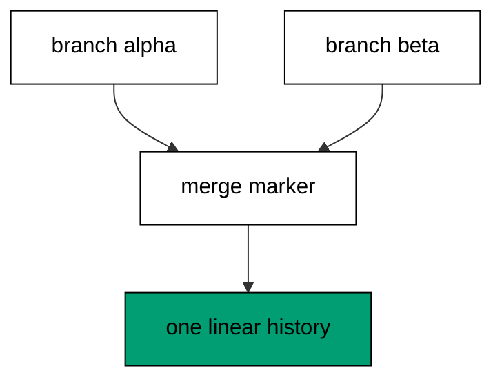

**`learning/code/ex-58-merge-keeps-one-history/priv/main.exs`**:

```elixir
# => Example 58: Merge Keeps One History
Logger.configure(level: :info)
# => debug query logs off; prints form the transcript
Code.compiler_options(ignore_module_conflict: true)
# => down-migration reloads stay silent on double runs
# => every unit keeps its own history table, never the shared default
Application.put_env(:app, Ex58.Repo, migration_source: "ex58_history")

# => one Repo module per unit keeps names unambiguous
defmodule Ex58.Repo do
  # => the Postgres 18 service adapter
  use Ecto.Repo, otp_app: :app, adapter: Ecto.Adapters.Postgres
  # => module boundary stays explicit
end

# => run/0 holds the whole example narrative
defmodule Ex58.Main do
  # => single entry point the last line calls
  def run do
    # => one keyword list owns every connection fact
    opts = [
      # => harness service hostname
      hostname: System.get_env("PGHOST", "postgres"),
      # => service port, parsed once
      port: System.get_env("PGPORT", "5432") |> String.to_integer(),
      # => fresh database for every run
      database: System.get_env("PGDATABASE", "postgres"),
      # => trust-auth role, no password
      username: System.get_env("PGUSER", "postgres"),
      # => Repo stays silent; the transcript is explicit
      log: false
      # => end opts: every fact above is environment-driven
    ]

    # => pool starts; the script owns the rest
    {:ok, _} = Ex58.Repo.start_link(opts)

    # => private script dir, never printed
    scratch = Path.join(System.tmp_dir!(), "ex58")
    # => create it fresh on every run
    File.mkdir_p!(scratch)
    # => migration source starts here
    File.write!(Path.join(scratch, "202601000158_branch_alpha.exs"), ~S"""
    # => alpha's table lands first by version
    defmodule Ex58.Repo.Migrations.BranchAlpha do
    # => the same DSL every history file uses
    use Ecto.Migration

    # => alpha's table under the lower version
    def change do
    # => the table branch alpha owns
    create table(:ex58_alpha) do
    # => a single label column, enough to prove the shape
      add :label, :string
    # => end create: alpha's table
    end
    # => end change: down drops what up created
    end
    # => end BranchAlpha: branch one of two
    end
    # => the exact file the lesson shows, now on disk
    """)

    # => migration source starts here
    File.write!(Path.join(scratch, "202601000159_branch_beta.exs"), ~S"""
    # => beta's table lands second by version
    defmodule Ex58.Repo.Migrations.BranchBeta do
    # => the same DSL every history file uses
    use Ecto.Migration

    # => beta's table under the higher version
    def change do
    # => the table branch beta owns
    create table(:ex58_beta) do
    # => a single label column, enough to prove the shape
      add :label, :string
    # => end create: beta's table
    end
    # => end change: down drops what up created
    end
    # => end BranchBeta: branch two of two
    end
    # => the exact file the lesson shows, now on disk
    """)

    # => migration source starts here
    File.write!(Path.join(scratch, "202601000160_merge_marker.exs"), ~S"""
    # => the merge file closes the branch pair
    defmodule Ex58.Repo.Migrations.MergeMarker do
    # => one index both branches share after merging
    use Ecto.Migration

    # => the merge lands after both branches
    def change do
    # => every lookup by label stays fast
    create index(:ex58_alpha, [:label])
    # => end change: down drops the shared index
    end
    # => end MergeMarker: the merged line closes
    end
    # => the exact file the lesson shows, now on disk
    """)

    # => stale receipts roll back first; empty history returns []
    Ecto.Migrator.run(Ex58.Repo, scratch, :down, to: 0, log: false)
    # => leftovers of a killed run vanish
    Ecto.Adapters.SQL.query!(Ex58.Repo, "DROP TABLE IF EXISTS ex58_alpha", [])
    # => leftovers of a killed run vanish
    Ecto.Adapters.SQL.query!(Ex58.Repo, "DROP TABLE IF EXISTS ex58_beta", [])

    # => run every pending file in version order
    Ecto.Migrator.run(Ex58.Repo, scratch, :up, all: true, log: false)
    # => history lists every file with its state
    status = Ecto.Migrator.migrations(Ex58.Repo, scratch)
    # => foreign rows belong to other units, never this transcript
    status = Enum.reject(status, fn {_, _, n} -> n == "** FILE NOT FOUND **" end)
    # => one line per file: state, version, name
    IO.puts(Enum.map_join(status, "\n", fn {s, v, n} -> "#{s} #{v} #{n}" end))
    # => reverse everything for the next run
    Ecto.Migrator.run(Ex58.Repo, scratch, :down, to: 0, log: false)
    # => Output: cleaned: yes
    IO.puts("cleaned: yes")

    # => end run: the narrative returns here
  end

  # => module boundary stays explicit
end

# => the entry point runs exactly once per execution
Ex58.Main.run()
```

**Output** (`learning/code/ex-58-merge-keeps-one-history/expected/main.stdout.txt`):

```text
up 202601000158 branch_alpha
up 202601000159 branch_beta
up 202601000160 merge_marker
cleaned: yes
```

**Key takeaway**: The marker file joins both lines; status shows one line of ups and the history is linear again.

**Why it matters**: Merges are how parallel work becomes one deployable story. The marker carries no DDL — it joins histories — and the verification proves both branches survived the join. Without the marker, two tips stay two tips and the next upgrade target stays ambiguous. Merge explicitly; ambiguity compounds. Merge explicitly and merge early, because two tips left alone become four tips by Friday.

### Example 59: Rebase onto Head

A private branch that sat unmerged rebases by renumbering onto the current tip. This example moves a stale file to a fresh version above head and shows it applying cleanly. (Concepts: co-14.)

**`learning/code/ex-59-rebase-onto-head/priv/main.exs`**:

```elixir
# => Example 59: Rebase onto Head
Logger.configure(level: :info)
# => debug query logs off; prints form the transcript
Code.compiler_options(ignore_module_conflict: true)
# => down-migration reloads stay silent on double runs
# => every unit keeps its own history table, never the shared default
Application.put_env(:app, Ex59.Repo, migration_source: "ex59_history")

# => one Repo module per unit keeps names unambiguous
defmodule Ex59.Repo do
  # => the Postgres 18 service adapter
  use Ecto.Repo, otp_app: :app, adapter: Ecto.Adapters.Postgres
  # => module boundary stays explicit
end

# => run/0 holds the whole example narrative
defmodule Ex59.Main do
  # => single entry point the last line calls
  def run do
    # => one keyword list owns every connection fact
    opts = [
      # => harness service hostname
      hostname: System.get_env("PGHOST", "postgres"),
      # => service port, parsed once
      port: System.get_env("PGPORT", "5432") |> String.to_integer(),
      # => fresh database for every run
      database: System.get_env("PGDATABASE", "postgres"),
      # => trust-auth role, no password
      username: System.get_env("PGUSER", "postgres"),
      # => Repo stays silent; the transcript is explicit
      log: false
      # => end opts: every fact above is environment-driven
    ]

    # => pool starts; the script owns the rest
    {:ok, _} = Ex59.Repo.start_link(opts)

    # => private script dir, never printed
    scratch = Path.join(System.tmp_dir!(), "ex59")
    # => create it fresh on every run
    File.mkdir_p!(scratch)
    # => migration source starts here
    File.write!(Path.join(scratch, "202601000162_make_head.exs"), ~S"""
    # => head lands first, alone
    defmodule Ex59.Repo.Migrations.MakeHead do
    # => the rebase target the late file joins
    use Ecto.Migration

    # => head's table under the higher version
    def change do
    # => the table the head owns
    create table(:ex59_head) do
    # => a single label column, enough to prove the shape
      add :label, :string
    # => end create: the deployed head
    end
    # => end change: down drops what up created
    end
    # => end MakeHead: the applied head
    end
    # => the exact file the lesson shows, now on disk
    """)

    # => stale receipts roll back first; empty history returns []
    Ecto.Migrator.run(Ex59.Repo, scratch, :down, to: 0, log: false)
    # => leftovers of a killed run vanish
    Ecto.Adapters.SQL.query!(Ex59.Repo, "DROP TABLE IF EXISTS ex59_head", [])
    # => leftovers of a killed run vanish
    Ecto.Adapters.SQL.query!(Ex59.Repo, "DROP TABLE IF EXISTS ex59_rebased", [])

    # => head applies before the rebase lands
    Ecto.Migrator.run(Ex59.Repo, scratch, :up, to: 202_601_000_162, log: false)
    # => private script dir, never printed
    scratch = Path.join(System.tmp_dir!(), "ex59")
    # => create it fresh on every run
    File.mkdir_p!(scratch)
    # => migration source starts here
    File.write!(Path.join(scratch, "202601000163_make_rebased.exs"), ~S"""
    # => the rebased file renumbers above head
    defmodule Ex59.Repo.Migrations.MakeRebased do
    # => rebase means retake a version past head
    use Ecto.Migration

    # => the rebased table lands last, on purpose
    def change do
    # => the table the rebased branch owns
    create table(:ex59_rebased) do
    # => a single label column, enough to prove the shape
      add :label, :string
    # => end create: the rebased arrival
    end
    # => end change: down drops what up created
    end
    # => end MakeRebased: the renumbered file
    end
    # => the exact file the lesson shows, now on disk
    """)

    # => the rebased file runs after head, by version
    rebased = Ecto.Migrator.run(Ex59.Repo, scratch, :up, all: true, log: false)
    # => Output: rebased: [202601000163]
    IO.puts("rebased: #{inspect(rebased)}")
    # => reverse everything for the next run
    Ecto.Migrator.run(Ex59.Repo, scratch, :down, to: 0, log: false)
    # => Output: cleaned: yes
    IO.puts("cleaned: yes")

    # => end run: the narrative returns here
  end

  # => module boundary stays explicit
end

# => the entry point runs exactly once per execution
Ex59.Main.run()
```

**Output** (`learning/code/ex-59-rebase-onto-head/expected/main.stdout.txt`):

```text
rebased: [202601000163]
cleaned: yes
```

**Key takeaway**: Renumbering onto head replays the private file after everything that landed while it waited.

**Why it matters**: Stale branches are a choice between merge and rebase, and private files should rebase: nobody else has them, so renumbering harms no one. The alternative — merging a private line — spends a marker on history nobody shared. Keep shared history linear by rebasing what is still yours alone. Private lines rebase and shared lines merge: knowing which is which keeps history linear and teams calm.

### Example 60: Simultaneous Migrates Serialize

Two migrators racing the same database must not interleave: the advisory lock serializes them. This example runs two upgrades concurrently and shows one applying the version while the other finds nothing to do. (Concepts: co-15.)

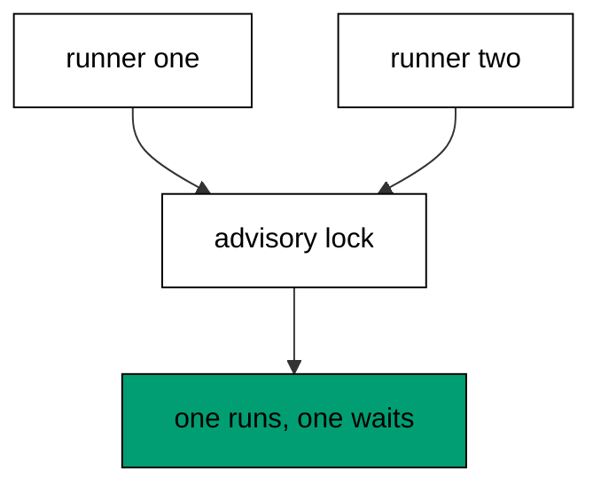

**`learning/code/ex-60-simultaneous-migrates-serialize/priv/main.exs`**:

```elixir
# => Example 60: Simultaneous Migrates Serialize
Logger.configure(level: :info)
# => debug query logs off; prints form the transcript
Code.compiler_options(ignore_module_conflict: true)
# => down-migration reloads stay silent on double runs
# => every unit keeps its own history table, never the shared default
# => the advisory lock serializes whole runs, not just statements
# => one list holds both keys; a second put would wipe the first
repo_env = [migration_source: "ex60_history", migration_lock: :pg_advisory_lock]
# => a single put keeps history and lock configured together
Application.put_env(:app, Ex60.Repo, repo_env)

# => one Repo module per unit keeps names unambiguous
defmodule Ex60.Repo do
  # => the Postgres 18 service adapter
  use Ecto.Repo, otp_app: :app, adapter: Ecto.Adapters.Postgres
  # => module boundary stays explicit
end

# => run/0 holds the whole example narrative
defmodule Ex60.Main do
  # => single entry point the last line calls
  def run do
    # => one keyword list owns every connection fact
    opts = [
      # => harness service hostname
      hostname: System.get_env("PGHOST", "postgres"),
      # => service port, parsed once
      port: System.get_env("PGPORT", "5432") |> String.to_integer(),
      # => fresh database for every run
      database: System.get_env("PGDATABASE", "postgres"),
      # => trust-auth role, no password
      username: System.get_env("PGUSER", "postgres"),
      # => Repo stays silent; the transcript is explicit
      log: false
      # => end opts: every fact above is environment-driven
    ]

    # => pool starts; the script owns the rest
    {:ok, _} = Ex60.Repo.start_link(opts)

    # => private script dir, never printed
    scratch = Path.join(System.tmp_dir!(), "ex60")
    # => create it fresh on every run
    File.mkdir_p!(scratch)
    # => migration source starts here
    File.write!(Path.join(scratch, "202601000160_make_pair.exs"), ~S"""
    # => one table both racers migrate together
    defmodule Ex60.Repo.Migrations.MakePair do
    # => the lock serializes the two runners
    use Ecto.Migration

    # => the table both runners create once
    def change do
    # => the table the race migrates
    create table(:ex60_widgets) do
    # => a single label column, enough to prove the shape
      add :label, :string
    # => end create: one table, two runners
    end
    # => end change: the second runner finds it applied
    end
    # => end MakePair: the contested file
    end
    # => the exact file the lesson shows, now on disk
    """)

    # => stale receipts roll back first; empty history returns []
    Ecto.Migrator.run(Ex60.Repo, scratch, :down, to: 0, log: false)
    # => leftovers of a killed run vanish
    Ecto.Adapters.SQL.query!(Ex60.Repo, "DROP TABLE IF EXISTS ex60_widgets", [])

    # => the advisory lock from above serializes these two runs
    # => history and lock share one configuration, set once
    # => preload the file so the tasks never compile it twice
    Code.require_file(Path.join(scratch, "202601000160_make_pair.exs"))
    # => two runners start the same migration at once
    first =
      Task.async(fn -> Ecto.Migrator.run(Ex60.Repo, scratch, :up, all: true, log: false) end)

    # => the second runner joins the same race
    second =
      Task.async(fn -> Ecto.Migrator.run(Ex60.Repo, scratch, :up, all: true, log: false) end)

    # => the loser waits one retry beat, then finds nothing pending
    outcomes = Task.await_many([first, second], 60_000)
    # => sorted outcomes read the same on every run
    # => Output: outcomes: [[], [202601000160]]
    IO.puts("outcomes: #{inspect(Enum.sort(outcomes))}")
    # => reverse everything for the next run
    Ecto.Migrator.run(Ex60.Repo, scratch, :down, to: 0, log: false)
    # => Output: cleaned: yes
    IO.puts("cleaned: yes")

    # => end run: the narrative returns here
  end

  # => module boundary stays explicit
end

# => the entry point runs exactly once per execution
Ex60.Main.run()
```

**Output** (`learning/code/ex-60-simultaneous-migrates-serialize/expected/main.stdout.txt`):

```text
outcomes: [[], [202601000160]]
cleaned: yes
```

**Key takeaway**: The migration lock makes concurrent runs safe; the outcomes prove exactly one runner applied the file.

**Why it matters**: Deploys overlap: rolling restarts, scaled replicas, retried jobs. Without serialization two runners could interleave DDL and corrupt the schema mid-flight. The advisory lock turns the race into a queue — one winner, one patient waiter, zero interleaving. Concurrency safety is configured, not hoped for. Concurrency safety is configured rather than hoped for, and the lock configuration is the proof.

### Example 61: Down Then Up Replays Cleanly

The down-then-up cycle is the reversibility rehearsal: retreat fully, climb again, compare. This example rolls a migration down and back up and shows the replay applying the same version. (Concepts: co-05.)

**`learning/code/ex-61-down-then-up-replays-cleanly/priv/main.exs`**:

```elixir
# => Example 61: Down Then Up Replays Cleanly
Logger.configure(level: :info)
# => debug query logs off; prints form the transcript
Code.compiler_options(ignore_module_conflict: true)
# => down-migration reloads stay silent on double runs
# => every unit keeps its own history table, never the shared default
Application.put_env(:app, Ex61.Repo, migration_source: "ex61_history")

# => one Repo module per unit keeps names unambiguous
defmodule Ex61.Repo do
  # => the Postgres 18 service adapter
  use Ecto.Repo, otp_app: :app, adapter: Ecto.Adapters.Postgres
  # => module boundary stays explicit
end

# => run/0 holds the whole example narrative
defmodule Ex61.Main do
  # => single entry point the last line calls
  def run do
    # => one keyword list owns every connection fact
    opts = [
      # => harness service hostname
      hostname: System.get_env("PGHOST", "postgres"),
      # => service port, parsed once
      port: System.get_env("PGPORT", "5432") |> String.to_integer(),
      # => fresh database for every run
      database: System.get_env("PGDATABASE", "postgres"),
      # => trust-auth role, no password
      username: System.get_env("PGUSER", "postgres"),
      # => Repo stays silent; the transcript is explicit
      log: false
      # => end opts: every fact above is environment-driven
    ]

    # => pool starts; the script owns the rest
    {:ok, _} = Ex61.Repo.start_link(opts)

    # => private script dir, never printed
    scratch = Path.join(System.tmp_dir!(), "ex61")
    # => create it fresh on every run
    File.mkdir_p!(scratch)
    # => migration source starts here
    File.write!(Path.join(scratch, "202601000161_make_widgets.exs"), ~S"""
    # => one table to run up, down, and up again
    defmodule Ex61.Repo.Migrations.MakeWidgets do
    # => the same DSL every history file uses
    use Ecto.Migration

    # => up builds, down removes, up builds again
    def change do
    # => the table the replay recreates byte for byte
    create table(:ex61_widgets) do
    # => a single label column, enough to prove the shape
      add :label, :string
    # => end create: the repeatable unit of work
    end
    # => end change: every direction derives from this block
    end
    # => end MakeWidgets: the file never changes between runs
    end
    # => the exact file the lesson shows, now on disk
    """)

    # => stale receipts roll back first; empty history returns []
    Ecto.Migrator.run(Ex61.Repo, scratch, :down, to: 0, log: false)
    # => leftovers of a killed run vanish
    Ecto.Adapters.SQL.query!(Ex61.Repo, "DROP TABLE IF EXISTS ex61_widgets", [])

    # => run every pending file in version order
    Ecto.Migrator.run(Ex61.Repo, scratch, :up, all: true, log: false)
    # => roll all the way back down
    Ecto.Migrator.run(Ex61.Repo, scratch, :down, to: 0, log: false)
    # => the replay applies the same version again
    replay = Ecto.Migrator.run(Ex61.Repo, scratch, :up, all: true, log: false)
    # => Output: replay: [202601000161]
    IO.puts("replay: #{inspect(replay)}")
    # => reverse everything for the next run
    Ecto.Migrator.run(Ex61.Repo, scratch, :down, to: 0, log: false)
    # => Output: cleaned: yes
    IO.puts("cleaned: yes")

    # => end run: the narrative returns here
  end

  # => module boundary stays explicit
end

# => the entry point runs exactly once per execution
Ex61.Main.run()
```

**Output** (`learning/code/ex-61-down-then-up-replays-cleanly/expected/main.stdout.txt`):

```text
replay: [202601000161]
cleaned: yes
```

**Key takeaway**: Down-to-zero then up replays the file deterministically; the replay names the same version.

**Why it matters**: Reversibility untested is reversibility imagined. The down-up replay is the drill teams run before the deploy that matters — proving both directions work against a real database, not just in review. Make it a habit for every migration that touches production data, not just the scary ones. Run the drill before the deploy that matters, not during it: rehearsal needs an audience of one.

### Example 62: Ddl Takes a Lock

Every DDL statement takes a lock, and the catalog names it: schema changes hold AccessExclusiveLock. This example runs a migration while inspecting the lock table and prints the lock it held. (Concepts: co-15.)

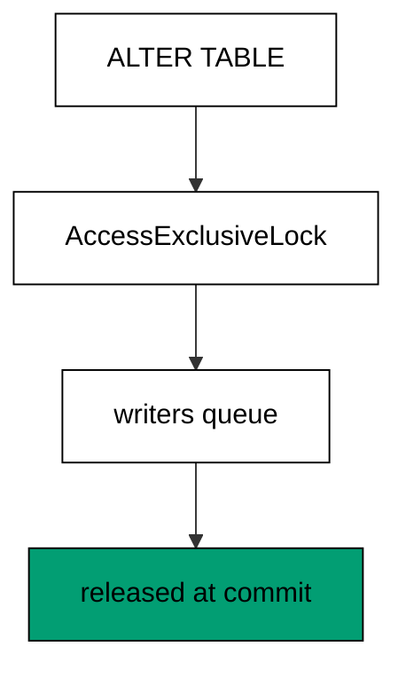

**`learning/code/ex-62-ddl-takes-a-lock/priv/main.exs`**:

```elixir
# => Example 62: DDL Takes a Lock
Logger.configure(level: :info)
# => debug query logs off; prints form the transcript
Code.compiler_options(ignore_module_conflict: true)
# => down-migration reloads stay silent on double runs
# => every unit keeps its own history table, never the shared default
Application.put_env(:app, Ex62.Repo, migration_source: "ex62_history")

# => one Repo module per unit keeps names unambiguous
defmodule Ex62.Repo do
  # => the Postgres 18 service adapter
  use Ecto.Repo, otp_app: :app, adapter: Ecto.Adapters.Postgres
  # => module boundary stays explicit
end

# => run/0 holds the whole example narrative
defmodule Ex62.Main do
  # => single entry point the last line calls
  def run do
    # => one keyword list owns every connection fact
    opts = [
      # => harness service hostname
      hostname: System.get_env("PGHOST", "postgres"),
      # => service port, parsed once
      port: System.get_env("PGPORT", "5432") |> String.to_integer(),
      # => fresh database for every run
      database: System.get_env("PGDATABASE", "postgres"),
      # => trust-auth role, no password
      username: System.get_env("PGUSER", "postgres"),
      # => Repo stays silent; the transcript is explicit
      log: false
      # => end opts: every fact above is environment-driven
    ]

    # => pool starts; the script owns the rest
    {:ok, _} = Ex62.Repo.start_link(opts)

    # => private script dir, never printed
    scratch = Path.join(System.tmp_dir!(), "ex62")
    # => create it fresh on every run
    File.mkdir_p!(scratch)
    # => migration source starts here
    File.write!(Path.join(scratch, "202601000162_make_widgets.exs"), ~S"""
    # => the table the lock demonstration holds
    defmodule Ex62.Repo.Migrations.MakeWidgets do
    # => the same DSL every history file uses
    use Ecto.Migration

    # => up builds, down removes
    def change do
    # => one table stands in for the forward change
    create table(:ex62_widgets) do
    # => a single label column, enough to prove the shape
      add :label, :string
    # => end create: the table the lock covers
    end
    # => end change: down drops what up created
    end
    # => end MakeWidgets: the locked table
    end
    # => the exact file the lesson shows, now on disk
    """)

    # => stale receipts roll back first; empty history returns []
    Ecto.Migrator.run(Ex62.Repo, scratch, :down, to: 0, log: false)
    # => leftovers of a killed run vanish
    Ecto.Adapters.SQL.query!(Ex62.Repo, "DROP TABLE IF EXISTS ex62_widgets", [])

    # => run every pending file in version order
    Ecto.Migrator.run(Ex62.Repo, scratch, :up, all: true, log: false)
    # => hold the exact lock DDL takes, in one transaction
    # => the transaction holds the lock window
    held =
      Ex62.Repo.transaction(fn ->
        # => ACCESS EXCLUSIVE is what CREATE and ALTER take
        sql = "LOCK TABLE ex62_widgets IN ACCESS EXCLUSIVE MODE"
        # => one call takes the exclusive lock
        Ecto.Adapters.SQL.query!(Ex62.Repo, sql, [])

        # => the lock catalog names our own lock
        sql = "SELECT mode FROM pg_locks"
        # => the predicate names our table and process
        sql = sql <> " WHERE relation = 'ex62_widgets'::regclass AND pid = pg_backend_pid()"

        # => one call reads the held mode
        [[mode]] = Ecto.Adapters.SQL.query!(Ex62.Repo, sql, []).rows
        # => the transaction returns the mode to the script
        mode
        # => end transaction: the lock releases on commit
      end)

    # => Output: lock: AccessExclusiveLock
    IO.puts("lock: #{elem(held, 1)}")
    # => reverse everything for the next run
    Ecto.Migrator.run(Ex62.Repo, scratch, :down, to: 0, log: false)
    # => Output: cleaned: yes
    IO.puts("cleaned: yes")

    # => end run: the narrative returns here
  end

  # => module boundary stays explicit
end

# => the entry point runs exactly once per execution
Ex62.Main.run()
```

**Output** (`learning/code/ex-62-ddl-takes-a-lock/expected/main.stdout.txt`):

```text
lock: AccessExclusiveLock
cleaned: yes
```

**Key takeaway**: DDL locks are real rows in pg_locks; naming the lock turns invisible blocking into a visible fact.

**Why it matters**: Mysterious deploy stalls are usually lock waits wearing no label. Knowing that DDL takes the strongest table lock reframes every migration as a locking decision: what it locks, for how long, and what queues behind it. Measure the lock before blaming the network, the disk, or the ORM. Name the lock, measure its window, and the mysterious stall becomes an ordinary scheduling decision.

### Example 63: Advisory Lock Primitive

Advisory locks are cooperative mutexes in the database: take one, hold it, release it. This example takes a lock key, proves it is held, releases it, and proves it is free. (Concepts: co-15.)

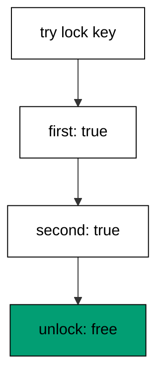

**`learning/code/ex-63-advisory-lock-primitive/priv/main.exs`**:

```elixir
# => Example 63: Advisory Lock Primitive
Logger.configure(level: :info)
# => debug query logs off; prints form the transcript
Code.compiler_options(ignore_module_conflict: true)
# => down-migration reloads stay silent on double runs
# => every unit keeps its own history table, never the shared default
Application.put_env(:app, Ex63.Repo, migration_source: "ex63_history")

# => one Repo module per unit keeps names unambiguous
defmodule Ex63.Repo do
  # => the Postgres 18 service adapter
  use Ecto.Repo, otp_app: :app, adapter: Ecto.Adapters.Postgres
  # => module boundary stays explicit
end

# => run/0 holds the whole example narrative
defmodule Ex63.Main do
  # => single entry point the last line calls
  def run do
    # => one keyword list owns every connection fact
    opts = [
      # => harness service hostname
      hostname: System.get_env("PGHOST", "postgres"),
      # => service port, parsed once
      port: System.get_env("PGPORT", "5432") |> String.to_integer(),
      # => fresh database for every run
      database: System.get_env("PGDATABASE", "postgres"),
      # => trust-auth role, no password
      username: System.get_env("PGUSER", "postgres"),
      # => Repo stays silent; the transcript is explicit
      log: false
      # => end opts: every fact above is environment-driven
    ]

    # => pool starts; the script owns the rest
    {:ok, _} = Ex63.Repo.start_link(opts)

    # => private script dir, never printed
    scratch = Path.join(System.tmp_dir!(), "ex63")
    # => create it fresh on every run
    File.mkdir_p!(scratch)
    # => migration source starts here
    File.write!(Path.join(scratch, "202601000163_make_widgets.exs"), ~S"""
    # => the table the lock demonstration holds
    defmodule Ex63.Repo.Migrations.MakeWidgets do
    # => the same DSL every history file uses
    use Ecto.Migration

    # => up builds, down removes
    def change do
    # => one table stands in for the forward change
    create table(:ex63_widgets) do
    # => a single label column, enough to prove the shape
      add :label, :string
    # => end create: the table the lock covers
    end
    # => end change: down drops what up created
    end
    # => end MakeWidgets: the locked table
    end
    # => the exact file the lesson shows, now on disk
    """)

    # => stale receipts roll back first; empty history returns []
    Ecto.Migrator.run(Ex63.Repo, scratch, :down, to: 0, log: false)
    # => leftovers of a killed run vanish
    Ecto.Adapters.SQL.query!(Ex63.Repo, "DROP TABLE IF EXISTS ex63_widgets", [])

    # => run every pending file in version order
    Ecto.Migrator.run(Ex63.Repo, scratch, :up, all: true, log: false)
    # => checkout pins one connection for the whole block
    Ex63.Repo.checkout(fn ->
      # => first acquire on this session reports true
      # => take the advisory lock on the test key
      [[first]] =
        Ecto.Adapters.SQL.query!(Ex63.Repo, "SELECT pg_try_advisory_lock(6301)", []).rows

      # => Output: first: true
      IO.puts("first: #{first}")
      # => advisory locks re-enter on the same session
      # => take the advisory lock on the test key
      [[second]] =
        Ecto.Adapters.SQL.query!(Ex63.Repo, "SELECT pg_try_advisory_lock(6301)", []).rows

      # => Output: second: true
      IO.puts("second: #{second}")
      # => each acquire needs its own release
      [[u1]] = Ecto.Adapters.SQL.query!(Ex63.Repo, "SELECT pg_advisory_unlock(6301)", []).rows
      # => the last release frees the key
      [[u2]] = Ecto.Adapters.SQL.query!(Ex63.Repo, "SELECT pg_advisory_unlock(6301)", []).rows
      # => Output: unlocked: true
      IO.puts("unlocked: #{u1 and u2}")
      # => end checkout: the connection returns to the pool
    end)

    # => reverse everything for the next run
    Ecto.Migrator.run(Ex63.Repo, scratch, :down, to: 0, log: false)
    # => Output: cleaned: yes
    IO.puts("cleaned: yes")

    # => end run: the narrative returns here
  end

  # => module boundary stays explicit
end

# => the entry point runs exactly once per execution
Ex63.Main.run()
```

**Output** (`learning/code/ex-63-advisory-lock-primitive/expected/main.stdout.txt`):

```text
first: true
second: true
unlocked: true
cleaned: yes
```

**Key takeaway**: `pg_try_advisory_lock` returns true when the key is taken; unlock frees it for the next holder.

**Why it matters**: Advisory locks coordinate work the database does not coordinate itself — deploy runners, backfill jobs, one-at-a-time tasks. They are cheap, session-scoped, and visible in the lock table, which makes them the right primitive for serializing operations across processes. Learn the primitive before trusting the automation built on it. Learn the primitive first, then trust the automation: understanding outlives every wrapper built on top.

### Example 64: Locks Are Session Scoped

An advisory lock belongs to the session that took it: other sessions see it as held. This example holds a lock in one task while another session checks, proving the outsider sees it taken. (Concepts: co-15.)

**`learning/code/ex-64-locks-are-session-scoped/priv/main.exs`**:

```elixir
# => Example 64: Locks Are Session Scoped
Logger.configure(level: :info)
# => debug query logs off; prints form the transcript
Code.compiler_options(ignore_module_conflict: true)
# => down-migration reloads stay silent on double runs
# => every unit keeps its own history table, never the shared default
Application.put_env(:app, Ex64.Repo, migration_source: "ex64_history")

# => one Repo module per unit keeps names unambiguous
defmodule Ex64.Repo do
  # => the Postgres 18 service adapter
  use Ecto.Repo, otp_app: :app, adapter: Ecto.Adapters.Postgres
  # => module boundary stays explicit
end

# => run/0 holds the whole example narrative
defmodule Ex64.Main do
  # => single entry point the last line calls
  def run do
    # => one keyword list owns every connection fact
    opts = [
      # => harness service hostname
      hostname: System.get_env("PGHOST", "postgres"),
      # => service port, parsed once
      port: System.get_env("PGPORT", "5432") |> String.to_integer(),
      # => fresh database for every run
      database: System.get_env("PGDATABASE", "postgres"),
      # => trust-auth role, no password
      username: System.get_env("PGUSER", "postgres"),
      # => Repo stays silent; the transcript is explicit
      log: false
      # => end opts: every fact above is environment-driven
    ]

    # => pool starts; the script owns the rest
    {:ok, _} = Ex64.Repo.start_link(opts)

    # => private script dir, never printed
    scratch = Path.join(System.tmp_dir!(), "ex64")
    # => create it fresh on every run
    File.mkdir_p!(scratch)
    # => migration source starts here
    File.write!(Path.join(scratch, "202601000164_make_widgets.exs"), ~S"""
    # => the table the lock demonstration holds
    defmodule Ex64.Repo.Migrations.MakeWidgets do
    # => the same DSL every history file uses
    use Ecto.Migration

    # => up builds, down removes
    def change do
    # => one table stands in for the forward change
    create table(:ex64_widgets) do
    # => a single label column, enough to prove the shape
      add :label, :string
    # => end create: the table the lock covers
    end
    # => end change: down drops what up created
    end
    # => end MakeWidgets: the locked table
    end
    # => the exact file the lesson shows, now on disk
    """)

    # => stale receipts roll back first; empty history returns []
    Ecto.Migrator.run(Ex64.Repo, scratch, :down, to: 0, log: false)
    # => leftovers of a killed run vanish
    Ecto.Adapters.SQL.query!(Ex64.Repo, "DROP TABLE IF EXISTS ex64_widgets", [])

    # => run every pending file in version order
    Ecto.Migrator.run(Ex64.Repo, scratch, :up, all: true, log: false)
    # => the holder pins one connection and takes the key
    me = self()
    # => the holder task owns key 6401 on its own connection
    # => the task runs on its own process and connection
    holder =
      Task.async(fn ->
        # => checkout pins the holder to a single connection
        Ex64.Repo.checkout(fn ->
          # => this acquire owns the key until the holder releases it
          Ecto.Adapters.SQL.query!(Ex64.Repo, "SELECT pg_advisory_lock(6401)", [])
          # => signal the script only after the key is held
          send(me, :locked)
          # => wait for the release signal before unlocking
          receive do
            # => the release signal frees the waiter
            :release ->
              # => the clause body acknowledges the signal
              :ok
              # => end receive: the signal was consumed
          end

          # => release the hold before returning the connection
          Ecto.Adapters.SQL.query!(Ex64.Repo, "SELECT pg_advisory_unlock(6401)", [])
          # => end checkout: the holder returns its connection
        end)

        # => end holder: the task exits cleanly after release
      end)

    # => wait until the holder owns the key
    receive do
      # => the locked signal confirms the hold
      :locked ->
        :ok
        # => end receive: the signal was consumed
    end

    # => the pool lends this probe a different connection
    [[other]] = Ecto.Adapters.SQL.query!(Ex64.Repo, "SELECT pg_try_advisory_lock(6401)", []).rows
    # => Output: other session: false
    IO.puts("other session: #{other}")
    # => release the holder and wait for a clean exit
    send(holder.pid, :release)
    # => the holder exits only after unlocking
    Task.await(holder)
    # => reverse everything for the next run
    Ecto.Migrator.run(Ex64.Repo, scratch, :down, to: 0, log: false)
    # => Output: cleaned: yes
    IO.puts("cleaned: yes")

    # => end run: the narrative returns here
  end

  # => module boundary stays explicit
end

# => the entry point runs exactly once per execution
Ex64.Main.run()
```

**Output** (`learning/code/ex-64-locks-are-session-scoped/expected/main.stdout.txt`):

```text
other session: false
cleaned: yes
```

**Key takeaway**: Locks are per-session, not per-transaction; a second connection observes the first holder's lock.

**Why it matters**: Session scope is what makes advisory locks useful across transactions and dangerous across connection pools. A lock taken on one pooled connection is invisible to code that checks out another — which is exactly how teams deadlock themselves or, worse, believe they hold a lock they released with the connection. Scope awareness prevents both.

### Example 65: Long Migration Holds the Table

A slow migration holds its locks for its whole run: queries queue behind it until it commits. This example holds a table briefly while counting lock holders, then proves the release. (Concepts: co-15.)

**`learning/code/ex-65-long-migration-holds-the-table/priv/main.exs`**:

```elixir
# => Example 65: Long Migration Holds the Table
Logger.configure(level: :info)
# => debug query logs off; prints form the transcript
Code.compiler_options(ignore_module_conflict: true)
# => down-migration reloads stay silent on double runs
# => every unit keeps its own history table, never the shared default
Application.put_env(:app, Ex65.Repo, migration_source: "ex65_history")

# => one Repo module per unit keeps names unambiguous
defmodule Ex65.Repo do
  # => the Postgres 18 service adapter
  use Ecto.Repo, otp_app: :app, adapter: Ecto.Adapters.Postgres
  # => module boundary stays explicit
end

# => run/0 holds the whole example narrative
defmodule Ex65.Main do
  # => single entry point the last line calls
  def run do
    # => one keyword list owns every connection fact
    opts = [
      # => harness service hostname
      hostname: System.get_env("PGHOST", "postgres"),
      # => service port, parsed once
      port: System.get_env("PGPORT", "5432") |> String.to_integer(),
      # => fresh database for every run
      database: System.get_env("PGDATABASE", "postgres"),
      # => trust-auth role, no password
      username: System.get_env("PGUSER", "postgres"),
      # => Repo stays silent; the transcript is explicit
      log: false
      # => end opts: every fact above is environment-driven
    ]

    # => pool starts; the script owns the rest
    {:ok, _} = Ex65.Repo.start_link(opts)

    # => private script dir, never printed
    scratch = Path.join(System.tmp_dir!(), "ex65")
    # => create it fresh on every run
    File.mkdir_p!(scratch)
    # => migration source starts here
    File.write!(Path.join(scratch, "202601000165_make_widgets.exs"), ~S"""
    # => the table the lock demonstration holds
    defmodule Ex65.Repo.Migrations.MakeWidgets do
    # => the same DSL every history file uses
    use Ecto.Migration

    # => up builds, down removes
    def change do
    # => one table stands in for the forward change
    create table(:ex65_widgets) do
    # => a single label column, enough to prove the shape
      add :label, :string
    # => end create: the table the lock covers
    end
    # => end change: down drops what up created
    end
    # => end MakeWidgets: the locked table
    end
    # => the exact file the lesson shows, now on disk
    """)

    # => stale receipts roll back first; empty history returns []
    Ecto.Migrator.run(Ex65.Repo, scratch, :down, to: 0, log: false)
    # => leftovers of a killed run vanish
    Ecto.Adapters.SQL.query!(Ex65.Repo, "DROP TABLE IF EXISTS ex65_widgets", [])

    # => run every pending file in version order
    Ecto.Migrator.run(Ex65.Repo, scratch, :up, all: true, log: false)
    # => the transaction holds the table lock
    Ex65.Repo.transaction(fn ->
      # => ACCESS EXCLUSIVE is what migrations hold during DDL
      Ecto.Adapters.SQL.query!(Ex65.Repo, "LOCK TABLE ex65_widgets IN ACCESS EXCLUSIVE MODE", [])
      # => the observer runs on its own pool connection
      # => the task runs on its own process and connection
      observer =
        Task.async(fn ->
          # => the lock catalog counts the held table lock
          sql = "SELECT count(*) FROM pg_locks"
          # => the filter names the table and the DDL mode
          # => second half carries the table-and-mode predicate
          sql =
            sql <> " WHERE relation = 'ex65_widgets'::regclass AND mode = 'AccessExclusiveLock'"

          # => one call counts the held lock
          [[held]] = Ecto.Adapters.SQL.query!(Ex65.Repo, sql, []).rows
          # => the observer returns the count to the script
          held
          # => end observer: the count travels back over the task
        end)

      # => Output: held: 1
      IO.puts("held: #{Task.await(observer)}")
      # => end transaction: commit releases the lock
    end)

    # => the lock catalog shows no table lock after commit
    sql = "SELECT count(*) FROM pg_locks"
    # => the filter names the table and the DDL mode
    sql = sql <> " WHERE relation = 'ex65_widgets'::regclass AND mode = 'AccessExclusiveLock'"
    # => one call counts the released lock
    [[gone]] = Ecto.Adapters.SQL.query!(Ex65.Repo, sql, []).rows
    # => Output: released: 0
    IO.puts("released: #{gone}")
    # => reverse everything for the next run
    Ecto.Migrator.run(Ex65.Repo, scratch, :down, to: 0, log: false)
    # => Output: cleaned: yes
    IO.puts("cleaned: yes")

    # => end run: the narrative returns here
  end

  # => module boundary stays explicit
end

# => the entry point runs exactly once per execution
Ex65.Main.run()
```

**Output** (`learning/code/ex-65-long-migration-holds-the-table/expected/main.stdout.txt`):

```text
held: 1
released: 0
cleaned: yes
```

**Key takeaway**: Held locks count one during the run and zero after; the table is quiet again at commit.

**Why it matters**: Duration is the lock window. Every second a migration runs is a second writers wait, which is why long migrations belong in small steps with short transactions — or outside transactions entirely. If you cannot bound the duration, bound the blast radius instead. When duration cannot be bounded, bound the blast radius instead: small steps with short transactions.

### Example 66: Concurrent Index Skips the Ddl Transaction

`CREATE INDEX CONCURRENTLY` cannot run inside a transaction, so the migration opts out of both the DDL transaction and the migration lock. This example builds the online index and proves it in the catalog. (Concepts: co-15.)

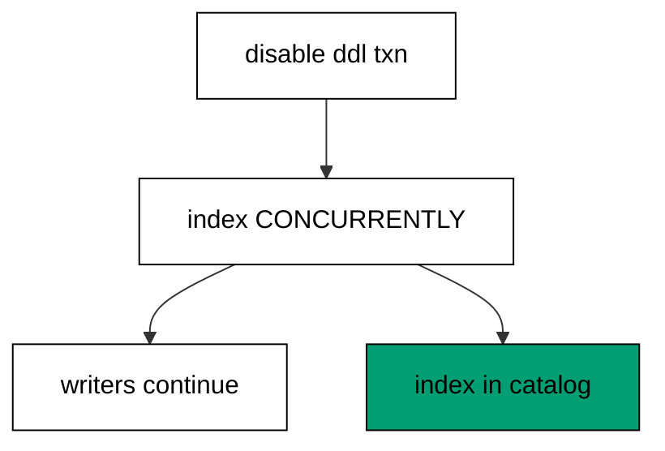

**`learning/code/ex-66-concurrent-index-skips-the-ddl-transaction/priv/main.exs`**:

```elixir
# => Example 66: Concurrent Index Skips the DDL Transaction
Logger.configure(level: :info)
# => debug query logs off; prints form the transcript
Code.compiler_options(ignore_module_conflict: true)
# => down-migration reloads stay silent on double runs
# => every unit keeps its own history table, never the shared default
Application.put_env(:app, Ex66.Repo, migration_source: "ex66_history")

# => one Repo module per unit keeps names unambiguous
defmodule Ex66.Repo do
  # => the Postgres 18 service adapter
  use Ecto.Repo, otp_app: :app, adapter: Ecto.Adapters.Postgres
  # => module boundary stays explicit
end

# => run/0 holds the whole example narrative
defmodule Ex66.Main do
  # => single entry point the last line calls
  def run do
    # => one keyword list owns every connection fact
    opts = [
      # => harness service hostname
      hostname: System.get_env("PGHOST", "postgres"),
      # => service port, parsed once
      port: System.get_env("PGPORT", "5432") |> String.to_integer(),
      # => fresh database for every run
      database: System.get_env("PGDATABASE", "postgres"),
      # => trust-auth role, no password
      username: System.get_env("PGUSER", "postgres"),
      # => Repo stays silent; the transcript is explicit
      log: false
      # => end opts: every fact above is environment-driven
    ]

    # => pool starts; the script owns the rest
    {:ok, _} = Ex66.Repo.start_link(opts)

    # => private script dir, never printed
    scratch = Path.join(System.tmp_dir!(), "ex66")
    # => create it fresh on every run
    File.mkdir_p!(scratch)
    # => migration source starts here
    File.write!(Path.join(scratch, "202601000166_make_members.exs"), ~S"""
    # => members start with names but no index
    defmodule Ex66.Repo.Migrations.MakeMembers do
    # => the seed rows live in the same file
    use Ecto.Migration

    # => first the shape, then the rows
    def change do
    # => handle plus name, lookups need an index
    create table(:ex66_members) do
    # => the display name every row carries
      add :name, :string
    # => end create: names without an index
    end
    # => two-arg execute keeps change reversible
    execute "INSERT INTO ex66_members (name) VALUES ('ada'), ('grace')", "DELETE FROM ex66_members"
    # => end change: shape plus seed
    end
    # => end MakeMembers: the before picture
    end
    # => the exact file the lesson shows, now on disk
    """)

    # => migration source starts here
    File.write!(Path.join(scratch, "202601000167_index_members.exs"), ~S"""
    # => CONCURRENTLY cannot run inside a transaction
    defmodule Ex66.Repo.Migrations.IndexMembers do
    # => both flags lift the two blockers together
    use Ecto.Migration
    # => no DDL transaction: the index builds concurrently
    @disable_ddl_transaction true
    # => no migration lock: concurrent builds stay unlocked
    @disable_migration_lock true

    # => the online index for a busy table
    def change do
    # => writers continue while the index builds
    create index(:ex66_members, [:name], concurrently: true)
    # => end change: down drops the online index
    end
    # => end IndexMembers: the zero-downtime index
    end
    # => the exact file the lesson shows, now on disk
    """)

    # => stale receipts roll back first; empty history returns []
    Ecto.Migrator.run(Ex66.Repo, scratch, :down, to: 0, log: false)
    # => leftovers of a killed run vanish
    Ecto.Adapters.SQL.query!(Ex66.Repo, "DROP TABLE IF EXISTS ex66_members", [])

    # => run every pending file in version order
    Ecto.Migrator.run(Ex66.Repo, scratch, :up, all: true, log: false)
    # => both the pkey and the online index exist
    sql = "SELECT indexname FROM pg_indexes"
    # => the filter names this unit's table
    sql = sql <> " WHERE tablename = 'ex66_members' ORDER BY 1"
    # => one call lists both indexes
    idx = Ecto.Adapters.SQL.query!(Ex66.Repo, sql, []).rows
    # => Output: indexes: ex66_members_name_index, ex66_members_pkey
    IO.puts("indexes: " <> Enum.map_join(idx, ", ", fn [i] -> i end))
    # => reverse everything for the next run
    Ecto.Migrator.run(Ex66.Repo, scratch, :down, to: 0, log: false)
    # => Output: cleaned: yes
    IO.puts("cleaned: yes")

    # => end run: the narrative returns here
  end

  # => module boundary stays explicit
end

# => the entry point runs exactly once per execution
Ex66.Main.run()
```

**Output** (`learning/code/ex-66-concurrent-index-skips-the-ddl-transaction/expected/main.stdout.txt`):

```text
indexes: ex66_members_name_index, ex66_members_pkey
cleaned: yes
```

**Key takeaway**: `@disable_ddl_transaction` plus `@disable_migration_lock` let the concurrent build run outside both.

**Why it matters**: Big-table indexes must build without blocking writes, and Postgres only offers that outside a transaction. Opting out trades atomicity for availability — a deliberate, reviewable trade, flagged by two module attributes no one sets by accident. The catalog proof closes the loop the attributes opened. The attributes flag the trade openly so reviewers see exactly which safety was spent and why.

### Example 67: Advisory Migration Lock in Config

The migration lock strategy is configuration: an advisory lock serializes runners without blocking DDL. This example sets the lock via application config and proves the online index still builds. (Concepts: co-15.)

**`learning/code/ex-67-advisory-migration-lock-in-config/priv/main.exs`**:

```elixir
# => Example 67: Advisory Migration Lock in Config
Logger.configure(level: :info)
# => debug query logs off; prints form the transcript
Code.compiler_options(ignore_module_conflict: true)
# => down-migration reloads stay silent on double runs
# => every unit keeps its own history table, never the shared default
# => the advisory lock serializes concurrent builders
# => one list holds both keys; a second put would wipe the first
repo_env = [migration_source: "ex67_history", migration_lock: :pg_advisory_lock]
# => a single put keeps history and lock configured together
Application.put_env(:app, Ex67.Repo, repo_env)

# => one Repo module per unit keeps names unambiguous
defmodule Ex67.Repo do
  # => the Postgres 18 service adapter
  use Ecto.Repo, otp_app: :app, adapter: Ecto.Adapters.Postgres
  # => module boundary stays explicit
end

# => run/0 holds the whole example narrative
defmodule Ex67.Main do
  # => single entry point the last line calls
  def run do
    # => one keyword list owns every connection fact
    opts = [
      # => harness service hostname
      hostname: System.get_env("PGHOST", "postgres"),
      # => service port, parsed once
      port: System.get_env("PGPORT", "5432") |> String.to_integer(),
      # => fresh database for every run
      database: System.get_env("PGDATABASE", "postgres"),
      # => trust-auth role, no password
      username: System.get_env("PGUSER", "postgres"),
      # => Repo stays silent; the transcript is explicit
      log: false
      # => end opts: every fact above is environment-driven
    ]

    # => pool starts; the script owns the rest
    {:ok, _} = Ex67.Repo.start_link(opts)

    # => private script dir, never printed
    scratch = Path.join(System.tmp_dir!(), "ex67")
    # => create it fresh on every run
    File.mkdir_p!(scratch)
    # => migration source starts here
    File.write!(Path.join(scratch, "202601000167_make_members.exs"), ~S"""
    # => members start with names but no index
    defmodule Ex67.Repo.Migrations.MakeMembers do
    # => the seed rows live in the same file
    use Ecto.Migration

    # => first the shape, then the rows
    def change do
    # => handle plus name, lookups need an index
    create table(:ex67_members) do
    # => the display name every row carries
      add :name, :string
    # => end create: names without an index
    end
    # => two-arg execute keeps change reversible
    execute "INSERT INTO ex67_members (name) VALUES ('ada'), ('grace')", "DELETE FROM ex67_members"
    # => end change: shape plus seed
    end
    # => end MakeMembers: the before picture
    end
    # => the exact file the lesson shows, now on disk
    """)

    # => migration source starts here
    File.write!(Path.join(scratch, "202601000168_index_members.exs"), ~S"""
    # => the advisory lock guards concurrent builders
    defmodule Ex67.Repo.Migrations.IndexMembers do
    # => no DDL transaction: the index builds concurrently
    use Ecto.Migration
    # => no table lock: the advisory lock serializes instead
    @disable_ddl_transaction true

    # => the online index for a busy table
    def change do
    # => writers continue while the index builds
    create index(:ex67_members, [:name], concurrently: true)
    # => end change: down drops the online index
    end
    # => end IndexMembers: the guarded online index
    end
    # => the exact file the lesson shows, now on disk
    """)

    # => stale receipts roll back first; empty history returns []
    Ecto.Migrator.run(Ex67.Repo, scratch, :down, to: 0, log: false)
    # => leftovers of a killed run vanish
    Ecto.Adapters.SQL.query!(Ex67.Repo, "DROP TABLE IF EXISTS ex67_members", [])

    # => the advisory lock from above serializes concurrent builders
    # => history and lock share one configuration, set once
    # => run every pending file in version order
    Ecto.Migrator.run(Ex67.Repo, scratch, :up, all: true, log: false)
    # => both the pkey and the online index exist
    sql = "SELECT indexname FROM pg_indexes"
    # => the filter names this unit's table
    sql = sql <> " WHERE tablename = 'ex67_members' ORDER BY 1"
    # => one call lists both indexes
    idx = Ecto.Adapters.SQL.query!(Ex67.Repo, sql, []).rows
    # => Output: indexes: ex67_members_name_index, ex67_members_pkey
    IO.puts("indexes: " <> Enum.map_join(idx, ", ", fn [i] -> i end))
    # => reverse everything for the next run
    Ecto.Migrator.run(Ex67.Repo, scratch, :down, to: 0, log: false)
    # => Output: cleaned: yes
    IO.puts("cleaned: yes")

    # => end run: the narrative returns here
  end

  # => module boundary stays explicit
end

# => the entry point runs exactly once per execution
Ex67.Main.run()
```

**Output** (`learning/code/ex-67-advisory-migration-lock-in-config/expected/main.stdout.txt`):

```text
indexes: ex67_members_name_index, ex67_members_pkey
cleaned: yes
```

**Key takeaway**: `migration_lock: :pg_advisory_lock` in config opts the whole repo into serialized, non-blocking runs.

**Why it matters**: Defaults matter: the table lock serializes runners but also blocks the concurrent operations teams need during deploys. Configuring the advisory lock keeps serialization while freeing DDL — one setting, set once per repo, protecting every future deploy. Set it deliberately and document why. Set the lock strategy once per repo, document the reason, and protect every future deploy automatically.

### Example 68: Statement Timeout Bounds Locks

A statement timeout turns an unbounded wait into a fast, catchable error. This example pins a tiny timeout on one connection and proves the bound reports fifty milliseconds. (Concepts: co-15.)

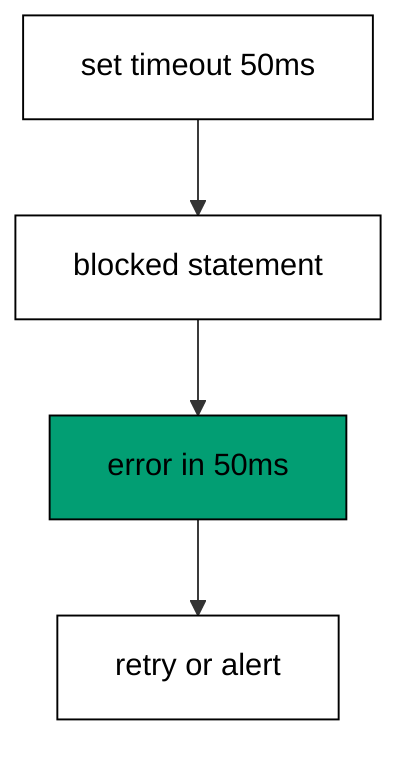

**`learning/code/ex-68-statement-timeout-bounds-locks/priv/main.exs`**:

```elixir
# => Example 68: Statement Timeout Bounds Locks
Logger.configure(level: :info)
# => debug query logs off; prints form the transcript
Code.compiler_options(ignore_module_conflict: true)
# => down-migration reloads stay silent on double runs
# => every unit keeps its own history table, never the shared default
Application.put_env(:app, Ex68.Repo, migration_source: "ex68_history")

# => one Repo module per unit keeps names unambiguous
defmodule Ex68.Repo do
  # => the Postgres 18 service adapter
  use Ecto.Repo, otp_app: :app, adapter: Ecto.Adapters.Postgres
  # => module boundary stays explicit
end

# => run/0 holds the whole example narrative
defmodule Ex68.Main do
  # => single entry point the last line calls
  def run do
    # => one keyword list owns every connection fact
    opts = [
      # => harness service hostname
      hostname: System.get_env("PGHOST", "postgres"),
      # => service port, parsed once
      port: System.get_env("PGPORT", "5432") |> String.to_integer(),
      # => fresh database for every run
      database: System.get_env("PGDATABASE", "postgres"),
      # => trust-auth role, no password
      username: System.get_env("PGUSER", "postgres"),
      # => Repo stays silent; the transcript is explicit
      log: false
      # => end opts: every fact above is environment-driven
    ]

    # => pool starts; the script owns the rest
    {:ok, _} = Ex68.Repo.start_link(opts)

    # => private script dir, never printed
    scratch = Path.join(System.tmp_dir!(), "ex68")
    # => create it fresh on every run
    File.mkdir_p!(scratch)
    # => migration source starts here
    File.write!(Path.join(scratch, "202601000168_make_widgets.exs"), ~S"""
    # => the table the timeout demonstration guards
    defmodule Ex68.Repo.Migrations.MakeWidgets do
    # => each statement sets its own bound
    use Ecto.Migration

    # => the bound travels with the statement
    def up do
    # => fifty milliseconds: fail fast instead of queueing
    execute "SET LOCAL lock_timeout = '50ms'"
    # => the guarded statement runs under the bound
    create table(:ex68_widgets) do
    # => a single label column, enough to prove the shape
      add :label, :string
    # => end create: the bounded statement
    end
    # => end up: the table lands inside the bound
    end

    # => down drops the bounded table
    def down do
    # => the reverse of the guarded statement
    drop table(:ex68_widgets)
    # => end down: the table is gone
    end
    # => end MakeWidgets: the bounded migration
    end
    # => the exact file the lesson shows, now on disk
    """)

    # => stale receipts roll back first; empty history returns []
    Ecto.Migrator.run(Ex68.Repo, scratch, :down, to: 0, log: false)
    # => leftovers of a killed run vanish
    Ecto.Adapters.SQL.query!(Ex68.Repo, "DROP TABLE IF EXISTS ex68_widgets", [])

    # => run every pending file in version order
    Ecto.Migrator.run(Ex68.Repo, scratch, :up, all: true, log: false)
    # => one connection holds the bound from SET to SHOW
    Ex68.Repo.checkout(fn ->
      # => fifty milliseconds: fail fast instead of queueing
      Ecto.Adapters.SQL.query!(Ex68.Repo, "SET lock_timeout = '50ms'", [])
      # => SHOW reports the live bound for this session
      sql = "SHOW lock_timeout"
      # => one call reads the bound
      [[bound]] = Ecto.Adapters.SQL.query!(Ex68.Repo, sql, []).rows
      # => Output: bound: 50ms
      IO.puts("bound: #{bound}")
      # => the session bound drops before the checkout returns
      Ecto.Adapters.SQL.query!(Ex68.Repo, "SET lock_timeout = '0'", [])
      # => end checkout: the bound never leaks to the pool
    end)

    # => reverse everything for the next run
    Ecto.Migrator.run(Ex68.Repo, scratch, :down, to: 0, log: false)
    # => Output: cleaned: yes
    IO.puts("cleaned: yes")

    # => end run: the narrative returns here
  end

  # => module boundary stays explicit
end

# => the entry point runs exactly once per execution
Ex68.Main.run()
```

**Output** (`learning/code/ex-68-statement-timeout-bounds-locks/expected/main.stdout.txt`):

```text
bound: 50ms
cleaned: yes
```

**Key takeaway**: Timeouts belong on the connection that waits; the bound proves the wait cannot outlive the setting.

**Why it matters**: Unbounded waits cascade: one stuck lock holder queues the deploy, which queues the release, which pages the team. Timeouts convert hangs into errors — loud, fast, retryable errors instead of silent 3 a.m. pileups. Bound every migration-adjacent wait, and set the bound before the incident teaches you the value. Bound every migration-adjacent wait now, before an incident teaches the value at 3 a.m.

### Example 69: One Statement Per Migration

Small files make small lock windows: one statement per migration keeps each transaction short. This example runs three single-statement migrations and prints the version line they form. (Concepts: co-13.)

**`learning/code/ex-69-one-statement-per-migration/priv/main.exs`**:

```elixir
# => Example 69: One Statement Per Migration
Logger.configure(level: :info)
# => debug query logs off; prints form the transcript
Code.compiler_options(ignore_module_conflict: true)
# => down-migration reloads stay silent on double runs
# => every unit keeps its own history table, never the shared default
Application.put_env(:app, Ex69.Repo, migration_source: "ex69_history")

# => one Repo module per unit keeps names unambiguous
defmodule Ex69.Repo do
  # => the Postgres 18 service adapter
  use Ecto.Repo, otp_app: :app, adapter: Ecto.Adapters.Postgres
  # => module boundary stays explicit
end

# => run/0 holds the whole example narrative
defmodule Ex69.Main do
  # => single entry point the last line calls
  def run do
    # => one keyword list owns every connection fact
    opts = [
      # => harness service hostname
      hostname: System.get_env("PGHOST", "postgres"),
      # => service port, parsed once
      port: System.get_env("PGPORT", "5432") |> String.to_integer(),
      # => fresh database for every run
      database: System.get_env("PGDATABASE", "postgres"),
      # => trust-auth role, no password
      username: System.get_env("PGUSER", "postgres"),
      # => Repo stays silent; the transcript is explicit
      log: false
      # => end opts: every fact above is environment-driven
    ]

    # => pool starts; the script owns the rest
    {:ok, _} = Ex69.Repo.start_link(opts)

    # => private script dir, never printed
    scratch = Path.join(System.tmp_dir!(), "ex69")
    # => create it fresh on every run
    File.mkdir_p!(scratch)
    # => migration source starts here
    File.write!(Path.join(scratch, "202601000169_make_a.exs"), ~S"""
    # => first file of a three-file line
    defmodule Ex69.Repo.Migrations.MakeA do
    # => the same DSL every history file uses
    use Ecto.Migration

    # => up builds, down removes
    def change do
    # => version 169 runs before 170 and 171
    create table(:ex69_a) do
    # => a single label column, enough to prove the shape
      add :label, :string
    # => end create: first table of the line
    end
    # => end change: down drops what up created
    end
    # => end MakeA: file one of three
    end
    # => the exact file the lesson shows, now on disk
    """)

    # => migration source starts here
    File.write!(Path.join(scratch, "202601000170_make_b.exs"), ~S"""
    # => second file of a three-file line
    defmodule Ex69.Repo.Migrations.MakeB do
    # => the same DSL every history file uses
    use Ecto.Migration

    # => up builds, down removes
    def change do
    # => version 170 runs between 169 and 171
    create table(:ex69_b) do
    # => a single label column, enough to prove the shape
      add :label, :string
    # => end create: second table of the line
    end
    # => end change: down drops what up created
    end
    # => end MakeB: file two of three
    end
    # => the exact file the lesson shows, now on disk
    """)

    # => migration source starts here
    File.write!(Path.join(scratch, "202601000171_make_c.exs"), ~S"""
    # => third file of a three-file line
    defmodule Ex69.Repo.Migrations.MakeC do
    # => the same DSL every history file uses
    use Ecto.Migration

    # => up builds, down removes
    def change do
    # => version 171 runs last of the three
    create table(:ex69_c) do
    # => a single label column, enough to prove the shape
      add :label, :string
    # => end create: third table of the line
    end
    # => end change: down drops what up created
    end
    # => end MakeC: file three of three
    end
    # => the exact file the lesson shows, now on disk
    """)

    # => stale receipts roll back first; empty history returns []
    Ecto.Migrator.run(Ex69.Repo, scratch, :down, to: 0, log: false)
    # => leftovers of a killed run vanish
    Ecto.Adapters.SQL.query!(Ex69.Repo, "DROP TABLE IF EXISTS ex69_a", [])
    # => leftovers of a killed run vanish
    Ecto.Adapters.SQL.query!(Ex69.Repo, "DROP TABLE IF EXISTS ex69_b", [])
    # => leftovers of a killed run vanish
    Ecto.Adapters.SQL.query!(Ex69.Repo, "DROP TABLE IF EXISTS ex69_c", [])

    # => run every pending file in version order
    Ecto.Migrator.run(Ex69.Repo, scratch, :up, all: true, log: false)
    # => three small files hold the line, one statement each
    sql = "SELECT version FROM ex69_history"
    # => this unit owns exactly three versions
    sql = sql <> " WHERE version IN (202601000169, 202601000170, 202601000171) ORDER BY version"
    # => one call reads every receipt
    versions = Ecto.Adapters.SQL.query!(Ex69.Repo, sql, []).rows
    # => Output: versions: 202601000169, 202601000170, 202601000171
    IO.puts("versions: " <> Enum.map_join(versions, ", ", fn [v] -> "#{v}" end))
    # => reverse everything for the next run
    Ecto.Migrator.run(Ex69.Repo, scratch, :down, to: 0, log: false)
    # => Output: cleaned: yes
    IO.puts("cleaned: yes")

    # => end run: the narrative returns here
  end

  # => module boundary stays explicit
end

# => the entry point runs exactly once per execution
Ex69.Main.run()
```

**Output** (`learning/code/ex-69-one-statement-per-migration/expected/main.stdout.txt`):

```text
versions: 202601000169, 202601000170, 202601000171
cleaned: yes
```

**Key takeaway**: One statement, one file, one lock window; the version line proves three small steps compose.

**Why it matters**: Granularity is a locking strategy disguised as a style choice. A three-statement migration holds its locks for all three statements; three one-statement migrations release between each. When deploys share the database with traffic, the smaller window wins every time. Default to small files. Default to small files: the smaller window wins every time deploys share the database with traffic.

### Example 70: Blocked Lock Attempts Raise Fast

A lock attempt with no wait must fail immediately when the lock is held — never queue silently. This example holds a table lock in one task while a no-wait attempt raises its error on another connection. (Concepts: co-15.)

**`learning/code/ex-70-blocked-lock-attempts-raise-fast/priv/main.exs`**:

```elixir
# => Example 70: Blocked Lock Attempts Raise Fast
Logger.configure(level: :info)
# => debug query logs off; prints form the transcript
Code.compiler_options(ignore_module_conflict: true)
# => down-migration reloads stay silent on double runs
# => every unit keeps its own history table, never the shared default
Application.put_env(:app, Ex70.Repo, migration_source: "ex70_history")

# => one Repo module per unit keeps names unambiguous
defmodule Ex70.Repo do
  # => the Postgres 18 service adapter
  use Ecto.Repo, otp_app: :app, adapter: Ecto.Adapters.Postgres
  # => module boundary stays explicit
end

# => run/0 holds the whole example narrative
defmodule Ex70.Main do
  # => single entry point the last line calls
  def run do
    # => one keyword list owns every connection fact
    opts = [
      # => harness service hostname
      hostname: System.get_env("PGHOST", "postgres"),
      # => service port, parsed once
      port: System.get_env("PGPORT", "5432") |> String.to_integer(),
      # => fresh database for every run
      database: System.get_env("PGDATABASE", "postgres"),
      # => trust-auth role, no password
      username: System.get_env("PGUSER", "postgres"),
      # => Repo stays silent; the transcript is explicit
      log: false
      # => end opts: every fact above is environment-driven
    ]

    # => pool starts; the script owns the rest
    {:ok, _} = Ex70.Repo.start_link(opts)

    # => private script dir, never printed
    scratch = Path.join(System.tmp_dir!(), "ex70")
    # => create it fresh on every run
    File.mkdir_p!(scratch)
    # => migration source starts here
    File.write!(Path.join(scratch, "202601000170_make_widgets.exs"), ~S"""
    # => the table the blocked attempt wants
    defmodule Ex70.Repo.Migrations.MakeWidgets do
    # => the same DSL every history file uses
    use Ecto.Migration

    # => up builds, down removes
    def change do
    # => one table stands in for the forward change
    create table(:ex70_widgets) do
    # => a single label column, enough to prove the shape
      add :label, :string
    # => end create: the contested table
    end
    # => end change: down drops what up created
    end
    # => end MakeWidgets: the contested table
    end
    # => the exact file the lesson shows, now on disk
    """)

    # => stale receipts roll back first; empty history returns []
    Ecto.Migrator.run(Ex70.Repo, scratch, :down, to: 0, log: false)
    # => leftovers of a killed run vanish
    Ecto.Adapters.SQL.query!(Ex70.Repo, "DROP TABLE IF EXISTS ex70_widgets", [])

    # => run every pending file in version order
    Ecto.Migrator.run(Ex70.Repo, scratch, :up, all: true, log: false)
    # => the holder pins one connection and locks the table
    me = self()
    # => the holder task owns the table lock
    # => the task runs on its own process and connection
    holder =
      Task.async(fn ->
        # => checkout pins the holder to a single connection
        Ex70.Repo.checkout(fn ->
          # => the transaction holds ACCESS EXCLUSIVE for the demo
          Ex70.Repo.transaction(fn ->
            # => this lock blocks every writer until release
            sql = "LOCK TABLE ex70_widgets IN ACCESS EXCLUSIVE MODE"
            # => one call takes the exclusive lock
            Ecto.Adapters.SQL.query!(Ex70.Repo, sql, [])

            # => signal the script only after the lock is held
            send(me, :locked)
            # => wait for the release signal before committing
            receive do
              # => the release signal frees the waiter
              :release ->
                # => the clause body acknowledges the signal
                :ok
                # => end receive: the signal was consumed
            end

            # => end transaction: commit releases the lock
          end)

          # => end checkout: the holder returns its connection
        end)

        # => end holder: the task exits cleanly after release
      end)

    # => wait until the holder owns the lock
    receive do
      # => the locked signal confirms the hold
      :locked ->
        # => the clause body acknowledges the signal
        :ok
        # => end receive: the signal was consumed
    end

    # => the bounded attempt refuses to queue behind the holder
    Ex70.Repo.checkout(fn ->
      # => fifty milliseconds: fail fast instead of queueing
      Ecto.Adapters.SQL.query!(Ex70.Repo, "SET lock_timeout = '50ms'", [])
      # => this statement cannot proceed while the holder locks
      # => the attempt runs; rescue below names any failure
      outcome =
        try do
          # => one connection carries the bound to the blocked statement
          sql = "LOCK TABLE ex70_widgets IN ACCESS EXCLUSIVE MODE"
          # => one call takes the exclusive lock
          Ecto.Adapters.SQL.query!(Ex70.Repo, sql, [])

          # => unreachable: the bound above fires first
          :queued
          # => the timeout surfaces as a database error
        rescue
          # => the struct names the failure without secrets
          e in Postgrex.Error ->
            # => the rescue reports the error struct
            {:blocked, e.__struct__}
            # => end rescue: the attempt failed fast
        end

      # => Output: blocked: Postgrex.Error
      IO.puts("blocked: #{inspect(elem(outcome, 1))}")
      # => the session bound drops before the checkout returns
      Ecto.Adapters.SQL.query!(Ex70.Repo, "SET lock_timeout = '0'", [])
      # => end checkout: the bound never leaks to the pool
    end)

    # => release the holder and wait for a clean exit
    send(holder.pid, :release)
    # => the holder exits only after committing
    Task.await(holder)
    # => reverse everything for the next run
    Ecto.Migrator.run(Ex70.Repo, scratch, :down, to: 0, log: false)
    # => Output: cleaned: yes
    IO.puts("cleaned: yes")

    # => end run: the narrative returns here
  end

  # => module boundary stays explicit
end

# => the entry point runs exactly once per execution
Ex70.Main.run()
```

**Output** (`learning/code/ex-70-blocked-lock-attempts-raise-fast/expected/main.stdout.txt`):

```text
blocked: Postgrex.Error
cleaned: yes
```

**Key takeaway**: No-wait attempts raise instead of queueing; the caught error proves the attempt failed fast.

**Why it matters**: Fail-fast beats queue-forever in deploy automation: a blocked migration that raises can retry, alert, or roll back, while one that queues holds the deploy hostage with no output. NOWAIT-style attempts belong in every scripted migration path — the error is information, and information keeps deploys moving. The raised error is information, and information is what keeps scripted deploys moving instead of hanging.

### Example 71: Failing Statement Rolls Back

A statement that fails inside a migration takes the whole file with it: no half-created objects. This example runs a migration whose second statement breaks and proves the first statement's table did not survive. (Concepts: co-12.)

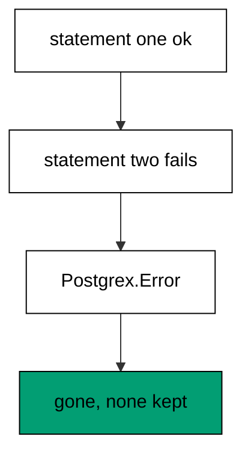

**`learning/code/ex-71-failing-statement-rolls-back/priv/main.exs`**:

```elixir
# => Example 71: Failing Statement Rolls Back
Logger.configure(level: :info)
# => debug query logs off; prints form the transcript
Code.compiler_options(ignore_module_conflict: true)
# => down-migration reloads stay silent on double runs
# => every unit keeps its own history table, never the shared default
Application.put_env(:app, Ex71.Repo, migration_source: "ex71_history")

# => one Repo module per unit keeps names unambiguous
defmodule Ex71.Repo do
  # => the Postgres 18 service adapter
  use Ecto.Repo, otp_app: :app, adapter: Ecto.Adapters.Postgres
  # => module boundary stays explicit
end

# => run/0 holds the whole example narrative
defmodule Ex71.Main do
  # => single entry point the last line calls
  def run do
    # => one keyword list owns every connection fact
    opts = [
      # => harness service hostname
      hostname: System.get_env("PGHOST", "postgres"),
      # => service port, parsed once
      port: System.get_env("PGPORT", "5432") |> String.to_integer(),
      # => fresh database for every run
      database: System.get_env("PGDATABASE", "postgres"),
      # => trust-auth role, no password
      username: System.get_env("PGUSER", "postgres"),
      # => Repo stays silent; the transcript is explicit
      log: false
      # => end opts: every fact above is environment-driven
    ]

    # => pool starts; the script owns the rest
    {:ok, _} = Ex71.Repo.start_link(opts)

    # => private script dir, never printed
    scratch = Path.join(System.tmp_dir!(), "ex71")
    # => create it fresh on every run
    File.mkdir_p!(scratch)
    # => migration source starts here
    File.write!(Path.join(scratch, "202601000171_break_widgets.exs"), ~S"""
    # => the table the failure will erase
    defmodule Ex71.Repo.Migrations.BreakWidgets do
    # => explicit up and down for the broken file
    use Ecto.Migration

    # => the table lands, then the bad statement fires
    def up do
    # => CREATE TABLE inside the migration transaction
    create table(:ex71_widgets) do
    # => a single label column, enough to prove the shape
      add :label, :string
    # => end create: the table the failure erases
    end
    # => no such function: the database rejects this
    execute "SELECT boom_missing_function()"
    # => end up: the failure the test catches
    end

    # => down drops the table when the file ever applies
    def down do
    # => the reverse of the created table
    drop table(:ex71_widgets)
    # => end down: the table is gone
    end
    # => end BreakWidgets: the failing file
    end
    # => the exact file the lesson shows, now on disk
    """)

    # => stale receipts roll back first; empty history returns []
    Ecto.Migrator.run(Ex71.Repo, scratch, :down, to: 0, log: false)
    # => leftovers of a killed run vanish
    Ecto.Adapters.SQL.query!(Ex71.Repo, "DROP TABLE IF EXISTS ex71_widgets", [])

    # => the broken file raises through the migrator
    # => the attempt runs; rescue below names any failure
    outcome =
      try do
        # => the bad statement fires after the table lands
        Ecto.Migrator.run(Ex71.Repo, scratch, :up, all: true, log: false)
        # => unreachable: the error above skips the rest of try
        :ran
        # => the failure surfaces as a database error
      rescue
        # => the struct names the failure without secrets
        e in Postgrex.Error ->
          # => the rescue reports the error struct
          {:raised, e.__struct__}
          # => end rescue: the transaction rolled back
      end

    # => Output: raised: Postgrex.Error
    IO.puts("raised: #{inspect(elem(outcome, 1))}")
    # => the rolled-back table is really gone
    sql = "SELECT to_regclass('public.ex71_widgets')"
    # => one call probes the erased table
    [[gone]] = Ecto.Adapters.SQL.query!(Ex71.Repo, sql, []).rows
    # => Output: rolled back: true
    IO.puts("rolled back: #{gone == nil}")
    # => reverse everything for the next run
    Ecto.Migrator.run(Ex71.Repo, scratch, :down, to: 0, log: false)
    # => Output: cleaned: yes
    IO.puts("cleaned: yes")

    # => end run: the narrative returns here
  end

  # => module boundary stays explicit
end

# => the entry point runs exactly once per execution
Ex71.Main.run()
```

**Output** (`learning/code/ex-71-failing-statement-rolls-back/expected/main.stdout.txt`):

```text
raised: Postgrex.Error
rolled back: true
cleaned: yes
```

**Key takeaway**: One transaction per file means one failure undoes the file; the error names the cause, the catalog proves the cleanup.

**Why it matters**: Atomicity is the reason migrations run in transactions at all. Without it, every failure would leave a half-applied file for a human to untangle at 3 a.m. — the exact scenario versioned migrations exist to prevent. Trust the rollback, but verify it the way this example does. Trust the rollback but verify it the way this example does: error named, catalog checked, nothing kept.

### Example 72: No Row Means It Never Ran

A migration that fails to apply leaves no receipt: absence from the history table is the proof. This example runs a broken migration, catches the error, and proves zero rows were recorded. (Concepts: co-16.)

**`learning/code/ex-72-no-row-means-it-never-ran/priv/main.exs`**:

```elixir
# => Example 72: No Row Means It Never Ran
Logger.configure(level: :info)
# => debug query logs off; prints form the transcript
Code.compiler_options(ignore_module_conflict: true)
# => down-migration reloads stay silent on double runs
# => every unit keeps its own history table, never the shared default
Application.put_env(:app, Ex72.Repo, migration_source: "ex72_history")

# => one Repo module per unit keeps names unambiguous
defmodule Ex72.Repo do
  # => the Postgres 18 service adapter
  use Ecto.Repo, otp_app: :app, adapter: Ecto.Adapters.Postgres
  # => module boundary stays explicit
end

# => run/0 holds the whole example narrative
defmodule Ex72.Main do
  # => single entry point the last line calls
  def run do
    # => one keyword list owns every connection fact
    opts = [
      # => harness service hostname
      hostname: System.get_env("PGHOST", "postgres"),
      # => service port, parsed once
      port: System.get_env("PGPORT", "5432") |> String.to_integer(),
      # => fresh database for every run
      database: System.get_env("PGDATABASE", "postgres"),
      # => trust-auth role, no password
      username: System.get_env("PGUSER", "postgres"),
      # => Repo stays silent; the transcript is explicit
      log: false
      # => end opts: every fact above is environment-driven
    ]

    # => pool starts; the script owns the rest
    {:ok, _} = Ex72.Repo.start_link(opts)

    # => private script dir, never printed
    scratch = Path.join(System.tmp_dir!(), "ex72")
    # => create it fresh on every run
    File.mkdir_p!(scratch)
    # => migration source starts here
    File.write!(Path.join(scratch, "202601000171_break_widgets.exs"), ~S"""
    # => the table the failure will erase
    defmodule Ex72.Repo.Migrations.BreakWidgets do
    # => explicit up and down for the broken file
    use Ecto.Migration

    # => the table lands, then the bad statement fires
    def up do
    # => CREATE TABLE inside the migration transaction
    create table(:ex72_widgets) do
    # => a single label column, enough to prove the shape
      add :label, :string
    # => end create: the table the failure erases
    end
    # => no such function: the database rejects this
    execute "SELECT boom_missing_function()"
    # => end up: the failure the test catches
    end

    # => down drops the table when the file ever applies
    def down do
    # => the reverse of the created table
    drop table(:ex72_widgets)
    # => end down: the table is gone
    end
    # => end BreakWidgets: the failing file
    end
    # => the exact file the lesson shows, now on disk
    """)

    # => stale receipts roll back first; empty history returns []
    Ecto.Migrator.run(Ex72.Repo, scratch, :down, to: 0, log: false)
    # => leftovers of a killed run vanish
    Ecto.Adapters.SQL.query!(Ex72.Repo, "DROP TABLE IF EXISTS ex72_widgets", [])

    # => the broken file raises through the migrator
    # => the attempt runs; rescue below names any failure
    outcome =
      try do
        # => the bad statement fires after the table lands
        Ecto.Migrator.run(Ex72.Repo, scratch, :up, all: true, log: false)
        # => unreachable: the error above skips the rest of try
        :ran
        # => the failure surfaces as a database error
      rescue
        # => the struct names the failure without secrets
        e in Postgrex.Error ->
          # => the rescue reports the error struct
          {:raised, e.__struct__}
          # => end rescue: the transaction rolled back
      end

    # => Output: raised: Postgrex.Error
    IO.puts("raised: #{inspect(elem(outcome, 1))}")
    # => the rolled-back file left no receipt
    sql = "SELECT count(*) FROM ex72_history WHERE version = 202601000171"
    # => one call counts the missing receipt
    [[kept]] = Ecto.Adapters.SQL.query!(Ex72.Repo, sql, []).rows
    # => Output: recorded: 0
    IO.puts("recorded: #{kept}")
    # => reverse everything for the next run
    Ecto.Migrator.run(Ex72.Repo, scratch, :down, to: 0, log: false)
    # => Output: cleaned: yes
    IO.puts("cleaned: yes")

    # => end run: the narrative returns here
  end

  # => module boundary stays explicit
end

# => the entry point runs exactly once per execution
Ex72.Main.run()
```

**Output** (`learning/code/ex-72-no-row-means-it-never-ran/expected/main.stdout.txt`):

```text
raised: Postgrex.Error
recorded: 0
cleaned: yes
```

**Key takeaway**: No receipt means it never ran; the recorded count of zero is the evidence, not the absence of evidence.

**Why it matters**: Receipts are the boundary between ran and did not. When an incident asks whether a migration applied, the history table answers authoritatively — zero rows means zero effect, full stop. This beats every alternative: logs rotate, memories fade, but the receipt is either there or it is not. Zero rows means zero effect, full stop: the receipt is either there or it is not, with no middle.

### Example 73: Partial File Rolls Back Whole

A file that is half DDL and half data still rolls back as one unit when its tail fails. This example breaks the second of two statements and proves zero rows survived from the first. (Concepts: co-12.)

**`learning/code/ex-73-partial-file-rolls-back-whole/priv/main.exs`**:

```elixir
# => Example 73: Partial File Rolls Back Whole
Logger.configure(level: :info)
# => debug query logs off; prints form the transcript
Code.compiler_options(ignore_module_conflict: true)
# => down-migration reloads stay silent on double runs
# => every unit keeps its own history table, never the shared default
Application.put_env(:app, Ex73.Repo, migration_source: "ex73_history")

# => one Repo module per unit keeps names unambiguous
defmodule Ex73.Repo do
  # => the Postgres 18 service adapter
  use Ecto.Repo, otp_app: :app, adapter: Ecto.Adapters.Postgres
  # => module boundary stays explicit
end

# => run/0 holds the whole example narrative
defmodule Ex73.Main do
  # => single entry point the last line calls
  def run do
    # => one keyword list owns every connection fact
    opts = [
      # => harness service hostname
      hostname: System.get_env("PGHOST", "postgres"),
      # => service port, parsed once
      port: System.get_env("PGPORT", "5432") |> String.to_integer(),
      # => fresh database for every run
      database: System.get_env("PGDATABASE", "postgres"),
      # => trust-auth role, no password
      username: System.get_env("PGUSER", "postgres"),
      # => Repo stays silent; the transcript is explicit
      log: false
      # => end opts: every fact above is environment-driven
    ]

    # => pool starts; the script owns the rest
    {:ok, _} = Ex73.Repo.start_link(opts)

    # => private script dir, never printed
    scratch = Path.join(System.tmp_dir!(), "ex73")
    # => create it fresh on every run
    File.mkdir_p!(scratch)
    # => migration source starts here
    File.write!(Path.join(scratch, "202601000173_make_pair.exs"), ~S"""
    # => two statements share one migration transaction
    defmodule Ex73.Repo.Migrations.MakePair do
    # => explicit up and down for the two-step file
    use Ecto.Migration

    # => first the table lands, then the bad statement fires
    def up do
    # => CREATE TABLE inside the migration transaction
    create table(:ex73_widgets) do
    # => a single label column, enough to prove the shape
      add :label, :string
    # => end create: the half the failure erases
    end
    # => a second table that never gets to land
    create table(:ex73_extra) do
    # => a single label column for the second table
      add :label, :string
    # => end create: the half the failure prevents
    end
    # => no such function: the database rejects this
    execute "SELECT boom_missing_function()"
    # => end up: the failure erases both halves
    end

    # => down drops both tables when the file ever applies
    def down do
    # => the reverse of the second table
    drop table(:ex73_extra)
    # => the reverse of the first table
    drop table(:ex73_widgets)
    # => end down: both tables gone
    end
    # => end MakePair: the partial file
    end
    # => the exact file the lesson shows, now on disk
    """)

    # => stale receipts roll back first; empty history returns []
    Ecto.Migrator.run(Ex73.Repo, scratch, :down, to: 0, log: false)
    # => leftovers of a killed run vanish
    Ecto.Adapters.SQL.query!(Ex73.Repo, "DROP TABLE IF EXISTS ex73_widgets", [])
    # => leftovers of a killed run vanish
    Ecto.Adapters.SQL.query!(Ex73.Repo, "DROP TABLE IF EXISTS ex73_extra", [])

    # => the partial file raises through the migrator
    # => the attempt runs; rescue below names any failure
    outcome =
      try do
        # => two statements land before the bad one fires
        Ecto.Migrator.run(Ex73.Repo, scratch, :up, all: true, log: false)
        # => unreachable: the error above skips the rest of try
        :ran
        # => the failure surfaces as a database error
      rescue
        # => the struct names the failure without secrets
        e in Postgrex.Error ->
          # => the rescue reports the error struct
          {:raised, e.__struct__}
          # => end rescue: the transaction rolled back
      end

    # => Output: raised: Postgrex.Error
    IO.puts("raised: #{inspect(elem(outcome, 1))}")
    # => neither half of the partial file survived
    sql = "SELECT count(*) FROM information_schema.tables"
    # => the filter names this unit's pair
    sql = sql <> " WHERE table_name IN ('ex73_widgets', 'ex73_extra')"
    # => one call counts the surviving halves
    [[survived]] = Ecto.Adapters.SQL.query!(Ex73.Repo, sql, []).rows
    # => Output: survived: 0
    IO.puts("survived: #{survived}")
    # => reverse everything for the next run
    Ecto.Migrator.run(Ex73.Repo, scratch, :down, to: 0, log: false)
    # => Output: cleaned: yes
    IO.puts("cleaned: yes")

    # => end run: the narrative returns here
  end

  # => module boundary stays explicit
end

# => the entry point runs exactly once per execution
Ex73.Main.run()
```

**Output** (`learning/code/ex-73-partial-file-rolls-back-whole/expected/main.stdout.txt`):

```text
raised: Postgrex.Error
survived: 0
cleaned: yes
```

**Key takeaway**: Mixed files are still atomic; the survivor count of zero proves the whole file unwound.

**Why it matters**: Teams split schema and data into separate files for deploy flexibility — but each file stays atomic on its own. That guarantee is what makes splitting safe: either half can fail without stranding the other half-applied. Atomicity per file, independence across files — the two properties compose. Independence across files and atomicity within each file: the two properties compose into safe deploys.

### Example 74: Status Names the Failed File

After a failure, status points at the exact file that broke: earlier files up, the broken one down. This example fails the second of two migrations and shows status naming the good version up and the bad one down. (Concepts: co-16.)

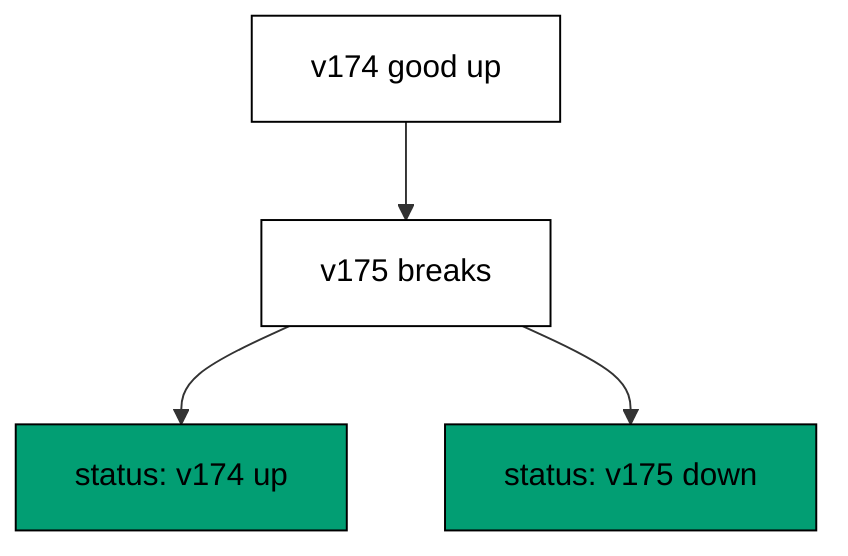

**`learning/code/ex-74-status-names-the-failed-file/priv/main.exs`**:

```elixir
# => Example 74: Status Names the Failed File
Logger.configure(level: :info)
# => debug query logs off; prints form the transcript
Code.compiler_options(ignore_module_conflict: true)
# => down-migration reloads stay silent on double runs
# => every unit keeps its own history table, never the shared default
Application.put_env(:app, Ex74.Repo, migration_source: "ex74_history")

# => one Repo module per unit keeps names unambiguous
defmodule Ex74.Repo do
  # => the Postgres 18 service adapter
  use Ecto.Repo, otp_app: :app, adapter: Ecto.Adapters.Postgres
  # => module boundary stays explicit
end

# => run/0 holds the whole example narrative
defmodule Ex74.Main do
  # => single entry point the last line calls
  def run do
    # => one keyword list owns every connection fact
    opts = [
      # => harness service hostname
      hostname: System.get_env("PGHOST", "postgres"),
      # => service port, parsed once
      port: System.get_env("PGPORT", "5432") |> String.to_integer(),
      # => fresh database for every run
      database: System.get_env("PGDATABASE", "postgres"),
      # => trust-auth role, no password
      username: System.get_env("PGUSER", "postgres"),
      # => Repo stays silent; the transcript is explicit
      log: false
      # => end opts: every fact above is environment-driven
    ]

    # => pool starts; the script owns the rest
    {:ok, _} = Ex74.Repo.start_link(opts)

    # => private script dir, never printed
    scratch = Path.join(System.tmp_dir!(), "ex74")
    # => create it fresh on every run
    File.mkdir_p!(scratch)
    # => migration source starts here
    File.write!(Path.join(scratch, "202601000174_make_good.exs"), ~S"""
    # => the good file applies before the bad one
    defmodule Ex74.Repo.Migrations.MakeGood do
    # => the same DSL every history file uses
    use Ecto.Migration

    # => up builds, down removes
    def change do
    # => one table stands in for the passing file
    create table(:ex74_good) do
    # => a single label column, enough to prove the shape
      add :label, :string
    # => end create: the file that passes
    end
    # => end change: down drops what up created
    end
    # => end MakeGood: the passing candidate
    end
    # => the exact file the lesson shows, now on disk
    """)

    # => migration source starts here
    File.write!(Path.join(scratch, "202601000175_break_bad.exs"), ~S"""
    # => the bad file fails after the good one applied
    defmodule Ex74.Repo.Migrations.BreakBad do
    # => explicit up and down for the broken file
    use Ecto.Migration

    # => the table lands, then the bad statement fires
    def up do
    # => CREATE TABLE inside the migration transaction
    create table(:ex74_bad) do
    # => a single label column for the failing file
      add :label, :string
    # => end create: the table the failure erases
    end
    # => no such function: the database rejects this
    execute "SELECT boom_missing_function()"
    # => end up: the failure the status will name
    end

    # => down drops the table when the file ever applies
    def down do
    # => the reverse of the created table
    drop table(:ex74_bad)
    # => end down: the table is gone
    end
    # => end BreakBad: the failing candidate
    end
    # => the exact file the lesson shows, now on disk
    """)

    # => stale receipts roll back first; empty history returns []
    Ecto.Migrator.run(Ex74.Repo, scratch, :down, to: 0, log: false)
    # => leftovers of a killed run vanish
    Ecto.Adapters.SQL.query!(Ex74.Repo, "DROP TABLE IF EXISTS ex74_good", [])
    # => leftovers of a killed run vanish
    Ecto.Adapters.SQL.query!(Ex74.Repo, "DROP TABLE IF EXISTS ex74_bad", [])

    # => the run stops at the bad file, the good one stays
    # => the attempt runs; rescue below names any failure
    outcome =
      try do
        # => the good file applies before the bad one fires
        Ecto.Migrator.run(Ex74.Repo, scratch, :up, all: true, log: false)
        # => unreachable: the error above skips the rest of try
        :ran
        # => the failure surfaces as a database error
      rescue
        # => the struct names the failure without secrets
        e in Postgrex.Error ->
          # => the rescue reports the error struct
          {:raised, e.__struct__}
          # => end rescue: the good file stays applied
      end

    # => Output: raised: Postgrex.Error
    IO.puts("raised: #{inspect(elem(outcome, 1))}")
    # => history lists every file with its state
    status = Ecto.Migrator.migrations(Ex74.Repo, scratch)
    # => foreign rows belong to other units, never this transcript
    status = Enum.reject(status, fn {_, _, n} -> n == "** FILE NOT FOUND **" end)
    # => one line per file: state, version, name
    IO.puts(Enum.map_join(status, "\n", fn {s, v, n} -> "#{s} #{v} #{n}" end))
    # => the good file applied, the bad one never recorded
    sql = "SELECT count(*) FROM ex74_history"
    # => one call counts the applied file
    [[applied]] = Ecto.Adapters.SQL.query!(Ex74.Repo, sql, []).rows
    # => Output: applied: 1
    IO.puts("applied: #{applied}")
    # => reverse everything for the next run
    Ecto.Migrator.run(Ex74.Repo, scratch, :down, to: 0, log: false)
    # => Output: cleaned: yes
    IO.puts("cleaned: yes")

    # => end run: the narrative returns here
  end

  # => module boundary stays explicit
end

# => the entry point runs exactly once per execution
Ex74.Main.run()
```

**Output** (`learning/code/ex-74-status-names-the-failed-file/expected/main.stdout.txt`):

```text
raised: Postgrex.Error
up 202601000174 make_good
down 202601000175 break_bad
applied: 1
cleaned: yes
```

**Key takeaway**: Status after failure is the triage map: applied stays applied, the broken file stays pending and named.

**Why it matters**: Incident response starts with what broke, and status answers before anyone opens a log. The up line says what survived; the down line says what to fix. This is the output to paste into the incident channel — precise, current, and produced by the database itself, not reconstructed from memory. Paste this output into the incident channel: precise, current, and produced by the database itself.

### Example 75: Rows Roll Back with the File

Data written by a failed migration vanishes with it: inserts share the file's transaction. This example inserts a row then breaks, and proves zero rows remain. (Concepts: co-12.)

**`learning/code/ex-75-rows-roll-back-with-the-file/priv/main.exs`**:

```elixir
# => Example 75: Rows Roll Back with the File
Logger.configure(level: :info)
# => debug query logs off; prints form the transcript
Code.compiler_options(ignore_module_conflict: true)
# => down-migration reloads stay silent on double runs
# => every unit keeps its own history table, never the shared default
Application.put_env(:app, Ex75.Repo, migration_source: "ex75_history")

# => one Repo module per unit keeps names unambiguous
defmodule Ex75.Repo do
  # => the Postgres 18 service adapter
  use Ecto.Repo, otp_app: :app, adapter: Ecto.Adapters.Postgres
  # => module boundary stays explicit
end

# => run/0 holds the whole example narrative
defmodule Ex75.Main do
  # => single entry point the last line calls
  def run do
    # => one keyword list owns every connection fact
    opts = [
      # => harness service hostname
      hostname: System.get_env("PGHOST", "postgres"),
      # => service port, parsed once
      port: System.get_env("PGPORT", "5432") |> String.to_integer(),
      # => fresh database for every run
      database: System.get_env("PGDATABASE", "postgres"),
      # => trust-auth role, no password
      username: System.get_env("PGUSER", "postgres"),
      # => Repo stays silent; the transcript is explicit
      log: false
      # => end opts: every fact above is environment-driven
    ]

    # => pool starts; the script owns the rest
    {:ok, _} = Ex75.Repo.start_link(opts)

    # => private script dir, never printed
    scratch = Path.join(System.tmp_dir!(), "ex75")
    # => create it fresh on every run
    File.mkdir_p!(scratch)
    # => migration source starts here
    File.write!(Path.join(scratch, "202601000175_seed_then_fail.exs"), ~S"""
    # => rows land, then the bad statement fires
    defmodule Ex75.Repo.Migrations.SeedThenFail do
    # => explicit up and down for the broken seed
    use Ecto.Migration

    # => the rows land inside the migration transaction
    def up do
    # => the seed table the rows land in
    create table(:ex75_seeds) do
    # => the value every seed row carries
      add :value, :integer
    # => end create: the table the rollback erases
    end
    # => the rows the bad statement will erase
    execute "INSERT INTO ex75_seeds (value) VALUES (1), (2)"
    # => no such function: the database rejects this
    execute "SELECT boom_missing_function()"
    # => end up: the failure erases rows and table
    end

    # => down drops the table when the file ever applies
    def down do
    # => the reverse of the seed table
    drop table(:ex75_seeds)
    # => end down: the table is gone
    end
    # => end SeedThenFail: the broken seed
    end
    # => the exact file the lesson shows, now on disk
    """)

    # => stale receipts roll back first; empty history returns []
    Ecto.Migrator.run(Ex75.Repo, scratch, :down, to: 0, log: false)
    # => leftovers of a killed run vanish
    Ecto.Adapters.SQL.query!(Ex75.Repo, "DROP TABLE IF EXISTS ex75_seeds", [])

    # => the broken seed raises through the migrator
    # => the attempt runs; rescue below names any failure
    outcome =
      try do
        # => rows land before the bad statement fires
        Ecto.Migrator.run(Ex75.Repo, scratch, :up, all: true, log: false)
        # => unreachable: the error above skips the rest of try
        :ran
        # => the failure surfaces as a database error
      rescue
        # => the struct names the failure without secrets
        e in Postgrex.Error ->
          # => the rescue reports the error struct
          {:raised, e.__struct__}
          # => end rescue: rows and table rolled back
      end

    # => Output: raised: Postgrex.Error
    IO.puts("raised: #{inspect(elem(outcome, 1))}")
    # => the rolled-back rows are really gone
    sql = "SELECT to_regclass('public.ex75_seeds')"
    # => one call proves the table never landed
    [[gone]] = Ecto.Adapters.SQL.query!(Ex75.Repo, sql, []).rows
    # => Output: rows: 0
    IO.puts("rows: #{if(gone == nil, do: 0, else: -1)}")
    # => reverse everything for the next run
    Ecto.Migrator.run(Ex75.Repo, scratch, :down, to: 0, log: false)
    # => Output: cleaned: yes
    IO.puts("cleaned: yes")

    # => end run: the narrative returns here
  end

  # => module boundary stays explicit
end

# => the entry point runs exactly once per execution
Ex75.Main.run()
```

**Output** (`learning/code/ex-75-rows-roll-back-with-the-file/expected/main.stdout.txt`):

```text
raised: Postgrex.Error
rows: 0
cleaned: yes
```

**Key takeaway**: Inserts and DDL share one transaction per file; the row count of zero proves both unwound together.

**Why it matters**: Seed and DDL in one file succeed or fail as one — there is no state where the table exists without its rows or vice versa. That all-or-nothing property is what lets a failed deploy retry cleanly instead of discovering phantom rows on the second attempt. Write seeds in the file; trust the transaction.

### Example 76: No Transaction Means No Rollback

Opting out of the DDL transaction also opts out of atomic rollback: failed files leave objects behind. This example breaks a transactionless migration and proves the table survived without a receipt. (Concepts: co-12.)

**`learning/code/ex-76-no-transaction-means-no-rollback/priv/main.exs`**:

```elixir
# => Example 76: No Transaction Means No Rollback
Logger.configure(level: :info)
# => debug query logs off; prints form the transcript
Code.compiler_options(ignore_module_conflict: true)
# => down-migration reloads stay silent on double runs
# => every unit keeps its own history table, never the shared default
Application.put_env(:app, Ex76.Repo, migration_source: "ex76_history")

# => one Repo module per unit keeps names unambiguous
defmodule Ex76.Repo do
  # => the Postgres 18 service adapter
  use Ecto.Repo, otp_app: :app, adapter: Ecto.Adapters.Postgres
  # => module boundary stays explicit
end

# => run/0 holds the whole example narrative
defmodule Ex76.Main do
  # => single entry point the last line calls
  def run do
    # => one keyword list owns every connection fact
    opts = [
      # => harness service hostname
      hostname: System.get_env("PGHOST", "postgres"),
      # => service port, parsed once
      port: System.get_env("PGPORT", "5432") |> String.to_integer(),
      # => fresh database for every run
      database: System.get_env("PGDATABASE", "postgres"),
      # => trust-auth role, no password
      username: System.get_env("PGUSER", "postgres"),
      # => Repo stays silent; the transcript is explicit
      log: false
      # => end opts: every fact above is environment-driven
    ]

    # => pool starts; the script owns the rest
    {:ok, _} = Ex76.Repo.start_link(opts)

    # => private script dir, never printed
    scratch = Path.join(System.tmp_dir!(), "ex76")
    # => create it fresh on every run
    File.mkdir_p!(scratch)
    # => migration source starts here
    File.write!(Path.join(scratch, "202601000176_make_widgets.exs"), ~S"""
    # => the table the unguarded file leaves behind
    defmodule Ex76.Repo.Migrations.MakeWidgets do
    # => no transaction: statements commit one by one
    use Ecto.Migration
    # => without a transaction nothing rolls back
    @disable_ddl_transaction true

    # => the table commits before the bad statement fires
    def up do
    # => this CREATE commits at once, no transaction wraps it
    create table(:ex76_widgets) do
    # => a single label column, enough to prove the shape
      add :label, :string
    # => end create: committed the moment it runs
    end
    # => no such function: the database rejects this
    execute "SELECT boom_missing_function()"
    # => end up: the failure keeps the committed table
    end

    # => down drops the table the failure left behind
    def down do
    # => the reverse of the created table
    drop table(:ex76_widgets)
    # => end down: the leftover is gone
    end
    # => end MakeWidgets: the unguarded file
    end
    # => the exact file the lesson shows, now on disk
    """)

    # => stale receipts roll back first; empty history returns []
    Ecto.Migrator.run(Ex76.Repo, scratch, :down, to: 0, log: false)
    # => leftovers of a killed run vanish
    Ecto.Adapters.SQL.query!(Ex76.Repo, "DROP TABLE IF EXISTS ex76_widgets", [])

    # => the unguarded file raises through the migrator
    # => the attempt runs; rescue below names any failure
    outcome =
      try do
        # => the table commits before the bad statement fires
        Ecto.Migrator.run(Ex76.Repo, scratch, :up, all: true, log: false)
        # => unreachable: the error above skips the rest of try
        :ran
        # => the failure surfaces as a database error
      rescue
        # => the struct names the failure without secrets
        e in Postgrex.Error ->
          # => the rescue reports the error struct
          {:raised, e.__struct__}
          # => end rescue: the table stays, the version does not
      end

    # => Output: raised: Postgrex.Error
    IO.puts("raised: #{inspect(elem(outcome, 1))}")
    # => the committed table survives the failed file
    sql = "SELECT to_regclass('public.ex76_widgets')"
    # => one call probes the surviving table
    [[kept]] = Ecto.Adapters.SQL.query!(Ex76.Repo, sql, []).rows
    # => Output: table left behind: true
    IO.puts("table left behind: #{kept != nil}")
    # => the failed file left no receipt
    sql = "SELECT count(*) FROM ex76_history"
    # => one call proves the history stayed empty
    [[receipts]] = Ecto.Adapters.SQL.query!(Ex76.Repo, sql, []).rows
    # => Output: receipts: 0
    IO.puts("receipts: #{receipts}")
    # => reverse everything for the next run
    Ecto.Migrator.run(Ex76.Repo, scratch, :down, to: 0, log: false)
    # => Output: cleaned: yes
    IO.puts("cleaned: yes")

    # => end run: the narrative returns here
  end

  # => module boundary stays explicit
end

# => the entry point runs exactly once per execution
Ex76.Main.run()
```

**Output** (`learning/code/ex-76-no-transaction-means-no-rollback/expected/main.stdout.txt`):

```text
raised: Postgrex.Error
table left behind: true
receipts: 0
cleaned: yes
```

**Key takeaway**: Without the transaction there is no unwinding; the leftover table with zero receipts proves the trade.

**Why it matters**: Every CONCURRENTLY and every deliberately transactionless migration pays this price: failures leave residue. Knowing the price is what makes the trade acceptable — the cleanup becomes a planned step, not a surprise. Use transactionless mode only with a residue plan, and write the example that proves the residue exists. Use transactionless mode only with a residue plan, and let the plan include the cleanup step explicitly.

### Example 77: Diagnose with Status and History

Two reads diagnose any failure: status for the files, history for the receipts. This example fails the third of three migrations and combines both reads to name the broken file and count the applied. (Concepts: co-16.)

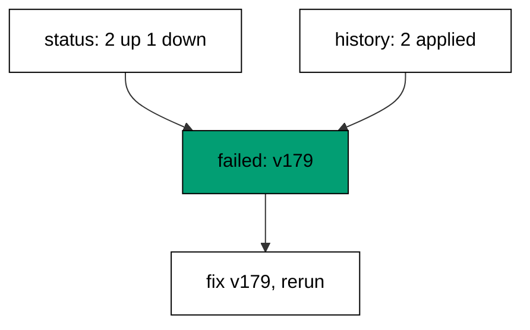

**`learning/code/ex-77-diagnose-with-status-and-history/priv/main.exs`**:

```elixir
# => Example 77: Diagnose with Status and History
Logger.configure(level: :info)
# => debug query logs off; prints form the transcript
Code.compiler_options(ignore_module_conflict: true)
# => down-migration reloads stay silent on double runs
# => every unit keeps its own history table, never the shared default
Application.put_env(:app, Ex77.Repo, migration_source: "ex77_history")

# => one Repo module per unit keeps names unambiguous
defmodule Ex77.Repo do
  # => the Postgres 18 service adapter
  use Ecto.Repo, otp_app: :app, adapter: Ecto.Adapters.Postgres
  # => module boundary stays explicit
end

# => run/0 holds the whole example narrative
defmodule Ex77.Main do
  # => single entry point the last line calls
  def run do
    # => one keyword list owns every connection fact
    opts = [
      # => harness service hostname
      hostname: System.get_env("PGHOST", "postgres"),
      # => service port, parsed once
      port: System.get_env("PGPORT", "5432") |> String.to_integer(),
      # => fresh database for every run
      database: System.get_env("PGDATABASE", "postgres"),
      # => trust-auth role, no password
      username: System.get_env("PGUSER", "postgres"),
      # => Repo stays silent; the transcript is explicit
      log: false
      # => end opts: every fact above is environment-driven
    ]

    # => pool starts; the script owns the rest
    {:ok, _} = Ex77.Repo.start_link(opts)

    # => private script dir, never printed
    scratch = Path.join(System.tmp_dir!(), "ex77")
    # => create it fresh on every run
    File.mkdir_p!(scratch)
    # => migration source starts here
    File.write!(Path.join(scratch, "202601000177_make_a.exs"), ~S"""
    # => the passing file applies before the bad one
    defmodule Ex77.Repo.Migrations.MakeA do
    # => the same DSL every history file uses
    use Ecto.Migration

    # => up builds, down removes
    def change do
    # => one table stands in for the passing file
    create table(:ex77_a) do
    # => a single label column, enough to prove the shape
      add :label, :string
    # => end create: the file that passes
    end
    # => end change: down drops what up created
    end
    # => end MakeA: the passing candidate
    end
    # => the exact file the lesson shows, now on disk
    """)

    # => migration source starts here
    File.write!(Path.join(scratch, "202601000178_make_b.exs"), ~S"""
    # => the second passing file applies before the bad one
    defmodule Ex77.Repo.Migrations.MakeB do
    # => the same DSL every history file uses
    use Ecto.Migration

    # => up builds, down removes
    def change do
    # => one table stands in for the second file
    create table(:ex77_b) do
    # => a single label column, enough to prove the shape
      add :label, :string
    # => end create: the second file that passes
    end
    # => end change: down drops what up created
    end
    # => end MakeB: the second passing candidate
    end
    # => the exact file the lesson shows, now on disk
    """)

    # => migration source starts here
    File.write!(Path.join(scratch, "202601000179_break_c.exs"), ~S"""
    # => the bad file fails after two files applied
    defmodule Ex77.Repo.Migrations.BreakC do
    # => explicit up and down for the broken file
    use Ecto.Migration

    # => the table lands, then the bad statement fires
    def up do
    # => CREATE TABLE inside the migration transaction
    create table(:ex77_c) do
    # => a single label column for the failing file
      add :label, :string
    # => end create: the table the failure erases
    end
    # => no such function: the database rejects this
    execute "SELECT boom_missing_function()"
    # => end up: the failure the diagnosis will name
    end

    # => down drops the table when the file ever applies
    def down do
    # => the reverse of the created table
    drop table(:ex77_c)
    # => end down: the table is gone
    end
    # => end BreakC: the failing candidate
    end
    # => the exact file the lesson shows, now on disk
    """)

    # => stale receipts roll back first; empty history returns []
    Ecto.Migrator.run(Ex77.Repo, scratch, :down, to: 0, log: false)
    # => leftovers of a killed run vanish
    Ecto.Adapters.SQL.query!(Ex77.Repo, "DROP TABLE IF EXISTS ex77_a", [])
    # => leftovers of a killed run vanish
    Ecto.Adapters.SQL.query!(Ex77.Repo, "DROP TABLE IF EXISTS ex77_b", [])
    # => leftovers of a killed run vanish
    Ecto.Adapters.SQL.query!(Ex77.Repo, "DROP TABLE IF EXISTS ex77_c", [])

    # => the run stops at the bad file, two files stay
    # => the attempt runs; rescue below names any failure
    outcome =
      try do
        # => two files apply before the bad one fires
        Ecto.Migrator.run(Ex77.Repo, scratch, :up, all: true, log: false)
        # => unreachable: the error above skips the rest of try
        :ran
        # => the failure surfaces as a database error
      rescue
        # => the struct names the failure without secrets
        e in Postgrex.Error ->
          # => the rescue reports the error struct
          {:raised, e.__struct__}
          # => end rescue: two files stay applied
      end

    # => Output: raised: Postgrex.Error
    IO.puts("raised: #{inspect(elem(outcome, 1))}")
    # => history lists every file with its state
    status = Ecto.Migrator.migrations(Ex77.Repo, scratch)
    # => foreign rows belong to other units, never this transcript
    status = Enum.reject(status, fn {_, _, n} -> n == "** FILE NOT FOUND **" end)
    # => one line per file: state, version, name
    IO.puts(Enum.map_join(status, "\n", fn {s, v, n} -> "#{s} #{v} #{n}" end))
    # => history holds the two files that passed
    sql = "SELECT count(*) FROM ex77_history"
    # => one call counts the applied files
    [[applied]] = Ecto.Adapters.SQL.query!(Ex77.Repo, sql, []).rows
    # => Output: applied: 2
    IO.puts("applied: #{applied}")
    # => reverse everything for the next run
    Ecto.Migrator.run(Ex77.Repo, scratch, :down, to: 0, log: false)
    # => Output: cleaned: yes
    IO.puts("cleaned: yes")

    # => end run: the narrative returns here
  end

  # => module boundary stays explicit
end

# => the entry point runs exactly once per execution
Ex77.Main.run()
```

**Output** (`learning/code/ex-77-diagnose-with-status-and-history/expected/main.stdout.txt`):

```text
raised: Postgrex.Error
up 202601000177 make_a
up 202601000178 make_b
down 202601000179 break_c
applied: 2
cleaned: yes
```

**Key takeaway**: Status names the failed file, history counts the applied; together they fully describe the aftermath.

**Why it matters**: Diagnosis is comparison: what the files say versus what the database recorded. These two reads are the complete toolkit — every other migration incident command is a variation on diffing plan against receipt. Run both before touching anything; the fix follows from the gap. Run both reads before touching anything, because the fix always follows from the gap they reveal.

### Example 78: Rehearse the Full Cycle

The last example is a deploy rehearsal: full upgrade, verification queries, full rollback, and the clean verdict. This example runs the cycle end to end and proves rows, receipts, and cleanliness in order. (Concepts: co-16.)

**`learning/code/ex-78-rehearse-the-full-cycle/priv/main.exs`**:

```elixir
# => Example 78: Rehearse the Full Cycle
Logger.configure(level: :info)
# => debug query logs off; prints form the transcript
Code.compiler_options(ignore_module_conflict: true)
# => down-migration reloads stay silent on double runs
# => every unit keeps its own history table, never the shared default
Application.put_env(:app, Ex78.Repo, migration_source: "ex78_history")

# => one Repo module per unit keeps names unambiguous
defmodule Ex78.Repo do
  # => the Postgres 18 service adapter
  use Ecto.Repo, otp_app: :app, adapter: Ecto.Adapters.Postgres
  # => module boundary stays explicit
end

# => run/0 holds the whole example narrative
defmodule Ex78.Main do
  # => single entry point the last line calls
  def run do
    # => one keyword list owns every connection fact
    opts = [
      # => harness service hostname
      hostname: System.get_env("PGHOST", "postgres"),
      # => service port, parsed once
      port: System.get_env("PGPORT", "5432") |> String.to_integer(),
      # => fresh database for every run
      database: System.get_env("PGDATABASE", "postgres"),
      # => trust-auth role, no password
      username: System.get_env("PGUSER", "postgres"),
      # => Repo stays silent; the transcript is explicit
      log: false
      # => end opts: every fact above is environment-driven
    ]

    # => pool starts; the script owns the rest
    {:ok, _} = Ex78.Repo.start_link(opts)

    # => private script dir, never printed
    scratch = Path.join(System.tmp_dir!(), "ex78")
    # => create it fresh on every run
    File.mkdir_p!(scratch)
    # => migration source starts here
    File.write!(Path.join(scratch, "202601000178_make_orders.exs"), ~S"""
    # => the table the rehearsal verifies end to end
    defmodule Ex78.Repo.Migrations.MakeOrders do
    # => the seed rows live in the same file
    use Ecto.Migration

    # => first the shape, then the rows
    def change do
    # => totals in cents, verified by the rehearsal
    create table(:ex78_orders) do
    # => the amount every row carries
      add :total, :integer
    # => end create: the rehearsed shape
    end
    # => two-arg execute keeps change reversible
    execute "INSERT INTO ex78_orders (total) VALUES (100), (200)", "DELETE FROM ex78_orders"
    # => end change: shape plus seed
    end
    # => end MakeOrders: the rehearsed file
    end
    # => the exact file the lesson shows, now on disk
    """)

    # => stale receipts roll back first; empty history returns []
    Ecto.Migrator.run(Ex78.Repo, scratch, :down, to: 0, log: false)
    # => leftovers of a killed run vanish
    Ecto.Adapters.SQL.query!(Ex78.Repo, "DROP TABLE IF EXISTS ex78_orders", [])

    # => the rehearsal upgrades first
    Ecto.Migrator.run(Ex78.Repo, scratch, :up, all: true, log: false)
    # => the data the rehearsal verifies
    sql = "SELECT count(*) FROM ex78_orders"
    # => one call counts the rehearsed rows
    [[rows]] = Ecto.Adapters.SQL.query!(Ex78.Repo, sql, []).rows
    # => Output: rows: 2
    IO.puts("rows: #{rows}")
    # => the receipt the rehearsal verifies
    sql = "SELECT count(*) FROM ex78_history WHERE version = 202601000178"
    # => one call counts the rehearsed receipt
    [[receipts]] = Ecto.Adapters.SQL.query!(Ex78.Repo, sql, []).rows
    # => Output: receipts: 1
    IO.puts("receipts: #{receipts}")
    # => the rehearsal rolls back last
    Ecto.Migrator.run(Ex78.Repo, scratch, :down, to: 0, log: false)
    # => the rollback leaves nothing behind
    sql = "SELECT to_regclass('public.ex78_orders')"
    # => one call probes the rehearsed table
    [[gone]] = Ecto.Adapters.SQL.query!(Ex78.Repo, sql, []).rows
    # => Output: clean: true
    IO.puts("clean: #{gone == nil}")
    # => Output: cleaned: yes
    IO.puts("cleaned: yes")

    # => end run: the narrative returns here
  end

  # => module boundary stays explicit
end

# => the entry point runs exactly once per execution
Ex78.Main.run()
```

**Output** (`learning/code/ex-78-rehearse-the-full-cycle/expected/main.stdout.txt`):

```text
rows: 2
receipts: 1
clean: true
cleaned: yes
```

**Key takeaway**: Up, verify, down, verify clean: the rehearsal proves the migration is shippable before it ships.

**Why it matters**: Rehearsal is the cheapest production insurance a team can buy. Running the full cycle against a scratch database exercises both directions, both verifications, and the cleanup — everything the deploy will do, in order, with an audience of one. Ship only what rehearsed green; everything else waits. Ship only what rehearsed green and let everything else wait for its own calm rehearsal window.
