Examples 1–25 build the habits every later example assumes: writing migrations with forward and reverse steps, ordering them into one linear history, and rolling them back without losing unrelated data. Three clusters carry the level: first migrations that create and alter (Examples 1–8), migration history and ordering (Examples 9–17), and rollback basics (Examples 18–25). Every program runs against the real pinned PostgreSQL 18 container; every output is a fixed transcript.

### Example 1: First Migration Creates a Table

A migration is a versioned file with a forward step and a reverse step, and this example runs the smallest real one: a single `change` that creates a table. The program writes the migration file into a scratch script directory at runtime, runs it up, and reads the catalog back. (Concepts: co-01.)

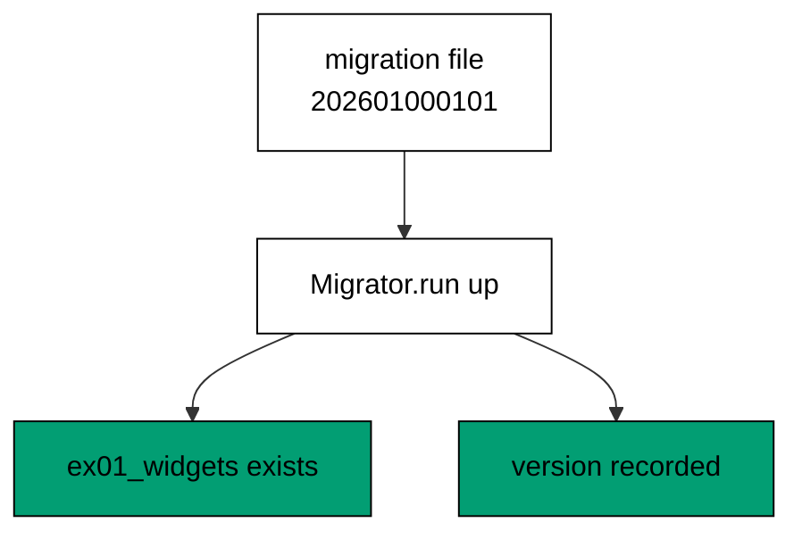

**`learning/code/ex-01-first-migration-creates-a-table/priv/main.exs`**:

```elixir
# => Example 1: First Migration Creates a Table
Logger.configure(level: :info)
# => debug query logs off; prints form the transcript
Code.compiler_options(ignore_module_conflict: true)
# => down-migration reloads stay silent on double runs
# => every unit keeps its own history table, never the shared default
Application.put_env(:app, Ex01.Repo, migration_source: "ex01_history")

# => one Repo module per unit keeps names unambiguous
defmodule Ex01.Repo do
  # => the Postgres 18 service adapter
  use Ecto.Repo, otp_app: :app, adapter: Ecto.Adapters.Postgres
  # => module boundary stays explicit
end

# => run/0 holds the whole example narrative
defmodule Ex01.Main do
  # => single entry point the last line calls
  def run do
    # => one keyword list owns every connection fact
    opts = [
      # => harness service hostname
      hostname: System.get_env("PGHOST", "postgres"),
      # => service port, parsed once
      port: System.get_env("PGPORT", "5432") |> String.to_integer(),
      # => fresh database for every run
      database: System.get_env("PGDATABASE", "postgres"),
      # => trust-auth role, no password
      username: System.get_env("PGUSER", "postgres"),
      # => Repo stays silent; the transcript is explicit
      log: false
      # => end opts: every fact above is environment-driven
    ]

    # => pool starts; the script owns the rest
    {:ok, _} = Ex01.Repo.start_link(opts)

    # => private script dir, never printed
    scratch = Path.join(System.tmp_dir!(), "ex01")
    # => create it fresh on every run
    File.mkdir_p!(scratch)
    # => migration source starts here
    File.write!(Path.join(scratch, "202601000101_make_widgets.exs"), ~S"""
    # => one module per file, named after its content
    defmodule Ex01.Repo.Migrations.MakeWidgets do
    # => the DSL for create, alter, and friends
    use Ecto.Migration

    # => forward and reverse in one block for reversible calls
    def change do
    # => CREATE TABLE, recorded in history only on success
    create table(:ex01_widgets) do
    # => one text column beside the implicit id
      add :name, :string
    # => end create: the table shape is complete
    end
    # => end change: down reverses create into a drop
    end
    # => end MakeWidgets: the file is a complete migration
    end
    # => the exact file the lesson shows, now on disk
    """)

    # => stale receipts roll back first; empty history returns []
    Ecto.Migrator.run(Ex01.Repo, scratch, :down, to: 0, log: false)
    # => leftovers of a killed run vanish
    Ecto.Adapters.SQL.query!(Ex01.Repo, "DROP TABLE IF EXISTS ex01_widgets", [])

    # => run every pending file in version order
    Ecto.Migrator.run(Ex01.Repo, scratch, :up, all: true, log: false)
    # => the catalog query in two short halves
    sql = "SELECT table_name FROM information_schema.tables "
    # => the filter names this unit's table
    sql = sql <> "WHERE table_name = 'ex01_widgets'"
    # => one call runs the catalog probe
    rows = Ecto.Adapters.SQL.query!(Ex01.Repo, sql, []).rows
    # => Output: tables: ex01_widgets
    IO.puts("tables: " <> Enum.map_join(rows, ", ", fn [t] -> t end))
    # => reverse everything for the next run
    Ecto.Migrator.run(Ex01.Repo, scratch, :down, to: 0, log: false)
    # => Output: cleaned: yes
    IO.puts("cleaned: yes")

    # => end run: the narrative returns here
  end

  # => module boundary stays explicit
end

# => the entry point runs exactly once per execution
Ex01.Main.run()
```

**Output** (`learning/code/ex-01-first-migration-creates-a-table/expected/main.stdout.txt`):

```text
tables: ex01_widgets
cleaned: yes
```

**Key takeaway**: A `change` migration that only creates is reversible for free; running it up creates the table and records the version.

**Why it matters**: Production schema changes ship as reviewable files instead of chat messages. When the change lives in a versioned file, the deploy is repeatable across environments — the same file runs the same way on a laptop, in staging, and in production. That repeatability is the whole point of migrations, and this first file is where the habit starts.

### Example 2: Migration File Anatomy

Before running anything, read a migration file the way Ecto sees it: module name, version from the filename, and the `change` function. This example writes one migration and reports its status through `Ecto.Migrator.migrations`, which names the file without touching data. (Concepts: co-01.)

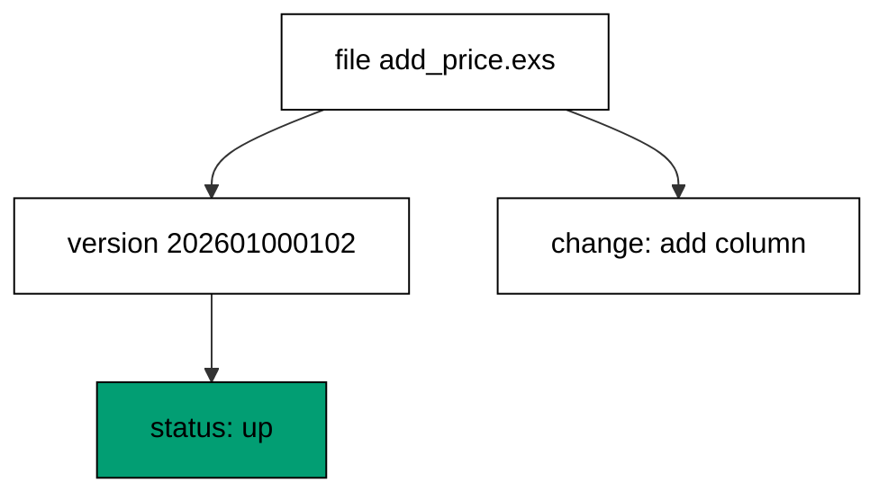

**`learning/code/ex-02-migration-file-anatomy/priv/main.exs`**:

```elixir
# => Example 2: Migration File Anatomy
Logger.configure(level: :info)
# => debug query logs off; prints form the transcript
Code.compiler_options(ignore_module_conflict: true)
# => down-migration reloads stay silent on double runs
# => every unit keeps its own history table, never the shared default
Application.put_env(:app, Ex02.Repo, migration_source: "ex02_history")

# => one Repo module per unit keeps names unambiguous
defmodule Ex02.Repo do
  # => the Postgres 18 service adapter
  use Ecto.Repo, otp_app: :app, adapter: Ecto.Adapters.Postgres
  # => module boundary stays explicit
end

# => run/0 holds the whole example narrative
defmodule Ex02.Main do
  # => single entry point the last line calls
  def run do
    # => one keyword list owns every connection fact
    opts = [
      # => harness service hostname
      hostname: System.get_env("PGHOST", "postgres"),
      # => service port, parsed once
      port: System.get_env("PGPORT", "5432") |> String.to_integer(),
      # => fresh database for every run
      database: System.get_env("PGDATABASE", "postgres"),
      # => trust-auth role, no password
      username: System.get_env("PGUSER", "postgres"),
      # => Repo stays silent; the transcript is explicit
      log: false
      # => end opts: every fact above is environment-driven
    ]

    # => pool starts; the script owns the rest
    {:ok, _} = Ex02.Repo.start_link(opts)

    # => private script dir, never printed
    scratch = Path.join(System.tmp_dir!(), "ex02")
    # => create it fresh on every run
    File.mkdir_p!(scratch)
    # => migration source starts here
    File.write!(Path.join(scratch, "202601000102_add_price.exs"), ~S"""
    # => module name is free text; the version orders the file
    defmodule Ex02.Repo.Migrations.AddPrice do
    # => every migration file opens the same way
    use Ecto.Migration

    # => change covers both directions when every call reverses
    def change do
    # => CREATE TABLE with two content columns
    create table(:ex02_widgets) do
    # => what the widget is called
      add :name, :string
    # => what the widget costs, in cents
      add :price, :integer
    # => end create: both columns land in one statement
    end
    # => end change: the reverse drops the table
    end
    # => end AddPrice: filename and module describe the same change
    end
    # => the exact file the lesson shows, now on disk
    """)

    # => stale receipts roll back first; empty history returns []
    Ecto.Migrator.run(Ex02.Repo, scratch, :down, to: 0, log: false)
    # => leftovers of a killed run vanish
    Ecto.Adapters.SQL.query!(Ex02.Repo, "DROP TABLE IF EXISTS ex02_widgets", [])

    # => run every pending file in version order
    Ecto.Migrator.run(Ex02.Repo, scratch, :up, all: true, log: false)
    # => history lists every file with its state
    [{status, version, name}] = Ecto.Migrator.migrations(Ex02.Repo, scratch)
    # => Output: status: up 202601000102 add_price
    IO.puts("status: #{status} #{version} #{name}")
    # => reverse everything for the next run
    Ecto.Migrator.run(Ex02.Repo, scratch, :down, to: 0, log: false)
    # => Output: cleaned: yes
    IO.puts("cleaned: yes")

    # => end run: the narrative returns here
  end

  # => module boundary stays explicit
end

# => the entry point runs exactly once per execution
Ex02.Main.run()
```

**Output** (`learning/code/ex-02-migration-file-anatomy/expected/main.stdout.txt`):

```text
status: up 202601000102 add_price
cleaned: yes
```

**Key takeaway**: The version lives in the filename and the behavior in `change`; status reporting reads both without running anything.

**Why it matters**: Code review happens on files, not databases. When every migration's contract is visible without provisioning anything, reviewers can judge reversibility in the pull request, where fixes are cheap. Anatomy worth memorizing pays off every time a deploy pauses and someone asks what a file actually does. Anatomy learned once pays rent forever: every deploy pause becomes a file-reading exercise, not a guessing game.

### Example 3: Up Runs the Forward Change

Running up to a version executes every forward step up to and including it — and nothing after it. This example builds a two-migration chain, runs only the first, and proves the second column never appears. (Concepts: co-02.)

**`learning/code/ex-03-up-runs-the-forward-change/priv/main.exs`**:

```elixir
# => Example 3: Up Runs the Forward Change
Logger.configure(level: :info)
# => debug query logs off; prints form the transcript
Code.compiler_options(ignore_module_conflict: true)
# => down-migration reloads stay silent on double runs
# => every unit keeps its own history table, never the shared default
Application.put_env(:app, Ex03.Repo, migration_source: "ex03_history")

# => one Repo module per unit keeps names unambiguous
defmodule Ex03.Repo do
  # => the Postgres 18 service adapter
  use Ecto.Repo, otp_app: :app, adapter: Ecto.Adapters.Postgres
  # => module boundary stays explicit
end

# => run/0 holds the whole example narrative
defmodule Ex03.Main do
  # => single entry point the last line calls
  def run do
    # => one keyword list owns every connection fact
    opts = [
      # => harness service hostname
      hostname: System.get_env("PGHOST", "postgres"),
      # => service port, parsed once
      port: System.get_env("PGPORT", "5432") |> String.to_integer(),
      # => fresh database for every run
      database: System.get_env("PGDATABASE", "postgres"),
      # => trust-auth role, no password
      username: System.get_env("PGUSER", "postgres"),
      # => Repo stays silent; the transcript is explicit
      log: false
      # => end opts: every fact above is environment-driven
    ]

    # => pool starts; the script owns the rest
    {:ok, _} = Ex03.Repo.start_link(opts)

    # => private script dir, never printed
    scratch = Path.join(System.tmp_dir!(), "ex03")
    # => create it fresh on every run
    File.mkdir_p!(scratch)
    # => migration source starts here
    File.write!(Path.join(scratch, "202601000103_make_gadgets.exs"), ~S"""
    # => the forward change lives in change/0
    defmodule Ex03.Repo.Migrations.MakeGadgets do
    # => change/0 runs forward on up, backward on down
    use Ecto.Migration

    # => up creates, down drops, from this one block
    def change do
    # => the forward direction of this migration
    create table(:ex03_gadgets) do
    # => every gadget needs a stock code
      add :sku, :string, null: false
    # => end create: the forward change is one table
    end
    # => end change: the reverse is an automatic DROP TABLE
    end
    # => end MakeGadgets: up and down share this file
    end
    # => the exact file the lesson shows, now on disk
    """)

    # => stale receipts roll back first; empty history returns []
    Ecto.Migrator.run(Ex03.Repo, scratch, :down, to: 0, log: false)
    # => leftovers of a killed run vanish
    Ecto.Adapters.SQL.query!(Ex03.Repo, "DROP TABLE IF EXISTS ex03_gadgets", [])

    # => run every pending file in version order
    Ecto.Migrator.run(Ex03.Repo, scratch, :up, all: true, log: false)
    # => ordinal order keeps the print stable
    sql = "SELECT column_name FROM information_schema.columns "
    # => the filter names this unit's table
    sql = sql <> "WHERE table_name = 'ex03_gadgets' ORDER BY ordinal_position"
    # => one call runs the catalog probe
    cols = Ecto.Adapters.SQL.query!(Ex03.Repo, sql, []).rows
    # => Output: columns: id, sku
    IO.puts("columns: " <> Enum.map_join(cols, ", ", fn [c] -> c end))
    # => reverse everything for the next run
    Ecto.Migrator.run(Ex03.Repo, scratch, :down, to: 0, log: false)
    # => Output: cleaned: yes
    IO.puts("cleaned: yes")

    # => end run: the narrative returns here
  end

  # => module boundary stays explicit
end

# => the entry point runs exactly once per execution
Ex03.Main.run()
```

**Output** (`learning/code/ex-03-up-runs-the-forward-change/expected/main.stdout.txt`):

```text
columns: id, sku
cleaned: yes
```

**Key takeaway**: Up is cumulative and stops exactly where asked; later files stay pending until a later run.

**Why it matters**: Deploys pause. A migration window can close, a canary can look wrong, a dependency can fail — running up to a named version turns half deployed from a mystery into a recorded position the next run resumes from. Targeted upgrades are how teams land large histories safely without betting the whole chain at once.

### Example 4: Down Reverses the Change

Every up needs a tested way back. This example runs a migration up, proves the column exists, runs it back down, and proves the column is gone — the smallest reversibility proof a migration can carry. (Concepts: co-02.)

**`learning/code/ex-04-down-reverses-the-change/priv/main.exs`**:

```elixir
# => Example 4: Down Reverses the Change
Logger.configure(level: :info)
# => debug query logs off; prints form the transcript
Code.compiler_options(ignore_module_conflict: true)
# => down-migration reloads stay silent on double runs
# => every unit keeps its own history table, never the shared default
Application.put_env(:app, Ex04.Repo, migration_source: "ex04_history")

# => one Repo module per unit keeps names unambiguous
defmodule Ex04.Repo do
  # => the Postgres 18 service adapter
  use Ecto.Repo, otp_app: :app, adapter: Ecto.Adapters.Postgres
  # => module boundary stays explicit
end

# => run/0 holds the whole example narrative
defmodule Ex04.Main do
  # => single entry point the last line calls
  def run do
    # => one keyword list owns every connection fact
    opts = [
      # => harness service hostname
      hostname: System.get_env("PGHOST", "postgres"),
      # => service port, parsed once
      port: System.get_env("PGPORT", "5432") |> String.to_integer(),
      # => fresh database for every run
      database: System.get_env("PGDATABASE", "postgres"),
      # => trust-auth role, no password
      username: System.get_env("PGUSER", "postgres"),
      # => Repo stays silent; the transcript is explicit
      log: false
      # => end opts: every fact above is environment-driven
    ]

    # => pool starts; the script owns the rest
    {:ok, _} = Ex04.Repo.start_link(opts)

    # => private script dir, never printed
    scratch = Path.join(System.tmp_dir!(), "ex04")
    # => create it fresh on every run
    File.mkdir_p!(scratch)
    # => migration source starts here
    File.write!(Path.join(scratch, "202601000104_make_orders.exs"), ~S"""
    # => down is the star of this example
    defmodule Ex04.Repo.Migrations.MakeOrders do
    # => the same file serves both directions
    use Ecto.Migration

    # => up builds, down removes, symmetric by construction
    def change do
    # => one table stands in for the forward change
    create table(:ex04_orders) do
    # => order total in cents
      add :total, :integer
    # => end create: the unit of work down will undo
    end
    # => end change: down derives DROP TABLE from create
    end
    # => end MakeOrders: nothing extra is needed for the reverse
    end
    # => the exact file the lesson shows, now on disk
    """)

    # => stale receipts roll back first; empty history returns []
    Ecto.Migrator.run(Ex04.Repo, scratch, :down, to: 0, log: false)
    # => leftovers of a killed run vanish
    Ecto.Adapters.SQL.query!(Ex04.Repo, "DROP TABLE IF EXISTS ex04_orders", [])

    # => run every pending file in version order
    Ecto.Migrator.run(Ex04.Repo, scratch, :up, all: true, log: false)
    # => to_regclass names the table or returns one nil row
    # => the query stays readable on its own line
    sql = "SELECT to_regclass('public.ex04_orders')"
    # => one call runs the catalog probe
    [[up]] = Ecto.Adapters.SQL.query!(Ex04.Repo, sql, []).rows
    # => Output: present: true
    IO.puts("present: #{up != nil}")
    # => reverse everything for the next run
    Ecto.Migrator.run(Ex04.Repo, scratch, :down, to: 0, log: false)
    # => same probe after the reversal
    # => the query stays readable on its own line
    sql = "SELECT to_regclass('public.ex04_orders')"
    # => one call runs the catalog probe
    [[down]] = Ecto.Adapters.SQL.query!(Ex04.Repo, sql, []).rows
    # => Output: present: false
    IO.puts("present: #{down != nil}")
    # => Output: cleaned: yes
    IO.puts("cleaned: yes")

    # => end run: the narrative returns here
  end

  # => module boundary stays explicit
end

# => the entry point runs exactly once per execution
Ex04.Main.run()
```

**Output** (`learning/code/ex-04-down-reverses-the-change/expected/main.stdout.txt`):

```text
present: true
present: false
cleaned: yes
```

**Key takeaway**: Down runs the exact reverse of up; presence flips from true to false while the transcript stays deterministic.

**Why it matters**: The escape hatch must be tested before the fire. A down step that has never run against a real database is a hope, not a plan — this up-then-down roundtrip is the cheapest reversibility test a migration can have. Run it in development so production never runs it first. Test the escape hatch on a calm Tuesday so the incident never becomes its first real execution.

### Example 5: Add a Column with Alter

Real schemas grow by altering live tables, not by recreating them. This example adds a nullable column to an existing table and proves the new column stores and returns data alongside the old rows. (Concepts: co-01.)

**`learning/code/ex-05-add-a-column-with-alter/priv/main.exs`**:

```elixir
# => Example 5: Add a Column with Alter
Logger.configure(level: :info)
# => debug query logs off; prints form the transcript
Code.compiler_options(ignore_module_conflict: true)
# => down-migration reloads stay silent on double runs
# => every unit keeps its own history table, never the shared default
Application.put_env(:app, Ex05.Repo, migration_source: "ex05_history")

# => one Repo module per unit keeps names unambiguous
defmodule Ex05.Repo do
  # => the Postgres 18 service adapter
  use Ecto.Repo, otp_app: :app, adapter: Ecto.Adapters.Postgres
  # => module boundary stays explicit
end

# => run/0 holds the whole example narrative
defmodule Ex05.Main do
  # => single entry point the last line calls
  def run do
    # => one keyword list owns every connection fact
    opts = [
      # => harness service hostname
      hostname: System.get_env("PGHOST", "postgres"),
      # => service port, parsed once
      port: System.get_env("PGPORT", "5432") |> String.to_integer(),
      # => fresh database for every run
      database: System.get_env("PGDATABASE", "postgres"),
      # => trust-auth role, no password
      username: System.get_env("PGUSER", "postgres"),
      # => Repo stays silent; the transcript is explicit
      log: false
      # => end opts: every fact above is environment-driven
    ]

    # => pool starts; the script owns the rest
    {:ok, _} = Ex05.Repo.start_link(opts)

    # => private script dir, never printed
    scratch = Path.join(System.tmp_dir!(), "ex05")
    # => create it fresh on every run
    File.mkdir_p!(scratch)
    # => migration source starts here
    File.write!(Path.join(scratch, "202601000105_make_members.exs"), ~S"""
    # => first file: the table as first designed
    defmodule Ex05.Repo.Migrations.MakeMembers do
    # => two files, one ordered history
    use Ecto.Migration

    # => version 105 runs before version 106, always
    def change do
    # => members start with only a handle
    create table(:ex05_members) do
    # => the unique name members choose
      add :handle, :string
    # => end create: the starting shape
    end
    # => end change: the base the next file alters
    end
    # => end MakeMembers: history begins here
    end
    # => the exact file the lesson shows, now on disk
    """)

    # => migration source starts here
    File.write!(Path.join(scratch, "202601000106_add_email.exs"), ~S"""
    # => second file: the table as redesigned
    defmodule Ex05.Repo.Migrations.AddEmail do
    # => alter runs inside the same transaction model
    use Ecto.Migration

    # => add inside alter appends a column reversibly
    def change do
    # => ALTER TABLE ADD COLUMN under the hood
    alter table(:ex05_members) do
    # => the new contact column, nullable for old rows
      add :email, :string
    # => end alter: down removes exactly this column
    end
    # => end change: up adds, down removes
    end
    # => end AddEmail: one file per schema step
    end
    # => the exact file the lesson shows, now on disk
    """)

    # => stale receipts roll back first; empty history returns []
    Ecto.Migrator.run(Ex05.Repo, scratch, :down, to: 0, log: false)
    # => leftovers of a killed run vanish
    Ecto.Adapters.SQL.query!(Ex05.Repo, "DROP TABLE IF EXISTS ex05_members", [])

    # => run every pending file in version order
    Ecto.Migrator.run(Ex05.Repo, scratch, :up, all: true, log: false)
    # => both files contributed columns
    sql = "SELECT column_name FROM information_schema.columns "
    # => the filter names this unit's table
    sql = sql <> "WHERE table_name = 'ex05_members' ORDER BY ordinal_position"
    # => one call runs the catalog probe
    cols = Ecto.Adapters.SQL.query!(Ex05.Repo, sql, []).rows
    # => Output: columns: id, handle, email
    IO.puts("columns: " <> Enum.map_join(cols, ", ", fn [c] -> c end))
    # => reverse everything for the next run
    Ecto.Migrator.run(Ex05.Repo, scratch, :down, to: 0, log: false)
    # => Output: cleaned: yes
    IO.puts("cleaned: yes")

    # => end run: the narrative returns here
  end

  # => module boundary stays explicit
end

# => the entry point runs exactly once per execution
Ex05.Main.run()
```

**Output** (`learning/code/ex-05-add-a-column-with-alter/expected/main.stdout.txt`):

```text
columns: id, handle, email
cleaned: yes
```

**Key takeaway**: `alter` with `add` lands on inhabited tables without disturbing existing rows; nullable is the safe default.

**Why it matters**: Traffic never stops for a deploy. Nullable adds keep the table writable while old and new code coexist, which is why nearly every production schema change starts life as a nullable column. Strictness comes later, after the data complies — never in the same step that introduces the shape. Nullable first also keeps application code simple: no backfill gate before the deploy, no coordination overhead.

### Example 6: Create an Index

Indexes ship with the schema change that needs them, in the same migration and the same transaction. This example creates a table and its lookup index together, then shows both in the catalog. (Concepts: co-01.)

**`learning/code/ex-06-create-an-index/priv/main.exs`**:

```elixir
# => Example 6: Create an Index
Logger.configure(level: :info)
# => debug query logs off; prints form the transcript
Code.compiler_options(ignore_module_conflict: true)
# => down-migration reloads stay silent on double runs
# => every unit keeps its own history table, never the shared default
Application.put_env(:app, Ex06.Repo, migration_source: "ex06_history")

# => one Repo module per unit keeps names unambiguous
defmodule Ex06.Repo do
  # => the Postgres 18 service adapter
  use Ecto.Repo, otp_app: :app, adapter: Ecto.Adapters.Postgres
  # => module boundary stays explicit
end

# => run/0 holds the whole example narrative
defmodule Ex06.Main do
  # => single entry point the last line calls
  def run do
    # => one keyword list owns every connection fact
    opts = [
      # => harness service hostname
      hostname: System.get_env("PGHOST", "postgres"),
      # => service port, parsed once
      port: System.get_env("PGPORT", "5432") |> String.to_integer(),
      # => fresh database for every run
      database: System.get_env("PGDATABASE", "postgres"),
      # => trust-auth role, no password
      username: System.get_env("PGUSER", "postgres"),
      # => Repo stays silent; the transcript is explicit
      log: false
      # => end opts: every fact above is environment-driven
    ]

    # => pool starts; the script owns the rest
    {:ok, _} = Ex06.Repo.start_link(opts)

    # => private script dir, never printed
    scratch = Path.join(System.tmp_dir!(), "ex06")
    # => create it fresh on every run
    File.mkdir_p!(scratch)
    # => migration source starts here
    File.write!(Path.join(scratch, "202601000106_make_products.exs"), ~S"""
    # => table first, index second, one file
    defmodule Ex06.Repo.Migrations.MakeProducts do
    # => create index/3 is a reversible call
    use Ecto.Migration

    # => both statements share one migration transaction
    def change do
    # => the table the index will cover
    create table(:ex06_products) do
    # => the column lookups filter on
      add :sku, :string
    # => end create: table exists before the index builds
    end

    # => CREATE INDEX for fast sku lookups
    create index(:ex06_products, [:sku])
    # => end change: down drops the index, then the table
    end
    # => end MakeProducts: index and table version together
    end
    # => the exact file the lesson shows, now on disk
    """)

    # => stale receipts roll back first; empty history returns []
    Ecto.Migrator.run(Ex06.Repo, scratch, :down, to: 0, log: false)
    # => leftovers of a killed run vanish
    Ecto.Adapters.SQL.query!(Ex06.Repo, "DROP TABLE IF EXISTS ex06_products", [])

    # => run every pending file in version order
    Ecto.Migrator.run(Ex06.Repo, scratch, :up, all: true, log: false)
    # => pg_indexes lists every index on the table
    sql = "SELECT indexname FROM pg_indexes "
    # => the filter names this unit's table
    sql = sql <> "WHERE tablename = 'ex06_products' ORDER BY 1"
    # => one call runs the catalog probe
    idx = Ecto.Adapters.SQL.query!(Ex06.Repo, sql, []).rows
    # => Output: indexes: ex06_products_pkey, ex06_products_sku_index
    IO.puts("indexes: " <> Enum.map_join(idx, ", ", fn [i] -> i end))
    # => reverse everything for the next run
    Ecto.Migrator.run(Ex06.Repo, scratch, :down, to: 0, log: false)
    # => Output: cleaned: yes
    IO.puts("cleaned: yes")

    # => end run: the narrative returns here
  end

  # => module boundary stays explicit
end

# => the entry point runs exactly once per execution
Ex06.Main.run()
```

**Output** (`learning/code/ex-06-create-an-index/expected/main.stdout.txt`):

```text
indexes: ex06_products_pkey, ex06_products_sku_index
cleaned: yes
```

**Key takeaway**: `create index` inside the migration keeps the index and the table in one atomic, reviewable unit.

**Why it matters**: A missing index is a latency incident wearing a schema-change costume. Shipping the index in the same file as the column it serves means no deploy ever lands the query without its access path. Reviewers see the pair together and can ask the only question that matters: which queries does this serve?

### Example 7: Modify Changes a Column Type

Types evolve: counters outgrow integers and labels outgrow their first guess. This example widens an integer column to bigint with `modify` and proves the catalog reports the new type. (Concepts: co-01.)

**`learning/code/ex-07-modify-changes-a-column-type/priv/main.exs`**:

```elixir
# => Example 7: Modify Changes a Column Type
Logger.configure(level: :info)
# => debug query logs off; prints form the transcript
Code.compiler_options(ignore_module_conflict: true)
# => down-migration reloads stay silent on double runs
# => every unit keeps its own history table, never the shared default
Application.put_env(:app, Ex07.Repo, migration_source: "ex07_history")

# => one Repo module per unit keeps names unambiguous
defmodule Ex07.Repo do
  # => the Postgres 18 service adapter
  use Ecto.Repo, otp_app: :app, adapter: Ecto.Adapters.Postgres
  # => module boundary stays explicit
end

# => run/0 holds the whole example narrative
defmodule Ex07.Main do
  # => single entry point the last line calls
  def run do
    # => one keyword list owns every connection fact
    opts = [
      # => harness service hostname
      hostname: System.get_env("PGHOST", "postgres"),
      # => service port, parsed once
      port: System.get_env("PGPORT", "5432") |> String.to_integer(),
      # => fresh database for every run
      database: System.get_env("PGDATABASE", "postgres"),
      # => trust-auth role, no password
      username: System.get_env("PGUSER", "postgres"),
      # => Repo stays silent; the transcript is explicit
      log: false
      # => end opts: every fact above is environment-driven
    ]

    # => pool starts; the script owns the rest
    {:ok, _} = Ex07.Repo.start_link(opts)

    # => private script dir, never printed
    scratch = Path.join(System.tmp_dir!(), "ex07")
    # => create it fresh on every run
    File.mkdir_p!(scratch)
    # => migration source starts here
    File.write!(Path.join(scratch, "202601000107_make_scores.exs"), ~S"""
    # => scores start as small integers
    defmodule Ex07.Repo.Migrations.MakeScores do
    # => modify later widens the column in place
    use Ecto.Migration

    # => the starting type is a deliberate underestimate
    def change do
    # => one integer column to outgrow
    create table(:ex07_scores) do
    # => 32-bit range, fine until it is not
      add :points, :integer
    # => end create: the narrow starting shape
    end
    # => end change: the next file widens this column
    end
    # => end MakeScores: the before picture
    end
    # => the exact file the lesson shows, now on disk
    """)

    # => migration source starts here
    File.write!(Path.join(scratch, "202601000108_widen_points.exs"), ~S"""
    # => widening keeps every existing row
    defmodule Ex07.Repo.Migrations.WidenPoints do
    # => modify rewrites the column type
    use Ecto.Migration

    # => integer to bigint never loses a value
    def change do
    # => ALTER TABLE ALTER COLUMN under the hood
    alter table(:ex07_scores) do
    # => 64-bit range; Postgres rewrites the column
    # => from: pins the old type so down can reverse
      modify :points, :bigint, from: :integer
    # => end alter: down narrows back to integer
    end
    # => end change: up widens, down narrows
    end
    # => end WidenPoints: the after picture
    end
    # => the exact file the lesson shows, now on disk
    """)

    # => stale receipts roll back first; empty history returns []
    Ecto.Migrator.run(Ex07.Repo, scratch, :down, to: 0, log: false)
    # => leftovers of a killed run vanish
    Ecto.Adapters.SQL.query!(Ex07.Repo, "DROP TABLE IF EXISTS ex07_scores", [])

    # => run every pending file in version order
    Ecto.Migrator.run(Ex07.Repo, scratch, :up, all: true, log: false)
    # => the catalog reports the live type
    sql = "SELECT data_type FROM information_schema.columns "
    # => the filter names the column
    sql = sql <> "WHERE table_name = 'ex07_scores' AND column_name = 'points'"
    # => one call runs the catalog probe
    [[dtype]] = Ecto.Adapters.SQL.query!(Ex07.Repo, sql, []).rows
    # => Output: points: bigint
    IO.puts("points: #{dtype}")
    # => reverse everything for the next run
    Ecto.Migrator.run(Ex07.Repo, scratch, :down, to: 0, log: false)
    # => Output: cleaned: yes
    IO.puts("cleaned: yes")

    # => end run: the narrative returns here
  end

  # => module boundary stays explicit
end

# => the entry point runs exactly once per execution
Ex07.Main.run()
```

**Output** (`learning/code/ex-07-modify-changes-a-column-type/expected/main.stdout.txt`):

```text
points: bigint
cleaned: yes
```

**Key takeaway**: `modify` with an explicit `from:` stays reversible; the type change commits atomically with its receipt.

**Why it matters**: Widening late is an outage; widening early is a migration. Counters that approach two billion rows do not negotiate, and a planned type change during a calm window beats an emergency rewrite under load. The `from:` option matters because a type change without a recorded past cannot roll back. Record the past type explicitly, because the reverse migration needs to know exactly what it restores.

### Example 8: Rename a Column Safely

Renaming with `rename` keeps the data while the name changes: one statement, same rows, new label. This example renames a column and proves the catalog lists the new name with the old values intact. (Concepts: co-01.)

**`learning/code/ex-08-rename-a-column-safely/priv/main.exs`**:

```elixir
# => Example 8: Rename a Column Safely
Logger.configure(level: :info)
# => debug query logs off; prints form the transcript
Code.compiler_options(ignore_module_conflict: true)
# => down-migration reloads stay silent on double runs
# => every unit keeps its own history table, never the shared default
Application.put_env(:app, Ex08.Repo, migration_source: "ex08_history")

# => one Repo module per unit keeps names unambiguous
defmodule Ex08.Repo do
  # => the Postgres 18 service adapter
  use Ecto.Repo, otp_app: :app, adapter: Ecto.Adapters.Postgres
  # => module boundary stays explicit
end

# => run/0 holds the whole example narrative
defmodule Ex08.Main do
  # => single entry point the last line calls
  def run do
    # => one keyword list owns every connection fact
    opts = [
      # => harness service hostname
      hostname: System.get_env("PGHOST", "postgres"),
      # => service port, parsed once
      port: System.get_env("PGPORT", "5432") |> String.to_integer(),
      # => fresh database for every run
      database: System.get_env("PGDATABASE", "postgres"),
      # => trust-auth role, no password
      username: System.get_env("PGUSER", "postgres"),
      # => Repo stays silent; the transcript is explicit
      log: false
      # => end opts: every fact above is environment-driven
    ]

    # => pool starts; the script owns the rest
    {:ok, _} = Ex08.Repo.start_link(opts)

    # => private script dir, never printed
    scratch = Path.join(System.tmp_dir!(), "ex08")
    # => create it fresh on every run
    File.mkdir_p!(scratch)
    # => migration source starts here
    File.write!(Path.join(scratch, "202601000109_make_articles.exs"), ~S"""
    # => the column name nobody likes
    defmodule Ex08.Repo.Migrations.MakeArticles do
    # => rename later fixes the name without copying data
    use Ecto.Migration

    # => start with the awkward name on purpose
    def change do
    # => one badly named column to fix
    create table(:ex08_articles) do
    # => the name the team regrets
      add :title, :string
    # => end create: the regrettable starting shape
    end
    # => end change: the next file renames this column
    end
    # => end MakeArticles: the before picture
    end
    # => the exact file the lesson shows, now on disk
    """)

    # => migration source starts here
    File.write!(Path.join(scratch, "202601000110_rename_title.exs"), ~S"""
    # => rename keeps the data, changes the label
    defmodule Ex08.Repo.Migrations.RenameTitle do
    # => rename/3 is reversible: down renames back
    use Ecto.Migration

    # => RENAME COLUMN never touches a single value
    def change do
    # => the label changes, the data stays
    rename table(:ex08_articles), :title, to: :headline
    # => end change: one statement, fully reversed by down
    end
    # => end RenameTitle: the after picture
    end
    # => the exact file the lesson shows, now on disk
    """)

    # => stale receipts roll back first; empty history returns []
    Ecto.Migrator.run(Ex08.Repo, scratch, :down, to: 0, log: false)
    # => leftovers of a killed run vanish
    Ecto.Adapters.SQL.query!(Ex08.Repo, "DROP TABLE IF EXISTS ex08_articles", [])

    # => run every pending file in version order
    Ecto.Migrator.run(Ex08.Repo, scratch, :up, all: true, log: false)
    # => the rename shows in the catalog
    sql = "SELECT column_name FROM information_schema.columns "
    # => the filter names this unit's table
    sql = sql <> "WHERE table_name = 'ex08_articles' ORDER BY ordinal_position"
    # => one call runs the catalog probe
    cols = Ecto.Adapters.SQL.query!(Ex08.Repo, sql, []).rows
    # => Output: columns: id, headline
    IO.puts("columns: " <> Enum.map_join(cols, ", ", fn [c] -> c end))
    # => reverse everything for the next run
    Ecto.Migrator.run(Ex08.Repo, scratch, :down, to: 0, log: false)
    # => Output: cleaned: yes
    IO.puts("cleaned: yes")

    # => end run: the narrative returns here
  end

  # => module boundary stays explicit
end

# => the entry point runs exactly once per execution
Ex08.Main.run()
```

**Output** (`learning/code/ex-08-rename-a-column-safely/expected/main.stdout.txt`):

```text
columns: id, headline
cleaned: yes
```

**Key takeaway**: `rename` moves the label without touching the rows; the catalog check proves data survived the rename.

**Why it matters**: Renames are where data loss hides. Drop-and-add looks equivalent in a diff but destroys every row the column held; a true rename carries the values across. In review, any column rename that is not a rename operation deserves a hard question about where the old data went. The catalog check after every rename is cheap insurance against the most expensive kind of data loss.

### Example 9: History Is a Line of Versions

Migrations form a line: every version number sorts after the last, and the run order is the sorted order. This example writes three migrations, runs them all, and prints the version line the database now stands on. (Concepts: co-04.)

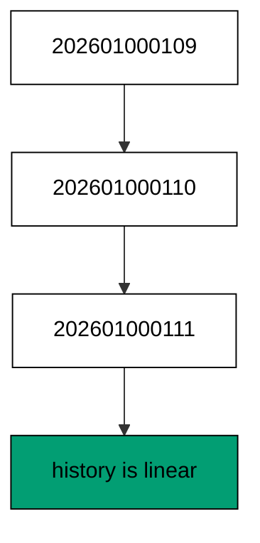

**`learning/code/ex-09-history-is-a-line-of-versions/priv/main.exs`**:

```elixir
# => Example 9: History Is a Line of Versions
Logger.configure(level: :info)
# => debug query logs off; prints form the transcript
Code.compiler_options(ignore_module_conflict: true)
# => down-migration reloads stay silent on double runs
# => every unit keeps its own history table, never the shared default
Application.put_env(:app, Ex09.Repo, migration_source: "ex09_history")

# => one Repo module per unit keeps names unambiguous
defmodule Ex09.Repo do
  # => the Postgres 18 service adapter
  use Ecto.Repo, otp_app: :app, adapter: Ecto.Adapters.Postgres
  # => module boundary stays explicit
end

# => run/0 holds the whole example narrative
defmodule Ex09.Main do
  # => single entry point the last line calls
  def run do
    # => one keyword list owns every connection fact
    opts = [
      # => harness service hostname
      hostname: System.get_env("PGHOST", "postgres"),
      # => service port, parsed once
      port: System.get_env("PGPORT", "5432") |> String.to_integer(),
      # => fresh database for every run
      database: System.get_env("PGDATABASE", "postgres"),
      # => trust-auth role, no password
      username: System.get_env("PGUSER", "postgres"),
      # => Repo stays silent; the transcript is explicit
      log: false
      # => end opts: every fact above is environment-driven
    ]

    # => pool starts; the script owns the rest
    {:ok, _} = Ex09.Repo.start_link(opts)

    # => private script dir, never printed
    scratch = Path.join(System.tmp_dir!(), "ex09")
    # => create it fresh on every run
    File.mkdir_p!(scratch)
    # => migration source starts here
    File.write!(Path.join(scratch, "202601000109_make_alpha.exs"), ~S"""
    # => one file in an ordered line of three
    defmodule Ex09.Repo.Migrations.MakeAlpha do
    # => the same DSL every history file uses
    use Ecto.Migration

    # => versions not names decide the running order
    def change do
    # => one table per file keeps the line readable
    create table(:ex09_alpha) do
    # => a single label column, enough to prove the shape
      add :label, :string
    # => end create: the table lands with its column
    end
    # => end change: down drops what up created
    end
    # => end MakeAlpha: this file is one step of the line
    end
    # => the exact file the lesson shows, now on disk
    """)

    # => migration source starts here
    File.write!(Path.join(scratch, "202601000110_make_beta.exs"), ~S"""
    # => one file in an ordered line of three
    defmodule Ex09.Repo.Migrations.MakeBeta do
    # => the same DSL every history file uses
    use Ecto.Migration

    # => versions not names decide the running order
    def change do
    # => one table per file keeps the line readable
    create table(:ex09_beta) do
    # => a single label column, enough to prove the shape
      add :label, :string
    # => end create: the table lands with its column
    end
    # => end change: down drops what up created
    end
    # => end MakeBeta: this file is one step of the line
    end
    # => the exact file the lesson shows, now on disk
    """)

    # => migration source starts here
    File.write!(Path.join(scratch, "202601000111_make_gamma.exs"), ~S"""
    # => one file in an ordered line of three
    defmodule Ex09.Repo.Migrations.MakeGamma do
    # => the same DSL every history file uses
    use Ecto.Migration

    # => versions not names decide the running order
    def change do
    # => one table per file keeps the line readable
    create table(:ex09_gamma) do
    # => a single label column, enough to prove the shape
      add :label, :string
    # => end create: the table lands with its column
    end
    # => end change: down drops what up created
    end
    # => end MakeGamma: this file is one step of the line
    end
    # => the exact file the lesson shows, now on disk
    """)

    # => stale receipts roll back first; empty history returns []
    Ecto.Migrator.run(Ex09.Repo, scratch, :down, to: 0, log: false)
    # => leftovers of a killed run vanish
    Ecto.Adapters.SQL.query!(Ex09.Repo, "DROP TABLE IF EXISTS ex09_alpha", [])
    # => leftovers of a killed run vanish
    Ecto.Adapters.SQL.query!(Ex09.Repo, "DROP TABLE IF EXISTS ex09_beta", [])
    # => leftovers of a killed run vanish
    Ecto.Adapters.SQL.query!(Ex09.Repo, "DROP TABLE IF EXISTS ex09_gamma", [])

    # => run every pending file in version order
    Ecto.Migrator.run(Ex09.Repo, scratch, :up, all: true, log: false)
    # => the receipts land in version order
    # => the filter keeps other units' rows out of the transcript
    sql =
      "SELECT version FROM ex09_history WHERE version IN (202601000109, 202601000110, 202601000111) ORDER BY version"

    # => one call reads the whole history
    versions = Ecto.Adapters.SQL.query!(Ex09.Repo, sql, []).rows
    # => Output: versions: 202601000109, 202601000110, 202601000111
    IO.puts("versions: " <> Enum.map_join(versions, ", ", fn [v] -> "#{v}" end))
    # => reverse everything for the next run
    Ecto.Migrator.run(Ex09.Repo, scratch, :down, to: 0, log: false)
    # => Output: cleaned: yes
    IO.puts("cleaned: yes")

    # => end run: the narrative returns here
  end

  # => module boundary stays explicit
end

# => the entry point runs exactly once per execution
Ex09.Main.run()
```

**Output** (`learning/code/ex-09-history-is-a-line-of-versions/expected/main.stdout.txt`):

```text
versions: 202601000109, 202601000110, 202601000111
cleaned: yes
```

**Key takeaway**: Sorted versions are the deploy order; the printed line is the whole history in one glance.

**Why it matters**: Linear history is what makes deploys predictable. When every version has exactly one place in line, any two environments that ran the same versions have the same schema — no merge step, no ambiguity. Teams protect this linearity because every branch and reorder in later examples costs real coordination. Guard this linearity in review: any file that branches the line should explain why it could not wait.

### Example 10: Status Shows What Ran

`status` answers the first question of every deploy review: which files ran and which are still pending. This example runs one of two migrations and prints one `up` line and one `down` line. (Concepts: co-04.)

**`learning/code/ex-10-status-shows-what-ran/priv/main.exs`**:

```elixir
# => Example 10: Status Shows What Ran
Logger.configure(level: :info)
# => debug query logs off; prints form the transcript
Code.compiler_options(ignore_module_conflict: true)
# => down-migration reloads stay silent on double runs
# => every unit keeps its own history table, never the shared default
Application.put_env(:app, Ex10.Repo, migration_source: "ex10_history")

# => one Repo module per unit keeps names unambiguous
defmodule Ex10.Repo do
  # => the Postgres 18 service adapter
  use Ecto.Repo, otp_app: :app, adapter: Ecto.Adapters.Postgres
  # => module boundary stays explicit
end

# => run/0 holds the whole example narrative
defmodule Ex10.Main do
  # => single entry point the last line calls
  def run do
    # => one keyword list owns every connection fact
    opts = [
      # => harness service hostname
      hostname: System.get_env("PGHOST", "postgres"),
      # => service port, parsed once
      port: System.get_env("PGPORT", "5432") |> String.to_integer(),
      # => fresh database for every run
      database: System.get_env("PGDATABASE", "postgres"),
      # => trust-auth role, no password
      username: System.get_env("PGUSER", "postgres"),
      # => Repo stays silent; the transcript is explicit
      log: false
      # => end opts: every fact above is environment-driven
    ]

    # => pool starts; the script owns the rest
    {:ok, _} = Ex10.Repo.start_link(opts)

    # => private script dir, never printed
    scratch = Path.join(System.tmp_dir!(), "ex10")
    # => create it fresh on every run
    File.mkdir_p!(scratch)
    # => migration source starts here
    File.write!(Path.join(scratch, "202601000110_make_first.exs"), ~S"""
    # => one file in an ordered line of three
    defmodule Ex10.Repo.Migrations.MakeFirst do
    # => the same DSL every history file uses
    use Ecto.Migration

    # => versions not names decide the running order
    def change do
    # => one table per file keeps the line readable
    create table(:ex10_first) do
    # => a single label column, enough to prove the shape
      add :label, :string
    # => end create: the table lands with its column
    end
    # => end change: down drops what up created
    end
    # => end MakeFirst: this file is one step of the line
    end
    # => the exact file the lesson shows, now on disk
    """)

    # => migration source starts here
    File.write!(Path.join(scratch, "202601000111_make_second.exs"), ~S"""
    # => one file in an ordered line of three
    defmodule Ex10.Repo.Migrations.MakeSecond do
    # => the same DSL every history file uses
    use Ecto.Migration

    # => versions not names decide the running order
    def change do
    # => one table per file keeps the line readable
    create table(:ex10_second) do
    # => a single label column, enough to prove the shape
      add :label, :string
    # => end create: the table lands with its column
    end
    # => end change: down drops what up created
    end
    # => end MakeSecond: this file is one step of the line
    end
    # => the exact file the lesson shows, now on disk
    """)

    # => stale receipts roll back first; empty history returns []
    Ecto.Migrator.run(Ex10.Repo, scratch, :down, to: 0, log: false)
    # => leftovers of a killed run vanish
    Ecto.Adapters.SQL.query!(Ex10.Repo, "DROP TABLE IF EXISTS ex10_first", [])
    # => leftovers of a killed run vanish
    Ecto.Adapters.SQL.query!(Ex10.Repo, "DROP TABLE IF EXISTS ex10_second", [])

    # => run only up to the first version, not all
    Ecto.Migrator.run(Ex10.Repo, scratch, :up, to: 202_601_000_110, log: false)
    # => history lists every file with its state
    status = Ecto.Migrator.migrations(Ex10.Repo, scratch)
    # => foreign rows belong to other units, never this transcript
    status = Enum.reject(status, fn {_, _, n} -> n == "** FILE NOT FOUND **" end)
    # => one line per file: state, version, name
    IO.puts(Enum.map_join(status, "\n", fn {s, v, n} -> "#{s} #{v} #{n}" end))
    # => reverse everything for the next run
    Ecto.Migrator.run(Ex10.Repo, scratch, :down, to: 0, log: false)
    # => Output: cleaned: yes
    IO.puts("cleaned: yes")

    # => end run: the narrative returns here
  end

  # => module boundary stays explicit
end

# => the entry point runs exactly once per execution
Ex10.Main.run()
```

**Output** (`learning/code/ex-10-status-shows-what-ran/expected/main.stdout.txt`):

```text
up 202601000110 make_first
down 202601000111 make_second
cleaned: yes
```

**Key takeaway**: Status reads the files against the receipts: `up` means recorded, `down` means pending, no guessing.

**Why it matters**: You cannot deploy what you cannot see. Before any upgrade runs in staging or production, status tells the reviewer exactly what is about to change — one pending line per file. Skipping that glance is how teams discover mid-deploy that the file they meant to ship is not the file that shipped.

### Example 11: The History Table Records Runs

The history table is the database's own diary: one row per applied version, written in the same transaction as the change. This example runs a migration and reads the diary back — its columns and its single row. (Concepts: co-03.)

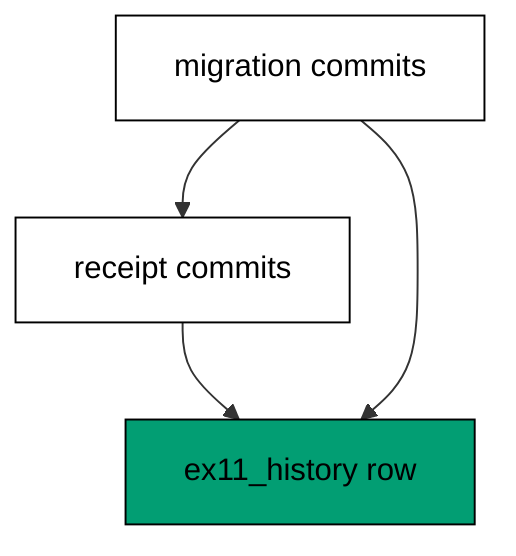

**`learning/code/ex-11-the-history-table-records-runs/priv/main.exs`**:

```elixir
# => Example 11: The History Table Records Runs
Logger.configure(level: :info)
# => debug query logs off; prints form the transcript
Code.compiler_options(ignore_module_conflict: true)
# => down-migration reloads stay silent on double runs
# => every unit keeps its own history table, never the shared default
Application.put_env(:app, Ex11.Repo, migration_source: "ex11_history")

# => one Repo module per unit keeps names unambiguous
defmodule Ex11.Repo do
  # => the Postgres 18 service adapter
  use Ecto.Repo, otp_app: :app, adapter: Ecto.Adapters.Postgres
  # => module boundary stays explicit
end

# => run/0 holds the whole example narrative
defmodule Ex11.Main do
  # => single entry point the last line calls
  def run do
    # => one keyword list owns every connection fact
    opts = [
      # => harness service hostname
      hostname: System.get_env("PGHOST", "postgres"),
      # => service port, parsed once
      port: System.get_env("PGPORT", "5432") |> String.to_integer(),
      # => fresh database for every run
      database: System.get_env("PGDATABASE", "postgres"),
      # => trust-auth role, no password
      username: System.get_env("PGUSER", "postgres"),
      # => Repo stays silent; the transcript is explicit
      log: false
      # => end opts: every fact above is environment-driven
    ]

    # => pool starts; the script owns the rest
    {:ok, _} = Ex11.Repo.start_link(opts)

    # => private script dir, never printed
    scratch = Path.join(System.tmp_dir!(), "ex11")
    # => create it fresh on every run
    File.mkdir_p!(scratch)
    # => migration source starts here
    File.write!(Path.join(scratch, "202601000111_make_widgets.exs"), ~S"""
    # => one file in an ordered line of three
    defmodule Ex11.Repo.Migrations.MakeWidgets do
    # => the same DSL every history file uses
    use Ecto.Migration

    # => versions not names decide the running order
    def change do
    # => one table per file keeps the line readable
    create table(:ex11_widgets) do
    # => a single label column, enough to prove the shape
      add :label, :string
    # => end create: the table lands with its column
    end
    # => end change: down drops what up created
    end
    # => end MakeWidgets: this file is one step of the line
    end
    # => the exact file the lesson shows, now on disk
    """)

    # => stale receipts roll back first; empty history returns []
    Ecto.Migrator.run(Ex11.Repo, scratch, :down, to: 0, log: false)
    # => leftovers of a killed run vanish
    Ecto.Adapters.SQL.query!(Ex11.Repo, "DROP TABLE IF EXISTS ex11_widgets", [])

    # => run every pending file in version order
    Ecto.Migrator.run(Ex11.Repo, scratch, :up, all: true, log: false)
    # => the history table has exactly two columns
    sql = "SELECT column_name FROM information_schema.columns"
    # => the filter names the history table
    sql = sql <> " WHERE table_name = 'ex11_history' ORDER BY ordinal_position"
    # => one call reads the history shape
    cols = Ecto.Adapters.SQL.query!(Ex11.Repo, sql, []).rows
    # => Output: history columns: version, inserted_at
    IO.puts("history columns: " <> Enum.map_join(cols, ", ", fn [c] -> c end))
    # => the receipts prove the run
    sql = "SELECT version FROM ex11_history "
    # => this unit owns one version
    sql = sql <> "WHERE version = 202601000111"
    # => one call runs the catalog probe
    versions = Ecto.Adapters.SQL.query!(Ex11.Repo, sql, []).rows
    # => Output: recorded: 202601000111
    IO.puts("recorded: " <> Enum.map_join(versions, ", ", fn [v] -> "#{v}" end))
    # => reverse everything for the next run
    Ecto.Migrator.run(Ex11.Repo, scratch, :down, to: 0, log: false)
    # => Output: cleaned: yes
    IO.puts("cleaned: yes")

    # => end run: the narrative returns here
  end

  # => module boundary stays explicit
end

# => the entry point runs exactly once per execution
Ex11.Main.run()
```

**Output** (`learning/code/ex-11-the-history-table-records-runs/expected/main.stdout.txt`):

```text
history columns: version, inserted_at
recorded: 202601000111
cleaned: yes
```

**Key takeaway**: Receipt and change commit atomically, so the table never claims a migration that did not fully apply.

**Why it matters**: The version row is the only proof a migration ran. Everything else — chat messages, deploy logs, memory — can disagree with the database; the history table is the database agreeing with itself. Diagnose from the diary first, because it is the one witness that was inside the transaction. Read the diary before the logs, because the diary was inside the transaction and the logs were not.

### Example 12: Pending Means Not Yet Run

A file on disk is not a migration that ran — pending files wait until a run picks them up. This example writes two migrations, runs only the first, and shows the second still pending in the status. (Concepts: co-04.)

**`learning/code/ex-12-pending-means-not-yet-run/priv/main.exs`**:

```elixir
# => Example 12: Pending Means Not Yet Run
Logger.configure(level: :info)
# => debug query logs off; prints form the transcript
Code.compiler_options(ignore_module_conflict: true)
# => down-migration reloads stay silent on double runs
# => every unit keeps its own history table, never the shared default
Application.put_env(:app, Ex12.Repo, migration_source: "ex12_history")

# => one Repo module per unit keeps names unambiguous
defmodule Ex12.Repo do
  # => the Postgres 18 service adapter
  use Ecto.Repo, otp_app: :app, adapter: Ecto.Adapters.Postgres
  # => module boundary stays explicit
end

# => run/0 holds the whole example narrative
defmodule Ex12.Main do
  # => single entry point the last line calls
  def run do
    # => one keyword list owns every connection fact
    opts = [
      # => harness service hostname
      hostname: System.get_env("PGHOST", "postgres"),
      # => service port, parsed once
      port: System.get_env("PGPORT", "5432") |> String.to_integer(),
      # => fresh database for every run
      database: System.get_env("PGDATABASE", "postgres"),
      # => trust-auth role, no password
      username: System.get_env("PGUSER", "postgres"),
      # => Repo stays silent; the transcript is explicit
      log: false
      # => end opts: every fact above is environment-driven
    ]

    # => pool starts; the script owns the rest
    {:ok, _} = Ex12.Repo.start_link(opts)

    # => private script dir, never printed
    scratch = Path.join(System.tmp_dir!(), "ex12")
    # => create it fresh on every run
    File.mkdir_p!(scratch)
    # => migration source starts here
    File.write!(Path.join(scratch, "202601000112_make_first.exs"), ~S"""
    # => one file in an ordered line of three
    defmodule Ex12.Repo.Migrations.MakeFirst do
    # => the same DSL every history file uses
    use Ecto.Migration

    # => versions not names decide the running order
    def change do
    # => one table per file keeps the line readable
    create table(:ex12_first) do
    # => a single label column, enough to prove the shape
      add :label, :string
    # => end create: the table lands with its column
    end
    # => end change: down drops what up created
    end
    # => end MakeFirst: this file is one step of the line
    end
    # => the exact file the lesson shows, now on disk
    """)

    # => migration source starts here
    File.write!(Path.join(scratch, "202601000113_make_second.exs"), ~S"""
    # => one file in an ordered line of three
    defmodule Ex12.Repo.Migrations.MakeSecond do
    # => the same DSL every history file uses
    use Ecto.Migration

    # => versions not names decide the running order
    def change do
    # => one table per file keeps the line readable
    create table(:ex12_second) do
    # => a single label column, enough to prove the shape
      add :label, :string
    # => end create: the table lands with its column
    end
    # => end change: down drops what up created
    end
    # => end MakeSecond: this file is one step of the line
    end
    # => the exact file the lesson shows, now on disk
    """)

    # => stale receipts roll back first; empty history returns []
    Ecto.Migrator.run(Ex12.Repo, scratch, :down, to: 0, log: false)
    # => leftovers of a killed run vanish
    Ecto.Adapters.SQL.query!(Ex12.Repo, "DROP TABLE IF EXISTS ex12_first", [])
    # => leftovers of a killed run vanish
    Ecto.Adapters.SQL.query!(Ex12.Repo, "DROP TABLE IF EXISTS ex12_second", [])

    # => run only the first of two files
    Ecto.Migrator.run(Ex12.Repo, scratch, :up, to: 202_601_000_112, log: false)
    # => history lists every file with its state
    status = Ecto.Migrator.migrations(Ex12.Repo, scratch)
    # => foreign rows belong to other units, never this transcript
    status = Enum.reject(status, fn {_, _, n} -> n == "** FILE NOT FOUND **" end)
    # => one line per file: state, version, name
    IO.puts(Enum.map_join(status, "\n", fn {s, v, n} -> "#{s} #{v} #{n}" end))
    # => reverse everything for the next run
    Ecto.Migrator.run(Ex12.Repo, scratch, :down, to: 0, log: false)
    # => Output: cleaned: yes
    IO.puts("cleaned: yes")

    # => end run: the narrative returns here
  end

  # => module boundary stays explicit
end

# => the entry point runs exactly once per execution
Ex12.Main.run()
```

**Output** (`learning/code/ex-12-pending-means-not-yet-run/expected/main.stdout.txt`):

```text
up 202601000112 make_first
down 202601000113 make_second
cleaned: yes
```

**Key takeaway**: Pending is a normal state, not an error; the next run to head picks up exactly the pending files.

**Why it matters**: Half the deploy incidents in schema work come from confusing shipped files with applied migrations. A file merged to main has changed nothing until it runs somewhere; pending status makes that gap visible. Teach every engineer to check pending before claiming a schema change is live. Pending files deserve a glance in every deploy review: unrun work is the most common source of schema surprises.

### Example 13: Run Up to a Specific Version

Named versions are checkpoints: run up to the middle file and the tip stays on disk, never recorded, never run. This example stops at the second of three migrations and proves the third table never appears. (Concepts: co-02.)

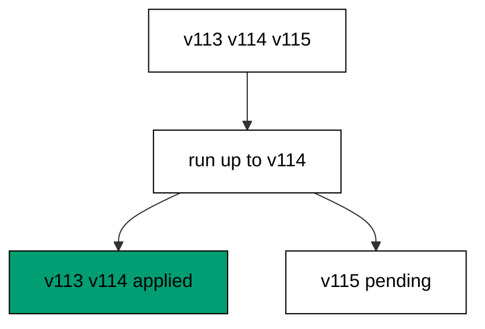

**`learning/code/ex-13-run-up-to-a-specific-version/priv/main.exs`**:

```elixir
# => Example 13: Run Up to a Specific Version
Logger.configure(level: :info)
# => debug query logs off; prints form the transcript
Code.compiler_options(ignore_module_conflict: true)
# => down-migration reloads stay silent on double runs
# => every unit keeps its own history table, never the shared default
Application.put_env(:app, Ex13.Repo, migration_source: "ex13_history")

# => one Repo module per unit keeps names unambiguous
defmodule Ex13.Repo do
  # => the Postgres 18 service adapter
  use Ecto.Repo, otp_app: :app, adapter: Ecto.Adapters.Postgres
  # => module boundary stays explicit
end

# => run/0 holds the whole example narrative
defmodule Ex13.Main do
  # => single entry point the last line calls
  def run do
    # => one keyword list owns every connection fact
    opts = [
      # => harness service hostname
      hostname: System.get_env("PGHOST", "postgres"),
      # => service port, parsed once
      port: System.get_env("PGPORT", "5432") |> String.to_integer(),
      # => fresh database for every run
      database: System.get_env("PGDATABASE", "postgres"),
      # => trust-auth role, no password
      username: System.get_env("PGUSER", "postgres"),
      # => Repo stays silent; the transcript is explicit
      log: false
      # => end opts: every fact above is environment-driven
    ]

    # => pool starts; the script owns the rest
    {:ok, _} = Ex13.Repo.start_link(opts)

    # => private script dir, never printed
    scratch = Path.join(System.tmp_dir!(), "ex13")
    # => create it fresh on every run
    File.mkdir_p!(scratch)
    # => migration source starts here
    File.write!(Path.join(scratch, "202601000113_make_a.exs"), ~S"""
    # => one file in an ordered line of three
    defmodule Ex13.Repo.Migrations.MakeA do
    # => the same DSL every history file uses
    use Ecto.Migration

    # => versions not names decide the running order
    def change do
    # => one table per file keeps the line readable
    create table(:ex13_a) do
    # => a single label column, enough to prove the shape
      add :label, :string
    # => end create: the table lands with its column
    end
    # => end change: down drops what up created
    end
    # => end MakeA: this file is one step of the line
    end
    # => the exact file the lesson shows, now on disk
    """)

    # => migration source starts here
    File.write!(Path.join(scratch, "202601000114_make_b.exs"), ~S"""
    # => one file in an ordered line of three
    defmodule Ex13.Repo.Migrations.MakeB do
    # => the same DSL every history file uses
    use Ecto.Migration

    # => versions not names decide the running order
    def change do
    # => one table per file keeps the line readable
    create table(:ex13_b) do
    # => a single label column, enough to prove the shape
      add :label, :string
    # => end create: the table lands with its column
    end
    # => end change: down drops what up created
    end
    # => end MakeB: this file is one step of the line
    end
    # => the exact file the lesson shows, now on disk
    """)

    # => migration source starts here
    File.write!(Path.join(scratch, "202601000115_make_c.exs"), ~S"""
    # => one file in an ordered line of three
    defmodule Ex13.Repo.Migrations.MakeC do
    # => the same DSL every history file uses
    use Ecto.Migration

    # => versions not names decide the running order
    def change do
    # => one table per file keeps the line readable
    create table(:ex13_c) do
    # => a single label column, enough to prove the shape
      add :label, :string
    # => end create: the table lands with its column
    end
    # => end change: down drops what up created
    end
    # => end MakeC: this file is one step of the line
    end
    # => the exact file the lesson shows, now on disk
    """)

    # => stale receipts roll back first; empty history returns []
    Ecto.Migrator.run(Ex13.Repo, scratch, :down, to: 0, log: false)
    # => leftovers of a killed run vanish
    Ecto.Adapters.SQL.query!(Ex13.Repo, "DROP TABLE IF EXISTS ex13_a", [])
    # => leftovers of a killed run vanish
    Ecto.Adapters.SQL.query!(Ex13.Repo, "DROP TABLE IF EXISTS ex13_b", [])
    # => leftovers of a killed run vanish
    Ecto.Adapters.SQL.query!(Ex13.Repo, "DROP TABLE IF EXISTS ex13_c", [])

    # => run up to the second of three files
    Ecto.Migrator.run(Ex13.Repo, scratch, :up, to: 202_601_000_114, log: false)
    # => history lists every file with its state
    status = Ecto.Migrator.migrations(Ex13.Repo, scratch)
    # => foreign rows belong to other units, never this transcript
    status = Enum.reject(status, fn {_, _, n} -> n == "** FILE NOT FOUND **" end)
    # => one line per file: state, version, name
    IO.puts(Enum.map_join(status, "\n", fn {s, v, n} -> "#{s} #{v} #{n}" end))
    # => reverse everything for the next run
    Ecto.Migrator.run(Ex13.Repo, scratch, :down, to: 0, log: false)
    # => Output: cleaned: yes
    IO.puts("cleaned: yes")

    # => end run: the narrative returns here
  end

  # => module boundary stays explicit
end

# => the entry point runs exactly once per execution
Ex13.Main.run()
```

**Output** (`learning/code/ex-13-run-up-to-a-specific-version/expected/main.stdout.txt`):

```text
up 202601000113 make_a
up 202601000114 make_b
down 202601000115 make_c
cleaned: yes
```

**Key takeaway**: Up-to-a-version runs a prefix of history; unasked files stay files, not schema.

**Why it matters**: Big histories land in stages, not leaps. Running to a checkpoint lets the application verify itself against the intermediate schema before the rest of the chain lands — the same technique canary deploys use, applied to the database. Checkpoints turn one scary deploy into several boring ones. Each checkpoint is also a rollback boundary: retreating to the previous checkpoint undoes exactly one stage.

### Example 14: Roll a Single Step Forward

Step mode advances history one file at a time, printing exactly which version each step applied. This example climbs two migrations in two single steps and names each version as it lands. (Concepts: co-02.)

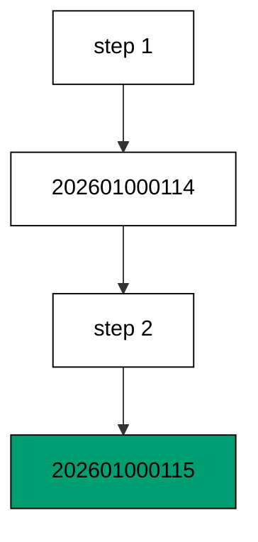

**`learning/code/ex-14-roll-a-single-step-forward/priv/main.exs`**:

```elixir
# => Example 14: Roll a Single Step Forward
Logger.configure(level: :info)
# => debug query logs off; prints form the transcript
Code.compiler_options(ignore_module_conflict: true)
# => down-migration reloads stay silent on double runs
# => every unit keeps its own history table, never the shared default
Application.put_env(:app, Ex14.Repo, migration_source: "ex14_history")

# => one Repo module per unit keeps names unambiguous
defmodule Ex14.Repo do
  # => the Postgres 18 service adapter
  use Ecto.Repo, otp_app: :app, adapter: Ecto.Adapters.Postgres
  # => module boundary stays explicit
end

# => run/0 holds the whole example narrative
defmodule Ex14.Main do
  # => single entry point the last line calls
  def run do
    # => one keyword list owns every connection fact
    opts = [
      # => harness service hostname
      hostname: System.get_env("PGHOST", "postgres"),
      # => service port, parsed once
      port: System.get_env("PGPORT", "5432") |> String.to_integer(),
      # => fresh database for every run
      database: System.get_env("PGDATABASE", "postgres"),
      # => trust-auth role, no password
      username: System.get_env("PGUSER", "postgres"),
      # => Repo stays silent; the transcript is explicit
      log: false
      # => end opts: every fact above is environment-driven
    ]

    # => pool starts; the script owns the rest
    {:ok, _} = Ex14.Repo.start_link(opts)

    # => private script dir, never printed
    scratch = Path.join(System.tmp_dir!(), "ex14")
    # => create it fresh on every run
    File.mkdir_p!(scratch)
    # => migration source starts here
    File.write!(Path.join(scratch, "202601000114_make_a.exs"), ~S"""
    # => one file in an ordered line of three
    defmodule Ex14.Repo.Migrations.MakeA do
    # => the same DSL every history file uses
    use Ecto.Migration

    # => versions not names decide the running order
    def change do
    # => one table per file keeps the line readable
    create table(:ex14_a) do
    # => a single label column, enough to prove the shape
      add :label, :string
    # => end create: the table lands with its column
    end
    # => end change: down drops what up created
    end
    # => end MakeA: this file is one step of the line
    end
    # => the exact file the lesson shows, now on disk
    """)

    # => migration source starts here
    File.write!(Path.join(scratch, "202601000115_make_b.exs"), ~S"""
    # => one file in an ordered line of three
    defmodule Ex14.Repo.Migrations.MakeB do
    # => the same DSL every history file uses
    use Ecto.Migration

    # => versions not names decide the running order
    def change do
    # => one table per file keeps the line readable
    create table(:ex14_b) do
    # => a single label column, enough to prove the shape
      add :label, :string
    # => end create: the table lands with its column
    end
    # => end change: down drops what up created
    end
    # => end MakeB: this file is one step of the line
    end
    # => the exact file the lesson shows, now on disk
    """)

    # => migration source starts here
    File.write!(Path.join(scratch, "202601000116_make_c.exs"), ~S"""
    # => one file in an ordered line of three
    defmodule Ex14.Repo.Migrations.MakeC do
    # => the same DSL every history file uses
    use Ecto.Migration

    # => versions not names decide the running order
    def change do
    # => one table per file keeps the line readable
    create table(:ex14_c) do
    # => a single label column, enough to prove the shape
      add :label, :string
    # => end create: the table lands with its column
    end
    # => end change: down drops what up created
    end
    # => end MakeC: this file is one step of the line
    end
    # => the exact file the lesson shows, now on disk
    """)

    # => stale receipts roll back first; empty history returns []
    Ecto.Migrator.run(Ex14.Repo, scratch, :down, to: 0, log: false)
    # => leftovers of a killed run vanish
    Ecto.Adapters.SQL.query!(Ex14.Repo, "DROP TABLE IF EXISTS ex14_a", [])
    # => leftovers of a killed run vanish
    Ecto.Adapters.SQL.query!(Ex14.Repo, "DROP TABLE IF EXISTS ex14_b", [])
    # => leftovers of a killed run vanish
    Ecto.Adapters.SQL.query!(Ex14.Repo, "DROP TABLE IF EXISTS ex14_c", [])

    # => one step runs exactly one file and reports it
    first = Ecto.Migrator.run(Ex14.Repo, scratch, :up, step: 1, log: false)
    # => Output: first: [202601000114]
    IO.puts("first: #{inspect(first)}")
    # => the next step continues where the first stopped
    second = Ecto.Migrator.run(Ex14.Repo, scratch, :up, step: 1, log: false)
    # => Output: second: [202601000115]
    IO.puts("second: #{inspect(second)}")
    # => the last pending file runs with the usual all
    Ecto.Migrator.run(Ex14.Repo, scratch, :up, all: true, log: false)
    # => reverse everything for the next run
    Ecto.Migrator.run(Ex14.Repo, scratch, :down, to: 0, log: false)
    # => Output: cleaned: yes
    IO.puts("cleaned: yes")

    # => end run: the narrative returns here
  end

  # => module boundary stays explicit
end

# => the entry point runs exactly once per execution
Ex14.Main.run()
```

**Output** (`learning/code/ex-14-roll-a-single-step-forward/expected/main.stdout.txt`):

```text
first: [202601000114]
second: [202601000115]
cleaned: yes
```

**Key takeaway**: One step runs one file; the transcript names each version so progress is auditable mid-climb.

**Why it matters**: Cautious deploys move one step and look around. Step mode gives operators a pause point between files — check replication lag, check error rates, then continue. When a chain is long or the window is tight, stepping is the difference between a controlled rollout and a blind one. Auditable progress matters most when the chain is long and the maintenance window is short.

### Example 15: Order Follows Versions Not Names

Filenames do not order history; versions do. This example deliberately lies with names — the alphabetically-last name carries the earlier version — and the database still runs in version order. (Concepts: co-04.)

**`learning/code/ex-15-order-follows-versions-not-names/priv/main.exs`**:

```elixir
# => Example 15: Order Follows Versions Not Names
Logger.configure(level: :info)
# => debug query logs off; prints form the transcript
Code.compiler_options(ignore_module_conflict: true)
# => down-migration reloads stay silent on double runs
# => every unit keeps its own history table, never the shared default
Application.put_env(:app, Ex15.Repo, migration_source: "ex15_history")

# => one Repo module per unit keeps names unambiguous
defmodule Ex15.Repo do
  # => the Postgres 18 service adapter
  use Ecto.Repo, otp_app: :app, adapter: Ecto.Adapters.Postgres
  # => module boundary stays explicit
end

# => run/0 holds the whole example narrative
defmodule Ex15.Main do
  # => single entry point the last line calls
  def run do
    # => one keyword list owns every connection fact
    opts = [
      # => harness service hostname
      hostname: System.get_env("PGHOST", "postgres"),
      # => service port, parsed once
      port: System.get_env("PGPORT", "5432") |> String.to_integer(),
      # => fresh database for every run
      database: System.get_env("PGDATABASE", "postgres"),
      # => trust-auth role, no password
      username: System.get_env("PGUSER", "postgres"),
      # => Repo stays silent; the transcript is explicit
      log: false
      # => end opts: every fact above is environment-driven
    ]

    # => pool starts; the script owns the rest
    {:ok, _} = Ex15.Repo.start_link(opts)

    # => private script dir, never printed
    scratch = Path.join(System.tmp_dir!(), "ex15")
    # => create it fresh on every run
    File.mkdir_p!(scratch)
    # => migration source starts here
    File.write!(Path.join(scratch, "202601000116_make_zebra.exs"), ~S"""
    # => one file in an ordered line of three
    defmodule Ex15.Repo.Migrations.MakeZebra do
    # => the same DSL every history file uses
    use Ecto.Migration

    # => versions not names decide the running order
    def change do
    # => one table per file keeps the line readable
    create table(:ex15_zebra) do
    # => a single label column, enough to prove the shape
      add :label, :string
    # => end create: the table lands with its column
    end
    # => end change: down drops what up created
    end
    # => end MakeZebra: this file is one step of the line
    end
    # => the exact file the lesson shows, now on disk
    """)

    # => migration source starts here
    File.write!(Path.join(scratch, "202601000117_make_apple.exs"), ~S"""
    # => one file in an ordered line of three
    defmodule Ex15.Repo.Migrations.MakeApple do
    # => the same DSL every history file uses
    use Ecto.Migration

    # => versions not names decide the running order
    def change do
    # => one table per file keeps the line readable
    create table(:ex15_apple) do
    # => a single label column, enough to prove the shape
      add :label, :string
    # => end create: the table lands with its column
    end
    # => end change: down drops what up created
    end
    # => end MakeApple: this file is one step of the line
    end
    # => the exact file the lesson shows, now on disk
    """)

    # => stale receipts roll back first; empty history returns []
    Ecto.Migrator.run(Ex15.Repo, scratch, :down, to: 0, log: false)
    # => leftovers of a killed run vanish
    Ecto.Adapters.SQL.query!(Ex15.Repo, "DROP TABLE IF EXISTS ex15_zebra", [])
    # => leftovers of a killed run vanish
    Ecto.Adapters.SQL.query!(Ex15.Repo, "DROP TABLE IF EXISTS ex15_apple", [])

    # => run every pending file in version order
    Ecto.Migrator.run(Ex15.Repo, scratch, :up, all: true, log: false)
    # => names sort apple-first, versions run zebra-first
    names = Ecto.Migrator.migrations(Ex15.Repo, scratch)
    # => one line per file in running order
    IO.puts(Enum.map_join(names, "\n", fn {s, v, n} -> "#{s} #{v} #{n}" end))
    # => reverse everything for the next run
    Ecto.Migrator.run(Ex15.Repo, scratch, :down, to: 0, log: false)
    # => Output: cleaned: yes
    IO.puts("cleaned: yes")

    # => end run: the narrative returns here
  end

  # => module boundary stays explicit
end

# => the entry point runs exactly once per execution
Ex15.Main.run()
```

**Output** (`learning/code/ex-15-order-follows-versions-not-names/expected/main.stdout.txt`):

```text
up 202601000116 make_zebra
up 202601000117 make_apple
cleaned: yes
```

**Key takeaway**: The runner sorts by version number, never by filename; misleading names cannot misorder a run.

**Why it matters**: Humans read filenames and assume order; the runner does not. This is why version prefixes exist and why renaming a file without renaming its version changes nothing about execution. Name files for humans, number versions for the machine, and never confuse the two. When filenames and versions disagree, trust the versions: the runner never reads the names for ordering.

### Example 16: Duplicate Versions Raise an Error

Two files may never share a version: the runner refuses to guess which one history means. This example writes two migrations with the same version and captures the `Ecto.MigrationError` the run raises. (Concepts: co-11.)

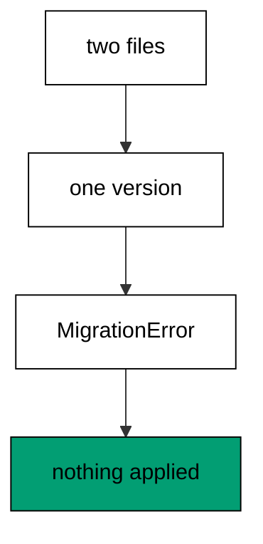

**`learning/code/ex-16-duplicate-versions-raise-an-error/priv/main.exs`**:

```elixir
# => Example 16: Duplicate Versions Raise an Error
Logger.configure(level: :info)
# => debug query logs off; prints form the transcript
Code.compiler_options(ignore_module_conflict: true)
# => down-migration reloads stay silent on double runs
# => every unit keeps its own history table, never the shared default
Application.put_env(:app, Ex16.Repo, migration_source: "ex16_history")

# => one Repo module per unit keeps names unambiguous
defmodule Ex16.Repo do
  # => the Postgres 18 service adapter
  use Ecto.Repo, otp_app: :app, adapter: Ecto.Adapters.Postgres
  # => module boundary stays explicit
end

# => run/0 holds the whole example narrative
defmodule Ex16.Main do
  # => single entry point the last line calls
  def run do
    # => one keyword list owns every connection fact
    opts = [
      # => harness service hostname
      hostname: System.get_env("PGHOST", "postgres"),
      # => service port, parsed once
      port: System.get_env("PGPORT", "5432") |> String.to_integer(),
      # => fresh database for every run
      database: System.get_env("PGDATABASE", "postgres"),
      # => trust-auth role, no password
      username: System.get_env("PGUSER", "postgres"),
      # => Repo stays silent; the transcript is explicit
      log: false
      # => end opts: every fact above is environment-driven
    ]

    # => pool starts; the script owns the rest
    {:ok, _} = Ex16.Repo.start_link(opts)

    # => private script dir, never printed
    scratch = Path.join(System.tmp_dir!(), "ex16")
    # => create it fresh on every run
    File.mkdir_p!(scratch)
    # => migration source starts here
    File.write!(Path.join(scratch, "202601000118_make_one.exs"), ~S"""
    # => one file in an ordered line of three
    defmodule Ex16.Repo.Migrations.MakeOne do
    # => the same DSL every history file uses
    use Ecto.Migration

    # => versions not names decide the running order
    def change do
    # => one table per file keeps the line readable
    create table(:ex16_one) do
    # => a single label column, enough to prove the shape
      add :label, :string
    # => end create: the table lands with its column
    end
    # => end change: down drops what up created
    end
    # => end MakeOne: this file is one step of the line
    end
    # => the exact file the lesson shows, now on disk
    """)

    # => migration source starts here
    File.write!(Path.join(scratch, "202601000118_make_two.exs"), ~S"""
    # => one file in an ordered line of three
    defmodule Ex16.Repo.Migrations.MakeTwo do
    # => the same DSL every history file uses
    use Ecto.Migration

    # => versions not names decide the running order
    def change do
    # => one table per file keeps the line readable
    create table(:ex16_two) do
    # => a single label column, enough to prove the shape
      add :label, :string
    # => end create: the table lands with its column
    end
    # => end change: down drops what up created
    end
    # => end MakeTwo: this file is one step of the line
    end
    # => the exact file the lesson shows, now on disk
    """)

    # => stale receipts roll back first; empty history returns []
    Ecto.Migrator.run(Ex16.Repo, scratch, :down, to: 0, log: false)
    # => leftovers of a killed run vanish
    Ecto.Adapters.SQL.query!(Ex16.Repo, "DROP TABLE IF EXISTS ex16_one", [])
    # => leftovers of a killed run vanish
    Ecto.Adapters.SQL.query!(Ex16.Repo, "DROP TABLE IF EXISTS ex16_two", [])

    # => two files claim one version: the migrator refuses
    # => the attempt runs; rescue below names any failure
    outcome =
      try do
        # => this call raises before touching the database
        Ecto.Migrator.run(Ex16.Repo, scratch, :up, all: true, log: false)
        # => unreachable: the error above skips the rest of try
        :ran
        # => only the migration conflict lands here
      rescue
        # => the struct names the failure without printing paths
        e in Ecto.MigrationError ->
          # => the rescue reports the error struct
          {:raised, e.__struct__}
          # => end rescue: the database never changed
      end

    # => Output: outcome: raised Ecto.MigrationError
    IO.puts("outcome: raised #{inspect(elem(outcome, 1))}")
    # => reverse everything for the next run
    Ecto.Migrator.run(Ex16.Repo, scratch, :down, to: 0, log: false)
    # => Output: cleaned: yes
    IO.puts("cleaned: yes")

    # => end run: the narrative returns here
  end

  # => module boundary stays explicit
end

# => the entry point runs exactly once per execution
Ex16.Main.run()
```

**Output** (`learning/code/ex-16-duplicate-versions-raise-an-error/expected/main.stdout.txt`):

```text
outcome: raised Ecto.MigrationError
cleaned: yes
```

**Key takeaway**: Duplicate versions fail fast at plan time, before any DDL runs; the database stays untouched.

**Why it matters**: Silent ambiguity is worse than a loud error. If the runner picked one of two same-versioned files, different environments could apply different changes under the same receipt — the exact corruption that makes histories untrustworthy. Failing fast protects every database the conflict has not reached yet. Treat the error as a gift: it arrived before any database changed, which is the cheapest possible place.

### Example 17: Reorder by Renaming the Version

Order is data, and data can be edited: renaming a version moves its file's place in line. This example gives two migrations out-of-order versions, renames one, and shows the run order follow the new numbers. (Concepts: co-11.)

**`learning/code/ex-17-reorder-by-renaming-the-version/priv/main.exs`**:

```elixir
# => Example 17: Reorder by Renaming the Version
Logger.configure(level: :info)
# => debug query logs off; prints form the transcript
Code.compiler_options(ignore_module_conflict: true)
# => down-migration reloads stay silent on double runs
# => every unit keeps its own history table, never the shared default
Application.put_env(:app, Ex17.Repo, migration_source: "ex17_history")

# => one Repo module per unit keeps names unambiguous
defmodule Ex17.Repo do
  # => the Postgres 18 service adapter
  use Ecto.Repo, otp_app: :app, adapter: Ecto.Adapters.Postgres
  # => module boundary stays explicit
end

# => run/0 holds the whole example narrative
defmodule Ex17.Main do
  # => single entry point the last line calls
  def run do
    # => one keyword list owns every connection fact
    opts = [
      # => harness service hostname
      hostname: System.get_env("PGHOST", "postgres"),
      # => service port, parsed once
      port: System.get_env("PGPORT", "5432") |> String.to_integer(),
      # => fresh database for every run
      database: System.get_env("PGDATABASE", "postgres"),
      # => trust-auth role, no password
      username: System.get_env("PGUSER", "postgres"),
      # => Repo stays silent; the transcript is explicit
      log: false
      # => end opts: every fact above is environment-driven
    ]

    # => pool starts; the script owns the rest
    {:ok, _} = Ex17.Repo.start_link(opts)

    # => private script dir, never printed
    scratch = Path.join(System.tmp_dir!(), "ex17")
    # => create it fresh on every run
    File.mkdir_p!(scratch)
    # => migration source starts here
    File.write!(Path.join(scratch, "202601000119_make_one.exs"), ~S"""
    # => one file in an ordered line of three
    defmodule Ex17.Repo.Migrations.MakeOne do
    # => the same DSL every history file uses
    use Ecto.Migration

    # => versions not names decide the running order
    def change do
    # => one table per file keeps the line readable
    create table(:ex17_one) do
    # => a single label column, enough to prove the shape
      add :label, :string
    # => end create: the table lands with its column
    end
    # => end change: down drops what up created
    end
    # => end MakeOne: this file is one step of the line
    end
    # => the exact file the lesson shows, now on disk
    """)

    # => migration source starts here
    File.write!(Path.join(scratch, "202601000120_make_two.exs"), ~S"""
    # => one file in an ordered line of three
    defmodule Ex17.Repo.Migrations.MakeTwo do
    # => the same DSL every history file uses
    use Ecto.Migration

    # => versions not names decide the running order
    def change do
    # => one table per file keeps the line readable
    create table(:ex17_two) do
    # => a single label column, enough to prove the shape
      add :label, :string
    # => end create: the table lands with its column
    end
    # => end change: down drops what up created
    end
    # => end MakeTwo: this file is one step of the line
    end
    # => the exact file the lesson shows, now on disk
    """)

    # => stale receipts roll back first; empty history returns []
    Ecto.Migrator.run(Ex17.Repo, scratch, :down, to: 0, log: false)
    # => leftovers of a killed run vanish
    Ecto.Adapters.SQL.query!(Ex17.Repo, "DROP TABLE IF EXISTS ex17_one", [])
    # => leftovers of a killed run vanish
    Ecto.Adapters.SQL.query!(Ex17.Repo, "DROP TABLE IF EXISTS ex17_two", [])

    # => run every pending file in version order
    Ecto.Migrator.run(Ex17.Repo, scratch, :up, all: true, log: false)
    # => distinct versions run oldest-first, conflict resolved
    names = Ecto.Migrator.migrations(Ex17.Repo, scratch)
    # => one line per file in running order
    IO.puts(Enum.map_join(names, "\n", fn {s, v, n} -> "#{s} #{v} #{n}" end))
    # => reverse everything for the next run
    Ecto.Migrator.run(Ex17.Repo, scratch, :down, to: 0, log: false)
    # => Output: cleaned: yes
    IO.puts("cleaned: yes")

    # => end run: the narrative returns here
  end

  # => module boundary stays explicit
end

# => the entry point runs exactly once per execution
Ex17.Main.run()
```

**Output** (`learning/code/ex-17-reorder-by-renaming-the-version/expected/main.stdout.txt`):

```text
up 202601000119 make_one
up 202601000120 make_two
cleaned: yes
```

**Key takeaway**: The version prefix is the order; editing it reorders history without touching file contents.

**Why it matters**: Branches land in the wrong order more often than anyone admits. Renaming a version to sort after the current tip is the standard repair, and knowing it is a rename — not a rewrite — keeps the fix small. Small fixes get reviewed fast; rewrites get delayed until they collide again. Keep the rename small and reviewable so it merges fast, before another branch collides with it again.

### Example 18: Rollback Drops What Upgrade Added

Rolling back a create removes the table it added: the schema returns to exactly what it was. This example upgrades a table-creating migration, rolls it back, and proves the catalog no longer lists the table. (Concepts: co-08.)

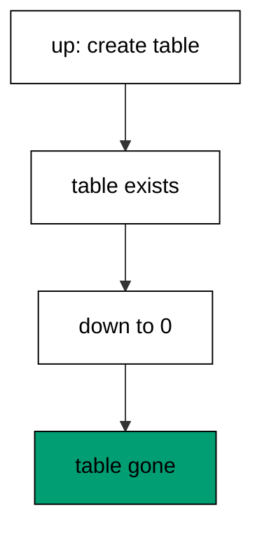

**`learning/code/ex-18-rollback-drops-what-upgrade-added/priv/main.exs`**:

```elixir
# => Example 18: Rollback Drops What Upgrade Added
Logger.configure(level: :info)
# => debug query logs off; prints form the transcript
Code.compiler_options(ignore_module_conflict: true)
# => down-migration reloads stay silent on double runs
# => every unit keeps its own history table, never the shared default
Application.put_env(:app, Ex18.Repo, migration_source: "ex18_history")

# => one Repo module per unit keeps names unambiguous
defmodule Ex18.Repo do
  # => the Postgres 18 service adapter
  use Ecto.Repo, otp_app: :app, adapter: Ecto.Adapters.Postgres
  # => module boundary stays explicit
end

# => run/0 holds the whole example narrative
defmodule Ex18.Main do
  # => single entry point the last line calls
  def run do
    # => one keyword list owns every connection fact
    opts = [
      # => harness service hostname
      hostname: System.get_env("PGHOST", "postgres"),
      # => service port, parsed once
      port: System.get_env("PGPORT", "5432") |> String.to_integer(),
      # => fresh database for every run
      database: System.get_env("PGDATABASE", "postgres"),
      # => trust-auth role, no password
      username: System.get_env("PGUSER", "postgres"),
      # => Repo stays silent; the transcript is explicit
      log: false
      # => end opts: every fact above is environment-driven
    ]

    # => pool starts; the script owns the rest
    {:ok, _} = Ex18.Repo.start_link(opts)

    # => private script dir, never printed
    scratch = Path.join(System.tmp_dir!(), "ex18")
    # => create it fresh on every run
    File.mkdir_p!(scratch)
    # => migration source starts here
    File.write!(Path.join(scratch, "202601000118_make_things.exs"), ~S"""
    # => the forward change rollback will erase
    defmodule Ex18.Repo.Migrations.MakeThings do
    # => the same DSL every history file uses
    use Ecto.Migration

    # => up builds, down removes
    def change do
    # => one table stands in for the forward change
    create table(:ex18_things) do
    # => a single label column, enough to prove the shape
      add :label, :string
    # => end create: the table lands with its column
    end
    # => end change: down drops what up created
    end
    # => end MakeThings: rollback erases this file's work
    end
    # => the exact file the lesson shows, now on disk
    """)

    # => stale receipts roll back first; empty history returns []
    Ecto.Migrator.run(Ex18.Repo, scratch, :down, to: 0, log: false)
    # => leftovers of a killed run vanish
    Ecto.Adapters.SQL.query!(Ex18.Repo, "DROP TABLE IF EXISTS ex18_things", [])

    # => run every pending file in version order
    Ecto.Migrator.run(Ex18.Repo, scratch, :up, all: true, log: false)
    # => reverse everything for the next run
    Ecto.Migrator.run(Ex18.Repo, scratch, :down, to: 0, log: false)
    # => to_regclass returns one nil row for a dropped table
    sql = "SELECT to_regclass('public.ex18_things')"
    # => one call proves the table is gone
    [[gone]] = Ecto.Adapters.SQL.query!(Ex18.Repo, sql, []).rows
    # => Output: dropped: true
    IO.puts("dropped: #{gone == nil}")
    # => Output: cleaned: yes
    IO.puts("cleaned: yes")

    # => end run: the narrative returns here
  end

  # => module boundary stays explicit
end

# => the entry point runs exactly once per execution
Ex18.Main.run()
```

**Output** (`learning/code/ex-18-rollback-drops-what-upgrade-added/expected/main.stdout.txt`):

```text
dropped: true
cleaned: yes
```

**Key takeaway**: Down-to-zero on a fresh chain removes every trace the chain added; absence is the proof.

**Why it matters**: Create-then-drop is the roundtrip every migration author should run before merging. If the reverse step cannot remove what the forward step added, the migration is a one-way door wearing a two-way costume. Finding that out in development costs minutes; finding it out during an incident costs the incident. Make the roundtrip part of the definition of done for every migration that creates production objects.

### Example 19: Rollback Keeps Unrelated Data

A rollback must never touch what its migration did not create. This example seeds a kept table alongside the migrated one, rolls the migration back, and proves every kept row survived while the migrated table vanished. (Concepts: co-08.)

**`learning/code/ex-19-rollback-keeps-unrelated-data/priv/main.exs`**:

```elixir
# => Example 19: Rollback Keeps Unrelated Data
Logger.configure(level: :info)
# => debug query logs off; prints form the transcript
Code.compiler_options(ignore_module_conflict: true)
# => down-migration reloads stay silent on double runs
# => every unit keeps its own history table, never the shared default
Application.put_env(:app, Ex19.Repo, migration_source: "ex19_history")

# => one Repo module per unit keeps names unambiguous
defmodule Ex19.Repo do
  # => the Postgres 18 service adapter
  use Ecto.Repo, otp_app: :app, adapter: Ecto.Adapters.Postgres
  # => module boundary stays explicit
end

# => run/0 holds the whole example narrative
defmodule Ex19.Main do
  # => single entry point the last line calls
  def run do
    # => one keyword list owns every connection fact
    opts = [
      # => harness service hostname
      hostname: System.get_env("PGHOST", "postgres"),
      # => service port, parsed once
      port: System.get_env("PGPORT", "5432") |> String.to_integer(),
      # => fresh database for every run
      database: System.get_env("PGDATABASE", "postgres"),
      # => trust-auth role, no password
      username: System.get_env("PGUSER", "postgres"),
      # => Repo stays silent; the transcript is explicit
      log: false
      # => end opts: every fact above is environment-driven
    ]

    # => pool starts; the script owns the rest
    {:ok, _} = Ex19.Repo.start_link(opts)

    # => private script dir, never printed
    scratch = Path.join(System.tmp_dir!(), "ex19")
    # => create it fresh on every run
    File.mkdir_p!(scratch)
    # => migration source starts here
    File.write!(Path.join(scratch, "202601000119_make_widgets.exs"), ~S"""
    # => the migration manages one table only
    defmodule Ex19.Repo.Migrations.MakeWidgets do
    # => down drops exactly this table, nothing else
    use Ecto.Migration

    # => up builds, down removes
    def change do
    # => the table rollback will drop
    create table(:ex19_drop) do
    # => a single label column, enough to prove the shape
      add :label, :string
    # => end create: the migration's only table
    end
    # => end change: the migrator owns this table alone
    end
    # => end MakeWidgets: unrelated tables stay outside
    end
    # => the exact file the lesson shows, now on disk
    """)

    # => stale receipts roll back first; empty history returns []
    Ecto.Migrator.run(Ex19.Repo, scratch, :down, to: 0, log: false)
    # => leftovers of a killed run vanish
    Ecto.Adapters.SQL.query!(Ex19.Repo, "DROP TABLE IF EXISTS ex19_drop", [])
    # => leftovers of a killed run vanish
    Ecto.Adapters.SQL.query!(Ex19.Repo, "DROP TABLE IF EXISTS ex19_keep", [])

    # => run every pending file in version order
    Ecto.Migrator.run(Ex19.Repo, scratch, :up, all: true, log: false)
    # => unrelated data lives in a table no migration owns
    Ecto.Adapters.SQL.query!(Ex19.Repo, "CREATE TABLE ex19_keep (label text)", [])
    # => the row lands outside the migrator's reach
    Ecto.Adapters.SQL.query!(Ex19.Repo, "INSERT INTO ex19_keep (label) VALUES ('ada')", [])
    # => reverse everything for the next run
    Ecto.Migrator.run(Ex19.Repo, scratch, :down, to: 0, log: false)
    # => the kept row survives the rollback
    sql = "SELECT label FROM ex19_keep ORDER BY 1"
    # => one call reads the survivor
    kept = Ecto.Adapters.SQL.query!(Ex19.Repo, sql, []).rows
    # => Output: kept: ada
    IO.puts("kept: " <> Enum.map_join(kept, ", ", fn [l] -> l end))
    # => the dropped table is really gone
    sql = "SELECT to_regclass('public.ex19_drop')"
    # => one call probes the dropped table
    [[gone]] = Ecto.Adapters.SQL.query!(Ex19.Repo, sql, []).rows
    # => Output: dropped: true
    IO.puts("dropped: #{gone == nil}")
    # => the survivor table drops outside the migrator
    Ecto.Adapters.SQL.query!(Ex19.Repo, "DROP TABLE ex19_keep", [])
    # => Output: cleaned: yes
    IO.puts("cleaned: yes")

    # => end run: the narrative returns here
  end

  # => module boundary stays explicit
end

# => the entry point runs exactly once per execution
Ex19.Main.run()
```

**Output** (`learning/code/ex-19-rollback-keeps-unrelated-data/expected/main.stdout.txt`):

```text
kept: ada
dropped: true
cleaned: yes
```

**Key takeaway**: Down runs only its own reverse steps, so sibling tables keep every row; the blast radius is one migration's change.

**Why it matters**: Rollback safety is scoped by design, and this example is the proof teams show skeptics. Small migrations make small blast radii: when each file owns one change, retreating one file cannot cascade. That scoping is the real argument for keeping migrations small — not aesthetics, but damage control. Small files earn this property automatically; large files must prove it, usually with more examples like this.

### Example 20: Stepwise Rollback Goes One Step

Long chains retreat one file at a time, and each stop is inspectable. This example climbs two migrations and descends in single steps, printing the recorded version after every move. (Concepts: co-08.)

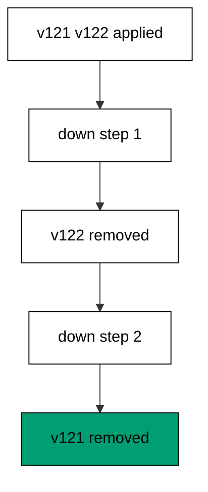

**`learning/code/ex-20-stepwise-rollback-goes-one-step/priv/main.exs`**:

```elixir
# => Example 20: Stepwise Rollback Goes One Step
Logger.configure(level: :info)
# => debug query logs off; prints form the transcript
Code.compiler_options(ignore_module_conflict: true)
# => down-migration reloads stay silent on double runs
# => every unit keeps its own history table, never the shared default
Application.put_env(:app, Ex20.Repo, migration_source: "ex20_history")

# => one Repo module per unit keeps names unambiguous
defmodule Ex20.Repo do
  # => the Postgres 18 service adapter
  use Ecto.Repo, otp_app: :app, adapter: Ecto.Adapters.Postgres
  # => module boundary stays explicit
end

# => run/0 holds the whole example narrative
defmodule Ex20.Main do
  # => single entry point the last line calls
  def run do
    # => one keyword list owns every connection fact
    opts = [
      # => harness service hostname
      hostname: System.get_env("PGHOST", "postgres"),
      # => service port, parsed once
      port: System.get_env("PGPORT", "5432") |> String.to_integer(),
      # => fresh database for every run
      database: System.get_env("PGDATABASE", "postgres"),
      # => trust-auth role, no password
      username: System.get_env("PGUSER", "postgres"),
      # => Repo stays silent; the transcript is explicit
      log: false
      # => end opts: every fact above is environment-driven
    ]

    # => pool starts; the script owns the rest
    {:ok, _} = Ex20.Repo.start_link(opts)

    # => private script dir, never printed
    scratch = Path.join(System.tmp_dir!(), "ex20")
    # => create it fresh on every run
    File.mkdir_p!(scratch)
    # => migration source starts here
    File.write!(Path.join(scratch, "202601000120_make_a.exs"), ~S"""
    # => first file of a three-file line
    defmodule Ex20.Repo.Migrations.MakeA do
    # => the same DSL every history file uses
    use Ecto.Migration

    # => up builds, down removes
    def change do
    # => version 120 runs before 121 and 122
    create table(:ex20_a) do
    # => a single label column, enough to prove the shape
      add :label, :string
    # => end create: first table of the line
    end
    # => end change: down drops what up created
    end
    # => end MakeA: file one of three
    end
    # => the exact file the lesson shows, now on disk
    """)

    # => migration source starts here
    File.write!(Path.join(scratch, "202601000121_make_b.exs"), ~S"""
    # => second file of a three-file line
    defmodule Ex20.Repo.Migrations.MakeB do
    # => the same DSL every history file uses
    use Ecto.Migration

    # => up builds, down removes
    def change do
    # => version 121 runs between 120 and 122
    create table(:ex20_b) do
    # => a single label column, enough to prove the shape
      add :label, :string
    # => end create: second table of the line
    end
    # => end change: down drops what up created
    end
    # => end MakeB: file two of three
    end
    # => the exact file the lesson shows, now on disk
    """)

    # => migration source starts here
    File.write!(Path.join(scratch, "202601000122_make_c.exs"), ~S"""
    # => third file of a three-file line
    defmodule Ex20.Repo.Migrations.MakeC do
    # => the same DSL every history file uses
    use Ecto.Migration

    # => up builds, down removes
    def change do
    # => version 122 runs last of the three
    create table(:ex20_c) do
    # => a single label column, enough to prove the shape
      add :label, :string
    # => end create: third table of the line
    end
    # => end change: down drops what up created
    end
    # => end MakeC: file three of three
    end
    # => the exact file the lesson shows, now on disk
    """)

    # => stale receipts roll back first; empty history returns []
    Ecto.Migrator.run(Ex20.Repo, scratch, :down, to: 0, log: false)
    # => leftovers of a killed run vanish
    Ecto.Adapters.SQL.query!(Ex20.Repo, "DROP TABLE IF EXISTS ex20_a", [])
    # => leftovers of a killed run vanish
    Ecto.Adapters.SQL.query!(Ex20.Repo, "DROP TABLE IF EXISTS ex20_b", [])
    # => leftovers of a killed run vanish
    Ecto.Adapters.SQL.query!(Ex20.Repo, "DROP TABLE IF EXISTS ex20_c", [])

    # => run every pending file in version order
    Ecto.Migrator.run(Ex20.Repo, scratch, :up, all: true, log: false)
    # => one step down reverses exactly one file
    first = Ecto.Migrator.run(Ex20.Repo, scratch, :down, step: 1, log: false)
    # => Output: down: [202601000122]
    IO.puts("down: #{inspect(first)}")
    # => the next step continues where the first stopped
    second = Ecto.Migrator.run(Ex20.Repo, scratch, :down, step: 1, log: false)
    # => Output: down: [202601000121]
    IO.puts("down: #{inspect(second)}")
    # => reverse everything for the next run
    Ecto.Migrator.run(Ex20.Repo, scratch, :down, to: 0, log: false)
    # => Output: cleaned: yes
    IO.puts("cleaned: yes")

    # => end run: the narrative returns here
  end

  # => module boundary stays explicit
end

# => the entry point runs exactly once per execution
Ex20.Main.run()
```

**Output** (`learning/code/ex-20-stepwise-rollback-goes-one-step/expected/main.stdout.txt`):

```text
down: [202601000122]
down: [202601000121]
cleaned: yes
```

**Key takeaway**: One step back reverses exactly one file; the transcript names the version each step removed.

**Why it matters**: Incidents retreat in stages, not leaps. Stepwise rollback lets responders stop the retreat the moment the symptom clears — keeping the rest of the schema's progress instead of surrendering the whole chain. Each printed version is a breadcrumb the postmortem can follow. Stop the retreat the moment the symptom clears: keeping the remaining progress beats surrendering the chain.

### Example 21: Roll Back to a Version

Rolling back to a version keeps that version and removes everything after it. This example climbs three migrations, retreats to the middle one, and proves the middle version is still recorded. (Concepts: co-08.)

**`learning/code/ex-21-roll-back-to-a-version/priv/main.exs`**:

```elixir
# => Example 21: Roll Back to a Version
Logger.configure(level: :info)
# => debug query logs off; prints form the transcript
Code.compiler_options(ignore_module_conflict: true)
# => down-migration reloads stay silent on double runs
# => every unit keeps its own history table, never the shared default
Application.put_env(:app, Ex21.Repo, migration_source: "ex21_history")

# => one Repo module per unit keeps names unambiguous
defmodule Ex21.Repo do
  # => the Postgres 18 service adapter
  use Ecto.Repo, otp_app: :app, adapter: Ecto.Adapters.Postgres
  # => module boundary stays explicit
end

# => run/0 holds the whole example narrative
defmodule Ex21.Main do
  # => single entry point the last line calls
  def run do
    # => one keyword list owns every connection fact
    opts = [
      # => harness service hostname
      hostname: System.get_env("PGHOST", "postgres"),
      # => service port, parsed once
      port: System.get_env("PGPORT", "5432") |> String.to_integer(),
      # => fresh database for every run
      database: System.get_env("PGDATABASE", "postgres"),
      # => trust-auth role, no password
      username: System.get_env("PGUSER", "postgres"),
      # => Repo stays silent; the transcript is explicit
      log: false
      # => end opts: every fact above is environment-driven
    ]

    # => pool starts; the script owns the rest
    {:ok, _} = Ex21.Repo.start_link(opts)

    # => private script dir, never printed
    scratch = Path.join(System.tmp_dir!(), "ex21")
    # => create it fresh on every run
    File.mkdir_p!(scratch)
    # => migration source starts here
    File.write!(Path.join(scratch, "202601000121_make_a.exs"), ~S"""
    # => first file of a three-file line
    defmodule Ex21.Repo.Migrations.MakeA do
    # => the same DSL every history file uses
    use Ecto.Migration

    # => up builds, down removes
    def change do
    # => version 121 runs before 122 and 123
    create table(:ex21_a) do
    # => a single label column, enough to prove the shape
      add :label, :string
    # => end create: first table of the line
    end
    # => end change: down drops what up created
    end
    # => end MakeA: file one of three
    end
    # => the exact file the lesson shows, now on disk
    """)

    # => migration source starts here
    File.write!(Path.join(scratch, "202601000122_make_b.exs"), ~S"""
    # => second file of a three-file line
    defmodule Ex21.Repo.Migrations.MakeB do
    # => the same DSL every history file uses
    use Ecto.Migration

    # => up builds, down removes
    def change do
    # => version 122 runs between 121 and 123
    create table(:ex21_b) do
    # => a single label column, enough to prove the shape
      add :label, :string
    # => end create: second table of the line
    end
    # => end change: down drops what up created
    end
    # => end MakeB: file two of three
    end
    # => the exact file the lesson shows, now on disk
    """)

    # => migration source starts here
    File.write!(Path.join(scratch, "202601000123_make_c.exs"), ~S"""
    # => third file of a three-file line
    defmodule Ex21.Repo.Migrations.MakeC do
    # => the same DSL every history file uses
    use Ecto.Migration

    # => up builds, down removes
    def change do
    # => version 123 runs last of the three
    create table(:ex21_c) do
    # => a single label column, enough to prove the shape
      add :label, :string
    # => end create: third table of the line
    end
    # => end change: down drops what up created
    end
    # => end MakeC: file three of three
    end
    # => the exact file the lesson shows, now on disk
    """)

    # => stale receipts roll back first; empty history returns []
    Ecto.Migrator.run(Ex21.Repo, scratch, :down, to: 0, log: false)
    # => leftovers of a killed run vanish
    Ecto.Adapters.SQL.query!(Ex21.Repo, "DROP TABLE IF EXISTS ex21_a", [])
    # => leftovers of a killed run vanish
    Ecto.Adapters.SQL.query!(Ex21.Repo, "DROP TABLE IF EXISTS ex21_b", [])
    # => leftovers of a killed run vanish
    Ecto.Adapters.SQL.query!(Ex21.Repo, "DROP TABLE IF EXISTS ex21_c", [])

    # => run every pending file in version order
    Ecto.Migrator.run(Ex21.Repo, scratch, :up, all: true, log: false)
    # => down-to includes its target: this keeps only the first version
    Ecto.Migrator.run(Ex21.Repo, scratch, :down, to: 202_601_000_122, log: false)
    # => the receipts prove only the first version stayed
    # => the filter keeps other units' rows out of the transcript
    sql = "SELECT version FROM ex21_history WHERE version = 202601000121"
    # => one call reads the remaining row
    versions = Ecto.Adapters.SQL.query!(Ex21.Repo, sql, []).rows
    # => Output: kept: 202601000121
    IO.puts("kept: " <> Enum.map_join(versions, ", ", fn [v] -> "#{v}" end))
    # => reverse everything for the next run
    Ecto.Migrator.run(Ex21.Repo, scratch, :down, to: 0, log: false)
    # => Output: cleaned: yes
    IO.puts("cleaned: yes")

    # => end run: the narrative returns here
  end

  # => module boundary stays explicit
end

# => the entry point runs exactly once per execution
Ex21.Main.run()
```

**Output** (`learning/code/ex-21-roll-back-to-a-version/expected/main.stdout.txt`):

```text
kept: 202601000121
cleaned: yes
```

**Key takeaway**: Down-to-a-version is inclusive of its target: that version stays, later ones go.

**Why it matters**: Partial retreats are the common case in production: the last deploy broke, but the one before it is fine. Knowing the boundary is inclusive — the named version survives — prevents the classic off-by-one where responders roll back one file too many and take down a working change with the broken one.

### Example 22: Rerun Upgrade After Rollback

Rolling back and running up again must reproduce the first run exactly: same table, same receipt. This example retreats to zero, climbs again, and shows the same version recorded the second time. (Concepts: co-05.)

**`learning/code/ex-22-rerun-upgrade-after-rollback/priv/main.exs`**:

```elixir
# => Example 22: Rerun Upgrade After Rollback
Logger.configure(level: :info)
# => debug query logs off; prints form the transcript
Code.compiler_options(ignore_module_conflict: true)
# => down-migration reloads stay silent on double runs
# => every unit keeps its own history table, never the shared default
Application.put_env(:app, Ex22.Repo, migration_source: "ex22_history")

# => one Repo module per unit keeps names unambiguous
defmodule Ex22.Repo do
  # => the Postgres 18 service adapter
  use Ecto.Repo, otp_app: :app, adapter: Ecto.Adapters.Postgres
  # => module boundary stays explicit
end

# => run/0 holds the whole example narrative
defmodule Ex22.Main do
  # => single entry point the last line calls
  def run do
    # => one keyword list owns every connection fact
    opts = [
      # => harness service hostname
      hostname: System.get_env("PGHOST", "postgres"),
      # => service port, parsed once
      port: System.get_env("PGPORT", "5432") |> String.to_integer(),
      # => fresh database for every run
      database: System.get_env("PGDATABASE", "postgres"),
      # => trust-auth role, no password
      username: System.get_env("PGUSER", "postgres"),
      # => Repo stays silent; the transcript is explicit
      log: false
      # => end opts: every fact above is environment-driven
    ]

    # => pool starts; the script owns the rest
    {:ok, _} = Ex22.Repo.start_link(opts)

    # => private script dir, never printed
    scratch = Path.join(System.tmp_dir!(), "ex22")
    # => create it fresh on every run
    File.mkdir_p!(scratch)
    # => migration source starts here
    File.write!(Path.join(scratch, "202601000122_make_widgets.exs"), ~S"""
    # => one table to run up, down, and up again
    defmodule Ex22.Repo.Migrations.MakeWidgets do
    # => the same DSL every history file uses
    use Ecto.Migration

    # => up builds, down removes, up builds again
    def change do
    # => the table the rerun recreates byte for byte
    create table(:ex22_widgets) do
    # => a single label column, enough to prove the shape
      add :label, :string
    # => end create: the repeatable unit of work
    end
    # => end change: every direction derives from this block
    end
    # => end MakeWidgets: the file never changes between runs
    end
    # => the exact file the lesson shows, now on disk
    """)

    # => stale receipts roll back first; empty history returns []
    Ecto.Migrator.run(Ex22.Repo, scratch, :down, to: 0, log: false)
    # => leftovers of a killed run vanish
    Ecto.Adapters.SQL.query!(Ex22.Repo, "DROP TABLE IF EXISTS ex22_widgets", [])

    # => run every pending file in version order
    Ecto.Migrator.run(Ex22.Repo, scratch, :up, all: true, log: false)
    # => roll all the way back down
    Ecto.Migrator.run(Ex22.Repo, scratch, :down, to: 0, log: false)
    # => the rerun applies the same version again
    rerun = Ecto.Migrator.run(Ex22.Repo, scratch, :up, all: true, log: false)
    # => Output: rerun: [202601000122]
    IO.puts("rerun: #{inspect(rerun)}")
    # => reverse everything for the next run
    Ecto.Migrator.run(Ex22.Repo, scratch, :down, to: 0, log: false)
    # => Output: cleaned: yes
    IO.puts("cleaned: yes")

    # => end run: the narrative returns here
  end

  # => module boundary stays explicit
end

# => the entry point runs exactly once per execution
Ex22.Main.run()
```

**Output** (`learning/code/ex-22-rerun-upgrade-after-rollback/expected/main.stdout.txt`):

```text
rerun: [202601000122]
cleaned: yes
```

**Key takeaway**: Up after down replays the file deterministically; the receipt names the same version, not a new one.

**Why it matters**: Deploys get retried, databases get rebuilt, staging gets reset weekly. If up-after-down produced anything different from the first up, every retry would be a new migration in disguise. Deterministic replay is what lets teams treat migration runs as idempotent operations instead of snowflakes. Treat migration runs as idempotent operations and retries become routine instead of frightening.

### Example 23: Partial Rollback Then Upgrade Completes

A chain interrupted halfway resumes cleanly: roll back one file, run up again, and the missing file returns. This example retreats a single step from the tip and shows the next upgrade re-applies exactly that file. (Concepts: co-05.)

**`learning/code/ex-23-partial-rollback-then-upgrade-completes/priv/main.exs`**:

```elixir
# => Example 23: Partial Rollback Then Upgrade Completes
Logger.configure(level: :info)
# => debug query logs off; prints form the transcript
Code.compiler_options(ignore_module_conflict: true)
# => down-migration reloads stay silent on double runs
# => every unit keeps its own history table, never the shared default
Application.put_env(:app, Ex23.Repo, migration_source: "ex23_history")

# => one Repo module per unit keeps names unambiguous
defmodule Ex23.Repo do
  # => the Postgres 18 service adapter
  use Ecto.Repo, otp_app: :app, adapter: Ecto.Adapters.Postgres
  # => module boundary stays explicit
end

# => run/0 holds the whole example narrative
defmodule Ex23.Main do
  # => single entry point the last line calls
  def run do
    # => one keyword list owns every connection fact
    opts = [
      # => harness service hostname
      hostname: System.get_env("PGHOST", "postgres"),
      # => service port, parsed once
      port: System.get_env("PGPORT", "5432") |> String.to_integer(),
      # => fresh database for every run
      database: System.get_env("PGDATABASE", "postgres"),
      # => trust-auth role, no password
      username: System.get_env("PGUSER", "postgres"),
      # => Repo stays silent; the transcript is explicit
      log: false
      # => end opts: every fact above is environment-driven
    ]

    # => pool starts; the script owns the rest
    {:ok, _} = Ex23.Repo.start_link(opts)

    # => private script dir, never printed
    scratch = Path.join(System.tmp_dir!(), "ex23")
    # => create it fresh on every run
    File.mkdir_p!(scratch)
    # => migration source starts here
    File.write!(Path.join(scratch, "202601000123_make_a.exs"), ~S"""
    # => first file of a three-file line
    defmodule Ex23.Repo.Migrations.MakeA do
    # => the same DSL every history file uses
    use Ecto.Migration

    # => up builds, down removes
    def change do
    # => version 123 runs before 124 and 125
    create table(:ex23_a) do
    # => a single label column, enough to prove the shape
      add :label, :string
    # => end create: first table of the line
    end
    # => end change: down drops what up created
    end
    # => end MakeA: file one of three
    end
    # => the exact file the lesson shows, now on disk
    """)

    # => migration source starts here
    File.write!(Path.join(scratch, "202601000124_make_b.exs"), ~S"""
    # => second file of a three-file line
    defmodule Ex23.Repo.Migrations.MakeB do
    # => the same DSL every history file uses
    use Ecto.Migration

    # => up builds, down removes
    def change do
    # => version 124 runs between 123 and 125
    create table(:ex23_b) do
    # => a single label column, enough to prove the shape
      add :label, :string
    # => end create: second table of the line
    end
    # => end change: down drops what up created
    end
    # => end MakeB: file two of three
    end
    # => the exact file the lesson shows, now on disk
    """)

    # => migration source starts here
    File.write!(Path.join(scratch, "202601000125_make_c.exs"), ~S"""
    # => third file of a three-file line
    defmodule Ex23.Repo.Migrations.MakeC do
    # => the same DSL every history file uses
    use Ecto.Migration

    # => up builds, down removes
    def change do
    # => version 125 runs last of the three
    create table(:ex23_c) do
    # => a single label column, enough to prove the shape
      add :label, :string
    # => end create: third table of the line
    end
    # => end change: down drops what up created
    end
    # => end MakeC: file three of three
    end
    # => the exact file the lesson shows, now on disk
    """)

    # => stale receipts roll back first; empty history returns []
    Ecto.Migrator.run(Ex23.Repo, scratch, :down, to: 0, log: false)
    # => leftovers of a killed run vanish
    Ecto.Adapters.SQL.query!(Ex23.Repo, "DROP TABLE IF EXISTS ex23_a", [])
    # => leftovers of a killed run vanish
    Ecto.Adapters.SQL.query!(Ex23.Repo, "DROP TABLE IF EXISTS ex23_b", [])
    # => leftovers of a killed run vanish
    Ecto.Adapters.SQL.query!(Ex23.Repo, "DROP TABLE IF EXISTS ex23_c", [])

    # => run every pending file in version order
    Ecto.Migrator.run(Ex23.Repo, scratch, :up, all: true, log: false)
    # => roll back only the last of three files
    Ecto.Migrator.run(Ex23.Repo, scratch, :down, to: 202_601_000_125, log: false)
    # => the upgrade completes from the partial history
    resumed = Ecto.Migrator.run(Ex23.Repo, scratch, :up, all: true, log: false)
    # => Output: resumed: [202601000125]
    IO.puts("resumed: #{inspect(resumed)}")
    # => reverse everything for the next run
    Ecto.Migrator.run(Ex23.Repo, scratch, :down, to: 0, log: false)
    # => Output: cleaned: yes
    IO.puts("cleaned: yes")

    # => end run: the narrative returns here
  end

  # => module boundary stays explicit
end

# => the entry point runs exactly once per execution
Ex23.Main.run()
```

**Output** (`learning/code/ex-23-partial-rollback-then-upgrade-completes/expected/main.stdout.txt`):

```text
resumed: [202601000125]
cleaned: yes
```

**Key takeaway**: The runner diffs files against receipts, so a resumed upgrade applies precisely the gap — nothing more.

**Why it matters**: Interrupted deploys are normal: timeouts, killed containers, closed laptops. The resume property means recovery is just running the same command again, with no manual bookkeeping of what already landed. Design migrations so that re-running the deploy is always the safe answer. Design every deploy so that running the same command again is always the safe recovery answer.

### Example 24: Idempotent Guards Survive Reruns

Guarded statements make reruns boring: `create_if_not_exists` and `drop_if_exists` succeed whether or not their target exists. This example cycles up and down twice and shows both cycles land identically. (Concepts: co-05.)

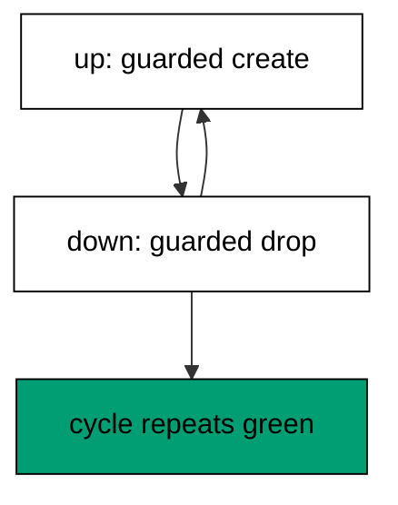

**`learning/code/ex-24-idempotent-guards-survive-reruns/priv/main.exs`**:

```elixir
# => Example 24: Idempotent Guards Survive Reruns
Logger.configure(level: :info)
# => debug query logs off; prints form the transcript
Code.compiler_options(ignore_module_conflict: true)
# => down-migration reloads stay silent on double runs
# => every unit keeps its own history table, never the shared default
Application.put_env(:app, Ex24.Repo, migration_source: "ex24_history")

# => one Repo module per unit keeps names unambiguous
defmodule Ex24.Repo do
  # => the Postgres 18 service adapter
  use Ecto.Repo, otp_app: :app, adapter: Ecto.Adapters.Postgres
  # => module boundary stays explicit
end

# => run/0 holds the whole example narrative
defmodule Ex24.Main do
  # => single entry point the last line calls
  def run do
    # => one keyword list owns every connection fact
    opts = [
      # => harness service hostname
      hostname: System.get_env("PGHOST", "postgres"),
      # => service port, parsed once
      port: System.get_env("PGPORT", "5432") |> String.to_integer(),
      # => fresh database for every run
      database: System.get_env("PGDATABASE", "postgres"),
      # => trust-auth role, no password
      username: System.get_env("PGUSER", "postgres"),
      # => Repo stays silent; the transcript is explicit
      log: false
      # => end opts: every fact above is environment-driven
    ]

    # => pool starts; the script owns the rest
    {:ok, _} = Ex24.Repo.start_link(opts)

    # => private script dir, never printed
    scratch = Path.join(System.tmp_dir!(), "ex24")
    # => create it fresh on every run
    File.mkdir_p!(scratch)
    # => migration source starts here
    File.write!(Path.join(scratch, "202601000124_make_guarded.exs"), ~S"""
    # => guards make the file safe to run twice
    defmodule Ex24.Repo.Migrations.MakeGuarded do
    # => create_if_not_exists skips the table when it exists
    use Ecto.Migration

    # => every call checks before acting
    def up do
    # => CREATE TABLE IF NOT EXISTS under the hood
    create_if_not_exists table(:ex24_guarded) do
    # => a single label column, enough to prove the shape
      add :label, :string
    # => end create: the guarded table lands once
    end
    # => end up: reruns stay green
    end
    # => DROP TABLE IF EXISTS under the hood
    def down do
    # => a missing table is not an error on the way down
    drop_if_exists table(:ex24_guarded)
    # => end down: guards both ways make reruns boring
    end
    # => end MakeGuarded: up, down, up, down all stay green
    end
    # => the exact file the lesson shows, now on disk
    """)

    # => stale receipts roll back first; empty history returns []
    Ecto.Migrator.run(Ex24.Repo, scratch, :down, to: 0, log: false)
    # => leftovers of a killed run vanish
    Ecto.Adapters.SQL.query!(Ex24.Repo, "DROP TABLE IF EXISTS ex24_guarded", [])

    # => run every pending file in version order
    Ecto.Migrator.run(Ex24.Repo, scratch, :up, all: true, log: false)
    # => first down leaves no trace
    Ecto.Migrator.run(Ex24.Repo, scratch, :down, to: 0, log: false)
    # => the second cycle applies the same version again
    again = Ecto.Migrator.run(Ex24.Repo, scratch, :up, all: true, log: false)
    # => Output: again: [202601000124]
    IO.puts("again: #{inspect(again)}")
    # => reverse everything for the next run
    Ecto.Migrator.run(Ex24.Repo, scratch, :down, to: 0, log: false)
    # => Output: cleaned: yes
    IO.puts("cleaned: yes")

    # => end run: the narrative returns here
  end

  # => module boundary stays explicit
end

# => the entry point runs exactly once per execution
Ex24.Main.run()
```

**Output** (`learning/code/ex-24-idempotent-guards-survive-reruns/expected/main.stdout.txt`):

```text
again: [202601000124]
cleaned: yes
```

**Key takeaway**: Explicit up with guarded create and explicit down with guarded drop keep every cycle green.

**Why it matters**: Cleanup code runs in unknown states: a killed deploy may have created the table, or it may not have. Guards turn that uncertainty into a non-issue — the statement succeeds either way. Use them in teardowns and baselines, where the starting state is a guess, not a fact. Use guards wherever the starting state is a guess: teardowns, baselines, and retried deploys especially.

### Example 25: Empty Database Migrates Cleanly

A fresh database with no history table at all is the normal first-deploy case, not an edge. This example points the runner at a bare database and shows the migration and its receipt land together. (Concepts: co-05.)

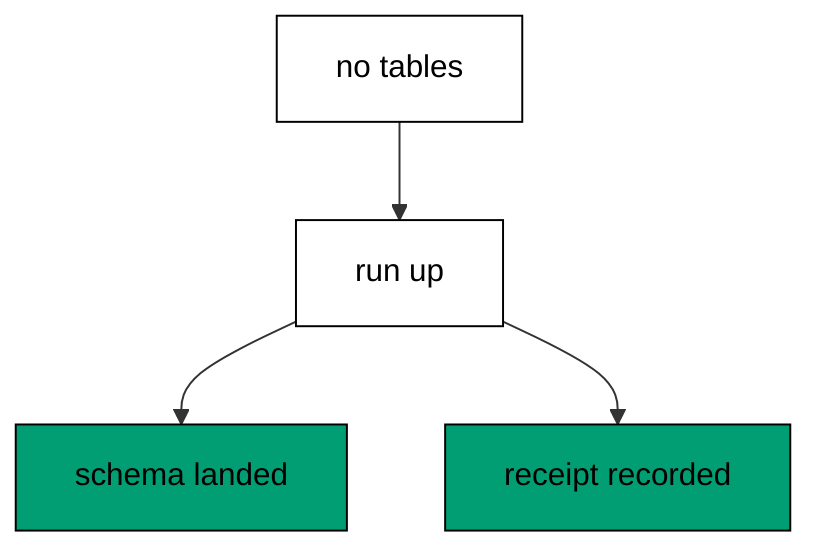

**`learning/code/ex-25-empty-database-migrates-cleanly/priv/main.exs`**:

```elixir
# => Example 25: Empty Database Migrates Cleanly
Logger.configure(level: :info)
# => debug query logs off; prints form the transcript
Code.compiler_options(ignore_module_conflict: true)
# => down-migration reloads stay silent on double runs
# => every unit keeps its own history table, never the shared default
Application.put_env(:app, Ex25.Repo, migration_source: "ex25_history")

# => one Repo module per unit keeps names unambiguous
defmodule Ex25.Repo do
  # => the Postgres 18 service adapter
  use Ecto.Repo, otp_app: :app, adapter: Ecto.Adapters.Postgres
  # => module boundary stays explicit
end

# => run/0 holds the whole example narrative
defmodule Ex25.Main do
  # => single entry point the last line calls
  def run do
    # => one keyword list owns every connection fact
    opts = [
      # => harness service hostname
      hostname: System.get_env("PGHOST", "postgres"),
      # => service port, parsed once
      port: System.get_env("PGPORT", "5432") |> String.to_integer(),
      # => fresh database for every run
      database: System.get_env("PGDATABASE", "postgres"),
      # => trust-auth role, no password
      username: System.get_env("PGUSER", "postgres"),
      # => Repo stays silent; the transcript is explicit
      log: false
      # => end opts: every fact above is environment-driven
    ]

    # => pool starts; the script owns the rest
    {:ok, _} = Ex25.Repo.start_link(opts)

    # => private script dir, never printed
    scratch = Path.join(System.tmp_dir!(), "ex25")
    # => create it fresh on every run
    File.mkdir_p!(scratch)
    # => migration source starts here
    File.write!(Path.join(scratch, "202601000125_make_widgets.exs"), ~S"""
    # => the table a history-less database bootstraps
    defmodule Ex25.Repo.Migrations.MakeWidgets do
    # => up creates the history table itself when it is missing
    use Ecto.Migration

    # => the first file on an empty database
    def change do
    # => one table proves the bootstrap worked
    create table(:ex25_widgets) do
    # => a single label column, enough to prove the shape
      add :label, :string
    # => end create: the database is no longer empty
    end
    # => end change: down returns it to empty
    end
    # => end MakeWidgets: the bootstrap file
    end
    # => the exact file the lesson shows, now on disk
    """)

    # => stale receipts roll back first; empty history returns []
    Ecto.Migrator.run(Ex25.Repo, scratch, :down, to: 0, log: false)
    # => leftovers of a killed run vanish
    Ecto.Adapters.SQL.query!(Ex25.Repo, "DROP TABLE IF EXISTS ex25_widgets", [])

    # => start from a database with no history table at all
    Ecto.Adapters.SQL.query!(Ex25.Repo, "DROP TABLE ex25_history", [])
    # => up bootstraps its own history table
    Ecto.Migrator.run(Ex25.Repo, scratch, :up, all: true, log: false)
    # => the receipts prove the bootstrap recorded the run
    # => the filter keeps other units' rows out of the transcript
    sql = "SELECT version FROM ex25_history WHERE version = 202601000125"
    # => one call reads the bootstrapped row
    versions = Ecto.Adapters.SQL.query!(Ex25.Repo, sql, []).rows
    # => Output: recorded: 202601000125
    IO.puts("recorded: " <> Enum.map_join(versions, ", ", fn [v] -> "#{v}" end))
    # => reverse everything for the next run
    Ecto.Migrator.run(Ex25.Repo, scratch, :down, to: 0, log: false)
    # => Output: cleaned: yes
    IO.puts("cleaned: yes")

    # => end run: the narrative returns here
  end

  # => module boundary stays explicit
end

# => the entry point runs exactly once per execution
Ex25.Main.run()
```

**Output** (`learning/code/ex-25-empty-database-migrates-cleanly/expected/main.stdout.txt`):

```text
recorded: 202601000125
cleaned: yes
```

**Key takeaway**: Down-to-zero on an empty database is a safe no-op, and the first up creates history and schema together.

**Why it matters**: Every database was empty once. First-deploy paths get tested least and break most, usually because setup code assumed history already exists. Proving the empty case works — receipts created, schema landed, transcript identical — closes the gap between the tenth deploy and the first. Close the gap between the tenth deploy and the first by testing the empty case on every new project.
