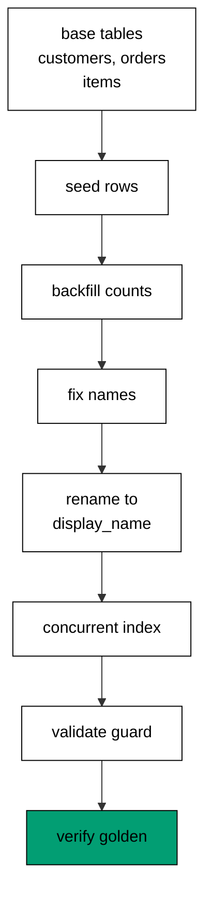

The capstone evolves one order-management schema through eight realistic migrations: customers and orders linked by a foreign key, line items linked to orders, a derived count column filled from a join, a data fix that normalizes messy names, a three-step column rename, a concurrent index, and a validated check guard. Every migration runs for real against the pinned PostgreSQL service, and a golden verification query proves the final shape and data in three fixed lines the harness asserts byte for byte.

## Why this exists -- the big idea

**The problem before the solution**: course examples prove each migration technique in isolation — one file, one idea, one clean database. Real evolutions stack the techniques: the rename lands while traffic reads the old name, the backfill lands while orders keep arriving, and the history must stay linear through all of it. The capstone wires the layers together so the seams are load-bearing: schema steps, data steps, and verification steps in one chain, with the transcript proving the whole chain ran.

**Keep this if you forget everything else**: evolve the schema and the data on separate schedules, keep every step reversible or explicitly one-way, and verify the ending with a query — not with confidence.

## What you will build

A single `main.exs` that writes eight migration files at runtime and runs them in order. `202603010101` creates `cap_customers` with a seeded pair of messily-cased names; `202603010102` creates `cap_orders` with a customer foreign key and seeded totals; `202603010103` creates `cap_items` with an order foreign key and seeded lines. Then the data work: `202603010104` adds a nullable `item_count` and backfills it from a join; `202603010105` normalizes every customer name with one UPDATE; `202603010106` renames `name` to `display_name` in the three-step expand-migrate-contract shape. Finally the production hardening: `202603010107` builds a concurrent index outside the DDL transaction, and `202603010108` adds a `NOT VALID` check guard and validates it. Seeds go in with the schema base so the data steps have real rows to work on; the fix migration reverses to a no-op because a normalization cannot un-know the original mess.

## How the pieces compose

Schema base (Examples 1–8) creates the tables and their foreign keys; the join backfill (Examples 26–32) fills the derived count; the data fix (Example 30) normalizes the names; the three-step rename (Examples 35–39) moves `name` to `display_name` without a flag day; the concurrent index (Example 66) and the advisory migration lock keep the online build safe; the `NOT VALID` guard (Example 41) constrains totals without blocking writers. No new technique appears here — composition is the test. Read the program top to bottom and name the example each section comes from; if a section has no ancestor, it does not belong.



## Reading the transcript

The three output lines each prove one stage: the `ada` line proves the join counted two orders totaling 300 on normalized names; the `grace` line proves the second customer survived every migration with one order totaling 300; the `cleaned` line proves the teardown returned the database to empty, so the next run starts identically. The eight migration versions ran in order before any of those lines printed — the verification query only passes when the base, the backfill, the fix, the rename, the index, and the guard all landed. Any missing line names its broken stage exactly. Rerun the unit and diff: identical bytes, because fixed versions, per-capstone tables, an ordered query, and label-only output leave no room for variance.

## Why this shape survives contact with production

Three decisions carry the whole capstone. First, data steps run after the schema they need and before the guards that constrain them: the count backfill needs the items table, the rename needs the fixed names, the guard needs the totals to already comply. Order is load-bearing, and the version numbers are the order. Second, every destructive step is either reversible or explicitly one-way: the rename walks back with real down steps, while the name fix declares its one-way policy in the down direction instead of pretending. Third, the verification query joins across the renamed column: it proves the rename, the backfill, and the seeds in one result set, so a single passing run means every layer composed. A capstone that only created tables would prove nothing about evolution; this one proves the evolution happened in the right order with the data intact.

## The pinning note

This tool runs on the course's shared hash-locked dependency set (`learning/code/mix.lock`): Ecto SQL drives the migrations, Postgrex talks to PostgreSQL 18. Every learning and drilling unit shares the same lockfile, so the capstone migrates with exactly the bytes the examples trained on. Pinning is a habit, not a file: the lockfile pins every transitive hash, the toolchain pins the interpreter and the database images by digest, and the version table pins the schema. Declare the floor, pin everything, and review pin diffs like code.

**`learning/capstone/code/main.exs`**:

```elixir
# => Capstone: order management on PostgreSQL, eight migrations
Logger.configure(level: :info)
# => debug query logs off; prints form the transcript
Code.compiler_options(ignore_module_conflict: true)
# => down-migration reloads stay silent on double runs
# => the capstone keeps its own history table, never the shared default
# => the advisory lock serializes the online index build
# => one list holds both keys; a second put would wipe the first
repo_env = [migration_source: "capstone_history", migration_lock: :pg_advisory_lock]
# => a single put keeps history and lock configured together
Application.put_env(:app, Capstone.Repo, repo_env)

# => one Repo module keeps names unambiguous
defmodule Capstone.Repo do
  # => the Postgres 18 service adapter
  use Ecto.Repo, otp_app: :app, adapter: Ecto.Adapters.Postgres
  # => module boundary stays explicit
end

# => run/0 holds the whole capstone narrative
defmodule Capstone.Main do
  # => single entry point the last line calls
  def run do
    # => one keyword list owns every connection fact
    opts = [
      # => harness service hostname
      hostname: System.get_env("PGHOST", "postgres"),
      # => service port, parsed once
      port: System.get_env("PGPORT", "5432") |> String.to_integer(),
      # => fresh database for every run
      database: System.get_env("PGDATABASE", "postgres"),
      # => trust-auth role, no password
      username: System.get_env("PGUSER", "postgres"),
      # => Repo stays silent; the transcript is explicit
      log: false
      # => end opts: every fact above is environment-driven
    ]

    # => pool starts; the script owns the rest
    {:ok, _} = Capstone.Repo.start_link(opts)

    # => private script dir, never printed
    scratch = Path.join(System.tmp_dir!(), "capstone")
    # => create it fresh on every run
    File.mkdir_p!(scratch)
    # => migration source starts here
    File.write!(Path.join(scratch, "202603010101_make_customers.exs"), ~S"""
    # => the customers every order belongs to
    defmodule Capstone.Repo.Migrations.MakeCustomers do
    # => seeds arrive with dirty names the fix will clean
    use Ecto.Migration

    # => first the shape, then the rows
    def change do
    # => the customer roster the shop starts with
    create table(:cap_customers) do
    # => casing and padding vary like real imports
      add :name, :string
    # => end create: the customer shape
    end
    # => two-arg execute keeps change reversible
    execute "INSERT INTO cap_customers (name) VALUES ('ADA'), ('grace ')", "DELETE FROM cap_customers"
    # => end change: shape plus seed
    end
    # => end MakeCustomers: migration one of eight
    end
    # => the exact file the lesson shows, now on disk
    """)

    # => migration source starts here
    File.write!(Path.join(scratch, "202603010102_make_orders.exs"), ~S"""
    # => orders reference their customers
    defmodule Capstone.Repo.Migrations.MakeOrders do
    # => foreign keys version beside the tables
    use Ecto.Migration

    # => the order shape with its customer link
    def change do
    # => every order belongs to exactly one customer
    create table(:cap_orders) do
    # => the customer link, indexed for joins
      add :customer_id, references(:cap_customers)
    # => the order total in cents
      add :total, :integer
    # => end create: the order shape
    end
    # => two-arg execute keeps change reversible
    execute "INSERT INTO cap_orders (customer_id, total) VALUES (1, 100), (1, 200), (2, 300)", "DELETE FROM cap_orders"
    # => end change: shape plus seed
    end
    # => end MakeOrders: migration two of eight
    end
    # => the exact file the lesson shows, now on disk
    """)

    # => migration source starts here
    File.write!(Path.join(scratch, "202603010103_make_items.exs"), ~S"""
    # => items reference their orders
    defmodule Capstone.Repo.Migrations.MakeItems do
    # => foreign keys version beside the tables
    use Ecto.Migration

    # => the item shape with its order link
    def change do
    # => every item belongs to exactly one order
    create table(:cap_items) do
    # => the order link, indexed for joins
      add :order_id, references(:cap_orders)
    # => the stock code every item carries
      add :sku, :string
    # => how many units the line holds
      add :qty, :integer
    # => end create: the item shape
    end
    # => two-arg execute keeps change reversible
    execute "INSERT INTO cap_items (order_id, sku, qty) VALUES (1, 'book', 1), (2, 'pen', 3), (3, 'book', 2)", "DELETE FROM cap_items"
    # => end change: shape plus seed
    end
    # => end MakeItems: migration three of eight
    end
    # => the exact file the lesson shows, now on disk
    """)

    # => migration source starts here
    File.write!(Path.join(scratch, "202603010104_backfill_counts.exs"), ~S"""
    # => the count column derives from the items
    defmodule Capstone.Repo.Migrations.BackfillCounts do
    # => explicit up and down for the backfill
    use Ecto.Migration

    # => add the column, then fill it from the join
    def up do
    # => nullable first: old rows gain counts below
    alter table(:cap_orders) do
    # => the derived count starts empty
      add :item_count, :integer
    # => end alter: schema half of the backfill
    end
    # => each order counts its own items
    execute "UPDATE cap_orders o SET item_count = (SELECT count(*) FROM cap_items i WHERE i.order_id = o.id)"
    # => end up: schema plus derived data
    end

    # => down clears the derived counts
    def down do
    # => NULL every count the up wrote
    execute "UPDATE cap_orders SET item_count = NULL"
    # => remove the column the up added
    alter table(:cap_orders) do
    # => the reverse of the schema half
      remove :item_count
    # => end alter: the column is gone
    end
    # => end down: data cleared, schema reverted
    end
    # => end BackfillCounts: migration four of eight
    end
    # => the exact file the lesson shows, now on disk
    """)

    # => migration source starts here
    File.write!(Path.join(scratch, "202603010105_fix_names.exs"), ~S"""
    # => the data fix normalizes the seeded names
    defmodule Capstone.Repo.Migrations.FixNames do
    # => explicit up and down for the data fix
    use Ecto.Migration

    # => trim padding, then fold case, in one statement
    def up do
    # => lower(trim()) repairs both faults at once
    execute "UPDATE cap_customers SET name = lower(trim(name))"
    # => end up: every name is clean
    end

    # => the fix cannot un-know the original mess
    def down do
    # => data fixes reverse to a no-op by team convention
    execute "SELECT 1"
    # => end down: the fix stays fixed
    end
    # => end FixNames: migration five of eight
    end
    # => the exact file the lesson shows, now on disk
    """)

    # => migration source starts here
    File.write!(Path.join(scratch, "202603010106_rename_name.exs"), ~S"""
    # => the rename ships in one deployable file
    defmodule Capstone.Repo.Migrations.RenameName do
    # => explicit up and down for the three-step rename
    use Ecto.Migration

    # => expand, migrate, and contract in version order
    def up do
    # => the successor column beside the original
    alter table(:cap_customers) do
    # => nullable: readers move before the contract
      add :display_name, :string, null: true
    # => end alter: expand lands
    end
    # => every old value moves across
    execute "UPDATE cap_customers SET display_name = name WHERE display_name IS NULL"
    # => the original column leaves after the copy
    alter table(:cap_customers) do
    # => DROP COLUMN under the hood
      remove :name
    # => end alter: contract lands
    end
    # => end up: rename complete in one version
    end

    # => down walks the rename back
    def down do
    # => the original column returns beside the new
    alter table(:cap_customers) do
    # => nullable: the restore tolerates gaps
      add :name, :string, null: true
    # => end alter: expand back
    end
    # => copy the kept values back across
    execute "UPDATE cap_customers SET name = display_name"
    # => the successor leaves after the copy back
    alter table(:cap_customers) do
    # => DROP COLUMN under the hood
      remove :display_name
    # => end alter: contract back
    end
    # => end down: rename walked back
    end
    # => end RenameName: migration six of eight
    end
    # => the exact file the lesson shows, now on disk
    """)

    # => migration source starts here
    File.write!(Path.join(scratch, "202603010107_index_items.exs"), ~S"""
    # => CONCURRENTLY cannot run inside a transaction
    defmodule Capstone.Repo.Migrations.IndexItems do
    # => no DDL transaction: the index builds concurrently
    use Ecto.Migration
    # => no table lock: the advisory lock serializes instead
    @disable_ddl_transaction true

    # => the online index for a busy order table
    def change do
    # => writers continue while the index builds
    create index(:cap_items, [:order_id], concurrently: true)
    # => end change: down drops the online index
    end
    # => end IndexItems: migration seven of eight
    end
    # => the exact file the lesson shows, now on disk
    """)

    # => migration source starts here
    File.write!(Path.join(scratch, "202603010108_guard_totals.exs"), ~S"""
    # => NOT VALID lands without scanning the busy table
    defmodule Capstone.Repo.Migrations.GuardTotals do
    # => explicit up and down for the guard
    use Ecto.Migration

    # => the guard lands, then validates in one deploy
    def up do
    # => new rows obey at once, old rows wait
    execute "ALTER TABLE cap_orders ADD CONSTRAINT positive_total CHECK (total >= 0) NOT VALID"
    # => VALIDATE takes a light lock, writers continue
    execute "ALTER TABLE cap_orders VALIDATE CONSTRAINT positive_total"
    # => end up: every total obeys the guard
    end

    # => down drops the guard by name
    def down do
    # => the reverse names the same constraint
    execute "ALTER TABLE cap_orders DROP CONSTRAINT positive_total"
    # => end down: the guard is gone
    end
    # => end GuardTotals: migration eight of eight
    end
    # => the exact file the lesson shows, now on disk
    """)

    # => stale receipts roll back first; empty history returns []
    Ecto.Migrator.run(Capstone.Repo, scratch, :down, to: 0, log: false)
    # => leftovers of a killed run vanish
    Ecto.Adapters.SQL.query!(Capstone.Repo, "DROP TABLE IF EXISTS cap_customers", [])
    # => leftovers of a killed run vanish
    Ecto.Adapters.SQL.query!(Capstone.Repo, "DROP TABLE IF EXISTS cap_orders", [])
    # => leftovers of a killed run vanish
    Ecto.Adapters.SQL.query!(Capstone.Repo, "DROP TABLE IF EXISTS cap_items", [])

    # => the advisory lock from above serializes the online index build
    # => history and lock share one configuration, set once
    # => all eight migrations run in version order
    Ecto.Migrator.run(Capstone.Repo, scratch, :up, all: true, log: false)
    # => the golden query joins customers to their orders
    sql = "SELECT c.display_name, count(o.id), coalesce(sum(o.total), 0)"
    # => customers keep their orders through every migration
    sql = sql <> " FROM cap_customers c LEFT JOIN cap_orders o ON o.customer_id = c.id"
    # => one row per customer, alphabetical
    sql = sql <> " GROUP BY 1 ORDER BY 1"
    # => one call runs the golden query
    rows = Ecto.Adapters.SQL.query!(Capstone.Repo, sql, []).rows
    # => Output: ada: 2 orders, 300 total
    # => Output: grace: 1 orders, 300 total
    IO.puts(Enum.map_join(rows, "\n", fn [n, c, t] -> "#{n}: #{c} orders, #{t} total" end))
    # => down returns the shop to an empty database
    Ecto.Migrator.run(Capstone.Repo, scratch, :down, to: 0, log: false)
    # => Output: cleaned: yes
    IO.puts("cleaned: yes")

    # => end run: the narrative returns here
  end

  # => module boundary stays explicit
end

# => the entry point runs exactly once per execution
Capstone.Main.run()
```

**Output** (`learning/capstone/code/expected/main/main.stdout.txt`):

```text
ada: 2 orders, 300 total
grace: 1 orders, 300 total
cleaned: yes
```
