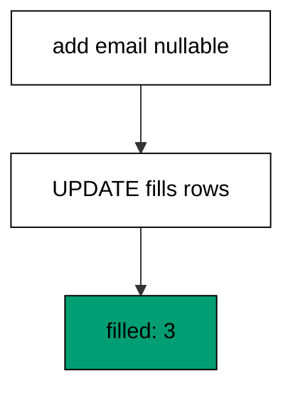
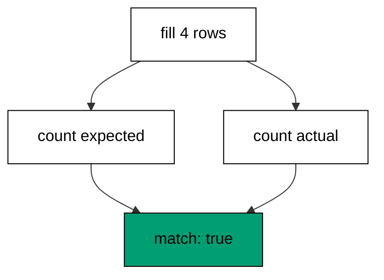
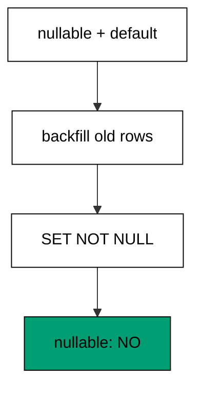
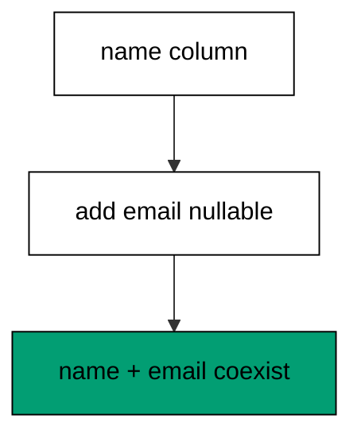
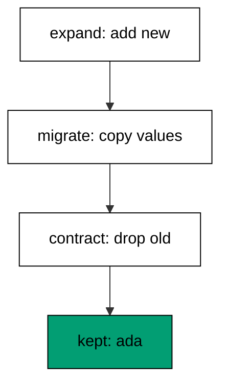
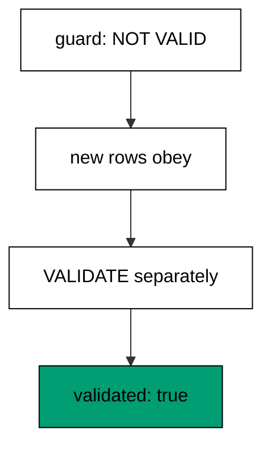
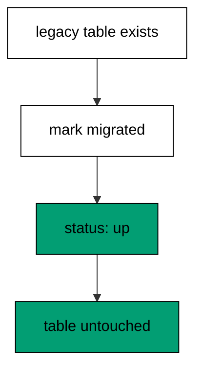
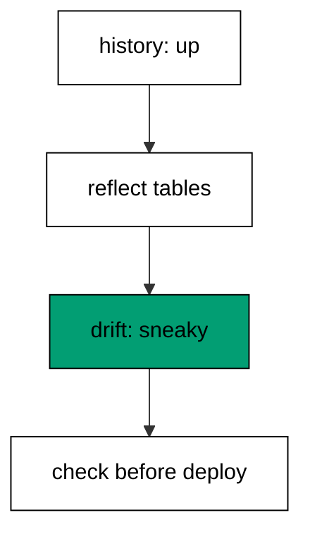
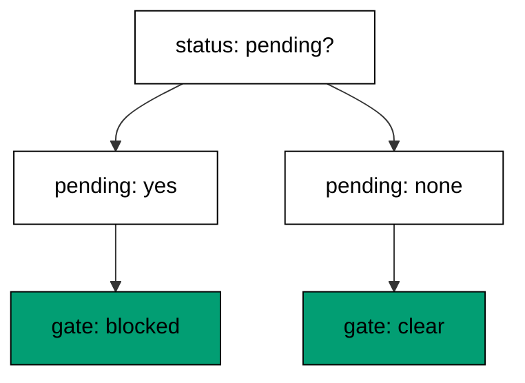

Examples 26–53 turn single migrations into evolutions: backfilling data after the schema lands, splitting breaking changes into zero-downtime steps, and adopting legacy databases into versioned history. Three clusters carry the level: data fills and verification (Examples 26–34), expand-migrate-contract renames and swaps (Examples 35–40), and deploy order, baselines, and drift (Examples 41–53). Every program runs against the real pinned PostgreSQL 18 container; every output is a fixed transcript.

### Example 26: Backfill Fills the New Column

Schema first, data second: the column lands empty, then one statement fills every row from existing values. This example adds a nullable column and backfills it from a sibling column, proving all three rows gained values. (Concepts: co-06.)



**`learning/code/ex-26-backfill-fills-the-new-column/priv/main.exs`**:

```elixir
# => Example 26: Backfill Fills the New Column
Logger.configure(level: :info)
# => debug query logs off; prints form the transcript
Code.compiler_options(ignore_module_conflict: true)
# => down-migration reloads stay silent on double runs
# => every unit keeps its own history table, never the shared default
Application.put_env(:app, Ex26.Repo, migration_source: "ex26_history")

# => one Repo module per unit keeps names unambiguous
defmodule Ex26.Repo do
  # => the Postgres 18 service adapter
  use Ecto.Repo, otp_app: :app, adapter: Ecto.Adapters.Postgres
  # => module boundary stays explicit
end

# => run/0 holds the whole example narrative
defmodule Ex26.Main do
  # => single entry point the last line calls
  def run do
    # => one keyword list owns every connection fact
    opts = [
      # => harness service hostname
      hostname: System.get_env("PGHOST", "postgres"),
      # => service port, parsed once
      port: System.get_env("PGPORT", "5432") |> String.to_integer(),
      # => fresh database for every run
      database: System.get_env("PGDATABASE", "postgres"),
      # => trust-auth role, no password
      username: System.get_env("PGUSER", "postgres"),
      # => Repo stays silent; the transcript is explicit
      log: false
      # => end opts: every fact above is environment-driven
    ]

    # => pool starts; the script owns the rest
    {:ok, _} = Ex26.Repo.start_link(opts)

    # => private script dir, never printed
    scratch = Path.join(System.tmp_dir!(), "ex26")
    # => create it fresh on every run
    File.mkdir_p!(scratch)
    # => migration source starts here
    File.write!(Path.join(scratch, "202601000126_make_members.exs"), ~S"""
    # => members start with names but no email
    defmodule Ex26.Repo.Migrations.MakeMembers do
    # => the seed rows live in the same file
    use Ecto.Migration

    # => first the shape, then the rows
    def change do
    # => handle plus name, no contact column yet
    create table(:ex26_members) do
    # => the display name every row carries
      add :name, :string
    # => end create: names without contact
    end
    # => seed rows the backfill will complete
    # => execute takes its own reverse as a second string
    execute "INSERT INTO ex26_members (name) VALUES ('ada'), ('grace'), ('lin')", "DELETE FROM ex26_members"
    # => end change: shape plus seed in one version
    end
    # => end MakeMembers: the before picture
    end
    # => the exact file the lesson shows, now on disk
    """)

    # => migration source starts here
    File.write!(Path.join(scratch, "202601000127_backfill_email.exs"), ~S"""
    # => the backfill completes rows the schema left blank
    defmodule Ex26.Repo.Migrations.BackfillEmail do
    # => data follows schema in its own version
    use Ecto.Migration

    # => add the column, then fill it, in one file
    def up do
    # => nullable first: old rows have no email yet
    alter table(:ex26_members) do
    # => the new contact column starts empty
      add :email, :string
    # => end alter: schema half of the backfill
    end
    # => derive every email from the names already stored
    execute "UPDATE ex26_members SET email = lower(name) || '@example.dev'"
    # => end up: schema plus data in version order
    end

    # => down clears the fill, then drops the column
    def down do
    # => NULL the fill first so the column drops cleanly
    execute "UPDATE ex26_members SET email = NULL"
    # => remove the column the up added
    alter table(:ex26_members) do
    # => the reverse of the schema half
      remove :email
    # => end alter: the column is gone
    end
    # => end down: data cleared, schema reverted
    end
    # => end BackfillEmail: explicit up and down
    end
    # => the exact file the lesson shows, now on disk
    """)

    # => stale receipts roll back first; empty history returns []
    Ecto.Migrator.run(Ex26.Repo, scratch, :down, to: 0, log: false)
    # => leftovers of a killed run vanish
    Ecto.Adapters.SQL.query!(Ex26.Repo, "DROP TABLE IF EXISTS ex26_members", [])

    # => run every pending file in version order
    Ecto.Migrator.run(Ex26.Repo, scratch, :up, all: true, log: false)
    # => every seed row gained an address
    sql = "SELECT count(*) FROM ex26_members"
    # => the filter counts only filled rows
    sql = sql <> " WHERE email IS NOT NULL"
    # => one call counts the filled rows
    [[filled]] = Ecto.Adapters.SQL.query!(Ex26.Repo, sql, []).rows
    # => Output: filled: 3
    IO.puts("filled: #{filled}")
    # => reverse everything for the next run
    Ecto.Migrator.run(Ex26.Repo, scratch, :down, to: 0, log: false)
    # => Output: cleaned: yes
    IO.puts("cleaned: yes")

    # => end run: the narrative returns here
  end

  # => module boundary stays explicit
end

# => the entry point runs exactly once per execution
Ex26.Main.run()
```

**Output** (`learning/code/ex-26-backfill-fills-the-new-column/expected/main.stdout.txt`):

```text
filled: 3
cleaned: yes
```

**Key takeaway**: Add the column in one migration step, fill it with a plain UPDATE, and verify the filled count.

**Why it matters**: New columns start empty on inhabited tables, and empty is not a value the application can use. The backfill is the step that makes a schema change a data change — and keeping it a separate, countable statement means its progress is measurable instead of magical. Count the filled rows every time; silent partial fills are the failure mode.

### Example 27: Schema First Data Second

Each step of a data migration deserves its own file: shape, rows, then values. This example runs three migrations — create, seed, backfill — and proves the fill landed on the seeded rows. (Concepts: co-06.)

**`learning/code/ex-27-schema-first-data-second/priv/main.exs`**:

```elixir
# => Example 27: Schema First Data Second
Logger.configure(level: :info)
# => debug query logs off; prints form the transcript
Code.compiler_options(ignore_module_conflict: true)
# => down-migration reloads stay silent on double runs
# => every unit keeps its own history table, never the shared default
Application.put_env(:app, Ex27.Repo, migration_source: "ex27_history")

# => one Repo module per unit keeps names unambiguous
defmodule Ex27.Repo do
  # => the Postgres 18 service adapter
  use Ecto.Repo, otp_app: :app, adapter: Ecto.Adapters.Postgres
  # => module boundary stays explicit
end

# => run/0 holds the whole example narrative
defmodule Ex27.Main do
  # => single entry point the last line calls
  def run do
    # => one keyword list owns every connection fact
    opts = [
      # => harness service hostname
      hostname: System.get_env("PGHOST", "postgres"),
      # => service port, parsed once
      port: System.get_env("PGPORT", "5432") |> String.to_integer(),
      # => fresh database for every run
      database: System.get_env("PGDATABASE", "postgres"),
      # => trust-auth role, no password
      username: System.get_env("PGUSER", "postgres"),
      # => Repo stays silent; the transcript is explicit
      log: false
      # => end opts: every fact above is environment-driven
    ]

    # => pool starts; the script owns the rest
    {:ok, _} = Ex27.Repo.start_link(opts)

    # => private script dir, never printed
    scratch = Path.join(System.tmp_dir!(), "ex27")
    # => create it fresh on every run
    File.mkdir_p!(scratch)
    # => migration source starts here
    File.write!(Path.join(scratch, "202601000127_make_members.exs"), ~S"""
    # => members start with names but no email
    defmodule Ex27.Repo.Migrations.MakeMembers do
    # => the seed rows live in the same file
    use Ecto.Migration

    # => first the shape, then the rows
    def change do
    # => handle plus name, no contact column yet
    create table(:ex27_members) do
    # => the display name every row carries
      add :name, :string
    # => end create: names without contact
    end
    # => seed rows the backfill will complete
    # => execute takes its own reverse as a second string
    execute "INSERT INTO ex27_members (name) VALUES ('ada'), ('grace')", "DELETE FROM ex27_members"
    # => end change: shape plus seed in one version
    end
    # => end MakeMembers: the before picture
    end
    # => the exact file the lesson shows, now on disk
    """)

    # => migration source starts here
    File.write!(Path.join(scratch, "202601000128_add_email.exs"), ~S"""
    # => schema lands before data, in its own file
    defmodule Ex27.Repo.Migrations.AddEmail do
    # => nullable first: old rows have no email yet
    use Ecto.Migration

    # => the schema half of the pair
    def change do
    # => ALTER TABLE ADD COLUMN under the hood
    alter table(:ex27_members) do
    # => the new contact column starts empty
      add :email, :string
    # => end alter: schema without data
    end
    # => end change: down removes exactly this column
    end
    # => end AddEmail: schema only, no backfill here
    end
    # => the exact file the lesson shows, now on disk
    """)

    # => migration source starts here
    File.write!(Path.join(scratch, "202601000129_fill_email.exs"), ~S"""
    # => data follows schema in a second file
    defmodule Ex27.Repo.Migrations.FillEmail do
    # => explicit up and down for the data step
    use Ecto.Migration

    # => the data half of the pair
    def up do
    # => derive every email from the names already stored
    execute "UPDATE ex27_members SET email = lower(name) || '@example.dev'"
    # => end up: the fill runs after the schema
    end

    # => down clears the fill the up derived
    def down do
    # => NULL every address the up wrote
    execute "UPDATE ex27_members SET email = NULL"
    # => end down: data cleared, schema untouched
    end
    # => end FillEmail: data only, no schema here
    end
    # => the exact file the lesson shows, now on disk
    """)

    # => stale receipts roll back first; empty history returns []
    Ecto.Migrator.run(Ex27.Repo, scratch, :down, to: 0, log: false)
    # => leftovers of a killed run vanish
    Ecto.Adapters.SQL.query!(Ex27.Repo, "DROP TABLE IF EXISTS ex27_members", [])

    # => run every pending file in version order
    Ecto.Migrator.run(Ex27.Repo, scratch, :up, all: true, log: false)
    # => schema and data versions all recorded
    sql = "SELECT version FROM ex27_history"
    # => this unit owns exactly three versions
    sql = sql <> " WHERE version IN (202601000127, 202601000128, 202601000129) ORDER BY version"
    # => one call reads every receipt
    versions = Ecto.Adapters.SQL.query!(Ex27.Repo, sql, []).rows
    # => Output: versions: 202601000127, 202601000128, 202601000129
    IO.puts("versions: " <> Enum.map_join(versions, ", ", fn [v] -> "#{v}" end))
    # => both seed rows gained an address
    sql = "SELECT count(*) FROM ex27_members WHERE email IS NOT NULL"
    # => one call counts the filled rows
    [[filled]] = Ecto.Adapters.SQL.query!(Ex27.Repo, sql, []).rows
    # => Output: filled: 2
    IO.puts("filled: #{filled}")
    # => reverse everything for the next run
    Ecto.Migrator.run(Ex27.Repo, scratch, :down, to: 0, log: false)
    # => Output: cleaned: yes
    IO.puts("cleaned: yes")

    # => end run: the narrative returns here
  end

  # => module boundary stays explicit
end

# => the entry point runs exactly once per execution
Ex27.Main.run()
```

**Output** (`learning/code/ex-27-schema-first-data-second/expected/main.stdout.txt`):

```text
versions: 202601000127, 202601000128, 202601000129
filled: 2
cleaned: yes
```

**Key takeaway**: Separate files for shape, seed, and fill keep each deploy, failure, and rollback independent.

**Why it matters**: Combined migrations couple the DDL lock to the data volume: slow rows hold the schema lock, and a fill failure rolls back structure that was fine. Splitting the steps means each one deploys, fails, and rolls back on its own. The extra files are not bureaucracy; they are bulkheads. Bulkheads beat bundles: a fill failure should never roll back structure that was perfectly fine.

### Example 28: Backfill in Batches

Big tables cannot fill in one statement without holding the table hostage. This example fills five rows in small batches with an `IS NULL` guard, proving three batches filled all five. (Concepts: co-06.)

**`learning/code/ex-28-backfill-in-batches/priv/main.exs`**:

```elixir
# => Example 28: Backfill in Batches
Logger.configure(level: :info)
# => debug query logs off; prints form the transcript
Code.compiler_options(ignore_module_conflict: true)
# => down-migration reloads stay silent on double runs
# => every unit keeps its own history table, never the shared default
Application.put_env(:app, Ex28.Repo, migration_source: "ex28_history")

# => one Repo module per unit keeps names unambiguous
defmodule Ex28.Repo do
  # => the Postgres 18 service adapter
  use Ecto.Repo, otp_app: :app, adapter: Ecto.Adapters.Postgres
  # => module boundary stays explicit
end

# => run/0 holds the whole example narrative
defmodule Ex28.Main do
  # => single entry point the last line calls
  def run do
    # => one keyword list owns every connection fact
    opts = [
      # => harness service hostname
      hostname: System.get_env("PGHOST", "postgres"),
      # => service port, parsed once
      port: System.get_env("PGPORT", "5432") |> String.to_integer(),
      # => fresh database for every run
      database: System.get_env("PGDATABASE", "postgres"),
      # => trust-auth role, no password
      username: System.get_env("PGUSER", "postgres"),
      # => Repo stays silent; the transcript is explicit
      log: false
      # => end opts: every fact above is environment-driven
    ]

    # => pool starts; the script owns the rest
    {:ok, _} = Ex28.Repo.start_link(opts)

    # => private script dir, never printed
    scratch = Path.join(System.tmp_dir!(), "ex28")
    # => create it fresh on every run
    File.mkdir_p!(scratch)
    # => migration source starts here
    File.write!(Path.join(scratch, "202601000128_make_members.exs"), ~S"""
    # => five seed rows wait for batched fills
    defmodule Ex28.Repo.Migrations.MakeMembers do
    # => the seed rows live in the same file
    use Ecto.Migration

    # => first the shape, then the rows
    def change do
    # => name plus email, email starts empty
    create table(:ex28_members) do
    # => the display name every row carries
      add :name, :string
    # => the contact column the batches will fill
      add :email, :string
    # => end create: five rows, no addresses
    end
    # => five single-letter names keep the math visible
    # => execute takes its own reverse as a second string
    execute "INSERT INTO ex28_members (name) VALUES ('a'), ('b'), ('c'), ('d'), ('e')", "DELETE FROM ex28_members"
    # => end change: shape plus seed in one version
    end
    # => end MakeMembers: the before picture
    end
    # => the exact file the lesson shows, now on disk
    """)

    # => stale receipts roll back first; empty history returns []
    Ecto.Migrator.run(Ex28.Repo, scratch, :down, to: 0, log: false)
    # => leftovers of a killed run vanish
    Ecto.Adapters.SQL.query!(Ex28.Repo, "DROP TABLE IF EXISTS ex28_members", [])

    # => the schema migration runs first
    Ecto.Migrator.run(Ex28.Repo, scratch, :up, all: true, log: false)
    # => three offsets cover five rows in pairs
    offsets = [0, 2, 4]
    # => each batch fills at most two rows by id order
    Enum.each(offsets, fn off ->
      # => the batch window names its two rows
      sql = "UPDATE ex28_members SET email = lower(name) || '@example.dev'"
      # => id order plus limit plus offset bounds the batch
      sql = sql <> " WHERE id IN (SELECT id FROM ex28_members ORDER BY id LIMIT 2 OFFSET #{off})"
      # => one call fills the batch
      Ecto.Adapters.SQL.query!(Ex28.Repo, sql, [])
      # => end each: five rows filled in three batches
    end)

    # => every seed row gained an address
    sql = "SELECT count(*) FROM ex28_members WHERE email IS NOT NULL"
    # => one call counts the filled rows
    [[filled]] = Ecto.Adapters.SQL.query!(Ex28.Repo, sql, []).rows
    # => Output: batches: 3, filled: 5
    IO.puts("batches: #{length(offsets)}, filled: #{filled}")
    # => reverse everything for the next run
    Ecto.Migrator.run(Ex28.Repo, scratch, :down, to: 0, log: false)
    # => Output: cleaned: yes
    IO.puts("cleaned: yes")

    # => end run: the narrative returns here
  end

  # => module boundary stays explicit
end

# => the entry point runs exactly once per execution
Ex28.Main.run()
```

**Output** (`learning/code/ex-28-backfill-in-batches/expected/main.stdout.txt`):

```text
batches: 3, filled: 5
cleaned: yes
```

**Key takeaway**: Loop small UPDATEs with a remaining-rows guard; each batch commits separately and the table stays usable.

**Why it matters**: One giant UPDATE takes one giant lock and generates one giant burst of dead rows. Batches trade a little total time for a lot of neighborliness: each small transaction commits fast, replication keeps up, and a killed run resumes where it stopped instead of starting over. At scale this is the only polite shape.

### Example 29: Backfill Down Clears the Fill

Data fills need an honest reverse step: clearing what up wrote. This example backfills an email column, rolls back, and proves the filled column is gone with the migration. (Concepts: co-06.)

**`learning/code/ex-29-backfill-down-clears-the-fill/priv/main.exs`**:

```elixir
# => Example 29: Backfill Down Clears the Fill
Logger.configure(level: :info)
# => debug query logs off; prints form the transcript
Code.compiler_options(ignore_module_conflict: true)
# => down-migration reloads stay silent on double runs
# => every unit keeps its own history table, never the shared default
Application.put_env(:app, Ex29.Repo, migration_source: "ex29_history")

# => one Repo module per unit keeps names unambiguous
defmodule Ex29.Repo do
  # => the Postgres 18 service adapter
  use Ecto.Repo, otp_app: :app, adapter: Ecto.Adapters.Postgres
  # => module boundary stays explicit
end

# => run/0 holds the whole example narrative
defmodule Ex29.Main do
  # => single entry point the last line calls
  def run do
    # => one keyword list owns every connection fact
    opts = [
      # => harness service hostname
      hostname: System.get_env("PGHOST", "postgres"),
      # => service port, parsed once
      port: System.get_env("PGPORT", "5432") |> String.to_integer(),
      # => fresh database for every run
      database: System.get_env("PGDATABASE", "postgres"),
      # => trust-auth role, no password
      username: System.get_env("PGUSER", "postgres"),
      # => Repo stays silent; the transcript is explicit
      log: false
      # => end opts: every fact above is environment-driven
    ]

    # => pool starts; the script owns the rest
    {:ok, _} = Ex29.Repo.start_link(opts)

    # => private script dir, never printed
    scratch = Path.join(System.tmp_dir!(), "ex29")
    # => create it fresh on every run
    File.mkdir_p!(scratch)
    # => migration source starts here
    File.write!(Path.join(scratch, "202601000129_make_members.exs"), ~S"""
    # => members start with names but no email
    defmodule Ex29.Repo.Migrations.MakeMembers do
    # => the seed rows live in the same file
    use Ecto.Migration

    # => first the shape, then the rows
    def change do
    # => name only, contact arrives later
    create table(:ex29_members) do
    # => the display name every row carries
      add :name, :string
    # => end create: names without contact
    end
    # => two seed rows the backfill will complete
    # => execute takes its own reverse as a second string
    execute "INSERT INTO ex29_members (name) VALUES ('ada'), ('grace')", "DELETE FROM ex29_members"
    # => end change: shape plus seed in one version
    end
    # => end MakeMembers: the before picture
    end
    # => the exact file the lesson shows, now on disk
    """)

    # => migration source starts here
    File.write!(Path.join(scratch, "202601000130_add_email.exs"), ~S"""
    # => the data step with an explicit reverse
    defmodule Ex29.Repo.Migrations.AddEmail do
    # => explicit up and down for the data step
    use Ecto.Migration

    # => add the column, then fill it
    def up do
    # => nullable first: old rows have no email yet
    alter table(:ex29_members) do
    # => the new contact column starts empty
      add :email, :string
    # => end alter: schema half of the backfill
    end
    # => derive every email from the names already stored
    execute "UPDATE ex29_members SET email = lower(name) || '@example.dev'"
    # => end up: schema plus data in one version
    end

    # => the reverse clears the fill before dropping
    def down do
    # => NULL the fill so no reader sees half history
    execute "UPDATE ex29_members SET email = NULL"
    # => remove the column the up added
    alter table(:ex29_members) do
    # => the reverse of the schema half
      remove :email
    # => end alter: the column is gone
    end
    # => end down: data cleared, schema reverted
    end
    # => end AddEmail: both directions written out
    end
    # => the exact file the lesson shows, now on disk
    """)

    # => stale receipts roll back first; empty history returns []
    Ecto.Migrator.run(Ex29.Repo, scratch, :down, to: 0, log: false)
    # => leftovers of a killed run vanish
    Ecto.Adapters.SQL.query!(Ex29.Repo, "DROP TABLE IF EXISTS ex29_members", [])

    # => run every pending file in version order
    Ecto.Migrator.run(Ex29.Repo, scratch, :up, all: true, log: false)
    # => both seed rows gained an address
    sql = "SELECT count(*) FROM ex29_members WHERE email IS NOT NULL"
    # => one call counts the filled rows
    [[filled]] = Ecto.Adapters.SQL.query!(Ex29.Repo, sql, []).rows
    # => Output: filled: 2
    IO.puts("filled: #{filled}")
    # => reverse only the data version, keep the table
    Ecto.Migrator.run(Ex29.Repo, scratch, :down, to: 202_601_000_130, log: false)
    # => the down cleared the fill before removing the column
    sql = "SELECT count(*) FROM information_schema.columns"
    # => the filter names the removed column
    sql = sql <> " WHERE table_name = 'ex29_members' AND column_name = 'email'"
    # => one call proves the column is gone
    [[gone]] = Ecto.Adapters.SQL.query!(Ex29.Repo, sql, []).rows
    # => Output: email gone: true
    IO.puts("email gone: #{gone == 0}")
    # => reverse everything for the next run
    Ecto.Migrator.run(Ex29.Repo, scratch, :down, to: 0, log: false)
    # => Output: cleaned: yes
    IO.puts("cleaned: yes")

    # => end run: the narrative returns here
  end

  # => module boundary stays explicit
end

# => the entry point runs exactly once per execution
Ex29.Main.run()
```

**Output** (`learning/code/ex-29-backfill-down-clears-the-fill/expected/main.stdout.txt`):

```text
filled: 2
email gone: true
cleaned: yes
```

**Key takeaway**: Down drops the column the up added, which clears the fill by construction; absence proves the reversal.

**Why it matters**: Reversibility is a property of the file, not a wish. When the fill lives in the same migration as its column, dropping the column reverses the fill automatically — no separate un-fill to write, test, or forget. Co-locating schema and its data is what makes the reverse step trustworthy. Co-location is the trick: schema plus its data in one file makes the reverse step trustworthy by construction.

### Example 30: Data Fix Inside a Revision

Migrations also repair: normalizing messy values is a legitimate forward step. This example trims and lowercases three seeded names with one UPDATE and spot-checks the result. (Concepts: co-06.)

**`learning/code/ex-30-data-fix-inside-a-revision/priv/main.exs`**:

```elixir
# => Example 30: Data Fix Inside a Revision
Logger.configure(level: :info)
# => debug query logs off; prints form the transcript
Code.compiler_options(ignore_module_conflict: true)
# => down-migration reloads stay silent on double runs
# => every unit keeps its own history table, never the shared default
Application.put_env(:app, Ex30.Repo, migration_source: "ex30_history")

# => one Repo module per unit keeps names unambiguous
defmodule Ex30.Repo do
  # => the Postgres 18 service adapter
  use Ecto.Repo, otp_app: :app, adapter: Ecto.Adapters.Postgres
  # => module boundary stays explicit
end

# => run/0 holds the whole example narrative
defmodule Ex30.Main do
  # => single entry point the last line calls
  def run do
    # => one keyword list owns every connection fact
    opts = [
      # => harness service hostname
      hostname: System.get_env("PGHOST", "postgres"),
      # => service port, parsed once
      port: System.get_env("PGPORT", "5432") |> String.to_integer(),
      # => fresh database for every run
      database: System.get_env("PGDATABASE", "postgres"),
      # => trust-auth role, no password
      username: System.get_env("PGUSER", "postgres"),
      # => Repo stays silent; the transcript is explicit
      log: false
      # => end opts: every fact above is environment-driven
    ]

    # => pool starts; the script owns the rest
    {:ok, _} = Ex30.Repo.start_link(opts)

    # => private script dir, never printed
    scratch = Path.join(System.tmp_dir!(), "ex30")
    # => create it fresh on every run
    File.mkdir_p!(scratch)
    # => migration source starts here
    File.write!(Path.join(scratch, "202601000130_make_members.exs"), ~S"""
    # => seed rows carry the mess real imports leave
    defmodule Ex30.Repo.Migrations.MakeMembers do
    # => the seed rows live in the same file
    use Ecto.Migration

    # => first the shape, then the messy rows
    def change do
    # => name plus email, both dirty on purpose
    create table(:ex30_members) do
    # => casing and padding vary like real imports
      add :name, :string
    # => end create: the messy starting shape
    end
    # => three rows with casing and padding faults
    # => execute takes its own reverse as a second string
    execute "INSERT INTO ex30_members (name) VALUES ('ADA'), ('grace '), (' LIN')", "DELETE FROM ex30_members"
    # => end change: shape plus dirty seed
    end
    # => end MakeMembers: the before picture
    end
    # => the exact file the lesson shows, now on disk
    """)

    # => migration source starts here
    File.write!(Path.join(scratch, "202601000131_fix_names.exs"), ~S"""
    # => the data fix normalizes every stored name
    defmodule Ex30.Repo.Migrations.FixNames do
    # => explicit up and down for the data fix
    use Ecto.Migration

    # => trim padding, then fold case, in one statement
    def up do
    # => lower(trim()) repairs both faults at once
    execute "UPDATE ex30_members SET name = lower(trim(name))"
    # => end up: every name is clean
    end

    # => the fix cannot un-know the original mess
    def down do
    # => data fixes reverse to a no-op by team convention
    execute "SELECT 1"
    # => end down: the fix stays fixed
    end
    # => end FixNames: data fixes are one-way doors
    end
    # => the exact file the lesson shows, now on disk
    """)

    # => stale receipts roll back first; empty history returns []
    Ecto.Migrator.run(Ex30.Repo, scratch, :down, to: 0, log: false)
    # => leftovers of a killed run vanish
    Ecto.Adapters.SQL.query!(Ex30.Repo, "DROP TABLE IF EXISTS ex30_members", [])

    # => run every pending file in version order
    Ecto.Migrator.run(Ex30.Repo, scratch, :up, all: true, log: false)
    # => both versions recorded, schema plus fix
    sql = "SELECT count(*) FROM ex30_members WHERE name = lower(trim(name))"
    # => one call counts the clean rows
    [[fixed]] = Ecto.Adapters.SQL.query!(Ex30.Repo, sql, []).rows
    # => Output: fixed: 3
    IO.puts("fixed: #{fixed}")
    # => the alphabetically first name proves the fold
    sql = "SELECT name FROM ex30_members ORDER BY 1 LIMIT 1"
    # => one call reads the sample
    [[sample]] = Ecto.Adapters.SQL.query!(Ex30.Repo, sql, []).rows
    # => Output: sample: ada
    IO.puts("sample: #{sample}")
    # => reverse everything for the next run
    Ecto.Migrator.run(Ex30.Repo, scratch, :down, to: 0, log: false)
    # => Output: cleaned: yes
    IO.puts("cleaned: yes")

    # => end run: the narrative returns here
  end

  # => module boundary stays explicit
end

# => the entry point runs exactly once per execution
Ex30.Main.run()
```

**Output** (`learning/code/ex-30-data-fix-inside-a-revision/expected/main.stdout.txt`):

```text
fixed: 3
sample: ada
cleaned: yes
```

**Key takeaway**: A data-fix migration rewrites values in place with `execute`; the sample check proves the normalization.

**Why it matters**: Dirty data arrives from imports, legacy systems, and human hands — and the fix belongs in version control like every other change. A fix migration makes the repair reviewable, rerunnable, and recorded: the history shows not just the current clean state but when and how it got clean. Ad-hoc UPDATEs in a console leave no such trail.

### Example 31: Verify Backfill Counts

A backfill without a verification query is a rumor. This example fills four rows, then counts expected versus actual and prints the match — the check that belongs in every data migration story. (Concepts: co-06.)



**`learning/code/ex-31-verify-backfill-counts/priv/main.exs`**:

```elixir
# => Example 31: Verify Backfill Counts
Logger.configure(level: :info)
# => debug query logs off; prints form the transcript
Code.compiler_options(ignore_module_conflict: true)
# => down-migration reloads stay silent on double runs
# => every unit keeps its own history table, never the shared default
Application.put_env(:app, Ex31.Repo, migration_source: "ex31_history")

# => one Repo module per unit keeps names unambiguous
defmodule Ex31.Repo do
  # => the Postgres 18 service adapter
  use Ecto.Repo, otp_app: :app, adapter: Ecto.Adapters.Postgres
  # => module boundary stays explicit
end

# => run/0 holds the whole example narrative
defmodule Ex31.Main do
  # => single entry point the last line calls
  def run do
    # => one keyword list owns every connection fact
    opts = [
      # => harness service hostname
      hostname: System.get_env("PGHOST", "postgres"),
      # => service port, parsed once
      port: System.get_env("PGPORT", "5432") |> String.to_integer(),
      # => fresh database for every run
      database: System.get_env("PGDATABASE", "postgres"),
      # => trust-auth role, no password
      username: System.get_env("PGUSER", "postgres"),
      # => Repo stays silent; the transcript is explicit
      log: false
      # => end opts: every fact above is environment-driven
    ]

    # => pool starts; the script owns the rest
    {:ok, _} = Ex31.Repo.start_link(opts)

    # => private script dir, never printed
    scratch = Path.join(System.tmp_dir!(), "ex31")
    # => create it fresh on every run
    File.mkdir_p!(scratch)
    # => migration source starts here
    File.write!(Path.join(scratch, "202601000131_make_orders.exs"), ~S"""
    # => four seed orders wait for verification
    defmodule Ex31.Repo.Migrations.MakeOrders do
    # => the seed rows live in the same file
    use Ecto.Migration

    # => first the shape, then the rows
    def change do
    # => total in cents, checked by the test
    create table(:ex31_orders) do
    # => the amount every row carries
      add :total, :integer
    # => end create: four rows, unchecked
    end
    # => two-arg execute keeps change reversible
    execute "INSERT INTO ex31_orders (total) VALUES (100), (200), (300), (400)", "DELETE FROM ex31_orders"
    # => end change: shape plus seed in one version
    end
    # => end MakeOrders: the before picture
    end
    # => the exact file the lesson shows, now on disk
    """)

    # => stale receipts roll back first; empty history returns []
    Ecto.Migrator.run(Ex31.Repo, scratch, :down, to: 0, log: false)
    # => leftovers of a killed run vanish
    Ecto.Adapters.SQL.query!(Ex31.Repo, "DROP TABLE IF EXISTS ex31_orders", [])

    # => run every pending file in version order
    Ecto.Migrator.run(Ex31.Repo, scratch, :up, all: true, log: false)
    # => the expectation lives beside the probe
    expected = 4
    # => one call counts the migrated rows
    sql = "SELECT count(*) FROM ex31_orders"
    # => the filter names this unit's table
    [[actual]] = Ecto.Adapters.SQL.query!(Ex31.Repo, sql, []).rows
    # => Output: expected: 4, actual: 4, match: true
    IO.puts("expected: #{expected}, actual: #{actual}, match: #{expected == actual}")
    # => reverse everything for the next run
    Ecto.Migrator.run(Ex31.Repo, scratch, :down, to: 0, log: false)
    # => Output: cleaned: yes
    IO.puts("cleaned: yes")

    # => end run: the narrative returns here
  end

  # => module boundary stays explicit
end

# => the entry point runs exactly once per execution
Ex31.Main.run()
```

**Output** (`learning/code/ex-31-verify-backfill-counts/expected/main.stdout.txt`):

```text
expected: 4, actual: 4, match: true
cleaned: yes
```

**Key takeaway**: Count what the fill should touch and what it did; print both and the boolean that compares them.

**Why it matters**: Backfills fail silently more often than loudly: a wrong predicate fills zero rows and exits green. The verification query is the migration's own test, and writing it as part of the change — not as an afterthought — is what catches the zero-row fill before the application reads the emptiness. Expected versus actual, every time.

### Example 32: Backfill from a Join

Fills often read from another table: denormalizing a name from a parent into a child. This example copies customer names into order rows with an UPDATE-from-join and proves both names arrived. (Concepts: co-06.)

**`learning/code/ex-32-backfill-from-a-join/priv/main.exs`**:

```elixir
# => Example 32: Backfill from a Join
Logger.configure(level: :info)
# => debug query logs off; prints form the transcript
Code.compiler_options(ignore_module_conflict: true)
# => down-migration reloads stay silent on double runs
# => every unit keeps its own history table, never the shared default
Application.put_env(:app, Ex32.Repo, migration_source: "ex32_history")

# => one Repo module per unit keeps names unambiguous
defmodule Ex32.Repo do
  # => the Postgres 18 service adapter
  use Ecto.Repo, otp_app: :app, adapter: Ecto.Adapters.Postgres
  # => module boundary stays explicit
end

# => run/0 holds the whole example narrative
defmodule Ex32.Main do
  # => single entry point the last line calls
  def run do
    # => one keyword list owns every connection fact
    opts = [
      # => harness service hostname
      hostname: System.get_env("PGHOST", "postgres"),
      # => service port, parsed once
      port: System.get_env("PGPORT", "5432") |> String.to_integer(),
      # => fresh database for every run
      database: System.get_env("PGDATABASE", "postgres"),
      # => trust-auth role, no password
      username: System.get_env("PGUSER", "postgres"),
      # => Repo stays silent; the transcript is explicit
      log: false
      # => end opts: every fact above is environment-driven
    ]

    # => pool starts; the script owns the rest
    {:ok, _} = Ex32.Repo.start_link(opts)

    # => private script dir, never printed
    scratch = Path.join(System.tmp_dir!(), "ex32")
    # => create it fresh on every run
    File.mkdir_p!(scratch)
    # => migration source starts here
    File.write!(Path.join(scratch, "202601000132_make_legacy.exs"), ~S"""
    # => the legacy table holds the source of truth
    defmodule Ex32.Repo.Migrations.MakeLegacy do
    # => handles join the two tables later
    use Ecto.Migration

    # => legacy handle plus the names to carry over
    def change do
    # => the old system's member roster
    create table(:ex32_legacy) do
    # => the join key both tables share
      add :handle, :string
    # => the display name to carry across
      add :name, :string
    # => end create: the source roster
    end
    # => two-arg execute keeps change reversible
    execute "INSERT INTO ex32_legacy (handle, name) VALUES ('a1', 'ada'), ('g1', 'grace')", "DELETE FROM ex32_legacy"
    # => end change: source shape plus rows
    end
    # => end MakeLegacy: the source of the backfill
    end
    # => the exact file the lesson shows, now on disk
    """)

    # => migration source starts here
    File.write!(Path.join(scratch, "202601000133_make_members.exs"), ~S"""
    # => the new table starts with handles only
    defmodule Ex32.Repo.Migrations.MakeMembers do
    # => the join fills the names next
    use Ecto.Migration

    # => handle only, names arrive from legacy
    def change do
    # => the new roster every login reads
    create table(:ex32_members) do
    # => the join key carried over
      add :handle, :string
    # => filled by the join in the next version
      add :name, :string
    # => end create: handles without names
    end
    # => two-arg execute keeps change reversible
    execute "INSERT INTO ex32_members (handle) VALUES ('a1'), ('g1')", "DELETE FROM ex32_members"
    # => end change: handles waiting for names
    end
    # => end MakeMembers: the target of the backfill
    end
    # => the exact file the lesson shows, now on disk
    """)

    # => migration source starts here
    File.write!(Path.join(scratch, "202601000134_fill_from_legacy.exs"), ~S"""
    # => the join carries names into the new table
    defmodule Ex32.Repo.Migrations.FillFromLegacy do
    # => explicit up and down for the join fill
    use Ecto.Migration

    # => UPDATE FROM joins the legacy roster
    def up do
    # => each handle gains its legacy name
    execute "UPDATE ex32_members m SET name = l.name FROM ex32_legacy l WHERE m.handle = l.handle"
    # => end up: names carried across
    end

    # => down clears the carried names
    def down do
    # => NULL every name the up wrote
    execute "UPDATE ex32_members SET name = NULL"
    # => end down: names cleared, handles stay
    end
    # => end FillFromLegacy: the join fill
    end
    # => the exact file the lesson shows, now on disk
    """)

    # => stale receipts roll back first; empty history returns []
    Ecto.Migrator.run(Ex32.Repo, scratch, :down, to: 0, log: false)
    # => leftovers of a killed run vanish
    Ecto.Adapters.SQL.query!(Ex32.Repo, "DROP TABLE IF EXISTS ex32_legacy", [])
    # => leftovers of a killed run vanish
    Ecto.Adapters.SQL.query!(Ex32.Repo, "DROP TABLE IF EXISTS ex32_members", [])

    # => run every pending file in version order
    Ecto.Migrator.run(Ex32.Repo, scratch, :up, all: true, log: false)
    # => the join carried both names across
    sql = "SELECT name FROM ex32_members ORDER BY 1"
    # => one call reads the carried names
    names = Ecto.Adapters.SQL.query!(Ex32.Repo, sql, []).rows
    # => Output: names: ada, grace
    IO.puts("names: " <> Enum.map_join(names, ", ", fn [n] -> n end))
    # => reverse everything for the next run
    Ecto.Migrator.run(Ex32.Repo, scratch, :down, to: 0, log: false)
    # => Output: cleaned: yes
    IO.puts("cleaned: yes")

    # => end run: the narrative returns here
  end

  # => module boundary stays explicit
end

# => the entry point runs exactly once per execution
Ex32.Main.run()
```

**Output** (`learning/code/ex-32-backfill-from-a-join/expected/main.stdout.txt`):

```text
names: ada, grace
cleaned: yes
```

**Key takeaway**: UPDATE with a FROM clause copies across the relationship in one statement; the row check proves each target.

**Why it matters**: Denormalization is a deliberate trade — read speed for write complexity — and the fill is where the trade executes. A join backfill must get the predicate exactly right, because one wrong join condition duplicates or drops rows silently. Proving the result row by row is not paranoia; it is the job.

### Example 33: Default Then Backfill Then Not Null

Strict columns arrive in three steps: a default for new rows, a fill for old rows, then the constraint. This example walks all three and proves the catalog reports the column non-nullable. (Concepts: co-06.)



**`learning/code/ex-33-default-then-backfill-then-not-null/priv/main.exs`**:

```elixir
# => Example 33: Default Then Backfill Then Not Null
Logger.configure(level: :info)
# => debug query logs off; prints form the transcript
Code.compiler_options(ignore_module_conflict: true)
# => down-migration reloads stay silent on double runs
# => every unit keeps its own history table, never the shared default
Application.put_env(:app, Ex33.Repo, migration_source: "ex33_history")

# => one Repo module per unit keeps names unambiguous
defmodule Ex33.Repo do
  # => the Postgres 18 service adapter
  use Ecto.Repo, otp_app: :app, adapter: Ecto.Adapters.Postgres
  # => module boundary stays explicit
end

# => run/0 holds the whole example narrative
defmodule Ex33.Main do
  # => single entry point the last line calls
  def run do
    # => one keyword list owns every connection fact
    opts = [
      # => harness service hostname
      hostname: System.get_env("PGHOST", "postgres"),
      # => service port, parsed once
      port: System.get_env("PGPORT", "5432") |> String.to_integer(),
      # => fresh database for every run
      database: System.get_env("PGDATABASE", "postgres"),
      # => trust-auth role, no password
      username: System.get_env("PGUSER", "postgres"),
      # => Repo stays silent; the transcript is explicit
      log: false
      # => end opts: every fact above is environment-driven
    ]

    # => pool starts; the script owns the rest
    {:ok, _} = Ex33.Repo.start_link(opts)

    # => private script dir, never printed
    scratch = Path.join(System.tmp_dir!(), "ex33")
    # => create it fresh on every run
    File.mkdir_p!(scratch)
    # => migration source starts here
    File.write!(Path.join(scratch, "202601000133_add_email.exs"), ~S"""
    # => the column starts nullable for old rows
    defmodule Ex33.Repo.Migrations.AddEmail do
    # => table plus seeds arrive in the same file
    use Ecto.Migration

    # => first the table, then the nullable column
    def change do
    # => members with names, contact later
    create table(:ex33_members) do
    # => the display name every row carries
      add :name, :string
    # => end create: names without contact
    end
    # => two-arg execute keeps change reversible
    execute "INSERT INTO ex33_members (name) VALUES ('ada'), ('grace')", "DELETE FROM ex33_members"
    # => the nullable column lands beside the rows
    alter table(:ex33_members) do
    # => nullable: existing rows stay valid
      add :email, :string, null: true
    # => end alter: contact exists but optional
    end
    # => end change: shape, rows, and nullable column
    end
    # => end AddEmail: step one of three
    end
    # => the exact file the lesson shows, now on disk
    """)

    # => migration source starts here
    File.write!(Path.join(scratch, "202601000134_fill_nulls.exs"), ~S"""
    # => the fill removes every NULL before the constraint
    defmodule Ex33.Repo.Migrations.FillNulls do
    # => explicit up and down for the data step
    use Ecto.Migration

    # => fill the gaps the nullable column allowed
    def up do
    # => derive every email from the names stored
    execute "UPDATE ex33_members SET email = lower(name) || '@example.dev' WHERE email IS NULL"
    # => end up: no NULL remains
    end

    # => down clears the derived fill
    def down do
    # => NULL every address the up wrote
    execute "UPDATE ex33_members SET email = NULL"
    # => end down: gaps restored
    end
    # => end FillNulls: step two of three
    end
    # => the exact file the lesson shows, now on disk
    """)

    # => migration source starts here
    File.write!(Path.join(scratch, "202601000135_require_email.exs"), ~S"""
    # => the constraint lands only when no NULL remains
    defmodule Ex33.Repo.Migrations.RequireEmail do
    # => explicit up and down for the constraint
    use Ecto.Migration

    # => NOT NULL is safe because the fill ran first
    def up do
    # => the column turns strict inside a transaction
    alter table(:ex33_members) do
    # => Postgres validates the two filled rows at once
      modify :email, :string, null: false
    # => end alter: the constraint holds
    end
    # => end up: strict from here on
    end

    # => down relaxes the column back to nullable
    def down do
    # => the reverse of the strict step
    alter table(:ex33_members) do
    # => old rows may lack contact again
      modify :email, :string, null: true
    # => end alter: nullable restored
    end
    # => end down: strictness lifted
    end
    # => end RequireEmail: step three of three
    end
    # => the exact file the lesson shows, now on disk
    """)

    # => stale receipts roll back first; empty history returns []
    Ecto.Migrator.run(Ex33.Repo, scratch, :down, to: 0, log: false)
    # => leftovers of a killed run vanish
    Ecto.Adapters.SQL.query!(Ex33.Repo, "DROP TABLE IF EXISTS ex33_members", [])

    # => run every pending file in version order
    Ecto.Migrator.run(Ex33.Repo, scratch, :up, all: true, log: false)
    # => the catalog reports the strict flag
    sql = "SELECT is_nullable FROM information_schema.columns"
    # => the filter names the strict column
    sql = sql <> " WHERE table_name = 'ex33_members' AND column_name = 'email'"
    # => one call reads the flag
    [[flag]] = Ecto.Adapters.SQL.query!(Ex33.Repo, sql, []).rows
    # => Output: nullable: NO
    IO.puts("nullable: #{flag}")
    # => reverse everything for the next run
    Ecto.Migrator.run(Ex33.Repo, scratch, :down, to: 0, log: false)
    # => Output: cleaned: yes
    IO.puts("cleaned: yes")

    # => end run: the narrative returns here
  end

  # => module boundary stays explicit
end

# => the entry point runs exactly once per execution
Ex33.Main.run()
```

**Output** (`learning/code/ex-33-default-then-backfill-then-not-null/expected/main.stdout.txt`):

```text
nullable: NO
cleaned: yes
```

**Key takeaway**: Nullable first, default second, fill third, NOT NULL last — each stop deploys on its own.

**Why it matters**: NOT NULL on an inhabited table without a default is a deploy that cannot land. The three-step shape respects the physics: existing rows need values before the constraint arrives, and new rows need a default in the meantime. Skipping a step does not go faster — it fails in production while the same steps would have succeeded in order.

### Example 34: Split Schema and Data Revisions

Shape and data ride in separate migrations with separate versions, each verifiable alone. This example runs a create migration and a seed migration and proves both the version line and the row count. (Concepts: co-06.)

**`learning/code/ex-34-split-schema-and-data-revisions/priv/main.exs`**:

```elixir
# => Example 34: Split Schema and Data Revisions
Logger.configure(level: :info)
# => debug query logs off; prints form the transcript
Code.compiler_options(ignore_module_conflict: true)
# => down-migration reloads stay silent on double runs
# => every unit keeps its own history table, never the shared default
Application.put_env(:app, Ex34.Repo, migration_source: "ex34_history")

# => one Repo module per unit keeps names unambiguous
defmodule Ex34.Repo do
  # => the Postgres 18 service adapter
  use Ecto.Repo, otp_app: :app, adapter: Ecto.Adapters.Postgres
  # => module boundary stays explicit
end

# => run/0 holds the whole example narrative
defmodule Ex34.Main do
  # => single entry point the last line calls
  def run do
    # => one keyword list owns every connection fact
    opts = [
      # => harness service hostname
      hostname: System.get_env("PGHOST", "postgres"),
      # => service port, parsed once
      port: System.get_env("PGPORT", "5432") |> String.to_integer(),
      # => fresh database for every run
      database: System.get_env("PGDATABASE", "postgres"),
      # => trust-auth role, no password
      username: System.get_env("PGUSER", "postgres"),
      # => Repo stays silent; the transcript is explicit
      log: false
      # => end opts: every fact above is environment-driven
    ]

    # => pool starts; the script owns the rest
    {:ok, _} = Ex34.Repo.start_link(opts)

    # => private script dir, never printed
    scratch = Path.join(System.tmp_dir!(), "ex34")
    # => create it fresh on every run
    File.mkdir_p!(scratch)
    # => migration source starts here
    File.write!(Path.join(scratch, "202601000134_make_orders.exs"), ~S"""
    # => the schema revision versions the shape
    defmodule Ex34.Repo.Migrations.MakeOrders do
    # => order totals in cents, no rows yet
    use Ecto.Migration

    # => the schema half of the split
    def change do
    # => the orders table every query reads
    create table(:ex34_orders) do
    # => the amount every order carries
      add :total, :integer
    # => end create: shape without data
    end
    # => end change: schema only, no backfill here
    end
    # => end MakeOrders: the schema revision
    end
    # => the exact file the lesson shows, now on disk
    """)

    # => migration source starts here
    File.write!(Path.join(scratch, "202601000135_seed_orders.exs"), ~S"""
    # => the data revision versions the seed rows
    defmodule Ex34.Repo.Migrations.SeedOrders do
    # => explicit up and down for the seed step
    use Ecto.Migration

    # => seed rows land in their own version
    def up do
    # => two opening orders for the new table
    execute "INSERT INTO ex34_orders (total) VALUES (100), (200)"
    # => end up: rows readable from this version
    end

    # => down removes the seed rows
    def down do
    # => the table stays, only its seeds go
    execute "DELETE FROM ex34_orders"
    # => end down: shape without seeds
    end
    # => end SeedOrders: the data revision
    end
    # => the exact file the lesson shows, now on disk
    """)

    # => stale receipts roll back first; empty history returns []
    Ecto.Migrator.run(Ex34.Repo, scratch, :down, to: 0, log: false)
    # => leftovers of a killed run vanish
    Ecto.Adapters.SQL.query!(Ex34.Repo, "DROP TABLE IF EXISTS ex34_orders", [])

    # => run every pending file in version order
    Ecto.Migrator.run(Ex34.Repo, scratch, :up, all: true, log: false)
    # => schema and data versions both recorded
    sql = "SELECT version FROM ex34_history"
    # => this unit owns exactly two versions
    sql = sql <> " WHERE version IN (202601000134, 202601000135) ORDER BY version"
    # => one call reads both receipts
    versions = Ecto.Adapters.SQL.query!(Ex34.Repo, sql, []).rows
    # => Output: versions: 202601000134, 202601000135
    IO.puts("versions: " <> Enum.map_join(versions, ", ", fn [v] -> "#{v}" end))
    # => the seed revision left two rows
    sql = "SELECT count(*) FROM ex34_orders"
    # => one call counts the seeds
    [[seeds]] = Ecto.Adapters.SQL.query!(Ex34.Repo, sql, []).rows
    # => Output: seeds: 2
    IO.puts("seeds: #{seeds}")
    # => reverse everything for the next run
    Ecto.Migrator.run(Ex34.Repo, scratch, :down, to: 0, log: false)
    # => Output: cleaned: yes
    IO.puts("cleaned: yes")

    # => end run: the narrative returns here
  end

  # => module boundary stays explicit
end

# => the entry point runs exactly once per execution
Ex34.Main.run()
```

**Output** (`learning/code/ex-34-split-schema-and-data-revisions/expected/main.stdout.txt`):

```text
versions: 202601000134, 202601000135
seeds: 2
cleaned: yes
```

**Key takeaway**: Two versions — one for shape, one for rows — compose into a history that tells the truth about each half.

**Why it matters**: Seeds are data with opinions about schema, and schema changes should not have to carry them. Splitting means the table can ship in one deploy and the rows in the next, and either half can roll back without dragging the other. When the seed turns out wrong, you revert a data file — not a table.

### Example 35: Expand Adds the Column Safely

Zero-downtime renames start with expand: add the new column beside the old, both nullable, both alive. This example adds the successor column and proves both names coexist in the catalog. (Concepts: co-07.)



**`learning/code/ex-35-expand-adds-the-column-safely/priv/main.exs`**:

```elixir
# => Example 35: Expand Adds the Column Safely
Logger.configure(level: :info)
# => debug query logs off; prints form the transcript
Code.compiler_options(ignore_module_conflict: true)
# => down-migration reloads stay silent on double runs
# => every unit keeps its own history table, never the shared default
Application.put_env(:app, Ex35.Repo, migration_source: "ex35_history")

# => one Repo module per unit keeps names unambiguous
defmodule Ex35.Repo do
  # => the Postgres 18 service adapter
  use Ecto.Repo, otp_app: :app, adapter: Ecto.Adapters.Postgres
  # => module boundary stays explicit
end

# => run/0 holds the whole example narrative
defmodule Ex35.Main do
  # => single entry point the last line calls
  def run do
    # => one keyword list owns every connection fact
    opts = [
      # => harness service hostname
      hostname: System.get_env("PGHOST", "postgres"),
      # => service port, parsed once
      port: System.get_env("PGPORT", "5432") |> String.to_integer(),
      # => fresh database for every run
      database: System.get_env("PGDATABASE", "postgres"),
      # => trust-auth role, no password
      username: System.get_env("PGUSER", "postgres"),
      # => Repo stays silent; the transcript is explicit
      log: false
      # => end opts: every fact above is environment-driven
    ]

    # => pool starts; the script owns the rest
    {:ok, _} = Ex35.Repo.start_link(opts)

    # => private script dir, never printed
    scratch = Path.join(System.tmp_dir!(), "ex35")
    # => create it fresh on every run
    File.mkdir_p!(scratch)
    # => migration source starts here
    File.write!(Path.join(scratch, "202601000135_expand_members.exs"), ~S"""
    # => the expand step never breaks old readers
    defmodule Ex35.Repo.Migrations.ExpandMembers do
    # => seeds plus a nullable new column
    use Ecto.Migration

    # => old code ignores the column it cannot see
    def change do
    # => the table every reader already queries
    create table(:ex35_members) do
    # => the name old readers select
      add :name, :string
    # => end create: the deployed shape
    end
    # => two-arg execute keeps change reversible
    execute "INSERT INTO ex35_members (name) VALUES ('ada'), ('grace')", "DELETE FROM ex35_members"
    # => nullable: old writes stay valid
    alter table(:ex35_members) do
    # => the new contact column starts empty
      add :email, :string, null: true
    # => end alter: expand without breaking
    end
    # => end change: shape, rows, and room to grow
    end
    # => end ExpandMembers: the safe first step
    end
    # => the exact file the lesson shows, now on disk
    """)

    # => stale receipts roll back first; empty history returns []
    Ecto.Migrator.run(Ex35.Repo, scratch, :down, to: 0, log: false)
    # => leftovers of a killed run vanish
    Ecto.Adapters.SQL.query!(Ex35.Repo, "DROP TABLE IF EXISTS ex35_members", [])

    # => run every pending file in version order
    Ecto.Migrator.run(Ex35.Repo, scratch, :up, all: true, log: false)
    # => old and new columns coexist
    sql = "SELECT column_name FROM information_schema.columns"
    # => the filter names this unit's table
    sql = sql <> " WHERE table_name = 'ex35_members' ORDER BY ordinal_position"
    # => one call reads the expanded shape
    cols = Ecto.Adapters.SQL.query!(Ex35.Repo, sql, []).rows
    # => Output: columns: id, name, email
    IO.puts("columns: " <> Enum.map_join(cols, ", ", fn [c] -> c end))
    # => reverse everything for the next run
    Ecto.Migrator.run(Ex35.Repo, scratch, :down, to: 0, log: false)
    # => Output: cleaned: yes
    IO.puts("cleaned: yes")

    # => end run: the narrative returns here
  end

  # => module boundary stays explicit
end

# => the entry point runs exactly once per execution
Ex35.Main.run()
```

**Output** (`learning/code/ex-35-expand-adds-the-column-safely/expected/main.stdout.txt`):

```text
columns: id, name, email
cleaned: yes
```

**Key takeaway**: Expand only adds; nothing renames, nothing drops, and old code keeps working untouched.

**Why it matters**: The expand step is the whole trick of zero-downtime evolution: the database gains the new shape while the old shape still serves traffic. Because nothing is removed, this step is safe to deploy at any hour and safe to leave in place for weeks. Patience here buys every later step its safety margin.

### Example 36: Dual Write Window

Between expand and migrate, the application writes both columns so neither falls behind. This example writes one address through the dual-write path and proves old and new read back identically. (Concepts: co-07.)

**`learning/code/ex-36-dual-write-window/priv/main.exs`**:

```elixir
# => Example 36: Dual Write Window
Logger.configure(level: :info)
# => debug query logs off; prints form the transcript
Code.compiler_options(ignore_module_conflict: true)
# => down-migration reloads stay silent on double runs
# => every unit keeps its own history table, never the shared default
Application.put_env(:app, Ex36.Repo, migration_source: "ex36_history")

# => one Repo module per unit keeps names unambiguous
defmodule Ex36.Repo do
  # => the Postgres 18 service adapter
  use Ecto.Repo, otp_app: :app, adapter: Ecto.Adapters.Postgres
  # => module boundary stays explicit
end

# => run/0 holds the whole example narrative
defmodule Ex36.Main do
  # => single entry point the last line calls
  def run do
    # => one keyword list owns every connection fact
    opts = [
      # => harness service hostname
      hostname: System.get_env("PGHOST", "postgres"),
      # => service port, parsed once
      port: System.get_env("PGPORT", "5432") |> String.to_integer(),
      # => fresh database for every run
      database: System.get_env("PGDATABASE", "postgres"),
      # => trust-auth role, no password
      username: System.get_env("PGUSER", "postgres"),
      # => Repo stays silent; the transcript is explicit
      log: false
      # => end opts: every fact above is environment-driven
    ]

    # => pool starts; the script owns the rest
    {:ok, _} = Ex36.Repo.start_link(opts)

    # => private script dir, never printed
    scratch = Path.join(System.tmp_dir!(), "ex36")
    # => create it fresh on every run
    File.mkdir_p!(scratch)
    # => migration source starts here
    File.write!(Path.join(scratch, "202601000136_dual_write.exs"), ~S"""
    # => the table both writers share during the window
    defmodule Ex36.Repo.Migrations.DualWrite do
    # => old and new columns land together
    use Ecto.Migration

    # => writers fill both columns until readers move
    def change do
    # => the handle every writer stores
    create table(:ex36_handles) do
    # => the old contact column readers still use
      add :email, :string
    # => the new contact column readers will use
      add :email_new, :string
    # => end create: both columns from the start
    end
    # => end change: down drops the pair
    end
    # => end DualWrite: the window's table
    end
    # => the exact file the lesson shows, now on disk
    """)

    # => stale receipts roll back first; empty history returns []
    Ecto.Migrator.run(Ex36.Repo, scratch, :down, to: 0, log: false)
    # => leftovers of a killed run vanish
    Ecto.Adapters.SQL.query!(Ex36.Repo, "DROP TABLE IF EXISTS ex36_handles", [])

    # => run every pending file in version order
    Ecto.Migrator.run(Ex36.Repo, scratch, :up, all: true, log: false)
    # => the application writes both columns at once
    sql = "INSERT INTO ex36_handles (email, email_new) VALUES ('a@x.dev', 'a@x.dev')"
    # => one call runs the dual write
    Ecto.Adapters.SQL.query!(Ex36.Repo, sql, [])

    # => readers may use either column during the window
    sql = "SELECT email, email_new FROM ex36_handles LIMIT 1"
    # => one call reads the dual-written row
    [[old, new]] = Ecto.Adapters.SQL.query!(Ex36.Repo, sql, []).rows
    # => Output: old: a@x.dev, new: a@x.dev
    IO.puts("old: #{old}, new: #{new}")
    # => reverse everything for the next run
    Ecto.Migrator.run(Ex36.Repo, scratch, :down, to: 0, log: false)
    # => Output: cleaned: yes
    IO.puts("cleaned: yes")

    # => end run: the narrative returns here
  end

  # => module boundary stays explicit
end

# => the entry point runs exactly once per execution
Ex36.Main.run()
```

**Output** (`learning/code/ex-36-dual-write-window/expected/main.stdout.txt`):

```text
old: a@x.dev, new: a@x.dev
cleaned: yes
```

**Key takeaway**: Dual writes keep both columns in sync during the window when readers still use the old name.

**Why it matters**: The migration step can only copy what exists — rows written after expand but before migrate would be lost without dual writes. The application deploy between the steps is load-bearing, not ceremonial: both columns must agree before any reader moves. Skipping dual writes turns the rename into silent data loss for new rows.

### Example 37: Migrate Reads to the New Column

With both columns in sync, readers move to the new name one deploy at a time. This example copies the old value to the new column and proves the moved value reads back from its new home. (Concepts: co-07.)

**`learning/code/ex-37-migrate-reads-to-the-new-column/priv/main.exs`**:

```elixir
# => Example 37: Migrate Reads to the New Column
Logger.configure(level: :info)
# => debug query logs off; prints form the transcript
Code.compiler_options(ignore_module_conflict: true)
# => down-migration reloads stay silent on double runs
# => every unit keeps its own history table, never the shared default
Application.put_env(:app, Ex37.Repo, migration_source: "ex37_history")

# => one Repo module per unit keeps names unambiguous
defmodule Ex37.Repo do
  # => the Postgres 18 service adapter
  use Ecto.Repo, otp_app: :app, adapter: Ecto.Adapters.Postgres
  # => module boundary stays explicit
end

# => run/0 holds the whole example narrative
defmodule Ex37.Main do
  # => single entry point the last line calls
  def run do
    # => one keyword list owns every connection fact
    opts = [
      # => harness service hostname
      hostname: System.get_env("PGHOST", "postgres"),
      # => service port, parsed once
      port: System.get_env("PGPORT", "5432") |> String.to_integer(),
      # => fresh database for every run
      database: System.get_env("PGDATABASE", "postgres"),
      # => trust-auth role, no password
      username: System.get_env("PGUSER", "postgres"),
      # => Repo stays silent; the transcript is explicit
      log: false
      # => end opts: every fact above is environment-driven
    ]

    # => pool starts; the script owns the rest
    {:ok, _} = Ex37.Repo.start_link(opts)

    # => private script dir, never printed
    scratch = Path.join(System.tmp_dir!(), "ex37")
    # => create it fresh on every run
    File.mkdir_p!(scratch)
    # => migration source starts here
    File.write!(Path.join(scratch, "202601000137_move_reads.exs"), ~S"""
    # => the table whose readers move columns
    defmodule Ex37.Repo.Migrations.MoveReads do
    # => old column plus the new one readers want
    use Ecto.Migration

    # => both columns exist before any read moves
    def change do
    # => the roster every reader queries
    create table(:ex37_members) do
    # => the old column readers use today
      add :email, :string
    # => the new column readers will use
      add :email_new, :string
    # => end create: old and new side by side
    end
    # => two-arg execute keeps change reversible
    execute "INSERT INTO ex37_members (email, email_new) VALUES ('a@x.dev', NULL)", "DELETE FROM ex37_members"
    # => end change: one stale row to migrate
    end
    # => end MoveReads: the before picture
    end
    # => the exact file the lesson shows, now on disk
    """)

    # => migration source starts here
    File.write!(Path.join(scratch, "202601000138_copy_reads.exs"), ~S"""
    # => the copy moves every old value across
    defmodule Ex37.Repo.Migrations.CopyReads do
    # => explicit up and down for the copy
    use Ecto.Migration

    # => copy old to new where new is still empty
    def up do
    # => the copy that lets readers move
    execute "UPDATE ex37_members SET email_new = email WHERE email_new IS NULL"
    # => end up: new matches old everywhere
    end

    # => down clears the copied values
    def down do
    # => NULL every value the up wrote
    execute "UPDATE ex37_members SET email_new = NULL"
    # => end down: new is empty again
    end
    # => end CopyReads: the migrate step
    end
    # => the exact file the lesson shows, now on disk
    """)

    # => stale receipts roll back first; empty history returns []
    Ecto.Migrator.run(Ex37.Repo, scratch, :down, to: 0, log: false)
    # => leftovers of a killed run vanish
    Ecto.Adapters.SQL.query!(Ex37.Repo, "DROP TABLE IF EXISTS ex37_members", [])

    # => run every pending file in version order
    Ecto.Migrator.run(Ex37.Repo, scratch, :up, all: true, log: false)
    # => readers now use the new column only
    sql = "SELECT email_new FROM ex37_members ORDER BY 1"
    # => one call reads through the new column
    moved = Ecto.Adapters.SQL.query!(Ex37.Repo, sql, []).rows
    # => Output: moved: a@x.dev
    IO.puts("moved: " <> Enum.map_join(moved, ", ", fn [m] -> m end))
    # => reverse everything for the next run
    Ecto.Migrator.run(Ex37.Repo, scratch, :down, to: 0, log: false)
    # => Output: cleaned: yes
    IO.puts("cleaned: yes")

    # => end run: the narrative returns here
  end

  # => module boundary stays explicit
end

# => the entry point runs exactly once per execution
Ex37.Main.run()
```

**Output** (`learning/code/ex-37-migrate-reads-to-the-new-column/expected/main.stdout.txt`):

```text
moved: a@x.dev
cleaned: yes
```

**Key takeaway**: Migrate copies old values to new and flips readers; the moved value proves the copy.

**Why it matters**: Reader migration is a deployment sequence, not a flag flip. Moving reads in stages — new code reads new, old code still works — means any stage can pause or roll back without data divergence. The copy query is the point of no return for values, so it runs only after dual writes have converged.

### Example 38: Contract Drops the Old Column

Contract is the payoff: with all readers moved, the old column leaves. This example drops the old column and proves the catalog lists only the successor. (Concepts: co-07.)

**`learning/code/ex-38-contract-drops-the-old-column/priv/main.exs`**:

```elixir
# => Example 38: Contract Drops the Old Column
Logger.configure(level: :info)
# => debug query logs off; prints form the transcript
Code.compiler_options(ignore_module_conflict: true)
# => down-migration reloads stay silent on double runs
# => every unit keeps its own history table, never the shared default
Application.put_env(:app, Ex38.Repo, migration_source: "ex38_history")

# => one Repo module per unit keeps names unambiguous
defmodule Ex38.Repo do
  # => the Postgres 18 service adapter
  use Ecto.Repo, otp_app: :app, adapter: Ecto.Adapters.Postgres
  # => module boundary stays explicit
end

# => run/0 holds the whole example narrative
defmodule Ex38.Main do
  # => single entry point the last line calls
  def run do
    # => one keyword list owns every connection fact
    opts = [
      # => harness service hostname
      hostname: System.get_env("PGHOST", "postgres"),
      # => service port, parsed once
      port: System.get_env("PGPORT", "5432") |> String.to_integer(),
      # => fresh database for every run
      database: System.get_env("PGDATABASE", "postgres"),
      # => trust-auth role, no password
      username: System.get_env("PGUSER", "postgres"),
      # => Repo stays silent; the transcript is explicit
      log: false
      # => end opts: every fact above is environment-driven
    ]

    # => pool starts; the script owns the rest
    {:ok, _} = Ex38.Repo.start_link(opts)

    # => private script dir, never printed
    scratch = Path.join(System.tmp_dir!(), "ex38")
    # => create it fresh on every run
    File.mkdir_p!(scratch)
    # => migration source starts here
    File.write!(Path.join(scratch, "202601000138_make_pair.exs"), ~S"""
    # => old and new columns start side by side
    defmodule Ex38.Repo.Migrations.MakePair do
    # => the contract step removes the old one
    use Ecto.Migration

    # => the pair the window maintained
    def change do
    # => the roster every reader queries
    create table(:ex38_members) do
    # => the old column readers left behind
      add :email, :string
    # => the new column every reader uses
      add :email_new, :string
    # => end create: old and new together
    end
    # => end change: the before picture
    end
    # => end MakePair: the expanded shape
    end
    # => the exact file the lesson shows, now on disk
    """)

    # => migration source starts here
    File.write!(Path.join(scratch, "202601000139_drop_old.exs"), ~S"""
    # => the contract step drops the abandoned column
    defmodule Ex38.Repo.Migrations.DropOld do
    # => dropping loses data: down restores shape only
    use Ecto.Migration

    # => remove inside alter needs explicit directions
    def up do
    # => the column no reader selects
    alter table(:ex38_members) do
    # => DROP COLUMN under the hood
      remove :email
    # => end alter: old column gone
    end
    # => end up: contract complete
    end

    # => down brings the column back empty
    def down do
    # => the shape returns, the dropped values do not
    alter table(:ex38_members) do
    # => nullable: the restore tolerates the loss
      add :email, :string, null: true
    # => end alter: old column back, empty
    end
    # => end down: shape restored, data stays dropped
    end
    # => end DropOld: the safe last step
    end
    # => the exact file the lesson shows, now on disk
    """)

    # => stale receipts roll back first; empty history returns []
    Ecto.Migrator.run(Ex38.Repo, scratch, :down, to: 0, log: false)
    # => leftovers of a killed run vanish
    Ecto.Adapters.SQL.query!(Ex38.Repo, "DROP TABLE IF EXISTS ex38_members", [])

    # => run every pending file in version order
    Ecto.Migrator.run(Ex38.Repo, scratch, :up, all: true, log: false)
    # => only the new column remains
    sql = "SELECT column_name FROM information_schema.columns"
    # => the filter names this unit's table
    sql = sql <> " WHERE table_name = 'ex38_members' ORDER BY ordinal_position"
    # => one call reads the contracted shape
    cols = Ecto.Adapters.SQL.query!(Ex38.Repo, sql, []).rows
    # => Output: columns: id, email_new
    IO.puts("columns: " <> Enum.map_join(cols, ", ", fn [c] -> c end))
    # => reverse everything for the next run
    Ecto.Migrator.run(Ex38.Repo, scratch, :down, to: 0, log: false)
    # => Output: cleaned: yes
    IO.puts("cleaned: yes")

    # => end run: the narrative returns here
  end

  # => module boundary stays explicit
end

# => the entry point runs exactly once per execution
Ex38.Main.run()
```

**Output** (`learning/code/ex-38-contract-drops-the-old-column/expected/main.stdout.txt`):

```text
columns: id, email_new
cleaned: yes
```

**Key takeaway**: Contract removes what migrate replaced; the catalog check proves the old name is fully retired.

**Why it matters**: Old columns are not free: they confuse new engineers, widen every SELECT \*, and keep constraints that no longer mean anything. Contract closes the loop the expand step opened — but only after readers moved, which is why this step waits for application deploys, not just migration runs. The rename is done when the old name is gone.

### Example 39: Rename in Three Deployable Steps

The full rename as one chain: expand adds, migrate copies, contract drops. This example runs all three versions in order and proves the kept value survived under its new name. (Concepts: co-07.)



**`learning/code/ex-39-rename-in-three-deployable-steps/priv/main.exs`**:

```elixir
# => Example 39: Rename in Three Deployable Steps
Logger.configure(level: :info)
# => debug query logs off; prints form the transcript
Code.compiler_options(ignore_module_conflict: true)
# => down-migration reloads stay silent on double runs
# => every unit keeps its own history table, never the shared default
Application.put_env(:app, Ex39.Repo, migration_source: "ex39_history")

# => one Repo module per unit keeps names unambiguous
defmodule Ex39.Repo do
  # => the Postgres 18 service adapter
  use Ecto.Repo, otp_app: :app, adapter: Ecto.Adapters.Postgres
  # => module boundary stays explicit
end

# => run/0 holds the whole example narrative
defmodule Ex39.Main do
  # => single entry point the last line calls
  def run do
    # => one keyword list owns every connection fact
    opts = [
      # => harness service hostname
      hostname: System.get_env("PGHOST", "postgres"),
      # => service port, parsed once
      port: System.get_env("PGPORT", "5432") |> String.to_integer(),
      # => fresh database for every run
      database: System.get_env("PGDATABASE", "postgres"),
      # => trust-auth role, no password
      username: System.get_env("PGUSER", "postgres"),
      # => Repo stays silent; the transcript is explicit
      log: false
      # => end opts: every fact above is environment-driven
    ]

    # => pool starts; the script owns the rest
    {:ok, _} = Ex39.Repo.start_link(opts)

    # => private script dir, never printed
    scratch = Path.join(System.tmp_dir!(), "ex39")
    # => create it fresh on every run
    File.mkdir_p!(scratch)
    # => migration source starts here
    File.write!(Path.join(scratch, "202601000139_expand.exs"), ~S"""
    # => step one adds the new column beside the old
    defmodule Ex39.Repo.Migrations.ExpandLogin do
    # => the rename starts as a plain addition
    use Ecto.Migration

    # => old column plus its successor, side by side
    def change do
    # => the roster every reader queries
    create table(:ex39_members) do
    # => the name the team wants to retire
      add :login, :string
    # => the name every reader will use
      add :handle, :string
    # => end create: old and new together
    end
    # => two-arg execute keeps change reversible
    execute "INSERT INTO ex39_members (login, handle) VALUES ('ada', NULL)", "DELETE FROM ex39_members"
    # => end change: expand lands with one stale row
    end
    # => end ExpandLogin: step one of three
    end
    # => the exact file the lesson shows, now on disk
    """)

    # => migration source starts here
    File.write!(Path.join(scratch, "202601000140_migrate.exs"), ~S"""
    # => step two copies every old value across
    defmodule Ex39.Repo.Migrations.MigrateLogin do
    # => explicit up and down for the copy
    use Ecto.Migration

    # => copy old to new where new is still empty
    def up do
    # => the copy that lets readers move
    execute "UPDATE ex39_members SET handle = login WHERE handle IS NULL"
    # => end up: new matches old everywhere
    end

    # => down clears the copied values
    def down do
    # => NULL every value the up wrote
    execute "UPDATE ex39_members SET handle = NULL"
    # => end down: new is empty again
    end
    # => end MigrateLogin: step two of three
    end
    # => the exact file the lesson shows, now on disk
    """)

    # => migration source starts here
    File.write!(Path.join(scratch, "202601000141_contract.exs"), ~S"""
    # => step three drops the retired column
    defmodule Ex39.Repo.Migrations.ContractLogin do
    # => readers moved, the old column may go
    use Ecto.Migration

    # => remove inside alter needs explicit directions
    def up do
    # => the retired column leaves the table
    alter table(:ex39_members) do
    # => DROP COLUMN under the hood
      remove :login
    # => end alter: old column gone
    end
    # => end up: contract complete
    end

    # => down restores the column and its values
    def down do
    # => the retired column returns beside the new
    alter table(:ex39_members) do
    # => nullable: the restore tolerates gaps
      add :login, :string, null: true
    # => end alter: old column back
    end
    # => copy the kept values back across
    execute "UPDATE ex39_members SET login = handle"
    # => end down: the rename walked back
    end
    # => end ContractLogin: step three of three
    end
    # => the exact file the lesson shows, now on disk
    """)

    # => stale receipts roll back first; empty history returns []
    Ecto.Migrator.run(Ex39.Repo, scratch, :down, to: 0, log: false)
    # => leftovers of a killed run vanish
    Ecto.Adapters.SQL.query!(Ex39.Repo, "DROP TABLE IF EXISTS ex39_members", [])

    # => run every pending file in version order
    Ecto.Migrator.run(Ex39.Repo, scratch, :up, all: true, log: false)
    # => the rename completed across three versions
    sql = "SELECT version FROM ex39_history"
    # => this unit owns exactly three versions
    sql = sql <> " WHERE version IN (202601000139, 202601000140, 202601000141) ORDER BY version"
    # => one call reads every receipt
    versions = Ecto.Adapters.SQL.query!(Ex39.Repo, sql, []).rows
    # => Output: versions: 202601000139, 202601000140, 202601000141
    IO.puts("versions: " <> Enum.map_join(versions, ", ", fn [v] -> "#{v}" end))
    # => the renamed value survived all three steps
    sql = "SELECT handle FROM ex39_members ORDER BY 1"
    # => one call reads the renamed value
    [[kept]] = Ecto.Adapters.SQL.query!(Ex39.Repo, sql, []).rows
    # => Output: kept: ada
    IO.puts("kept: #{kept}")
    # => reverse everything for the next run
    Ecto.Migrator.run(Ex39.Repo, scratch, :down, to: 0, log: false)
    # => Output: cleaned: yes
    IO.puts("cleaned: yes")

    # => end run: the narrative returns here
  end

  # => module boundary stays explicit
end

# => the entry point runs exactly once per execution
Ex39.Main.run()
```

**Output** (`learning/code/ex-39-rename-in-three-deployable-steps/expected/main.stdout.txt`):

```text
versions: 202601000139, 202601000140, 202601000141
kept: ada
cleaned: yes
```

**Key takeaway**: Three versions, three deploys, zero flag days; the kept value proves the chain preserved data.

**Why it matters**: Renames are the canonical zero-downtime operation because they touch names applications hardcode. The three-step shape exists so that at no point do the database and the application disagree about which name works. Memorize this chain: it is the template for every breaking change that must not break. Memorize this chain, because every breaking change that must not break follows the same three stops.

### Example 40: Swap Columns Without Downtime

Type changes use the same three stops as renames: add the new-typed column, fill it, drop the old. This example swaps an integer column for bigint and proves the value and the new type both survived. (Concepts: co-07.)

**`learning/code/ex-40-swap-columns-without-downtime/priv/main.exs`**:

```elixir
# => Example 40: Swap Columns Without Downtime
Logger.configure(level: :info)
# => debug query logs off; prints form the transcript
Code.compiler_options(ignore_module_conflict: true)
# => down-migration reloads stay silent on double runs
# => every unit keeps its own history table, never the shared default
Application.put_env(:app, Ex40.Repo, migration_source: "ex40_history")

# => one Repo module per unit keeps names unambiguous
defmodule Ex40.Repo do
  # => the Postgres 18 service adapter
  use Ecto.Repo, otp_app: :app, adapter: Ecto.Adapters.Postgres
  # => module boundary stays explicit
end

# => run/0 holds the whole example narrative
defmodule Ex40.Main do
  # => single entry point the last line calls
  def run do
    # => one keyword list owns every connection fact
    opts = [
      # => harness service hostname
      hostname: System.get_env("PGHOST", "postgres"),
      # => service port, parsed once
      port: System.get_env("PGPORT", "5432") |> String.to_integer(),
      # => fresh database for every run
      database: System.get_env("PGDATABASE", "postgres"),
      # => trust-auth role, no password
      username: System.get_env("PGUSER", "postgres"),
      # => Repo stays silent; the transcript is explicit
      log: false
      # => end opts: every fact above is environment-driven
    ]

    # => pool starts; the script owns the rest
    {:ok, _} = Ex40.Repo.start_link(opts)

    # => private script dir, never printed
    scratch = Path.join(System.tmp_dir!(), "ex40")
    # => create it fresh on every run
    File.mkdir_p!(scratch)
    # => migration source starts here
    File.write!(Path.join(scratch, "202601000140_wide_start.exs"), ~S"""
    # => the narrow column the swap will replace
    defmodule Ex40.Repo.Migrations.WideStart do
    # => seeds plus the column to outgrow
    use Ecto.Migration

    # => small integers that will overflow
    def change do
    # => the counters table every writer updates
    create table(:ex40_counters) do
    # => 32-bit range, fine until traffic grows
      add :hits, :integer
    # => end create: the narrow starting shape
    end
    # => two-arg execute keeps change reversible
    execute "INSERT INTO ex40_counters (hits) VALUES (7)", "DELETE FROM ex40_counters"
    # => end change: narrow shape plus one row
    end
    # => end WideStart: the before picture
    end
    # => the exact file the lesson shows, now on disk
    """)

    # => migration source starts here
    File.write!(Path.join(scratch, "202601000141_swap_wide.exs"), ~S"""
    # => the swap adds wide, copies, and drops narrow
    defmodule Ex40.Repo.Migrations.SwapWide do
    # => explicit up and down for the swap
    use Ecto.Migration

    # => new column, copy, drop old: zero downtime
    def up do
    # => the wide successor beside the narrow original
    alter table(:ex40_counters) do
    # => 64-bit range for the traffic ahead
      add :hits_new, :bigint
    # => end alter: both columns coexist
    end
    # => every old value moves across untouched
    execute "UPDATE ex40_counters SET hits_new = hits"
    # => the narrow original leaves the table
    alter table(:ex40_counters) do
    # => DROP COLUMN under the hood
      remove :hits
    # => end alter: narrow is gone
    end
    # => the successor takes the original name
    rename table(:ex40_counters), :hits_new, to: :hits
    # => end up: wide column, original name
    end

    # => down swaps back the same way
    def down do
    # => the narrow column returns beside the wide one
    alter table(:ex40_counters) do
    # => 32-bit range, the old shape
      add :hits_old, :integer
    # => end alter: both columns coexist
    end
    # => every wide value moves back
    execute "UPDATE ex40_counters SET hits_old = hits"
    # => the wide column leaves the table
    alter table(:ex40_counters) do
    # => DROP COLUMN under the hood
      remove :hits
    # => end alter: wide is gone
    end
    # => the narrow column retakes its name
    rename table(:ex40_counters), :hits_old, to: :hits
    # => end down: narrow column, original name
    end
    # => end SwapWide: the zero-downtime widen
    end
    # => the exact file the lesson shows, now on disk
    """)

    # => stale receipts roll back first; empty history returns []
    Ecto.Migrator.run(Ex40.Repo, scratch, :down, to: 0, log: false)
    # => leftovers of a killed run vanish
    Ecto.Adapters.SQL.query!(Ex40.Repo, "DROP TABLE IF EXISTS ex40_counters", [])

    # => run every pending file in version order
    Ecto.Migrator.run(Ex40.Repo, scratch, :up, all: true, log: false)
    # => the value survived the swap untouched
    sql = "SELECT hits FROM ex40_counters ORDER BY 1"
    # => one call reads the swapped value
    [[kept]] = Ecto.Adapters.SQL.query!(Ex40.Repo, sql, []).rows
    # => Output: kept: 7
    IO.puts("kept: #{kept}")
    # => the catalog reports the wide type
    sql = "SELECT data_type FROM information_schema.columns"
    # => the filter names the swapped column
    sql = sql <> " WHERE table_name = 'ex40_counters' AND column_name = 'hits'"
    # => one call reads the live type
    [[dtype]] = Ecto.Adapters.SQL.query!(Ex40.Repo, sql, []).rows
    # => Output: type: bigint
    IO.puts("type: #{dtype}")
    # => reverse everything for the next run
    Ecto.Migrator.run(Ex40.Repo, scratch, :down, to: 0, log: false)
    # => Output: cleaned: yes
    IO.puts("cleaned: yes")

    # => end run: the narrative returns here
  end

  # => module boundary stays explicit
end

# => the entry point runs exactly once per execution
Ex40.Main.run()
```

**Output** (`learning/code/ex-40-swap-columns-without-downtime/expected/main.stdout.txt`):

```text
kept: 7
type: bigint
cleaned: yes
```

**Key takeaway**: Expand-migrate-contract works for types too; the kept value and catalog type prove the swap.

**Why it matters**: ALTER COLUMN rewrites the table under a heavy lock — fine at midnight on small tables, an outage on big ones at noon. The swap shape moves the cost into a backfill that runs without blocking, trading one scary statement for three boring ones. Boring is the goal; boring deploys at noon.

### Example 41: Constraint Not Valid First

Validating a constraint against a big table takes a lock the deploy cannot afford — so the constraint lands NOT VALID first. This example adds an unchecked guard, validates it separately, and proves validation passed. (Concepts: co-13.)



**`learning/code/ex-41-constraint-not-valid-first/priv/main.exs`**:

```elixir
# => Example 41: Constraint Not Valid First
Logger.configure(level: :info)
# => debug query logs off; prints form the transcript
Code.compiler_options(ignore_module_conflict: true)
# => down-migration reloads stay silent on double runs
# => every unit keeps its own history table, never the shared default
Application.put_env(:app, Ex41.Repo, migration_source: "ex41_history")

# => one Repo module per unit keeps names unambiguous
defmodule Ex41.Repo do
  # => the Postgres 18 service adapter
  use Ecto.Repo, otp_app: :app, adapter: Ecto.Adapters.Postgres
  # => module boundary stays explicit
end

# => run/0 holds the whole example narrative
defmodule Ex41.Main do
  # => single entry point the last line calls
  def run do
    # => one keyword list owns every connection fact
    opts = [
      # => harness service hostname
      hostname: System.get_env("PGHOST", "postgres"),
      # => service port, parsed once
      port: System.get_env("PGPORT", "5432") |> String.to_integer(),
      # => fresh database for every run
      database: System.get_env("PGDATABASE", "postgres"),
      # => trust-auth role, no password
      username: System.get_env("PGUSER", "postgres"),
      # => Repo stays silent; the transcript is explicit
      log: false
      # => end opts: every fact above is environment-driven
    ]

    # => pool starts; the script owns the rest
    {:ok, _} = Ex41.Repo.start_link(opts)

    # => private script dir, never printed
    scratch = Path.join(System.tmp_dir!(), "ex41")
    # => create it fresh on every run
    File.mkdir_p!(scratch)
    # => migration source starts here
    File.write!(Path.join(scratch, "202601000141_make_orders.exs"), ~S"""
    # => totals must stay non-negative by policy
    defmodule Ex41.Repo.Migrations.MakeOrders do
    # => seeds plus an unchecked total column
    use Ecto.Migration

    # => the orders table every check will guard
    def change do
    # => totals in cents, negative forbidden later
    create table(:ex41_orders) do
    # => the amount the constraint will bound
      add :total, :integer
    # => end create: totals without a guard
    end
    # => two-arg execute keeps change reversible
    execute "INSERT INTO ex41_orders (total) VALUES (100), (200)", "DELETE FROM ex41_orders"
    # => end change: shape plus seed
    end
    # => end MakeOrders: the unguarded start
    end
    # => the exact file the lesson shows, now on disk
    """)

    # => migration source starts here
    File.write!(Path.join(scratch, "202601000142_check_not_valid.exs"), ~S"""
    # => NOT VALID skips the table scan on busy tables
    defmodule Ex41.Repo.Migrations.CheckNotValid do
    # => explicit up and down for the guard
    use Ecto.Migration

    # => the guard lands without locking the table
    def up do
    # => new rows obey at once, old rows wait
    execute "ALTER TABLE ex41_orders ADD CONSTRAINT positive_total CHECK (total >= 0) NOT VALID"
    # => end up: guard present, old rows unchecked
    end

    # => down drops the guard by name
    def down do
    # => the reverse names the same constraint
    execute "ALTER TABLE ex41_orders DROP CONSTRAINT positive_total"
    # => end down: guard gone
    end
    # => end CheckNotValid: step one of two
    end
    # => the exact file the lesson shows, now on disk
    """)

    # => migration source starts here
    File.write!(Path.join(scratch, "202601000143_validate_check.exs"), ~S"""
    # => VALIDATE scans old rows without blocking writes
    defmodule Ex41.Repo.Migrations.ValidateCheck do
    # => the second deploy finishes the guard
    use Ecto.Migration

    # => old rows face the guard in a later deploy
    def up do
    # => VALIDATE takes a light lock, writers continue
    execute "ALTER TABLE ex41_orders VALIDATE CONSTRAINT positive_total"
    # => end up: every row obeys the guard
    end

    # => down has nothing to undo: the guard stays
    def down do
    # => validation is a one-way scan by team convention
    execute "SELECT 1"
    # => end down: the guard stays validated
    end
    # => end ValidateCheck: step two of two
    end
    # => the exact file the lesson shows, now on disk
    """)

    # => stale receipts roll back first; empty history returns []
    Ecto.Migrator.run(Ex41.Repo, scratch, :down, to: 0, log: false)
    # => leftovers of a killed run vanish
    Ecto.Adapters.SQL.query!(Ex41.Repo, "DROP TABLE IF EXISTS ex41_orders", [])

    # => run every pending file in version order
    Ecto.Migrator.run(Ex41.Repo, scratch, :up, all: true, log: false)
    # => pg_constraint reports the validated guard
    sql = "SELECT convalidated FROM pg_constraint"
    # => the filter names the guard
    sql = sql <> " WHERE conname = 'positive_total'"
    # => one call reads the validated flag
    [[valid]] = Ecto.Adapters.SQL.query!(Ex41.Repo, sql, []).rows
    # => Output: validated: true
    IO.puts("validated: #{valid}")
    # => reverse everything for the next run
    Ecto.Migrator.run(Ex41.Repo, scratch, :down, to: 0, log: false)
    # => Output: cleaned: yes
    IO.puts("cleaned: yes")

    # => end run: the narrative returns here
  end

  # => module boundary stays explicit
end

# => the entry point runs exactly once per execution
Ex41.Main.run()
```

**Output** (`learning/code/ex-41-constraint-not-valid-first/expected/main.stdout.txt`):

```text
validated: true
cleaned: yes
```

**Key takeaway**: ADD CONSTRAINT ... NOT VALID, then VALIDATE separately; new rows obey at once, old rows wait their turn.

**Why it matters**: Constraint validation scans the table, and a scan under a deploy lock is downtime with paperwork. Splitting arrival from validation keeps the lock light: writes continue while the check runs, and only the final enforcement is strict. Two steps, one light lock each, zero blocked traffic. One light lock each, zero blocked traffic: that is the arithmetic that justifies the extra file.

### Example 42: Deploy Order Matters

Filling before the readers arrive wastes a step: order the deploys so each fill lands when something uses it. This example shows an early fill covering zero rows and the correctly ordered fill covering both. (Concepts: co-13.)

**`learning/code/ex-42-deploy-order-matters/priv/main.exs`**:

```elixir
# => Example 42: Deploy Order Matters
Logger.configure(level: :info)
# => debug query logs off; prints form the transcript
Code.compiler_options(ignore_module_conflict: true)
# => down-migration reloads stay silent on double runs
# => every unit keeps its own history table, never the shared default
Application.put_env(:app, Ex42.Repo, migration_source: "ex42_history")

# => one Repo module per unit keeps names unambiguous
defmodule Ex42.Repo do
  # => the Postgres 18 service adapter
  use Ecto.Repo, otp_app: :app, adapter: Ecto.Adapters.Postgres
  # => module boundary stays explicit
end

# => run/0 holds the whole example narrative
defmodule Ex42.Main do
  # => single entry point the last line calls
  def run do
    # => one keyword list owns every connection fact
    opts = [
      # => harness service hostname
      hostname: System.get_env("PGHOST", "postgres"),
      # => service port, parsed once
      port: System.get_env("PGPORT", "5432") |> String.to_integer(),
      # => fresh database for every run
      database: System.get_env("PGDATABASE", "postgres"),
      # => trust-auth role, no password
      username: System.get_env("PGUSER", "postgres"),
      # => Repo stays silent; the transcript is explicit
      log: false
      # => end opts: every fact above is environment-driven
    ]

    # => pool starts; the script owns the rest
    {:ok, _} = Ex42.Repo.start_link(opts)

    # => private script dir, never printed
    scratch = Path.join(System.tmp_dir!(), "ex42")
    # => create it fresh on every run
    File.mkdir_p!(scratch)
    # => migration source starts here
    File.write!(Path.join(scratch, "202601000142_make_members.exs"), ~S"""
    # => members start with names but no email
    defmodule Ex42.Repo.Migrations.MakeMembers do
    # => the seed rows live in the same file
    use Ecto.Migration

    # => first the shape, then the rows
    def change do
    # => name only, contact arrives next
    create table(:ex42_members) do
    # => the display name every row carries
      add :name, :string
    # => end create: names without contact
    end
    # => two-arg execute keeps change reversible
    execute "INSERT INTO ex42_members (name) VALUES ('ada'), ('grace')", "DELETE FROM ex42_members"
    # => end change: shape plus seed
    end
    # => end MakeMembers: the deployed base
    end
    # => the exact file the lesson shows, now on disk
    """)

    # => migration source starts here
    File.write!(Path.join(scratch, "202601000143_add_email.exs"), ~S"""
    # => the column must land before any fill
    defmodule Ex42.Repo.Migrations.AddEmail do
    # => nullable first: deploys stay independent
    use Ecto.Migration

    # => the deployable step every later fill needs
    def change do
    # => ALTER TABLE ADD COLUMN under the hood
    alter table(:ex42_members) do
    # => existing rows stay valid mid-deploy
      add :email, :string, null: true
    # => end alter: column without data
    end
    # => end change: a safe intermediate deploy
    end
    # => end AddEmail: order matters, this runs first
    end
    # => the exact file the lesson shows, now on disk
    """)

    # => migration source starts here
    File.write!(Path.join(scratch, "202601000144_fill_email.exs"), ~S"""
    # => the fill runs only after the column exists
    defmodule Ex42.Repo.Migrations.FillEmail do
    # => explicit up and down for the data step
    use Ecto.Migration

    # => derive every email from the names stored
    def up do
    # => the fill the intermediate deploy enabled
    execute "UPDATE ex42_members SET email = lower(name) || '@example.dev'"
    # => end up: column plus data, in order
    end

    # => down clears the fill the column keeps
    def down do
    # => NULL every address the up wrote
    execute "UPDATE ex42_members SET email = NULL"
    # => end down: data cleared, column stays
    end
    # => end FillEmail: order matters, this runs last
    end
    # => the exact file the lesson shows, now on disk
    """)

    # => stale receipts roll back first; empty history returns []
    Ecto.Migrator.run(Ex42.Repo, scratch, :down, to: 0, log: false)
    # => leftovers of a killed run vanish
    Ecto.Adapters.SQL.query!(Ex42.Repo, "DROP TABLE IF EXISTS ex42_members", [])

    # => the intermediate deploy runs only the first two
    Ecto.Migrator.run(Ex42.Repo, scratch, :up, to: 202_601_000_143, log: false)
    # => the column exists with no data yet
    sql = "SELECT count(*) FROM ex42_members WHERE email IS NOT NULL"
    # => one call counts the empty fill
    [[empty]] = Ecto.Adapters.SQL.query!(Ex42.Repo, sql, []).rows
    # => Output: intermediate filled: 0
    IO.puts("intermediate filled: #{empty}")
    # => the final deploy completes the order
    Ecto.Migrator.run(Ex42.Repo, scratch, :up, all: true, log: false)
    # => the fill ran after its column, in version order
    sql = "SELECT count(*) FROM ex42_members WHERE email IS NOT NULL"
    # => one call counts the completed fill
    [[done]] = Ecto.Adapters.SQL.query!(Ex42.Repo, sql, []).rows
    # => Output: final filled: 2
    IO.puts("final filled: #{done}")
    # => reverse everything for the next run
    Ecto.Migrator.run(Ex42.Repo, scratch, :down, to: 0, log: false)
    # => Output: cleaned: yes
    IO.puts("cleaned: yes")

    # => end run: the narrative returns here
  end

  # => module boundary stays explicit
end

# => the entry point runs exactly once per execution
Ex42.Main.run()
```

**Output** (`learning/code/ex-42-deploy-order-matters/expected/main.stdout.txt`):

```text
intermediate filled: 0
final filled: 2
cleaned: yes
```

**Key takeaway**: Intermediate fills can cover nothing; the final ordered fill is the one that counts.

**Why it matters**: Migration order is application order: the fill must run after the writer exists and before the reader needs the values. Running steps in the wrong sequence produces green runs with empty results — the most misleading outcome in schema work. Think in deploy sequences, not just file sequences. Think in deploy sequences first and file sequences second; the green run with empty results misleads otherwise.

### Example 43: Rollback Plan for Every Step

Every forward step names its way back before it runs: expand reverses by dropping, migrate by re-copying, contract by re-adding. This example walks a step forward and back and proves the original value restored. (Concepts: co-08.)

**`learning/code/ex-43-rollback-plan-for-every-step/priv/main.exs`**:

```elixir
# => Example 43: Rollback Plan for Every Step
Logger.configure(level: :info)
# => debug query logs off; prints form the transcript
Code.compiler_options(ignore_module_conflict: true)
# => down-migration reloads stay silent on double runs
# => every unit keeps its own history table, never the shared default
Application.put_env(:app, Ex43.Repo, migration_source: "ex43_history")

# => one Repo module per unit keeps names unambiguous
defmodule Ex43.Repo do
  # => the Postgres 18 service adapter
  use Ecto.Repo, otp_app: :app, adapter: Ecto.Adapters.Postgres
  # => module boundary stays explicit
end

# => run/0 holds the whole example narrative
defmodule Ex43.Main do
  # => single entry point the last line calls
  def run do
    # => one keyword list owns every connection fact
    opts = [
      # => harness service hostname
      hostname: System.get_env("PGHOST", "postgres"),
      # => service port, parsed once
      port: System.get_env("PGPORT", "5432") |> String.to_integer(),
      # => fresh database for every run
      database: System.get_env("PGDATABASE", "postgres"),
      # => trust-auth role, no password
      username: System.get_env("PGUSER", "postgres"),
      # => Repo stays silent; the transcript is explicit
      log: false
      # => end opts: every fact above is environment-driven
    ]

    # => pool starts; the script owns the rest
    {:ok, _} = Ex43.Repo.start_link(opts)

    # => private script dir, never printed
    scratch = Path.join(System.tmp_dir!(), "ex43")
    # => create it fresh on every run
    File.mkdir_p!(scratch)
    # => migration source starts here
    File.write!(Path.join(scratch, "202601000143_make_pair.exs"), ~S"""
    # => old and new columns start side by side
    defmodule Ex43.Repo.Migrations.MakePair do
    # => every step below carries its own reverse
    use Ecto.Migration

    # => the pair every step will evolve
    def change do
    # => the roster every reader queries
    create table(:ex43_members) do
    # => the old column the plan may restore
      add :handle, :string
    # => the new column the plan fills
      add :email, :string
    # => end create: old and new together
    end
    # => two-arg execute keeps change reversible
    execute "INSERT INTO ex43_members (handle) VALUES ('ada')", "DELETE FROM ex43_members"
    # => end change: the pair the plan protects
    end
    # => end MakePair: the rollback baseline
    end
    # => the exact file the lesson shows, now on disk
    """)

    # => migration source starts here
    File.write!(Path.join(scratch, "202601000144_fill_and_drop.exs"), ~S"""
    # => the risky step with a written way back
    defmodule Ex43.Repo.Migrations.FillAndDrop do
    # => explicit up and down for the risky step
    use Ecto.Migration

    # => fill the new column, then drop the old
    def up do
    # => every old value moves across first
    execute "UPDATE ex43_members SET email = handle || '@example.dev'"
    # => the old column leaves only after the copy
    alter table(:ex43_members) do
    # => DROP COLUMN under the hood
      remove :handle
    # => end alter: old column gone
    end
    # => end up: the point of no return, planned
    end

    # => down restores the old column and its values
    def down do
    # => the old column returns beside the new
    alter table(:ex43_members) do
    # => nullable: the restore tolerates gaps
      add :handle, :string, null: true
    # => end alter: old column back
    end
    # => derive old values back from the new ones
    execute "UPDATE ex43_members SET handle = split_part(email, '@', 1)"
    # => end down: the plan walked back
    end
    # => end FillAndDrop: every step reversible
    end
    # => the exact file the lesson shows, now on disk
    """)

    # => stale receipts roll back first; empty history returns []
    Ecto.Migrator.run(Ex43.Repo, scratch, :down, to: 0, log: false)
    # => leftovers of a killed run vanish
    Ecto.Adapters.SQL.query!(Ex43.Repo, "DROP TABLE IF EXISTS ex43_members", [])

    # => run every pending file in version order
    Ecto.Migrator.run(Ex43.Repo, scratch, :up, all: true, log: false)
    # => roll the risky step back, keep the baseline
    Ecto.Migrator.run(Ex43.Repo, scratch, :down, to: 202_601_000_144, log: false)
    # => the restored column serves readers again
    sql = "SELECT handle FROM ex43_members ORDER BY 1"
    # => one call reads the restored value
    [[restored]] = Ecto.Adapters.SQL.query!(Ex43.Repo, sql, []).rows
    # => Output: restored: ada
    IO.puts("restored: #{restored}")
    # => reverse everything for the next run
    Ecto.Migrator.run(Ex43.Repo, scratch, :down, to: 0, log: false)
    # => Output: cleaned: yes
    IO.puts("cleaned: yes")

    # => end run: the narrative returns here
  end

  # => module boundary stays explicit
end

# => the entry point runs exactly once per execution
Ex43.Main.run()
```

**Output** (`learning/code/ex-43-rollback-plan-for-every-step/expected/main.stdout.txt`):

```text
restored: ada
cleaned: yes
```

**Key takeaway**: Plan the reverse with the forward step; the restored value proves the plan was real.

**Why it matters**: A step without a rollback plan is a step you cannot take back mid-deploy. Writing the reverse first — even when it is just re-adding a dropped column — forces the author to admit which steps are one-way before production discovers it. Data steps especially: copies do not un-copy themselves. Copies do not un-copy themselves, so name the one-way steps before production discovers them mid-incident.

### Example 44: Same Migrations Every Environment

Staging, production, and laptops must run the same files in the same order — no local-only tweaks. This example replays the chain against an already-current database and shows the replay is an empty no-op. (Concepts: co-13.)

**`learning/code/ex-44-same-migrations-every-environment/priv/main.exs`**:

```elixir
# => Example 44: Same Migrations Every Environment
Logger.configure(level: :info)
# => debug query logs off; prints form the transcript
Code.compiler_options(ignore_module_conflict: true)
# => down-migration reloads stay silent on double runs
# => every unit keeps its own history table, never the shared default
Application.put_env(:app, Ex44.Repo, migration_source: "ex44_history")

# => one Repo module per unit keeps names unambiguous
defmodule Ex44.Repo do
  # => the Postgres 18 service adapter
  use Ecto.Repo, otp_app: :app, adapter: Ecto.Adapters.Postgres
  # => module boundary stays explicit
end

# => run/0 holds the whole example narrative
defmodule Ex44.Main do
  # => single entry point the last line calls
  def run do
    # => one keyword list owns every connection fact
    opts = [
      # => harness service hostname
      hostname: System.get_env("PGHOST", "postgres"),
      # => service port, parsed once
      port: System.get_env("PGPORT", "5432") |> String.to_integer(),
      # => fresh database for every run
      database: System.get_env("PGDATABASE", "postgres"),
      # => trust-auth role, no password
      username: System.get_env("PGUSER", "postgres"),
      # => Repo stays silent; the transcript is explicit
      log: false
      # => end opts: every fact above is environment-driven
    ]

    # => pool starts; the script owns the rest
    {:ok, _} = Ex44.Repo.start_link(opts)

    # => private script dir, never printed
    scratch = Path.join(System.tmp_dir!(), "ex44")
    # => create it fresh on every run
    File.mkdir_p!(scratch)
    # => migration source starts here
    File.write!(Path.join(scratch, "202601000144_make_widgets.exs"), ~S"""
    # => the same files every environment runs
    defmodule Ex44.Repo.Migrations.MakeWidgets do
    # => promotion replays files, never edits them
    use Ecto.Migration

    # => one table every environment creates
    def change do
    # => the widget every environment stores
    create table(:ex44_widgets) do
    # => a single label column, enough to prove the run
      add :label, :string
    # => end create: the promotable shape
    end
    # => end change: down drops what up created
    end
    # => end MakeWidgets: the file environments share
    end
    # => the exact file the lesson shows, now on disk
    """)

    # => stale receipts roll back first; empty history returns []
    Ecto.Migrator.run(Ex44.Repo, scratch, :down, to: 0, log: false)
    # => leftovers of a killed run vanish
    Ecto.Adapters.SQL.query!(Ex44.Repo, "DROP TABLE IF EXISTS ex44_widgets", [])

    # => the first environment runs the file
    Ecto.Migrator.run(Ex44.Repo, scratch, :up, all: true, log: false)
    # => the second environment replays the same files
    replay = Ecto.Migrator.run(Ex44.Repo, scratch, :up, all: true, log: false)
    # => Output: replay: []
    IO.puts("replay: #{inspect(replay)}")
    # => reverse everything for the next run
    Ecto.Migrator.run(Ex44.Repo, scratch, :down, to: 0, log: false)
    # => Output: cleaned: yes
    IO.puts("cleaned: yes")

    # => end run: the narrative returns here
  end

  # => module boundary stays explicit
end

# => the entry point runs exactly once per execution
Ex44.Main.run()
```

**Output** (`learning/code/ex-44-same-migrations-every-environment/expected/main.stdout.txt`):

```text
replay: []
cleaned: yes
```

**Key takeaway**: Same versions everywhere means replay is empty; an empty replay is proof the environments agree.

**Why it matters**: The version table records ids, not effects: if staging ran a file production never saw, both claim current while diverging. Same files, same order, every environment — drift becomes structurally impossible instead of merely forbidden. The empty replay is the daily proof. The empty replay is the daily proof that every environment tells the same story about the schema.

### Example 45: Baseline Marks an Existing Database

Legacy databases predate their migration history: the tables exist, but no file ever ran. Marking records a version as done without executing its steps, adopting the existing schema into history. (Concepts: co-09.)



**`learning/code/ex-45-baseline-marks-an-existing-database/priv/main.exs`**:

```elixir
# => Example 45: Baseline Marks an Existing Database
Logger.configure(level: :info)
# => debug query logs off; prints form the transcript
Code.compiler_options(ignore_module_conflict: true)
# => down-migration reloads stay silent on double runs
# => every unit keeps its own history table, never the shared default
Application.put_env(:app, Ex45.Repo, migration_source: "ex45_history")

# => one Repo module per unit keeps names unambiguous
defmodule Ex45.Repo do
  # => the Postgres 18 service adapter
  use Ecto.Repo, otp_app: :app, adapter: Ecto.Adapters.Postgres
  # => module boundary stays explicit
end

# => run/0 holds the whole example narrative
defmodule Ex45.Main do
  # => single entry point the last line calls
  def run do
    # => one keyword list owns every connection fact
    opts = [
      # => harness service hostname
      hostname: System.get_env("PGHOST", "postgres"),
      # => service port, parsed once
      port: System.get_env("PGPORT", "5432") |> String.to_integer(),
      # => fresh database for every run
      database: System.get_env("PGDATABASE", "postgres"),
      # => trust-auth role, no password
      username: System.get_env("PGUSER", "postgres"),
      # => Repo stays silent; the transcript is explicit
      log: false
      # => end opts: every fact above is environment-driven
    ]

    # => pool starts; the script owns the rest
    {:ok, _} = Ex45.Repo.start_link(opts)

    # => private script dir, never printed
    scratch = Path.join(System.tmp_dir!(), "ex45")
    # => create it fresh on every run
    File.mkdir_p!(scratch)
    # => migration source starts here
    File.write!(Path.join(scratch, "202601000145_baseline_members.exs"), ~S"""
    # => the file describes the legacy shape as code
    defmodule Ex45.Repo.Migrations.BaselineMembers do
    # => create_if_not_exists tolerates the legacy table
    use Ecto.Migration

    # => the legacy shape, versioned without rebuilding
    def change do
    # => IF NOT EXISTS: the legacy table stays untouched
    create_if_not_exists table(:ex45_members) do
    # => the handle every legacy row carries
      add :handle, :string
    # => end create: the adopted shape
    end
    # => end change: adopt, never rebuild
    end
    # => end BaselineMembers: the starting receipt
    end
    # => the exact file the lesson shows, now on disk
    """)

    # => stale receipts roll back first; empty history returns []
    Ecto.Migrator.run(Ex45.Repo, scratch, :down, to: 0, log: false)
    # => leftovers of a killed run vanish
    Ecto.Adapters.SQL.query!(Ex45.Repo, "DROP TABLE IF EXISTS ex45_members", [])

    # => the legacy system built this table, not a migration
    sql = "CREATE TABLE ex45_members (id bigserial PRIMARY KEY, handle text)"
    # => one call builds the legacy shape
    Ecto.Adapters.SQL.query!(Ex45.Repo, sql, [])

    # => the baseline mark records the version by hand
    sql = "INSERT INTO ex45_history (version) VALUES (202601000145)"
    # => one call writes the starting receipt
    Ecto.Adapters.SQL.query!(Ex45.Repo, sql, [])
    # => history lists every file with its state
    status = Ecto.Migrator.migrations(Ex45.Repo, scratch)
    # => foreign rows belong to other units, never this transcript
    status = Enum.reject(status, fn {_, _, n} -> n == "** FILE NOT FOUND **" end)
    # => one line per file: state, version, name
    IO.puts(Enum.map_join(status, "\n", fn {s, v, n} -> "#{s} #{v} #{n}" end))
    # => down returns the database to unmarked
    Ecto.Migrator.run(Ex45.Repo, scratch, :down, to: 0, log: false)
    # => Output: cleaned: yes
    IO.puts("cleaned: yes")

    # => end run: the narrative returns here
  end

  # => module boundary stays explicit
end

# => the entry point runs exactly once per execution
Ex45.Main.run()
```

**Output** (`learning/code/ex-45-baseline-marks-an-existing-database/expected/main.stdout.txt`):

```text
up 202601000145 baseline_members
cleaned: yes
```

**Key takeaway**: Mark-as-migrated declares agreement without running DDL; the status line proves the version is now current.

**Why it matters**: You cannot replay history onto a database that already lived it — running the create would collide with existing tables. The mark is the handshake between the old world and the new: it says this schema matches that version, and from here both move together. Use it for adoption, never for skipping work.

### Example 46: Mark Is Idempotent

Marking twice must not record twice: the receipt is a set, not a log. This example marks the same version two times and proves exactly one mark exists. (Concepts: co-09.)

**`learning/code/ex-46-mark-is-idempotent/priv/main.exs`**:

```elixir
# => Example 46: Mark Is Idempotent
Logger.configure(level: :info)
# => debug query logs off; prints form the transcript
Code.compiler_options(ignore_module_conflict: true)
# => down-migration reloads stay silent on double runs
# => every unit keeps its own history table, never the shared default
Application.put_env(:app, Ex46.Repo, migration_source: "ex46_history")

# => one Repo module per unit keeps names unambiguous
defmodule Ex46.Repo do
  # => the Postgres 18 service adapter
  use Ecto.Repo, otp_app: :app, adapter: Ecto.Adapters.Postgres
  # => module boundary stays explicit
end

# => run/0 holds the whole example narrative
defmodule Ex46.Main do
  # => single entry point the last line calls
  def run do
    # => one keyword list owns every connection fact
    opts = [
      # => harness service hostname
      hostname: System.get_env("PGHOST", "postgres"),
      # => service port, parsed once
      port: System.get_env("PGPORT", "5432") |> String.to_integer(),
      # => fresh database for every run
      database: System.get_env("PGDATABASE", "postgres"),
      # => trust-auth role, no password
      username: System.get_env("PGUSER", "postgres"),
      # => Repo stays silent; the transcript is explicit
      log: false
      # => end opts: every fact above is environment-driven
    ]

    # => pool starts; the script owns the rest
    {:ok, _} = Ex46.Repo.start_link(opts)

    # => private script dir, never printed
    scratch = Path.join(System.tmp_dir!(), "ex46")
    # => create it fresh on every run
    File.mkdir_p!(scratch)
    # => migration source starts here
    File.write!(Path.join(scratch, "202601000146_baseline_members.exs"), ~S"""
    # => the file describes the legacy shape as code
    defmodule Ex46.Repo.Migrations.BaselineMembers do
    # => create_if_not_exists tolerates the legacy table
    use Ecto.Migration

    # => the legacy shape, versioned without rebuilding
    def change do
    # => IF NOT EXISTS: the legacy table stays untouched
    create_if_not_exists table(:ex46_members) do
    # => the handle every legacy row carries
      add :handle, :string
    # => end create: the adopted shape
    end
    # => end change: adopt, never rebuild
    end
    # => end BaselineMembers: the starting receipt
    end
    # => the exact file the lesson shows, now on disk
    """)

    # => stale receipts roll back first; empty history returns []
    Ecto.Migrator.run(Ex46.Repo, scratch, :down, to: 0, log: false)
    # => leftovers of a killed run vanish
    Ecto.Adapters.SQL.query!(Ex46.Repo, "DROP TABLE IF EXISTS ex46_members", [])

    # => the legacy system built this table, not a migration
    sql = "CREATE TABLE ex46_members (id bigserial PRIMARY KEY, handle text)"
    # => one call builds the legacy shape
    Ecto.Adapters.SQL.query!(Ex46.Repo, sql, [])

    # => the mark lands once, whatever order operators run
    sql = "INSERT INTO ex46_history (version) VALUES (202601000146) ON CONFLICT DO NOTHING"
    # => one call writes the starting receipt
    Ecto.Adapters.SQL.query!(Ex46.Repo, sql, [])
    # => the second mark is a harmless no-op
    Ecto.Adapters.SQL.query!(Ex46.Repo, sql, [])
    # => one receipt, however many times operators mark
    sql = "SELECT count(*) FROM ex46_history WHERE version = 202601000146"
    # => one call counts the single receipt
    [[marks]] = Ecto.Adapters.SQL.query!(Ex46.Repo, sql, []).rows
    # => Output: marks: 1
    IO.puts("marks: #{marks}")
    # => down returns the database to unmarked
    Ecto.Migrator.run(Ex46.Repo, scratch, :down, to: 0, log: false)
    # => Output: cleaned: yes
    IO.puts("cleaned: yes")

    # => end run: the narrative returns here
  end

  # => module boundary stays explicit
end

# => the entry point runs exactly once per execution
Ex46.Main.run()
```

**Output** (`learning/code/ex-46-mark-is-idempotent/expected/main.stdout.txt`):

```text
marks: 1
cleaned: yes
```

**Key takeaway**: Marks are idempotent; the count of one proves the second mark was a safe no-op.

**Why it matters**: Adoption scripts run in uncertain states — operators retry, automation reruns, nobody remembers what already ran. Idempotent marks make the retry safe: the second run converges instead of duplicating. Every baseline procedure should be safe to run twice, because it will be. Automation reruns and operators retry: convergence on the second run is what makes baselines safe.

### Example 47: Adopt Legacy Data with a New Migration

After the mark adopts the schema, a normal migration adopts the data: new files build on the marked version. This example marks a base, then runs a migration that adopts the legacy rows. (Concepts: co-09.)

**`learning/code/ex-47-adopt-legacy-data-with-a-new-migration/priv/main.exs`**:

```elixir
# => Example 47: Adopt Legacy Data with a New Migration
Logger.configure(level: :info)
# => debug query logs off; prints form the transcript
Code.compiler_options(ignore_module_conflict: true)
# => down-migration reloads stay silent on double runs
# => every unit keeps its own history table, never the shared default
Application.put_env(:app, Ex47.Repo, migration_source: "ex47_history")

# => one Repo module per unit keeps names unambiguous
defmodule Ex47.Repo do
  # => the Postgres 18 service adapter
  use Ecto.Repo, otp_app: :app, adapter: Ecto.Adapters.Postgres
  # => module boundary stays explicit
end

# => run/0 holds the whole example narrative
defmodule Ex47.Main do
  # => single entry point the last line calls
  def run do
    # => one keyword list owns every connection fact
    opts = [
      # => harness service hostname
      hostname: System.get_env("PGHOST", "postgres"),
      # => service port, parsed once
      port: System.get_env("PGPORT", "5432") |> String.to_integer(),
      # => fresh database for every run
      database: System.get_env("PGDATABASE", "postgres"),
      # => trust-auth role, no password
      username: System.get_env("PGUSER", "postgres"),
      # => Repo stays silent; the transcript is explicit
      log: false
      # => end opts: every fact above is environment-driven
    ]

    # => pool starts; the script owns the rest
    {:ok, _} = Ex47.Repo.start_link(opts)

    # => private script dir, never printed
    scratch = Path.join(System.tmp_dir!(), "ex47")
    # => create it fresh on every run
    File.mkdir_p!(scratch)
    # => migration source starts here
    File.write!(Path.join(scratch, "202601000147_baseline_ledger.exs"), ~S"""
    # => the ledger predates the migration workflow
    defmodule Ex47.Repo.Migrations.BaselineLedger do
    # => create_if_not_exists tolerates the legacy table
    use Ecto.Migration

    # => the legacy shape, versioned without rebuilding
    def change do
    # => IF NOT EXISTS: the legacy table stays untouched
    create_if_not_exists table(:ex47_ledger) do
    # => the handle every legacy row carries
      add :handle, :string
    # => end create: the adopted shape
    end
    # => end change: adopt, never rebuild
    end
    # => end BaselineLedger: the starting receipt
    end
    # => the exact file the lesson shows, now on disk
    """)

    # => migration source starts here
    File.write!(Path.join(scratch, "202601000148_add_status.exs"), ~S"""
    # => the new migration adopts legacy rows
    defmodule Ex47.Repo.Migrations.AddStatus do
    # => explicit up and down for the adoption
    use Ecto.Migration

    # => add the column, then fill it from legacy data
    def up do
    # => nullable first: adoption stays deployable
    alter table(:ex47_ledger) do
    # => the status column starts empty
      add :status, :string
    # => end alter: schema half of the adoption
    end
    # => legacy handles map to the active status
    execute "UPDATE ex47_ledger SET status = 'active' WHERE status IS NULL"
    # => end up: schema plus adopted data
    end

    # => down clears the adopted values
    def down do
    # => NULL every status the up wrote
    execute "UPDATE ex47_ledger SET status = NULL"
    # => remove the column the up added
    alter table(:ex47_ledger) do
    # => the reverse of the schema half
      remove :status
    # => end alter: the column is gone
    end
    # => end down: adoption reverted
    end
    # => end AddStatus: the adopting migration
    end
    # => the exact file the lesson shows, now on disk
    """)

    # => stale receipts roll back first; empty history returns []
    Ecto.Migrator.run(Ex47.Repo, scratch, :down, to: 0, log: false)
    # => leftovers of a killed run vanish
    Ecto.Adapters.SQL.query!(Ex47.Repo, "DROP TABLE IF EXISTS ex47_ledger", [])

    # => the legacy system built this table with rows
    sql = "CREATE TABLE ex47_ledger (id bigserial PRIMARY KEY, handle text)"
    # => one call builds the legacy shape
    Ecto.Adapters.SQL.query!(Ex47.Repo, sql, [])

    # => legacy rows predate every migration
    sql = "INSERT INTO ex47_ledger (handle) VALUES ('ada'), ('grace')"
    # => one call adopts the legacy rows
    Ecto.Adapters.SQL.query!(Ex47.Repo, sql, [])

    # => the baseline mark records the legacy shape
    sql = "INSERT INTO ex47_history (version) VALUES (202601000147)"
    # => one call writes the starting receipt
    Ecto.Adapters.SQL.query!(Ex47.Repo, sql, [])
    # => the adopting migration runs on legacy rows
    Ecto.Migrator.run(Ex47.Repo, scratch, :up, all: true, log: false)
    # => legacy rows gained the adopted status
    sql = "SELECT count(*) FROM ex47_ledger WHERE status = 'active'"
    # => one call counts the adopted rows
    [[adopted]] = Ecto.Adapters.SQL.query!(Ex47.Repo, sql, []).rows
    # => Output: adopted: 2
    IO.puts("adopted: #{adopted}")
    # => reverse everything for the next run
    Ecto.Migrator.run(Ex47.Repo, scratch, :down, to: 0, log: false)
    # => Output: cleaned: yes
    IO.puts("cleaned: yes")

    # => end run: the narrative returns here
  end

  # => module boundary stays explicit
end

# => the entry point runs exactly once per execution
Ex47.Main.run()
```

**Output** (`learning/code/ex-47-adopt-legacy-data-with-a-new-migration/expected/main.stdout.txt`):

```text
adopted: 2
cleaned: yes
```

**Key takeaway**: Mark the past, migrate the future; the adopted row count proves the new file built on the mark.

**Why it matters**: Baselines freeze the schema, not the data work. Legacy rows still need backfills, fixes, and constraints — and those ride in ordinary migrations stacked on the marked version. The mark says where history starts; the next file says where it goes. Adoption is a beginning, not a pardon. The mark says where history starts and the next file says where it goes; adoption is a beginning.

### Example 48: Detect Schema Drift

Drift is the live database disagreeing with history: a manual tweak, a hotfix, a forgotten file. This example compares the recorded version against the reflected tables and names the extra table. (Concepts: co-10.)



**`learning/code/ex-48-detect-schema-drift/priv/main.exs`**:

```elixir
# => Example 48: Detect Schema Drift
Logger.configure(level: :info)
# => debug query logs off; prints form the transcript
Code.compiler_options(ignore_module_conflict: true)
# => down-migration reloads stay silent on double runs
# => every unit keeps its own history table, never the shared default
Application.put_env(:app, Ex48.Repo, migration_source: "ex48_history")

# => one Repo module per unit keeps names unambiguous
defmodule Ex48.Repo do
  # => the Postgres 18 service adapter
  use Ecto.Repo, otp_app: :app, adapter: Ecto.Adapters.Postgres
  # => module boundary stays explicit
end

# => run/0 holds the whole example narrative
defmodule Ex48.Main do
  # => single entry point the last line calls
  def run do
    # => one keyword list owns every connection fact
    opts = [
      # => harness service hostname
      hostname: System.get_env("PGHOST", "postgres"),
      # => service port, parsed once
      port: System.get_env("PGPORT", "5432") |> String.to_integer(),
      # => fresh database for every run
      database: System.get_env("PGDATABASE", "postgres"),
      # => trust-auth role, no password
      username: System.get_env("PGUSER", "postgres"),
      # => Repo stays silent; the transcript is explicit
      log: false
      # => end opts: every fact above is environment-driven
    ]

    # => pool starts; the script owns the rest
    {:ok, _} = Ex48.Repo.start_link(opts)

    # => private script dir, never printed
    scratch = Path.join(System.tmp_dir!(), "ex48")
    # => create it fresh on every run
    File.mkdir_p!(scratch)
    # => migration source starts here
    File.write!(Path.join(scratch, "202601000148_make_widgets.exs"), ~S"""
    # => the table the migrator versions
    defmodule Ex48.Repo.Migrations.MakeWidgets do
    # => the same DSL every history file uses
    use Ecto.Migration

    # => up builds, down removes
    def change do
    # => one table stands in for the forward change
    create table(:ex48_widgets) do
    # => a single label column, enough to prove the shape
      add :label, :string
    # => end create: the versioned shape
    end
    # => end change: down drops what up created
    end
    # => end MakeWidgets: the file the drift escapes
    end
    # => the exact file the lesson shows, now on disk
    """)

    # => stale receipts roll back first; empty history returns []
    Ecto.Migrator.run(Ex48.Repo, scratch, :down, to: 0, log: false)
    # => leftovers of a killed run vanish
    Ecto.Adapters.SQL.query!(Ex48.Repo, "DROP TABLE IF EXISTS ex48_widgets", [])

    # => run every pending file in version order
    Ecto.Migrator.run(Ex48.Repo, scratch, :up, all: true, log: false)
    # => drift lands outside the migrator, like a hotfix would
    Ecto.Adapters.SQL.query!(Ex48.Repo, "ALTER TABLE ex48_widgets ADD COLUMN sneaky text", [])
    # => the migrator still reports everything applied
    applied = Ecto.Migrator.migrations(Ex48.Repo, scratch)
    # => every file shows up from the migrator's side
    IO.puts("migrator: " <> Enum.map_join(applied, ", ", fn {s, _, _} -> "#{s}" end))
    # => the catalog tells the truth the history hides
    sql = "SELECT column_name FROM information_schema.columns"
    # => the filter names this unit's table
    sql = sql <> " WHERE table_name = 'ex48_widgets' ORDER BY ordinal_position"
    # => one call reads the real shape
    cols = Ecto.Adapters.SQL.query!(Ex48.Repo, sql, []).rows
    # => Output: drift: sneaky
    IO.puts("drift: " <> Enum.map_join(cols -- [["id"], ["label"]], ", ", fn [c] -> c end))
    # => reverse everything for the next run
    Ecto.Migrator.run(Ex48.Repo, scratch, :down, to: 0, log: false)
    # => Output: cleaned: yes
    IO.puts("cleaned: yes")

    # => end run: the narrative returns here
  end

  # => module boundary stays explicit
end

# => the entry point runs exactly once per execution
Ex48.Main.run()
```

**Output** (`learning/code/ex-48-detect-schema-drift/expected/main.stdout.txt`):

```text
migrator: up
drift: sneaky
cleaned: yes
```

**Key takeaway**: History says `up`, reflection says extra table; the gap between the two is the diagnosis.

**Why it matters**: The version table is a claim, not a proof — reflection is the audit that checks the claim against the metal. Every team that has ever hotfixed production carries drift, and undetected drift turns the next migration into a surprise. Compare before you deploy; the gap is cheaper than the incident.

### Example 49: Drift Report Table by Table

A real drift report checks every table, not just one: clean tables pass, messy ones list their extras. This example reports one clean table and one table with an extra column. (Concepts: co-10.)

**`learning/code/ex-49-drift-report-table-by-table/priv/main.exs`**:

```elixir
# => Example 49: Drift Report Table by Table
Logger.configure(level: :info)
# => debug query logs off; prints form the transcript
Code.compiler_options(ignore_module_conflict: true)
# => down-migration reloads stay silent on double runs
# => every unit keeps its own history table, never the shared default
Application.put_env(:app, Ex49.Repo, migration_source: "ex49_history")

# => one Repo module per unit keeps names unambiguous
defmodule Ex49.Repo do
  # => the Postgres 18 service adapter
  use Ecto.Repo, otp_app: :app, adapter: Ecto.Adapters.Postgres
  # => module boundary stays explicit
end

# => run/0 holds the whole example narrative
defmodule Ex49.Main do
  # => single entry point the last line calls
  def run do
    # => one keyword list owns every connection fact
    opts = [
      # => harness service hostname
      hostname: System.get_env("PGHOST", "postgres"),
      # => service port, parsed once
      port: System.get_env("PGPORT", "5432") |> String.to_integer(),
      # => fresh database for every run
      database: System.get_env("PGDATABASE", "postgres"),
      # => trust-auth role, no password
      username: System.get_env("PGUSER", "postgres"),
      # => Repo stays silent; the transcript is explicit
      log: false
      # => end opts: every fact above is environment-driven
    ]

    # => pool starts; the script owns the rest
    {:ok, _} = Ex49.Repo.start_link(opts)

    # => private script dir, never printed
    scratch = Path.join(System.tmp_dir!(), "ex49")
    # => create it fresh on every run
    File.mkdir_p!(scratch)
    # => migration source starts here
    File.write!(Path.join(scratch, "202601000149_make_pair.exs"), ~S"""
    # => two tables share one migration file
    defmodule Ex49.Repo.Migrations.MakePair do
    # => one file versions the pair together
    use Ecto.Migration

    # => both tables land in one transaction
    def change do
    # => the table that will stay clean
    create table(:ex49_clean) do
    # => a single label column, enough to prove the shape
      add :label, :string
    # => end create: the clean table
    end
    # => the table that will drift
    create table(:ex49_messy) do
    # => a single label column, enough to prove the shape
      add :label, :string
    # => end create: the table drift will touch
    end
    # => end change: the pair the report grades
    end
    # => end MakePair: one receipt for two tables
    end
    # => the exact file the lesson shows, now on disk
    """)

    # => stale receipts roll back first; empty history returns []
    Ecto.Migrator.run(Ex49.Repo, scratch, :down, to: 0, log: false)
    # => leftovers of a killed run vanish
    Ecto.Adapters.SQL.query!(Ex49.Repo, "DROP TABLE IF EXISTS ex49_clean", [])
    # => leftovers of a killed run vanish
    Ecto.Adapters.SQL.query!(Ex49.Repo, "DROP TABLE IF EXISTS ex49_messy", [])

    # => run every pending file in version order
    Ecto.Migrator.run(Ex49.Repo, scratch, :up, all: true, log: false)
    # => drift lands on one table only, like a hotfix would
    Ecto.Adapters.SQL.query!(Ex49.Repo, "ALTER TABLE ex49_messy ADD COLUMN sneaky text", [])
    # => the report probes one table at a time
    sql = "SELECT table_name FROM information_schema.tables"
    # => the filter names this unit's pair
    sql = sql <> " WHERE table_name IN ('ex49_clean', 'ex49_messy') ORDER BY 1"
    # => one call lists the pair
    tables = Ecto.Adapters.SQL.query!(Ex49.Repo, sql, []).rows
    # => each table earns its own verdict line
    Enum.each(tables, fn [t] ->
      # => the catalog query names one table
      sql = "SELECT count(*) FROM information_schema.columns"
      # => the filter names the probed table and the known column
      sql = sql <> " WHERE table_name = '#{t}' AND column_name NOT IN ('id', 'label')"
      # => one call counts the unexpected columns
      [[extra]] = Ecto.Adapters.SQL.query!(Ex49.Repo, sql, []).rows
      # => clean tables print ok, drifted ones name the count
      IO.puts("#{t}: " <> if(extra == 0, do: "ok", else: "drift: #{extra} extra"))
      # => end each: the report covers the pair
    end)

    # => reverse everything for the next run
    Ecto.Migrator.run(Ex49.Repo, scratch, :down, to: 0, log: false)
    # => Output: cleaned: yes
    IO.puts("cleaned: yes")

    # => end run: the narrative returns here
  end

  # => module boundary stays explicit
end

# => the entry point runs exactly once per execution
Ex49.Main.run()
```

**Output** (`learning/code/ex-49-drift-report-table-by-table/expected/main.stdout.txt`):

```text
ex49_clean: ok
ex49_messy: drift: 1 extra
cleaned: yes
```

**Key takeaway**: Per-table comparison turns one vague suspicion into a named list of extras per table.

**Why it matters**: Vague drift alerts get ignored; named extras get fixed. A report that says which table carries what extra turns the audit into a work list with owners. Build the report into the deploy gate so drift blocks promotion — attention follows the checklist, not the worry. Attention follows the checklist, so build the drift report into the deploy gate where it blocks promotion.

### Example 50: Catch Up a Drifted Column

Found drift becomes a migration: the extra column gets adopted into history with its own file. This example writes a catch-up migration for the drifted column and proves the final shape matches. (Concepts: co-10.)

**`learning/code/ex-50-catch-up-a-drifted-column/priv/main.exs`**:

```elixir
# => Example 50: Catch Up a Drifted Column
Logger.configure(level: :info)
# => debug query logs off; prints form the transcript
Code.compiler_options(ignore_module_conflict: true)
# => down-migration reloads stay silent on double runs
# => every unit keeps its own history table, never the shared default
Application.put_env(:app, Ex50.Repo, migration_source: "ex50_history")

# => one Repo module per unit keeps names unambiguous
defmodule Ex50.Repo do
  # => the Postgres 18 service adapter
  use Ecto.Repo, otp_app: :app, adapter: Ecto.Adapters.Postgres
  # => module boundary stays explicit
end

# => run/0 holds the whole example narrative
defmodule Ex50.Main do
  # => single entry point the last line calls
  def run do
    # => one keyword list owns every connection fact
    opts = [
      # => harness service hostname
      hostname: System.get_env("PGHOST", "postgres"),
      # => service port, parsed once
      port: System.get_env("PGPORT", "5432") |> String.to_integer(),
      # => fresh database for every run
      database: System.get_env("PGDATABASE", "postgres"),
      # => trust-auth role, no password
      username: System.get_env("PGUSER", "postgres"),
      # => Repo stays silent; the transcript is explicit
      log: false
      # => end opts: every fact above is environment-driven
    ]

    # => pool starts; the script owns the rest
    {:ok, _} = Ex50.Repo.start_link(opts)

    # => private script dir, never printed
    scratch = Path.join(System.tmp_dir!(), "ex50")
    # => create it fresh on every run
    File.mkdir_p!(scratch)
    # => migration source starts here
    File.write!(Path.join(scratch, "202601000150_make_widgets.exs"), ~S"""
    # => the table the drift escapes
    defmodule Ex50.Repo.Migrations.MakeWidgets do
    # => the same DSL every history file uses
    use Ecto.Migration

    # => up builds, down removes
    def change do
    # => one table stands in for the forward change
    create table(:ex50_widgets) do
    # => a single label column, enough to prove the shape
      add :label, :string
    # => end create: the versioned shape
    end
    # => end change: down drops what up created
    end
    # => end MakeWidgets: the file the drift escapes
    end
    # => the exact file the lesson shows, now on disk
    """)

    # => migration source starts here
    File.write!(Path.join(scratch, "202601000151_catch_up.exs"), ~S"""
    # => the catch-up documents the drifted column
    defmodule Ex50.Repo.Migrations.CatchUp do
    # => IF NOT EXISTS converges drifted and fresh databases
    use Ecto.Migration

    # => the catch-up runs clean on both shapes
    def up do
    # => drifted databases skip, fresh ones add
    execute "ALTER TABLE ex50_widgets ADD COLUMN IF NOT EXISTS nickname text", "ALTER TABLE ex50_widgets DROP COLUMN nickname"
    # => end up: the column exists everywhere now
    end

    # => down drops the documented column
    def down do
    # => the reverse names the same column
    execute "ALTER TABLE ex50_widgets DROP COLUMN nickname"
    # => end down: the column is gone
    end
    # => end CatchUp: drift converged
    end
    # => the exact file the lesson shows, now on disk
    """)

    # => stale receipts roll back first; empty history returns []
    Ecto.Migrator.run(Ex50.Repo, scratch, :down, to: 0, log: false)
    # => leftovers of a killed run vanish
    Ecto.Adapters.SQL.query!(Ex50.Repo, "DROP TABLE IF EXISTS ex50_widgets", [])

    # => the versioned shape lands before the drift
    Ecto.Migrator.run(Ex50.Repo, scratch, :up, to: 202_601_000_150, log: false)
    # => the drift lands outside the migrator, like a hotfix would
    Ecto.Adapters.SQL.query!(Ex50.Repo, "ALTER TABLE ex50_widgets ADD COLUMN nickname text", [])
    # => the catch-up converges both shapes
    Ecto.Migrator.run(Ex50.Repo, scratch, :up, all: true, log: false)
    # => the drifted column is versioned now
    sql = "SELECT column_name FROM information_schema.columns"
    # => the filter names this unit's table
    sql = sql <> " WHERE table_name = 'ex50_widgets' ORDER BY ordinal_position"
    # => one call reads the converged shape
    cols = Ecto.Adapters.SQL.query!(Ex50.Repo, sql, []).rows
    # => Output: columns: id, label, nickname
    IO.puts("columns: " <> Enum.map_join(cols, ", ", fn [c] -> c end))
    # => reverse everything for the next run
    Ecto.Migrator.run(Ex50.Repo, scratch, :down, to: 0, log: false)
    # => Output: cleaned: yes
    IO.puts("cleaned: yes")

    # => end run: the narrative returns here
  end

  # => module boundary stays explicit
end

# => the entry point runs exactly once per execution
Ex50.Main.run()
```

**Output** (`learning/code/ex-50-catch-up-a-drifted-column/expected/main.stdout.txt`):

```text
columns: id, label, nickname
cleaned: yes
```

**Key takeaway**: Drift ends as a versioned file; the column list proves the database and history agree again.

**Why it matters**: Drift fixed by hand is drift that returns. Adopting the stray column into a real migration converts an undocumented tweak into reviewed, reversible history — the database and the files agree again, and the next audit passes. Fix forward, in a file, or it did not happen. Fix forward in a file or it did not happen: hand-fixed drift always returns wearing a new disguise.

### Example 51: Review a Migration Without Committing

Some migrations deserve a look before they land: run the file, inspect the effect, then roll everything back. This example runs a faulty migration, catches the database error, and proves nothing was applied. (Concepts: co-13.)

**`learning/code/ex-51-review-a-migration-without-committing/priv/main.exs`**:

```elixir
# => Example 51: Review a Migration Without Committing
Logger.configure(level: :info)
# => debug query logs off; prints form the transcript
Code.compiler_options(ignore_module_conflict: true)
# => down-migration reloads stay silent on double runs
# => every unit keeps its own history table, never the shared default
Application.put_env(:app, Ex51.Repo, migration_source: "ex51_history")

# => one Repo module per unit keeps names unambiguous
defmodule Ex51.Repo do
  # => the Postgres 18 service adapter
  use Ecto.Repo, otp_app: :app, adapter: Ecto.Adapters.Postgres
  # => module boundary stays explicit
end

# => run/0 holds the whole example narrative
defmodule Ex51.Main do
  # => single entry point the last line calls
  def run do
    # => one keyword list owns every connection fact
    opts = [
      # => harness service hostname
      hostname: System.get_env("PGHOST", "postgres"),
      # => service port, parsed once
      port: System.get_env("PGPORT", "5432") |> String.to_integer(),
      # => fresh database for every run
      database: System.get_env("PGDATABASE", "postgres"),
      # => trust-auth role, no password
      username: System.get_env("PGUSER", "postgres"),
      # => Repo stays silent; the transcript is explicit
      log: false
      # => end opts: every fact above is environment-driven
    ]

    # => pool starts; the script owns the rest
    {:ok, _} = Ex51.Repo.start_link(opts)

    # => private script dir, never printed
    scratch = Path.join(System.tmp_dir!(), "ex51")
    # => create it fresh on every run
    File.mkdir_p!(scratch)
    # => migration source starts here
    File.write!(Path.join(scratch, "202601000151_make_widgets.exs"), ~S"""
    # => the table both candidates touch
    defmodule Ex51.Repo.Migrations.MakeWidgets do
    # => the same DSL every history file uses
    use Ecto.Migration

    # => up builds, down removes
    def change do
    # => one table stands in for the forward change
    create table(:ex51_widgets) do
    # => a single label column, enough to prove the shape
      add :label, :string
    # => end create: the safe candidate
    end
    # => end change: down drops what up created
    end
    # => end MakeWidgets: the candidate that passes
    end
    # => the exact file the lesson shows, now on disk
    """)

    # => migration source starts here
    File.write!(Path.join(scratch, "202601000152_break_widgets.exs"), ~S"""
    # => the candidate with a broken statement
    defmodule Ex51.Repo.Migrations.BreakWidgets do
    # => the typo fails the review on purpose
    use Ecto.Migration

    # => the bad statement the review must catch
    def up do
    # => no such function: the database rejects this
    execute "SELECT boom_missing_function()"
    # => end up: the failure the review catches
    end

    # => down has nothing to undo
    def down do
    # => the broken up never committed anything
    execute "SELECT 1"
    # => end down: nothing to revert
    end
    # => end BreakWidgets: the candidate that fails
    end
    # => the exact file the lesson shows, now on disk
    """)

    # => stale receipts roll back first; empty history returns []
    Ecto.Migrator.run(Ex51.Repo, scratch, :down, to: 0, log: false)
    # => leftovers of a killed run vanish
    Ecto.Adapters.SQL.query!(Ex51.Repo, "DROP TABLE IF EXISTS ex51_widgets", [])

    # => the review job applies every candidate to a scratch state
    # => the attempt runs; rescue below names any failure
    reviewed =
      try do
        # => the broken candidate raises before reaching head
        Ecto.Migrator.run(Ex51.Repo, scratch, :up, all: true, log: false)
        # => unreachable when a candidate raises
        :clean
        # => the broken candidate raises through the review
      rescue
        # => the struct names the failure without secrets
        e in Postgrex.Error ->
          # => the rescue reports the error struct
          {:review_failed, e.__struct__}
          # => end rescue: the review fails the build here
      end

    # => Output: review: Postgrex.Error
    IO.puts("review: #{inspect(elem(reviewed, 1))}")
    # => the review rolls the partial run back
    Ecto.Migrator.run(Ex51.Repo, scratch, :down, to: 0, log: false)
    # => no receipt survived the reviewed run
    sql = "SELECT count(*) FROM ex51_history"
    # => one call proves the history stayed empty
    [[kept]] = Ecto.Adapters.SQL.query!(Ex51.Repo, sql, []).rows
    # => Output: applied: 0
    IO.puts("applied: #{kept}")
    # => reverse everything for the next run
    Ecto.Migrator.run(Ex51.Repo, scratch, :down, to: 0, log: false)
    # => Output: cleaned: yes
    IO.puts("cleaned: yes")

    # => end run: the narrative returns here
  end

  # => module boundary stays explicit
end

# => the entry point runs exactly once per execution
Ex51.Main.run()
```

**Output** (`learning/code/ex-51-review-a-migration-without-committing/expected/main.stdout.txt`):

```text
review: Postgrex.Error
applied: 0
cleaned: yes
```

**Key takeaway**: Run, catch, roll back: the review leaves zero applied versions and the database untouched.

**Why it matters**: Reviewing SQL text is necessary but not sufficient — some failures only exist at runtime. A trial run against a scratch database shows the real behavior, and rolling it back keeps the review honest: no residue, no receipts, no half-applied experiments leaking into the next run. Rehearse, then decide. Rehearse against scratch, decide with evidence, and keep the review residue-free for the next run.

### Example 52: Guard a Deploy with a Status Check

Deploys should refuse to proceed while migrations are pending: status is the gate. This example shows the gate blocked with a pending file and clear after the upgrade completes. (Concepts: co-13.)



**`learning/code/ex-52-guard-a-deploy-with-a-status-check/priv/main.exs`**:

```elixir
# => Example 52: Guard a Deploy with a Status Check
Logger.configure(level: :info)
# => debug query logs off; prints form the transcript
Code.compiler_options(ignore_module_conflict: true)
# => down-migration reloads stay silent on double runs
# => every unit keeps its own history table, never the shared default
Application.put_env(:app, Ex52.Repo, migration_source: "ex52_history")

# => one Repo module per unit keeps names unambiguous
defmodule Ex52.Repo do
  # => the Postgres 18 service adapter
  use Ecto.Repo, otp_app: :app, adapter: Ecto.Adapters.Postgres
  # => module boundary stays explicit
end

# => run/0 holds the whole example narrative
defmodule Ex52.Main do
  # => single entry point the last line calls
  def run do
    # => one keyword list owns every connection fact
    opts = [
      # => harness service hostname
      hostname: System.get_env("PGHOST", "postgres"),
      # => service port, parsed once
      port: System.get_env("PGPORT", "5432") |> String.to_integer(),
      # => fresh database for every run
      database: System.get_env("PGDATABASE", "postgres"),
      # => trust-auth role, no password
      username: System.get_env("PGUSER", "postgres"),
      # => Repo stays silent; the transcript is explicit
      log: false
      # => end opts: every fact above is environment-driven
    ]

    # => pool starts; the script owns the rest
    {:ok, _} = Ex52.Repo.start_link(opts)

    # => private script dir, never printed
    scratch = Path.join(System.tmp_dir!(), "ex52")
    # => create it fresh on every run
    File.mkdir_p!(scratch)
    # => migration source starts here
    File.write!(Path.join(scratch, "202601000152_make_a.exs"), ~S"""
    # => first file of a three-file line
    defmodule Ex52.Repo.Migrations.MakeA do
    # => the same DSL every history file uses
    use Ecto.Migration

    # => up builds, down removes
    def change do
    # => version 152 runs before 153 and 154
    create table(:ex52_a) do
    # => a single label column, enough to prove the shape
      add :label, :string
    # => end create: first table of the line
    end
    # => end change: down drops what up created
    end
    # => end MakeA: file one of three
    end
    # => the exact file the lesson shows, now on disk
    """)

    # => migration source starts here
    File.write!(Path.join(scratch, "202601000153_make_b.exs"), ~S"""
    # => second file of a three-file line
    defmodule Ex52.Repo.Migrations.MakeB do
    # => the same DSL every history file uses
    use Ecto.Migration

    # => up builds, down removes
    def change do
    # => version 153 runs between 152 and 154
    create table(:ex52_b) do
    # => a single label column, enough to prove the shape
      add :label, :string
    # => end create: second table of the line
    end
    # => end change: down drops what up created
    end
    # => end MakeB: file two of three
    end
    # => the exact file the lesson shows, now on disk
    """)

    # => migration source starts here
    File.write!(Path.join(scratch, "202601000154_make_c.exs"), ~S"""
    # => third file of a three-file line
    defmodule Ex52.Repo.Migrations.MakeC do
    # => the same DSL every history file uses
    use Ecto.Migration

    # => up builds, down removes
    def change do
    # => version 154 runs last of the three
    create table(:ex52_c) do
    # => a single label column, enough to prove the shape
      add :label, :string
    # => end create: third table of the line
    end
    # => end change: down drops what up created
    end
    # => end MakeC: file three of three
    end
    # => the exact file the lesson shows, now on disk
    """)

    # => stale receipts roll back first; empty history returns []
    Ecto.Migrator.run(Ex52.Repo, scratch, :down, to: 0, log: false)
    # => leftovers of a killed run vanish
    Ecto.Adapters.SQL.query!(Ex52.Repo, "DROP TABLE IF EXISTS ex52_a", [])
    # => leftovers of a killed run vanish
    Ecto.Adapters.SQL.query!(Ex52.Repo, "DROP TABLE IF EXISTS ex52_b", [])
    # => leftovers of a killed run vanish
    Ecto.Adapters.SQL.query!(Ex52.Repo, "DROP TABLE IF EXISTS ex52_c", [])

    # => the deploy runs the first two files only
    Ecto.Migrator.run(Ex52.Repo, scratch, :up, to: 202_601_000_153, log: false)
    # => the guard lists files the history has not recorded
    pending = Ecto.Migrator.migrations(Ex52.Repo, scratch)
    # => foreign rows belong to other units, never this guard
    pending = Enum.reject(pending, fn {_, _, n} -> n == "** FILE NOT FOUND **" end)
    # => pending means down from this unit's side
    pending = Enum.filter(pending, fn {s, _, _} -> s == :down end)
    # => Output: pending: 202601000154 make_c
    IO.puts("pending: " <> Enum.map_join(pending, ", ", fn {_, v, n} -> "#{v} #{n}" end))
    # => the deploy completes the line
    Ecto.Migrator.run(Ex52.Repo, scratch, :up, all: true, log: false)
    # => the guard passes when nothing stays pending
    clear = Ecto.Migrator.migrations(Ex52.Repo, scratch)
    # => pending means down from this unit's side
    clear = Enum.filter(clear, fn {s, _, _} -> s == :down end)
    # => Output: pending: none
    IO.puts("pending: " <> if(clear == [], do: "none", else: "stuck"))
    # => reverse everything for the next run
    Ecto.Migrator.run(Ex52.Repo, scratch, :down, to: 0, log: false)
    # => Output: cleaned: yes
    IO.puts("cleaned: yes")

    # => end run: the narrative returns here
  end

  # => module boundary stays explicit
end

# => the entry point runs exactly once per execution
Ex52.Main.run()
```

**Output** (`learning/code/ex-52-guard-a-deploy-with-a-status-check/expected/main.stdout.txt`):

```text
pending: 202601000154 make_c
pending: none
cleaned: yes
```

**Key takeaway**: Pending files block the gate; an empty pending list clears it — the check before every deploy.

**Why it matters**: Shipping code against a schema that has not landed is the classic two-team collision. The status gate makes the deploy pipeline ask the database where it stands before the application moves. Blocked is not failure; blocked is the gate doing its job while the migration catches up. The gate doing its job looks like a blocked deploy waiting patiently for the migration to catch up.

### Example 53: Record File Hashes

Edited-after-apply is the silent history killer: the file changed but its receipt still claims the old content. This example hashes its migration files and proves the stored hash matches the live file. (Concepts: co-13.)

**`learning/code/ex-53-record-file-hashes/priv/main.exs`**:

```elixir
# => Example 53: Record File Hashes
Logger.configure(level: :info)
# => debug query logs off; prints form the transcript
Code.compiler_options(ignore_module_conflict: true)
# => down-migration reloads stay silent on double runs
# => every unit keeps its own history table, never the shared default
Application.put_env(:app, Ex53.Repo, migration_source: "ex53_history")

# => one Repo module per unit keeps names unambiguous
defmodule Ex53.Repo do
  # => the Postgres 18 service adapter
  use Ecto.Repo, otp_app: :app, adapter: Ecto.Adapters.Postgres
  # => module boundary stays explicit
end

# => run/0 holds the whole example narrative
defmodule Ex53.Main do
  # => single entry point the last line calls
  def run do
    # => one keyword list owns every connection fact
    opts = [
      # => harness service hostname
      hostname: System.get_env("PGHOST", "postgres"),
      # => service port, parsed once
      port: System.get_env("PGPORT", "5432") |> String.to_integer(),
      # => fresh database for every run
      database: System.get_env("PGDATABASE", "postgres"),
      # => trust-auth role, no password
      username: System.get_env("PGUSER", "postgres"),
      # => Repo stays silent; the transcript is explicit
      log: false
      # => end opts: every fact above is environment-driven
    ]

    # => pool starts; the script owns the rest
    {:ok, _} = Ex53.Repo.start_link(opts)

    # => private script dir, never printed
    scratch = Path.join(System.tmp_dir!(), "ex53")
    # => create it fresh on every run
    File.mkdir_p!(scratch)
    # => migration source starts here
    File.write!(Path.join(scratch, "202601000153_make_widgets.exs"), ~S"""
    # => the file the guard will fingerprint
    defmodule Ex53.Repo.Migrations.MakeWidgets do
    # => the same DSL every history file uses
    use Ecto.Migration

    # => up builds, down removes
    def change do
    # => one table stands in for the forward change
    create table(:ex53_widgets) do
    # => a single label column, enough to prove the shape
      add :label, :string
    # => end create: the fingerprinted file
    end
    # => end change: down drops what up created
    end
    # => end MakeWidgets: hashes guard this file
    end
    # => the exact file the lesson shows, now on disk
    """)

    # => stale receipts roll back first; empty history returns []
    Ecto.Migrator.run(Ex53.Repo, scratch, :down, to: 0, log: false)
    # => leftovers of a killed run vanish
    Ecto.Adapters.SQL.query!(Ex53.Repo, "DROP TABLE IF EXISTS ex53_widgets", [])

    # => run every pending file in version order
    Ecto.Migrator.run(Ex53.Repo, scratch, :up, all: true, log: false)
    # => the guard table lives outside the migrator
    sql = "CREATE TABLE ex53_hashes (path text PRIMARY KEY, sha text)"
    # => one call builds the hash registry
    Ecto.Adapters.SQL.query!(Ex53.Repo, sql, [])

    # => Ecto records no checksums, so the team fingerprints files itself
    path = Path.join(scratch, "202601000153_make_widgets.exs")
    # => :crypto hashes client-side over the exact file bytes
    sha = :crypto.hash(:sha256, File.read!(path)) |> Base.encode16(case: :lower)
    # => the guard stores the known-good fingerprint
    sql = "INSERT INTO ex53_hashes (path, sha) VALUES ('make_widgets', '#{sha}')"
    # => one call records the file hash
    Ecto.Adapters.SQL.query!(Ex53.Repo, sql, [])

    # => a second read must match the stored print
    later = :crypto.hash(:sha256, File.read!(path)) |> Base.encode16(case: :lower)
    # => Output: hash match: true
    IO.puts("hash match: #{later == sha}")
    # => the guard table drops outside the migrator
    Ecto.Adapters.SQL.query!(Ex53.Repo, "DROP TABLE ex53_hashes", [])
    # => reverse everything for the next run
    Ecto.Migrator.run(Ex53.Repo, scratch, :down, to: 0, log: false)
    # => Output: cleaned: yes
    IO.puts("cleaned: yes")

    # => end run: the narrative returns here
  end

  # => module boundary stays explicit
end

# => the entry point runs exactly once per execution
Ex53.Main.run()
```

**Output** (`learning/code/ex-53-record-file-hashes/expected/main.stdout.txt`):

```text
hash match: true
cleaned: yes
```

**Key takeaway**: History is append-only; the hash check proves no applied file was edited after it ran.

**Why it matters**: A version table that names files nobody can reproduce is a diary written in disappearing ink. Hashing applied files turns I trust the history into I verified the history — and the first time the check fails, it catches exactly the well-meaning edit that would have corrupted every future diagnosis. Never rewrite the recorded past.
