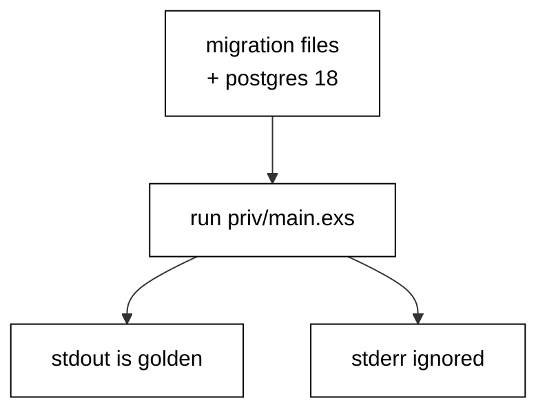

Prerequisites for this course: [just-enough-elixir](/en/learn/courses/just-enough-elixir/learning/overview) for basic syntax, functions, and modules, and [sql-essentials](/en/learn/courses/sql-essentials/learning/overview) for CREATE and ALTER TABLE. Comfort editing and running Elixir scripts from a terminal is assumed throughout, and every example builds only on the primers plus earlier examples in this course.

## Why this exists -- the big idea

**The problem before the solution**: teams evolve production databases with chat messages and ad-hoc SQL — nobody knows which changes ran where, rollbacks are improvised under pressure, and two developers' changes collide in the deploy queue. Ecto replaces folklore with artifacts: every change is a versioned file with a forward step and a reverse step, and the database itself records which files already ran.

**Keep this if you forget everything else**: A migration that cannot be rolled back safely is a migration that will eventually be run in production by accident.

## Tensions and trade-offs -- when NOT to reach for this

- **Small versus strict**: nullable columns land without disturbing traffic; NOT NULL, checks, and defaults constrain later once data complies. Each example names which side it takes and what the other side would cost, and Examples 33 and 41 collect the three-step and two-step shapes for going strict safely.
- **One migration versus many**: single-statement migrations minimize lock windows but multiply files; multi-step migrations read as one story but hold locks longer. The course defaults to small files and merges steps only when the steps genuinely share a deploy window.
- **When NOT**: throwaway exploration against a scratch database needs no versioning — create, poke, drop, done. Migrations earn their place when the database outlives the session: shared development databases, staging, and anything resembling production.

## Lineage -- where this tool sits

Ecto is the database layer for Elixir, and this course assumes both the Elixir primer and basic SQL DDL as background. The ORM and query-builder course teaches data access; this course teaches schema evolution — the versioned history that lets the schema change while the data and the traffic survive. Later data courses assume migrations exist and build pipelines, analytics, and services on top of versioned schemas.

## How this course is organized

[Beginner](/en/learn/courses/database-migrations-with-elixir-and-ecto/learning/beginner) (Examples 1–25) writes first migrations and rolls them back: file anatomy, chain ordering, history stamps, and rollback basics. [Intermediate](/en/learn/courses/database-migrations-with-elixir-and-ecto/learning/intermediate) (Examples 26–53) backfills data, splits breaking changes into zero-downtime steps, and adopts legacy databases with marks and drift checks. [Advanced](/en/learn/courses/database-migrations-with-elixir-and-ecto/learning/advanced) (Examples 54–78) resolves branch conflicts, shrinks locking blast radius, and diagnoses failures from the version table. The [capstone](/en/learn/courses/database-migrations-with-elixir-and-ecto/learning/capstone/overview) evolves an order-management schema through eight realistic migrations with a golden verification query, and [drilling](/en/learn/courses/database-migrations-with-elixir-and-ecto/drilling/overview) turns the sixteen concepts into recall, katas, and checklists.

## About the runtime

Every example runs as `mix run --no-compile priv/main.exs` in the pinned Elixir container against the real pinned PostgreSQL 18 service with a shared hash-locked dependency set (Ecto SQL, Postgrex): no mocks, no fixtures-as-data. Each example owns per-example tables and a per-example history table, drops leftovers before running, and cleans up after itself, so reruns are byte-stable. Migration files shown in a lesson are written by the program itself into a scratch script directory at runtime and executed for real. Standard output is the asserted golden transcript; standard error is ignored. Programs print labels, counts, and row values — never paths, timings, temp names, or migration noise — so reruns match byte for byte.

## Examples by Level

### Beginner (Examples 1–25)

- [Example 1: First Migration Creates a Table](/en/learn/courses/database-migrations-with-elixir-and-ecto/learning/beginner#example-1-first-migration-creates-a-table)
- [Example 2: Migration File Anatomy](/en/learn/courses/database-migrations-with-elixir-and-ecto/learning/beginner#example-2-migration-file-anatomy)
- [Example 3: Up Runs the Forward Change](/en/learn/courses/database-migrations-with-elixir-and-ecto/learning/beginner#example-3-up-runs-the-forward-change)
- [Example 4: Down Reverses the Change](/en/learn/courses/database-migrations-with-elixir-and-ecto/learning/beginner#example-4-down-reverses-the-change)
- [Example 5: Add a Column with Alter](/en/learn/courses/database-migrations-with-elixir-and-ecto/learning/beginner#example-5-add-a-column-with-alter)
- [Example 6: Create an Index](/en/learn/courses/database-migrations-with-elixir-and-ecto/learning/beginner#example-6-create-an-index)
- [Example 7: Modify Changes a Column Type](/en/learn/courses/database-migrations-with-elixir-and-ecto/learning/beginner#example-7-modify-changes-a-column-type)
- [Example 8: Rename a Column Safely](/en/learn/courses/database-migrations-with-elixir-and-ecto/learning/beginner#example-8-rename-a-column-safely)
- [Example 9: History Is a Line of Versions](/en/learn/courses/database-migrations-with-elixir-and-ecto/learning/beginner#example-9-history-is-a-line-of-versions)
- [Example 10: Status Shows What Ran](/en/learn/courses/database-migrations-with-elixir-and-ecto/learning/beginner#example-10-status-shows-what-ran)
- [Example 11: The History Table Records Runs](/en/learn/courses/database-migrations-with-elixir-and-ecto/learning/beginner#example-11-the-history-table-records-runs)
- [Example 12: Pending Means Not Yet Run](/en/learn/courses/database-migrations-with-elixir-and-ecto/learning/beginner#example-12-pending-means-not-yet-run)
- [Example 13: Run Up to a Specific Version](/en/learn/courses/database-migrations-with-elixir-and-ecto/learning/beginner#example-13-run-up-to-a-specific-version)
- [Example 14: Roll a Single Step Forward](/en/learn/courses/database-migrations-with-elixir-and-ecto/learning/beginner#example-14-roll-a-single-step-forward)
- [Example 15: Order Follows Versions Not Names](/en/learn/courses/database-migrations-with-elixir-and-ecto/learning/beginner#example-15-order-follows-versions-not-names)
- [Example 16: Duplicate Versions Raise an Error](/en/learn/courses/database-migrations-with-elixir-and-ecto/learning/beginner#example-16-duplicate-versions-raise-an-error)
- [Example 17: Reorder by Renaming the Version](/en/learn/courses/database-migrations-with-elixir-and-ecto/learning/beginner#example-17-reorder-by-renaming-the-version)
- [Example 18: Rollback Drops What Upgrade Added](/en/learn/courses/database-migrations-with-elixir-and-ecto/learning/beginner#example-18-rollback-drops-what-upgrade-added)
- [Example 19: Rollback Keeps Unrelated Data](/en/learn/courses/database-migrations-with-elixir-and-ecto/learning/beginner#example-19-rollback-keeps-unrelated-data)
- [Example 20: Stepwise Rollback Goes One Step](/en/learn/courses/database-migrations-with-elixir-and-ecto/learning/beginner#example-20-stepwise-rollback-goes-one-step)
- [Example 21: Roll Back to a Version](/en/learn/courses/database-migrations-with-elixir-and-ecto/learning/beginner#example-21-roll-back-to-a-version)
- [Example 22: Rerun Upgrade After Rollback](/en/learn/courses/database-migrations-with-elixir-and-ecto/learning/beginner#example-22-rerun-upgrade-after-rollback)
- [Example 23: Partial Rollback Then Upgrade Completes](/en/learn/courses/database-migrations-with-elixir-and-ecto/learning/beginner#example-23-partial-rollback-then-upgrade-completes)
- [Example 24: Idempotent Guards Survive Reruns](/en/learn/courses/database-migrations-with-elixir-and-ecto/learning/beginner#example-24-idempotent-guards-survive-reruns)
- [Example 25: Empty Database Migrates Cleanly](/en/learn/courses/database-migrations-with-elixir-and-ecto/learning/beginner#example-25-empty-database-migrates-cleanly)

### Intermediate (Examples 26–53)

- [Example 26: Backfill Fills the New Column](/en/learn/courses/database-migrations-with-elixir-and-ecto/learning/intermediate#example-26-backfill-fills-the-new-column)
- [Example 27: Schema First Data Second](/en/learn/courses/database-migrations-with-elixir-and-ecto/learning/intermediate#example-27-schema-first-data-second)
- [Example 28: Backfill in Batches](/en/learn/courses/database-migrations-with-elixir-and-ecto/learning/intermediate#example-28-backfill-in-batches)
- [Example 29: Backfill Down Clears the Fill](/en/learn/courses/database-migrations-with-elixir-and-ecto/learning/intermediate#example-29-backfill-down-clears-the-fill)
- [Example 30: Data Fix Inside a Revision](/en/learn/courses/database-migrations-with-elixir-and-ecto/learning/intermediate#example-30-data-fix-inside-a-revision)
- [Example 31: Verify Backfill Counts](/en/learn/courses/database-migrations-with-elixir-and-ecto/learning/intermediate#example-31-verify-backfill-counts)
- [Example 32: Backfill from a Join](/en/learn/courses/database-migrations-with-elixir-and-ecto/learning/intermediate#example-32-backfill-from-a-join)
- [Example 33: Default Then Backfill Then Not Null](/en/learn/courses/database-migrations-with-elixir-and-ecto/learning/intermediate#example-33-default-then-backfill-then-not-null)
- [Example 34: Split Schema and Data Revisions](/en/learn/courses/database-migrations-with-elixir-and-ecto/learning/intermediate#example-34-split-schema-and-data-revisions)
- [Example 35: Expand Adds the Column Safely](/en/learn/courses/database-migrations-with-elixir-and-ecto/learning/intermediate#example-35-expand-adds-the-column-safely)
- [Example 36: Dual Write Window](/en/learn/courses/database-migrations-with-elixir-and-ecto/learning/intermediate#example-36-dual-write-window)
- [Example 37: Migrate Reads to the New Column](/en/learn/courses/database-migrations-with-elixir-and-ecto/learning/intermediate#example-37-migrate-reads-to-the-new-column)
- [Example 38: Contract Drops the Old Column](/en/learn/courses/database-migrations-with-elixir-and-ecto/learning/intermediate#example-38-contract-drops-the-old-column)
- [Example 39: Rename in Three Deployable Steps](/en/learn/courses/database-migrations-with-elixir-and-ecto/learning/intermediate#example-39-rename-in-three-deployable-steps)
- [Example 40: Swap Columns Without Downtime](/en/learn/courses/database-migrations-with-elixir-and-ecto/learning/intermediate#example-40-swap-columns-without-downtime)
- [Example 41: Constraint Not Valid First](/en/learn/courses/database-migrations-with-elixir-and-ecto/learning/intermediate#example-41-constraint-not-valid-first)
- [Example 42: Deploy Order Matters](/en/learn/courses/database-migrations-with-elixir-and-ecto/learning/intermediate#example-42-deploy-order-matters)
- [Example 43: Rollback Plan for Every Step](/en/learn/courses/database-migrations-with-elixir-and-ecto/learning/intermediate#example-43-rollback-plan-for-every-step)
- [Example 44: Same Migrations Every Environment](/en/learn/courses/database-migrations-with-elixir-and-ecto/learning/intermediate#example-44-same-migrations-every-environment)
- [Example 45: Baseline Marks an Existing Database](/en/learn/courses/database-migrations-with-elixir-and-ecto/learning/intermediate#example-45-baseline-marks-an-existing-database)
- [Example 46: Mark Is Idempotent](/en/learn/courses/database-migrations-with-elixir-and-ecto/learning/intermediate#example-46-mark-is-idempotent)
- [Example 47: Adopt Legacy Data with a New Migration](/en/learn/courses/database-migrations-with-elixir-and-ecto/learning/intermediate#example-47-adopt-legacy-data-with-a-new-migration)
- [Example 48: Detect Schema Drift](/en/learn/courses/database-migrations-with-elixir-and-ecto/learning/intermediate#example-48-detect-schema-drift)
- [Example 49: Drift Report Table by Table](/en/learn/courses/database-migrations-with-elixir-and-ecto/learning/intermediate#example-49-drift-report-table-by-table)
- [Example 50: Catch Up a Drifted Column](/en/learn/courses/database-migrations-with-elixir-and-ecto/learning/intermediate#example-50-catch-up-a-drifted-column)
- [Example 51: Review a Migration Without Committing](/en/learn/courses/database-migrations-with-elixir-and-ecto/learning/intermediate#example-51-review-a-migration-without-committing)
- [Example 52: Guard a Deploy with a Status Check](/en/learn/courses/database-migrations-with-elixir-and-ecto/learning/intermediate#example-52-guard-a-deploy-with-a-status-check)
- [Example 53: Record File Hashes](/en/learn/courses/database-migrations-with-elixir-and-ecto/learning/intermediate#example-53-record-file-hashes)

### Advanced (Examples 54–78)

- [Example 54: Two Branches Two Versions](/en/learn/courses/database-migrations-with-elixir-and-ecto/learning/advanced#example-54-two-branches-two-versions)
- [Example 55: Same Timestamp Collides](/en/learn/courses/database-migrations-with-elixir-and-ecto/learning/advanced#example-55-same-timestamp-collides)
- [Example 56: Rename Resolves the Conflict](/en/learn/courses/database-migrations-with-elixir-and-ecto/learning/advanced#example-56-rename-resolves-the-conflict)
- [Example 57: Late File Runs on Arrival](/en/learn/courses/database-migrations-with-elixir-and-ecto/learning/advanced#example-57-late-file-runs-on-arrival)
- [Example 58: Merge Keeps One History](/en/learn/courses/database-migrations-with-elixir-and-ecto/learning/advanced#example-58-merge-keeps-one-history)
- [Example 59: Rebase onto Head](/en/learn/courses/database-migrations-with-elixir-and-ecto/learning/advanced#example-59-rebase-onto-head)
- [Example 60: Simultaneous Migrates Serialize](/en/learn/courses/database-migrations-with-elixir-and-ecto/learning/advanced#example-60-simultaneous-migrates-serialize)
- [Example 61: Down Then Up Replays Cleanly](/en/learn/courses/database-migrations-with-elixir-and-ecto/learning/advanced#example-61-down-then-up-replays-cleanly)
- [Example 62: Ddl Takes a Lock](/en/learn/courses/database-migrations-with-elixir-and-ecto/learning/advanced#example-62-ddl-takes-a-lock)
- [Example 63: Advisory Lock Primitive](/en/learn/courses/database-migrations-with-elixir-and-ecto/learning/advanced#example-63-advisory-lock-primitive)
- [Example 64: Locks Are Session Scoped](/en/learn/courses/database-migrations-with-elixir-and-ecto/learning/advanced#example-64-locks-are-session-scoped)
- [Example 65: Long Migration Holds the Table](/en/learn/courses/database-migrations-with-elixir-and-ecto/learning/advanced#example-65-long-migration-holds-the-table)
- [Example 66: Concurrent Index Skips the Ddl Transaction](/en/learn/courses/database-migrations-with-elixir-and-ecto/learning/advanced#example-66-concurrent-index-skips-the-ddl-transaction)
- [Example 67: Advisory Migration Lock in Config](/en/learn/courses/database-migrations-with-elixir-and-ecto/learning/advanced#example-67-advisory-migration-lock-in-config)
- [Example 68: Statement Timeout Bounds Locks](/en/learn/courses/database-migrations-with-elixir-and-ecto/learning/advanced#example-68-statement-timeout-bounds-locks)
- [Example 69: One Statement Per Migration](/en/learn/courses/database-migrations-with-elixir-and-ecto/learning/advanced#example-69-one-statement-per-migration)
- [Example 70: Blocked Lock Attempts Raise Fast](/en/learn/courses/database-migrations-with-elixir-and-ecto/learning/advanced#example-70-blocked-lock-attempts-raise-fast)
- [Example 71: Failing Statement Rolls Back](/en/learn/courses/database-migrations-with-elixir-and-ecto/learning/advanced#example-71-failing-statement-rolls-back)
- [Example 72: No Row Means It Never Ran](/en/learn/courses/database-migrations-with-elixir-and-ecto/learning/advanced#example-72-no-row-means-it-never-ran)
- [Example 73: Partial File Rolls Back Whole](/en/learn/courses/database-migrations-with-elixir-and-ecto/learning/advanced#example-73-partial-file-rolls-back-whole)
- [Example 74: Status Names the Failed File](/en/learn/courses/database-migrations-with-elixir-and-ecto/learning/advanced#example-74-status-names-the-failed-file)
- [Example 75: Rows Roll Back with the File](/en/learn/courses/database-migrations-with-elixir-and-ecto/learning/advanced#example-75-rows-roll-back-with-the-file)
- [Example 76: No Transaction Means No Rollback](/en/learn/courses/database-migrations-with-elixir-and-ecto/learning/advanced#example-76-no-transaction-means-no-rollback)
- [Example 77: Diagnose with Status and History](/en/learn/courses/database-migrations-with-elixir-and-ecto/learning/advanced#example-77-diagnose-with-status-and-history)
- [Example 78: Rehearse the Full Cycle](/en/learn/courses/database-migrations-with-elixir-and-ecto/learning/advanced#example-78-rehearse-the-full-cycle)
